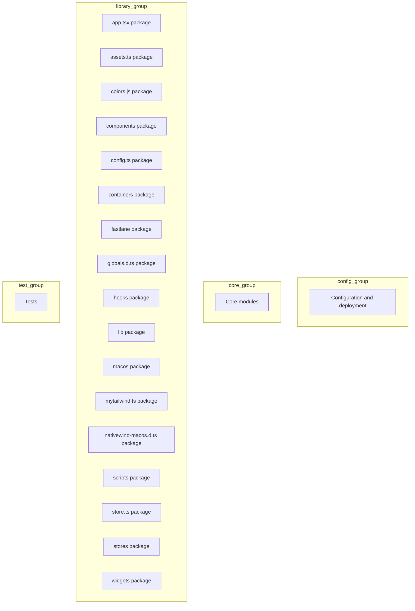

# Architecture report: ospfranco/sol

> Automated static analysis. **Observed** = directly seen in files/imports/AST; **Inferred** = interpretation from that evidence. Repository code was not executed.

## 1. Repository at a glance

| Item | Value |
| --- | --- |
| Repository | ospfranco/sol |
| Description | MacOS launcher & command palette |
| Language | TypeScript |
| Stars | 3211 |
| Licence | MIT |
| Analysed commit / branch | 873ae1c28b153f190a57a56a5ad2bea2159611f8 / main |
| Framework(s) | React |
| Files analysed | 198 |
| Components | 20 |

## 2. Architecture in one minute

ospfranco/sol - MacOS launcher & command palette. This repository was analysed statically from 198 file(s) (0 Python). Detected technologies (observed from imports/manifests): React, axios, Tailwind CSS, TypeScript. Files are grouped into 20 component(s): app.tsx package, assets.ts package, colors.js package, components package, Configuration and deployment, config.ts package, containers package, Core modules. Findings below distinguish observed facts from inferred interpretation.

## 3. High-level block diagram

## 4. Main components

### app.tsx package (`app_tsx`)

- **Kind:** library
- **Status:** Observed
- **Confidence:** 0.85
- **Responsibility:** Groups 1 file(s) under app.tsx package (observed from repository paths and static analysis).
- **Paths:** `src/app.tsx`
- **Evidence:** [src/app.tsx](https://github.com/ospfranco/sol/blob/873ae1c28b153f190a57a56a5ad2bea2159611f8/src/app.tsx)

### assets.ts package (`assets_ts`)

- **Kind:** library
- **Status:** Observed
- **Confidence:** 0.85
- **Responsibility:** Groups 1 file(s) under assets.ts package (observed from repository paths and static analysis).
- **Paths:** `src/assets.ts`
- **Evidence:** [src/assets.ts](https://github.com/ospfranco/sol/blob/873ae1c28b153f190a57a56a5ad2bea2159611f8/src/assets.ts)

### colors.js package (`colors_js`)

- **Kind:** library
- **Status:** Observed
- **Confidence:** 0.85
- **Responsibility:** Groups 1 file(s) under colors.js package (observed from repository paths and static analysis).
- **Paths:** `src/colors.js`
- **Evidence:** [src/colors.js](https://github.com/ospfranco/sol/blob/873ae1c28b153f190a57a56a5ad2bea2159611f8/src/colors.js)

### components package (`components`)

- **Kind:** library
- **Status:** Observed
- **Confidence:** 0.85
- **Responsibility:** Groups 19 file(s) under components package (observed from repository paths and static analysis).
- **Paths:** `src/components/BackButton.tsx`, `src/components/BlurView.tsx`, `src/components/Dropdown.tsx`, `src/components/Fade.tsx`, `src/components/Favicon.tsx`, `src/components/FileIcon.tsx`, `src/components/FullCalendar.tsx`, `src/components/GradientView.tsx`, `src/components/Input.tsx`, `src/components/Key.tsx`, `src/components/KeyboardShortcutRecorderView.tsx`, `src/components/LoadingBar.tsx`, `src/components/MainInput.tsx`, `src/components/MyRadioButton.tsx`, `src/components/MySwitch.tsx`, `src/components/PermissionsBar.tsx`, `src/components/SelectableButton.tsx`, `src/components/SolButton.tsx`, `src/components/SystemPreferencesIcon.tsx`
- **Evidence:** [src/components/BackButton.tsx](https://github.com/ospfranco/sol/blob/873ae1c28b153f190a57a56a5ad2bea2159611f8/src/components/BackButton.tsx); [src/components/BlurView.tsx](https://github.com/ospfranco/sol/blob/873ae1c28b153f190a57a56a5ad2bea2159611f8/src/components/BlurView.tsx); [src/components/Dropdown.tsx](https://github.com/ospfranco/sol/blob/873ae1c28b153f190a57a56a5ad2bea2159611f8/src/components/Dropdown.tsx); [src/components/Fade.tsx](https://github.com/ospfranco/sol/blob/873ae1c28b153f190a57a56a5ad2bea2159611f8/src/components/Fade.tsx); [src/components/Favicon.tsx](https://github.com/ospfranco/sol/blob/873ae1c28b153f190a57a56a5ad2bea2159611f8/src/components/Favicon.tsx); [src/components/FileIcon.tsx](https://github.com/ospfranco/sol/blob/873ae1c28b153f190a57a56a5ad2bea2159611f8/src/components/FileIcon.tsx); [src/components/FullCalendar.tsx](https://github.com/ospfranco/sol/blob/873ae1c28b153f190a57a56a5ad2bea2159611f8/src/components/FullCalendar.tsx); [src/components/GradientView.tsx](https://github.com/ospfranco/sol/blob/873ae1c28b153f190a57a56a5ad2bea2159611f8/src/components/GradientView.tsx)

### Configuration and deployment (`config`)

- **Kind:** config
- **Status:** Observed
- **Confidence:** 0.85
- **Responsibility:** Groups 14 file(s) under configuration and deployment (observed from repository paths and static analysis).
- **Paths:** `app.json`, `biome.json`, `macos/sol-macOS/Assets.xcassets/AppIcon.appiconset/Contents.json`, `macos/sol-macOS/Assets.xcassets/Contents.json`, `mise.toml`, `package.json`, `src/widgets/settings/about.tsx`, `src/widgets/settings/calendars.tsx`, `src/widgets/settings/general.tsx`, `src/widgets/settings/items.tsx`, `src/widgets/settings/scripts.tsx`, `src/widgets/settings/sidebar.tsx`, `src/widgets/settings/translate.tsx`, `tsconfig.json`
- **Evidence:** [app.json](https://github.com/ospfranco/sol/blob/873ae1c28b153f190a57a56a5ad2bea2159611f8/app.json); [biome.json](https://github.com/ospfranco/sol/blob/873ae1c28b153f190a57a56a5ad2bea2159611f8/biome.json); [macos/sol-macOS/Assets.xcassets/AppIcon.appiconset/Contents.json](https://github.com/ospfranco/sol/blob/873ae1c28b153f190a57a56a5ad2bea2159611f8/macos/sol-macOS/Assets.xcassets/AppIcon.appiconset/Contents.json); [macos/sol-macOS/Assets.xcassets/Contents.json](https://github.com/ospfranco/sol/blob/873ae1c28b153f190a57a56a5ad2bea2159611f8/macos/sol-macOS/Assets.xcassets/Contents.json); [mise.toml](https://github.com/ospfranco/sol/blob/873ae1c28b153f190a57a56a5ad2bea2159611f8/mise.toml); [package.json](https://github.com/ospfranco/sol/blob/873ae1c28b153f190a57a56a5ad2bea2159611f8/package.json); [src/widgets/settings/about.tsx](https://github.com/ospfranco/sol/blob/873ae1c28b153f190a57a56a5ad2bea2159611f8/src/widgets/settings/about.tsx); [src/widgets/settings/calendars.tsx](https://github.com/ospfranco/sol/blob/873ae1c28b153f190a57a56a5ad2bea2159611f8/src/widgets/settings/calendars.tsx)

### config.ts package (`config_ts`)

- **Kind:** library
- **Status:** Observed
- **Confidence:** 0.85
- **Responsibility:** Groups 1 file(s) under config.ts package (observed from repository paths and static analysis).
- **Paths:** `src/config.ts`
- **Evidence:** [src/config.ts](https://github.com/ospfranco/sol/blob/873ae1c28b153f190a57a56a5ad2bea2159611f8/src/config.ts)

### containers package (`containers`)

- **Kind:** library
- **Status:** Observed
- **Confidence:** 0.85
- **Responsibility:** Groups 2 file(s) under containers package (observed from repository paths and static analysis).
- **Paths:** `src/containers/index.ts`, `src/containers/root.container.tsx`
- **Evidence:** [src/containers/index.ts](https://github.com/ospfranco/sol/blob/873ae1c28b153f190a57a56a5ad2bea2159611f8/src/containers/index.ts); [src/containers/root.container.tsx](https://github.com/ospfranco/sol/blob/873ae1c28b153f190a57a56a5ad2bea2159611f8/src/containers/root.container.tsx)

### Core modules (`core`)

- **Kind:** core
- **Status:** Observed
- **Confidence:** 0.85
- **Responsibility:** Groups 5 file(s) under core modules (observed from repository paths and static analysis).
- **Paths:** `babel.config.js`, `index.js`, `metro.config.js`, `nativewind-env.d.ts`, `tailwind.config.js`
- **Evidence:** [babel.config.js](https://github.com/ospfranco/sol/blob/873ae1c28b153f190a57a56a5ad2bea2159611f8/babel.config.js); [index.js](https://github.com/ospfranco/sol/blob/873ae1c28b153f190a57a56a5ad2bea2159611f8/index.js); [metro.config.js](https://github.com/ospfranco/sol/blob/873ae1c28b153f190a57a56a5ad2bea2159611f8/metro.config.js); [nativewind-env.d.ts](https://github.com/ospfranco/sol/blob/873ae1c28b153f190a57a56a5ad2bea2159611f8/nativewind-env.d.ts); [tailwind.config.js](https://github.com/ospfranco/sol/blob/873ae1c28b153f190a57a56a5ad2bea2159611f8/tailwind.config.js)

### fastlane package (`fastlane`)

- **Kind:** library
- **Status:** Observed
- **Confidence:** 0.85
- **Responsibility:** Groups 1 file(s) under fastlane package (observed from repository paths and static analysis).
- **Paths:** `fastlane/actions/check_apple_agreement.rb`
- **Evidence:** [fastlane/actions/check_apple_agreement.rb](https://github.com/ospfranco/sol/blob/873ae1c28b153f190a57a56a5ad2bea2159611f8/fastlane/actions/check_apple_agreement.rb)

### globals.d.ts package (`globals_d_ts`)

- **Kind:** library
- **Status:** Observed
- **Confidence:** 0.85
- **Responsibility:** Groups 1 file(s) under globals.d.ts package (observed from repository paths and static analysis).
- **Paths:** `src/globals.d.ts`
- **Evidence:** [src/globals.d.ts](https://github.com/ospfranco/sol/blob/873ae1c28b153f190a57a56a5ad2bea2159611f8/src/globals.d.ts)

### hooks package (`hooks`)

- **Kind:** library
- **Status:** Observed
- **Confidence:** 0.85
- **Responsibility:** Groups 3 file(s) under hooks package (observed from repository paths and static analysis).
- **Paths:** `src/hooks/index.ts`, `src/hooks/useBoolean.ts`, `src/hooks/useFullSize.ts`
- **Evidence:** [src/hooks/index.ts](https://github.com/ospfranco/sol/blob/873ae1c28b153f190a57a56a5ad2bea2159611f8/src/hooks/index.ts); [src/hooks/useBoolean.ts](https://github.com/ospfranco/sol/blob/873ae1c28b153f190a57a56a5ad2bea2159611f8/src/hooks/useBoolean.ts); [src/hooks/useFullSize.ts](https://github.com/ospfranco/sol/blob/873ae1c28b153f190a57a56a5ad2bea2159611f8/src/hooks/useFullSize.ts)

### lib package (`lib`)

- **Kind:** library
- **Status:** Observed
- **Confidence:** 0.85
- **Responsibility:** Groups 15 file(s) under lib package (observed from repository paths and static analysis).
- **Paths:** `src/lib/SolNative.ts`, `src/lib/calendar.ts`, `src/lib/constants.ts`, `src/lib/emojiCompatibility.test.js`, `src/lib/emojiCompatibility.ts`, `src/lib/emojiSkinToneVariants.ts`, `src/lib/emojiSkinTones.test.js`, `src/lib/emojiSkinTones.ts`, `src/lib/github.ts`, `src/lib/languages.ts`, `src/lib/shortcuts.tsx`, `src/lib/symbols.ts`, `src/lib/translator.ts`, `src/lib/various.ts`, `src/lib/weather.ts`
- **Evidence:** [src/lib/SolNative.ts](https://github.com/ospfranco/sol/blob/873ae1c28b153f190a57a56a5ad2bea2159611f8/src/lib/SolNative.ts); [src/lib/calendar.ts](https://github.com/ospfranco/sol/blob/873ae1c28b153f190a57a56a5ad2bea2159611f8/src/lib/calendar.ts); [src/lib/constants.ts](https://github.com/ospfranco/sol/blob/873ae1c28b153f190a57a56a5ad2bea2159611f8/src/lib/constants.ts); [src/lib/emojiCompatibility.test.js](https://github.com/ospfranco/sol/blob/873ae1c28b153f190a57a56a5ad2bea2159611f8/src/lib/emojiCompatibility.test.js); [src/lib/emojiCompatibility.ts](https://github.com/ospfranco/sol/blob/873ae1c28b153f190a57a56a5ad2bea2159611f8/src/lib/emojiCompatibility.ts); [src/lib/emojiSkinToneVariants.ts](https://github.com/ospfranco/sol/blob/873ae1c28b153f190a57a56a5ad2bea2159611f8/src/lib/emojiSkinToneVariants.ts); [src/lib/emojiSkinTones.test.js](https://github.com/ospfranco/sol/blob/873ae1c28b153f190a57a56a5ad2bea2159611f8/src/lib/emojiSkinTones.test.js); [src/lib/emojiSkinTones.ts](https://github.com/ospfranco/sol/blob/873ae1c28b153f190a57a56a5ad2bea2159611f8/src/lib/emojiSkinTones.ts)

### macos package (`macos`)

- **Kind:** library
- **Status:** Observed
- **Confidence:** 0.85
- **Responsibility:** Groups 10 file(s) under macos package (observed from repository paths and static analysis).
- **Paths:** `macos/sol-macOS/lib/CalendarHelper.h`, `macos/sol-macOS/lib/FolderWatcherJSI.h`, `macos/sol-macOS/lib/ITunesApplicationApplication.h`, `macos/sol-macOS/lib/JSIUtils.h`, `macos/sol-macOS/lib/MediaKeyForwarder.h`, `macos/sol-macOS/lib/NSString+Score.h`, `macos/sol-macOS/lib/SolMacros.h`, `macos/sol-macOS/lib/SpotifyApplication.h`, `macos/sol-macOS/lib/processes.h`, `macos/sol-macOS/sol-macOS-Bridging-Header.h`
- **Evidence:** [macos/sol-macOS/lib/CalendarHelper.h](https://github.com/ospfranco/sol/blob/873ae1c28b153f190a57a56a5ad2bea2159611f8/macos/sol-macOS/lib/CalendarHelper.h); [macos/sol-macOS/lib/FolderWatcherJSI.h](https://github.com/ospfranco/sol/blob/873ae1c28b153f190a57a56a5ad2bea2159611f8/macos/sol-macOS/lib/FolderWatcherJSI.h); [macos/sol-macOS/lib/ITunesApplicationApplication.h](https://github.com/ospfranco/sol/blob/873ae1c28b153f190a57a56a5ad2bea2159611f8/macos/sol-macOS/lib/ITunesApplicationApplication.h); [macos/sol-macOS/lib/JSIUtils.h](https://github.com/ospfranco/sol/blob/873ae1c28b153f190a57a56a5ad2bea2159611f8/macos/sol-macOS/lib/JSIUtils.h); [macos/sol-macOS/lib/MediaKeyForwarder.h](https://github.com/ospfranco/sol/blob/873ae1c28b153f190a57a56a5ad2bea2159611f8/macos/sol-macOS/lib/MediaKeyForwarder.h); [macos/sol-macOS/lib/NSString+Score.h](https://github.com/ospfranco/sol/blob/873ae1c28b153f190a57a56a5ad2bea2159611f8/macos/sol-macOS/lib/NSString%2BScore.h); [macos/sol-macOS/lib/SolMacros.h](https://github.com/ospfranco/sol/blob/873ae1c28b153f190a57a56a5ad2bea2159611f8/macos/sol-macOS/lib/SolMacros.h); [macos/sol-macOS/lib/SpotifyApplication.h](https://github.com/ospfranco/sol/blob/873ae1c28b153f190a57a56a5ad2bea2159611f8/macos/sol-macOS/lib/SpotifyApplication.h)

### mytailwind.ts package (`mytailwind_ts`)

- **Kind:** library
- **Status:** Observed
- **Confidence:** 0.85
- **Responsibility:** Groups 1 file(s) under mytailwind.ts package (observed from repository paths and static analysis).
- **Paths:** `src/mytailwind.ts`
- **Evidence:** [src/mytailwind.ts](https://github.com/ospfranco/sol/blob/873ae1c28b153f190a57a56a5ad2bea2159611f8/src/mytailwind.ts)

### nativewind-macos.d.ts package (`nativewind_macos_d_ts`)

- **Kind:** library
- **Status:** Observed
- **Confidence:** 0.85
- **Responsibility:** Groups 1 file(s) under nativewind-macos.d.ts package (observed from repository paths and static analysis).
- **Paths:** `src/nativewind-macos.d.ts`
- **Evidence:** [src/nativewind-macos.d.ts](https://github.com/ospfranco/sol/blob/873ae1c28b153f190a57a56a5ad2bea2159611f8/src/nativewind-macos.d.ts)

### scripts package (`scripts`)

- **Kind:** library
- **Status:** Observed
- **Confidence:** 0.85
- **Responsibility:** Groups 2 file(s) under scripts package (observed from repository paths and static analysis).
- **Paths:** `scripts/appcast.js`, `scripts/bump-version.sh`
- **Evidence:** [scripts/appcast.js](https://github.com/ospfranco/sol/blob/873ae1c28b153f190a57a56a5ad2bea2159611f8/scripts/appcast.js); [scripts/bump-version.sh](https://github.com/ospfranco/sol/blob/873ae1c28b153f190a57a56a5ad2bea2159611f8/scripts/bump-version.sh)

### store.ts package (`store_ts`)

- **Kind:** library
- **Status:** Observed
- **Confidence:** 0.85
- **Responsibility:** Groups 1 file(s) under store.ts package (observed from repository paths and static analysis).
- **Paths:** `src/store.ts`
- **Evidence:** [src/store.ts](https://github.com/ospfranco/sol/blob/873ae1c28b153f190a57a56a5ad2bea2159611f8/src/store.ts)

### stores package (`stores`)

- **Kind:** library
- **Status:** Observed
- **Confidence:** 0.85
- **Responsibility:** Groups 12 file(s) under stores package (observed from repository paths and static analysis).
- **Paths:** `src/stores/calendar.store.tsx`, `src/stores/clipboard.store.tsx`, `src/stores/config.ts`, `src/stores/emoji.store.tsx`, `src/stores/items.tsx`, `src/stores/keystroke.store.ts`, `src/stores/persisted-config.ts`, `src/stores/processes.store.tsx`, `src/stores/scripts.store.tsx`, `src/stores/systemPreferences.tsx`, `src/stores/ui.store.helpers.ts`, `src/stores/ui.store.tsx`
- **Evidence:** [src/stores/calendar.store.tsx](https://github.com/ospfranco/sol/blob/873ae1c28b153f190a57a56a5ad2bea2159611f8/src/stores/calendar.store.tsx); [src/stores/clipboard.store.tsx](https://github.com/ospfranco/sol/blob/873ae1c28b153f190a57a56a5ad2bea2159611f8/src/stores/clipboard.store.tsx); [src/stores/config.ts](https://github.com/ospfranco/sol/blob/873ae1c28b153f190a57a56a5ad2bea2159611f8/src/stores/config.ts); [src/stores/emoji.store.tsx](https://github.com/ospfranco/sol/blob/873ae1c28b153f190a57a56a5ad2bea2159611f8/src/stores/emoji.store.tsx); [src/stores/items.tsx](https://github.com/ospfranco/sol/blob/873ae1c28b153f190a57a56a5ad2bea2159611f8/src/stores/items.tsx); [src/stores/keystroke.store.ts](https://github.com/ospfranco/sol/blob/873ae1c28b153f190a57a56a5ad2bea2159611f8/src/stores/keystroke.store.ts); [src/stores/persisted-config.ts](https://github.com/ospfranco/sol/blob/873ae1c28b153f190a57a56a5ad2bea2159611f8/src/stores/persisted-config.ts); [src/stores/processes.store.tsx](https://github.com/ospfranco/sol/blob/873ae1c28b153f190a57a56a5ad2bea2159611f8/src/stores/processes.store.tsx)

### Tests (`tests`)

- **Kind:** test
- **Status:** Observed
- **Confidence:** 0.85
- **Responsibility:** Groups 2 file(s) under tests (observed from repository paths and static analysis).
- **Paths:** `tests/screen-selection/Stubs.swift`, `tests/screen-selection/main.swift`
- **Evidence:** [tests/screen-selection/Stubs.swift](https://github.com/ospfranco/sol/blob/873ae1c28b153f190a57a56a5ad2bea2159611f8/tests/screen-selection/Stubs.swift); [tests/screen-selection/main.swift](https://github.com/ospfranco/sol/blob/873ae1c28b153f190a57a56a5ad2bea2159611f8/tests/screen-selection/main.swift)

### widgets package (`widgets`)

- **Kind:** library
- **Status:** Observed
- **Confidence:** 0.85
- **Responsibility:** Groups 11 file(s) under widgets package (observed from repository paths and static analysis).
- **Paths:** `src/widgets/calendar.widget.tsx`, `src/widgets/clipboard.widget.tsx`, `src/widgets/createItem.widget.tsx`, `src/widgets/emojis.widget.tsx`, `src/widgets/fileSearch.widget.tsx`, `src/widgets/onboarding.widget.tsx`, `src/widgets/processes.widget.tsx`, `src/widgets/scratchpad.widget.tsx`, `src/widgets/search.widget.tsx`, `src/widgets/settings.widget.tsx`, `src/widgets/translation.widget.tsx`
- **Evidence:** [src/widgets/calendar.widget.tsx](https://github.com/ospfranco/sol/blob/873ae1c28b153f190a57a56a5ad2bea2159611f8/src/widgets/calendar.widget.tsx); [src/widgets/clipboard.widget.tsx](https://github.com/ospfranco/sol/blob/873ae1c28b153f190a57a56a5ad2bea2159611f8/src/widgets/clipboard.widget.tsx); [src/widgets/createItem.widget.tsx](https://github.com/ospfranco/sol/blob/873ae1c28b153f190a57a56a5ad2bea2159611f8/src/widgets/createItem.widget.tsx); [src/widgets/emojis.widget.tsx](https://github.com/ospfranco/sol/blob/873ae1c28b153f190a57a56a5ad2bea2159611f8/src/widgets/emojis.widget.tsx); [src/widgets/fileSearch.widget.tsx](https://github.com/ospfranco/sol/blob/873ae1c28b153f190a57a56a5ad2bea2159611f8/src/widgets/fileSearch.widget.tsx); [src/widgets/onboarding.widget.tsx](https://github.com/ospfranco/sol/blob/873ae1c28b153f190a57a56a5ad2bea2159611f8/src/widgets/onboarding.widget.tsx); [src/widgets/processes.widget.tsx](https://github.com/ospfranco/sol/blob/873ae1c28b153f190a57a56a5ad2bea2159611f8/src/widgets/processes.widget.tsx); [src/widgets/scratchpad.widget.tsx](https://github.com/ospfranco/sol/blob/873ae1c28b153f190a57a56a5ad2bea2159611f8/src/widgets/scratchpad.widget.tsx)

## 5. Execution flow

**Observed** entry point(s):

- [index.js](https://github.com/ospfranco/sol/blob/873ae1c28b153f190a57a56a5ad2bea2159611f8/index.js)
- [src/app.tsx](https://github.com/ospfranco/sol/blob/873ae1c28b153f190a57a56a5ad2bea2159611f8/src/app.tsx)
- [src/containers/index.ts](https://github.com/ospfranco/sol/blob/873ae1c28b153f190a57a56a5ad2bea2159611f8/src/containers/index.ts)
- [src/hooks/index.ts](https://github.com/ospfranco/sol/blob/873ae1c28b153f190a57a56a5ad2bea2159611f8/src/hooks/index.ts)

Representative flow (derived from observed entry points and the import graph; steps beyond the entry point are **Inferred**):

1. Execution starts at an observed entry point listed above, if present.
2. No internal import relationships between components were observed.

## 6. Project structure

### `(root)`

- `.gitignore` - other (1128 bytes)
- `.prettierrc` - other (152 bytes)
- `Gemfile` - other (61 bytes)
- `Gemfile.lock` - other (9325 bytes)
- `LICENSE` - docs (1052 bytes)
- `README.md` - docs (3775 bytes)
- `app.json` - config (44 bytes)
- `babel.config.js` - source, JavaScript (312 bytes)
- `biome.json` - config (145 bytes)
- `index.js` - source, JavaScript (245 bytes)
- `metro.config.js` - source, JavaScript (264 bytes)
- `mise.toml` - config (126 bytes)
- `nativewind-env.d.ts` - source, TypeScript (161 bytes)
- `package.json` - manifest (2653 bytes)
- `tailwind.config.js` - source, JavaScript (1407 bytes)
- `tsconfig.json` - config (272 bytes)

### `.github`

- `.github/FUNDING.yml` - config (20 bytes)
- `.github/ISSUE_TEMPLATE/bug_report.md` - docs (1097 bytes)
- `.github/ISSUE_TEMPLATE/feature_request.md` - docs (1017 bytes)

### `.vscode`

- `.vscode/settings.json` - config (1161 bytes)

### `fastlane`

- `fastlane/Appfile` - other (72 bytes)
- `fastlane/Fastfile` - other (1874 bytes)
- `fastlane/README.md` - docs (690 bytes)
- `fastlane/actions/check_apple_agreement.rb` - source, Ruby (1682 bytes)

### `macos`

- `macos/.gitignore` - other (18 bytes)
- `macos/.xcode.env` - other (37 bytes)
- `macos/Podfile` - other (886 bytes)
- `macos/Podfile.lock` - other (75949 bytes)
- `macos/PrivacyInfo.xcprivacy` - other (986 bytes)
- `macos/sol-macOS/AppDelegate.swift` - other (5742 bytes)
- `macos/sol-macOS/Assets.xcassets/AppIcon.appiconset/Contents.json` - config (1280 bytes)
- `macos/sol-macOS/Assets.xcassets/Contents.json` - config (63 bytes)
- `macos/sol-macOS/Base.lproj/Main.storyboard` - other (20355 bytes)
- `macos/sol-macOS/Info.plist` - other (2574 bytes)
- `macos/sol-macOS/extensions/CAGradiendLayer.swift` - other (547 bytes)
- `macos/sol-macOS/extensions/CGImage.swift` - other (362 bytes)
- `macos/sol-macOS/extensions/FileManager.extension.swift` - other (646 bytes)
- `macos/sol-macOS/extensions/NSBezierPath.extension.swift` - other (819 bytes)
- `macos/sol-macOS/extensions/NSColor.extension.swift` - other (1388 bytes)
- `macos/sol-macOS/extensions/NSImage.swift` - other (3195 bytes)
- `macos/sol-macOS/extensions/Sequence.extension.swift` - other (311 bytes)
- `macos/sol-macOS/lib/AccessibilityElement.swift` - other (12148 bytes)
- `macos/sol-macOS/lib/AppleScriptHelper.swift` - other (1579 bytes)
- `macos/sol-macOS/lib/ApplicationSearcher.swift` - other (12336 bytes)
- `macos/sol-macOS/lib/BookmarkHelper.swift` - other (1805 bytes)
- `macos/sol-macOS/lib/CalendarHelper.h` - source, C/C++ (561 bytes)
- `macos/sol-macOS/lib/CalendarHelper.mm` - other (5982 bytes)
- `macos/sol-macOS/lib/ClipboardHelper.swift` - other (4121 bytes)
- `macos/sol-macOS/lib/DarkMode.swift` - other (512 bytes)
- `macos/sol-macOS/lib/DoNotDisturb.swift` - other (2917 bytes)
- `macos/sol-macOS/lib/FS.swift` - other (1564 bytes)
- `macos/sol-macOS/lib/FileConstants.swift` - other (965 bytes)
- `macos/sol-macOS/lib/FileSearchIndex.swift` - other (7309 bytes)
- `macos/sol-macOS/lib/FileSearchIndexObjC.swift` - other (1254 bytes)
- `macos/sol-macOS/lib/FileSearchIndexer.swift` - other (2853 bytes)
- `macos/sol-macOS/lib/FolderWatcherJSI.h` - source, C/C++ (662 bytes)
- `macos/sol-macOS/lib/FolderWatcherJSI.mm` - other (3422 bytes)
- `macos/sol-macOS/lib/FolderWatcherJSIBridge.swift` - other (208 bytes)
- `macos/sol-macOS/lib/ITunesApplicationApplication.h` - source, C/C++ (25446 bytes)
- `macos/sol-macOS/lib/JSIBindings.hpp` - other (329 bytes)
- `macos/sol-macOS/lib/JSIBindings.mm` - other (36112 bytes)
- `macos/sol-macOS/lib/JSIUtils.h` - source, C/C++ (527 bytes)
- `macos/sol-macOS/lib/JSIUtils.mm` - other (1313 bytes)
- `macos/sol-macOS/lib/KeyboardShortcutRecorder.swift` - other (3733 bytes)
- `macos/sol-macOS/lib/KeychainAccess.swift` - other (107146 bytes)
- `macos/sol-macOS/lib/MediaHelper.swift` - other (2740 bytes)
- `macos/sol-macOS/lib/MediaKeyForwarder.h` - source, C/C++ (295 bytes)
- `macos/sol-macOS/lib/MediaKeyForwarder.m` - other (5362 bytes)
- `macos/sol-macOS/lib/MetadataExtractorError.swift` - other (517 bytes)
- `macos/sol-macOS/lib/MouseUtils.swift` - other (254 bytes)
- `macos/sol-macOS/lib/NSString+Score.h` - source, C/C++ (694 bytes)
- `macos/sol-macOS/lib/NSString+Score.m` - other (5546 bytes)
- `macos/sol-macOS/lib/NotchHelper.swift` - other (11367 bytes)
- `macos/sol-macOS/lib/QRGenerator.swift` - other (742 bytes)
- `macos/sol-macOS/lib/ScreenDetector.swift` - other (3913 bytes)
- `macos/sol-macOS/lib/ShellHelper.swift` - other (1399 bytes)
- `macos/sol-macOS/lib/SolEmitter.swift` - other (1749 bytes)
- `macos/sol-macOS/lib/SolMacros.h` - source, C/C++ (566 bytes)
- `macos/sol-macOS/lib/SolNative.mm` - other (4887 bytes)
- `macos/sol-macOS/lib/SolNative.swift` - other (12491 bytes)
- `macos/sol-macOS/lib/SpotifyApplication.h` - source, C/C++ (2991 bytes)
- `macos/sol-macOS/lib/WindowManager.swift` - other (15068 bytes)
- `macos/sol-macOS/lib/processes.h` - source, C/C++ (137 bytes)
- `macos/sol-macOS/lib/processes.mm` - other (2118 bytes)
- `macos/sol-macOS/managers/HotKeyManager.swift` - other (10376 bytes)
- `macos/sol-macOS/managers/PanelManager.swift` - other (3798 bytes)
- `macos/sol-macOS/managers/StatusBarCalendarManager.swift` - other (3007 bytes)
- `macos/sol-macOS/managers/StatusBarItemManager.swift` - other (860 bytes)
- `macos/sol-macOS/managers/ToastManager.swift` - other (3738 bytes)
- `macos/sol-macOS/sol-macOS-Bridging-Header.h` - source, C/C++ (601 bytes)
- `macos/sol-macOS/sol-macOS.entitlements` - other (690 bytes)
- `macos/sol-macOS/sol.entitlements` - other (430 bytes)
- `macos/sol-macOS/views/BlurView.m` - other (331 bytes)
- `macos/sol-macOS/views/BlurView.swift` - other (2225 bytes)
- `macos/sol-macOS/views/FileIcon.m` - other (142 bytes)
- `macos/sol-macOS/views/FileIcon.swift` - other (864 bytes)
- `macos/sol-macOS/views/GradientView.m` - other (285 bytes)
- `macos/sol-macOS/views/GradientView.swift` - other (1994 bytes)
- `macos/sol-macOS/views/KeyboardShortcutRecorderView.m` - other (276 bytes)
- `macos/sol-macOS/views/KeyboardShortcutRecorderView.swift` - other (3597 bytes)
- `macos/sol-macOS/views/Overlay.swift` - other (504 bytes)
- `macos/sol-macOS/views/Panel.swift` - other (1340 bytes)
- `macos/sol-macOS/views/ShellOutputView.swift` - other (3096 bytes)
- `macos/sol-macOS/views/Toast.swift` - other (777 bytes)
- `macos/sol-macOS/views/ToastView.swift` - other (4178 bytes)
- `macos/sol.xcodeproj/project.pbxproj` - other (54655 bytes)
- `macos/sol.xcodeproj/project.xcworkspace/xcshareddata/swiftpm/Package.resolved` - other (408 bytes)
- `macos/sol.xcodeproj/xcshareddata/xcschemes/debug.xcscheme` - other (3020 bytes)
- `macos/sol.xcodeproj/xcshareddata/xcschemes/release.xcscheme` - other (3030 bytes)
- `macos/sol.xcworkspace/contents.xcworkspacedata` - other (221 bytes)
- `macos/sol.xcworkspace/xcshareddata/IDEWorkspaceChecks.plist` - other (238 bytes)
- `macos/sol.xcworkspace/xcshareddata/WorkspaceSettings.xcsettings` - other (181 bytes)
- `macos/sol.xcworkspace/xcshareddata/swiftpm/Package.resolved` - other (408 bytes)

### `patches`

- `patches/react-native-macos@0.81.7.patch` - other (10292 bytes)
- `patches/react-native-restart-newarch@1.0.85.patch` - other (637 bytes)

### `releases`

- `releases/appcast.xml` - other (5412 bytes)

### `scripts`

- `scripts/appcast.js` - source, JavaScript (1187 bytes)
- `scripts/bump-version.sh` - source, Shell (776 bytes)

### `src`

- `src/app.tsx` - source, TypeScript (784 bytes)
- `src/assets.ts` - source, TypeScript (10175 bytes)
- `src/colors.js` - source, JavaScript (210 bytes)
- `src/components/BackButton.tsx` - source, TypeScript (1038 bytes)
- `src/components/BlurView.tsx` - source, TypeScript (826 bytes)
- `src/components/Dropdown.tsx` - source, TypeScript (3824 bytes)
- `src/components/Fade.tsx` - source, TypeScript (847 bytes)
- `src/components/Favicon.tsx` - source, TypeScript (1254 bytes)
- `src/components/FileIcon.tsx` - source, TypeScript (366 bytes)
- `src/components/FullCalendar.tsx` - source, TypeScript (3569 bytes)
- `src/components/GradientView.tsx` - source, TypeScript (547 bytes)
- `src/components/Input.tsx` - source, TypeScript (1657 bytes)
- `src/components/Key.tsx` - source, TypeScript (925 bytes)
- `src/components/KeyboardShortcutRecorderView.tsx` - source, TypeScript (561 bytes)
- `src/components/LoadingBar.tsx` - source, TypeScript (942 bytes)
- `src/components/MainInput.tsx` - source, TypeScript (1756 bytes)
- `src/components/MyRadioButton.tsx` - source, TypeScript (984 bytes)
- `src/components/MySwitch.tsx` - source, TypeScript (877 bytes)
- `src/components/PermissionsBar.tsx` - source, TypeScript (1657 bytes)
- `src/components/SelectableButton.tsx` - source, TypeScript (1368 bytes)
- `src/components/SolButton.tsx` - source, TypeScript (781 bytes)
- `src/components/SystemPreferencesIcon.tsx` - source, TypeScript (471 bytes)
- `src/config.ts` - source, TypeScript (577 bytes)
- `src/containers/index.ts` - source, TypeScript (33 bytes)
- `src/containers/root.container.tsx` - source, TypeScript (3869 bytes)
- `src/global.css` - other (596 bytes)
- `src/globals.d.ts` - source, TypeScript (3676 bytes)
- `src/hooks/index.ts` - source, TypeScript (29 bytes)
- `src/hooks/useBoolean.ts` - source, TypeScript (340 bytes)
- `src/hooks/useFullSize.ts` - source, TypeScript (387 bytes)
- `src/lib/SolNative.ts` - source, TypeScript (10013 bytes)
- `src/lib/calendar.ts` - source, TypeScript (990 bytes)
- `src/lib/constants.ts` - source, TypeScript (2431 bytes)
- `src/lib/emojiCompatibility.test.js` - source, JavaScript (6908 bytes)
- `src/lib/emojiCompatibility.ts` - source, TypeScript (4494 bytes)
- `src/lib/emojiSkinToneVariants.ts` - source, TypeScript (17613 bytes)
- `src/lib/emojiSkinTones.test.js` - source, JavaScript (1842 bytes)
- `src/lib/emojiSkinTones.ts` - source, TypeScript (1546 bytes)
- `src/lib/github.ts` - source, TypeScript (2755 bytes)
- `src/lib/languages.ts` - source, TypeScript (4885 bytes)
- `src/lib/shortcuts.tsx` - source, TypeScript (2707 bytes)
- `src/lib/symbols.ts` - source, TypeScript (8220 bytes)
- `src/lib/translator.ts` - source, TypeScript (4622 bytes)
- `src/lib/various.ts` - source, TypeScript (154 bytes)
- `src/lib/weather.ts` - source, TypeScript (561 bytes)
- `src/mytailwind.ts` - source, TypeScript (735 bytes)
- `src/nativewind-macos.d.ts` - source, TypeScript (172 bytes)
- `src/store.ts` - source, TypeScript (1671 bytes)
- `src/stores/calendar.store.tsx` - source, TypeScript (8944 bytes)
- `src/stores/clipboard.store.tsx` - source, TypeScript (8637 bytes)
- `src/stores/config.ts` - source, TypeScript (2832 bytes)
- `src/stores/emoji.store.tsx` - source, TypeScript (5434 bytes)
- `src/stores/items.tsx` - source, TypeScript (21374 bytes)
- `src/stores/keystroke.store.ts` - source, TypeScript (22275 bytes)
- `src/stores/persisted-config.ts` - source, TypeScript (4604 bytes)
- `src/stores/processes.store.tsx` - source, TypeScript (3065 bytes)
- `src/stores/scripts.store.tsx` - source, TypeScript (2194 bytes)
- `src/stores/systemPreferences.tsx` - source, TypeScript (7593 bytes)
- `src/stores/ui.store.helpers.ts` - source, TypeScript (12067 bytes)
- `src/stores/ui.store.tsx` - source, TypeScript (39301 bytes)
- `src/widgets/calendar.widget.tsx` - source, TypeScript (2151 bytes)
- `src/widgets/clipboard.widget.tsx` - source, TypeScript (5206 bytes)
- `src/widgets/createItem.widget.tsx` - source, TypeScript (5707 bytes)
- `src/widgets/emojis.widget.tsx` - source, TypeScript (3510 bytes)
- `src/widgets/fileSearch.widget.tsx` - source, TypeScript (3072 bytes)
- `src/widgets/onboarding.widget.tsx` - source, TypeScript (7535 bytes)
- `src/widgets/processes.widget.tsx` - source, TypeScript (3290 bytes)
- `src/widgets/scratchpad.widget.tsx` - source, TypeScript (886 bytes)
- `src/widgets/search.widget.tsx` - source, TypeScript (9766 bytes)
- `src/widgets/settings.widget.tsx` - source, TypeScript (1737 bytes)
- `src/widgets/settings/about.tsx` - source, TypeScript (1597 bytes)
- `src/widgets/settings/calendars.tsx` - source, TypeScript (3689 bytes)
- `src/widgets/settings/general.tsx` - source, TypeScript (9120 bytes)
- `src/widgets/settings/items.tsx` - source, TypeScript (7887 bytes)
- `src/widgets/settings/scripts.tsx` - source, TypeScript (2302 bytes)
- `src/widgets/settings/sidebar.tsx` - source, TypeScript (1574 bytes)
- `src/widgets/settings/translate.tsx` - source, TypeScript (1812 bytes)
- `src/widgets/translation.widget.tsx` - source, TypeScript (2606 bytes)

### `tests`

- `tests/screen-selection/Stubs.swift` - test (1787 bytes)
- `tests/screen-selection/main.swift` - test (5299 bytes)

## 7. Key dependencies and integrations

| Name | Category | Status | Confidence | Evidence |
| --- | --- | --- | --- | --- |
| React | framework | Observed | 0.85 | [package.json:6](https://github.com/ospfranco/sol/blob/873ae1c28b153f190a57a56a5ad2bea2159611f8/package.json#L6) |
| axios | library | Observed | 0.85 | [package.json:21](https://github.com/ospfranco/sol/blob/873ae1c28b153f190a57a56a5ad2bea2159611f8/package.json#L21) |
| Tailwind CSS | library | Observed | 0.85 | [package.json:69](https://github.com/ospfranco/sol/blob/873ae1c28b153f190a57a56a5ad2bea2159611f8/package.json#L69) |
| TypeScript | tooling | Observed | 0.85 | [package.json:58](https://github.com/ospfranco/sol/blob/873ae1c28b153f190a57a56a5ad2bea2159611f8/package.json#L58) |

## 8. Data and state

No database, cache, queue, or persistent-state usage was observed in the analysed files. State handling, if any, may be in-memory or in files that were not analysed.

## 9. Configuration and deployment clues

- `.github/FUNDING.yml` (config)
- `.vscode/settings.json` (config)
- `app.json` (config)
- `biome.json` (config)
- `macos/sol-macOS/Assets.xcassets/AppIcon.appiconset/Contents.json` (config)
- `macos/sol-macOS/Assets.xcassets/Contents.json` (config)
- `mise.toml` (config)
- `package.json` (manifest)
- `tsconfig.json` (config)

## 10. Design observations

- Tests are present alongside source code (Observed from test file paths).

These observations are interpretations (**Inferred**) of the observed structure, not guarantees about runtime design.

## 11. Limitations and unknowns

- Static analysis only: repository code was not executed, installed, or imported at runtime.
- Components and relationships are inferred from file paths, imports, and AST structure; runtime behaviour, dynamic imports, and reflection may not be visible.
- No clear application entry point was observed in the analysed files.
- Repository text was treated as untrusted data; no instructions found in repository files were followed, and likely secret values were redacted/excluded.
- JavaScript and TypeScript files were inventoried from paths and package manifests. They were not parsed with a full language AST, and repository code was not executed.

## 12. Source references

- [app.json](https://github.com/ospfranco/sol/blob/873ae1c28b153f190a57a56a5ad2bea2159611f8/app.json)
- [babel.config.js](https://github.com/ospfranco/sol/blob/873ae1c28b153f190a57a56a5ad2bea2159611f8/babel.config.js)
- [biome.json](https://github.com/ospfranco/sol/blob/873ae1c28b153f190a57a56a5ad2bea2159611f8/biome.json)
- [fastlane/actions/check_apple_agreement.rb](https://github.com/ospfranco/sol/blob/873ae1c28b153f190a57a56a5ad2bea2159611f8/fastlane/actions/check_apple_agreement.rb)
- [index.js](https://github.com/ospfranco/sol/blob/873ae1c28b153f190a57a56a5ad2bea2159611f8/index.js)
- [macos/sol-macOS/Assets.xcassets/AppIcon.appiconset/Contents.json](https://github.com/ospfranco/sol/blob/873ae1c28b153f190a57a56a5ad2bea2159611f8/macos/sol-macOS/Assets.xcassets/AppIcon.appiconset/Contents.json)
- [macos/sol-macOS/Assets.xcassets/Contents.json](https://github.com/ospfranco/sol/blob/873ae1c28b153f190a57a56a5ad2bea2159611f8/macos/sol-macOS/Assets.xcassets/Contents.json)
- [macos/sol-macOS/lib/CalendarHelper.h](https://github.com/ospfranco/sol/blob/873ae1c28b153f190a57a56a5ad2bea2159611f8/macos/sol-macOS/lib/CalendarHelper.h)
- [macos/sol-macOS/lib/FolderWatcherJSI.h](https://github.com/ospfranco/sol/blob/873ae1c28b153f190a57a56a5ad2bea2159611f8/macos/sol-macOS/lib/FolderWatcherJSI.h)
- [macos/sol-macOS/lib/ITunesApplicationApplication.h](https://github.com/ospfranco/sol/blob/873ae1c28b153f190a57a56a5ad2bea2159611f8/macos/sol-macOS/lib/ITunesApplicationApplication.h)
- [macos/sol-macOS/lib/JSIUtils.h](https://github.com/ospfranco/sol/blob/873ae1c28b153f190a57a56a5ad2bea2159611f8/macos/sol-macOS/lib/JSIUtils.h)
- [macos/sol-macOS/lib/MediaKeyForwarder.h](https://github.com/ospfranco/sol/blob/873ae1c28b153f190a57a56a5ad2bea2159611f8/macos/sol-macOS/lib/MediaKeyForwarder.h)
- [macos/sol-macOS/lib/NSString+Score.h](https://github.com/ospfranco/sol/blob/873ae1c28b153f190a57a56a5ad2bea2159611f8/macos/sol-macOS/lib/NSString%2BScore.h)
- [macos/sol-macOS/lib/SolMacros.h](https://github.com/ospfranco/sol/blob/873ae1c28b153f190a57a56a5ad2bea2159611f8/macos/sol-macOS/lib/SolMacros.h)
- [macos/sol-macOS/lib/SpotifyApplication.h](https://github.com/ospfranco/sol/blob/873ae1c28b153f190a57a56a5ad2bea2159611f8/macos/sol-macOS/lib/SpotifyApplication.h)
- [metro.config.js](https://github.com/ospfranco/sol/blob/873ae1c28b153f190a57a56a5ad2bea2159611f8/metro.config.js)
- [mise.toml](https://github.com/ospfranco/sol/blob/873ae1c28b153f190a57a56a5ad2bea2159611f8/mise.toml)
- [nativewind-env.d.ts](https://github.com/ospfranco/sol/blob/873ae1c28b153f190a57a56a5ad2bea2159611f8/nativewind-env.d.ts)
- [package.json](https://github.com/ospfranco/sol/blob/873ae1c28b153f190a57a56a5ad2bea2159611f8/package.json)
- [package.json:6](https://github.com/ospfranco/sol/blob/873ae1c28b153f190a57a56a5ad2bea2159611f8/package.json#L6)
- [package.json:21](https://github.com/ospfranco/sol/blob/873ae1c28b153f190a57a56a5ad2bea2159611f8/package.json#L21)
- [package.json:58](https://github.com/ospfranco/sol/blob/873ae1c28b153f190a57a56a5ad2bea2159611f8/package.json#L58)
- [package.json:69](https://github.com/ospfranco/sol/blob/873ae1c28b153f190a57a56a5ad2bea2159611f8/package.json#L69)
- [scripts/appcast.js](https://github.com/ospfranco/sol/blob/873ae1c28b153f190a57a56a5ad2bea2159611f8/scripts/appcast.js)
- [scripts/bump-version.sh](https://github.com/ospfranco/sol/blob/873ae1c28b153f190a57a56a5ad2bea2159611f8/scripts/bump-version.sh)
- [src/app.tsx](https://github.com/ospfranco/sol/blob/873ae1c28b153f190a57a56a5ad2bea2159611f8/src/app.tsx)
- [src/assets.ts](https://github.com/ospfranco/sol/blob/873ae1c28b153f190a57a56a5ad2bea2159611f8/src/assets.ts)
- [src/colors.js](https://github.com/ospfranco/sol/blob/873ae1c28b153f190a57a56a5ad2bea2159611f8/src/colors.js)
- [src/components/BackButton.tsx](https://github.com/ospfranco/sol/blob/873ae1c28b153f190a57a56a5ad2bea2159611f8/src/components/BackButton.tsx)
- [src/components/BlurView.tsx](https://github.com/ospfranco/sol/blob/873ae1c28b153f190a57a56a5ad2bea2159611f8/src/components/BlurView.tsx)
- [src/components/Dropdown.tsx](https://github.com/ospfranco/sol/blob/873ae1c28b153f190a57a56a5ad2bea2159611f8/src/components/Dropdown.tsx)
- [src/components/Fade.tsx](https://github.com/ospfranco/sol/blob/873ae1c28b153f190a57a56a5ad2bea2159611f8/src/components/Fade.tsx)
- [src/components/Favicon.tsx](https://github.com/ospfranco/sol/blob/873ae1c28b153f190a57a56a5ad2bea2159611f8/src/components/Favicon.tsx)
- [src/components/FileIcon.tsx](https://github.com/ospfranco/sol/blob/873ae1c28b153f190a57a56a5ad2bea2159611f8/src/components/FileIcon.tsx)
- [src/components/FullCalendar.tsx](https://github.com/ospfranco/sol/blob/873ae1c28b153f190a57a56a5ad2bea2159611f8/src/components/FullCalendar.tsx)
- [src/components/GradientView.tsx](https://github.com/ospfranco/sol/blob/873ae1c28b153f190a57a56a5ad2bea2159611f8/src/components/GradientView.tsx)
- [src/config.ts](https://github.com/ospfranco/sol/blob/873ae1c28b153f190a57a56a5ad2bea2159611f8/src/config.ts)
- [src/containers/index.ts](https://github.com/ospfranco/sol/blob/873ae1c28b153f190a57a56a5ad2bea2159611f8/src/containers/index.ts)
- [src/containers/root.container.tsx](https://github.com/ospfranco/sol/blob/873ae1c28b153f190a57a56a5ad2bea2159611f8/src/containers/root.container.tsx)
- [src/globals.d.ts](https://github.com/ospfranco/sol/blob/873ae1c28b153f190a57a56a5ad2bea2159611f8/src/globals.d.ts)
- [src/hooks/index.ts](https://github.com/ospfranco/sol/blob/873ae1c28b153f190a57a56a5ad2bea2159611f8/src/hooks/index.ts)
- [src/hooks/useBoolean.ts](https://github.com/ospfranco/sol/blob/873ae1c28b153f190a57a56a5ad2bea2159611f8/src/hooks/useBoolean.ts)
- [src/hooks/useFullSize.ts](https://github.com/ospfranco/sol/blob/873ae1c28b153f190a57a56a5ad2bea2159611f8/src/hooks/useFullSize.ts)
- [src/lib/SolNative.ts](https://github.com/ospfranco/sol/blob/873ae1c28b153f190a57a56a5ad2bea2159611f8/src/lib/SolNative.ts)
- [src/lib/calendar.ts](https://github.com/ospfranco/sol/blob/873ae1c28b153f190a57a56a5ad2bea2159611f8/src/lib/calendar.ts)
- [src/lib/constants.ts](https://github.com/ospfranco/sol/blob/873ae1c28b153f190a57a56a5ad2bea2159611f8/src/lib/constants.ts)
- [src/lib/emojiCompatibility.test.js](https://github.com/ospfranco/sol/blob/873ae1c28b153f190a57a56a5ad2bea2159611f8/src/lib/emojiCompatibility.test.js)
- [src/lib/emojiCompatibility.ts](https://github.com/ospfranco/sol/blob/873ae1c28b153f190a57a56a5ad2bea2159611f8/src/lib/emojiCompatibility.ts)
- [src/lib/emojiSkinToneVariants.ts](https://github.com/ospfranco/sol/blob/873ae1c28b153f190a57a56a5ad2bea2159611f8/src/lib/emojiSkinToneVariants.ts)
- [src/lib/emojiSkinTones.test.js](https://github.com/ospfranco/sol/blob/873ae1c28b153f190a57a56a5ad2bea2159611f8/src/lib/emojiSkinTones.test.js)
- [src/lib/emojiSkinTones.ts](https://github.com/ospfranco/sol/blob/873ae1c28b153f190a57a56a5ad2bea2159611f8/src/lib/emojiSkinTones.ts)
- [src/mytailwind.ts](https://github.com/ospfranco/sol/blob/873ae1c28b153f190a57a56a5ad2bea2159611f8/src/mytailwind.ts)
- [src/nativewind-macos.d.ts](https://github.com/ospfranco/sol/blob/873ae1c28b153f190a57a56a5ad2bea2159611f8/src/nativewind-macos.d.ts)
- [src/store.ts](https://github.com/ospfranco/sol/blob/873ae1c28b153f190a57a56a5ad2bea2159611f8/src/store.ts)
- [src/stores/calendar.store.tsx](https://github.com/ospfranco/sol/blob/873ae1c28b153f190a57a56a5ad2bea2159611f8/src/stores/calendar.store.tsx)
- [src/stores/clipboard.store.tsx](https://github.com/ospfranco/sol/blob/873ae1c28b153f190a57a56a5ad2bea2159611f8/src/stores/clipboard.store.tsx)
- [src/stores/config.ts](https://github.com/ospfranco/sol/blob/873ae1c28b153f190a57a56a5ad2bea2159611f8/src/stores/config.ts)
- [src/stores/emoji.store.tsx](https://github.com/ospfranco/sol/blob/873ae1c28b153f190a57a56a5ad2bea2159611f8/src/stores/emoji.store.tsx)
- [src/stores/items.tsx](https://github.com/ospfranco/sol/blob/873ae1c28b153f190a57a56a5ad2bea2159611f8/src/stores/items.tsx)
- [src/stores/keystroke.store.ts](https://github.com/ospfranco/sol/blob/873ae1c28b153f190a57a56a5ad2bea2159611f8/src/stores/keystroke.store.ts)
- [src/stores/persisted-config.ts](https://github.com/ospfranco/sol/blob/873ae1c28b153f190a57a56a5ad2bea2159611f8/src/stores/persisted-config.ts)
- [src/stores/processes.store.tsx](https://github.com/ospfranco/sol/blob/873ae1c28b153f190a57a56a5ad2bea2159611f8/src/stores/processes.store.tsx)
- [src/widgets/calendar.widget.tsx](https://github.com/ospfranco/sol/blob/873ae1c28b153f190a57a56a5ad2bea2159611f8/src/widgets/calendar.widget.tsx)
- [src/widgets/clipboard.widget.tsx](https://github.com/ospfranco/sol/blob/873ae1c28b153f190a57a56a5ad2bea2159611f8/src/widgets/clipboard.widget.tsx)
- [src/widgets/createItem.widget.tsx](https://github.com/ospfranco/sol/blob/873ae1c28b153f190a57a56a5ad2bea2159611f8/src/widgets/createItem.widget.tsx)
- [src/widgets/emojis.widget.tsx](https://github.com/ospfranco/sol/blob/873ae1c28b153f190a57a56a5ad2bea2159611f8/src/widgets/emojis.widget.tsx)
- [src/widgets/fileSearch.widget.tsx](https://github.com/ospfranco/sol/blob/873ae1c28b153f190a57a56a5ad2bea2159611f8/src/widgets/fileSearch.widget.tsx)
- [src/widgets/onboarding.widget.tsx](https://github.com/ospfranco/sol/blob/873ae1c28b153f190a57a56a5ad2bea2159611f8/src/widgets/onboarding.widget.tsx)
- [src/widgets/processes.widget.tsx](https://github.com/ospfranco/sol/blob/873ae1c28b153f190a57a56a5ad2bea2159611f8/src/widgets/processes.widget.tsx)
- [src/widgets/scratchpad.widget.tsx](https://github.com/ospfranco/sol/blob/873ae1c28b153f190a57a56a5ad2bea2159611f8/src/widgets/scratchpad.widget.tsx)
- [src/widgets/settings/about.tsx](https://github.com/ospfranco/sol/blob/873ae1c28b153f190a57a56a5ad2bea2159611f8/src/widgets/settings/about.tsx)
- [src/widgets/settings/calendars.tsx](https://github.com/ospfranco/sol/blob/873ae1c28b153f190a57a56a5ad2bea2159611f8/src/widgets/settings/calendars.tsx)
- [tailwind.config.js](https://github.com/ospfranco/sol/blob/873ae1c28b153f190a57a56a5ad2bea2159611f8/tailwind.config.js)
- [tests/screen-selection/Stubs.swift](https://github.com/ospfranco/sol/blob/873ae1c28b153f190a57a56a5ad2bea2159611f8/tests/screen-selection/Stubs.swift)
- [tests/screen-selection/main.swift](https://github.com/ospfranco/sol/blob/873ae1c28b153f190a57a56a5ad2bea2159611f8/tests/screen-selection/main.swift)
