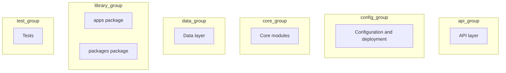

# Architecture report: pacexy/flow

> Automated static analysis. **Observed** = directly seen in files/imports/AST; **Inferred** = interpretation from that evidence. Repository code was not executed.

## 1. Repository at a glance

| Item | Value |
| --- | --- |
| Repository | pacexy/flow |
| Description | Browser-based ePub reader |
| Language | TypeScript |
| Stars | 3385 |
| Licence | AGPL-3.0 |
| Analysed commit / branch | 36f3cc7c4581f62ff6d72b75641c674020bb1e9f / main |
| Framework(s) | Next.js, React |
| Files analysed | 296 |
| Components | 7 |

## 2. Architecture in one minute

pacexy/flow - Browser-based ePub reader. This repository was analysed statically from 296 file(s) (0 Python). Detected technologies (observed from imports/manifests): Next.js, React, Tailwind CSS, Docker, Docker Compose, TypeScript. Files are grouped into 7 component(s): API layer, apps package, Configuration and deployment, Core modules, Data layer, packages package, Tests. Findings below distinguish observed facts from inferred interpretation.

## 3. High-level block diagram

## 4. Main components

### API layer (`api_layer`)

- **Kind:** api
- **Status:** Observed
- **Confidence:** 0.85
- **Responsibility:** Groups 5 file(s) under api layer (observed from repository paths and static analysis).
- **Paths:** `apps/reader/src/pages/api/callback/[provider].ts`, `apps/reader/src/pages/api/refresh.ts`, `apps/reader/src/pages/api/utils.ts`, `packages/epubjs/src/managers/views/iframe.js`, `packages/epubjs/src/managers/views/inline.js`
- **Evidence:** [apps/reader/src/pages/api/callback/[provider].ts](https://github.com/pacexy/flow/blob/36f3cc7c4581f62ff6d72b75641c674020bb1e9f/apps/reader/src/pages/api/callback/%5Bprovider%5D.ts); [apps/reader/src/pages/api/refresh.ts](https://github.com/pacexy/flow/blob/36f3cc7c4581f62ff6d72b75641c674020bb1e9f/apps/reader/src/pages/api/refresh.ts); [apps/reader/src/pages/api/utils.ts](https://github.com/pacexy/flow/blob/36f3cc7c4581f62ff6d72b75641c674020bb1e9f/apps/reader/src/pages/api/utils.ts); [packages/epubjs/src/managers/views/iframe.js](https://github.com/pacexy/flow/blob/36f3cc7c4581f62ff6d72b75641c674020bb1e9f/packages/epubjs/src/managers/views/iframe.js); [packages/epubjs/src/managers/views/inline.js](https://github.com/pacexy/flow/blob/36f3cc7c4581f62ff6d72b75641c674020bb1e9f/packages/epubjs/src/managers/views/inline.js)

### apps package (`apps`)

- **Kind:** library
- **Status:** Observed
- **Confidence:** 0.85
- **Responsibility:** Groups 92 file(s) under apps package (observed from repository paths and static analysis).
- **Paths:** `apps/reader/.eslintrc.js`, `apps/reader/locales/de-DE.ts`, `apps/reader/locales/en-US.ts`, `apps/reader/locales/index.ts`, `apps/reader/locales/ja-JP.ts`, `apps/reader/locales/zh-CN.ts`, `apps/reader/next-env.d.ts`, `apps/reader/next.config.js`, `apps/reader/postcss.config.js`, `apps/reader/sentry.client.config.js`, `apps/reader/sentry.server.config.js`, `apps/reader/src/annotation.ts`, `apps/reader/src/color.ts`, `apps/reader/src/components/Annotation.tsx`, `apps/reader/src/components/Button.tsx`, `apps/reader/src/components/ErrorBoundary.tsx`, `apps/reader/src/components/Form.tsx`, `apps/reader/src/components/Layout.tsx`, `apps/reader/src/components/Page.tsx`, `apps/reader/src/components/Reader.tsx`, `apps/reader/src/components/Row.tsx`, `apps/reader/src/components/Tab.tsx`, `apps/reader/src/components/TextSelectionMenu.tsx`, `apps/reader/src/components/Theme.tsx`, `apps/reader/src/components/base/ActionBar.tsx`, `apps/reader/src/components/base/ContextView.tsx`, `apps/reader/src/components/base/DropZone.tsx`, `apps/reader/src/components/base/GridView.tsx`, `apps/reader/src/components/base/PaneView.tsx`, `apps/reader/src/components/base/SplitView.tsx`, `apps/reader/src/components/base/index.ts`, `apps/reader/src/components/index.ts`, `apps/reader/src/components/pages/index.ts`, `apps/reader/src/components/pages/settings.tsx`, `apps/reader/src/components/viewlets/AnnotationView.tsx`, `apps/reader/src/components/viewlets/ImageView.tsx`, `apps/reader/src/components/viewlets/SearchView.tsx`, `apps/reader/src/components/viewlets/ThemeView.tsx`, `apps/reader/src/components/viewlets/TimelineView.tsx`, `apps/reader/src/components/viewlets/TocView.tsx`, `apps/reader/src/components/viewlets/TypographyView.tsx`, `apps/reader/src/db.ts`, `apps/reader/src/dropbox.d.ts`, `apps/reader/src/file.ts`, `apps/reader/src/hooks/index.ts`, `apps/reader/src/hooks/remote/index.ts`, `apps/reader/src/hooks/remote/useRemote.ts`, `apps/reader/src/hooks/remote/useSync.ts`, `apps/reader/src/hooks/theme/index.ts`, `apps/reader/src/hooks/theme/useBackground.ts`, `apps/reader/src/hooks/theme/useColorScheme.ts`, `apps/reader/src/hooks/theme/useSourceColor.ts`, `apps/reader/src/hooks/theme/useTheme.ts`, `apps/reader/src/hooks/useAction.ts`, `apps/reader/src/hooks/useAsync.ts`, `apps/reader/src/hooks/useDisablePinchZooming.ts`, `apps/reader/src/hooks/useEnv.ts`, `apps/reader/src/hooks/useForceRender.ts`, `apps/reader/src/hooks/useLibrary.ts`, `apps/reader/src/hooks/useList.ts`, `apps/reader/src/hooks/useMobile.ts`, `apps/reader/src/hooks/useTextSelection.ts`, `apps/reader/src/hooks/useTranslation.ts`, `apps/reader/src/hooks/useTypography.ts`, `apps/reader/src/mime.ts`, `apps/reader/src/pages/_.tsx`, `apps/reader/src/pages/_app.tsx`, `apps/reader/src/pages/_document.tsx`, `apps/reader/src/pages/_error.js`, `apps/reader/src/pages/index.tsx`, `apps/reader/src/pages/success.tsx`, `apps/reader/src/platform.ts`, `apps/reader/src/state.ts`, `apps/reader/src/styles.ts`, `apps/reader/src/sync.ts`, `apps/reader/src/utils.ts`, `apps/reader/src/web.d.ts`, `apps/reader/tailwind.config.js`, `apps/website/.eslintrc.js`, `apps/website/i18n.js`, `apps/website/next-env.d.ts`, `apps/website/next.config.js`, `apps/website/plugins/mdx.js`, `apps/website/postcss.config.js`, `apps/website/src/components/Layout.tsx`, `apps/website/src/components/MDX.tsx`, `apps/website/src/components/Seo.tsx`, `apps/website/src/components/index.ts`, `apps/website/src/pages/_app.tsx`, `apps/website/src/pages/_document.tsx`, `apps/website/src/pages/index.tsx`, `apps/website/tailwind.config.js`
- **Evidence:** [apps/reader/.eslintrc.js](https://github.com/pacexy/flow/blob/36f3cc7c4581f62ff6d72b75641c674020bb1e9f/apps/reader/.eslintrc.js); [apps/reader/locales/de-DE.ts](https://github.com/pacexy/flow/blob/36f3cc7c4581f62ff6d72b75641c674020bb1e9f/apps/reader/locales/de-DE.ts); [apps/reader/locales/en-US.ts](https://github.com/pacexy/flow/blob/36f3cc7c4581f62ff6d72b75641c674020bb1e9f/apps/reader/locales/en-US.ts); [apps/reader/locales/index.ts](https://github.com/pacexy/flow/blob/36f3cc7c4581f62ff6d72b75641c674020bb1e9f/apps/reader/locales/index.ts); [apps/reader/locales/ja-JP.ts](https://github.com/pacexy/flow/blob/36f3cc7c4581f62ff6d72b75641c674020bb1e9f/apps/reader/locales/ja-JP.ts); [apps/reader/locales/zh-CN.ts](https://github.com/pacexy/flow/blob/36f3cc7c4581f62ff6d72b75641c674020bb1e9f/apps/reader/locales/zh-CN.ts); [apps/reader/next-env.d.ts](https://github.com/pacexy/flow/blob/36f3cc7c4581f62ff6d72b75641c674020bb1e9f/apps/reader/next-env.d.ts); [apps/reader/next.config.js](https://github.com/pacexy/flow/blob/36f3cc7c4581f62ff6d72b75641c674020bb1e9f/apps/reader/next.config.js)

### Configuration and deployment (`config`)

- **Kind:** config
- **Status:** Observed
- **Confidence:** 0.85
- **Responsibility:** Groups 30 file(s) under configuration and deployment (observed from repository paths and static analysis).
- **Paths:** `Dockerfile`, `apps/reader/netlify.toml`, `apps/reader/package.json`, `apps/reader/public/manifest.json`, `apps/reader/tsconfig.json`, `apps/website/locales/en-US.json`, `apps/website/locales/ja-JP.json`, `apps/website/locales/zh-CN.json`, `apps/website/netlify.toml`, `apps/website/package.json`, `apps/website/tsconfig.json`, `docker-compose.yml`, `package.json`, `packages/epubjs/.babelrc.json`, `packages/epubjs/.travis.yml`, `packages/epubjs/bower.json`, `packages/epubjs/documentation.yml`, `packages/epubjs/package.json`, `packages/epubjs/tsconfig.json`, `packages/epubjs/types/tsconfig.json`, `packages/epubjs/types/tslint.json`, `packages/internal/package.json`, `packages/internal/tsconfig.json`, `packages/tailwind/package.json`, `pnpm-workspace.yaml`, `tsconfig.json`, `tsconfig.next.json`, `tsconfig.react.json`, `tsconfig.ts.json`, `turbo.json`
- **Evidence:** [Dockerfile](https://github.com/pacexy/flow/blob/36f3cc7c4581f62ff6d72b75641c674020bb1e9f/Dockerfile); [apps/reader/netlify.toml](https://github.com/pacexy/flow/blob/36f3cc7c4581f62ff6d72b75641c674020bb1e9f/apps/reader/netlify.toml); [apps/reader/package.json](https://github.com/pacexy/flow/blob/36f3cc7c4581f62ff6d72b75641c674020bb1e9f/apps/reader/package.json); [apps/reader/public/manifest.json](https://github.com/pacexy/flow/blob/36f3cc7c4581f62ff6d72b75641c674020bb1e9f/apps/reader/public/manifest.json); [apps/reader/tsconfig.json](https://github.com/pacexy/flow/blob/36f3cc7c4581f62ff6d72b75641c674020bb1e9f/apps/reader/tsconfig.json); [apps/website/locales/en-US.json](https://github.com/pacexy/flow/blob/36f3cc7c4581f62ff6d72b75641c674020bb1e9f/apps/website/locales/en-US.json); [apps/website/locales/ja-JP.json](https://github.com/pacexy/flow/blob/36f3cc7c4581f62ff6d72b75641c674020bb1e9f/apps/website/locales/ja-JP.json); [apps/website/locales/zh-CN.json](https://github.com/pacexy/flow/blob/36f3cc7c4581f62ff6d72b75641c674020bb1e9f/apps/website/locales/zh-CN.json)

### Core modules (`core`)

- **Kind:** core
- **Status:** Observed
- **Confidence:** 0.85
- **Responsibility:** Groups 1 file(s) under core modules (observed from repository paths and static analysis).
- **Paths:** `prettier.config.js`
- **Evidence:** [prettier.config.js](https://github.com/pacexy/flow/blob/36f3cc7c4581f62ff6d72b75641c674020bb1e9f/prettier.config.js)

### Data layer (`data_layer`)

- **Kind:** data
- **Status:** Observed
- **Confidence:** 0.85
- **Responsibility:** Groups 3 file(s) under data layer (observed from repository paths and static analysis).
- **Paths:** `apps/reader/src/models/index.ts`, `apps/reader/src/models/reader.ts`, `apps/reader/src/models/tree.ts`
- **Evidence:** [apps/reader/src/models/index.ts](https://github.com/pacexy/flow/blob/36f3cc7c4581f62ff6d72b75641c674020bb1e9f/apps/reader/src/models/index.ts); [apps/reader/src/models/reader.ts](https://github.com/pacexy/flow/blob/36f3cc7c4581f62ff6d72b75641c674020bb1e9f/apps/reader/src/models/reader.ts); [apps/reader/src/models/tree.ts](https://github.com/pacexy/flow/blob/36f3cc7c4581f62ff6d72b75641c674020bb1e9f/apps/reader/src/models/tree.ts)

### packages package (`packages`)

- **Kind:** library
- **Status:** Observed
- **Confidence:** 0.85
- **Responsibility:** Groups 80 file(s) under packages package (observed from repository paths and static analysis).
- **Paths:** `packages/epubjs/.eslintrc.js`, `packages/epubjs/examples/hypothesis.js`, `packages/epubjs/karma.conf.js`, `packages/epubjs/src/annotations.js`, `packages/epubjs/src/archive.js`, `packages/epubjs/src/book.js`, `packages/epubjs/src/container.js`, `packages/epubjs/src/contents.js`, `packages/epubjs/src/displayoptions.js`, `packages/epubjs/src/epub.js`, `packages/epubjs/src/epubcfi.js`, `packages/epubjs/src/index.js`, `packages/epubjs/src/layout.js`, `packages/epubjs/src/locations.js`, `packages/epubjs/src/managers/continuous/index.js`, `packages/epubjs/src/managers/default/index.js`, `packages/epubjs/src/managers/helpers/snap.js`, `packages/epubjs/src/managers/helpers/stage.js`, `packages/epubjs/src/managers/helpers/views.js`, `packages/epubjs/src/mapping.js`, `packages/epubjs/src/navigation.js`, `packages/epubjs/src/packaging.js`, `packages/epubjs/src/pagelist.js`, `packages/epubjs/src/rendition.js`, `packages/epubjs/src/resources.js`, `packages/epubjs/src/section.js`, `packages/epubjs/src/spine.js`, `packages/epubjs/src/store.js`, `packages/epubjs/src/themes.js`, `packages/epubjs/src/utils/constants.js`, `packages/epubjs/src/utils/core.js`, `packages/epubjs/src/utils/hook.js`, `packages/epubjs/src/utils/mime.js`, `packages/epubjs/src/utils/path.js`, `packages/epubjs/src/utils/queue.js`, `packages/epubjs/src/utils/replacements.js`, `packages/epubjs/src/utils/request.js`, `packages/epubjs/src/utils/scrolltype.js`, `packages/epubjs/src/utils/url.js`, `packages/epubjs/types/annotations.d.ts`, `packages/epubjs/types/archive.d.ts`, `packages/epubjs/types/book.d.ts`, `packages/epubjs/types/container.d.ts`, `packages/epubjs/types/contents.d.ts`, `packages/epubjs/types/core.d.ts`, `packages/epubjs/types/epub.d.ts`, `packages/epubjs/types/epubcfi.d.ts`, `packages/epubjs/types/epubjs-tests.ts`, `packages/epubjs/types/index.d.ts`, `packages/epubjs/types/layout.d.ts`, `packages/epubjs/types/locations.d.ts`, `packages/epubjs/types/managers/manager.d.ts`, `packages/epubjs/types/managers/view.d.ts`, `packages/epubjs/types/mapping.d.ts`, `packages/epubjs/types/navigation.d.ts`, `packages/epubjs/types/packaging.d.ts`, `packages/epubjs/types/pagelist.d.ts`, `packages/epubjs/types/rendition.ts`, `packages/epubjs/types/resources.d.ts`, `packages/epubjs/types/section.d.ts`, `packages/epubjs/types/spine.d.ts`, `packages/epubjs/types/store.d.ts`, `packages/epubjs/types/themes.d.ts`, `packages/epubjs/types/utils/constants.d.ts`, `packages/epubjs/types/utils/core.d.ts`, `packages/epubjs/types/utils/hook.d.ts`, `packages/epubjs/types/utils/path.d.ts`, `packages/epubjs/types/utils/queue.d.ts`, `packages/epubjs/types/utils/replacements.d.ts`, `packages/epubjs/types/utils/request.d.ts`, `packages/epubjs/types/utils/scrolltype.d.ts`, `packages/epubjs/types/utils/url.d.ts`, `packages/epubjs/webpack.config.js`, `packages/internal/src/index.ts`, `packages/internal/src/lib.ts`, `packages/tailwind/src/colors.js`, `packages/tailwind/src/elevation.js`, `packages/tailwind/src/index.js`, `packages/tailwind/src/state.js`, `packages/tailwind/src/typography.js`
- **Evidence:** [packages/epubjs/.eslintrc.js](https://github.com/pacexy/flow/blob/36f3cc7c4581f62ff6d72b75641c674020bb1e9f/packages/epubjs/.eslintrc.js); [packages/epubjs/examples/hypothesis.js](https://github.com/pacexy/flow/blob/36f3cc7c4581f62ff6d72b75641c674020bb1e9f/packages/epubjs/examples/hypothesis.js); [packages/epubjs/karma.conf.js](https://github.com/pacexy/flow/blob/36f3cc7c4581f62ff6d72b75641c674020bb1e9f/packages/epubjs/karma.conf.js); [packages/epubjs/src/annotations.js](https://github.com/pacexy/flow/blob/36f3cc7c4581f62ff6d72b75641c674020bb1e9f/packages/epubjs/src/annotations.js); [packages/epubjs/src/archive.js](https://github.com/pacexy/flow/blob/36f3cc7c4581f62ff6d72b75641c674020bb1e9f/packages/epubjs/src/archive.js); [packages/epubjs/src/book.js](https://github.com/pacexy/flow/blob/36f3cc7c4581f62ff6d72b75641c674020bb1e9f/packages/epubjs/src/book.js); [packages/epubjs/src/container.js](https://github.com/pacexy/flow/blob/36f3cc7c4581f62ff6d72b75641c674020bb1e9f/packages/epubjs/src/container.js); [packages/epubjs/src/contents.js](https://github.com/pacexy/flow/blob/36f3cc7c4581f62ff6d72b75641c674020bb1e9f/packages/epubjs/src/contents.js)

### Tests (`tests`)

- **Kind:** test
- **Status:** Observed
- **Confidence:** 0.85
- **Responsibility:** Groups 30 file(s) under tests (observed from repository paths and static analysis).
- **Paths:** `packages/epubjs/test/book.js`, `packages/epubjs/test/core.js`, `packages/epubjs/test/epub.js`, `packages/epubjs/test/epubcfi.js`, `packages/epubjs/test/fixtures/alice/META-INF/container.xml`, `packages/epubjs/test/fixtures/alice/OPS/chapter_001.xhtml`, `packages/epubjs/test/fixtures/alice/OPS/chapter_002.xhtml`, `packages/epubjs/test/fixtures/alice/OPS/chapter_003.xhtml`, `packages/epubjs/test/fixtures/alice/OPS/chapter_004.xhtml`, `packages/epubjs/test/fixtures/alice/OPS/chapter_005.xhtml`, `packages/epubjs/test/fixtures/alice/OPS/chapter_006.xhtml`, `packages/epubjs/test/fixtures/alice/OPS/chapter_007.xhtml`, `packages/epubjs/test/fixtures/alice/OPS/chapter_008.xhtml`, `packages/epubjs/test/fixtures/alice/OPS/chapter_009.xhtml`, `packages/epubjs/test/fixtures/alice/OPS/chapter_010.xhtml`, `packages/epubjs/test/fixtures/alice/OPS/cover.xhtml`, `packages/epubjs/test/fixtures/alice/OPS/css/stylesheet.css`, `packages/epubjs/test/fixtures/alice/OPS/package.opf`, `packages/epubjs/test/fixtures/alice/OPS/titlepage.xhtml`, `packages/epubjs/test/fixtures/alice/OPS/toc.xhtml`, `packages/epubjs/test/fixtures/alice/mimetype`, `packages/epubjs/test/fixtures/chapter1-highlights.xhtml`, `packages/epubjs/test/fixtures/chapter1.xhtml`, `packages/epubjs/test/fixtures/highlight.xhtml`, `packages/epubjs/test/fixtures/locations.xhtml`, `packages/epubjs/test/index.html`, `packages/epubjs/test/locations.js`, `packages/epubjs/test/old/epub.js`, `packages/epubjs/test/old/rendering.js`, `packages/epubjs/test/section.js`
- **Evidence:** [packages/epubjs/test/book.js](https://github.com/pacexy/flow/blob/36f3cc7c4581f62ff6d72b75641c674020bb1e9f/packages/epubjs/test/book.js); [packages/epubjs/test/core.js](https://github.com/pacexy/flow/blob/36f3cc7c4581f62ff6d72b75641c674020bb1e9f/packages/epubjs/test/core.js); [packages/epubjs/test/epub.js](https://github.com/pacexy/flow/blob/36f3cc7c4581f62ff6d72b75641c674020bb1e9f/packages/epubjs/test/epub.js); [packages/epubjs/test/epubcfi.js](https://github.com/pacexy/flow/blob/36f3cc7c4581f62ff6d72b75641c674020bb1e9f/packages/epubjs/test/epubcfi.js); [packages/epubjs/test/fixtures/alice/META-INF/container.xml](https://github.com/pacexy/flow/blob/36f3cc7c4581f62ff6d72b75641c674020bb1e9f/packages/epubjs/test/fixtures/alice/META-INF/container.xml); [packages/epubjs/test/fixtures/alice/OPS/chapter_001.xhtml](https://github.com/pacexy/flow/blob/36f3cc7c4581f62ff6d72b75641c674020bb1e9f/packages/epubjs/test/fixtures/alice/OPS/chapter_001.xhtml); [packages/epubjs/test/fixtures/alice/OPS/chapter_002.xhtml](https://github.com/pacexy/flow/blob/36f3cc7c4581f62ff6d72b75641c674020bb1e9f/packages/epubjs/test/fixtures/alice/OPS/chapter_002.xhtml); [packages/epubjs/test/fixtures/alice/OPS/chapter_003.xhtml](https://github.com/pacexy/flow/blob/36f3cc7c4581f62ff6d72b75641c674020bb1e9f/packages/epubjs/test/fixtures/alice/OPS/chapter_003.xhtml)

## 5. Execution flow

**Observed** entry point(s):

- [apps/reader/locales/index.ts](https://github.com/pacexy/flow/blob/36f3cc7c4581f62ff6d72b75641c674020bb1e9f/apps/reader/locales/index.ts)
- [packages/epubjs/src/index.js](https://github.com/pacexy/flow/blob/36f3cc7c4581f62ff6d72b75641c674020bb1e9f/packages/epubjs/src/index.js)
- [packages/internal/src/index.ts](https://github.com/pacexy/flow/blob/36f3cc7c4581f62ff6d72b75641c674020bb1e9f/packages/internal/src/index.ts)
- [packages/tailwind/src/index.js](https://github.com/pacexy/flow/blob/36f3cc7c4581f62ff6d72b75641c674020bb1e9f/packages/tailwind/src/index.js)

Representative flow (derived from observed entry points and the import graph; steps beyond the entry point are **Inferred**):

1. Execution starts at an observed entry point listed above, if present.
2. No internal import relationships between components were observed.

## 6. Project structure

### `(root)`

- `.dockerignore` - container (43 bytes)
- `.eslintrc.js` - source, JavaScript (1356 bytes)
- `.gitattributes` - other (37 bytes)
- `.gitignore` - other (454 bytes)
- `AGENTS.md` - docs (2291 bytes)
- `Dockerfile` - container (1668 bytes)
- `LICENSE` - docs (34523 bytes)
- `README.md` - docs (1907 bytes)
- `docker-compose.yml` - container (218 bytes)
- `package.json` - manifest (1289 bytes)
- `pnpm-workspace.yaml` - config (40 bytes)
- `prettier.config.js` - source, JavaScript (134 bytes)
- `tsconfig.json` - config (701 bytes)
- `tsconfig.next.json` - config (551 bytes)
- `tsconfig.react.json` - config (261 bytes)
- `tsconfig.ts.json` - config (219 bytes)
- `turbo.json` - config (173 bytes)

### `.github`

- `.github/FUNDING.yml` - config (817 bytes)

### `.husky`

- `.husky/pre-commit` - other (59 bytes)

### `.vscode`

- `.vscode/settings.json` - config (517 bytes)

### `apps`

- `apps/reader/.eslintrc.js` - source, JavaScript (376 bytes)
- `apps/reader/.gitignore` - other (22 bytes)
- `apps/reader/locales/de-DE.ts` - source, TypeScript (2533 bytes)
- `apps/reader/locales/en-US.ts` - source, TypeScript (2374 bytes)
- `apps/reader/locales/index.ts` - source, TypeScript (487 bytes)
- `apps/reader/locales/ja-JP.ts` - source, TypeScript (2637 bytes)
- `apps/reader/locales/zh-CN.ts` - source, TypeScript (2331 bytes)
- `apps/reader/netlify.toml` - config (409 bytes)
- `apps/reader/next-env.d.ts` - source, TypeScript (201 bytes)
- `apps/reader/next.config.js` - source, JavaScript (1776 bytes)
- `apps/reader/package.json` - manifest (1887 bytes)
- `apps/reader/postcss.config.js` - source, JavaScript (82 bytes)
- `apps/reader/public/manifest.json` - config (966 bytes)
- `apps/reader/sentry.client.config.js` - source, JavaScript (770 bytes)
- `apps/reader/sentry.properties` - other (74 bytes)
- `apps/reader/sentry.server.config.js` - source, JavaScript (780 bytes)
- `apps/reader/src/annotation.ts` - source, TypeScript (812 bytes)
- `apps/reader/src/color.ts` - source, TypeScript (787 bytes)
- `apps/reader/src/components/Annotation.tsx` - source, TypeScript (4314 bytes)
- `apps/reader/src/components/Button.tsx` - source, TypeScript (1140 bytes)
- `apps/reader/src/components/ErrorBoundary.tsx` - source, TypeScript (692 bytes)
- `apps/reader/src/components/Form.tsx` - source, TypeScript (4795 bytes)
- `apps/reader/src/components/Layout.tsx` - source, TypeScript (7971 bytes)
- `apps/reader/src/components/Page.tsx` - source, TypeScript (527 bytes)
- `apps/reader/src/components/Reader.tsx` - source, TypeScript (13102 bytes)
- `apps/reader/src/components/Row.tsx` - source, TypeScript (3361 bytes)
- `apps/reader/src/components/Tab.tsx` - source, TypeScript (2001 bytes)
- `apps/reader/src/components/TextSelectionMenu.tsx` - source, TypeScript (9127 bytes)
- `apps/reader/src/components/Theme.tsx` - source, TypeScript (2134 bytes)
- `apps/reader/src/components/base/ActionBar.tsx` - source, TypeScript (775 bytes)
- `apps/reader/src/components/base/ContextView.excalidraw` - other (22873 bytes)
- `apps/reader/src/components/base/ContextView.tsx` - source, TypeScript (1757 bytes)
- `apps/reader/src/components/base/DropZone.tsx` - source, TypeScript (4100 bytes)
- `apps/reader/src/components/base/GridView.tsx` - source, TypeScript (107 bytes)
- `apps/reader/src/components/base/PaneView.tsx` - source, TypeScript (2424 bytes)
- `apps/reader/src/components/base/SplitView.tsx` - source, TypeScript (4893 bytes)
- `apps/reader/src/components/base/index.ts` - source, TypeScript (167 bytes)
- `apps/reader/src/components/index.ts` - source, TypeScript (333 bytes)
- `apps/reader/src/components/pages/index.ts` - source, TypeScript (27 bytes)
- `apps/reader/src/components/pages/settings.tsx` - source, TypeScript (4275 bytes)
- `apps/reader/src/components/viewlets/AnnotationView.tsx` - source, TypeScript (4242 bytes)
- `apps/reader/src/components/viewlets/ImageView.tsx` - source, TypeScript (1913 bytes)
- `apps/reader/src/components/viewlets/SearchView.tsx` - source, TypeScript (4439 bytes)
- `apps/reader/src/components/viewlets/ThemeView.tsx` - source, TypeScript (1917 bytes)
- `apps/reader/src/components/viewlets/TimelineView.tsx` - source, TypeScript (1416 bytes)
- `apps/reader/src/components/viewlets/TocView.tsx` - source, TypeScript (3429 bytes)
- `apps/reader/src/components/viewlets/TypographyView.tsx` - source, TypeScript (6445 bytes)
- `apps/reader/src/db.ts` - source, TypeScript (3078 bytes)
- `apps/reader/src/dropbox.d.ts` - source, TypeScript (287 bytes)
- `apps/reader/src/file.ts` - source, TypeScript (2318 bytes)
- `apps/reader/src/hooks/index.ts` - source, TypeScript (386 bytes)
- `apps/reader/src/hooks/remote/index.ts` - source, TypeScript (54 bytes)
- `apps/reader/src/hooks/remote/useRemote.ts` - source, TypeScript (385 bytes)
- `apps/reader/src/hooks/remote/useSync.ts` - source, TypeScript (1560 bytes)
- `apps/reader/src/hooks/theme/index.ts` - source, TypeScript (125 bytes)
- `apps/reader/src/hooks/theme/useBackground.ts` - source, TypeScript (1429 bytes)
- `apps/reader/src/hooks/theme/useColorScheme.ts` - source, TypeScript (677 bytes)
- `apps/reader/src/hooks/theme/useSourceColor.ts` - source, TypeScript (467 bytes)
- `apps/reader/src/hooks/theme/useTheme.ts` - source, TypeScript (353 bytes)
- `apps/reader/src/hooks/useAction.ts` - source, TypeScript (425 bytes)
- `apps/reader/src/hooks/useAsync.ts` - source, TypeScript (378 bytes)
- `apps/reader/src/hooks/useDisablePinchZooming.ts` - source, TypeScript (626 bytes)
- `apps/reader/src/hooks/useEnv.ts` - source, TypeScript (197 bytes)
- `apps/reader/src/hooks/useForceRender.ts` - source, TypeScript (172 bytes)
- `apps/reader/src/hooks/useLibrary.ts` - source, TypeScript (166 bytes)
- `apps/reader/src/hooks/useList.ts` - source, TypeScript (285 bytes)
- `apps/reader/src/hooks/useMobile.ts` - source, TypeScript (551 bytes)
- `apps/reader/src/hooks/useTextSelection.ts` - source, TypeScript (1650 bytes)
- `apps/reader/src/hooks/useTranslation.ts` - source, TypeScript (368 bytes)
- `apps/reader/src/hooks/useTypography.ts` - source, TypeScript (688 bytes)
- `apps/reader/src/mime.ts` - source, TypeScript (200 bytes)
- `apps/reader/src/models/index.ts` - source, TypeScript (48 bytes)
- `apps/reader/src/models/reader.ts` - source, TypeScript (15074 bytes)
- `apps/reader/src/models/tree.ts` - source, TypeScript (829 bytes)
- `apps/reader/src/pages/_.tsx` - source, TypeScript (50 bytes)
- `apps/reader/src/pages/_app.tsx` - source, TypeScript (865 bytes)
- `apps/reader/src/pages/_document.tsx` - source, TypeScript (2973 bytes)
- `apps/reader/src/pages/_error.js` - source, JavaScript (1502 bytes)
- `apps/reader/src/pages/api/callback/[provider].ts` - source, TypeScript (855 bytes)
- `apps/reader/src/pages/api/refresh.ts` - source, TypeScript (553 bytes)
- `apps/reader/src/pages/api/utils.ts` - source, TypeScript (177 bytes)
- `apps/reader/src/pages/index.tsx` - source, TypeScript (13139 bytes)
- `apps/reader/src/pages/styles.css` - other (2012 bytes)
- `apps/reader/src/pages/success.tsx` - source, TypeScript (925 bytes)
- `apps/reader/src/platform.ts` - source, TypeScript (318 bytes)
- `apps/reader/src/state.ts` - source, TypeScript (1405 bytes)
- `apps/reader/src/styles.ts` - source, TypeScript (1888 bytes)
- `apps/reader/src/sync.ts` - source, TypeScript (3462 bytes)
- `apps/reader/src/utils.ts` - source, TypeScript (590 bytes)
- `apps/reader/src/web.d.ts` - source, TypeScript (506 bytes)
- `apps/reader/tailwind.config.js` - source, JavaScript (340 bytes)
- `apps/reader/tsconfig.json` - config (193 bytes)
- `apps/website/.eslintrc.js` - source, JavaScript (225 bytes)
- `apps/website/i18n.js` - source, JavaScript (468 bytes)
- `apps/website/locales/en-US.json` - config (3082 bytes)
- `apps/website/locales/ja-JP.json` - config (3965 bytes)
- `apps/website/locales/zh-CN.json` - config (3017 bytes)
- `apps/website/netlify.toml` - config (411 bytes)
- `apps/website/next-env.d.ts` - source, TypeScript (201 bytes)
- `apps/website/next.config.js` - source, JavaScript (1538 bytes)
- `apps/website/package.json` - manifest (1235 bytes)
- `apps/website/plugins/mdx.js` - source, JavaScript (363 bytes)
- `apps/website/postcss.config.js` - source, JavaScript (82 bytes)
- `apps/website/src/components/Layout.tsx` - source, TypeScript (3643 bytes)
- `apps/website/src/components/MDX.tsx` - source, TypeScript (960 bytes)
- `apps/website/src/components/Seo.tsx` - source, TypeScript (605 bytes)
- `apps/website/src/components/index.ts` - source, TypeScript (69 bytes)
- `apps/website/src/pages/_app.tsx` - source, TypeScript (521 bytes)
- `apps/website/src/pages/_document.tsx` - source, TypeScript (1331 bytes)
- `apps/website/src/pages/index.tsx` - source, TypeScript (2612 bytes)
- `apps/website/src/pages/privacy.mdx` - other (29048 bytes)
- `apps/website/src/pages/refund.mdx` - other (250 bytes)
- `apps/website/src/pages/styles.css` - other (95 bytes)
- `apps/website/src/pages/terms.mdx` - other (39929 bytes)
- `apps/website/tailwind.config.js` - source, JavaScript (471 bytes)
- `apps/website/tsconfig.json` - config (155 bytes)

### `packages`

- `packages/epubjs/.babelrc.json` - config (351 bytes)
- `packages/epubjs/.eslintrc.js` - source, JavaScript (163 bytes)
- `packages/epubjs/.gitignore` - other (124 bytes)
- `packages/epubjs/.jshintrc` - other (336 bytes)
- `packages/epubjs/.nojekyll` - other (0 bytes)
- `packages/epubjs/.npmignore` - other (20 bytes)
- `packages/epubjs/.travis.yml` - ci, YAML (167 bytes)
- `packages/epubjs/.watchmanconfig` - other (58 bytes)
- `packages/epubjs/README.md` - docs (6650 bytes)
- `packages/epubjs/bower.json` - config (709 bytes)
- `packages/epubjs/documentation.yml` - config (79 bytes)
- `packages/epubjs/documentation/md/API.md` - docs (76765 bytes)
- `packages/epubjs/examples/annotator.html` - other (2691 bytes)
- `packages/epubjs/examples/archived.html` - other (1539 bytes)
- `packages/epubjs/examples/contents.html` - other (715 bytes)
- `packages/epubjs/examples/continuous-scrolled.html` - other (1575 bytes)
- `packages/epubjs/examples/continuous-spreads.html` - other (3862 bytes)
- `packages/epubjs/examples/embedded.html` - other (1658 bytes)
- `packages/epubjs/examples/examples.css` - other (4383 bytes)
- `packages/epubjs/examples/highlights.html` - other (4480 bytes)
- `packages/epubjs/examples/hooks.html` - other (2430 bytes)
- `packages/epubjs/examples/hypothesis-continuous.html` - other (3154 bytes)
- `packages/epubjs/examples/hypothesis-spreads.html` - other (1595 bytes)
- `packages/epubjs/examples/hypothesis.css` - other (4482 bytes)
- `packages/epubjs/examples/hypothesis.html` - other (8562 bytes)
- `packages/epubjs/examples/hypothesis.js` - source, JavaScript (6043 bytes)
- `packages/epubjs/examples/index.html` - other (6685 bytes)
- `packages/epubjs/examples/input.html` - other (2005 bytes)
- `packages/epubjs/examples/legacy.html` - other (4454 bytes)
- `packages/epubjs/examples/locations.html` - other (3935 bytes)
- `packages/epubjs/examples/manifest.html` - other (5089 bytes)
- `packages/epubjs/examples/marks.html` - other (3018 bytes)
- `packages/epubjs/examples/mathml.html` - other (4768 bytes)
- `packages/epubjs/examples/offline.html` - other (2257 bytes)
- `packages/epubjs/examples/renderless.html` - other (2052 bytes)
- `packages/epubjs/examples/scrolled.html` - other (2188 bytes)
- `packages/epubjs/examples/single-full.html` - other (6013 bytes)
- `packages/epubjs/examples/spreads.html` - other (4447 bytes)
- `packages/epubjs/examples/swipe.html` - other (2579 bytes)
- `packages/epubjs/examples/themes.css` - other (136 bytes)
- `packages/epubjs/examples/themes.html` - other (2584 bytes)
- `packages/epubjs/examples/toc.html` - other (1295 bytes)
- `packages/epubjs/karma.conf.js` - source, JavaScript (3708 bytes)
- `packages/epubjs/license` - docs (1516 bytes)
- `packages/epubjs/package.json` - manifest (2339 bytes)
- `packages/epubjs/src/annotations.js` - source, JavaScript (7695 bytes)
- `packages/epubjs/src/archive.js` - source, JavaScript (5984 bytes)
- `packages/epubjs/src/book.js` - source, JavaScript (19993 bytes)
- `packages/epubjs/src/container.js` - source, JavaScript (1129 bytes)
- `packages/epubjs/src/contents.js` - source, JavaScript (33269 bytes)
- `packages/epubjs/src/displayoptions.js` - source, JavaScript (1531 bytes)
- `packages/epubjs/src/epub.js` - source, JavaScript (891 bytes)
- `packages/epubjs/src/epubcfi.js` - source, JavaScript (25448 bytes)
- `packages/epubjs/src/index.js` - source, JavaScript (259 bytes)
- `packages/epubjs/src/layout.js` - source, JavaScript (6302 bytes)
- `packages/epubjs/src/locations.js` - source, JavaScript (11980 bytes)
- `packages/epubjs/src/managers/continuous/index.js` - source, JavaScript (14745 bytes)
- `packages/epubjs/src/managers/default/index.js` - source, JavaScript (27814 bytes)
- `packages/epubjs/src/managers/helpers/snap.js` - source, JavaScript (8454 bytes)
- `packages/epubjs/src/managers/helpers/stage.js` - source, JavaScript (8815 bytes)
- `packages/epubjs/src/managers/helpers/views.js` - source, JavaScript (2782 bytes)
- `packages/epubjs/src/managers/views/iframe.js` - source, JavaScript (21721 bytes)
- `packages/epubjs/src/managers/views/inline.js` - source, JavaScript (10428 bytes)
- `packages/epubjs/src/mapping.js` - source, JavaScript (11591 bytes)
- `packages/epubjs/src/navigation.js` - source, JavaScript (7357 bytes)
- `packages/epubjs/src/packaging.js` - source, JavaScript (10430 bytes)
- `packages/epubjs/src/pagelist.js` - source, JavaScript (5947 bytes)
- `packages/epubjs/src/rendition.js` - source, JavaScript (29501 bytes)
- `packages/epubjs/src/resources.js` - source, JavaScript (7820 bytes)
- `packages/epubjs/src/section.js` - source, JavaScript (9631 bytes)
- `packages/epubjs/src/spine.js` - source, JavaScript (6482 bytes)
- `packages/epubjs/src/store.js` - source, JavaScript (9050 bytes)
- `packages/epubjs/src/themes.js` - source, JavaScript (6198 bytes)
- `packages/epubjs/src/utils/constants.js` - source, JavaScript (1469 bytes)
- `packages/epubjs/src/utils/core.js` - source, JavaScript (21226 bytes)
- `packages/epubjs/src/utils/hook.js` - source, JavaScript (1930 bytes)
- `packages/epubjs/src/utils/mime.js` - source, JavaScript (4375 bytes)
- `packages/epubjs/src/utils/path.js` - source, JavaScript (2073 bytes)
- `packages/epubjs/src/utils/queue.js` - source, JavaScript (4562 bytes)
- `packages/epubjs/src/utils/replacements.js` - source, JavaScript (2828 bytes)
- `packages/epubjs/src/utils/request.js` - source, JavaScript (3672 bytes)
- `packages/epubjs/src/utils/scrolltype.js` - source, JavaScript (1412 bytes)
- `packages/epubjs/src/utils/url.js` - source, JavaScript (2481 bytes)
- `packages/epubjs/test/book.js` - test, JavaScript (2467 bytes)
- `packages/epubjs/test/core.js` - test, JavaScript (6398 bytes)
- `packages/epubjs/test/epub.js` - test, JavaScript (1569 bytes)
- `packages/epubjs/test/epubcfi.js` - test, JavaScript (16778 bytes)
- `packages/epubjs/test/fixtures/alice/META-INF/container.xml` - test (240 bytes)
- `packages/epubjs/test/fixtures/alice/OPS/chapter_001.xhtml` - test (8357 bytes)
- `packages/epubjs/test/fixtures/alice/OPS/chapter_002.xhtml` - test (7550 bytes)
- `packages/epubjs/test/fixtures/alice/OPS/chapter_003.xhtml` - test (9347 bytes)
- `packages/epubjs/test/fixtures/alice/OPS/chapter_004.xhtml` - test (9056 bytes)
- `packages/epubjs/test/fixtures/alice/OPS/chapter_005.xhtml` - test (7464 bytes)
- `packages/epubjs/test/fixtures/alice/OPS/chapter_006.xhtml` - test (6100 bytes)
- `packages/epubjs/test/fixtures/alice/OPS/chapter_007.xhtml` - test (4268 bytes)
- `packages/epubjs/test/fixtures/alice/OPS/chapter_008.xhtml` - test (7795 bytes)
- `packages/epubjs/test/fixtures/alice/OPS/chapter_009.xhtml` - test (4386 bytes)
- `packages/epubjs/test/fixtures/alice/OPS/chapter_010.xhtml` - test (4271 bytes)
- `packages/epubjs/test/fixtures/alice/OPS/cover.xhtml` - test (366 bytes)
- `packages/epubjs/test/fixtures/alice/OPS/css/stylesheet.css` - test (1388 bytes)
- `packages/epubjs/test/fixtures/alice/OPS/package.opf` - test (5110 bytes)
- `packages/epubjs/test/fixtures/alice/OPS/titlepage.xhtml` - test (1088 bytes)
- `packages/epubjs/test/fixtures/alice/OPS/toc.xhtml` - test (1452 bytes)
- `packages/epubjs/test/fixtures/alice/mimetype` - test (20 bytes)
- `packages/epubjs/test/fixtures/chapter1-highlights.xhtml` - test (13945 bytes)
- `packages/epubjs/test/fixtures/chapter1.xhtml` - test (13843 bytes)
- `packages/epubjs/test/fixtures/highlight.xhtml` - test (1699 bytes)
- `packages/epubjs/test/fixtures/locations.xhtml` - test (1974 bytes)
- `packages/epubjs/test/index.html` - test (357 bytes)
- `packages/epubjs/test/locations.js` - test, JavaScript (881 bytes)
- `packages/epubjs/test/old/epub.js` - test, JavaScript (9176 bytes)
- `packages/epubjs/test/old/rendering.js` - test, JavaScript (369 bytes)
- `packages/epubjs/test/section.js` - test, JavaScript (3926 bytes)
- `packages/epubjs/tsconfig.json` - config (42 bytes)
- `packages/epubjs/types/annotations.d.ts` - source, TypeScript (1416 bytes)
- `packages/epubjs/types/archive.d.ts` - source, TypeScript (754 bytes)
- `packages/epubjs/types/book.d.ts` - source, TypeScript (3103 bytes)
- `packages/epubjs/types/container.d.ts` - source, TypeScript (141 bytes)
- `packages/epubjs/types/contents.d.ts` - source, TypeScript (3131 bytes)
- `packages/epubjs/types/core.d.ts` - source, TypeScript (2862 bytes)
- `packages/epubjs/types/epub.d.ts` - source, TypeScript (207 bytes)
- `packages/epubjs/types/epubcfi.d.ts` - source, TypeScript (2740 bytes)
- `packages/epubjs/types/epubjs-tests.ts` - source, TypeScript (225 bytes)
- `packages/epubjs/types/index.d.ts` - source, TypeScript (592 bytes)
- `packages/epubjs/types/layout.d.ts` - source, TypeScript (995 bytes)
- `packages/epubjs/types/locations.d.ts` - source, TypeScript (925 bytes)
- `packages/epubjs/types/managers/manager.d.ts` - source, TypeScript (1831 bytes)
- `packages/epubjs/types/managers/view.d.ts` - source, TypeScript (1698 bytes)
- `packages/epubjs/types/mapping.d.ts` - source, TypeScript (933 bytes)
- `packages/epubjs/types/navigation.d.ts` - source, TypeScript (1028 bytes)
- `packages/epubjs/types/packaging.d.ts` - source, TypeScript (1775 bytes)
- `packages/epubjs/types/pagelist.d.ts` - source, TypeScript (558 bytes)
- `packages/epubjs/types/rendition.ts` - source, TypeScript (3587 bytes)
- `packages/epubjs/types/resources.d.ts` - source, TypeScript (865 bytes)
- `packages/epubjs/types/section.d.ts` - source, TypeScript (1128 bytes)
- `packages/epubjs/types/spine.d.ts` - source, TypeScript (542 bytes)
- `packages/epubjs/types/store.d.ts` - source, TypeScript (1040 bytes)
- `packages/epubjs/types/themes.d.ts` - source, TypeScript (837 bytes)
- `packages/epubjs/types/tsconfig.json` - config (378 bytes)
- `packages/epubjs/types/tslint.json` - config (50 bytes)
- `packages/epubjs/types/utils/constants.d.ts` - source, TypeScript (151 bytes)
- `packages/epubjs/types/utils/core.d.ts` - source, TypeScript (2666 bytes)
- `packages/epubjs/types/utils/hook.d.ts` - source, TypeScript (296 bytes)
- `packages/epubjs/types/utils/path.d.ts` - source, TypeScript (298 bytes)
- `packages/epubjs/types/utils/queue.d.ts` - source, TypeScript (556 bytes)
- `packages/epubjs/types/utils/replacements.d.ts` - source, TypeScript (450 bytes)
- `packages/epubjs/types/utils/request.d.ts` - source, TypeScript (172 bytes)
- `packages/epubjs/types/utils/scrolltype.d.ts` - source, TypeScript (84 bytes)
- `packages/epubjs/types/utils/url.d.ts` - source, TypeScript (214 bytes)
- `packages/epubjs/webpack.config.js` - source, JavaScript (2050 bytes)
- `packages/internal/package.json` - manifest (222 bytes)
- `packages/internal/src/index.ts` - source, TypeScript (22 bytes)
- `packages/internal/src/lib.ts` - source, TypeScript (115 bytes)
- `packages/internal/tsconfig.json` - config (113 bytes)
- `packages/tailwind/package.json` - manifest (156 bytes)
- `packages/tailwind/src/colors.js` - source, JavaScript (2012 bytes)
- `packages/tailwind/src/elevation.js` - source, JavaScript (717 bytes)
- `packages/tailwind/src/index.js` - source, JavaScript (726 bytes)
- `packages/tailwind/src/state.js` - source, JavaScript (498 bytes)
- `packages/tailwind/src/typography.js` - source, JavaScript (4985 bytes)

## 7. Key dependencies and integrations

| Name | Category | Status | Confidence | Evidence |
| --- | --- | --- | --- | --- |
| Next.js | framework | Observed | 0.90 | [apps/reader/package.json:5](https://github.com/pacexy/flow/blob/36f3cc7c4581f62ff6d72b75641c674020bb1e9f/apps/reader/package.json#L5); [apps/website/package.json:5](https://github.com/pacexy/flow/blob/36f3cc7c4581f62ff6d72b75641c674020bb1e9f/apps/website/package.json#L5) |
| React | framework | Observed | 0.90 | [apps/reader/package.json:21](https://github.com/pacexy/flow/blob/36f3cc7c4581f62ff6d72b75641c674020bb1e9f/apps/reader/package.json#L21); [apps/reader/package.json:35](https://github.com/pacexy/flow/blob/36f3cc7c4581f62ff6d72b75641c674020bb1e9f/apps/reader/package.json#L35); [apps/website/package.json:17](https://github.com/pacexy/flow/blob/36f3cc7c4581f62ff6d72b75641c674020bb1e9f/apps/website/package.json#L17); [apps/website/package.json:26](https://github.com/pacexy/flow/blob/36f3cc7c4581f62ff6d72b75641c674020bb1e9f/apps/website/package.json#L26) |
| Tailwind CSS | library | Observed | 0.90 | [apps/reader/package.json:51](https://github.com/pacexy/flow/blob/36f3cc7c4581f62ff6d72b75641c674020bb1e9f/apps/reader/package.json#L51); [apps/website/package.json:34](https://github.com/pacexy/flow/blob/36f3cc7c4581f62ff6d72b75641c674020bb1e9f/apps/website/package.json#L34); [packages/tailwind/package.json:7](https://github.com/pacexy/flow/blob/36f3cc7c4581f62ff6d72b75641c674020bb1e9f/packages/tailwind/package.json#L7) |
| Docker | tooling | Observed | 0.85 | [Dockerfile](https://github.com/pacexy/flow/blob/36f3cc7c4581f62ff6d72b75641c674020bb1e9f/Dockerfile) |
| Docker Compose | tooling | Observed | 0.85 | [docker-compose.yml](https://github.com/pacexy/flow/blob/36f3cc7c4581f62ff6d72b75641c674020bb1e9f/docker-compose.yml) |
| TypeScript | tooling | Observed | 0.85 | [package.json:20](https://github.com/pacexy/flow/blob/36f3cc7c4581f62ff6d72b75641c674020bb1e9f/package.json#L20) |
| webpack | tooling | Observed | 0.85 | [packages/epubjs/package.json:18](https://github.com/pacexy/flow/blob/36f3cc7c4581f62ff6d72b75641c674020bb1e9f/packages/epubjs/package.json#L18) |

## 8. Data and state

- Data component `data_layer` (Observed): Groups 3 file(s) under data layer (observed from repository paths and static analysis).

## 9. Configuration and deployment clues

- `.dockerignore` (container)
- `.github/FUNDING.yml` (config)
- `.vscode/settings.json` (config)
- `Dockerfile` (container)
- `apps/reader/netlify.toml` (config)
- `apps/reader/package.json` (manifest)
- `apps/reader/public/manifest.json` (config)
- `apps/reader/tsconfig.json` (config)
- `apps/website/locales/en-US.json` (config)
- `apps/website/locales/ja-JP.json` (config)
- `apps/website/locales/zh-CN.json` (config)
- `apps/website/netlify.toml` (config)
- `apps/website/package.json` (manifest)
- `apps/website/tsconfig.json` (config)
- `docker-compose.yml` (container)
- `package.json` (manifest)
- `packages/epubjs/.babelrc.json` (config)
- `packages/epubjs/.travis.yml` (ci)
- `packages/epubjs/bower.json` (config)
- `packages/epubjs/documentation.yml` (config)
- `packages/epubjs/package.json` (manifest)
- `packages/epubjs/tsconfig.json` (config)
- `packages/epubjs/types/tsconfig.json` (config)
- `packages/epubjs/types/tslint.json` (config)
- `packages/internal/package.json` (manifest)
- `packages/internal/tsconfig.json` (config)
- `packages/tailwind/package.json` (manifest)
- `pnpm-workspace.yaml` (config)
- `tsconfig.json` (config)
- `tsconfig.next.json` (config)
- `tsconfig.react.json` (config)
- `tsconfig.ts.json` (config)
- `turbo.json` (config)

## 10. Design observations

- An entry/API layer is separated from other code (Inferred from paths and decorators).
- Data-related code is grouped separately, suggesting a data-layer boundary (Inferred).
- Tests are present alongside source code (Observed from test file paths).

These observations are interpretations (**Inferred**) of the observed structure, not guarantees about runtime design.

## 11. Limitations and unknowns

- Static analysis only: repository code was not executed, installed, or imported at runtime.
- Components and relationships are inferred from file paths, imports, and AST structure; runtime behaviour, dynamic imports, and reflection may not be visible.
- 3 file(s) were skipped during inventory (3 x likely secret file excluded).
- No clear application entry point was observed in the analysed files.
- Repository text was treated as untrusted data; no instructions found in repository files were followed, and likely secret values were redacted/excluded.
- JavaScript and TypeScript files were inventoried from paths and package manifests. They were not parsed with a full language AST, and repository code was not executed.

## 12. Source references

- [Dockerfile](https://github.com/pacexy/flow/blob/36f3cc7c4581f62ff6d72b75641c674020bb1e9f/Dockerfile)
- [apps/reader/.eslintrc.js](https://github.com/pacexy/flow/blob/36f3cc7c4581f62ff6d72b75641c674020bb1e9f/apps/reader/.eslintrc.js)
- [apps/reader/locales/de-DE.ts](https://github.com/pacexy/flow/blob/36f3cc7c4581f62ff6d72b75641c674020bb1e9f/apps/reader/locales/de-DE.ts)
- [apps/reader/locales/en-US.ts](https://github.com/pacexy/flow/blob/36f3cc7c4581f62ff6d72b75641c674020bb1e9f/apps/reader/locales/en-US.ts)
- [apps/reader/locales/index.ts](https://github.com/pacexy/flow/blob/36f3cc7c4581f62ff6d72b75641c674020bb1e9f/apps/reader/locales/index.ts)
- [apps/reader/locales/ja-JP.ts](https://github.com/pacexy/flow/blob/36f3cc7c4581f62ff6d72b75641c674020bb1e9f/apps/reader/locales/ja-JP.ts)
- [apps/reader/locales/zh-CN.ts](https://github.com/pacexy/flow/blob/36f3cc7c4581f62ff6d72b75641c674020bb1e9f/apps/reader/locales/zh-CN.ts)
- [apps/reader/netlify.toml](https://github.com/pacexy/flow/blob/36f3cc7c4581f62ff6d72b75641c674020bb1e9f/apps/reader/netlify.toml)
- [apps/reader/next-env.d.ts](https://github.com/pacexy/flow/blob/36f3cc7c4581f62ff6d72b75641c674020bb1e9f/apps/reader/next-env.d.ts)
- [apps/reader/next.config.js](https://github.com/pacexy/flow/blob/36f3cc7c4581f62ff6d72b75641c674020bb1e9f/apps/reader/next.config.js)
- [apps/reader/package.json](https://github.com/pacexy/flow/blob/36f3cc7c4581f62ff6d72b75641c674020bb1e9f/apps/reader/package.json)
- [apps/reader/package.json:5](https://github.com/pacexy/flow/blob/36f3cc7c4581f62ff6d72b75641c674020bb1e9f/apps/reader/package.json#L5)
- [apps/reader/package.json:21](https://github.com/pacexy/flow/blob/36f3cc7c4581f62ff6d72b75641c674020bb1e9f/apps/reader/package.json#L21)
- [apps/reader/package.json:35](https://github.com/pacexy/flow/blob/36f3cc7c4581f62ff6d72b75641c674020bb1e9f/apps/reader/package.json#L35)
- [apps/reader/package.json:51](https://github.com/pacexy/flow/blob/36f3cc7c4581f62ff6d72b75641c674020bb1e9f/apps/reader/package.json#L51)
- [apps/reader/public/manifest.json](https://github.com/pacexy/flow/blob/36f3cc7c4581f62ff6d72b75641c674020bb1e9f/apps/reader/public/manifest.json)
- [apps/reader/src/models/index.ts](https://github.com/pacexy/flow/blob/36f3cc7c4581f62ff6d72b75641c674020bb1e9f/apps/reader/src/models/index.ts)
- [apps/reader/src/models/reader.ts](https://github.com/pacexy/flow/blob/36f3cc7c4581f62ff6d72b75641c674020bb1e9f/apps/reader/src/models/reader.ts)
- [apps/reader/src/models/tree.ts](https://github.com/pacexy/flow/blob/36f3cc7c4581f62ff6d72b75641c674020bb1e9f/apps/reader/src/models/tree.ts)
- [apps/reader/src/pages/api/callback/[provider].ts](https://github.com/pacexy/flow/blob/36f3cc7c4581f62ff6d72b75641c674020bb1e9f/apps/reader/src/pages/api/callback/%5Bprovider%5D.ts)
- [apps/reader/src/pages/api/refresh.ts](https://github.com/pacexy/flow/blob/36f3cc7c4581f62ff6d72b75641c674020bb1e9f/apps/reader/src/pages/api/refresh.ts)
- [apps/reader/src/pages/api/utils.ts](https://github.com/pacexy/flow/blob/36f3cc7c4581f62ff6d72b75641c674020bb1e9f/apps/reader/src/pages/api/utils.ts)
- [apps/reader/tsconfig.json](https://github.com/pacexy/flow/blob/36f3cc7c4581f62ff6d72b75641c674020bb1e9f/apps/reader/tsconfig.json)
- [apps/website/locales/en-US.json](https://github.com/pacexy/flow/blob/36f3cc7c4581f62ff6d72b75641c674020bb1e9f/apps/website/locales/en-US.json)
- [apps/website/locales/ja-JP.json](https://github.com/pacexy/flow/blob/36f3cc7c4581f62ff6d72b75641c674020bb1e9f/apps/website/locales/ja-JP.json)
- [apps/website/locales/zh-CN.json](https://github.com/pacexy/flow/blob/36f3cc7c4581f62ff6d72b75641c674020bb1e9f/apps/website/locales/zh-CN.json)
- [apps/website/package.json:5](https://github.com/pacexy/flow/blob/36f3cc7c4581f62ff6d72b75641c674020bb1e9f/apps/website/package.json#L5)
- [apps/website/package.json:17](https://github.com/pacexy/flow/blob/36f3cc7c4581f62ff6d72b75641c674020bb1e9f/apps/website/package.json#L17)
- [apps/website/package.json:26](https://github.com/pacexy/flow/blob/36f3cc7c4581f62ff6d72b75641c674020bb1e9f/apps/website/package.json#L26)
- [apps/website/package.json:34](https://github.com/pacexy/flow/blob/36f3cc7c4581f62ff6d72b75641c674020bb1e9f/apps/website/package.json#L34)
- [docker-compose.yml](https://github.com/pacexy/flow/blob/36f3cc7c4581f62ff6d72b75641c674020bb1e9f/docker-compose.yml)
- [package.json:20](https://github.com/pacexy/flow/blob/36f3cc7c4581f62ff6d72b75641c674020bb1e9f/package.json#L20)
- [packages/epubjs/.eslintrc.js](https://github.com/pacexy/flow/blob/36f3cc7c4581f62ff6d72b75641c674020bb1e9f/packages/epubjs/.eslintrc.js)
- [packages/epubjs/examples/hypothesis.js](https://github.com/pacexy/flow/blob/36f3cc7c4581f62ff6d72b75641c674020bb1e9f/packages/epubjs/examples/hypothesis.js)
- [packages/epubjs/karma.conf.js](https://github.com/pacexy/flow/blob/36f3cc7c4581f62ff6d72b75641c674020bb1e9f/packages/epubjs/karma.conf.js)
- [packages/epubjs/package.json:18](https://github.com/pacexy/flow/blob/36f3cc7c4581f62ff6d72b75641c674020bb1e9f/packages/epubjs/package.json#L18)
- [packages/epubjs/src/annotations.js](https://github.com/pacexy/flow/blob/36f3cc7c4581f62ff6d72b75641c674020bb1e9f/packages/epubjs/src/annotations.js)
- [packages/epubjs/src/archive.js](https://github.com/pacexy/flow/blob/36f3cc7c4581f62ff6d72b75641c674020bb1e9f/packages/epubjs/src/archive.js)
- [packages/epubjs/src/book.js](https://github.com/pacexy/flow/blob/36f3cc7c4581f62ff6d72b75641c674020bb1e9f/packages/epubjs/src/book.js)
- [packages/epubjs/src/container.js](https://github.com/pacexy/flow/blob/36f3cc7c4581f62ff6d72b75641c674020bb1e9f/packages/epubjs/src/container.js)
- [packages/epubjs/src/contents.js](https://github.com/pacexy/flow/blob/36f3cc7c4581f62ff6d72b75641c674020bb1e9f/packages/epubjs/src/contents.js)
- [packages/epubjs/src/index.js](https://github.com/pacexy/flow/blob/36f3cc7c4581f62ff6d72b75641c674020bb1e9f/packages/epubjs/src/index.js)
- [packages/epubjs/src/managers/views/iframe.js](https://github.com/pacexy/flow/blob/36f3cc7c4581f62ff6d72b75641c674020bb1e9f/packages/epubjs/src/managers/views/iframe.js)
- [packages/epubjs/src/managers/views/inline.js](https://github.com/pacexy/flow/blob/36f3cc7c4581f62ff6d72b75641c674020bb1e9f/packages/epubjs/src/managers/views/inline.js)
- [packages/epubjs/test/book.js](https://github.com/pacexy/flow/blob/36f3cc7c4581f62ff6d72b75641c674020bb1e9f/packages/epubjs/test/book.js)
- [packages/epubjs/test/core.js](https://github.com/pacexy/flow/blob/36f3cc7c4581f62ff6d72b75641c674020bb1e9f/packages/epubjs/test/core.js)
- [packages/epubjs/test/epub.js](https://github.com/pacexy/flow/blob/36f3cc7c4581f62ff6d72b75641c674020bb1e9f/packages/epubjs/test/epub.js)
- [packages/epubjs/test/epubcfi.js](https://github.com/pacexy/flow/blob/36f3cc7c4581f62ff6d72b75641c674020bb1e9f/packages/epubjs/test/epubcfi.js)
- [packages/epubjs/test/fixtures/alice/META-INF/container.xml](https://github.com/pacexy/flow/blob/36f3cc7c4581f62ff6d72b75641c674020bb1e9f/packages/epubjs/test/fixtures/alice/META-INF/container.xml)
- [packages/epubjs/test/fixtures/alice/OPS/chapter_001.xhtml](https://github.com/pacexy/flow/blob/36f3cc7c4581f62ff6d72b75641c674020bb1e9f/packages/epubjs/test/fixtures/alice/OPS/chapter_001.xhtml)
- [packages/epubjs/test/fixtures/alice/OPS/chapter_002.xhtml](https://github.com/pacexy/flow/blob/36f3cc7c4581f62ff6d72b75641c674020bb1e9f/packages/epubjs/test/fixtures/alice/OPS/chapter_002.xhtml)
- [packages/epubjs/test/fixtures/alice/OPS/chapter_003.xhtml](https://github.com/pacexy/flow/blob/36f3cc7c4581f62ff6d72b75641c674020bb1e9f/packages/epubjs/test/fixtures/alice/OPS/chapter_003.xhtml)
- [packages/internal/src/index.ts](https://github.com/pacexy/flow/blob/36f3cc7c4581f62ff6d72b75641c674020bb1e9f/packages/internal/src/index.ts)
- [packages/tailwind/package.json:7](https://github.com/pacexy/flow/blob/36f3cc7c4581f62ff6d72b75641c674020bb1e9f/packages/tailwind/package.json#L7)
- [packages/tailwind/src/index.js](https://github.com/pacexy/flow/blob/36f3cc7c4581f62ff6d72b75641c674020bb1e9f/packages/tailwind/src/index.js)
- [prettier.config.js](https://github.com/pacexy/flow/blob/36f3cc7c4581f62ff6d72b75641c674020bb1e9f/prettier.config.js)
