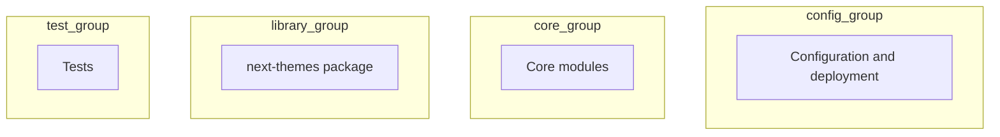

# Architecture report: pacocoursey/next-themes

> Automated static analysis. **Observed** = directly seen in files/imports/AST; **Inferred** = interpretation from that evidence. Repository code was not executed.

## 1. Repository at a glance

| Item | Value |
| --- | --- |
| Repository | pacocoursey/next-themes |
| Description | Perfect Next.js dark mode in 2 lines of code. Support System preference and any other theme with no flashing |
| Language | TypeScript |
| Stars | 6354 |
| Licence | MIT |
| Analysed commit / branch | a7eeabc39cfb37d74ea3d82eac674d0e1851b1cb / main |
| Framework(s) | Next.js, React |
| Files analysed | 64 |
| Components | 4 |

## 2. Architecture in one minute

pacocoursey/next-themes - Perfect Next.js dark mode in 2 lines of code. Support System preference and any other theme with no flashing. This repository was analysed statically from 64 file(s) (0 Python). Detected technologies (observed from imports/manifests): GitHub Actions, Next.js, React, Tailwind CSS, TypeScript, Vitest. Files are grouped into 4 component(s): Configuration and deployment, Core modules, next-themes package, Tests. Findings below distinguish observed facts from inferred interpretation.

## 3. High-level block diagram

## 4. Main components

### Configuration and deployment (`config`)

- **Kind:** config
- **Status:** Observed
- **Confidence:** 0.85
- **Responsibility:** Groups 5 file(s) under configuration and deployment (observed from repository paths and static analysis).
- **Paths:** `next-themes/package.json`, `next-themes/tsconfig.json`, `package.json`, `pnpm-workspace.yaml`, `turbo.json`
- **Evidence:** [next-themes/package.json](https://github.com/pacocoursey/next-themes/blob/a7eeabc39cfb37d74ea3d82eac674d0e1851b1cb/next-themes/package.json); [next-themes/tsconfig.json](https://github.com/pacocoursey/next-themes/blob/a7eeabc39cfb37d74ea3d82eac674d0e1851b1cb/next-themes/tsconfig.json); [package.json](https://github.com/pacocoursey/next-themes/blob/a7eeabc39cfb37d74ea3d82eac674d0e1851b1cb/package.json); [pnpm-workspace.yaml](https://github.com/pacocoursey/next-themes/blob/a7eeabc39cfb37d74ea3d82eac674d0e1851b1cb/pnpm-workspace.yaml); [turbo.json](https://github.com/pacocoursey/next-themes/blob/a7eeabc39cfb37d74ea3d82eac674d0e1851b1cb/turbo.json)

### Core modules (`core`)

- **Kind:** core
- **Status:** Observed
- **Confidence:** 0.85
- **Responsibility:** Groups 1 file(s) under core modules (observed from repository paths and static analysis).
- **Paths:** `playwright.config.ts`
- **Evidence:** [playwright.config.ts](https://github.com/pacocoursey/next-themes/blob/a7eeabc39cfb37d74ea3d82eac674d0e1851b1cb/playwright.config.ts)

### next-themes package (`next_themes`)

- **Kind:** library
- **Status:** Observed
- **Confidence:** 0.85
- **Responsibility:** Groups 5 file(s) under next-themes package (observed from repository paths and static analysis).
- **Paths:** `next-themes/__tests__/index.test.tsx`, `next-themes/src/index.tsx`, `next-themes/src/script.ts`, `next-themes/src/types.ts`, `next-themes/tsup.config.ts`
- **Evidence:** [next-themes/__tests__/index.test.tsx](https://github.com/pacocoursey/next-themes/blob/a7eeabc39cfb37d74ea3d82eac674d0e1851b1cb/next-themes/__tests__/index.test.tsx); [next-themes/src/index.tsx](https://github.com/pacocoursey/next-themes/blob/a7eeabc39cfb37d74ea3d82eac674d0e1851b1cb/next-themes/src/index.tsx); [next-themes/src/script.ts](https://github.com/pacocoursey/next-themes/blob/a7eeabc39cfb37d74ea3d82eac674d0e1851b1cb/next-themes/src/script.ts); [next-themes/src/types.ts](https://github.com/pacocoursey/next-themes/blob/a7eeabc39cfb37d74ea3d82eac674d0e1851b1cb/next-themes/src/types.ts); [next-themes/tsup.config.ts](https://github.com/pacocoursey/next-themes/blob/a7eeabc39cfb37d74ea3d82eac674d0e1851b1cb/next-themes/tsup.config.ts)

### Tests (`tests`)

- **Kind:** test
- **Status:** Observed
- **Confidence:** 0.85
- **Responsibility:** Groups 5 file(s) under tests (observed from repository paths and static analysis).
- **Paths:** `test/forced-theme.test.ts`, `test/storage-event.test.ts`, `test/switch-theme.test.ts`, `test/system-theme.test.ts`, `test/util.ts`
- **Evidence:** [test/forced-theme.test.ts](https://github.com/pacocoursey/next-themes/blob/a7eeabc39cfb37d74ea3d82eac674d0e1851b1cb/test/forced-theme.test.ts); [test/storage-event.test.ts](https://github.com/pacocoursey/next-themes/blob/a7eeabc39cfb37d74ea3d82eac674d0e1851b1cb/test/storage-event.test.ts); [test/switch-theme.test.ts](https://github.com/pacocoursey/next-themes/blob/a7eeabc39cfb37d74ea3d82eac674d0e1851b1cb/test/switch-theme.test.ts); [test/system-theme.test.ts](https://github.com/pacocoursey/next-themes/blob/a7eeabc39cfb37d74ea3d82eac674d0e1851b1cb/test/system-theme.test.ts); [test/util.ts](https://github.com/pacocoursey/next-themes/blob/a7eeabc39cfb37d74ea3d82eac674d0e1851b1cb/test/util.ts)

## 5. Execution flow

**Observed** entry point(s):

- [next-themes/src/index.tsx](https://github.com/pacocoursey/next-themes/blob/a7eeabc39cfb37d74ea3d82eac674d0e1851b1cb/next-themes/src/index.tsx)

Representative flow (derived from observed entry points and the import graph; steps beyond the entry point are **Inferred**):

1. Execution starts at an observed entry point listed above, if present.
2. No internal import relationships between components were observed.

## 6. Project structure

### `(root)`

- `.gitignore` - other (68 bytes)
- `.prettierignore` - other (17 bytes)
- `.prettierrc` - other (117 bytes)
- `license.md` - docs (1069 bytes)
- `package.json` - manifest (781 bytes)
- `playwright.config.ts` - source, TypeScript (593 bytes)
- `pnpm-workspace.yaml` - config (45 bytes)
- `turbo.json` - config (335 bytes)

### `.github`

- `.github/FUNDING.yml` - config (20 bytes)
- `.github/ISSUE_TEMPLATE/1-bug-report.yaml` - config (915 bytes)
- `.github/ISSUE_TEMPLATE/2-feature-request.yaml` - config (547 bytes)
- `.github/workflows/e2e.yml` - ci, YAML (624 bytes)
- `.github/workflows/test.yml` - ci, YAML (512 bytes)

### `examples`

- `examples/example/.gitignore` - other (8 bytes)
- `examples/example/package.json` - manifest (270 bytes)
- `examples/example/pages/_app.js` - source, JavaScript (269 bytes)
- `examples/example/pages/dark.js` - source, JavaScript (138 bytes)
- `examples/example/pages/index.js` - source, JavaScript (832 bytes)
- `examples/example/pages/light.js` - source, JavaScript (139 bytes)
- `examples/example/styles.css` - other (643 bytes)
- `examples/multi-theme/.gitignore` - other (368 bytes)
- `examples/multi-theme/README.md` - docs (119 bytes)
- `examples/multi-theme/next.config.js` - source, JavaScript (92 bytes)
- `examples/multi-theme/package.json` - manifest (528 bytes)
- `examples/multi-theme/postcss.config.js` - source, JavaScript (82 bytes)
- `examples/multi-theme/src/app/globals.css` - other (632 bytes)
- `examples/multi-theme/src/app/layout.tsx` - source, TypeScript (553 bytes)
- `examples/multi-theme/src/app/page.tsx` - source, TypeScript (578 bytes)
- `examples/multi-theme/src/components/ThemeProvider.tsx` - source, TypeScript (444 bytes)
- `examples/multi-theme/src/components/ThemeToggles.tsx` - source, TypeScript (1442 bytes)
- `examples/multi-theme/tailwind.config.ts` - source, TypeScript (377 bytes)
- `examples/multi-theme/tsconfig.json` - config (595 bytes)
- `examples/tailwind/.gitignore` - other (386 bytes)
- `examples/tailwind/package.json` - manifest (382 bytes)
- `examples/tailwind/pages/_app.js` - source, JavaScript (287 bytes)
- `examples/tailwind/pages/_document.js` - source, JavaScript (390 bytes)
- `examples/tailwind/pages/index.js` - source, JavaScript (703 bytes)
- `examples/tailwind/postcss.config.js` - source, JavaScript (80 bytes)
- `examples/tailwind/styles.css` - other (103 bytes)
- `examples/tailwind/tailwind.config.js` - source, JavaScript (211 bytes)
- `examples/with-app-dir/.gitignore` - other (368 bytes)
- `examples/with-app-dir/README.md` - docs (95 bytes)
- `examples/with-app-dir/package.json` - manifest (390 bytes)
- `examples/with-app-dir/postcss.config.js` - source, JavaScript (80 bytes)
- `examples/with-app-dir/src/app/ThemeToggle.tsx` - source, TypeScript (407 bytes)
- `examples/with-app-dir/src/app/globals.css` - other (59 bytes)
- `examples/with-app-dir/src/app/layout.tsx` - source, TypeScript (365 bytes)
- `examples/with-app-dir/src/app/page.tsx` - source, TypeScript (469 bytes)
- `examples/with-app-dir/tailwind.config.ts` - source, TypeScript (170 bytes)
- `examples/with-app-dir/tsconfig.json` - config (595 bytes)

### `next-themes`

- `next-themes/README.md` - docs (18986 bytes)
- `next-themes/__tests__/index.test.tsx` - source, TypeScript (15012 bytes)
- `next-themes/license.md` - docs (1069 bytes)
- `next-themes/package.json` - manifest (798 bytes)
- `next-themes/src/index.tsx` - source, TypeScript (7103 bytes)
- `next-themes/src/script.ts` - source, TypeScript (1320 bytes)
- `next-themes/src/types.ts` - source, TypeScript (2519 bytes)
- `next-themes/tsconfig.json` - config (565 bytes)
- `next-themes/tsup.config.ts` - source, TypeScript (246 bytes)

### `test`

- `test/forced-theme.test.ts` - test, TypeScript (854 bytes)
- `test/storage-event.test.ts` - test, TypeScript (2385 bytes)
- `test/switch-theme.test.ts` - test, TypeScript (1486 bytes)
- `test/system-theme.test.ts` - test, TypeScript (951 bytes)
- `test/util.ts` - test, TypeScript (1113 bytes)

## 7. Key dependencies and integrations

| Name | Category | Status | Confidence | Evidence |
| --- | --- | --- | --- | --- |
| GitHub Actions | ci | Observed | 0.90 | [.github/workflows/e2e.yml](https://github.com/pacocoursey/next-themes/blob/a7eeabc39cfb37d74ea3d82eac674d0e1851b1cb/.github/workflows/e2e.yml); [.github/workflows/test.yml](https://github.com/pacocoursey/next-themes/blob/a7eeabc39cfb37d74ea3d82eac674d0e1851b1cb/.github/workflows/test.yml) |
| Next.js | framework | Observed | 0.90 | [examples/example/package.json:5](https://github.com/pacocoursey/next-themes/blob/a7eeabc39cfb37d74ea3d82eac674d0e1851b1cb/examples/example/package.json#L5); [examples/multi-theme/package.json:6](https://github.com/pacocoursey/next-themes/blob/a7eeabc39cfb37d74ea3d82eac674d0e1851b1cb/examples/multi-theme/package.json#L6); [examples/tailwind/package.json:5](https://github.com/pacocoursey/next-themes/blob/a7eeabc39cfb37d74ea3d82eac674d0e1851b1cb/examples/tailwind/package.json#L5); [examples/with-app-dir/package.json:5](https://github.com/pacocoursey/next-themes/blob/a7eeabc39cfb37d74ea3d82eac674d0e1851b1cb/examples/with-app-dir/package.json#L5) |
| React | framework | Observed | 0.90 | [examples/example/package.json:12](https://github.com/pacocoursey/next-themes/blob/a7eeabc39cfb37d74ea3d82eac674d0e1851b1cb/examples/example/package.json#L12); [examples/example/package.json:13](https://github.com/pacocoursey/next-themes/blob/a7eeabc39cfb37d74ea3d82eac674d0e1851b1cb/examples/example/package.json#L13); [examples/multi-theme/package.json:13](https://github.com/pacocoursey/next-themes/blob/a7eeabc39cfb37d74ea3d82eac674d0e1851b1cb/examples/multi-theme/package.json#L13); [examples/multi-theme/package.json:14](https://github.com/pacocoursey/next-themes/blob/a7eeabc39cfb37d74ea3d82eac674d0e1851b1cb/examples/multi-theme/package.json#L14) |
| Tailwind CSS | library | Observed | 0.90 | [examples/multi-theme/package.json:21](https://github.com/pacocoursey/next-themes/blob/a7eeabc39cfb37d74ea3d82eac674d0e1851b1cb/examples/multi-theme/package.json#L21); [examples/tailwind/package.json:18](https://github.com/pacocoursey/next-themes/blob/a7eeabc39cfb37d74ea3d82eac674d0e1851b1cb/examples/tailwind/package.json#L18); [examples/with-app-dir/package.json:18](https://github.com/pacocoursey/next-themes/blob/a7eeabc39cfb37d74ea3d82eac674d0e1851b1cb/examples/with-app-dir/package.json#L18) |
| TypeScript | tooling | Observed | 0.90 | [examples/multi-theme/package.json:22](https://github.com/pacocoursey/next-themes/blob/a7eeabc39cfb37d74ea3d82eac674d0e1851b1cb/examples/multi-theme/package.json#L22); [package.json:22](https://github.com/pacocoursey/next-themes/blob/a7eeabc39cfb37d74ea3d82eac674d0e1851b1cb/package.json#L22) |
| Vitest | tooling | Observed | 0.85 | [package.json:23](https://github.com/pacocoursey/next-themes/blob/a7eeabc39cfb37d74ea3d82eac674d0e1851b1cb/package.json#L23) |

## 8. Data and state

No database, cache, queue, or persistent-state usage was observed in the analysed files. State handling, if any, may be in-memory or in files that were not analysed.

## 9. Configuration and deployment clues

- `.github/FUNDING.yml` (config)
- `.github/ISSUE_TEMPLATE/1-bug-report.yaml` (config)
- `.github/ISSUE_TEMPLATE/2-feature-request.yaml` (config)
- `.github/workflows/e2e.yml` (ci)
- `.github/workflows/test.yml` (ci)
- `examples/example/package.json` (manifest)
- `examples/multi-theme/package.json` (manifest)
- `examples/multi-theme/tsconfig.json` (config)
- `examples/tailwind/package.json` (manifest)
- `examples/with-app-dir/package.json` (manifest)
- `examples/with-app-dir/tsconfig.json` (config)
- `next-themes/package.json` (manifest)
- `next-themes/tsconfig.json` (config)
- `package.json` (manifest)
- `pnpm-workspace.yaml` (config)
- `turbo.json` (config)

## 10. Design observations

- Tests are present alongside source code (Observed from test file paths).

These observations are interpretations (**Inferred**) of the observed structure, not guarantees about runtime design.

## 11. Limitations and unknowns

- Static analysis only: repository code was not executed, installed, or imported at runtime.
- Components and relationships are inferred from file paths, imports, and AST structure; runtime behaviour, dynamic imports, and reflection may not be visible.
- 1 file(s) were skipped during inventory (1 x lockfile excluded).
- No clear application entry point was observed in the analysed files.
- Repository text was treated as untrusted data; no instructions found in repository files were followed, and likely secret values were redacted/excluded.
- JavaScript and TypeScript files were inventoried from paths and package manifests. They were not parsed with a full language AST, and repository code was not executed.

## 12. Source references

- [.github/workflows/e2e.yml](https://github.com/pacocoursey/next-themes/blob/a7eeabc39cfb37d74ea3d82eac674d0e1851b1cb/.github/workflows/e2e.yml)
- [.github/workflows/test.yml](https://github.com/pacocoursey/next-themes/blob/a7eeabc39cfb37d74ea3d82eac674d0e1851b1cb/.github/workflows/test.yml)
- [examples/example/package.json:5](https://github.com/pacocoursey/next-themes/blob/a7eeabc39cfb37d74ea3d82eac674d0e1851b1cb/examples/example/package.json#L5)
- [examples/example/package.json:12](https://github.com/pacocoursey/next-themes/blob/a7eeabc39cfb37d74ea3d82eac674d0e1851b1cb/examples/example/package.json#L12)
- [examples/example/package.json:13](https://github.com/pacocoursey/next-themes/blob/a7eeabc39cfb37d74ea3d82eac674d0e1851b1cb/examples/example/package.json#L13)
- [examples/multi-theme/package.json:6](https://github.com/pacocoursey/next-themes/blob/a7eeabc39cfb37d74ea3d82eac674d0e1851b1cb/examples/multi-theme/package.json#L6)
- [examples/multi-theme/package.json:13](https://github.com/pacocoursey/next-themes/blob/a7eeabc39cfb37d74ea3d82eac674d0e1851b1cb/examples/multi-theme/package.json#L13)
- [examples/multi-theme/package.json:14](https://github.com/pacocoursey/next-themes/blob/a7eeabc39cfb37d74ea3d82eac674d0e1851b1cb/examples/multi-theme/package.json#L14)
- [examples/multi-theme/package.json:21](https://github.com/pacocoursey/next-themes/blob/a7eeabc39cfb37d74ea3d82eac674d0e1851b1cb/examples/multi-theme/package.json#L21)
- [examples/multi-theme/package.json:22](https://github.com/pacocoursey/next-themes/blob/a7eeabc39cfb37d74ea3d82eac674d0e1851b1cb/examples/multi-theme/package.json#L22)
- [examples/tailwind/package.json:5](https://github.com/pacocoursey/next-themes/blob/a7eeabc39cfb37d74ea3d82eac674d0e1851b1cb/examples/tailwind/package.json#L5)
- [examples/tailwind/package.json:12](https://github.com/pacocoursey/next-themes/blob/a7eeabc39cfb37d74ea3d82eac674d0e1851b1cb/examples/tailwind/package.json#L12)
- [examples/tailwind/package.json:13](https://github.com/pacocoursey/next-themes/blob/a7eeabc39cfb37d74ea3d82eac674d0e1851b1cb/examples/tailwind/package.json#L13)
- [examples/tailwind/package.json:18](https://github.com/pacocoursey/next-themes/blob/a7eeabc39cfb37d74ea3d82eac674d0e1851b1cb/examples/tailwind/package.json#L18)
- [examples/with-app-dir/package.json:5](https://github.com/pacocoursey/next-themes/blob/a7eeabc39cfb37d74ea3d82eac674d0e1851b1cb/examples/with-app-dir/package.json#L5)
- [examples/with-app-dir/package.json:12](https://github.com/pacocoursey/next-themes/blob/a7eeabc39cfb37d74ea3d82eac674d0e1851b1cb/examples/with-app-dir/package.json#L12)
- [examples/with-app-dir/package.json:13](https://github.com/pacocoursey/next-themes/blob/a7eeabc39cfb37d74ea3d82eac674d0e1851b1cb/examples/with-app-dir/package.json#L13)
- [examples/with-app-dir/package.json:18](https://github.com/pacocoursey/next-themes/blob/a7eeabc39cfb37d74ea3d82eac674d0e1851b1cb/examples/with-app-dir/package.json#L18)
- [next-themes/__tests__/index.test.tsx](https://github.com/pacocoursey/next-themes/blob/a7eeabc39cfb37d74ea3d82eac674d0e1851b1cb/next-themes/__tests__/index.test.tsx)
- [next-themes/package.json](https://github.com/pacocoursey/next-themes/blob/a7eeabc39cfb37d74ea3d82eac674d0e1851b1cb/next-themes/package.json)
- [next-themes/src/index.tsx](https://github.com/pacocoursey/next-themes/blob/a7eeabc39cfb37d74ea3d82eac674d0e1851b1cb/next-themes/src/index.tsx)
- [next-themes/src/script.ts](https://github.com/pacocoursey/next-themes/blob/a7eeabc39cfb37d74ea3d82eac674d0e1851b1cb/next-themes/src/script.ts)
- [next-themes/src/types.ts](https://github.com/pacocoursey/next-themes/blob/a7eeabc39cfb37d74ea3d82eac674d0e1851b1cb/next-themes/src/types.ts)
- [next-themes/tsconfig.json](https://github.com/pacocoursey/next-themes/blob/a7eeabc39cfb37d74ea3d82eac674d0e1851b1cb/next-themes/tsconfig.json)
- [next-themes/tsup.config.ts](https://github.com/pacocoursey/next-themes/blob/a7eeabc39cfb37d74ea3d82eac674d0e1851b1cb/next-themes/tsup.config.ts)
- [package.json](https://github.com/pacocoursey/next-themes/blob/a7eeabc39cfb37d74ea3d82eac674d0e1851b1cb/package.json)
- [package.json:22](https://github.com/pacocoursey/next-themes/blob/a7eeabc39cfb37d74ea3d82eac674d0e1851b1cb/package.json#L22)
- [package.json:23](https://github.com/pacocoursey/next-themes/blob/a7eeabc39cfb37d74ea3d82eac674d0e1851b1cb/package.json#L23)
- [playwright.config.ts](https://github.com/pacocoursey/next-themes/blob/a7eeabc39cfb37d74ea3d82eac674d0e1851b1cb/playwright.config.ts)
- [pnpm-workspace.yaml](https://github.com/pacocoursey/next-themes/blob/a7eeabc39cfb37d74ea3d82eac674d0e1851b1cb/pnpm-workspace.yaml)
- [test/forced-theme.test.ts](https://github.com/pacocoursey/next-themes/blob/a7eeabc39cfb37d74ea3d82eac674d0e1851b1cb/test/forced-theme.test.ts)
- [test/storage-event.test.ts](https://github.com/pacocoursey/next-themes/blob/a7eeabc39cfb37d74ea3d82eac674d0e1851b1cb/test/storage-event.test.ts)
- [test/switch-theme.test.ts](https://github.com/pacocoursey/next-themes/blob/a7eeabc39cfb37d74ea3d82eac674d0e1851b1cb/test/switch-theme.test.ts)
- [test/system-theme.test.ts](https://github.com/pacocoursey/next-themes/blob/a7eeabc39cfb37d74ea3d82eac674d0e1851b1cb/test/system-theme.test.ts)
- [test/util.ts](https://github.com/pacocoursey/next-themes/blob/a7eeabc39cfb37d74ea3d82eac674d0e1851b1cb/test/util.ts)
- [turbo.json](https://github.com/pacocoursey/next-themes/blob/a7eeabc39cfb37d74ea3d82eac674d0e1851b1cb/turbo.json)
