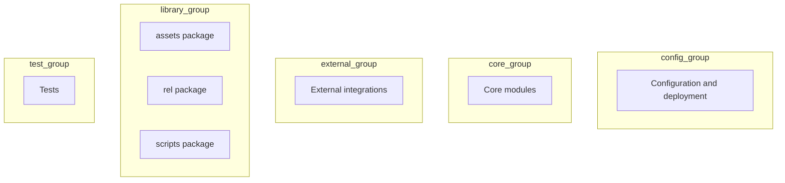

# Architecture report: papercups-io/papercups

> Automated static analysis. **Observed** = directly seen in files/imports/AST; **Inferred** = interpretation from that evidence. Repository code was not executed.

## 1. Repository at a glance

| Item | Value |
| --- | --- |
| Repository | papercups-io/papercups |
| Description | Open-source live customer chat |
| Language | Elixir |
| Stars | 6123 |
| Licence | MIT |
| Analysed commit / branch | 6a6f5adc7f0cef5813b2c2f1c0659922defaf976 / master |
| Framework(s) | React |
| Files analysed | 681 |
| Components | 7 |

## 2. Architecture in one minute

papercups-io/papercups - Open-source live customer chat. This repository was analysed statically from 681 file(s) (0 Python). Detected technologies (observed from imports/manifests): GitHub Actions, PostgreSQL, React, React Router, Docker, Docker Compose. Files are grouped into 7 component(s): assets package, Configuration and deployment, Core modules, External integrations, rel package, scripts package, Tests. Findings below distinguish observed facts from inferred interpretation.

## 3. High-level block diagram

## 4. Main components

### assets package (`assets`)

- **Kind:** library
- **Status:** Observed
- **Confidence:** 0.85
- **Responsibility:** Groups 153 file(s) under assets package (observed from repository paths and static analysis).
- **Paths:** `assets/.prettierrc.js`, `assets/src/App.tsx`, `assets/src/analytics.ts`, `assets/src/api.ts`, `assets/src/components/Dashboard.tsx`, `assets/src/components/DatePicker.tsx`, `assets/src/components/MarkdownRenderer.tsx`, `assets/src/components/Sandbox.tsx`, `assets/src/components/Spinner.tsx`, `assets/src/components/auth/AuthProvider.tsx`, `assets/src/components/auth/EmailVerification.tsx`, `assets/src/components/auth/Login.tsx`, `assets/src/components/auth/PasswordReset.tsx`, `assets/src/components/auth/PasswordResetRequested.tsx`, `assets/src/components/auth/Register.tsx`, `assets/src/components/auth/RequestPasswordReset.tsx`, `assets/src/components/auth/SocketProvider.tsx`, `assets/src/components/billing/BillingOverview.tsx`, `assets/src/components/billing/CardInputSection.tsx`, `assets/src/components/billing/PaymentForm.tsx`, `assets/src/components/billing/PricingOverview.tsx`, `assets/src/components/billing/support.test.ts`, `assets/src/components/billing/support.ts`, `assets/src/components/canned-responses/CannedResponsesOverview.tsx`, `assets/src/components/canned-responses/NewCannedResponseModal.tsx`, `assets/src/components/common.tsx`, `assets/src/components/companies/CompaniesPage.tsx`, `assets/src/components/companies/CompanyDetailsPage.tsx`, `assets/src/components/companies/CreateCompanyPage.tsx`, `assets/src/components/companies/UpdateCompanyPage.tsx`, `assets/src/components/companies/support.ts`, `assets/src/components/conversations/ChatMessage.tsx`, `assets/src/components/conversations/ChatMessageBox.tsx`, `assets/src/components/conversations/ConversationClosing.tsx`, `assets/src/components/conversations/ConversationDetailsSidebar.tsx`, `assets/src/components/conversations/ConversationFooter.tsx`, `assets/src/components/conversations/ConversationHeader.tsx`, `assets/src/components/conversations/ConversationItem.tsx`, `assets/src/components/conversations/ConversationMessages.tsx`, `assets/src/components/conversations/ConversationModal.tsx`, `assets/src/components/conversations/ConversationsDashboard.tsx`, `assets/src/components/conversations/ConversationsPreviewList.tsx`, `assets/src/components/conversations/ConversationsProvider.tsx`, `assets/src/components/conversations/DashboardShortcutsModal.tsx`, `assets/src/components/conversations/NotificationsProvider.tsx`, `assets/src/components/conversations/RelatedCustomerConversations.tsx`, `assets/src/components/conversations/SelectedConversationContainer.tsx`, `assets/src/components/conversations/SharedConversation.tsx`, `assets/src/components/conversations/SidebarCustomerIssues.tsx`, `assets/src/components/conversations/SidebarCustomerNotes.tsx`, `assets/src/components/conversations/SidebarTagSection.tsx`, `assets/src/components/conversations/SlackConversationThreads.tsx`, `assets/src/components/conversations/StartConversationButton.tsx`, `assets/src/components/conversations/presence.test.tsx`, `assets/src/components/conversations/support.ts`, `assets/src/components/conversations/useChannel.tsx`, `assets/src/components/customers/CustomerActiveSessions.tsx`, `assets/src/components/customers/CustomerCompanyDetails.tsx`, `assets/src/components/customers/CustomerDetailsConversations.tsx`, `assets/src/components/customers/CustomerDetailsIssues.tsx`, `assets/src/components/customers/CustomerDetailsMainSection.tsx`, `assets/src/components/customers/CustomerDetailsModal.tsx`, `assets/src/components/customers/CustomerDetailsNewNoteInput.tsx`, `assets/src/components/customers/CustomerDetailsNotes.tsx`, `assets/src/components/customers/CustomerDetailsPage.tsx`, `assets/src/components/customers/CustomerDetailsPageV2.tsx`, `assets/src/components/customers/CustomerDetailsSidebar.tsx`, `assets/src/components/customers/CustomerHubspotInfo.tsx`, `assets/src/components/customers/CustomerIntercomInfo.tsx`, `assets/src/components/customers/CustomerTagSelect.tsx`, `assets/src/components/customers/CustomersPage.tsx`, `assets/src/components/customers/CustomersTable.tsx`, `assets/src/components/customers/CustomersTableContainer.tsx`, `assets/src/components/customers/EditCustomerDetailsModal.tsx`, `assets/src/components/customers/NewCustomerModal.tsx`, `assets/src/components/customers/SearchCustomers.tsx`, `assets/src/components/customers/support.ts`, `assets/src/components/demo/BotDemo.tsx`, `assets/src/components/demo/Demo.tsx`, `assets/src/components/developers/ApiExplorer.tsx`, `assets/src/components/developers/CodeSandbox.tsx`, `assets/src/components/developers/DynamicTable.tsx`, `assets/src/components/developers/EmailTemplateBuilder.tsx`, `assets/src/components/developers/EmbeddableChat.tsx`, `assets/src/components/developers/EventSubscriptionsPage.tsx`, `assets/src/components/developers/MonacoEditor.tsx`, `assets/src/components/developers/PersonalApiKeysPage.tsx`, `assets/src/components/developers/RunKit.ts`, `assets/src/components/developers/RunKitWrapper.tsx`, `assets/src/components/developers/email/components.ts`, `assets/src/components/developers/email/html.ts`, `assets/src/components/developers/email/styles.ts`, `assets/src/components/getting-started/GettingStarted.tsx`, `assets/src/components/getting-started/Steps.tsx`, `assets/src/components/icons.tsx`, `assets/src/components/inboxes/InboxConversations.tsx`, `assets/src/components/inboxes/InboxDetailsPage.tsx`, `assets/src/components/inboxes/InboxEmailForwardingPage.tsx`, `assets/src/components/inboxes/InboxForwardingAddresses.tsx`, `assets/src/components/inboxes/InboxIntegrations.tsx`, `assets/src/components/inboxes/InboxesDashboard.tsx`, `assets/src/components/inboxes/InboxesOverview.tsx`, `assets/src/components/inboxes/NewInboxModal.tsx`, `assets/src/components/issues/IssueDetailsPage.tsx`, `assets/src/components/issues/IssuesOverview.tsx`, `assets/src/components/issues/IssuesTable.tsx`, `assets/src/components/issues/NewIssueModal.tsx`, `assets/src/components/issues/SearchIssuesInput.tsx`, `assets/src/components/issues/UpdateIssueModal.tsx`, `assets/src/components/issues/support.ts`, `assets/src/components/lambdas/LambdaDetailsPage.tsx`, `assets/src/components/lambdas/LambdasOnboarding.tsx`, `assets/src/components/lambdas/LambdasOverview.tsx`, `assets/src/components/lambdas/NewLambdaModal.tsx`, `assets/src/components/lambdas/support/deploy.ts`, `assets/src/components/lambdas/support/jszip-utils.d.ts`, `assets/src/components/lambdas/support/types.ts`, `assets/src/components/lambdas/support/upload.ts`, `assets/src/components/lambdas/support/zipper.ts`, `assets/src/components/notes/NotesOverview.tsx`, `assets/src/components/reporting/CustomerBreakdownChart.tsx`, `assets/src/components/reporting/FirstResponseTimeByWeekChart.tsx`, `assets/src/components/reporting/MessagesByDayOfWeekChart.tsx`, `assets/src/components/reporting/MessagesPerDayChart.tsx`, `assets/src/components/reporting/MessagesPerUserChart.tsx`, `assets/src/components/reporting/MessagesSentVsReceivedChart.tsx`, `assets/src/components/reporting/ReportingDashboard.tsx`, `assets/src/components/reporting/support.ts`, `assets/src/components/sessions/ConversationSidebar.tsx`, `assets/src/components/sessions/InstallingStorytime.tsx`, `assets/src/components/sessions/LiveSessionViewer.tsx`, `assets/src/components/sessions/RrWebPlayer.tsx`, `assets/src/components/sessions/SessionReplay.tsx`, `assets/src/components/sessions/SessionsOverview.tsx`, `assets/src/components/sessions/SessionsTable.tsx`, `assets/src/components/tags/NewTagModal.tsx`, `assets/src/components/tags/TagDetailsPage.tsx`, `assets/src/components/tags/TagsOverview.tsx`, `assets/src/components/tags/UpdateTagModal.tsx`, `assets/src/components/tags/support.ts`, `assets/src/config.ts`, `assets/src/constants.ts`, `assets/src/index.tsx`, `assets/src/logger.tsx`, `assets/src/presence.ts`, `assets/src/react-app-env.d.ts`, `assets/src/serviceWorker.ts`, `assets/src/setupTests.ts`, `assets/src/socket.ts`, `assets/src/storage.ts`, `assets/src/types.ts`, `assets/src/utils.test.ts`, `assets/src/utils.ts`
- **Evidence:** [assets/.prettierrc.js](https://github.com/papercups-io/papercups/blob/6a6f5adc7f0cef5813b2c2f1c0659922defaf976/assets/.prettierrc.js); [assets/src/App.tsx](https://github.com/papercups-io/papercups/blob/6a6f5adc7f0cef5813b2c2f1c0659922defaf976/assets/src/App.tsx); [assets/src/analytics.ts](https://github.com/papercups-io/papercups/blob/6a6f5adc7f0cef5813b2c2f1c0659922defaf976/assets/src/analytics.ts); [assets/src/api.ts](https://github.com/papercups-io/papercups/blob/6a6f5adc7f0cef5813b2c2f1c0659922defaf976/assets/src/api.ts); [assets/src/components/Dashboard.tsx](https://github.com/papercups-io/papercups/blob/6a6f5adc7f0cef5813b2c2f1c0659922defaf976/assets/src/components/Dashboard.tsx); [assets/src/components/DatePicker.tsx](https://github.com/papercups-io/papercups/blob/6a6f5adc7f0cef5813b2c2f1c0659922defaf976/assets/src/components/DatePicker.tsx); [assets/src/components/MarkdownRenderer.tsx](https://github.com/papercups-io/papercups/blob/6a6f5adc7f0cef5813b2c2f1c0659922defaf976/assets/src/components/MarkdownRenderer.tsx); [assets/src/components/Sandbox.tsx](https://github.com/papercups-io/papercups/blob/6a6f5adc7f0cef5813b2c2f1c0659922defaf976/assets/src/components/Sandbox.tsx)

### Configuration and deployment (`config`)

- **Kind:** config
- **Status:** Observed
- **Confidence:** 0.85
- **Responsibility:** Groups 18 file(s) under configuration and deployment (observed from repository paths and static analysis).
- **Paths:** `Dockerfile`, `app.json`, `assets/package.json`, `assets/public/manifest.json`, `assets/src/components/settings/AccountOverview.tsx`, `assets/src/components/settings/AccountUsersTable.tsx`, `assets/src/components/settings/ChatWidgetSettings.tsx`, `assets/src/components/settings/ConversationRemindersSettings.tsx`, `assets/src/components/settings/DisabledUsersTable.tsx`, `assets/src/components/settings/ForwardingAddressSettings.tsx`, `assets/src/components/settings/NewForwardingAddressModal.tsx`, `assets/src/components/settings/TeamOverview.tsx`, `assets/src/components/settings/UserProfile.tsx`, `assets/src/components/settings/WorkingHoursSelector.tsx`, `assets/src/components/settings/support.ts`, `assets/tsconfig.json`, `docker-compose.yml`, `scripts/lambdas/send-email-to-webhook/package.json`
- **Evidence:** [Dockerfile](https://github.com/papercups-io/papercups/blob/6a6f5adc7f0cef5813b2c2f1c0659922defaf976/Dockerfile); [app.json](https://github.com/papercups-io/papercups/blob/6a6f5adc7f0cef5813b2c2f1c0659922defaf976/app.json); [assets/package.json](https://github.com/papercups-io/papercups/blob/6a6f5adc7f0cef5813b2c2f1c0659922defaf976/assets/package.json); [assets/public/manifest.json](https://github.com/papercups-io/papercups/blob/6a6f5adc7f0cef5813b2c2f1c0659922defaf976/assets/public/manifest.json); [assets/src/components/settings/AccountOverview.tsx](https://github.com/papercups-io/papercups/blob/6a6f5adc7f0cef5813b2c2f1c0659922defaf976/assets/src/components/settings/AccountOverview.tsx); [assets/src/components/settings/AccountUsersTable.tsx](https://github.com/papercups-io/papercups/blob/6a6f5adc7f0cef5813b2c2f1c0659922defaf976/assets/src/components/settings/AccountUsersTable.tsx); [assets/src/components/settings/ChatWidgetSettings.tsx](https://github.com/papercups-io/papercups/blob/6a6f5adc7f0cef5813b2c2f1c0659922defaf976/assets/src/components/settings/ChatWidgetSettings.tsx); [assets/src/components/settings/ConversationRemindersSettings.tsx](https://github.com/papercups-io/papercups/blob/6a6f5adc7f0cef5813b2c2f1c0659922defaf976/assets/src/components/settings/ConversationRemindersSettings.tsx)

### Core modules (`core`)

- **Kind:** core
- **Status:** Observed
- **Confidence:** 0.85
- **Responsibility:** Groups 2 file(s) under core modules (observed from repository paths and static analysis).
- **Paths:** `docker-entrypoint-dev.sh`, `docker-entrypoint.sh`
- **Evidence:** [docker-entrypoint-dev.sh](https://github.com/papercups-io/papercups/blob/6a6f5adc7f0cef5813b2c2f1c0659922defaf976/docker-entrypoint-dev.sh); [docker-entrypoint.sh](https://github.com/papercups-io/papercups/blob/6a6f5adc7f0cef5813b2c2f1c0659922defaf976/docker-entrypoint.sh)

### External integrations (`external_integrations`)

- **Kind:** external
- **Status:** Observed
- **Confidence:** 0.85
- **Responsibility:** Groups 24 file(s) under external integrations (observed from repository paths and static analysis).
- **Paths:** `assets/src/components/integrations/GithubAuthorizationButton.tsx`, `assets/src/components/integrations/GithubIntegrationDetails.tsx`, `assets/src/components/integrations/GmailIntegrationDetails.tsx`, `assets/src/components/integrations/GoogleAuthorizationButton.tsx`, `assets/src/components/integrations/GoogleIntegrationDetails.tsx`, `assets/src/components/integrations/GoogleSheetsIntegrationDetails.tsx`, `assets/src/components/integrations/HubspotAuthorizationButton.tsx`, `assets/src/components/integrations/HubspotIntegrationDetails.tsx`, `assets/src/components/integrations/IntegrationsOverview.tsx`, `assets/src/components/integrations/IntegrationsTable.tsx`, `assets/src/components/integrations/IntercomAuthorizationButton.tsx`, `assets/src/components/integrations/IntercomIntegrationDetails.tsx`, `assets/src/components/integrations/MattermostAuthorizationModal.tsx`, `assets/src/components/integrations/MattermostIntegrationDetails.tsx`, `assets/src/components/integrations/NewApiKeyModal.tsx`, `assets/src/components/integrations/NewWebhookModal.tsx`, `assets/src/components/integrations/PersonalApiKeysTable.tsx`, `assets/src/components/integrations/SlackIntegrationDetails.tsx`, `assets/src/components/integrations/SlackReplyIntegrationDetails.tsx`, `assets/src/components/integrations/SlackSyncIntegrationDetails.tsx`, `assets/src/components/integrations/TwilioAuthorizationModal.tsx`, `assets/src/components/integrations/TwilioIntegrationDetails.tsx`, `assets/src/components/integrations/WebhooksTable.tsx`, `assets/src/components/integrations/support.ts`
- **Evidence:** [assets/src/components/integrations/GithubAuthorizationButton.tsx](https://github.com/papercups-io/papercups/blob/6a6f5adc7f0cef5813b2c2f1c0659922defaf976/assets/src/components/integrations/GithubAuthorizationButton.tsx); [assets/src/components/integrations/GithubIntegrationDetails.tsx](https://github.com/papercups-io/papercups/blob/6a6f5adc7f0cef5813b2c2f1c0659922defaf976/assets/src/components/integrations/GithubIntegrationDetails.tsx); [assets/src/components/integrations/GmailIntegrationDetails.tsx](https://github.com/papercups-io/papercups/blob/6a6f5adc7f0cef5813b2c2f1c0659922defaf976/assets/src/components/integrations/GmailIntegrationDetails.tsx); [assets/src/components/integrations/GoogleAuthorizationButton.tsx](https://github.com/papercups-io/papercups/blob/6a6f5adc7f0cef5813b2c2f1c0659922defaf976/assets/src/components/integrations/GoogleAuthorizationButton.tsx); [assets/src/components/integrations/GoogleIntegrationDetails.tsx](https://github.com/papercups-io/papercups/blob/6a6f5adc7f0cef5813b2c2f1c0659922defaf976/assets/src/components/integrations/GoogleIntegrationDetails.tsx); [assets/src/components/integrations/GoogleSheetsIntegrationDetails.tsx](https://github.com/papercups-io/papercups/blob/6a6f5adc7f0cef5813b2c2f1c0659922defaf976/assets/src/components/integrations/GoogleSheetsIntegrationDetails.tsx); [assets/src/components/integrations/HubspotAuthorizationButton.tsx](https://github.com/papercups-io/papercups/blob/6a6f5adc7f0cef5813b2c2f1c0659922defaf976/assets/src/components/integrations/HubspotAuthorizationButton.tsx); [assets/src/components/integrations/HubspotIntegrationDetails.tsx](https://github.com/papercups-io/papercups/blob/6a6f5adc7f0cef5813b2c2f1c0659922defaf976/assets/src/components/integrations/HubspotIntegrationDetails.tsx)

### rel package (`rel`)

- **Kind:** library
- **Status:** Observed
- **Confidence:** 0.85
- **Responsibility:** Groups 4 file(s) under rel package (observed from repository paths and static analysis).
- **Paths:** `rel/overlays/createdb.sh`, `rel/overlays/migrate.sh`, `rel/overlays/rollback.sh`, `rel/overlays/seed.sh`
- **Evidence:** [rel/overlays/createdb.sh](https://github.com/papercups-io/papercups/blob/6a6f5adc7f0cef5813b2c2f1c0659922defaf976/rel/overlays/createdb.sh); [rel/overlays/migrate.sh](https://github.com/papercups-io/papercups/blob/6a6f5adc7f0cef5813b2c2f1c0659922defaf976/rel/overlays/migrate.sh); [rel/overlays/rollback.sh](https://github.com/papercups-io/papercups/blob/6a6f5adc7f0cef5813b2c2f1c0659922defaf976/rel/overlays/rollback.sh); [rel/overlays/seed.sh](https://github.com/papercups-io/papercups/blob/6a6f5adc7f0cef5813b2c2f1c0659922defaf976/rel/overlays/seed.sh)

### scripts package (`scripts`)

- **Kind:** library
- **Status:** Observed
- **Confidence:** 0.85
- **Responsibility:** Groups 3 file(s) under scripts package (observed from repository paths and static analysis).
- **Paths:** `scripts/compile_watch.sh`, `scripts/lambdas/send-email-to-webhook/index.js`, `scripts/ses_setup.sh`
- **Evidence:** [scripts/compile_watch.sh](https://github.com/papercups-io/papercups/blob/6a6f5adc7f0cef5813b2c2f1c0659922defaf976/scripts/compile_watch.sh); [scripts/lambdas/send-email-to-webhook/index.js](https://github.com/papercups-io/papercups/blob/6a6f5adc7f0cef5813b2c2f1c0659922defaf976/scripts/lambdas/send-email-to-webhook/index.js); [scripts/ses_setup.sh](https://github.com/papercups-io/papercups/blob/6a6f5adc7f0cef5813b2c2f1c0659922defaf976/scripts/ses_setup.sh)

### Tests (`tests`)

- **Kind:** test
- **Status:** Observed
- **Confidence:** 0.85
- **Responsibility:** Groups 79 file(s) under tests (observed from repository paths and static analysis).
- **Paths:** `test/chat_api/accounts_test.exs`, `test/chat_api/api_keys_test.exs`, `test/chat_api/aws_test.exs`, `test/chat_api/browser_replay_events_test.exs`, `test/chat_api/browser_sessions_test.exs`, `test/chat_api/canned_responses_test.exs`, `test/chat_api/companies_test.exs`, `test/chat_api/conversations/helpers_test.exs`, `test/chat_api/conversations_test.exs`, `test/chat_api/customers_test.exs`, `test/chat_api/emails_test.exs`, `test/chat_api/event_subscriptions_test.exs`, `test/chat_api/forwarding_addresses_test.exs`, `test/chat_api/github_test.exs`, `test/chat_api/google_test.exs`, `test/chat_api/hubspot_test.exs`, `test/chat_api/inboxes_test.exs`, `test/chat_api/intercom_test.exs`, `test/chat_api/issues_test.exs`, `test/chat_api/lambdas_test.exs`, `test/chat_api/mentions_test.exs`, `test/chat_api/messages_test.exs`, `test/chat_api/notes_test.exs`, `test/chat_api/reporting_test.exs`, `test/chat_api/slack_authorizations_test.exs`, `test/chat_api/slack_conversation_threads_test.exs`, `test/chat_api/slack_test.exs`, `test/chat_api/tags_test.exs`, `test/chat_api/twilio_test.exs`, `test/chat_api/user_invitations_test.exs`, `test/chat_api/users_test.exs`, `test/chat_api/utils_test.exs`, `test/chat_api/widget_settings_test.exs`, `test/chat_api_web/api_auth_plug_test.exs`, `test/chat_api_web/channels/conversation_channel_test.exs`, `test/chat_api_web/channels/event_channel_test.exs`, `test/chat_api_web/channels/notification_channel_test.exs`, `test/chat_api_web/channels/room_channel_test.exs`, `test/chat_api_web/controllers/account_controller_test.exs`, `test/chat_api_web/controllers/browser_session_controller_test.exs`, `test/chat_api_web/controllers/canned_response_controller_test.exs`, `test/chat_api_web/controllers/company_controller_test.exs`, `test/chat_api_web/controllers/conversation_controller_test.exs`, `test/chat_api_web/controllers/customer_controller_test.exs`, `test/chat_api_web/controllers/event_subscription_controller_test.exs`, `test/chat_api_web/controllers/forwarding_address_controller_test.exs`, `test/chat_api_web/controllers/github_controller_test.exs`, `test/chat_api_web/controllers/gmail_controller_test.exs`, `test/chat_api_web/controllers/inbox_controller_test.exs`, `test/chat_api_web/controllers/issue_controller_test.exs`, `test/chat_api_web/controllers/lambda_controller_test.exs`, `test/chat_api_web/controllers/message_controller_test.exs`, `test/chat_api_web/controllers/note_controller_test.exs`, `test/chat_api_web/controllers/onboarding_status_controller_test.exs`, `test/chat_api_web/controllers/personal_api_key_controller_test.exs`, `test/chat_api_web/controllers/registration_controller_test.exs`, `test/chat_api_web/controllers/session_controller_test.exs`, `test/chat_api_web/controllers/slack_controller_test.exs`, `test/chat_api_web/controllers/tag_controller_test.exs`, `test/chat_api_web/controllers/twilio_controller_test.exs`, `test/chat_api_web/controllers/upload_controller_test.exs`, `test/chat_api_web/controllers/user_controller_test.exs`, `test/chat_api_web/controllers/user_invitation_controller_test.exs`, `test/chat_api_web/controllers/user_profile_controller_test.exs`, `test/chat_api_web/controllers/user_settings_controller_test.exs`, `test/chat_api_web/controllers/widget_settings_controller_test.exs`, `test/chat_api_web/ensure_role_plug_test.exs`, `test/chat_api_web/ensure_user_enabled_plug_test.exs`, `test/chat_api_web/plugs/ip_address_plug_test.exs`, `test/chat_api_web/views/csv_helpers_test.exs`, `test/chat_api_web/views/error_view_test.exs`, `test/support/channel_case.ex`, `test/support/conn_case.ex`, `test/support/data_case.ex`, `test/support/factory.ex`, `test/test_helper.exs`, `test/workers/process_ses_event_test.exs`, `test/workers/send_conversation_reply_email_test.exs`, `test/workers/send_ses_reply_email_test.exs`
- **Evidence:** [test/chat_api/accounts_test.exs](https://github.com/papercups-io/papercups/blob/6a6f5adc7f0cef5813b2c2f1c0659922defaf976/test/chat_api/accounts_test.exs); [test/chat_api/api_keys_test.exs](https://github.com/papercups-io/papercups/blob/6a6f5adc7f0cef5813b2c2f1c0659922defaf976/test/chat_api/api_keys_test.exs); [test/chat_api/aws_test.exs](https://github.com/papercups-io/papercups/blob/6a6f5adc7f0cef5813b2c2f1c0659922defaf976/test/chat_api/aws_test.exs); [test/chat_api/browser_replay_events_test.exs](https://github.com/papercups-io/papercups/blob/6a6f5adc7f0cef5813b2c2f1c0659922defaf976/test/chat_api/browser_replay_events_test.exs); [test/chat_api/browser_sessions_test.exs](https://github.com/papercups-io/papercups/blob/6a6f5adc7f0cef5813b2c2f1c0659922defaf976/test/chat_api/browser_sessions_test.exs); [test/chat_api/canned_responses_test.exs](https://github.com/papercups-io/papercups/blob/6a6f5adc7f0cef5813b2c2f1c0659922defaf976/test/chat_api/canned_responses_test.exs); [test/chat_api/companies_test.exs](https://github.com/papercups-io/papercups/blob/6a6f5adc7f0cef5813b2c2f1c0659922defaf976/test/chat_api/companies_test.exs); [test/chat_api/conversations/helpers_test.exs](https://github.com/papercups-io/papercups/blob/6a6f5adc7f0cef5813b2c2f1c0659922defaf976/test/chat_api/conversations/helpers_test.exs)

## 5. Execution flow

**Observed** entry point(s):

- [assets/src/App.tsx](https://github.com/papercups-io/papercups/blob/6a6f5adc7f0cef5813b2c2f1c0659922defaf976/assets/src/App.tsx)
- [assets/src/index.tsx](https://github.com/papercups-io/papercups/blob/6a6f5adc7f0cef5813b2c2f1c0659922defaf976/assets/src/index.tsx)
- [scripts/lambdas/send-email-to-webhook/index.js](https://github.com/papercups-io/papercups/blob/6a6f5adc7f0cef5813b2c2f1c0659922defaf976/scripts/lambdas/send-email-to-webhook/index.js)

Representative flow (derived from observed entry points and the import graph; steps beyond the entry point are **Inferred**):

1. Execution starts at an observed entry point listed above, if present.
2. No internal import relationships between components were observed.

## 6. Project structure

### `(root)`

- `.dockerignore` - container (873 bytes)
- `.env.example` - config (1501 bytes)
- `.formatter.exs` - other (159 bytes)
- `.gitattributes` - other (471 bytes)
- `.gitignore` - other (925 bytes)
- `.nvmrc` - other (9 bytes)
- `.tool-versions` - other (64 bytes)
- `CHANGELOG.md` - docs (23910 bytes)
- `CODE_OF_CONDUCT.md` - docs (3353 bytes)
- `CONTRIBUTING.md` - docs (1603 bytes)
- `Dockerfile` - container (1800 bytes)
- `LICENSE` - docs (1066 bytes)
- `Procfile` - other (85 bytes)
- `README.md` - docs (7746 bytes)
- `app.json` - config (2088 bytes)
- `compile` - other (76 bytes)
- `dev.Dockerfile` - other (949 bytes)
- `docker-compose.yml` - container (905 bytes)
- `docker-entrypoint-dev.sh` - source, Shell (173 bytes)
- `docker-entrypoint.sh` - source, Shell (166 bytes)
- `elixir_buildpack.config` - other (189 bytes)
- `mix.exs` - other (3167 bytes)
- `mix.lock` - other (28130 bytes)
- `phoenix_static_buildpack.config` - other (72 bytes)

### `.github`

- `.github/ISSUE_TEMPLATE/bug_report.md` - docs (511 bytes)
- `.github/ISSUE_TEMPLATE/feature_request.md` - docs (755 bytes)
- `.github/pull_request_template.md` - docs (300 bytes)
- `.github/workflows/papercups.yml` - ci, YAML (2125 bytes)
- `.github/workflows/release.yml` - ci, YAML (698 bytes)

### `assets`

- `assets/.gitignore` - other (330 bytes)
- `assets/.prettierrc.js` - source, JavaScript (92 bytes)
- `assets/README.md` - docs (1023 bytes)
- `assets/package.json` - manifest (3062 bytes)
- `assets/public/github.svg` - other (968 bytes)
- `assets/public/gmail.svg` - other (1023 bytes)
- `assets/public/hubspot.svg` - other (986 bytes)
- `assets/public/index.html` - other (1955 bytes)
- `assets/public/intercom.svg` - other (990 bytes)
- `assets/public/jira-v0.svg` - other (1038 bytes)
- `assets/public/jira.svg` - other (905 bytes)
- `assets/public/logo.svg` - other (684 bytes)
- `assets/public/manifest.json` - config (292 bytes)
- `assets/public/mattermost.svg` - other (1441 bytes)
- `assets/public/microsoft-teams.svg` - other (4674 bytes)
- `assets/public/robots.txt` - docs (67 bytes)
- `assets/public/salesforce.svg` - other (8075 bytes)
- `assets/public/ses.svg` - other (2004 bytes)
- `assets/public/sheets.svg` - other (9046 bytes)
- `assets/public/slack.svg` - other (1315 bytes)
- `assets/public/twilio.svg` - other (1140 bytes)
- `assets/public/whatsapp-v2.svg` - other (3208 bytes)
- `assets/public/whatsapp.svg` - other (2718 bytes)
- `assets/public/zendesk.svg` - other (303 bytes)
- `assets/src/App.css` - other (2873 bytes)
- `assets/src/App.tsx` - source, TypeScript (2996 bytes)
- `assets/src/analytics.ts` - source, TypeScript (1223 bytes)
- `assets/src/api.ts` - source, TypeScript (48525 bytes)
- `assets/src/components/Dashboard.tsx` - source, TypeScript (22158 bytes)
- `assets/src/components/DatePicker.tsx` - source, TypeScript (389 bytes)
- `assets/src/components/MarkdownRenderer.tsx` - source, TypeScript (901 bytes)
- `assets/src/components/Sandbox.tsx` - source, TypeScript (279 bytes)
- `assets/src/components/Spinner.tsx` - source, TypeScript (278 bytes)
- `assets/src/components/auth/AuthProvider.tsx` - source, TypeScript (4833 bytes)
- `assets/src/components/auth/EmailVerification.tsx` - source, TypeScript (1262 bytes)
- `assets/src/components/auth/Login.tsx` - source, TypeScript (3682 bytes)
- `assets/src/components/auth/PasswordReset.tsx` - source, TypeScript (4867 bytes)
- `assets/src/components/auth/PasswordResetRequested.tsx` - source, TypeScript (913 bytes)
- `assets/src/components/auth/Register.tsx` - source, TypeScript (6468 bytes)
- `assets/src/components/auth/RequestPasswordReset.tsx` - source, TypeScript (2817 bytes)
- `assets/src/components/auth/SocketProvider.tsx` - source, TypeScript (2417 bytes)
- `assets/src/components/billing/Billing.css` - other (60 bytes)
- `assets/src/components/billing/BillingOverview.tsx` - source, TypeScript (13475 bytes)
- `assets/src/components/billing/CardInputSection.tsx` - source, TypeScript (654 bytes)
- `assets/src/components/billing/PaymentForm.tsx` - source, TypeScript (2975 bytes)
- `assets/src/components/billing/PricingOverview.tsx` - source, TypeScript (5754 bytes)
- `assets/src/components/billing/StripeElement.css` - other (649 bytes)
- `assets/src/components/billing/support.test.ts` - source, TypeScript (5891 bytes)
- `assets/src/components/billing/support.ts` - source, TypeScript (5173 bytes)
- `assets/src/components/canned-responses/CannedResponsesOverview.tsx` - source, TypeScript (5618 bytes)
- `assets/src/components/canned-responses/NewCannedResponseModal.tsx` - source, TypeScript (3472 bytes)
- `assets/src/components/common.tsx` - source, TypeScript (5007 bytes)
- `assets/src/components/companies/CompaniesPage.tsx` - source, TypeScript (3243 bytes)
- `assets/src/components/companies/CompanyDetailsPage.tsx` - source, TypeScript (6618 bytes)
- `assets/src/components/companies/CreateCompanyPage.tsx` - source, TypeScript (4854 bytes)
- `assets/src/components/companies/UpdateCompanyPage.tsx` - source, TypeScript (8849 bytes)
- `assets/src/components/companies/support.ts` - source, TypeScript (464 bytes)
- `assets/src/components/conversations/ChatMessage.tsx` - source, TypeScript (4695 bytes)
- `assets/src/components/conversations/ChatMessageBox.tsx` - source, TypeScript (4088 bytes)
- `assets/src/components/conversations/ConversationClosing.tsx` - source, TypeScript (1169 bytes)
- `assets/src/components/conversations/ConversationDetailsSidebar.tsx` - source, TypeScript (12226 bytes)
- `assets/src/components/conversations/ConversationFooter.tsx` - source, TypeScript (13240 bytes)
- `assets/src/components/conversations/ConversationHeader.tsx` - source, TypeScript (5303 bytes)
- `assets/src/components/conversations/ConversationItem.tsx` - source, TypeScript (4468 bytes)
- `assets/src/components/conversations/ConversationMessages.tsx` - source, TypeScript (6959 bytes)
- `assets/src/components/conversations/ConversationModal.tsx` - source, TypeScript (4146 bytes)
- `assets/src/components/conversations/ConversationsDashboard.tsx` - source, TypeScript (22380 bytes)
- `assets/src/components/conversations/ConversationsPreviewList.tsx` - source, TypeScript (3471 bytes)
- `assets/src/components/conversations/ConversationsProvider.tsx` - source, TypeScript (14607 bytes)
- `assets/src/components/conversations/DashboardShortcutsModal.tsx` - source, TypeScript (2651 bytes)
- `assets/src/components/conversations/NotificationsProvider.tsx` - source, TypeScript (7092 bytes)
- `assets/src/components/conversations/RelatedCustomerConversations.tsx` - source, TypeScript (3882 bytes)
- `assets/src/components/conversations/SelectedConversationContainer.tsx` - source, TypeScript (4134 bytes)
- `assets/src/components/conversations/SharedConversation.tsx` - source, TypeScript (2103 bytes)
- `assets/src/components/conversations/SidebarCustomerIssues.tsx` - source, TypeScript (2905 bytes)
- `assets/src/components/conversations/SidebarCustomerNotes.tsx` - source, TypeScript (3349 bytes)
- `assets/src/components/conversations/SidebarTagSection.tsx` - source, TypeScript (11142 bytes)
- `assets/src/components/conversations/SlackConversationThreads.tsx` - source, TypeScript (1631 bytes)
- `assets/src/components/conversations/StartConversationButton.tsx` - source, TypeScript (6798 bytes)
- `assets/src/components/conversations/presence.test.tsx` - source, TypeScript (2748 bytes)
- `assets/src/components/conversations/support.ts` - source, TypeScript (5180 bytes)
- `assets/src/components/conversations/useChannel.tsx` - source, TypeScript (1252 bytes)
- `assets/src/components/customers/CustomerActiveSessions.tsx` - source, TypeScript (1070 bytes)
- `assets/src/components/customers/CustomerCompanyDetails.tsx` - source, TypeScript (2094 bytes)
- `assets/src/components/customers/CustomerDetailsConversations.tsx` - source, TypeScript (3794 bytes)
- `assets/src/components/customers/CustomerDetailsIssues.tsx` - source, TypeScript (1715 bytes)
- `assets/src/components/customers/CustomerDetailsMainSection.tsx` - source, TypeScript (1638 bytes)
- `assets/src/components/customers/CustomerDetailsModal.tsx` - source, TypeScript (10340 bytes)
- `assets/src/components/customers/CustomerDetailsNewNoteInput.tsx` - source, TypeScript (1951 bytes)
- `assets/src/components/customers/CustomerDetailsNotes.tsx` - source, TypeScript (3986 bytes)
- `assets/src/components/customers/CustomerDetailsPage.tsx` - source, TypeScript (6514 bytes)
- `assets/src/components/customers/CustomerDetailsPageV2.tsx` - source, TypeScript (3776 bytes)
- `assets/src/components/customers/CustomerDetailsSidebar.tsx` - source, TypeScript (9316 bytes)
- `assets/src/components/customers/CustomerHubspotInfo.tsx` - source, TypeScript (3095 bytes)
- `assets/src/components/customers/CustomerIntercomInfo.tsx` - source, TypeScript (3356 bytes)
- `assets/src/components/customers/CustomerTagSelect.tsx` - source, TypeScript (1208 bytes)
- `assets/src/components/customers/CustomersPage.tsx` - source, TypeScript (778 bytes)
- `assets/src/components/customers/CustomersTable.tsx` - source, TypeScript (8102 bytes)
- `assets/src/components/customers/CustomersTableContainer.tsx` - source, TypeScript (5297 bytes)
- `assets/src/components/customers/EditCustomerDetailsModal.tsx` - source, TypeScript (4861 bytes)
- `assets/src/components/customers/NewCustomerModal.tsx` - source, TypeScript (3964 bytes)
- `assets/src/components/customers/SearchCustomers.tsx` - source, TypeScript (4055 bytes)
- `assets/src/components/customers/support.ts` - source, TypeScript (700 bytes)
- `assets/src/components/demo/BotDemo.tsx` - source, TypeScript (8344 bytes)
- `assets/src/components/demo/Demo.tsx` - source, TypeScript (5859 bytes)
- `assets/src/components/developers/ApiExplorer.tsx` - source, TypeScript (3475 bytes)
- `assets/src/components/developers/CodeSandbox.tsx` - source, TypeScript (5710 bytes)
- `assets/src/components/developers/DynamicTable.tsx` - source, TypeScript (1373 bytes)
- `assets/src/components/developers/EmailTemplateBuilder.tsx` - source, TypeScript (2238 bytes)
- `assets/src/components/developers/EmbeddableChat.tsx` - source, TypeScript (5980 bytes)
- `assets/src/components/developers/EventSubscriptionsPage.tsx` - source, TypeScript (4244 bytes)
- `assets/src/components/developers/MonacoEditor.tsx` - source, TypeScript (1570 bytes)
- `assets/src/components/developers/PersonalApiKeysPage.tsx` - source, TypeScript (4196 bytes)
- `assets/src/components/developers/RunKit.ts` - source, TypeScript (3026 bytes)
- `assets/src/components/developers/RunKitWrapper.tsx` - source, TypeScript (2547 bytes)
- `assets/src/components/developers/email/components.ts` - source, TypeScript (7833 bytes)
- `assets/src/components/developers/email/html.ts` - source, TypeScript (1235 bytes)
- `assets/src/components/developers/email/styles.ts` - source, TypeScript (16357 bytes)
- `assets/src/components/getting-started/GettingStarted.tsx` - source, TypeScript (1621 bytes)
- `assets/src/components/getting-started/Steps.tsx` - source, TypeScript (3966 bytes)
- `assets/src/components/icons.tsx` - source, TypeScript (3130 bytes)
- `assets/src/components/inboxes/InboxConversations.tsx` - source, TypeScript (2494 bytes)
- `assets/src/components/inboxes/InboxDetailsPage.tsx` - source, TypeScript (2799 bytes)
- `assets/src/components/inboxes/InboxEmailForwardingPage.tsx` - source, TypeScript (7751 bytes)
- `assets/src/components/inboxes/InboxForwardingAddresses.tsx` - source, TypeScript (6768 bytes)
- `assets/src/components/inboxes/InboxIntegrations.tsx` - source, TypeScript (11717 bytes)
- `assets/src/components/inboxes/InboxesDashboard.tsx` - source, TypeScript (11764 bytes)
- `assets/src/components/inboxes/InboxesOverview.tsx` - source, TypeScript (3354 bytes)
- `assets/src/components/inboxes/NewInboxModal.tsx` - source, TypeScript (3226 bytes)
- `assets/src/components/integrations/GithubAuthorizationButton.tsx` - source, TypeScript (1409 bytes)
- `assets/src/components/integrations/GithubIntegrationDetails.tsx` - source, TypeScript (5822 bytes)
- `assets/src/components/integrations/GmailIntegrationDetails.tsx` - source, TypeScript (8916 bytes)
- `assets/src/components/integrations/GoogleAuthorizationButton.tsx` - source, TypeScript (4357 bytes)
- `assets/src/components/integrations/GoogleIntegrationDetails.tsx` - source, TypeScript (925 bytes)
- `assets/src/components/integrations/GoogleSheetsIntegrationDetails.tsx` - source, TypeScript (6213 bytes)
- `assets/src/components/integrations/HubspotAuthorizationButton.tsx` - source, TypeScript (1235 bytes)
- `assets/src/components/integrations/HubspotIntegrationDetails.tsx` - source, TypeScript (5078 bytes)
- `assets/src/components/integrations/IntegrationsOverview.tsx` - source, TypeScript (17746 bytes)
- `assets/src/components/integrations/IntegrationsTable.tsx` - source, TypeScript (3940 bytes)
- `assets/src/components/integrations/IntercomAuthorizationButton.tsx` - source, TypeScript (1240 bytes)
- `assets/src/components/integrations/IntercomIntegrationDetails.tsx` - source, TypeScript (5108 bytes)
- `assets/src/components/integrations/MattermostAuthorizationModal.tsx` - source, TypeScript (8665 bytes)
- `assets/src/components/integrations/MattermostIntegrationDetails.tsx` - source, TypeScript (7425 bytes)
- `assets/src/components/integrations/NewApiKeyModal.tsx` - source, TypeScript (2299 bytes)
- `assets/src/components/integrations/NewWebhookModal.tsx` - source, TypeScript (4152 bytes)
- `assets/src/components/integrations/PersonalApiKeysTable.tsx` - source, TypeScript (2569 bytes)
- `assets/src/components/integrations/SlackIntegrationDetails.tsx` - source, TypeScript (1516 bytes)
- `assets/src/components/integrations/SlackReplyIntegrationDetails.tsx` - source, TypeScript (9335 bytes)
- `assets/src/components/integrations/SlackSyncIntegrationDetails.tsx` - source, TypeScript (14208 bytes)
- `assets/src/components/integrations/TwilioAuthorizationModal.tsx` - source, TypeScript (6257 bytes)
- `assets/src/components/integrations/TwilioIntegrationDetails.tsx` - source, TypeScript (6661 bytes)
- `assets/src/components/integrations/WebhooksTable.tsx` - source, TypeScript (2248 bytes)
- `assets/src/components/integrations/support.ts` - source, TypeScript (2750 bytes)
- `assets/src/components/issues/IssueDetailsPage.tsx` - source, TypeScript (6938 bytes)
- `assets/src/components/issues/IssuesOverview.tsx` - source, TypeScript (5351 bytes)
- `assets/src/components/issues/IssuesTable.tsx` - source, TypeScript (4339 bytes)
- `assets/src/components/issues/NewIssueModal.tsx` - source, TypeScript (8163 bytes)
- `assets/src/components/issues/SearchIssuesInput.tsx` - source, TypeScript (2360 bytes)
- `assets/src/components/issues/UpdateIssueModal.tsx` - source, TypeScript (4782 bytes)
- `assets/src/components/issues/support.ts` - source, TypeScript (569 bytes)
- `assets/src/components/lambdas/LambdaDetailsPage.tsx` - source, TypeScript (13764 bytes)
- `assets/src/components/lambdas/LambdasOnboarding.tsx` - source, TypeScript (2551 bytes)
- `assets/src/components/lambdas/LambdasOverview.tsx` - source, TypeScript (3409 bytes)
- `assets/src/components/lambdas/NewLambdaModal.tsx` - source, TypeScript (3234 bytes)
- `assets/src/components/lambdas/support/deploy.ts` - source, TypeScript (1049 bytes)
- `assets/src/components/lambdas/support/jszip-utils.d.ts` - source, TypeScript (30 bytes)
- `assets/src/components/lambdas/support/types.ts` - source, TypeScript (894 bytes)
- `assets/src/components/lambdas/support/upload.ts` - source, TypeScript (2862 bytes)
- `assets/src/components/lambdas/support/zipper.ts` - source, TypeScript (857 bytes)
- `assets/src/components/notes/NotesOverview.tsx` - source, TypeScript (4834 bytes)
- `assets/src/components/reporting/CustomerBreakdownChart.tsx` - source, TypeScript (1935 bytes)
- `assets/src/components/reporting/FirstResponseTimeByWeekChart.tsx` - source, TypeScript (794 bytes)
- `assets/src/components/reporting/MessagesByDayOfWeekChart.tsx` - source, TypeScript (788 bytes)
- `assets/src/components/reporting/MessagesPerDayChart.tsx` - source, TypeScript (919 bytes)
- `assets/src/components/reporting/MessagesPerUserChart.tsx` - source, TypeScript (1993 bytes)
- `assets/src/components/reporting/MessagesSentVsReceivedChart.tsx` - source, TypeScript (843 bytes)
- `assets/src/components/reporting/ReportingDashboard.tsx` - source, TypeScript (14213 bytes)
- `assets/src/components/reporting/support.ts` - source, TypeScript (1301 bytes)
- `assets/src/components/sessions/ConversationSidebar.tsx` - source, TypeScript (2486 bytes)
- `assets/src/components/sessions/InstallingStorytime.tsx` - source, TypeScript (5575 bytes)
- `assets/src/components/sessions/LiveSessionViewer.tsx` - source, TypeScript (10874 bytes)
- `assets/src/components/sessions/RrWebPlayer.tsx` - source, TypeScript (724 bytes)
- `assets/src/components/sessions/SessionReplay.tsx` - source, TypeScript (4872 bytes)
- `assets/src/components/sessions/SessionsOverview.tsx` - source, TypeScript (5323 bytes)
- `assets/src/components/sessions/SessionsTable.tsx` - source, TypeScript (3292 bytes)
- `assets/src/components/settings/AccountOverview.tsx` - source, TypeScript (6515 bytes)
- `assets/src/components/settings/AccountUsersTable.tsx` - source, TypeScript (3617 bytes)
- `assets/src/components/settings/ChatWidgetSettings.tsx` - source, TypeScript (21867 bytes)
- `assets/src/components/settings/ConversationRemindersSettings.tsx` - source, TypeScript (3816 bytes)
- `assets/src/components/settings/DisabledUsersTable.tsx` - source, TypeScript (2525 bytes)
- `assets/src/components/settings/ForwardingAddressSettings.tsx` - source, TypeScript (7026 bytes)
- `assets/src/components/settings/NewForwardingAddressModal.tsx` - source, TypeScript (4210 bytes)
- `assets/src/components/settings/TeamOverview.tsx` - source, TypeScript (11735 bytes)
- `assets/src/components/settings/UserProfile.tsx` - source, TypeScript (11106 bytes)
- `assets/src/components/settings/WorkingHoursSelector.tsx` - source, TypeScript (7572 bytes)
- `assets/src/components/settings/support.ts` - source, TypeScript (25662 bytes)
- `assets/src/components/tags/NewTagModal.tsx` - source, TypeScript (3621 bytes)
- `assets/src/components/tags/TagDetailsPage.tsx` - source, TypeScript (7401 bytes)
- `assets/src/components/tags/TagsOverview.tsx` - source, TypeScript (4550 bytes)
- `assets/src/components/tags/UpdateTagModal.tsx` - source, TypeScript (3933 bytes)
- `assets/src/components/tags/support.ts` - source, TypeScript (462 bytes)
- `assets/src/config.ts` - source, TypeScript (1907 bytes)
- `assets/src/constants.ts` - source, TypeScript (192 bytes)
- `assets/src/index.css` - other (366 bytes)
- `assets/src/index.tsx` - source, TypeScript (612 bytes)
- `assets/src/logger.tsx` - source, TypeScript (3912 bytes)
- `assets/src/logo.svg` - other (2671 bytes)
- `assets/src/presence.ts` - source, TypeScript (2841 bytes)
- `assets/src/react-app-env.d.ts` - source, TypeScript (40 bytes)
- `assets/src/serviceWorker.ts` - source, TypeScript (5296 bytes)
- `assets/src/setupTests.ts` - source, TypeScript (255 bytes)
- `assets/src/socket.ts` - source, TypeScript (121 bytes)
- `assets/src/storage.ts` - source, TypeScript (1767 bytes)
- `assets/src/types.ts` - source, TypeScript (7861 bytes)
- `assets/src/utils.test.ts` - source, TypeScript (3419 bytes)
- `assets/src/utils.ts` - source, TypeScript (8109 bytes)
- `assets/tsconfig.json` - config (544 bytes)

### `config`

- `config/config.exs` - other (2529 bytes)
- `config/dev.exs` - other (2146 bytes)
- `config/prod.exs` - other (706 bytes)
- `config/runtime.exs` - other (5379 bytes)
- `config/test.exs` - other (1119 bytes)

### `docs`

- `docs/examples/add_conversations_api.md` - docs (5453 bytes)

### `lib`

- `lib/chat_api.ex` - other (251 bytes)
- `lib/chat_api/accounts.ex` - other (5201 bytes)
- `lib/chat_api/accounts/account.ex` - other (3253 bytes)
- `lib/chat_api/accounts/settings.ex` - other (882 bytes)
- `lib/chat_api/accounts/working_hours.ex` - other (782 bytes)
- `lib/chat_api/api_keys.ex` - other (2581 bytes)
- `lib/chat_api/api_keys/personal_api_key.ex` - other (1143 bytes)
- `lib/chat_api/application.ex` - other (2661 bytes)
- `lib/chat_api/auth/pow_session.ex` - other (310 bytes)
- `lib/chat_api/aws.ex` - other (15501 bytes)
- `lib/chat_api/aws/config.ex` - other (1321 bytes)
- `lib/chat_api/billing.ex` - other (5751 bytes)
- `lib/chat_api/browser_replay_events.ex` - other (2611 bytes)
- `lib/chat_api/browser_replay_events/browser_replay_event.ex` - other (1037 bytes)
- `lib/chat_api/browser_sessions.ex` - other (4078 bytes)
- `lib/chat_api/browser_sessions/browser_session.ex` - other (1281 bytes)
- `lib/chat_api/canned_responses.ex` - other (1484 bytes)
- `lib/chat_api/canned_responses/canned_response.ex` - other (855 bytes)
- `lib/chat_api/companies.ex` - other (3320 bytes)
- `lib/chat_api/companies/company.ex` - other (1755 bytes)
- `lib/chat_api/conversations.ex` - other (22789 bytes)
- `lib/chat_api/conversations/conversation.ex` - other (3421 bytes)
- `lib/chat_api/conversations/helpers.ex` - other (4018 bytes)
- `lib/chat_api/conversations/notification.ex` - other (2793 bytes)
- `lib/chat_api/customers.ex` - other (16048 bytes)
- `lib/chat_api/customers/customer.ex` - other (3541 bytes)
- `lib/chat_api/emails.ex` - other (5734 bytes)
- `lib/chat_api/emails/customer_io.ex` - other (2488 bytes)
- `lib/chat_api/emails/debounce.ex` - other (2153 bytes)
- `lib/chat_api/emails/email.ex` - other (12101 bytes)
- `lib/chat_api/emails/helpers.ex` - other (2104 bytes)
- `lib/chat_api/event_subscriptions.ex` - other (5627 bytes)
- `lib/chat_api/event_subscriptions/event_subscription.ex` - other (931 bytes)
- `lib/chat_api/files.ex` - other (624 bytes)
- `lib/chat_api/files/file.ex` - other (1507 bytes)
- `lib/chat_api/forwarding_addresses.ex` - other (4401 bytes)
- `lib/chat_api/forwarding_addresses/forwarding_address.ex` - other (1336 bytes)
- `lib/chat_api/github.ex` - other (3218 bytes)
- `lib/chat_api/github/client.ex` - other (4939 bytes)
- `lib/chat_api/github/github_authorization.ex` - other (1864 bytes)
- `lib/chat_api/github/helpers.ex` - other (2870 bytes)
- `lib/chat_api/github/token.ex` - other (266 bytes)
- `lib/chat_api/google.ex` - other (7718 bytes)
- `lib/chat_api/google/auth.ex` - other (2532 bytes)
- `lib/chat_api/google/gmail.ex` - other (15821 bytes)
- `lib/chat_api/google/gmail_conversation_thread.ex` - other (1540 bytes)
- `lib/chat_api/google/google_authorization.ex` - other (1860 bytes)
- `lib/chat_api/google/initialize_gmail_thread.ex` - other (3894 bytes)
- `lib/chat_api/google/sheets.ex` - other (2504 bytes)
- `lib/chat_api/hubspot.ex` - other (4381 bytes)
- `lib/chat_api/hubspot/client.ex` - other (7204 bytes)
- `lib/chat_api/hubspot/hubspot_authorization.ex` - other (1607 bytes)
- `lib/chat_api/inboxes.ex` - other (4264 bytes)
- `lib/chat_api/inboxes/inbox.ex` - other (1034 bytes)
- `lib/chat_api/inboxes/inbox_member.ex` - other (988 bytes)
- `lib/chat_api/intercom.ex` - other (3156 bytes)
- `lib/chat_api/intercom/client.ex` - other (4910 bytes)
- `lib/chat_api/intercom/intercom_authorization.ex` - other (1189 bytes)
- `lib/chat_api/issues.ex` - other (4505 bytes)
- `lib/chat_api/issues/conversation_issue.ex` - other (1037 bytes)
- `lib/chat_api/issues/customer_issue.ex` - other (1007 bytes)
- `lib/chat_api/issues/issue.ex` - other (2033 bytes)
- `lib/chat_api/lambdas.ex` - other (5762 bytes)
- `lib/chat_api/lambdas/lambda.ex` - other (2298 bytes)
- `lib/chat_api/mailers/gmail.ex` - other (79 bytes)
- `lib/chat_api/mailers/gmail_adapter.ex` - other (3312 bytes)
- `lib/chat_api/mailers/mailers.ex` - other (73 bytes)
- `lib/chat_api/mattermost.ex` - other (7198 bytes)
- `lib/chat_api/mattermost/auth.ex` - other (1821 bytes)
- `lib/chat_api/mattermost/client.ex` - other (2274 bytes)
- `lib/chat_api/mattermost/helpers.ex` - other (927 bytes)
- `lib/chat_api/mattermost/mattermost_authorization.ex` - other (2244 bytes)
- `lib/chat_api/mattermost/mattermost_conversation_thread.ex` - other (1253 bytes)
- `lib/chat_api/mattermost/notification.ex` - other (3676 bytes)
- `lib/chat_api/mentions.ex` - other (2103 bytes)
- `lib/chat_api/mentions/mention.ex` - other (1091 bytes)
- `lib/chat_api/messages.ex` - other (6522 bytes)
- `lib/chat_api/messages/helpers.ex` - other (7720 bytes)
- `lib/chat_api/messages/message.ex` - other (2419 bytes)
- `lib/chat_api/messages/message_file.ex` - other (1006 bytes)
- `lib/chat_api/messages/notification.ex` - other (7672 bytes)
- `lib/chat_api/newsletters.ex` - other (88 bytes)
- `lib/chat_api/newsletters/pg.ex` - other (11478 bytes)
- `lib/chat_api/notes.ex` - other (1826 bytes)
- `lib/chat_api/notes/note.ex` - other (1262 bytes)
- `lib/chat_api/repo.ex` - other (468 bytes)
- `lib/chat_api/reporting.ex` - other (21677 bytes)
- `lib/chat_api/reporting/internal.ex` - other (10659 bytes)
- `lib/chat_api/slack.ex` - other (1010 bytes)
- `lib/chat_api/slack/client.ex` - other (7357 bytes)
- `lib/chat_api/slack/event.ex` - other (17040 bytes)
- `lib/chat_api/slack/extractor.ex` - other (3181 bytes)
- `lib/chat_api/slack/helpers.ex` - other (39500 bytes)
- `lib/chat_api/slack/notification.ex` - other (12622 bytes)
- `lib/chat_api/slack/sync.ex` - other (6608 bytes)
- `lib/chat_api/slack/token.ex` - other (492 bytes)
- `lib/chat_api/slack/validation.ex` - other (2792 bytes)
- `lib/chat_api/slack_authorizations.ex` - other (7527 bytes)
- `lib/chat_api/slack_authorizations/settings.ex` - other (889 bytes)
- `lib/chat_api/slack_authorizations/slack_authorization.ex` - other (2539 bytes)
- `lib/chat_api/slack_conversation_threads.ex` - other (7426 bytes)
- `lib/chat_api/slack_conversation_threads/slack_conversation_thread.ex` - other (1674 bytes)
- `lib/chat_api/stripe.ex` - other (1720 bytes)
- `lib/chat_api/tags.ex` - other (1507 bytes)
- `lib/chat_api/tags/conversation_tag.ex` - other (1017 bytes)
- `lib/chat_api/tags/customer_tag.ex` - other (987 bytes)
- `lib/chat_api/tags/tag.ex` - other (1355 bytes)
- `lib/chat_api/twilio.ex` - other (3470 bytes)
- `lib/chat_api/twilio/client.ex` - other (2303 bytes)
- `lib/chat_api/twilio/notification.ex` - other (1577 bytes)
- `lib/chat_api/twilio/twilio_authorization.ex` - other (1622 bytes)
- `lib/chat_api/user_invitations.ex` - other (4139 bytes)
- `lib/chat_api/user_invitations/user_invitation.ex` - other (785 bytes)
- `lib/chat_api/users.ex` - other (9676 bytes)
- `lib/chat_api/users/user.ex` - other (3192 bytes)
- `lib/chat_api/users/user_profile.ex` - other (995 bytes)
- `lib/chat_api/users/user_settings.ex` - other (1061 bytes)
- `lib/chat_api/utils/date_time_utils.ex` - other (868 bytes)
- `lib/chat_api/widget_settings.ex` - other (3941 bytes)
- `lib/chat_api/widget_settings/widget_setting.ex` - other (3145 bytes)
- `lib/chat_api_web.ex` - other (1815 bytes)
- `lib/chat_api_web/api_auth_error_handler.ex` - other (296 bytes)
- `lib/chat_api_web/api_auth_plug.ex` - other (3234 bytes)
- `lib/chat_api_web/channels/conversation_channel.ex` - other (4400 bytes)
- `lib/chat_api_web/channels/event_channel.ex` - other (5739 bytes)
- `lib/chat_api_web/channels/issue_channel.ex` - other (698 bytes)
- `lib/chat_api_web/channels/notification_channel.ex` - other (5443 bytes)
- `lib/chat_api_web/channels/room_channel.ex` - other (396 bytes)
- `lib/chat_api_web/channels/user_socket.ex` - other (2333 bytes)
- `lib/chat_api_web/controllers/account_controller.ex` - other (2013 bytes)
- `lib/chat_api_web/controllers/admin_notification_controller.ex` - other (1083 bytes)
- `lib/chat_api_web/controllers/billing_controller.ex` - other (2687 bytes)
- `lib/chat_api_web/controllers/browser_replay_event_controller.ex` - other (995 bytes)
- `lib/chat_api_web/controllers/browser_session_controller.ex` - other (3775 bytes)
- `lib/chat_api_web/controllers/canned_response_controller.ex` - other (2457 bytes)
- `lib/chat_api_web/controllers/company_controller.ex` - other (2111 bytes)
- `lib/chat_api_web/controllers/conversation_controller.ex` - other (16518 bytes)
- `lib/chat_api_web/controllers/customer_controller.ex` - other (7439 bytes)
- `lib/chat_api_web/controllers/event_subscription_controller.ex` - other (3064 bytes)
- `lib/chat_api_web/controllers/fallback_controller.ex` - other (1293 bytes)
- `lib/chat_api_web/controllers/forwarding_address_controller.ex` - other (2801 bytes)
- `lib/chat_api_web/controllers/github_controller.ex` - other (11982 bytes)
- `lib/chat_api_web/controllers/gmail_controller.ex` - other (2075 bytes)
- `lib/chat_api_web/controllers/google_controller.ex` - other (6228 bytes)
- `lib/chat_api_web/controllers/hubspot_controller.ex` - other (5087 bytes)
- `lib/chat_api_web/controllers/inbox_controller.ex` - other (2361 bytes)
- `lib/chat_api_web/controllers/intercom_controller.ex` - other (3963 bytes)
- `lib/chat_api_web/controllers/issue_controller.ex` - other (1860 bytes)
- `lib/chat_api_web/controllers/lambda_controller.ex` - other (3738 bytes)
- `lib/chat_api_web/controllers/mattermost_controller.ex` - other (5774 bytes)
- `lib/chat_api_web/controllers/message_controller.ex` - other (6811 bytes)
- `lib/chat_api_web/controllers/newsletter_controller.ex` - other (897 bytes)
- `lib/chat_api_web/controllers/note_controller.ex` - other (2172 bytes)
- `lib/chat_api_web/controllers/onboarding_status_controller.ex` - other (3451 bytes)
- `lib/chat_api_web/controllers/page_controller.ex` - other (2136 bytes)
- `lib/chat_api_web/controllers/payment_method_controller.ex` - other (1484 bytes)
- `lib/chat_api_web/controllers/personal_api_key_controller.ex` - other (1909 bytes)
- `lib/chat_api_web/controllers/ping_controller.ex` - other (360 bytes)
- `lib/chat_api_web/controllers/registration_controller.ex` - other (7527 bytes)
- `lib/chat_api_web/controllers/reporting_controller.ex` - other (2352 bytes)
- `lib/chat_api_web/controllers/ses_controller.ex` - other (1746 bytes)
- `lib/chat_api_web/controllers/session_controller.ex` - other (2454 bytes)
- `lib/chat_api_web/controllers/slack_controller.ex` - other (13450 bytes)
- `lib/chat_api_web/controllers/slack_conversation_thread_controller.ex` - other (658 bytes)
- `lib/chat_api_web/controllers/tag_controller.ex` - other (1771 bytes)
- `lib/chat_api_web/controllers/twilio_controller.ex` - other (5091 bytes)
- `lib/chat_api_web/controllers/upload_controller.ex` - other (1585 bytes)
- `lib/chat_api_web/controllers/user_controller.ex` - other (6272 bytes)
- `lib/chat_api_web/controllers/user_invitation_controller.ex` - other (2456 bytes)
- `lib/chat_api_web/controllers/user_invitation_email_controller.ex` - other (1572 bytes)
- `lib/chat_api_web/controllers/user_profile_controller.ex` - other (866 bytes)
- `lib/chat_api_web/controllers/user_settings_controller.ex` - other (830 bytes)
- `lib/chat_api_web/controllers/widget_settings_controller.ex` - other (3335 bytes)
- `lib/chat_api_web/endpoint.ex` - other (2099 bytes)
- `lib/chat_api_web/ensure_role_plug.ex` - other (1264 bytes)
- `lib/chat_api_web/ensure_user_enabled_plug.ex` - other (1242 bytes)
- `lib/chat_api_web/gettext.ex` - other (712 bytes)
- `lib/chat_api_web/ip_address_plug.ex` - other (1884 bytes)
- `lib/chat_api_web/presence.ex` - other (119 bytes)
- `lib/chat_api_web/public_api_auth_plug.ex` - other (1823 bytes)
- `lib/chat_api_web/router.ex` - other (11828 bytes)
- `lib/chat_api_web/telemetry.ex` - other (1824 bytes)
- `lib/chat_api_web/views/account_settings_view.ex` - other (531 bytes)
- `lib/chat_api_web/views/account_view.ex` - other (2366 bytes)
- `lib/chat_api_web/views/billing_view.ex` - other (2793 bytes)
- `lib/chat_api_web/views/browser_replay_event_view.ex` - other (831 bytes)
- `lib/chat_api_web/views/browser_session_view.ex` - other (2093 bytes)
- `lib/chat_api_web/views/canned_response_view.ex` - other (606 bytes)
- `lib/chat_api_web/views/changeset_view.ex` - other (558 bytes)
- `lib/chat_api_web/views/company_view.ex` - other (1031 bytes)
- `lib/chat_api_web/views/conversation_view.ex` - other (2929 bytes)
- `lib/chat_api_web/views/csv_helpers.ex` - other (1103 bytes)
- `lib/chat_api_web/views/customer_view.ex` - other (4357 bytes)
- `lib/chat_api_web/views/error_helpers.ex` - other (1210 bytes)
- `lib/chat_api_web/views/error_view.ex` - other (529 bytes)
- `lib/chat_api_web/views/event_subscription_view.ex` - other (923 bytes)
- `lib/chat_api_web/views/file_view.ex` - other (398 bytes)
- `lib/chat_api_web/views/forwarding_address_view.ex` - other (1027 bytes)
- `lib/chat_api_web/views/github_authorization_view.ex` - other (1034 bytes)
- `lib/chat_api_web/views/google_authorization_view.ex` - other (951 bytes)
- `lib/chat_api_web/views/inbox_view.ex` - other (620 bytes)
- `lib/chat_api_web/views/issue_view.ex` - other (764 bytes)
- `lib/chat_api_web/views/lambda_view.ex` - other (865 bytes)
- `lib/chat_api_web/views/mention_view.ex` - other (754 bytes)
- `lib/chat_api_web/views/message_view.ex` - other (2667 bytes)
- `lib/chat_api_web/views/note_view.ex` - other (1268 bytes)
- `lib/chat_api_web/views/payment_method_view.ex` - other (673 bytes)
- `lib/chat_api_web/views/personal_api_key_view.ex` - other (815 bytes)
- `lib/chat_api_web/views/slack_authorization_view.ex` - other (1726 bytes)
- `lib/chat_api_web/views/slack_conversation_thread_view.ex` - other (1404 bytes)
- `lib/chat_api_web/views/tag_view.ex` - other (540 bytes)
- `lib/chat_api_web/views/user_invitation_view.ex` - other (648 bytes)
- `lib/chat_api_web/views/user_profile_view.ex` - other (224 bytes)
- `lib/chat_api_web/views/user_settings_view.ex` - other (806 bytes)
- `lib/chat_api_web/views/user_view.ex` - other (1107 bytes)
- `lib/chat_api_web/views/widget_settings_view.ex` - other (3171 bytes)
- `lib/chat_api_web/views/working_hours_view.ex` - other (281 bytes)
- `lib/mix/tasks/enable_gmail_inbox_sync.ex` - other (2836 bytes)
- `lib/mix/tasks/fix_slack_message_formatting.ex` - other (2149 bytes)
- `lib/mix/tasks/generate_api_key.ex` - other (1050 bytes)
- `lib/mix/tasks/send_ad_hoc_notifications.ex` - other (7169 bytes)
- `lib/mix/tasks/send_slack_update_notification.ex` - other (3700 bytes)
- `lib/mix/tasks/set_missing_slack_user_ids.ex` - other (3130 bytes)
- `lib/mix/tasks/set_subscription_plan.ex` - other (1106 bytes)
- `lib/mix/tasks/sync_gmail_inbox.ex` - other (10386 bytes)
- `lib/mix/tasks/update_customer_io.ex` - other (3026 bytes)
- `lib/mix/tasks/validate_user_emails.ex` - other (1636 bytes)
- `lib/release.ex` - other (2046 bytes)
- `lib/workers/archive_stale_closed_conversations.ex` - other (764 bytes)
- `lib/workers/archive_stale_free_tier_conversations.ex` - other (465 bytes)
- `lib/workers/enable_gmail_inbox_sync.ex` - other (1796 bytes)
- `lib/workers/example.ex` - other (216 bytes)
- `lib/workers/message_created_actions.ex` - other (400 bytes)
- `lib/workers/process_ses_event.ex` - other (9205 bytes)
- `lib/workers/save_browser_replay_event.ex` - other (457 bytes)
- `lib/workers/send_account_conversation_reminders.ex` - other (4716 bytes)
- `lib/workers/send_all_conversation_reminders.ex` - other (602 bytes)
- `lib/workers/send_conversation_reply_email.ex` - other (4317 bytes)
- `lib/workers/send_gmail_notification.ex` - other (5334 bytes)
- `lib/workers/send_mention_notification.ex` - other (3056 bytes)
- `lib/workers/send_pg_newsletter.ex` - other (461 bytes)
- `lib/workers/send_push_notifications.ex` - other (3487 bytes)
- `lib/workers/send_ses_reply_email.ex` - other (4036 bytes)
- `lib/workers/send_user_invitation_email.ex` - other (1595 bytes)
- `lib/workers/send_welcome_email.ex` - other (974 bytes)
- `lib/workers/sync_gmail_inbox.ex` - other (11177 bytes)
- `lib/workers/sync_gmail_inboxes.ex` - other (1767 bytes)

### `priv`

- `priv/gettext/en/LC_MESSAGES/errors.po` - other (2197 bytes)
- `priv/gettext/errors.pot` - other (2226 bytes)
- `priv/repo/migrations/.formatter.exs` - other (52 bytes)
- `priv/repo/migrations/20200708223000_create_messages.exs` - other (262 bytes)
- `priv/repo/migrations/20200710013806_create_users.exs` - other (272 bytes)
- `priv/repo/migrations/20200710123644_create_conversations.exs` - other (263 bytes)
- `priv/repo/migrations/20200710124618_add_conversation_id_to_messages.exs` - other (294 bytes)
- `priv/repo/migrations/20200710215458_conversation_belongs_to_user.exs` - other (619 bytes)
- `priv/repo/migrations/20200711201020_create_accounts.exs` - other (259 bytes)
- `priv/repo/migrations/20200711203005_add_accounts_associations.exs` - other (578 bytes)
- `priv/repo/migrations/20200711233730_create_customers.exs` - other (717 bytes)
- `priv/repo/migrations/20200713174859_add_user_id_to_messages.exs` - other (225 bytes)
- `priv/repo/migrations/20200716230614_create_user_invitations.exs` - other (416 bytes)
- `priv/repo/migrations/20200718234848_add_email_alert_on_new_message_to_user.exs` - other (212 bytes)
- `priv/repo/migrations/20200720153026_create_slack_conversation_threads.exs` - other (485 bytes)
- `priv/repo/migrations/20200720215913_create_slack_authorizations.exs` - other (717 bytes)
- `priv/repo/migrations/20200725042851_create_widget_settings.exs` - other (453 bytes)
- `priv/repo/migrations/20200727025014_add_identifier_fields_to_customer.exs` - other (420 bytes)
- `priv/repo/migrations/20200731221423_create_user_profiles.exs` - other (458 bytes)
- `priv/repo/migrations/20200804022935_create_user_settings.exs` - other (436 bytes)
- `priv/repo/migrations/20200807190356_add_greeting_and_placeholder_to_widget_settings.exs` - other (277 bytes)
- `priv/repo/migrations/20200807202121_add_more_customer_metadata.exs` - other (676 bytes)
- `priv/repo/migrations/20200811162628_add_host_name_to_widget_settings.exs` - other (254 bytes)
- `priv/repo/migrations/20200817172356_add_sent_at_to_messages.exs` - other (178 bytes)
- `priv/repo/migrations/20200818203357_add_stripe_fields_to_account.exs` - other (242 bytes)
- `priv/repo/migrations/20200821162250_add_oban_jobs_table.exs` - other (337 bytes)
- `priv/repo/migrations/20200822192627_create_event_subscriptions.exs` - other (506 bytes)
- `priv/repo/migrations/20200827133006_add_seen_at_to_messages.exs` - other (178 bytes)
- `priv/repo/migrations/20200831011352_set_messages_seen_at.exs` - other (1151 bytes)
- `priv/repo/migrations/20200902165352_add_stripe_subscription_fields.exs` - other (294 bytes)
- `priv/repo/migrations/20200910021505_add_email_confirmation_and_password_reset_to_users.exs` - other (419 bytes)
- `priv/repo/migrations/20200911145259_add_metadata_to_customers.exs` - other (174 bytes)
- `priv/repo/migrations/20200917204123_add_role_to_user.exs` - other (364 bytes)
- `priv/repo/migrations/20200922145334_add_disabled_at_to_user.exs` - other (218 bytes)
- `priv/repo/migrations/20200923195440_create_google_authorizations.exs` - other (658 bytes)
- `priv/repo/migrations/20200930173234_add_working_hours_to_account.exs` - other (234 bytes)
- `priv/repo/migrations/20200930190344_add_time_zone_to_customers.exs` - other (178 bytes)
- `priv/repo/migrations/20201001165426_create_tags.exs` - other (2074 bytes)
- `priv/repo/migrations/20201013140531_create_browser_sessions.exs` - other (608 bytes)
- `priv/repo/migrations/20201013141553_create_browser_replay_events.exs` - other (672 bytes)
- `priv/repo/migrations/20201019091633_add_on_delete_to_conversation_constraint_on_slack_conversation_threads.exs` - other (713 bytes)
- `priv/repo/migrations/20201019210311_change_current_url_and_pathname_fields_type_to_text.exs` - other (231 bytes)
- `priv/repo/migrations/20201022165122_change_pathname_field_type_to_text.exs` - other (190 bytes)
- `priv/repo/migrations/20201026201955_add_archived_at_field_to_conversations.exs` - other (201 bytes)
- `priv/repo/migrations/20201111155001_add_has_valid_email_to_user.exs` - other (181 bytes)
- `priv/repo/migrations/20201130152701_create_personal_api_keys.exs` - other (684 bytes)
- `priv/repo/migrations/20201202213217_create_pow_sessions.exs` - other (436 bytes)
- `priv/repo/migrations/20201210043230_create_notes.exs` - other (681 bytes)
- `priv/repo/migrations/20201216194341_add_type_to_slack_authorizations.exs` - other (291 bytes)
- `priv/repo/migrations/20201222023551_create_companies.exs` - other (797 bytes)
- `priv/repo/migrations/20201227210759_add_slack_channel_name_to_companies.exs` - other (194 bytes)
- `priv/repo/migrations/20201228112043_add_closed_at_to_conversations.exs` - other (192 bytes)
- `priv/repo/migrations/20201230025444_add_replied_at_field_to_conversation.exs` - other (204 bytes)
- `priv/repo/migrations/20210106033738_add_source_to_conversations_and_messages.exs` - other (347 bytes)
- `priv/repo/migrations/20210112224359_add_private_note_fields_to_messages.exs` - other (291 bytes)
- `priv/repo/migrations/20210117203658_create_message_files.exs` - other (1307 bytes)
- `priv/repo/migrations/20210118193526_add_metadata_to_slack_authorizations.exs` - other (195 bytes)
- `priv/repo/migrations/20210120183142_add_slack_user_id_to_user_profiles.exs` - other (192 bytes)
- `priv/repo/migrations/20210125193914_add_settings_to_account.exs` - other (329 bytes)
- `priv/repo/migrations/20210127003244_make_message_body_optional.exs` - other (550 bytes)
- `priv/repo/migrations/20210128201959_add_profile_photo_url_to_customer.exs` - other (192 bytes)
- `priv/repo/migrations/20210219194630_add_require_email_and_agent_availability_to_widget_settings.exs` - other (390 bytes)
- `priv/repo/migrations/20210226191952_add_more_fields_to_widget_settings.exs` - other (447 bytes)
- `priv/repo/migrations/20210302011754_add_cascade_deletes_to_user_references.exs` - other (3253 bytes)
- `priv/repo/migrations/20210302200041_add_is_branding_hidden_to_widget_settings.exs` - other (223 bytes)
- `priv/repo/migrations/20210303192043_fix_on_delete_customer_associations.exs` - other (1268 bytes)
- `priv/repo/migrations/20210303204631_fix_on_delete_account_associations.exs` - other (3397 bytes)
- `priv/repo/migrations/20210309195352_create_mattermost_authorizations.exs` - other (1044 bytes)
- `priv/repo/migrations/20210309195358_create_mattermost_conversation_threads.exs` - other (845 bytes)
- `priv/repo/migrations/20210310235842_add_away_message.exs` - other (177 bytes)
- `priv/repo/migrations/20210311143537_create_canned_responses.exs` - other (542 bytes)
- `priv/repo/migrations/20210312222205_add_conversations_last_activity_at.exs` - other (577 bytes)
- `priv/repo/migrations/20210318215338_add_index_to_last_activity_at.exs` - other (164 bytes)
- `priv/repo/migrations/20210322230210_create_twilio_authorizations.exs` - other (696 bytes)
- `priv/repo/migrations/20210326132156_fix_tag_name_index.exs` - other (273 bytes)
- `priv/repo/migrations/20210329190916_create_gmail_conversation_threads.exs` - other (935 bytes)
- `priv/repo/migrations/20210413171813_add_company_logo_url_to_accounts.exs` - other (189 bytes)
- `priv/repo/migrations/20210416131457_update_customers_last_seen_at.exs` - other (239 bytes)
- `priv/repo/migrations/20210416202314_create_github_authorizations.exs` - other (838 bytes)
- `priv/repo/migrations/20210420181716_create_issues.exs` - other (2352 bytes)
- `priv/repo/migrations/20210425174238_add_subject_to_conversations_and_messages.exs` - other (262 bytes)
- `priv/repo/migrations/20210517172713_remove_customer_last_seen_requirement.exs` - other (202 bytes)
- `priv/repo/migrations/20210519180207_add_type_to_google_authorizations.exs` - other (760 bytes)
- `priv/repo/migrations/20210525145321_add_settings_to_authorizations.exs` - other (510 bytes)
- `priv/repo/migrations/20210611192633_create_lambdas.exs` - other (973 bytes)
- `priv/repo/migrations/20210720202019_create_mentions.exs` - other (816 bytes)
- `priv/repo/migrations/20210729175737_add_slack_team_to_companies.exs` - other (5430 bytes)
- `priv/repo/migrations/20210810144957_add_expo_push_token_to_user_settings.exs` - other (196 bytes)
- `priv/repo/migrations/20210830175456_create_forwarding_addresses.exs` - other (639 bytes)
- `priv/repo/migrations/20210901153347_add_email_alert_on_new_conversation_to_user_settings.exs` - other (243 bytes)
- `priv/repo/migrations/20210908194951_create_inboxes.exs` - other (5153 bytes)
- `priv/repo/migrations/20210917191817_drop_widget_settings_unique_index.exs` - other (392 bytes)
- `priv/repo/migrations/20210930131150_create_hubspot_authorizations.exs` - other (844 bytes)
- `priv/repo/migrations/20211004192852_create_intercom_authorizations.exs` - other (862 bytes)
- `priv/repo/seeds.exs` - other (351 bytes)

### `rel`

- `rel/overlays/createdb.sh` - source, Shell (123 bytes)
- `rel/overlays/migrate.sh` - source, Shell (115 bytes)
- `rel/overlays/rollback.sh` - source, Shell (90 bytes)
- `rel/overlays/seed.sh` - source, Shell (86 bytes)

### `scripts`

- `scripts/compile_watch.sh` - source, Shell (265 bytes)
- `scripts/lambdas/send-email-to-webhook/index.js` - source, JavaScript (1906 bytes)
- `scripts/lambdas/send-email-to-webhook/package.json` - manifest (236 bytes)
- `scripts/ses_setup.sh` - source, Shell (687 bytes)

### `test`

- `test/chat_api/accounts_test.exs` - test (8123 bytes)
- `test/chat_api/api_keys_test.exs` - test (3192 bytes)
- `test/chat_api/aws_test.exs` - test (5401 bytes)
- `test/chat_api/browser_replay_events_test.exs` - test (3693 bytes)
- `test/chat_api/browser_sessions_test.exs` - test (3742 bytes)
- `test/chat_api/canned_responses_test.exs` - test (3151 bytes)
- `test/chat_api/companies_test.exs` - test (3860 bytes)
- `test/chat_api/conversations/helpers_test.exs` - test (2526 bytes)
- `test/chat_api/conversations_test.exs` - test (38058 bytes)
- `test/chat_api/customers_test.exs` - test (18811 bytes)
- `test/chat_api/emails_test.exs` - test (4277 bytes)
- `test/chat_api/event_subscriptions_test.exs` - test (3609 bytes)
- `test/chat_api/forwarding_addresses_test.exs` - test (3797 bytes)
- `test/chat_api/github_test.exs` - test (10553 bytes)
- `test/chat_api/google_test.exs` - test (2983 bytes)
- `test/chat_api/hubspot_test.exs` - test (4582 bytes)
- `test/chat_api/inboxes_test.exs` - test (2499 bytes)
- `test/chat_api/intercom_test.exs` - test (4578 bytes)
- `test/chat_api/issues_test.exs` - test (2913 bytes)
- `test/chat_api/lambdas_test.exs` - test (4142 bytes)
- `test/chat_api/mentions_test.exs` - test (2781 bytes)
- `test/chat_api/messages_test.exs` - test (7386 bytes)
- `test/chat_api/notes_test.exs` - test (3104 bytes)
- `test/chat_api/reporting_test.exs` - test (42678 bytes)
- `test/chat_api/slack_authorizations_test.exs` - test (8680 bytes)
- `test/chat_api/slack_conversation_threads_test.exs` - test (10591 bytes)
- `test/chat_api/slack_test.exs` - test (43542 bytes)
- `test/chat_api/tags_test.exs` - test (1837 bytes)
- `test/chat_api/twilio_test.exs` - test (2830 bytes)
- `test/chat_api/user_invitations_test.exs` - test (1059 bytes)
- `test/chat_api/users_test.exs` - test (7763 bytes)
- `test/chat_api/utils_test.exs` - test (1960 bytes)
- `test/chat_api/widget_settings_test.exs` - test (2967 bytes)
- `test/chat_api_web/api_auth_plug_test.exs` - test (2112 bytes)
- `test/chat_api_web/channels/conversation_channel_test.exs` - test (949 bytes)
- `test/chat_api_web/channels/event_channel_test.exs` - test (889 bytes)
- `test/chat_api_web/channels/notification_channel_test.exs` - test (4500 bytes)
- `test/chat_api_web/channels/room_channel_test.exs` - test (424 bytes)
- `test/chat_api_web/controllers/account_controller_test.exs` - test (2987 bytes)
- `test/chat_api_web/controllers/browser_session_controller_test.exs` - test (3979 bytes)
- `test/chat_api_web/controllers/canned_response_controller_test.exs` - test (9277 bytes)
- `test/chat_api_web/controllers/company_controller_test.exs` - test (6399 bytes)
- `test/chat_api_web/controllers/conversation_controller_test.exs` - test (7769 bytes)
- `test/chat_api_web/controllers/customer_controller_test.exs` - test (13630 bytes)
- `test/chat_api_web/controllers/event_subscription_controller_test.exs` - test (3874 bytes)
- `test/chat_api_web/controllers/forwarding_address_controller_test.exs` - test (6845 bytes)
- `test/chat_api_web/controllers/github_controller_test.exs` - test (945 bytes)
- `test/chat_api_web/controllers/gmail_controller_test.exs` - test (84 bytes)
- `test/chat_api_web/controllers/inbox_controller_test.exs` - test (5463 bytes)
- `test/chat_api_web/controllers/issue_controller_test.exs` - test (4929 bytes)
- `test/chat_api_web/controllers/lambda_controller_test.exs` - test (5663 bytes)
- `test/chat_api_web/controllers/message_controller_test.exs` - test (7973 bytes)
- `test/chat_api_web/controllers/note_controller_test.exs` - test (4998 bytes)
- `test/chat_api_web/controllers/onboarding_status_controller_test.exs` - test (9579 bytes)
- `test/chat_api_web/controllers/personal_api_key_controller_test.exs` - test (1002 bytes)
- `test/chat_api_web/controllers/registration_controller_test.exs` - test (5130 bytes)
- `test/chat_api_web/controllers/session_controller_test.exs` - test (3430 bytes)
- `test/chat_api_web/controllers/slack_controller_test.exs` - test (23725 bytes)
- `test/chat_api_web/controllers/tag_controller_test.exs` - test (4728 bytes)
- `test/chat_api_web/controllers/twilio_controller_test.exs` - test (3797 bytes)
- `test/chat_api_web/controllers/upload_controller_test.exs` - test (2463 bytes)
- `test/chat_api_web/controllers/user_controller_test.exs` - test (960 bytes)
- `test/chat_api_web/controllers/user_invitation_controller_test.exs` - test (3239 bytes)
- `test/chat_api_web/controllers/user_profile_controller_test.exs` - test (2109 bytes)
- `test/chat_api_web/controllers/user_settings_controller_test.exs` - test (1816 bytes)
- `test/chat_api_web/controllers/widget_settings_controller_test.exs` - test (1685 bytes)
- `test/chat_api_web/ensure_role_plug_test.exs` - test (1469 bytes)
- `test/chat_api_web/ensure_user_enabled_plug_test.exs` - test (1316 bytes)
- `test/chat_api_web/plugs/ip_address_plug_test.exs` - test (3464 bytes)
- `test/chat_api_web/views/csv_helpers_test.exs` - test (1598 bytes)
- `test/chat_api_web/views/error_view_test.exs` - test (454 bytes)
- `test/support/channel_case.ex` - test (1111 bytes)
- `test/support/conn_case.ex` - test (1241 bytes)
- `test/support/data_case.ex` - test (1532 bytes)
- `test/support/factory.ex` - test (8160 bytes)
- `test/test_helper.exs` - test (125 bytes)
- `test/workers/process_ses_event_test.exs` - test (4656 bytes)
- `test/workers/send_conversation_reply_email_test.exs` - test (8892 bytes)
- `test/workers/send_ses_reply_email_test.exs` - test (4344 bytes)

## 7. Key dependencies and integrations

| Name | Category | Status | Confidence | Evidence |
| --- | --- | --- | --- | --- |
| GitHub Actions | ci | Observed | 0.90 | [.github/workflows/papercups.yml](https://github.com/papercups-io/papercups/blob/6a6f5adc7f0cef5813b2c2f1c0659922defaf976/.github/workflows/papercups.yml); [.github/workflows/release.yml](https://github.com/papercups-io/papercups/blob/6a6f5adc7f0cef5813b2c2f1c0659922defaf976/.github/workflows/release.yml) |
| PostgreSQL | database | Observed | 0.80 | [docker-compose.yml:14](https://github.com/papercups-io/papercups/blob/6a6f5adc7f0cef5813b2c2f1c0659922defaf976/docker-compose.yml#L14) |
| React | framework | Observed | 0.90 | [assets/package.json:8](https://github.com/papercups-io/papercups/blob/6a6f5adc7f0cef5813b2c2f1c0659922defaf976/assets/package.json#L8); [assets/package.json:26](https://github.com/papercups-io/papercups/blob/6a6f5adc7f0cef5813b2c2f1c0659922defaf976/assets/package.json#L26) |
| React Router | library | Observed | 0.85 | [assets/package.json:28](https://github.com/papercups-io/papercups/blob/6a6f5adc7f0cef5813b2c2f1c0659922defaf976/assets/package.json#L28) |
| Docker | tooling | Observed | 0.90 | [.github/workflows/release.yml:8](https://github.com/papercups-io/papercups/blob/6a6f5adc7f0cef5813b2c2f1c0659922defaf976/.github/workflows/release.yml#L8); [Dockerfile](https://github.com/papercups-io/papercups/blob/6a6f5adc7f0cef5813b2c2f1c0659922defaf976/Dockerfile) |
| Docker Compose | tooling | Observed | 0.85 | [docker-compose.yml](https://github.com/papercups-io/papercups/blob/6a6f5adc7f0cef5813b2c2f1c0659922defaf976/docker-compose.yml) |
| TypeScript | tooling | Observed | 0.85 | [assets/package.json:61](https://github.com/papercups-io/papercups/blob/6a6f5adc7f0cef5813b2c2f1c0659922defaf976/assets/package.json#L61) |

## 8. Data and state

- **PostgreSQL** (Observed, confidence 0.80) - evidence: [docker-compose.yml:14](https://github.com/papercups-io/papercups/blob/6a6f5adc7f0cef5813b2c2f1c0659922defaf976/docker-compose.yml#L14)

## 9. Configuration and deployment clues

- `.dockerignore` (container)
- `.env.example` (config)
- `.github/workflows/papercups.yml` (ci)
- `.github/workflows/release.yml` (ci)
- `Dockerfile` (container)
- `app.json` (config)
- `assets/package.json` (manifest)
- `assets/public/manifest.json` (config)
- `assets/tsconfig.json` (config)
- `docker-compose.yml` (container)
- `scripts/lambdas/send-email-to-webhook/package.json` (manifest)

Environment variable *names* seen in example env files (values never recorded):

- `.env.example`: `AWS_ACCESS_KEY_ID`, `AWS_ACCOUNT_ID`, `AWS_REGION`, `AWS_SECRET_ACCESS_KEY`, `BACKEND_URL`, `BUCKET_NAME`, `CUSTOMER_IO_API_KEY`, `CUSTOMER_IO_SITE_ID`, `DOMAIN`, `FROM_ADDRESS`, `FUNCTION_BUCKET_NAME`, `FUNCTION_ROLE`, `MAILGUN_API_KEY`, `PAPERCUPS_SLACK_CLIENT_ID`, `PAPERCUPS_SLACK_CLIENT_SECRET`, `PAPERCUPS_STRIPE_SECRET`, `REACT_APP_FILE_UPLOADS_ENABLED`, `REACT_APP_GOOGLE_ANALYTICS_ID`, `REACT_APP_LOGROCKET_ID`, `REACT_APP_SENTRY_DSN`, `REACT_APP_SLACK_CLIENT_ID`, `REACT_APP_STRIPE_PUBLIC_KEY`, `REACT_APP_URL`, `REQUIRE_DB_SSL`, `SENTRY_DSN`, `SES_BUCKET_NAME`, `SES_REGION`, `SLACK_BOT_ACCESS_TOKEN`

## 10. Design observations

- Tests are present alongside source code (Observed from test file paths).
- External integrations appear isolated behind a boundary component (Inferred from imports/paths).

These observations are interpretations (**Inferred**) of the observed structure, not guarantees about runtime design.

## 11. Limitations and unknowns

- Static analysis only: repository code was not executed, installed, or imported at runtime.
- Components and relationships are inferred from file paths, imports, and AST structure; runtime behaviour, dynamic imports, and reflection may not be visible.
- 1 file(s) were skipped during inventory (1 x lockfile excluded).
- No clear application entry point was observed in the analysed files.
- Repository text was treated as untrusted data; no instructions found in repository files were followed, and likely secret values were redacted/excluded.
- JavaScript and TypeScript files were inventoried from paths and package manifests. They were not parsed with a full language AST, and repository code was not executed.

## 12. Source references

- [.github/workflows/papercups.yml](https://github.com/papercups-io/papercups/blob/6a6f5adc7f0cef5813b2c2f1c0659922defaf976/.github/workflows/papercups.yml)
- [.github/workflows/release.yml](https://github.com/papercups-io/papercups/blob/6a6f5adc7f0cef5813b2c2f1c0659922defaf976/.github/workflows/release.yml)
- [.github/workflows/release.yml:8](https://github.com/papercups-io/papercups/blob/6a6f5adc7f0cef5813b2c2f1c0659922defaf976/.github/workflows/release.yml#L8)
- [Dockerfile](https://github.com/papercups-io/papercups/blob/6a6f5adc7f0cef5813b2c2f1c0659922defaf976/Dockerfile)
- [app.json](https://github.com/papercups-io/papercups/blob/6a6f5adc7f0cef5813b2c2f1c0659922defaf976/app.json)
- [assets/.prettierrc.js](https://github.com/papercups-io/papercups/blob/6a6f5adc7f0cef5813b2c2f1c0659922defaf976/assets/.prettierrc.js)
- [assets/package.json](https://github.com/papercups-io/papercups/blob/6a6f5adc7f0cef5813b2c2f1c0659922defaf976/assets/package.json)
- [assets/package.json:8](https://github.com/papercups-io/papercups/blob/6a6f5adc7f0cef5813b2c2f1c0659922defaf976/assets/package.json#L8)
- [assets/package.json:26](https://github.com/papercups-io/papercups/blob/6a6f5adc7f0cef5813b2c2f1c0659922defaf976/assets/package.json#L26)
- [assets/package.json:28](https://github.com/papercups-io/papercups/blob/6a6f5adc7f0cef5813b2c2f1c0659922defaf976/assets/package.json#L28)
- [assets/package.json:61](https://github.com/papercups-io/papercups/blob/6a6f5adc7f0cef5813b2c2f1c0659922defaf976/assets/package.json#L61)
- [assets/public/manifest.json](https://github.com/papercups-io/papercups/blob/6a6f5adc7f0cef5813b2c2f1c0659922defaf976/assets/public/manifest.json)
- [assets/src/App.tsx](https://github.com/papercups-io/papercups/blob/6a6f5adc7f0cef5813b2c2f1c0659922defaf976/assets/src/App.tsx)
- [assets/src/analytics.ts](https://github.com/papercups-io/papercups/blob/6a6f5adc7f0cef5813b2c2f1c0659922defaf976/assets/src/analytics.ts)
- [assets/src/api.ts](https://github.com/papercups-io/papercups/blob/6a6f5adc7f0cef5813b2c2f1c0659922defaf976/assets/src/api.ts)
- [assets/src/components/Dashboard.tsx](https://github.com/papercups-io/papercups/blob/6a6f5adc7f0cef5813b2c2f1c0659922defaf976/assets/src/components/Dashboard.tsx)
- [assets/src/components/DatePicker.tsx](https://github.com/papercups-io/papercups/blob/6a6f5adc7f0cef5813b2c2f1c0659922defaf976/assets/src/components/DatePicker.tsx)
- [assets/src/components/MarkdownRenderer.tsx](https://github.com/papercups-io/papercups/blob/6a6f5adc7f0cef5813b2c2f1c0659922defaf976/assets/src/components/MarkdownRenderer.tsx)
- [assets/src/components/Sandbox.tsx](https://github.com/papercups-io/papercups/blob/6a6f5adc7f0cef5813b2c2f1c0659922defaf976/assets/src/components/Sandbox.tsx)
- [assets/src/components/integrations/GithubAuthorizationButton.tsx](https://github.com/papercups-io/papercups/blob/6a6f5adc7f0cef5813b2c2f1c0659922defaf976/assets/src/components/integrations/GithubAuthorizationButton.tsx)
- [assets/src/components/integrations/GithubIntegrationDetails.tsx](https://github.com/papercups-io/papercups/blob/6a6f5adc7f0cef5813b2c2f1c0659922defaf976/assets/src/components/integrations/GithubIntegrationDetails.tsx)
- [assets/src/components/integrations/GmailIntegrationDetails.tsx](https://github.com/papercups-io/papercups/blob/6a6f5adc7f0cef5813b2c2f1c0659922defaf976/assets/src/components/integrations/GmailIntegrationDetails.tsx)
- [assets/src/components/integrations/GoogleAuthorizationButton.tsx](https://github.com/papercups-io/papercups/blob/6a6f5adc7f0cef5813b2c2f1c0659922defaf976/assets/src/components/integrations/GoogleAuthorizationButton.tsx)
- [assets/src/components/integrations/GoogleIntegrationDetails.tsx](https://github.com/papercups-io/papercups/blob/6a6f5adc7f0cef5813b2c2f1c0659922defaf976/assets/src/components/integrations/GoogleIntegrationDetails.tsx)
- [assets/src/components/integrations/GoogleSheetsIntegrationDetails.tsx](https://github.com/papercups-io/papercups/blob/6a6f5adc7f0cef5813b2c2f1c0659922defaf976/assets/src/components/integrations/GoogleSheetsIntegrationDetails.tsx)
- [assets/src/components/integrations/HubspotAuthorizationButton.tsx](https://github.com/papercups-io/papercups/blob/6a6f5adc7f0cef5813b2c2f1c0659922defaf976/assets/src/components/integrations/HubspotAuthorizationButton.tsx)
- [assets/src/components/integrations/HubspotIntegrationDetails.tsx](https://github.com/papercups-io/papercups/blob/6a6f5adc7f0cef5813b2c2f1c0659922defaf976/assets/src/components/integrations/HubspotIntegrationDetails.tsx)
- [assets/src/components/settings/AccountOverview.tsx](https://github.com/papercups-io/papercups/blob/6a6f5adc7f0cef5813b2c2f1c0659922defaf976/assets/src/components/settings/AccountOverview.tsx)
- [assets/src/components/settings/AccountUsersTable.tsx](https://github.com/papercups-io/papercups/blob/6a6f5adc7f0cef5813b2c2f1c0659922defaf976/assets/src/components/settings/AccountUsersTable.tsx)
- [assets/src/components/settings/ChatWidgetSettings.tsx](https://github.com/papercups-io/papercups/blob/6a6f5adc7f0cef5813b2c2f1c0659922defaf976/assets/src/components/settings/ChatWidgetSettings.tsx)
- [assets/src/components/settings/ConversationRemindersSettings.tsx](https://github.com/papercups-io/papercups/blob/6a6f5adc7f0cef5813b2c2f1c0659922defaf976/assets/src/components/settings/ConversationRemindersSettings.tsx)
- [assets/src/index.tsx](https://github.com/papercups-io/papercups/blob/6a6f5adc7f0cef5813b2c2f1c0659922defaf976/assets/src/index.tsx)
- [docker-compose.yml](https://github.com/papercups-io/papercups/blob/6a6f5adc7f0cef5813b2c2f1c0659922defaf976/docker-compose.yml)
- [docker-compose.yml:14](https://github.com/papercups-io/papercups/blob/6a6f5adc7f0cef5813b2c2f1c0659922defaf976/docker-compose.yml#L14)
- [docker-entrypoint-dev.sh](https://github.com/papercups-io/papercups/blob/6a6f5adc7f0cef5813b2c2f1c0659922defaf976/docker-entrypoint-dev.sh)
- [docker-entrypoint.sh](https://github.com/papercups-io/papercups/blob/6a6f5adc7f0cef5813b2c2f1c0659922defaf976/docker-entrypoint.sh)
- [rel/overlays/createdb.sh](https://github.com/papercups-io/papercups/blob/6a6f5adc7f0cef5813b2c2f1c0659922defaf976/rel/overlays/createdb.sh)
- [rel/overlays/migrate.sh](https://github.com/papercups-io/papercups/blob/6a6f5adc7f0cef5813b2c2f1c0659922defaf976/rel/overlays/migrate.sh)
- [rel/overlays/rollback.sh](https://github.com/papercups-io/papercups/blob/6a6f5adc7f0cef5813b2c2f1c0659922defaf976/rel/overlays/rollback.sh)
- [rel/overlays/seed.sh](https://github.com/papercups-io/papercups/blob/6a6f5adc7f0cef5813b2c2f1c0659922defaf976/rel/overlays/seed.sh)
- [scripts/compile_watch.sh](https://github.com/papercups-io/papercups/blob/6a6f5adc7f0cef5813b2c2f1c0659922defaf976/scripts/compile_watch.sh)
- [scripts/lambdas/send-email-to-webhook/index.js](https://github.com/papercups-io/papercups/blob/6a6f5adc7f0cef5813b2c2f1c0659922defaf976/scripts/lambdas/send-email-to-webhook/index.js)
- [scripts/ses_setup.sh](https://github.com/papercups-io/papercups/blob/6a6f5adc7f0cef5813b2c2f1c0659922defaf976/scripts/ses_setup.sh)
- [test/chat_api/accounts_test.exs](https://github.com/papercups-io/papercups/blob/6a6f5adc7f0cef5813b2c2f1c0659922defaf976/test/chat_api/accounts_test.exs)
- [test/chat_api/api_keys_test.exs](https://github.com/papercups-io/papercups/blob/6a6f5adc7f0cef5813b2c2f1c0659922defaf976/test/chat_api/api_keys_test.exs)
- [test/chat_api/aws_test.exs](https://github.com/papercups-io/papercups/blob/6a6f5adc7f0cef5813b2c2f1c0659922defaf976/test/chat_api/aws_test.exs)
- [test/chat_api/browser_replay_events_test.exs](https://github.com/papercups-io/papercups/blob/6a6f5adc7f0cef5813b2c2f1c0659922defaf976/test/chat_api/browser_replay_events_test.exs)
- [test/chat_api/browser_sessions_test.exs](https://github.com/papercups-io/papercups/blob/6a6f5adc7f0cef5813b2c2f1c0659922defaf976/test/chat_api/browser_sessions_test.exs)
- [test/chat_api/canned_responses_test.exs](https://github.com/papercups-io/papercups/blob/6a6f5adc7f0cef5813b2c2f1c0659922defaf976/test/chat_api/canned_responses_test.exs)
- [test/chat_api/companies_test.exs](https://github.com/papercups-io/papercups/blob/6a6f5adc7f0cef5813b2c2f1c0659922defaf976/test/chat_api/companies_test.exs)
- [test/chat_api/conversations/helpers_test.exs](https://github.com/papercups-io/papercups/blob/6a6f5adc7f0cef5813b2c2f1c0659922defaf976/test/chat_api/conversations/helpers_test.exs)
