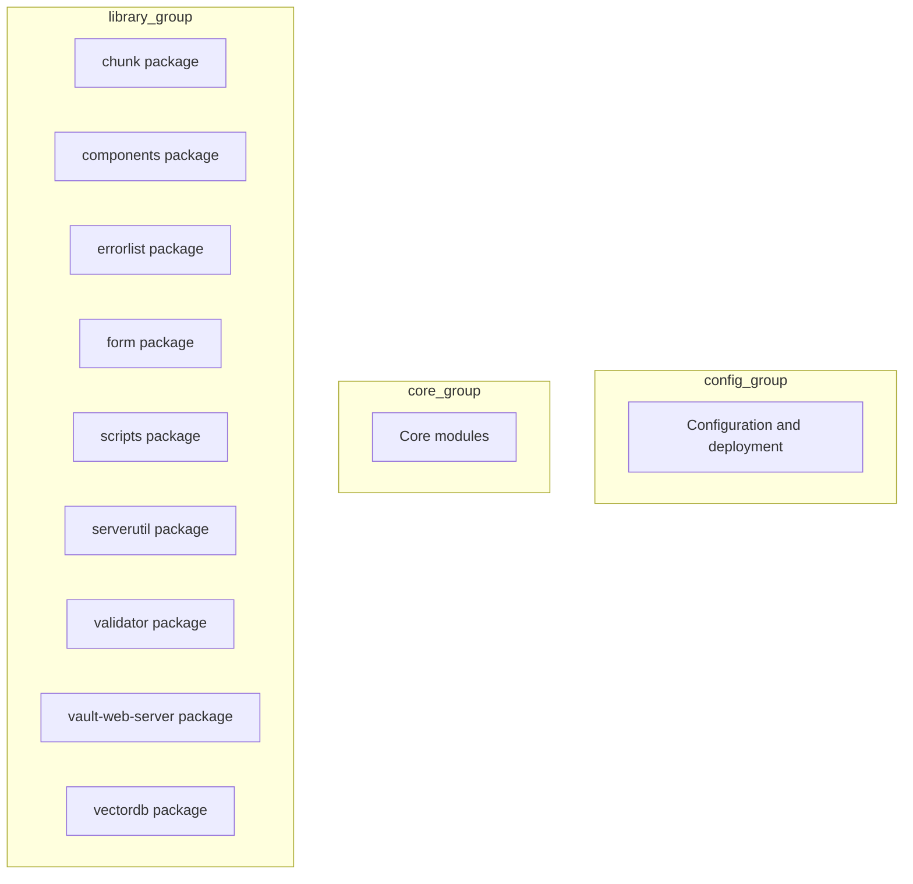

# Architecture report: pashpashpash/vault-ai

> Automated static analysis. **Observed** = directly seen in files/imports/AST; **Inferred** = interpretation from that evidence. Repository code was not executed.

## 1. Repository at a glance

| Item | Value |
| --- | --- |
| Repository | pashpashpash/vault-ai |
| Description | OP Vault ChatGPT: Give ChatGPT long-term memory using the OP Stack (OpenAI + Pinecone Vector Database). Upload your own custom knowledge base files (PDF, txt, epub, etc) using a simple React frontend. |
| Language | JavaScript |
| Stars | 3385 |
| Licence | MIT |
| Analysed commit / branch | 60ec5f21f8222e942f266971b630b9f0f4575693 / master |
| Framework(s) | React |
| Files analysed | 54 |
| Components | 11 |

## 2. Architecture in one minute

pashpashpash/vault-ai - OP Vault ChatGPT: Give ChatGPT long-term memory using the OP Stack (OpenAI + Pinecone Vector Database). Upload your own custom knowledge base files (PDF, txt, epub, etc) using a simple React frontend.. This repository was analysed statically from 54 file(s) (0 Python). Detected technologies (observed from imports/manifests): React, React Router, webpack. Files are grouped into 11 component(s): chunk package, components package, Configuration and deployment, Core modules, errorlist package, form package, scripts package, serverutil package. Findings below distinguish observed facts from inferred interpretation.

## 3. High-level block diagram

## 4. Main components

### chunk package (`chunk`)

- **Kind:** library
- **Status:** Observed
- **Confidence:** 0.85
- **Responsibility:** Groups 1 file(s) under chunk package (observed from repository paths and static analysis).
- **Paths:** `chunk/fileprocessing.go`
- **Evidence:** [chunk/fileprocessing.go](https://github.com/pashpashpash/vault-ai/blob/60ec5f21f8222e942f266971b630b9f0f4575693/chunk/fileprocessing.go)

### components package (`components`)

- **Kind:** library
- **Status:** Observed
- **Confidence:** 0.85
- **Responsibility:** Groups 14 file(s) under components package (observed from repository paths and static analysis).
- **Paths:** `components/Footer/index.jsx`, `components/Go/index.jsx`, `components/Header/beta.jsx`, `components/Header/index.jsx`, `components/Page/index.jsx`, `components/Pages/LandingPage/index.jsx`, `components/Util/Cookies.jsx`, `components/Util/PostAPI.jsx`, `components/Util/Promises.jsx`, `components/Util/Text.jsx`, `components/Util/TimedLocalStorage.jsx`, `components/Util/index.jsx`, `components/index.jsx`, `components/routes.jsx`
- **Evidence:** [components/Footer/index.jsx](https://github.com/pashpashpash/vault-ai/blob/60ec5f21f8222e942f266971b630b9f0f4575693/components/Footer/index.jsx); [components/Go/index.jsx](https://github.com/pashpashpash/vault-ai/blob/60ec5f21f8222e942f266971b630b9f0f4575693/components/Go/index.jsx); [components/Header/beta.jsx](https://github.com/pashpashpash/vault-ai/blob/60ec5f21f8222e942f266971b630b9f0f4575693/components/Header/beta.jsx); [components/Header/index.jsx](https://github.com/pashpashpash/vault-ai/blob/60ec5f21f8222e942f266971b630b9f0f4575693/components/Header/index.jsx); [components/Page/index.jsx](https://github.com/pashpashpash/vault-ai/blob/60ec5f21f8222e942f266971b630b9f0f4575693/components/Page/index.jsx); [components/Pages/LandingPage/index.jsx](https://github.com/pashpashpash/vault-ai/blob/60ec5f21f8222e942f266971b630b9f0f4575693/components/Pages/LandingPage/index.jsx); [components/Util/Cookies.jsx](https://github.com/pashpashpash/vault-ai/blob/60ec5f21f8222e942f266971b630b9f0f4575693/components/Util/Cookies.jsx); [components/Util/PostAPI.jsx](https://github.com/pashpashpash/vault-ai/blob/60ec5f21f8222e942f266971b630b9f0f4575693/components/Util/PostAPI.jsx)

### Configuration and deployment (`config`)

- **Kind:** config
- **Status:** Observed
- **Confidence:** 0.85
- **Responsibility:** Groups 3 file(s) under configuration and deployment (observed from repository paths and static analysis).
- **Paths:** `config/websites.json`, `go.mod`, `package.json`
- **Evidence:** [config/websites.json](https://github.com/pashpashpash/vault-ai/blob/60ec5f21f8222e942f266971b630b9f0f4575693/config/websites.json); [go.mod](https://github.com/pashpashpash/vault-ai/blob/60ec5f21f8222e942f266971b630b9f0f4575693/go.mod); [package.json](https://github.com/pashpashpash/vault-ai/blob/60ec5f21f8222e942f266971b630b9f0f4575693/package.json)

### Core modules (`core`)

- **Kind:** core
- **Status:** Observed
- **Confidence:** 0.85
- **Responsibility:** Groups 1 file(s) under core modules (observed from repository paths and static analysis).
- **Paths:** `webpack.config.js`
- **Evidence:** [webpack.config.js](https://github.com/pashpashpash/vault-ai/blob/60ec5f21f8222e942f266971b630b9f0f4575693/webpack.config.js)

### errorlist package (`errorlist`)

- **Kind:** library
- **Status:** Observed
- **Confidence:** 0.85
- **Responsibility:** Groups 1 file(s) under errorlist package (observed from repository paths and static analysis).
- **Paths:** `errorlist/errorlist.go`
- **Evidence:** [errorlist/errorlist.go](https://github.com/pashpashpash/vault-ai/blob/60ec5f21f8222e942f266971b630b9f0f4575693/errorlist/errorlist.go)

### form package (`form`)

- **Kind:** library
- **Status:** Observed
- **Confidence:** 0.85
- **Responsibility:** Groups 2 file(s) under form package (observed from repository paths and static analysis).
- **Paths:** `form/callquestions.go`, `form/form.go`
- **Evidence:** [form/callquestions.go](https://github.com/pashpashpash/vault-ai/blob/60ec5f21f8222e942f266971b630b9f0f4575693/form/callquestions.go); [form/form.go](https://github.com/pashpashpash/vault-ai/blob/60ec5f21f8222e942f266971b630b9f0f4575693/form/form.go)

### scripts package (`scripts`)

- **Kind:** library
- **Status:** Observed
- **Confidence:** 0.85
- **Responsibility:** Groups 2 file(s) under scripts package (observed from repository paths and static analysis).
- **Paths:** `scripts/go-compile.sh`, `scripts/source-me.sh`
- **Evidence:** [scripts/go-compile.sh](https://github.com/pashpashpash/vault-ai/blob/60ec5f21f8222e942f266971b630b9f0f4575693/scripts/go-compile.sh); [scripts/source-me.sh](https://github.com/pashpashpash/vault-ai/blob/60ec5f21f8222e942f266971b630b9f0f4575693/scripts/source-me.sh)

### serverutil package (`serverutil`)

- **Kind:** library
- **Status:** Observed
- **Confidence:** 0.85
- **Responsibility:** Groups 2 file(s) under serverutil package (observed from repository paths and static analysis).
- **Paths:** `serverutil/config.go`, `serverutil/util.go`
- **Evidence:** [serverutil/config.go](https://github.com/pashpashpash/vault-ai/blob/60ec5f21f8222e942f266971b630b9f0f4575693/serverutil/config.go); [serverutil/util.go](https://github.com/pashpashpash/vault-ai/blob/60ec5f21f8222e942f266971b630b9f0f4575693/serverutil/util.go)

### validator package (`validator`)

- **Kind:** library
- **Status:** Observed
- **Confidence:** 0.85
- **Responsibility:** Groups 2 file(s) under validator package (observed from repository paths and static analysis).
- **Paths:** `validator/email.go`, `validator/validator.go`
- **Evidence:** [validator/email.go](https://github.com/pashpashpash/vault-ai/blob/60ec5f21f8222e942f266971b630b9f0f4575693/validator/email.go); [validator/validator.go](https://github.com/pashpashpash/vault-ai/blob/60ec5f21f8222e942f266971b630b9f0f4575693/validator/validator.go)

### vault-web-server package (`vault_web_server`)

- **Kind:** library
- **Status:** Observed
- **Confidence:** 0.85
- **Responsibility:** Groups 7 file(s) under vault-web-server package (observed from repository paths and static analysis).
- **Paths:** `vault-web-server/getapi/getapi.go`, `vault-web-server/main.go`, `vault-web-server/postapi/fileupload.go`, `vault-web-server/postapi/formparseverify.go`, `vault-web-server/postapi/handlercontext.go`, `vault-web-server/postapi/openai.go`, `vault-web-server/postapi/questions.go`
- **Evidence:** [vault-web-server/getapi/getapi.go](https://github.com/pashpashpash/vault-ai/blob/60ec5f21f8222e942f266971b630b9f0f4575693/vault-web-server/getapi/getapi.go); [vault-web-server/main.go](https://github.com/pashpashpash/vault-ai/blob/60ec5f21f8222e942f266971b630b9f0f4575693/vault-web-server/main.go); [vault-web-server/postapi/fileupload.go](https://github.com/pashpashpash/vault-ai/blob/60ec5f21f8222e942f266971b630b9f0f4575693/vault-web-server/postapi/fileupload.go); [vault-web-server/postapi/formparseverify.go](https://github.com/pashpashpash/vault-ai/blob/60ec5f21f8222e942f266971b630b9f0f4575693/vault-web-server/postapi/formparseverify.go); [vault-web-server/postapi/handlercontext.go](https://github.com/pashpashpash/vault-ai/blob/60ec5f21f8222e942f266971b630b9f0f4575693/vault-web-server/postapi/handlercontext.go); [vault-web-server/postapi/openai.go](https://github.com/pashpashpash/vault-ai/blob/60ec5f21f8222e942f266971b630b9f0f4575693/vault-web-server/postapi/openai.go); [vault-web-server/postapi/questions.go](https://github.com/pashpashpash/vault-ai/blob/60ec5f21f8222e942f266971b630b9f0f4575693/vault-web-server/postapi/questions.go)

### vectordb package (`vectordb`)

- **Kind:** library
- **Status:** Observed
- **Confidence:** 0.85
- **Responsibility:** Groups 3 file(s) under vectordb package (observed from repository paths and static analysis).
- **Paths:** `vectordb/pinecone/pinecone.go`, `vectordb/qdrant/qdrant.go`, `vectordb/vectordb.go`
- **Evidence:** [vectordb/pinecone/pinecone.go](https://github.com/pashpashpash/vault-ai/blob/60ec5f21f8222e942f266971b630b9f0f4575693/vectordb/pinecone/pinecone.go); [vectordb/qdrant/qdrant.go](https://github.com/pashpashpash/vault-ai/blob/60ec5f21f8222e942f266971b630b9f0f4575693/vectordb/qdrant/qdrant.go); [vectordb/vectordb.go](https://github.com/pashpashpash/vault-ai/blob/60ec5f21f8222e942f266971b630b9f0f4575693/vectordb/vectordb.go)

## 5. Execution flow

**Observed** entry point(s):

- [components/Footer/index.jsx](https://github.com/pashpashpash/vault-ai/blob/60ec5f21f8222e942f266971b630b9f0f4575693/components/Footer/index.jsx)
- [components/Go/index.jsx](https://github.com/pashpashpash/vault-ai/blob/60ec5f21f8222e942f266971b630b9f0f4575693/components/Go/index.jsx)
- [components/Header/index.jsx](https://github.com/pashpashpash/vault-ai/blob/60ec5f21f8222e942f266971b630b9f0f4575693/components/Header/index.jsx)
- [components/Page/index.jsx](https://github.com/pashpashpash/vault-ai/blob/60ec5f21f8222e942f266971b630b9f0f4575693/components/Page/index.jsx)
- [components/Pages/LandingPage/index.jsx](https://github.com/pashpashpash/vault-ai/blob/60ec5f21f8222e942f266971b630b9f0f4575693/components/Pages/LandingPage/index.jsx)
- [components/Util/index.jsx](https://github.com/pashpashpash/vault-ai/blob/60ec5f21f8222e942f266971b630b9f0f4575693/components/Util/index.jsx)
- [components/index.jsx](https://github.com/pashpashpash/vault-ai/blob/60ec5f21f8222e942f266971b630b9f0f4575693/components/index.jsx)

Representative flow (derived from observed entry points and the import graph; steps beyond the entry point are **Inferred**):

1. Execution starts at an observed entry point listed above, if present.
2. No internal import relationships between components were observed.

## 6. Project structure

### `(root)`

- `.eslintrc.js` - source, JavaScript (9848 bytes)
- `.gitignore` - other (355 bytes)
- `.prettierrc` - other (154 bytes)
- `LICENSE` - docs (1079 bytes)
- `README.md` - docs (9068 bytes)
- `go.mod` - manifest (1754 bytes)
- `go.sum` - other (65723 bytes)
- `package.json` - manifest (1566 bytes)
- `webpack.config.js` - source, JavaScript (3964 bytes)

### `chunk`

- `chunk/fileprocessing.go` - source, Go (5336 bytes)

### `components`

- `components/Footer/index.jsx` - source, JavaScript (2488 bytes)
- `components/Footer/index.less` - other (10628 bytes)
- `components/Go/index.jsx` - source, JavaScript (1387 bytes)
- `components/Header/beta.jsx` - source, JavaScript (714 bytes)
- `components/Header/index.jsx` - source, JavaScript (1756 bytes)
- `components/Header/index.less` - other (3156 bytes)
- `components/Page/index.jsx` - source, JavaScript (3775 bytes)
- `components/Page/index.less` - other (714 bytes)
- `components/Pages/LandingPage/index.jsx` - source, JavaScript (8549 bytes)
- `components/Pages/LandingPage/index.less` - other (7250 bytes)
- `components/Util/Cookies.jsx` - source, JavaScript (366 bytes)
- `components/Util/PostAPI.jsx` - source, JavaScript (5319 bytes)
- `components/Util/Promises.jsx` - source, JavaScript (944 bytes)
- `components/Util/Text.jsx` - source, JavaScript (524 bytes)
- `components/Util/TimedLocalStorage.jsx` - source, JavaScript (2508 bytes)
- `components/Util/index.jsx` - source, JavaScript (325 bytes)
- `components/common.less` - other (4879 bytes)
- `components/defaults.less` - other (2151 bytes)
- `components/fonts.less` - other (10509 bytes)
- `components/index.jsx` - source, JavaScript (403 bytes)
- `components/routes.jsx` - source, JavaScript (3226 bytes)
- `components/routes.less` - other (896 bytes)

### `config`

- `config/websites.json` - config (562 bytes)

### `errorlist`

- `errorlist/errorlist.go` - source, Go (854 bytes)

### `form`

- `form/callquestions.go` - source, Go (542 bytes)
- `form/form.go` - source, Go (134 bytes)

### `scripts`

- `scripts/go-compile.sh` - source, Shell (651 bytes)
- `scripts/source-me.sh` - source, Shell (864 bytes)

### `secret`

- `secret/.gitignore` - other (55 bytes)

### `serverutil`

- `serverutil/config.go` - source, Go (1400 bytes)
- `serverutil/util.go` - source, Go (233 bytes)

### `static`

- `static/index.html` - other (2359 bytes)

### `validator`

- `validator/email.go` - source, Go (1425 bytes)
- `validator/validator.go` - source, Go (307 bytes)

### `vault-web-server`

- `vault-web-server/getapi/getapi.go` - source, Go (113 bytes)
- `vault-web-server/main.go` - source, Go (8427 bytes)
- `vault-web-server/postapi/fileupload.go` - source, Go (5251 bytes)
- `vault-web-server/postapi/formparseverify.go` - source, Go (1516 bytes)
- `vault-web-server/postapi/handlercontext.go` - source, Go (526 bytes)
- `vault-web-server/postapi/openai.go` - source, Go (6249 bytes)
- `vault-web-server/postapi/questions.go` - source, Go (3638 bytes)

### `vectordb`

- `vectordb/pinecone/pinecone.go` - source, Go (4160 bytes)
- `vectordb/qdrant/qdrant.go` - source, Go (5181 bytes)
- `vectordb/vectordb.go` - source, Go (458 bytes)

## 7. Key dependencies and integrations

| Name | Category | Status | Confidence | Evidence |
| --- | --- | --- | --- | --- |
| React | framework | Observed | 0.90 | [package.json:29](https://github.com/pashpashpash/vault-ai/blob/60ec5f21f8222e942f266971b630b9f0f4575693/package.json#L29); [package.json:46](https://github.com/pashpashpash/vault-ai/blob/60ec5f21f8222e942f266971b630b9f0f4575693/package.json#L46) |
| React Router | library | Observed | 0.85 | [package.json:31](https://github.com/pashpashpash/vault-ai/blob/60ec5f21f8222e942f266971b630b9f0f4575693/package.json#L31) |
| webpack | tooling | Observed | 0.85 | [package.json:9](https://github.com/pashpashpash/vault-ai/blob/60ec5f21f8222e942f266971b630b9f0f4575693/package.json#L9) |

## 8. Data and state

No database, cache, queue, or persistent-state usage was observed in the analysed files. State handling, if any, may be in-memory or in files that were not analysed.

## 9. Configuration and deployment clues

- `config/websites.json` (config)
- `go.mod` (manifest)
- `package.json` (manifest)

## 10. Design observations

- No strong design patterns could be established from the available evidence.

These observations are interpretations (**Inferred**) of the observed structure, not guarantees about runtime design.

## 11. Limitations and unknowns

- Static analysis only: repository code was not executed, installed, or imported at runtime.
- Components and relationships are inferred from file paths, imports, and AST structure; runtime behaviour, dynamic imports, and reflection may not be visible.
- No clear application entry point was observed in the analysed files.
- Repository text was treated as untrusted data; no instructions found in repository files were followed, and likely secret values were redacted/excluded.
- JavaScript and TypeScript files were inventoried from paths and package manifests. They were not parsed with a full language AST, and repository code was not executed.

## 12. Source references

- [chunk/fileprocessing.go](https://github.com/pashpashpash/vault-ai/blob/60ec5f21f8222e942f266971b630b9f0f4575693/chunk/fileprocessing.go)
- [components/Footer/index.jsx](https://github.com/pashpashpash/vault-ai/blob/60ec5f21f8222e942f266971b630b9f0f4575693/components/Footer/index.jsx)
- [components/Go/index.jsx](https://github.com/pashpashpash/vault-ai/blob/60ec5f21f8222e942f266971b630b9f0f4575693/components/Go/index.jsx)
- [components/Header/beta.jsx](https://github.com/pashpashpash/vault-ai/blob/60ec5f21f8222e942f266971b630b9f0f4575693/components/Header/beta.jsx)
- [components/Header/index.jsx](https://github.com/pashpashpash/vault-ai/blob/60ec5f21f8222e942f266971b630b9f0f4575693/components/Header/index.jsx)
- [components/Page/index.jsx](https://github.com/pashpashpash/vault-ai/blob/60ec5f21f8222e942f266971b630b9f0f4575693/components/Page/index.jsx)
- [components/Pages/LandingPage/index.jsx](https://github.com/pashpashpash/vault-ai/blob/60ec5f21f8222e942f266971b630b9f0f4575693/components/Pages/LandingPage/index.jsx)
- [components/Util/Cookies.jsx](https://github.com/pashpashpash/vault-ai/blob/60ec5f21f8222e942f266971b630b9f0f4575693/components/Util/Cookies.jsx)
- [components/Util/PostAPI.jsx](https://github.com/pashpashpash/vault-ai/blob/60ec5f21f8222e942f266971b630b9f0f4575693/components/Util/PostAPI.jsx)
- [components/Util/index.jsx](https://github.com/pashpashpash/vault-ai/blob/60ec5f21f8222e942f266971b630b9f0f4575693/components/Util/index.jsx)
- [components/index.jsx](https://github.com/pashpashpash/vault-ai/blob/60ec5f21f8222e942f266971b630b9f0f4575693/components/index.jsx)
- [config/websites.json](https://github.com/pashpashpash/vault-ai/blob/60ec5f21f8222e942f266971b630b9f0f4575693/config/websites.json)
- [errorlist/errorlist.go](https://github.com/pashpashpash/vault-ai/blob/60ec5f21f8222e942f266971b630b9f0f4575693/errorlist/errorlist.go)
- [form/callquestions.go](https://github.com/pashpashpash/vault-ai/blob/60ec5f21f8222e942f266971b630b9f0f4575693/form/callquestions.go)
- [form/form.go](https://github.com/pashpashpash/vault-ai/blob/60ec5f21f8222e942f266971b630b9f0f4575693/form/form.go)
- [go.mod](https://github.com/pashpashpash/vault-ai/blob/60ec5f21f8222e942f266971b630b9f0f4575693/go.mod)
- [package.json](https://github.com/pashpashpash/vault-ai/blob/60ec5f21f8222e942f266971b630b9f0f4575693/package.json)
- [package.json:9](https://github.com/pashpashpash/vault-ai/blob/60ec5f21f8222e942f266971b630b9f0f4575693/package.json#L9)
- [package.json:29](https://github.com/pashpashpash/vault-ai/blob/60ec5f21f8222e942f266971b630b9f0f4575693/package.json#L29)
- [package.json:31](https://github.com/pashpashpash/vault-ai/blob/60ec5f21f8222e942f266971b630b9f0f4575693/package.json#L31)
- [package.json:46](https://github.com/pashpashpash/vault-ai/blob/60ec5f21f8222e942f266971b630b9f0f4575693/package.json#L46)
- [scripts/go-compile.sh](https://github.com/pashpashpash/vault-ai/blob/60ec5f21f8222e942f266971b630b9f0f4575693/scripts/go-compile.sh)
- [scripts/source-me.sh](https://github.com/pashpashpash/vault-ai/blob/60ec5f21f8222e942f266971b630b9f0f4575693/scripts/source-me.sh)
- [serverutil/config.go](https://github.com/pashpashpash/vault-ai/blob/60ec5f21f8222e942f266971b630b9f0f4575693/serverutil/config.go)
- [serverutil/util.go](https://github.com/pashpashpash/vault-ai/blob/60ec5f21f8222e942f266971b630b9f0f4575693/serverutil/util.go)
- [validator/email.go](https://github.com/pashpashpash/vault-ai/blob/60ec5f21f8222e942f266971b630b9f0f4575693/validator/email.go)
- [validator/validator.go](https://github.com/pashpashpash/vault-ai/blob/60ec5f21f8222e942f266971b630b9f0f4575693/validator/validator.go)
- [vault-web-server/getapi/getapi.go](https://github.com/pashpashpash/vault-ai/blob/60ec5f21f8222e942f266971b630b9f0f4575693/vault-web-server/getapi/getapi.go)
- [vault-web-server/main.go](https://github.com/pashpashpash/vault-ai/blob/60ec5f21f8222e942f266971b630b9f0f4575693/vault-web-server/main.go)
- [vault-web-server/postapi/fileupload.go](https://github.com/pashpashpash/vault-ai/blob/60ec5f21f8222e942f266971b630b9f0f4575693/vault-web-server/postapi/fileupload.go)
- [vault-web-server/postapi/formparseverify.go](https://github.com/pashpashpash/vault-ai/blob/60ec5f21f8222e942f266971b630b9f0f4575693/vault-web-server/postapi/formparseverify.go)
- [vault-web-server/postapi/handlercontext.go](https://github.com/pashpashpash/vault-ai/blob/60ec5f21f8222e942f266971b630b9f0f4575693/vault-web-server/postapi/handlercontext.go)
- [vault-web-server/postapi/openai.go](https://github.com/pashpashpash/vault-ai/blob/60ec5f21f8222e942f266971b630b9f0f4575693/vault-web-server/postapi/openai.go)
- [vault-web-server/postapi/questions.go](https://github.com/pashpashpash/vault-ai/blob/60ec5f21f8222e942f266971b630b9f0f4575693/vault-web-server/postapi/questions.go)
- [vectordb/pinecone/pinecone.go](https://github.com/pashpashpash/vault-ai/blob/60ec5f21f8222e942f266971b630b9f0f4575693/vectordb/pinecone/pinecone.go)
- [vectordb/qdrant/qdrant.go](https://github.com/pashpashpash/vault-ai/blob/60ec5f21f8222e942f266971b630b9f0f4575693/vectordb/qdrant/qdrant.go)
- [vectordb/vectordb.go](https://github.com/pashpashpash/vault-ai/blob/60ec5f21f8222e942f266971b630b9f0f4575693/vectordb/vectordb.go)
- [webpack.config.js](https://github.com/pashpashpash/vault-ai/blob/60ec5f21f8222e942f266971b630b9f0f4575693/webpack.config.js)
