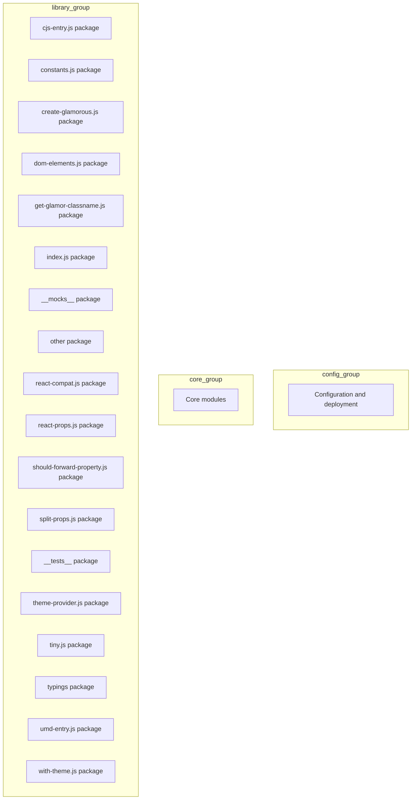

# Architecture report: paypal/glamorous

> Automated static analysis. **Observed** = directly seen in files/imports/AST; **Inferred** = interpretation from that evidence. Repository code was not executed.

## 1. Repository at a glance

| Item | Value |
| --- | --- |
| Repository | paypal/glamorous |
| Description | DEPRECATED: 💄 Maintainable CSS with React |
| Language | JavaScript |
| Stars | 3613 |
| Licence | MIT |
| Analysed commit / branch | 031484cd5eff92ff135038200ba49a300859a335 / master |
| Framework(s) | React |
| Files analysed | 113 |
| Components | 20 |

## 2. Architecture in one minute

paypal/glamorous - DEPRECATED: 💄 Maintainable CSS with React. This repository was analysed statically from 113 file(s) (0 Python). Detected technologies (observed from imports/manifests): React, Jest, TypeScript. Files are grouped into 20 component(s): cjs-entry.js package, Configuration and deployment, constants.js package, Core modules, create-glamorous.js package, dom-elements.js package, get-glamor-classname.js package, index.js package. Findings below distinguish observed facts from inferred interpretation.

## 3. High-level block diagram

## 4. Main components

### cjs-entry.js package (`cjs_entry_js`)

- **Kind:** library
- **Status:** Observed
- **Confidence:** 0.85
- **Responsibility:** Groups 1 file(s) under cjs-entry.js package (observed from repository paths and static analysis).
- **Paths:** `src/cjs-entry.js`
- **Evidence:** [src/cjs-entry.js](https://github.com/paypal/glamorous/blob/031484cd5eff92ff135038200ba49a300859a335/src/cjs-entry.js)

### Configuration and deployment (`config`)

- **Kind:** config
- **Status:** Observed
- **Confidence:** 0.85
- **Responsibility:** Groups 7 file(s) under configuration and deployment (observed from repository paths and static analysis).
- **Paths:** `other/codemods/package.json`, `package.json`, `tsconfig.base.json`, `tsconfig.json`, `tsconfig.preact.json`, `tsconfig.react.json`, `tslint.json`
- **Evidence:** [other/codemods/package.json](https://github.com/paypal/glamorous/blob/031484cd5eff92ff135038200ba49a300859a335/other/codemods/package.json); [package.json](https://github.com/paypal/glamorous/blob/031484cd5eff92ff135038200ba49a300859a335/package.json); [tsconfig.base.json](https://github.com/paypal/glamorous/blob/031484cd5eff92ff135038200ba49a300859a335/tsconfig.base.json); [tsconfig.json](https://github.com/paypal/glamorous/blob/031484cd5eff92ff135038200ba49a300859a335/tsconfig.json); [tsconfig.preact.json](https://github.com/paypal/glamorous/blob/031484cd5eff92ff135038200ba49a300859a335/tsconfig.preact.json); [tsconfig.react.json](https://github.com/paypal/glamorous/blob/031484cd5eff92ff135038200ba49a300859a335/tsconfig.react.json); [tslint.json](https://github.com/paypal/glamorous/blob/031484cd5eff92ff135038200ba49a300859a335/tslint.json)

### constants.js package (`constants_js`)

- **Kind:** library
- **Status:** Observed
- **Confidence:** 0.85
- **Responsibility:** Groups 1 file(s) under constants.js package (observed from repository paths and static analysis).
- **Paths:** `src/constants.js`
- **Evidence:** [src/constants.js](https://github.com/paypal/glamorous/blob/031484cd5eff92ff135038200ba49a300859a335/src/constants.js)

### Core modules (`core`)

- **Kind:** core
- **Status:** Observed
- **Confidence:** 0.85
- **Responsibility:** Groups 2 file(s) under core modules (observed from repository paths and static analysis).
- **Paths:** `jest.config.js`, `rollup.config.js`
- **Evidence:** [jest.config.js](https://github.com/paypal/glamorous/blob/031484cd5eff92ff135038200ba49a300859a335/jest.config.js); [rollup.config.js](https://github.com/paypal/glamorous/blob/031484cd5eff92ff135038200ba49a300859a335/rollup.config.js)

### create-glamorous.js package (`create_glamorous_js`)

- **Kind:** library
- **Status:** Observed
- **Confidence:** 0.85
- **Responsibility:** Groups 1 file(s) under create-glamorous.js package (observed from repository paths and static analysis).
- **Paths:** `src/create-glamorous.js`
- **Evidence:** [src/create-glamorous.js](https://github.com/paypal/glamorous/blob/031484cd5eff92ff135038200ba49a300859a335/src/create-glamorous.js)

### dom-elements.js package (`dom_elements_js`)

- **Kind:** library
- **Status:** Observed
- **Confidence:** 0.85
- **Responsibility:** Groups 1 file(s) under dom-elements.js package (observed from repository paths and static analysis).
- **Paths:** `src/dom-elements.js`
- **Evidence:** [src/dom-elements.js](https://github.com/paypal/glamorous/blob/031484cd5eff92ff135038200ba49a300859a335/src/dom-elements.js)

### get-glamor-classname.js package (`get_glamor_classname_js`)

- **Kind:** library
- **Status:** Observed
- **Confidence:** 0.85
- **Responsibility:** Groups 1 file(s) under get-glamor-classname.js package (observed from repository paths and static analysis).
- **Paths:** `src/get-glamor-classname.js`
- **Evidence:** [src/get-glamor-classname.js](https://github.com/paypal/glamorous/blob/031484cd5eff92ff135038200ba49a300859a335/src/get-glamor-classname.js)

### index.js package (`index_js`)

- **Kind:** library
- **Status:** Observed
- **Confidence:** 0.85
- **Responsibility:** Groups 1 file(s) under index.js package (observed from repository paths and static analysis).
- **Paths:** `src/index.js`
- **Evidence:** [src/index.js](https://github.com/paypal/glamorous/blob/031484cd5eff92ff135038200ba49a300859a335/src/index.js)

### __mocks__ package (`mocks`)

- **Kind:** library
- **Status:** Observed
- **Confidence:** 0.85
- **Responsibility:** Groups 1 file(s) under __mocks__ package (observed from repository paths and static analysis).
- **Paths:** `src/__mocks__/constants.js`
- **Evidence:** [src/__mocks__/constants.js](https://github.com/paypal/glamorous/blob/031484cd5eff92ff135038200ba49a300859a335/src/__mocks__/constants.js)

### other package (`other`)

- **Kind:** library
- **Status:** Observed
- **Confidence:** 0.85
- **Responsibility:** Groups 9 file(s) under other package (observed from repository paths and static analysis).
- **Paths:** `other/__tests__/dist-preact.js`, `other/__tests__/dist-react.js`, `other/__tests__/helpers/prop-types.js`, `other/codemods/theme-move.js`, `other/codemods/theme-move.test.js`, `other/get-exports-code.js`, `other/jest.config.js`, `other/patch-preact-package-json.js`, `other/setup-tests.js`
- **Evidence:** [other/__tests__/dist-preact.js](https://github.com/paypal/glamorous/blob/031484cd5eff92ff135038200ba49a300859a335/other/__tests__/dist-preact.js); [other/__tests__/dist-react.js](https://github.com/paypal/glamorous/blob/031484cd5eff92ff135038200ba49a300859a335/other/__tests__/dist-react.js); [other/__tests__/helpers/prop-types.js](https://github.com/paypal/glamorous/blob/031484cd5eff92ff135038200ba49a300859a335/other/__tests__/helpers/prop-types.js); [other/codemods/theme-move.js](https://github.com/paypal/glamorous/blob/031484cd5eff92ff135038200ba49a300859a335/other/codemods/theme-move.js); [other/codemods/theme-move.test.js](https://github.com/paypal/glamorous/blob/031484cd5eff92ff135038200ba49a300859a335/other/codemods/theme-move.test.js); [other/get-exports-code.js](https://github.com/paypal/glamorous/blob/031484cd5eff92ff135038200ba49a300859a335/other/get-exports-code.js); [other/jest.config.js](https://github.com/paypal/glamorous/blob/031484cd5eff92ff135038200ba49a300859a335/other/jest.config.js); [other/patch-preact-package-json.js](https://github.com/paypal/glamorous/blob/031484cd5eff92ff135038200ba49a300859a335/other/patch-preact-package-json.js)

### react-compat.js package (`react_compat_js`)

- **Kind:** library
- **Status:** Observed
- **Confidence:** 0.85
- **Responsibility:** Groups 1 file(s) under react-compat.js package (observed from repository paths and static analysis).
- **Paths:** `src/react-compat.js`
- **Evidence:** [src/react-compat.js](https://github.com/paypal/glamorous/blob/031484cd5eff92ff135038200ba49a300859a335/src/react-compat.js)

### react-props.js package (`react_props_js`)

- **Kind:** library
- **Status:** Observed
- **Confidence:** 0.85
- **Responsibility:** Groups 1 file(s) under react-props.js package (observed from repository paths and static analysis).
- **Paths:** `src/react-props.js`
- **Evidence:** [src/react-props.js](https://github.com/paypal/glamorous/blob/031484cd5eff92ff135038200ba49a300859a335/src/react-props.js)

### should-forward-property.js package (`should_forward_property_js`)

- **Kind:** library
- **Status:** Observed
- **Confidence:** 0.85
- **Responsibility:** Groups 1 file(s) under should-forward-property.js package (observed from repository paths and static analysis).
- **Paths:** `src/should-forward-property.js`
- **Evidence:** [src/should-forward-property.js](https://github.com/paypal/glamorous/blob/031484cd5eff92ff135038200ba49a300859a335/src/should-forward-property.js)

### split-props.js package (`split_props_js`)

- **Kind:** library
- **Status:** Observed
- **Confidence:** 0.85
- **Responsibility:** Groups 1 file(s) under split-props.js package (observed from repository paths and static analysis).
- **Paths:** `src/split-props.js`
- **Evidence:** [src/split-props.js](https://github.com/paypal/glamorous/blob/031484cd5eff92ff135038200ba49a300859a335/src/split-props.js)

### __tests__ package (`tests`)

- **Kind:** library
- **Status:** Observed
- **Confidence:** 0.85
- **Responsibility:** Groups 19 file(s) under __tests__ package (observed from repository paths and static analysis).
- **Paths:** `src/__tests__/create-glamorous.with-component.js`, `src/__tests__/dev.js`, `src/__tests__/index.filter-props.js`, `src/__tests__/index.js`, `src/__tests__/index.should-class-name-update.js`, `src/__tests__/index.with-config.js`, `src/__tests__/index.with-props.js`, `src/__tests__/preact.js`, `src/__tests__/refs.js`, `src/__tests__/should-forward-property.js`, `src/__tests__/theme-provider.js`, `src/__tests__/tiny.js`, `src/__tests__/typescript.js`, `src/__tests__/with-theme.js`, `test/glamorous-exports.test.ts`, `test/glamorous.test.tsx`, `test/preact/glamorous.test.tsx`, `test/preact/should-fail.test.tsx`, `test/should-fail.test.tsx`
- **Evidence:** [src/__tests__/create-glamorous.with-component.js](https://github.com/paypal/glamorous/blob/031484cd5eff92ff135038200ba49a300859a335/src/__tests__/create-glamorous.with-component.js); [src/__tests__/dev.js](https://github.com/paypal/glamorous/blob/031484cd5eff92ff135038200ba49a300859a335/src/__tests__/dev.js); [src/__tests__/index.filter-props.js](https://github.com/paypal/glamorous/blob/031484cd5eff92ff135038200ba49a300859a335/src/__tests__/index.filter-props.js); [src/__tests__/index.js](https://github.com/paypal/glamorous/blob/031484cd5eff92ff135038200ba49a300859a335/src/__tests__/index.js); [src/__tests__/index.should-class-name-update.js](https://github.com/paypal/glamorous/blob/031484cd5eff92ff135038200ba49a300859a335/src/__tests__/index.should-class-name-update.js); [src/__tests__/index.with-config.js](https://github.com/paypal/glamorous/blob/031484cd5eff92ff135038200ba49a300859a335/src/__tests__/index.with-config.js); [src/__tests__/index.with-props.js](https://github.com/paypal/glamorous/blob/031484cd5eff92ff135038200ba49a300859a335/src/__tests__/index.with-props.js); [src/__tests__/preact.js](https://github.com/paypal/glamorous/blob/031484cd5eff92ff135038200ba49a300859a335/src/__tests__/preact.js)

### theme-provider.js package (`theme_provider_js`)

- **Kind:** library
- **Status:** Observed
- **Confidence:** 0.85
- **Responsibility:** Groups 1 file(s) under theme-provider.js package (observed from repository paths and static analysis).
- **Paths:** `src/theme-provider.js`
- **Evidence:** [src/theme-provider.js](https://github.com/paypal/glamorous/blob/031484cd5eff92ff135038200ba49a300859a335/src/theme-provider.js)

### tiny.js package (`tiny_js`)

- **Kind:** library
- **Status:** Observed
- **Confidence:** 0.85
- **Responsibility:** Groups 1 file(s) under tiny.js package (observed from repository paths and static analysis).
- **Paths:** `src/tiny.js`
- **Evidence:** [src/tiny.js](https://github.com/paypal/glamorous/blob/031484cd5eff92ff135038200ba49a300859a335/src/tiny.js)

### typings package (`typings`)

- **Kind:** library
- **Status:** Observed
- **Confidence:** 0.85
- **Responsibility:** Groups 22 file(s) under typings package (observed from repository paths and static analysis).
- **Paths:** `typings/built-in-component-factories.d.ts`, `typings/built-in-glamorous-components.d.ts`, `typings/component-factory.d.ts`, `typings/css-properties.d.ts`, `typings/dom-tag-component-factory.d.ts`, `typings/glamorous-component.d.ts`, `typings/glamorous.d.ts`, `typings/helpers.d.ts`, `typings/named-built-in-glamorous-components.d.ts`, `typings/preact/built-in-component-factories.d.ts`, `typings/preact/built-in-glamorous-components.d.ts`, `typings/preact/component-factory.d.ts`, `typings/preact/css-properties.d.ts`, `typings/preact/dom-tag-component-factory.d.ts`, `typings/preact/glamorous-component.d.ts`, `typings/preact/glamorous.d.ts`, `typings/preact/helpers.d.ts`, `typings/preact/named-built-in-glamorous-components.d.ts`, `typings/preact/style-arguments.d.ts`, `typings/preact/svg-properties.d.ts`, `typings/style-arguments.d.ts`, `typings/svg-properties.d.ts`
- **Evidence:** [typings/built-in-component-factories.d.ts](https://github.com/paypal/glamorous/blob/031484cd5eff92ff135038200ba49a300859a335/typings/built-in-component-factories.d.ts); [typings/built-in-glamorous-components.d.ts](https://github.com/paypal/glamorous/blob/031484cd5eff92ff135038200ba49a300859a335/typings/built-in-glamorous-components.d.ts); [typings/component-factory.d.ts](https://github.com/paypal/glamorous/blob/031484cd5eff92ff135038200ba49a300859a335/typings/component-factory.d.ts); [typings/css-properties.d.ts](https://github.com/paypal/glamorous/blob/031484cd5eff92ff135038200ba49a300859a335/typings/css-properties.d.ts); [typings/dom-tag-component-factory.d.ts](https://github.com/paypal/glamorous/blob/031484cd5eff92ff135038200ba49a300859a335/typings/dom-tag-component-factory.d.ts); [typings/glamorous-component.d.ts](https://github.com/paypal/glamorous/blob/031484cd5eff92ff135038200ba49a300859a335/typings/glamorous-component.d.ts); [typings/glamorous.d.ts](https://github.com/paypal/glamorous/blob/031484cd5eff92ff135038200ba49a300859a335/typings/glamorous.d.ts); [typings/helpers.d.ts](https://github.com/paypal/glamorous/blob/031484cd5eff92ff135038200ba49a300859a335/typings/helpers.d.ts)

### umd-entry.js package (`umd_entry_js`)

- **Kind:** library
- **Status:** Observed
- **Confidence:** 0.85
- **Responsibility:** Groups 1 file(s) under umd-entry.js package (observed from repository paths and static analysis).
- **Paths:** `src/umd-entry.js`
- **Evidence:** [src/umd-entry.js](https://github.com/paypal/glamorous/blob/031484cd5eff92ff135038200ba49a300859a335/src/umd-entry.js)

### with-theme.js package (`with_theme_js`)

- **Kind:** library
- **Status:** Observed
- **Confidence:** 0.85
- **Responsibility:** Groups 1 file(s) under with-theme.js package (observed from repository paths and static analysis).
- **Paths:** `src/with-theme.js`
- **Evidence:** [src/with-theme.js](https://github.com/paypal/glamorous/blob/031484cd5eff92ff135038200ba49a300859a335/src/with-theme.js)

## 5. Execution flow

**Observed** entry point(s):

- [examples/with-jest/index.js](https://github.com/paypal/glamorous/blob/031484cd5eff92ff135038200ba49a300859a335/examples/with-jest/index.js)
- [src/index.js](https://github.com/paypal/glamorous/blob/031484cd5eff92ff135038200ba49a300859a335/src/index.js)

Representative flow (derived from observed entry points and the import graph; steps beyond the entry point are **Inferred**):

1. Execution starts at an observed entry point listed above, if present.
2. No internal import relationships between components were observed.

## 6. Project structure

### `(root)`

- `.all-contributorsrc` - other (16907 bytes)
- `.eslintignore` - other (35 bytes)
- `.gitattributes` - other (51 bytes)
- `.gitignore` - other (116 bytes)
- `.travis.yml` - ci, YAML (206 bytes)
- `CHANGELOG.md` - docs (187 bytes)
- `CODE_OF_CONDUCT.md` - docs (3233 bytes)
- `CONTRIBUTING.md` - docs (2544 bytes)
- `LICENSE` - docs (1072 bytes)
- `README.md` - docs (27503 bytes)
- `jest.config.js` - source, JavaScript (438 bytes)
- `package.json` - manifest (2962 bytes)
- `rollup.config.js` - source, JavaScript (712 bytes)
- `tsconfig.base.json` - config (485 bytes)
- `tsconfig.json` - config (330 bytes)
- `tsconfig.preact.json` - config (365 bytes)
- `tsconfig.react.json` - config (162 bytes)
- `tslint.json` - config (47 bytes)

### `.github`

- `.github/ISSUE_TEMPLATE.md` - docs (155 bytes)
- `.github/PULL_REQUEST_TEMPLATE.md` - docs (131 bytes)

### `examples`

- `examples/README.md` - docs (9459 bytes)
- `examples/with-jest/.babelrc` - other (34 bytes)
- `examples/with-jest/README.md` - docs (1158 bytes)
- `examples/with-jest/__snapshots__/index.test.js.snap` - other (1150 bytes)
- `examples/with-jest/index.js` - source, JavaScript (237 bytes)
- `examples/with-jest/index.test.js` - source, JavaScript (479 bytes)
- `examples/with-jest/package.json` - manifest (816 bytes)
- `examples/with-jest/testSetup.js` - source, JavaScript (272 bytes)

### `other`

- `other/EMOTION_MIGRATION.md` - docs (4289 bytes)
- `other/FAQ.md` - docs (1979 bytes)
- `other/MAINTAINING.md` - docs (3269 bytes)
- `other/USERS.md` - docs (2125 bytes)
- `other/__tests__/dist-preact.js` - source, JavaScript (4283 bytes)
- `other/__tests__/dist-react.js` - source, JavaScript (4247 bytes)
- `other/__tests__/helpers/prop-types.js` - source, JavaScript (95 bytes)
- `other/codemods/README.md` - docs (1882 bytes)
- `other/codemods/__snapshots__/theme-move.test.js.snap` - other (5730 bytes)
- `other/codemods/package.json` - manifest (689 bytes)
- `other/codemods/theme-move.js` - source, JavaScript (7026 bytes)
- `other/codemods/theme-move.test.js` - source, JavaScript (4587 bytes)
- `other/get-exports-code.js` - source, JavaScript (1026 bytes)
- `other/jest.config.js` - source, JavaScript (178 bytes)
- `other/logo/compact.ai` - other (87873 bytes)
- `other/logo/full.ai` - other (119725 bytes)
- `other/manual-releases.md` - docs (1313 bytes)
- `other/patch-preact-package-json.js` - source, JavaScript (346 bytes)
- `other/setup-tests.js` - source, JavaScript (118 bytes)

### `src`

- `src/.eslintrc` - other (54 bytes)
- `src/__mocks__/constants.js` - source, JavaScript (95 bytes)
- `src/__tests__/.eslintrc` - other (51 bytes)
- `src/__tests__/__snapshots__/create-glamorous.with-component.js.snap` - other (839 bytes)
- `src/__tests__/__snapshots__/dev.js.snap` - other (195 bytes)
- `src/__tests__/__snapshots__/index.js.snap` - other (5004 bytes)
- `src/__tests__/__snapshots__/index.with-props.js.snap` - other (226 bytes)
- `src/__tests__/__snapshots__/theme-provider.js.snap` - other (2934 bytes)
- `src/__tests__/__snapshots__/tiny.js.snap` - other (209 bytes)
- `src/__tests__/__snapshots__/typescript.js.snap` - other (20884 bytes)
- `src/__tests__/__snapshots__/with-theme.js.snap` - other (1927 bytes)
- `src/__tests__/create-glamorous.with-component.js` - source, JavaScript (2564 bytes)
- `src/__tests__/dev.js` - source, JavaScript (917 bytes)
- `src/__tests__/index.filter-props.js` - source, JavaScript (3031 bytes)
- `src/__tests__/index.js` - source, JavaScript (12708 bytes)
- `src/__tests__/index.should-class-name-update.js` - source, JavaScript (4182 bytes)
- `src/__tests__/index.with-config.js` - source, JavaScript (1252 bytes)
- `src/__tests__/index.with-props.js` - source, JavaScript (4371 bytes)
- `src/__tests__/preact.js` - source, JavaScript (1355 bytes)
- `src/__tests__/refs.js` - source, JavaScript (2570 bytes)
- `src/__tests__/should-forward-property.js` - source, JavaScript (2295 bytes)
- `src/__tests__/theme-provider.js` - source, JavaScript (4247 bytes)
- `src/__tests__/tiny.js` - source, JavaScript (1763 bytes)
- `src/__tests__/typescript.js` - source, JavaScript (588 bytes)
- `src/__tests__/with-theme.js` - source, JavaScript (3773 bytes)
- `src/cjs-entry.js` - source, JavaScript (358 bytes)
- `src/constants.js` - source, JavaScript (186 bytes)
- `src/create-glamorous.js` - source, JavaScript (8228 bytes)
- `src/dom-elements.js` - source, JavaScript (230 bytes)
- `src/get-glamor-classname.js` - source, JavaScript (2999 bytes)
- `src/index.js` - source, JavaScript (1739 bytes)
- `src/react-compat.js` - source, JavaScript (2384 bytes)
- `src/react-props.js` - source, JavaScript (3470 bytes)
- `src/should-forward-property.js` - source, JavaScript (2503 bytes)
- `src/split-props.js` - source, JavaScript (1375 bytes)
- `src/theme-provider.js` - source, JavaScript (2510 bytes)
- `src/tiny.js` - source, JavaScript (596 bytes)
- `src/umd-entry.js` - source, JavaScript (89 bytes)
- `src/with-theme.js` - source, JavaScript (3194 bytes)

### `test`

- `test/glamorous-exports.test.ts` - test, TypeScript (520 bytes)
- `test/glamorous.test.tsx` - test, TypeScript (12177 bytes)
- `test/preact/glamorous.test.tsx` - test, TypeScript (12394 bytes)
- `test/preact/should-fail.test.tsx` - test, TypeScript (6058 bytes)
- `test/should-fail.test.tsx` - test, TypeScript (6104 bytes)

### `typings`

- `typings/built-in-component-factories.d.ts` - source, TypeScript (7882 bytes)
- `typings/built-in-glamorous-components.d.ts` - source, TypeScript (22541 bytes)
- `typings/component-factory.d.ts` - source, TypeScript (3750 bytes)
- `typings/css-properties.d.ts` - source, TypeScript (1004 bytes)
- `typings/dom-tag-component-factory.d.ts` - source, TypeScript (11091 bytes)
- `typings/glamorous-component.d.ts` - source, TypeScript (1586 bytes)
- `typings/glamorous.d.ts` - source, TypeScript (6670 bytes)
- `typings/helpers.d.ts` - source, TypeScript (192 bytes)
- `typings/named-built-in-glamorous-components.d.ts` - source, TypeScript (22149 bytes)
- `typings/preact/built-in-component-factories.d.ts` - source, TypeScript (7846 bytes)
- `typings/preact/built-in-glamorous-components.d.ts` - source, TypeScript (20650 bytes)
- `typings/preact/component-factory.d.ts` - source, TypeScript (3750 bytes)
- `typings/preact/css-properties.d.ts` - source, TypeScript (1004 bytes)
- `typings/preact/dom-tag-component-factory.d.ts` - source, TypeScript (11023 bytes)
- `typings/preact/glamorous-component.d.ts` - source, TypeScript (1740 bytes)
- `typings/preact/glamorous.d.ts` - source, TypeScript (6715 bytes)
- `typings/preact/helpers.d.ts` - source, TypeScript (192 bytes)
- `typings/preact/named-built-in-glamorous-components.d.ts` - source, TypeScript (20336 bytes)
- `typings/preact/style-arguments.d.ts` - source, TypeScript (603 bytes)
- `typings/preact/svg-properties.d.ts` - source, TypeScript (600 bytes)
- `typings/style-arguments.d.ts` - source, TypeScript (603 bytes)
- `typings/svg-properties.d.ts` - source, TypeScript (600 bytes)

## 7. Key dependencies and integrations

| Name | Category | Status | Confidence | Evidence |
| --- | --- | --- | --- | --- |
| React | framework | Observed | 0.90 | [examples/with-jest/package.json:2](https://github.com/paypal/glamorous/blob/031484cd5eff92ff135038200ba49a300859a335/examples/with-jest/package.json#L2); [examples/with-jest/package.json:27](https://github.com/paypal/glamorous/blob/031484cd5eff92ff135038200ba49a300859a335/examples/with-jest/package.json#L27); [package.json:4](https://github.com/paypal/glamorous/blob/031484cd5eff92ff135038200ba49a300859a335/package.json#L4); [package.json:71](https://github.com/paypal/glamorous/blob/031484cd5eff92ff135038200ba49a300859a335/package.json#L71) |
| Jest | tooling | Observed | 0.90 | [examples/with-jest/package.json:2](https://github.com/paypal/glamorous/blob/031484cd5eff92ff135038200ba49a300859a335/examples/with-jest/package.json#L2); [other/codemods/package.json:7](https://github.com/paypal/glamorous/blob/031484cd5eff92ff135038200ba49a300859a335/other/codemods/package.json#L7) |
| TypeScript | tooling | Observed | 0.85 | [package.json:77](https://github.com/paypal/glamorous/blob/031484cd5eff92ff135038200ba49a300859a335/package.json#L77) |

## 8. Data and state

No database, cache, queue, or persistent-state usage was observed in the analysed files. State handling, if any, may be in-memory or in files that were not analysed.

## 9. Configuration and deployment clues

- `.travis.yml` (ci)
- `examples/with-jest/package.json` (manifest)
- `other/codemods/package.json` (manifest)
- `package.json` (manifest)
- `tsconfig.base.json` (config)
- `tsconfig.json` (config)
- `tsconfig.preact.json` (config)
- `tsconfig.react.json` (config)
- `tslint.json` (config)

## 10. Design observations

- No strong design patterns could be established from the available evidence.

These observations are interpretations (**Inferred**) of the observed structure, not guarantees about runtime design.

## 11. Limitations and unknowns

- Static analysis only: repository code was not executed, installed, or imported at runtime.
- Components and relationships are inferred from file paths, imports, and AST structure; runtime behaviour, dynamic imports, and reflection may not be visible.
- 2 file(s) were skipped during inventory (1 x likely secret file excluded; 1 x lockfile excluded).
- No clear application entry point was observed in the analysed files.
- Repository text was treated as untrusted data; no instructions found in repository files were followed, and likely secret values were redacted/excluded.
- JavaScript and TypeScript files were inventoried from paths and package manifests. They were not parsed with a full language AST, and repository code was not executed.
- The GitHub repository was marked archived at selection time.

## 12. Source references

- [examples/with-jest/index.js](https://github.com/paypal/glamorous/blob/031484cd5eff92ff135038200ba49a300859a335/examples/with-jest/index.js)
- [examples/with-jest/package.json:2](https://github.com/paypal/glamorous/blob/031484cd5eff92ff135038200ba49a300859a335/examples/with-jest/package.json#L2)
- [examples/with-jest/package.json:27](https://github.com/paypal/glamorous/blob/031484cd5eff92ff135038200ba49a300859a335/examples/with-jest/package.json#L27)
- [jest.config.js](https://github.com/paypal/glamorous/blob/031484cd5eff92ff135038200ba49a300859a335/jest.config.js)
- [other/__tests__/dist-preact.js](https://github.com/paypal/glamorous/blob/031484cd5eff92ff135038200ba49a300859a335/other/__tests__/dist-preact.js)
- [other/__tests__/dist-react.js](https://github.com/paypal/glamorous/blob/031484cd5eff92ff135038200ba49a300859a335/other/__tests__/dist-react.js)
- [other/__tests__/helpers/prop-types.js](https://github.com/paypal/glamorous/blob/031484cd5eff92ff135038200ba49a300859a335/other/__tests__/helpers/prop-types.js)
- [other/codemods/package.json](https://github.com/paypal/glamorous/blob/031484cd5eff92ff135038200ba49a300859a335/other/codemods/package.json)
- [other/codemods/package.json:7](https://github.com/paypal/glamorous/blob/031484cd5eff92ff135038200ba49a300859a335/other/codemods/package.json#L7)
- [other/codemods/theme-move.js](https://github.com/paypal/glamorous/blob/031484cd5eff92ff135038200ba49a300859a335/other/codemods/theme-move.js)
- [other/codemods/theme-move.test.js](https://github.com/paypal/glamorous/blob/031484cd5eff92ff135038200ba49a300859a335/other/codemods/theme-move.test.js)
- [other/get-exports-code.js](https://github.com/paypal/glamorous/blob/031484cd5eff92ff135038200ba49a300859a335/other/get-exports-code.js)
- [other/jest.config.js](https://github.com/paypal/glamorous/blob/031484cd5eff92ff135038200ba49a300859a335/other/jest.config.js)
- [other/patch-preact-package-json.js](https://github.com/paypal/glamorous/blob/031484cd5eff92ff135038200ba49a300859a335/other/patch-preact-package-json.js)
- [package.json](https://github.com/paypal/glamorous/blob/031484cd5eff92ff135038200ba49a300859a335/package.json)
- [package.json:4](https://github.com/paypal/glamorous/blob/031484cd5eff92ff135038200ba49a300859a335/package.json#L4)
- [package.json:71](https://github.com/paypal/glamorous/blob/031484cd5eff92ff135038200ba49a300859a335/package.json#L71)
- [package.json:77](https://github.com/paypal/glamorous/blob/031484cd5eff92ff135038200ba49a300859a335/package.json#L77)
- [rollup.config.js](https://github.com/paypal/glamorous/blob/031484cd5eff92ff135038200ba49a300859a335/rollup.config.js)
- [src/__mocks__/constants.js](https://github.com/paypal/glamorous/blob/031484cd5eff92ff135038200ba49a300859a335/src/__mocks__/constants.js)
- [src/__tests__/create-glamorous.with-component.js](https://github.com/paypal/glamorous/blob/031484cd5eff92ff135038200ba49a300859a335/src/__tests__/create-glamorous.with-component.js)
- [src/__tests__/dev.js](https://github.com/paypal/glamorous/blob/031484cd5eff92ff135038200ba49a300859a335/src/__tests__/dev.js)
- [src/__tests__/index.filter-props.js](https://github.com/paypal/glamorous/blob/031484cd5eff92ff135038200ba49a300859a335/src/__tests__/index.filter-props.js)
- [src/__tests__/index.js](https://github.com/paypal/glamorous/blob/031484cd5eff92ff135038200ba49a300859a335/src/__tests__/index.js)
- [src/__tests__/index.should-class-name-update.js](https://github.com/paypal/glamorous/blob/031484cd5eff92ff135038200ba49a300859a335/src/__tests__/index.should-class-name-update.js)
- [src/__tests__/index.with-config.js](https://github.com/paypal/glamorous/blob/031484cd5eff92ff135038200ba49a300859a335/src/__tests__/index.with-config.js)
- [src/__tests__/index.with-props.js](https://github.com/paypal/glamorous/blob/031484cd5eff92ff135038200ba49a300859a335/src/__tests__/index.with-props.js)
- [src/__tests__/preact.js](https://github.com/paypal/glamorous/blob/031484cd5eff92ff135038200ba49a300859a335/src/__tests__/preact.js)
- [src/cjs-entry.js](https://github.com/paypal/glamorous/blob/031484cd5eff92ff135038200ba49a300859a335/src/cjs-entry.js)
- [src/constants.js](https://github.com/paypal/glamorous/blob/031484cd5eff92ff135038200ba49a300859a335/src/constants.js)
- [src/create-glamorous.js](https://github.com/paypal/glamorous/blob/031484cd5eff92ff135038200ba49a300859a335/src/create-glamorous.js)
- [src/dom-elements.js](https://github.com/paypal/glamorous/blob/031484cd5eff92ff135038200ba49a300859a335/src/dom-elements.js)
- [src/get-glamor-classname.js](https://github.com/paypal/glamorous/blob/031484cd5eff92ff135038200ba49a300859a335/src/get-glamor-classname.js)
- [src/index.js](https://github.com/paypal/glamorous/blob/031484cd5eff92ff135038200ba49a300859a335/src/index.js)
- [src/react-compat.js](https://github.com/paypal/glamorous/blob/031484cd5eff92ff135038200ba49a300859a335/src/react-compat.js)
- [src/react-props.js](https://github.com/paypal/glamorous/blob/031484cd5eff92ff135038200ba49a300859a335/src/react-props.js)
- [src/should-forward-property.js](https://github.com/paypal/glamorous/blob/031484cd5eff92ff135038200ba49a300859a335/src/should-forward-property.js)
- [src/split-props.js](https://github.com/paypal/glamorous/blob/031484cd5eff92ff135038200ba49a300859a335/src/split-props.js)
- [src/theme-provider.js](https://github.com/paypal/glamorous/blob/031484cd5eff92ff135038200ba49a300859a335/src/theme-provider.js)
- [src/tiny.js](https://github.com/paypal/glamorous/blob/031484cd5eff92ff135038200ba49a300859a335/src/tiny.js)
- [src/umd-entry.js](https://github.com/paypal/glamorous/blob/031484cd5eff92ff135038200ba49a300859a335/src/umd-entry.js)
- [src/with-theme.js](https://github.com/paypal/glamorous/blob/031484cd5eff92ff135038200ba49a300859a335/src/with-theme.js)
- [tsconfig.base.json](https://github.com/paypal/glamorous/blob/031484cd5eff92ff135038200ba49a300859a335/tsconfig.base.json)
- [tsconfig.json](https://github.com/paypal/glamorous/blob/031484cd5eff92ff135038200ba49a300859a335/tsconfig.json)
- [tsconfig.preact.json](https://github.com/paypal/glamorous/blob/031484cd5eff92ff135038200ba49a300859a335/tsconfig.preact.json)
- [tsconfig.react.json](https://github.com/paypal/glamorous/blob/031484cd5eff92ff135038200ba49a300859a335/tsconfig.react.json)
- [tslint.json](https://github.com/paypal/glamorous/blob/031484cd5eff92ff135038200ba49a300859a335/tslint.json)
- [typings/built-in-component-factories.d.ts](https://github.com/paypal/glamorous/blob/031484cd5eff92ff135038200ba49a300859a335/typings/built-in-component-factories.d.ts)
- [typings/built-in-glamorous-components.d.ts](https://github.com/paypal/glamorous/blob/031484cd5eff92ff135038200ba49a300859a335/typings/built-in-glamorous-components.d.ts)
- [typings/component-factory.d.ts](https://github.com/paypal/glamorous/blob/031484cd5eff92ff135038200ba49a300859a335/typings/component-factory.d.ts)
- [typings/css-properties.d.ts](https://github.com/paypal/glamorous/blob/031484cd5eff92ff135038200ba49a300859a335/typings/css-properties.d.ts)
- [typings/dom-tag-component-factory.d.ts](https://github.com/paypal/glamorous/blob/031484cd5eff92ff135038200ba49a300859a335/typings/dom-tag-component-factory.d.ts)
- [typings/glamorous-component.d.ts](https://github.com/paypal/glamorous/blob/031484cd5eff92ff135038200ba49a300859a335/typings/glamorous-component.d.ts)
- [typings/glamorous.d.ts](https://github.com/paypal/glamorous/blob/031484cd5eff92ff135038200ba49a300859a335/typings/glamorous.d.ts)
- [typings/helpers.d.ts](https://github.com/paypal/glamorous/blob/031484cd5eff92ff135038200ba49a300859a335/typings/helpers.d.ts)
