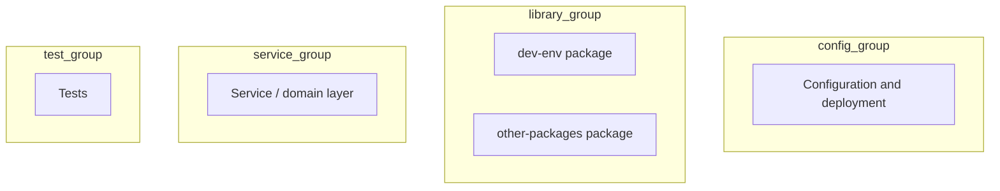

# Architecture report: pedronauck/docz

> Automated static analysis. **Observed** = directly seen in files/imports/AST; **Inferred** = interpretation from that evidence. Repository code was not executed.

## 1. Repository at a glance

| Item | Value |
| --- | --- |
| Repository | pedronauck/docz |
| Description | ✍ It has never been so easy to document your things! |
| Language | TypeScript |
| Stars | 23555 |
| Licence | MIT |
| Analysed commit / branch | e0a53cb64fa8bb7a9e02f4f39eada7f74566dd3c / main |
| Framework(s) | React |
| Files analysed | 675 |
| Components | 5 |

## 2. Architecture in one minute

pedronauck/docz - ✍ It has never been so easy to document your things!. This repository was analysed statically from 675 file(s) (0 Python). Detected technologies (observed from imports/manifests): React, React Router, Jest, TypeScript. Files are grouped into 5 component(s): Configuration and deployment, dev-env package, other-packages package, Service / domain layer, Tests. Findings below distinguish observed facts from inferred interpretation.

## 3. High-level block diagram

## 4. Main components

### Configuration and deployment (`config`)

- **Kind:** config
- **Status:** Observed
- **Confidence:** 0.85
- **Responsibility:** Groups 31 file(s) under configuration and deployment (observed from repository paths and static analysis).
- **Paths:** `core/docz-core/nodemon.json`, `core/docz-core/package.json`, `core/docz-core/src/config/argv.ts`, `core/docz-core/src/config/docz.ts`, `core/docz-core/src/config/env.ts`, `core/docz-core/src/config/paths.ts`, `core/docz-core/tsconfig.json`, `core/docz-rollup/package.json`, `core/docz-utils/package.json`, `core/docz-utils/tsconfig.json`, `core/docz/package.json`, `core/docz/tsconfig.json`, `core/gatsby-theme-docz/package.json`, `core/rehype-docz/package.json`, `core/rehype-docz/tsconfig.json`, `core/remark-docz/package.json`, `core/remark-docz/tsconfig.json`, `dev-env/basic/package.json`, `lerna.json`, `other-packages/babel-plugin-export-metadata/package.json`, `other-packages/e2e-tests/.testcaferc.json`, `other-packages/e2e-tests/package.json`, `other-packages/e2e-tests/verdaccio.yaml`, `other-packages/eslint-config-docz-js/package.json`, `other-packages/eslint-config-docz-ts/package.json`, `other-packages/load-cfg/package.json`, `other-packages/load-cfg/tsconfig.json`, `other-packages/react-docgen-actual-name-handler/package.json`, `other-packages/react-docgen-actual-name-handler/tsconfig.json`, `package.json`, `tsconfig.json`
- **Evidence:** [core/docz-core/nodemon.json](https://github.com/pedronauck/docz/blob/e0a53cb64fa8bb7a9e02f4f39eada7f74566dd3c/core/docz-core/nodemon.json); [core/docz-core/package.json](https://github.com/pedronauck/docz/blob/e0a53cb64fa8bb7a9e02f4f39eada7f74566dd3c/core/docz-core/package.json); [core/docz-core/src/config/argv.ts](https://github.com/pedronauck/docz/blob/e0a53cb64fa8bb7a9e02f4f39eada7f74566dd3c/core/docz-core/src/config/argv.ts); [core/docz-core/src/config/docz.ts](https://github.com/pedronauck/docz/blob/e0a53cb64fa8bb7a9e02f4f39eada7f74566dd3c/core/docz-core/src/config/docz.ts); [core/docz-core/src/config/env.ts](https://github.com/pedronauck/docz/blob/e0a53cb64fa8bb7a9e02f4f39eada7f74566dd3c/core/docz-core/src/config/env.ts); [core/docz-core/src/config/paths.ts](https://github.com/pedronauck/docz/blob/e0a53cb64fa8bb7a9e02f4f39eada7f74566dd3c/core/docz-core/src/config/paths.ts); [core/docz-core/tsconfig.json](https://github.com/pedronauck/docz/blob/e0a53cb64fa8bb7a9e02f4f39eada7f74566dd3c/core/docz-core/tsconfig.json); [core/docz-rollup/package.json](https://github.com/pedronauck/docz/blob/e0a53cb64fa8bb7a9e02f4f39eada7f74566dd3c/core/docz-rollup/package.json)

### dev-env package (`dev_env`)

- **Kind:** library
- **Status:** Observed
- **Confidence:** 0.85
- **Responsibility:** Groups 2 file(s) under dev-env package (observed from repository paths and static analysis).
- **Paths:** `dev-env/basic/doczrc.js`, `dev-env/basic/src/components/Alert.jsx`
- **Evidence:** [dev-env/basic/doczrc.js](https://github.com/pedronauck/docz/blob/e0a53cb64fa8bb7a9e02f4f39eada7f74566dd3c/dev-env/basic/doczrc.js); [dev-env/basic/src/components/Alert.jsx](https://github.com/pedronauck/docz/blob/e0a53cb64fa8bb7a9e02f4f39eada7f74566dd3c/dev-env/basic/src/components/Alert.jsx)

### other-packages package (`other_packages`)

- **Kind:** library
- **Status:** Observed
- **Confidence:** 0.85
- **Responsibility:** Groups 17 file(s) under other-packages package (observed from repository paths and static analysis).
- **Paths:** `other-packages/babel-plugin-export-metadata/.eslintrc.js`, `other-packages/babel-plugin-export-metadata/jest.config.js`, `other-packages/babel-plugin-export-metadata/src/index.js`, `other-packages/e2e-tests/__tests__/test.ts`, `other-packages/e2e-tests/helpers.js`, `other-packages/e2e-tests/index.js`, `other-packages/e2e-tests/testing-library.js`, `other-packages/eslint-config-docz-js/index.js`, `other-packages/eslint-config-docz-ts/index.js`, `other-packages/load-cfg/.eslintrc.js`, `other-packages/load-cfg/rollup.config.js`, `other-packages/load-cfg/src/index.ts`, `other-packages/load-cfg/src/types.d.ts`, `other-packages/react-docgen-actual-name-handler/.eslintrc.js`, `other-packages/react-docgen-actual-name-handler/rollup.config.js`, `other-packages/react-docgen-actual-name-handler/src/index.ts`, `other-packages/react-docgen-actual-name-handler/src/types.d.ts`
- **Evidence:** [other-packages/babel-plugin-export-metadata/.eslintrc.js](https://github.com/pedronauck/docz/blob/e0a53cb64fa8bb7a9e02f4f39eada7f74566dd3c/other-packages/babel-plugin-export-metadata/.eslintrc.js); [other-packages/babel-plugin-export-metadata/jest.config.js](https://github.com/pedronauck/docz/blob/e0a53cb64fa8bb7a9e02f4f39eada7f74566dd3c/other-packages/babel-plugin-export-metadata/jest.config.js); [other-packages/babel-plugin-export-metadata/src/index.js](https://github.com/pedronauck/docz/blob/e0a53cb64fa8bb7a9e02f4f39eada7f74566dd3c/other-packages/babel-plugin-export-metadata/src/index.js); [other-packages/e2e-tests/__tests__/test.ts](https://github.com/pedronauck/docz/blob/e0a53cb64fa8bb7a9e02f4f39eada7f74566dd3c/other-packages/e2e-tests/__tests__/test.ts); [other-packages/e2e-tests/helpers.js](https://github.com/pedronauck/docz/blob/e0a53cb64fa8bb7a9e02f4f39eada7f74566dd3c/other-packages/e2e-tests/helpers.js); [other-packages/e2e-tests/index.js](https://github.com/pedronauck/docz/blob/e0a53cb64fa8bb7a9e02f4f39eada7f74566dd3c/other-packages/e2e-tests/index.js); [other-packages/e2e-tests/testing-library.js](https://github.com/pedronauck/docz/blob/e0a53cb64fa8bb7a9e02f4f39eada7f74566dd3c/other-packages/e2e-tests/testing-library.js); [other-packages/eslint-config-docz-js/index.js](https://github.com/pedronauck/docz/blob/e0a53cb64fa8bb7a9e02f4f39eada7f74566dd3c/other-packages/eslint-config-docz-js/index.js)

### Service / domain layer (`service_layer`)

- **Kind:** service
- **Status:** Observed
- **Confidence:** 0.85
- **Responsibility:** Groups 167 file(s) under service / domain layer (observed from repository paths and static analysis).
- **Paths:** `core/docz-core/.eslintrc.js`, `core/docz-core/__fixtures__/Alert/Alert.tsx`, `core/docz-core/__fixtures__/Label.jsx`, `core/docz-core/__fixtures__/Label.tsx`, `core/docz-core/__tests__/config.test.ts`, `core/docz-core/__tests__/entries.test.ts`, `core/docz-core/__tests__/props.test.ts`, `core/docz-core/__tests__/states.test.ts`, `core/docz-core/bin/index.js`, `core/docz-core/rollup.config.js`, `core/docz-core/src/bundler/build.ts`, `core/docz-core/src/bundler/index.ts`, `core/docz-core/src/bundler/machine/actions.ts`, `core/docz-core/src/bundler/machine/context.ts`, `core/docz-core/src/bundler/machine/index.ts`, `core/docz-core/src/bundler/machine/services/create-resources.ts`, `core/docz-core/src/bundler/machine/services/ensure-dirs.ts`, `core/docz-core/src/bundler/machine/services/exec-dev-command.ts`, `core/docz-core/src/bundler/machine/services/index.ts`, `core/docz-core/src/bundler/machine/services/install-deps.ts`, `core/docz-core/src/bundler/machine/services/watch-files.ts`, `core/docz-core/src/bundler/server.ts`, `core/docz-core/src/cli.ts`, `core/docz-core/src/commands/build.ts`, `core/docz-core/src/commands/dev.ts`, `core/docz-core/src/commands/index.ts`, `core/docz-core/src/commands/init.ts`, `core/docz-core/src/commands/serve.ts`, `core/docz-core/src/index.ts`, `core/docz-core/src/lib/Bundler.ts`, `core/docz-core/src/lib/DataServer.ts`, `core/docz-core/src/lib/Entries.ts`, `core/docz-core/src/lib/Entry.ts`, `core/docz-core/src/lib/Plugin.ts`, `core/docz-core/src/states/config.ts`, `core/docz-core/src/states/entries.ts`, `core/docz-core/src/states/index.ts`, `core/docz-core/src/states/props.ts`, `core/docz-core/src/test-utils/data-bank.ts`, `core/docz-core/src/test-utils/index.ts`, `core/docz-core/src/types.d.ts`, `core/docz-core/src/utils/docgen/docz-docgen-resolver.ts`, `core/docz-core/src/utils/docgen/externalProptypesHandler.ts`, `core/docz-core/src/utils/docgen/index.ts`, `core/docz-core/src/utils/docgen/javascript.ts`, `core/docz-core/src/utils/docgen/typescript.ts`, `core/docz-core/src/utils/open-browser.ts`, `core/docz-core/src/utils/p-reduce.ts`, `core/docz-core/src/utils/repo-info.ts`, `core/docz-core/src/utils/spawn.ts`, `core/docz-core/src/utils/template.ts`, `core/docz-core/templates/404.tpl.js`, `core/docz-core/templates/gatsby-config.tpl.js`, `core/docz-core/templates/gatsby-node.tpl.js`, `core/docz-core/templates/imports.tpl.js`, `core/docz-core/templates/index.tpl.js`, `core/docz-core/templates/root.tpl.js`, `core/docz-rollup/.eslintrc.js`, `core/docz-rollup/src/index.js`, `core/docz-rollup/src/plugins/clean.js`, `core/docz-rollup/src/plugins/copy.js`, `core/docz-rollup/src/plugins/size.js`, `core/docz-utils/.eslintrc.js`, `core/docz-utils/__tests__/jsx.test.ts`, `core/docz-utils/rollup.config.js`, `core/docz-utils/src/ast.ts`, `core/docz-utils/src/exports.ts`, `core/docz-utils/src/format.ts`, `core/docz-utils/src/fs.ts`, `core/docz-utils/src/imports.ts`, `core/docz-utils/src/index.ts`, `core/docz-utils/src/jsx.ts`, `core/docz-utils/src/mdast.ts`, `core/docz-utils/src/types.d.ts`, `core/docz/.eslintrc.js`, `core/docz/bin/index.js`, `core/docz/rollup.config.js`, `core/docz/src/components/Link.tsx`, `core/docz/src/components/Playground.tsx`, `core/docz/src/components/Props.tsx`, `core/docz/src/hooks/index.ts`, `core/docz/src/hooks/useComponentProps.ts`, `core/docz/src/hooks/useComponents.tsx`, `core/docz/src/hooks/useConfig.ts`, `core/docz/src/hooks/useCurrentDoc.tsx`, `core/docz/src/hooks/useDataServer.ts`, `core/docz/src/hooks/useDocs.ts`, `core/docz/src/hooks/useMenus.ts`, `core/docz/src/hooks/usePrevious.ts`, `core/docz/src/hooks/useWindowSize.ts`, `core/docz/src/index.ts`, `core/docz/src/state.tsx`, `core/docz/src/theme.tsx`, `core/docz/src/types.d.ts`, `core/docz/src/utils/createState.tsx`, `core/docz/src/utils/helpers.ts`, `core/docz/src/utils/humanize-prop.ts`, `core/gatsby-theme-docz/.eslintrc.js`, `core/gatsby-theme-docz/gatsby-browser.js`, `core/gatsby-theme-docz/gatsby-config.js`, `core/gatsby-theme-docz/gatsby-node.js`, `core/gatsby-theme-docz/gatsby-ssr.js`, `core/gatsby-theme-docz/index.js`, `core/gatsby-theme-docz/lib/createPagesStatefully.js`, `core/gatsby-theme-docz/lib/onCreateBabelConfig.js`, `core/gatsby-theme-docz/lib/onCreateDevServer.js`, `core/gatsby-theme-docz/lib/onCreateWebpackConfig.js`, `core/gatsby-theme-docz/lib/onPostBuild.js`, `core/gatsby-theme-docz/lib/onPreBuild.js`, `core/gatsby-theme-docz/lib/sourceNodes.js`, `core/gatsby-theme-docz/lib/utils/parseConfig.js`, `core/gatsby-theme-docz/src/base/Layout.js`, `core/gatsby-theme-docz/src/base/Seo.js`, `core/gatsby-theme-docz/src/components/Code/index.js`, `core/gatsby-theme-docz/src/components/Code/styles.js`, `core/gatsby-theme-docz/src/components/Header/index.js`, `core/gatsby-theme-docz/src/components/Header/styles.js`, `core/gatsby-theme-docz/src/components/Headings/index.js`, `core/gatsby-theme-docz/src/components/Icons/index.js`, `core/gatsby-theme-docz/src/components/Layout/index.js`, `core/gatsby-theme-docz/src/components/Layout/styles.js`, `core/gatsby-theme-docz/src/components/Logo/index.js`, `core/gatsby-theme-docz/src/components/Logo/styles.js`, `core/gatsby-theme-docz/src/components/MainContainer/index.js`, `core/gatsby-theme-docz/src/components/MainContainer/styles.js`, `core/gatsby-theme-docz/src/components/NavGroup/index.js`, `core/gatsby-theme-docz/src/components/NavGroup/styles.js`, `core/gatsby-theme-docz/src/components/NavLink/index.js`, `core/gatsby-theme-docz/src/components/NavLink/styles.js`, `core/gatsby-theme-docz/src/components/NavSearch/index.js`, `core/gatsby-theme-docz/src/components/NavSearch/styles.js`, `core/gatsby-theme-docz/src/components/Playground/Wrapper.js`, `core/gatsby-theme-docz/src/components/Playground/index.js`, `core/gatsby-theme-docz/src/components/Playground/styles.js`, `core/gatsby-theme-docz/src/components/Pre/index.js`, `core/gatsby-theme-docz/src/components/Pre/styles.js`, `core/gatsby-theme-docz/src/components/Props/index.js`, `core/gatsby-theme-docz/src/components/Props/styles.js`, `core/gatsby-theme-docz/src/components/Sidebar/index.js`, `core/gatsby-theme-docz/src/components/Sidebar/styles.js`, `core/gatsby-theme-docz/src/components/index.js`, `core/gatsby-theme-docz/src/hooks/useDbQuery.js`, `core/gatsby-theme-docz/src/index.js`, `core/gatsby-theme-docz/src/theme/breakpoints.js`, `core/gatsby-theme-docz/src/theme/colors.js`, `core/gatsby-theme-docz/src/theme/global.js`, `core/gatsby-theme-docz/src/theme/index.js`, `core/gatsby-theme-docz/src/theme/modes.js`, `core/gatsby-theme-docz/src/theme/prism/dark.js`, `core/gatsby-theme-docz/src/theme/prism/index.js`, `core/gatsby-theme-docz/src/theme/prism/light.js`, `core/gatsby-theme-docz/src/theme/styles.js`, `core/gatsby-theme-docz/src/utils/mixins.js`, `core/gatsby-theme-docz/src/utils/theme.js`, `core/gatsby-theme-docz/src/wrapper.js`, `core/rehype-docz/.eslintrc.js`, `core/rehype-docz/jest.config.js`, `core/rehype-docz/rollup.config.js`, `core/rehype-docz/src/index.test.ts`, `core/rehype-docz/src/index.ts`, `core/rehype-docz/src/types.d.ts`, `core/remark-docz/.eslintrc.js`, `core/remark-docz/jest.config.js`, `core/remark-docz/rollup.config.js`, `core/remark-docz/src/index.test.ts`, `core/remark-docz/src/index.ts`, `core/remark-docz/src/types.d.ts`
- **Evidence:** [core/docz-core/.eslintrc.js](https://github.com/pedronauck/docz/blob/e0a53cb64fa8bb7a9e02f4f39eada7f74566dd3c/core/docz-core/.eslintrc.js); [core/docz-core/__fixtures__/Alert/Alert.tsx](https://github.com/pedronauck/docz/blob/e0a53cb64fa8bb7a9e02f4f39eada7f74566dd3c/core/docz-core/__fixtures__/Alert/Alert.tsx); [core/docz-core/__fixtures__/Label.jsx](https://github.com/pedronauck/docz/blob/e0a53cb64fa8bb7a9e02f4f39eada7f74566dd3c/core/docz-core/__fixtures__/Label.jsx); [core/docz-core/__fixtures__/Label.tsx](https://github.com/pedronauck/docz/blob/e0a53cb64fa8bb7a9e02f4f39eada7f74566dd3c/core/docz-core/__fixtures__/Label.tsx); [core/docz-core/__tests__/config.test.ts](https://github.com/pedronauck/docz/blob/e0a53cb64fa8bb7a9e02f4f39eada7f74566dd3c/core/docz-core/__tests__/config.test.ts); [core/docz-core/__tests__/entries.test.ts](https://github.com/pedronauck/docz/blob/e0a53cb64fa8bb7a9e02f4f39eada7f74566dd3c/core/docz-core/__tests__/entries.test.ts); [core/docz-core/__tests__/props.test.ts](https://github.com/pedronauck/docz/blob/e0a53cb64fa8bb7a9e02f4f39eada7f74566dd3c/core/docz-core/__tests__/props.test.ts); [core/docz-core/__tests__/states.test.ts](https://github.com/pedronauck/docz/blob/e0a53cb64fa8bb7a9e02f4f39eada7f74566dd3c/core/docz-core/__tests__/states.test.ts)

### Tests (`tests`)

- **Kind:** test
- **Status:** Observed
- **Confidence:** 0.85
- **Responsibility:** Groups 16 file(s) under tests (observed from repository paths and static analysis).
- **Paths:** `other-packages/babel-plugin-export-metadata/tests/__snapshots__/index.test.js.snap`, `other-packages/babel-plugin-export-metadata/tests/fixtures/assets/a.js`, `other-packages/babel-plugin-export-metadata/tests/fixtures/export-default/with-arr-expression.js`, `other-packages/babel-plugin-export-metadata/tests/fixtures/export-default/with-call-expression.js`, `other-packages/babel-plugin-export-metadata/tests/fixtures/export-default/with-class-declaration.js`, `other-packages/babel-plugin-export-metadata/tests/fixtures/export-default/with-func-declaration.js`, `other-packages/babel-plugin-export-metadata/tests/fixtures/export-default/with-identifier.js`, `other-packages/babel-plugin-export-metadata/tests/fixtures/export-default/with-obj-expression.js`, `other-packages/babel-plugin-export-metadata/tests/fixtures/export-named/index.js`, `other-packages/babel-plugin-export-metadata/tests/fixtures/re-export/re-export-default.js`, `other-packages/babel-plugin-export-metadata/tests/fixtures/re-export/re-export-multi.js`, `other-packages/babel-plugin-export-metadata/tests/fixtures/re-export/re-export-rename1.js`, `other-packages/babel-plugin-export-metadata/tests/fixtures/re-export/re-export-rename2.js`, `other-packages/babel-plugin-export-metadata/tests/fixtures/re-export/re-export-rename3.js`, `other-packages/babel-plugin-export-metadata/tests/fixtures/re-export/re-export.js`, `other-packages/babel-plugin-export-metadata/tests/index.test.js`
- **Evidence:** [other-packages/babel-plugin-export-metadata/tests/__snapshots__/index.test.js.snap](https://github.com/pedronauck/docz/blob/e0a53cb64fa8bb7a9e02f4f39eada7f74566dd3c/other-packages/babel-plugin-export-metadata/tests/__snapshots__/index.test.js.snap); [other-packages/babel-plugin-export-metadata/tests/fixtures/assets/a.js](https://github.com/pedronauck/docz/blob/e0a53cb64fa8bb7a9e02f4f39eada7f74566dd3c/other-packages/babel-plugin-export-metadata/tests/fixtures/assets/a.js); [other-packages/babel-plugin-export-metadata/tests/fixtures/export-default/with-arr-expression.js](https://github.com/pedronauck/docz/blob/e0a53cb64fa8bb7a9e02f4f39eada7f74566dd3c/other-packages/babel-plugin-export-metadata/tests/fixtures/export-default/with-arr-expression.js); [other-packages/babel-plugin-export-metadata/tests/fixtures/export-default/with-call-expression.js](https://github.com/pedronauck/docz/blob/e0a53cb64fa8bb7a9e02f4f39eada7f74566dd3c/other-packages/babel-plugin-export-metadata/tests/fixtures/export-default/with-call-expression.js); [other-packages/babel-plugin-export-metadata/tests/fixtures/export-default/with-class-declaration.js](https://github.com/pedronauck/docz/blob/e0a53cb64fa8bb7a9e02f4f39eada7f74566dd3c/other-packages/babel-plugin-export-metadata/tests/fixtures/export-default/with-class-declaration.js); [other-packages/babel-plugin-export-metadata/tests/fixtures/export-default/with-func-declaration.js](https://github.com/pedronauck/docz/blob/e0a53cb64fa8bb7a9e02f4f39eada7f74566dd3c/other-packages/babel-plugin-export-metadata/tests/fixtures/export-default/with-func-declaration.js); [other-packages/babel-plugin-export-metadata/tests/fixtures/export-default/with-identifier.js](https://github.com/pedronauck/docz/blob/e0a53cb64fa8bb7a9e02f4f39eada7f74566dd3c/other-packages/babel-plugin-export-metadata/tests/fixtures/export-default/with-identifier.js); [other-packages/babel-plugin-export-metadata/tests/fixtures/export-default/with-obj-expression.js](https://github.com/pedronauck/docz/blob/e0a53cb64fa8bb7a9e02f4f39eada7f74566dd3c/other-packages/babel-plugin-export-metadata/tests/fixtures/export-default/with-obj-expression.js)

## 5. Execution flow

**Observed** entry point(s):

- [core/docz-core/bin/index.js](https://github.com/pedronauck/docz/blob/e0a53cb64fa8bb7a9e02f4f39eada7f74566dd3c/core/docz-core/bin/index.js)
- [core/docz-core/src/index.ts](https://github.com/pedronauck/docz/blob/e0a53cb64fa8bb7a9e02f4f39eada7f74566dd3c/core/docz-core/src/index.ts)
- [core/docz-rollup/src/index.js](https://github.com/pedronauck/docz/blob/e0a53cb64fa8bb7a9e02f4f39eada7f74566dd3c/core/docz-rollup/src/index.js)
- [core/docz-utils/src/index.ts](https://github.com/pedronauck/docz/blob/e0a53cb64fa8bb7a9e02f4f39eada7f74566dd3c/core/docz-utils/src/index.ts)
- [core/docz/bin/index.js](https://github.com/pedronauck/docz/blob/e0a53cb64fa8bb7a9e02f4f39eada7f74566dd3c/core/docz/bin/index.js)
- [core/docz/src/index.ts](https://github.com/pedronauck/docz/blob/e0a53cb64fa8bb7a9e02f4f39eada7f74566dd3c/core/docz/src/index.ts)
- [examples/monorepo-separate-docs/packages/alert/index.js](https://github.com/pedronauck/docz/blob/e0a53cb64fa8bb7a9e02f4f39eada7f74566dd3c/examples/monorepo-separate-docs/packages/alert/index.js)
- [examples/with-custom-docz-theme/gatsby-theme-docz-pink/index.js](https://github.com/pedronauck/docz/blob/e0a53cb64fa8bb7a9e02f4f39eada7f74566dd3c/examples/with-custom-docz-theme/gatsby-theme-docz-pink/index.js)
- [other-packages/babel-plugin-export-metadata/src/index.js](https://github.com/pedronauck/docz/blob/e0a53cb64fa8bb7a9e02f4f39eada7f74566dd3c/other-packages/babel-plugin-export-metadata/src/index.js)
- [other-packages/e2e-tests/index.js](https://github.com/pedronauck/docz/blob/e0a53cb64fa8bb7a9e02f4f39eada7f74566dd3c/other-packages/e2e-tests/index.js)
- [other-packages/eslint-config-docz-js/index.js](https://github.com/pedronauck/docz/blob/e0a53cb64fa8bb7a9e02f4f39eada7f74566dd3c/other-packages/eslint-config-docz-js/index.js)
- [other-packages/eslint-config-docz-ts/index.js](https://github.com/pedronauck/docz/blob/e0a53cb64fa8bb7a9e02f4f39eada7f74566dd3c/other-packages/eslint-config-docz-ts/index.js)

Representative flow (derived from observed entry points and the import graph; steps beyond the entry point are **Inferred**):

1. Execution starts at an observed entry point listed above, if present.
2. No internal import relationships between components were observed.

## 6. Project structure

### `(root)`

- `.all-contributorsrc` - other (502 bytes)
- `.commitlintrc.json` - config (100 bytes)
- `.editorconfig` - config (146 bytes)
- `.eslintignore` - other (18 bytes)
- `.gitignore` - other (401 bytes)
- `.huskyrc` - other (124 bytes)
- `.prettierignore` - other (28 bytes)
- `.prettierrc` - other (209 bytes)
- `CHANGELOG.md` - docs (115902 bytes)
- `CODE_OF_CONDUCT.md` - docs (3217 bytes)
- `CONTRIBUTING.md` - docs (3968 bytes)
- `LICENSE.md` - docs (1068 bytes)
- `MIGRATION_GUIDE.md` - docs (6083 bytes)
- `README.md` - docs (6445 bytes)
- `lerna.json` - config (157 bytes)
- `package.json` - manifest (3344 bytes)
- `tsconfig.json` - config (729 bytes)

### `.circleci`

- `.circleci/config.yml` - ci, YAML (1135 bytes)

### `.github`

- `.github/FUNDING.yml` - config (114 bytes)
- `.github/ISSUE_TEMPLATE/---bug-report.md` - docs (996 bytes)
- `.github/ISSUE_TEMPLATE/---feature-request.md` - docs (617 bytes)
- `.github/ISSUE_TEMPLATE/---support-question.md` - docs (254 bytes)
- `.github/PULL_REQUEST_TEMPLATE.md` - docs (238 bytes)
- `.github/stale.yml` - config (682 bytes)

### `.vscode`

- `.vscode/launch.json` - config (1443 bytes)
- `.vscode/settings.json` - config (271 bytes)

### `core`

- `core/docz-core/.babelrc` - other (194 bytes)
- `core/docz-core/.eslintignore` - other (5 bytes)
- `core/docz-core/.eslintrc.js` - source, JavaScript (43 bytes)
- `core/docz-core/.lintstagedrc` - other (44 bytes)
- `core/docz-core/CHANGELOG.md` - docs (49106 bytes)
- `core/docz-core/LICENSE.md` - docs (1068 bytes)
- `core/docz-core/README.md` - docs (343 bytes)
- `core/docz-core/__fixtures__/Alert/Alert.mdx` - other (464 bytes)
- `core/docz-core/__fixtures__/Alert/Alert.tsx` - source, TypeScript (737 bytes)
- `core/docz-core/__fixtures__/Label.jsx` - source, JavaScript (239 bytes)
- `core/docz-core/__fixtures__/Label.tsx` - source, TypeScript (281 bytes)
- `core/docz-core/__tests__/config.test.ts` - source, TypeScript (1236 bytes)
- `core/docz-core/__tests__/entries.test.ts` - source, TypeScript (276 bytes)
- `core/docz-core/__tests__/props.test.ts` - source, TypeScript (3034 bytes)
- `core/docz-core/__tests__/states.test.ts` - source, TypeScript (1968 bytes)
- `core/docz-core/bin/index.js` - source, JavaScript (26 bytes)
- `core/docz-core/nodemon.json` - config (120 bytes)
- `core/docz-core/package.json` - manifest (1819 bytes)
- `core/docz-core/rollup.config.js` - source, JavaScript (148 bytes)
- `core/docz-core/src/bundler/build.ts` - source, TypeScript (807 bytes)
- `core/docz-core/src/bundler/index.ts` - source, TypeScript (260 bytes)
- `core/docz-core/src/bundler/machine/actions.ts` - source, TypeScript (2520 bytes)
- `core/docz-core/src/bundler/machine/context.ts` - source, TypeScript (171 bytes)
- `core/docz-core/src/bundler/machine/index.ts` - source, TypeScript (1358 bytes)
- `core/docz-core/src/bundler/machine/services/create-resources.ts` - source, TypeScript (4181 bytes)
- `core/docz-core/src/bundler/machine/services/ensure-dirs.ts` - source, TypeScript (247 bytes)
- `core/docz-core/src/bundler/machine/services/exec-dev-command.ts` - source, TypeScript (2267 bytes)
- `core/docz-core/src/bundler/machine/services/index.ts` - source, TypeScript (236 bytes)
- `core/docz-core/src/bundler/machine/services/install-deps.ts` - source, TypeScript (89 bytes)
- `core/docz-core/src/bundler/machine/services/watch-files.ts` - source, TypeScript (3016 bytes)
- `core/docz-core/src/bundler/server.ts` - source, TypeScript (668 bytes)
- `core/docz-core/src/cli.ts` - source, TypeScript (1031 bytes)
- `core/docz-core/src/commands/build.ts` - source, TypeScript (637 bytes)
- `core/docz-core/src/commands/dev.ts` - source, TypeScript (606 bytes)
- `core/docz-core/src/commands/index.ts` - source, TypeScript (122 bytes)
- `core/docz-core/src/commands/init.ts` - source, TypeScript (864 bytes)
- `core/docz-core/src/commands/serve.ts` - source, TypeScript (805 bytes)
- `core/docz-core/src/config/argv.ts` - source, TypeScript (4379 bytes)
- `core/docz-core/src/config/docz.ts` - source, TypeScript (1973 bytes)
- `core/docz-core/src/config/env.ts` - source, TypeScript (3046 bytes)
- `core/docz-core/src/config/paths.ts` - source, TypeScript (2686 bytes)
- `core/docz-core/src/index.ts` - source, TypeScript (439 bytes)
- `core/docz-core/src/lib/Bundler.ts` - source, TypeScript (1217 bytes)
- `core/docz-core/src/lib/DataServer.ts` - source, TypeScript (2170 bytes)
- `core/docz-core/src/lib/Entries.ts` - source, TypeScript (3820 bytes)
- `core/docz-core/src/lib/Entry.ts` - source, TypeScript (2682 bytes)
- `core/docz-core/src/lib/Plugin.ts` - source, TypeScript (3445 bytes)
- `core/docz-core/src/states/config.ts` - source, TypeScript (2169 bytes)
- `core/docz-core/src/states/entries.ts` - source, TypeScript (1620 bytes)
- `core/docz-core/src/states/index.ts` - source, TypeScript (129 bytes)
- `core/docz-core/src/states/props.ts` - source, TypeScript (2784 bytes)
- `core/docz-core/src/test-utils/data-bank.ts` - source, TypeScript (378 bytes)
- `core/docz-core/src/test-utils/index.ts` - source, TypeScript (926 bytes)
- `core/docz-core/src/types.d.ts` - source, TypeScript (356 bytes)
- `core/docz-core/src/utils/docgen/docz-docgen-resolver.ts` - source, TypeScript (4364 bytes)
- `core/docz-core/src/utils/docgen/externalProptypesHandler.ts` - source, TypeScript (14704 bytes)
- `core/docz-core/src/utils/docgen/index.ts` - source, TypeScript (767 bytes)
- `core/docz-core/src/utils/docgen/javascript.ts` - source, TypeScript (1296 bytes)
- `core/docz-core/src/utils/docgen/typescript.ts` - source, TypeScript (6711 bytes)
- `core/docz-core/src/utils/open-browser.ts` - source, TypeScript (3656 bytes)
- `core/docz-core/src/utils/openChrome.applescript` - other (2043 bytes)
- `core/docz-core/src/utils/p-reduce.ts` - source, TypeScript (554 bytes)
- `core/docz-core/src/utils/repo-info.ts` - source, TypeScript (2071 bytes)
- `core/docz-core/src/utils/spawn.ts` - source, TypeScript (257 bytes)
- `core/docz-core/src/utils/template.ts` - source, TypeScript (711 bytes)
- `core/docz-core/templates/404.tpl.js` - source, JavaScript (282 bytes)
- `core/docz-core/templates/gatsby-config.tpl.js` - source, JavaScript (1407 bytes)
- `core/docz-core/templates/gatsby-node.tpl.js` - source, JavaScript (3400 bytes)
- `core/docz-core/templates/imports.tpl.js` - source, JavaScript (211 bytes)
- `core/docz-core/templates/index.tpl.html` - other (394 bytes)
- `core/docz-core/templates/index.tpl.js` - source, JavaScript (534 bytes)
- `core/docz-core/templates/root.tpl.js` - source, JavaScript (719 bytes)
- `core/docz-core/tsconfig.json` - config (332 bytes)
- `core/docz-rollup/.eslintrc.js` - source, JavaScript (43 bytes)
- `core/docz-rollup/.lintstagedrc` - other (38 bytes)
- `core/docz-rollup/CHANGELOG.md` - docs (3381 bytes)
- `core/docz-rollup/LICENSE.md` - docs (1068 bytes)
- `core/docz-rollup/README.md` - docs (323 bytes)
- `core/docz-rollup/package.json` - manifest (1050 bytes)
- `core/docz-rollup/src/index.js` - source, JavaScript (2719 bytes)
- `core/docz-rollup/src/plugins/clean.js` - source, JavaScript (229 bytes)
- `core/docz-rollup/src/plugins/copy.js` - source, JavaScript (373 bytes)
- `core/docz-rollup/src/plugins/size.js` - source, JavaScript (1283 bytes)
- `core/docz-utils/.babelrc` - other (194 bytes)
- `core/docz-utils/.eslintignore` - other (4 bytes)
- `core/docz-utils/.eslintrc.js` - source, JavaScript (43 bytes)
- `core/docz-utils/.lintstagedrc` - other (44 bytes)
- `core/docz-utils/CHANGELOG.md` - docs (7587 bytes)
- `core/docz-utils/LICENSE.md` - docs (1068 bytes)
- `core/docz-utils/README.md` - docs (284 bytes)
- `core/docz-utils/__tests__/jsx.test.ts` - source, TypeScript (720 bytes)
- `core/docz-utils/package.json` - manifest (1388 bytes)
- `core/docz-utils/rollup.config.js` - source, JavaScript (288 bytes)
- `core/docz-utils/src/ast.ts` - source, TypeScript (733 bytes)
- `core/docz-utils/src/exports.ts` - source, TypeScript (1297 bytes)
- `core/docz-utils/src/format.ts` - source, TypeScript (465 bytes)
- `core/docz-utils/src/fs.ts` - source, TypeScript (663 bytes)
- `core/docz-utils/src/imports.ts` - source, TypeScript (979 bytes)
- `core/docz-utils/src/index.ts` - source, TypeScript (242 bytes)
- `core/docz-utils/src/jsx.ts` - source, TypeScript (1255 bytes)
- `core/docz-utils/src/mdast.ts` - source, TypeScript (1953 bytes)
- `core/docz-utils/src/types.d.ts` - source, TypeScript (528 bytes)
- `core/docz-utils/tsconfig.json` - config (331 bytes)
- `core/docz/.babelrc` - other (67 bytes)
- `core/docz/.eslintignore` - other (5 bytes)
- `core/docz/.eslintrc.js` - source, JavaScript (43 bytes)
- `core/docz/.lintstagedrc` - other (44 bytes)
- `core/docz/CHANGELOG.md` - docs (47144 bytes)
- `core/docz/LICENSE.md` - docs (1068 bytes)
- `core/docz/README.md` - docs (7514 bytes)
- `core/docz/bin/index.js` - source, JavaScript (47 bytes)
- `core/docz/package.json` - manifest (1370 bytes)
- `core/docz/rollup.config.js` - source, JavaScript (92 bytes)
- `core/docz/src/components/Link.tsx` - source, TypeScript (60 bytes)
- `core/docz/src/components/Playground.tsx` - source, TypeScript (940 bytes)
- `core/docz/src/components/Props.tsx` - source, TypeScript (2664 bytes)
- `core/docz/src/hooks/index.ts` - source, TypeScript (404 bytes)
- `core/docz/src/hooks/useComponentProps.ts` - source, TypeScript (1625 bytes)
- `core/docz/src/hooks/useComponents.tsx` - source, TypeScript (1414 bytes)
- `core/docz/src/hooks/useConfig.ts` - source, TypeScript (558 bytes)
- `core/docz/src/hooks/useCurrentDoc.tsx` - source, TypeScript (233 bytes)
- `core/docz/src/hooks/useDataServer.ts` - source, TypeScript (517 bytes)
- `core/docz/src/hooks/useDocs.ts` - source, TypeScript (376 bytes)
- `core/docz/src/hooks/useMenus.ts` - source, TypeScript (4332 bytes)
- `core/docz/src/hooks/usePrevious.ts` - source, TypeScript (215 bytes)
- `core/docz/src/hooks/useWindowSize.ts` - source, TypeScript (957 bytes)
- `core/docz/src/index.ts` - source, TypeScript (309 bytes)
- `core/docz/src/state.tsx` - source, TypeScript (1175 bytes)
- `core/docz/src/theme.tsx` - source, TypeScript (876 bytes)
- `core/docz/src/types.d.ts` - source, TypeScript (215 bytes)
- `core/docz/src/utils/createState.tsx` - source, TypeScript (1469 bytes)
- `core/docz/src/utils/helpers.ts` - source, TypeScript (532 bytes)
- `core/docz/src/utils/humanize-prop.ts` - source, TypeScript (1525 bytes)
- `core/docz/tsconfig.json` - config (356 bytes)
- `core/gatsby-theme-docz/.eslintrc.js` - source, JavaScript (43 bytes)
- `core/gatsby-theme-docz/.gitignore` - other (30 bytes)
- `core/gatsby-theme-docz/.lintstagedrc` - other (32 bytes)
- `core/gatsby-theme-docz/CHANGELOG.md` - docs (21786 bytes)
- `core/gatsby-theme-docz/LICENSE.md` - docs (1068 bytes)
- `core/gatsby-theme-docz/README.md` - docs (6680 bytes)
- `core/gatsby-theme-docz/gatsby-browser.js` - source, JavaScript (25 bytes)
- `core/gatsby-theme-docz/gatsby-config.js` - source, JavaScript (3122 bytes)
- `core/gatsby-theme-docz/gatsby-node.js` - source, JavaScript (424 bytes)
- `core/gatsby-theme-docz/gatsby-ssr.js` - source, JavaScript (25 bytes)
- `core/gatsby-theme-docz/index.js` - source, JavaScript (8 bytes)
- `core/gatsby-theme-docz/lib/createPagesStatefully.js` - source, JavaScript (1508 bytes)
- `core/gatsby-theme-docz/lib/onCreateBabelConfig.js` - source, JavaScript (457 bytes)
- `core/gatsby-theme-docz/lib/onCreateDevServer.js` - source, JavaScript (283 bytes)
- `core/gatsby-theme-docz/lib/onCreateWebpackConfig.js` - source, JavaScript (506 bytes)
- `core/gatsby-theme-docz/lib/onPostBuild.js` - source, JavaScript (201 bytes)
- `core/gatsby-theme-docz/lib/onPreBuild.js` - source, JavaScript (201 bytes)
- `core/gatsby-theme-docz/lib/sourceNodes.js` - source, JavaScript (1894 bytes)
- `core/gatsby-theme-docz/lib/utils/parseConfig.js` - source, JavaScript (312 bytes)
- `core/gatsby-theme-docz/package.json` - manifest (1982 bytes)
- `core/gatsby-theme-docz/src/base/Layout.js` - source, JavaScript (1993 bytes)
- `core/gatsby-theme-docz/src/base/Seo.js` - source, JavaScript (1620 bytes)
- `core/gatsby-theme-docz/src/components/Code/index.js` - source, JavaScript (1159 bytes)
- `core/gatsby-theme-docz/src/components/Code/styles.js` - source, JavaScript (126 bytes)
- `core/gatsby-theme-docz/src/components/Header/index.js` - source, JavaScript (1856 bytes)
- `core/gatsby-theme-docz/src/components/Header/styles.js` - source, JavaScript (1095 bytes)
- `core/gatsby-theme-docz/src/components/Headings/index.js` - source, JavaScript (694 bytes)
- `core/gatsby-theme-docz/src/components/Icons/index.js` - source, JavaScript (620 bytes)
- `core/gatsby-theme-docz/src/components/Layout/index.js` - source, JavaScript (1034 bytes)
- `core/gatsby-theme-docz/src/components/Layout/styles.js` - source, JavaScript (319 bytes)
- `core/gatsby-theme-docz/src/components/Logo/index.js` - source, JavaScript (356 bytes)
- `core/gatsby-theme-docz/src/components/Logo/styles.js` - source, JavaScript (221 bytes)
- `core/gatsby-theme-docz/src/components/MainContainer/index.js` - source, JavaScript (252 bytes)
- `core/gatsby-theme-docz/src/components/MainContainer/styles.js` - source, JavaScript (254 bytes)
- `core/gatsby-theme-docz/src/components/NavGroup/index.js` - source, JavaScript (1523 bytes)
- `core/gatsby-theme-docz/src/components/NavGroup/styles.js` - source, JavaScript (494 bytes)
- `core/gatsby-theme-docz/src/components/NavLink/index.js` - source, JavaScript (1513 bytes)
- `core/gatsby-theme-docz/src/components/NavLink/styles.js` - source, JavaScript (610 bytes)
- `core/gatsby-theme-docz/src/components/NavSearch/index.js` - source, JavaScript (326 bytes)
- `core/gatsby-theme-docz/src/components/NavSearch/styles.js` - source, JavaScript (256 bytes)
- `core/gatsby-theme-docz/src/components/Playground/Wrapper.js` - source, JavaScript (1418 bytes)
- `core/gatsby-theme-docz/src/components/Playground/index.js` - source, JavaScript (2977 bytes)
- `core/gatsby-theme-docz/src/components/Playground/styles.js` - source, JavaScript (1363 bytes)
- `core/gatsby-theme-docz/src/components/Pre/index.js` - source, JavaScript (107 bytes)
- `core/gatsby-theme-docz/src/components/Pre/styles.js` - source, JavaScript (189 bytes)
- `core/gatsby-theme-docz/src/components/Props/index.js` - source, JavaScript (2456 bytes)
- `core/gatsby-theme-docz/src/components/Props/styles.js` - source, JavaScript (1504 bytes)
- `core/gatsby-theme-docz/src/components/Sidebar/index.js` - source, JavaScript (1726 bytes)
- `core/gatsby-theme-docz/src/components/Sidebar/styles.js` - source, JavaScript (1000 bytes)
- `core/gatsby-theme-docz/src/components/index.js` - source, JavaScript (327 bytes)
- `core/gatsby-theme-docz/src/hooks/useDbQuery.js` - source, JavaScript (369 bytes)
- `core/gatsby-theme-docz/src/index.css` - other (166 bytes)
- `core/gatsby-theme-docz/src/index.js` - source, JavaScript (545 bytes)
- `core/gatsby-theme-docz/src/theme/breakpoints.js` - source, JavaScript (335 bytes)
- `core/gatsby-theme-docz/src/theme/colors.js` - source, JavaScript (411 bytes)
- `core/gatsby-theme-docz/src/theme/global.js` - source, JavaScript (159 bytes)
- `core/gatsby-theme-docz/src/theme/index.js` - source, JavaScript (1334 bytes)
- `core/gatsby-theme-docz/src/theme/modes.js` - source, JavaScript (2071 bytes)
- `core/gatsby-theme-docz/src/theme/prism/dark.js` - source, JavaScript (1986 bytes)
- `core/gatsby-theme-docz/src/theme/prism/index.js` - source, JavaScript (91 bytes)
- `core/gatsby-theme-docz/src/theme/prism/light.js` - source, JavaScript (1290 bytes)
- `core/gatsby-theme-docz/src/theme/styles.js` - source, JavaScript (1486 bytes)
- `core/gatsby-theme-docz/src/utils/mixins.js` - source, JavaScript (250 bytes)
- `core/gatsby-theme-docz/src/utils/theme.js` - source, JavaScript (378 bytes)
- `core/gatsby-theme-docz/src/wrapper.js` - source, JavaScript (100 bytes)
- `core/rehype-docz/.eslintignore` - other (5 bytes)
- `core/rehype-docz/.eslintrc.js` - source, JavaScript (43 bytes)
- `core/rehype-docz/.lintstagedrc` - other (44 bytes)
- `core/rehype-docz/CHANGELOG.md` - docs (8231 bytes)
- `core/rehype-docz/LICENSE.md` - docs (1068 bytes)
- `core/rehype-docz/README.md` - docs (305 bytes)
- `core/rehype-docz/jest.config.js` - source, JavaScript (115 bytes)
- `core/rehype-docz/package.json` - manifest (888 bytes)
- `core/rehype-docz/rollup.config.js` - source, JavaScript (92 bytes)
- `core/rehype-docz/src/__snapshots__/index.test.ts.snap` - other (1843 bytes)
- `core/rehype-docz/src/index.test.ts` - source, TypeScript (559 bytes)
- `core/rehype-docz/src/index.ts` - source, TypeScript (1670 bytes)
- `core/rehype-docz/src/types.d.ts` - source, TypeScript (66 bytes)
- `core/rehype-docz/tsconfig.json` - config (340 bytes)
- `core/remark-docz/.eslintignore` - other (5 bytes)
- `core/remark-docz/.eslintrc.js` - source, JavaScript (43 bytes)
- `core/remark-docz/.lintstagedrc` - other (44 bytes)
- `core/remark-docz/CHANGELOG.md` - docs (4665 bytes)
- `core/remark-docz/LICENSE.md` - docs (1068 bytes)
- `core/remark-docz/README.md` - docs (305 bytes)
- `core/remark-docz/jest.config.js` - source, JavaScript (115 bytes)
- `core/remark-docz/package.json` - manifest (817 bytes)
- `core/remark-docz/rollup.config.js` - source, JavaScript (92 bytes)
- `core/remark-docz/src/__snapshots__/index.test.ts.snap` - other (788 bytes)
- `core/remark-docz/src/index.test.ts` - source, TypeScript (375 bytes)
- `core/remark-docz/src/index.ts` - source, TypeScript (3240 bytes)
- `core/remark-docz/src/types.d.ts` - source, TypeScript (98 bytes)
- `core/remark-docz/tsconfig.json` - config (340 bytes)

### `dev-env`

- `dev-env/basic/.eslintrc` - other (193 bytes)
- `dev-env/basic/.gitignore` - other (47 bytes)
- `dev-env/basic/CHANGELOG.md` - docs (581 bytes)
- `dev-env/basic/README.md` - docs (188 bytes)
- `dev-env/basic/doczrc.js` - source, JavaScript (62 bytes)
- `dev-env/basic/package.json` - manifest (387 bytes)
- `dev-env/basic/src/components/Alert.jsx` - source, JavaScript (566 bytes)
- `dev-env/basic/src/components/Alert.mdx` - other (464 bytes)
- `dev-env/basic/src/index.mdx` - other (1428 bytes)

### `examples`

- `examples/.eslintrc` - other (121 bytes)
- `examples/basic/.gitignore` - other (18 bytes)
- `examples/basic/README.md` - docs (503 bytes)
- `examples/basic/package.json` - manifest (427 bytes)
- `examples/basic/src/components/Alert.jsx` - source, JavaScript (611 bytes)
- `examples/basic/src/components/Alert.mdx` - other (464 bytes)
- `examples/basic/src/index.mdx` - other (1428 bytes)
- `examples/create-react-app-ts/.gitignore` - other (317 bytes)
- `examples/create-react-app-ts/README.md` - docs (2694 bytes)
- `examples/create-react-app-ts/doczrc.js` - source, JavaScript (39 bytes)
- `examples/create-react-app-ts/package.json` - manifest (1031 bytes)
- `examples/create-react-app-ts/public/index.html` - other (1721 bytes)
- `examples/create-react-app-ts/public/manifest.json` - config (492 bytes)
- `examples/create-react-app-ts/public/robots.txt` - docs (57 bytes)
- `examples/create-react-app-ts/src/App.css` - other (564 bytes)
- `examples/create-react-app-ts/src/App.test.tsx` - source, TypeScript (280 bytes)
- `examples/create-react-app-ts/src/App.tsx` - source, TypeScript (559 bytes)
- `examples/create-react-app-ts/src/components/Alert.jsx` - source, JavaScript (611 bytes)
- `examples/create-react-app-ts/src/components/Alert.mdx` - other (464 bytes)
- `examples/create-react-app-ts/src/index.css` - other (366 bytes)
- `examples/create-react-app-ts/src/index.mdx` - other (1428 bytes)
- `examples/create-react-app-ts/src/index.tsx` - source, TypeScript (452 bytes)
- `examples/create-react-app-ts/src/logo.svg` - other (2671 bytes)
- `examples/create-react-app-ts/src/react-app-env.d.ts` - source, TypeScript (40 bytes)
- `examples/create-react-app-ts/src/serviceWorker.ts` - source, TypeScript (5213 bytes)
- `examples/create-react-app-ts/src/setupTests.ts` - source, TypeScript (255 bytes)
- `examples/create-react-app-ts/tsconfig.json` - config (491 bytes)
- `examples/create-react-app/.gitignore` - other (317 bytes)
- `examples/create-react-app/README.md` - docs (3488 bytes)
- `examples/create-react-app/package.json` - manifest (701 bytes)
- `examples/create-react-app/public/index.html` - other (1717 bytes)
- `examples/create-react-app/public/manifest.json` - config (497 bytes)
- `examples/create-react-app/public/robots.txt` - docs (57 bytes)
- `examples/create-react-app/src/App.css` - other (492 bytes)
- `examples/create-react-app/src/App.js` - source, JavaScript (550 bytes)
- `examples/create-react-app/src/App.test.js` - source, JavaScript (241 bytes)
- `examples/create-react-app/src/components/Alert.jsx` - source, JavaScript (611 bytes)
- `examples/create-react-app/src/components/Alert.mdx` - other (464 bytes)
- `examples/create-react-app/src/index.css` - other (366 bytes)
- `examples/create-react-app/src/index.js` - source, JavaScript (445 bytes)
- `examples/create-react-app/src/index.mdx` - other (1428 bytes)
- `examples/create-react-app/src/logo.svg` - other (2671 bytes)
- `examples/create-react-app/src/serviceWorker.js` - source, JavaScript (4923 bytes)
- `examples/custom-base-path/.gitignore` - other (18 bytes)
- `examples/custom-base-path/README.md` - docs (698 bytes)
- `examples/custom-base-path/doczrc.js` - source, JavaScript (42 bytes)
- `examples/custom-base-path/package.json` - manifest (391 bytes)
- `examples/custom-base-path/src/components/Alert.jsx` - source, JavaScript (593 bytes)
- `examples/custom-base-path/src/components/Alert.mdx` - other (464 bytes)
- `examples/custom-base-path/src/index.mdx` - other (1428 bytes)
- `examples/custom-config-location/.gitignore` - other (18 bytes)
- `examples/custom-config-location/README.md` - docs (703 bytes)
- `examples/custom-config-location/package.json` - manifest (382 bytes)
- `examples/custom-config-location/src/components/Alert.jsx` - source, JavaScript (593 bytes)
- `examples/custom-config-location/src/components/Alert.mdx` - other (464 bytes)
- `examples/custom-config-location/src/doczrc.js` - source, JavaScript (105 bytes)
- `examples/custom-config-location/src/index.mdx` - other (1428 bytes)
- `examples/flow/.babelrc` - other (40 bytes)
- `examples/flow/.flowconfig` - other (60 bytes)
- `examples/flow/.gitignore` - other (18 bytes)
- `examples/flow/README.md` - docs (526 bytes)
- `examples/flow/gatsby-node.js` - source, JavaScript (115 bytes)
- `examples/flow/package.json` - manifest (567 bytes)
- `examples/flow/src/components/Alert.jsx` - source, JavaScript (605 bytes)
- `examples/flow/src/components/Alert.mdx` - other (466 bytes)
- `examples/flow/src/components/Button.jsx` - source, JavaScript (1609 bytes)
- `examples/flow/src/components/Button.mdx` - other (1416 bytes)
- `examples/flow/src/index.mdx` - other (1428 bytes)
- `examples/gatsby/.gitignore` - other (67 bytes)
- `examples/gatsby/README.md` - docs (704 bytes)
- `examples/gatsby/doczrc.js` - source, JavaScript (51 bytes)
- `examples/gatsby/gatsby-config.js` - source, JavaScript (266 bytes)
- `examples/gatsby/package.json` - manifest (846 bytes)
- `examples/gatsby/src/components/Alert.jsx` - source, JavaScript (604 bytes)
- `examples/gatsby/src/components/Alert.mdx` - other (465 bytes)
- `examples/gatsby/src/components/Button.jsx` - source, JavaScript (1600 bytes)
- `examples/gatsby/src/components/Button.mdx` - other (1416 bytes)
- `examples/gatsby/src/pages/404.js` - source, JavaScript (192 bytes)
- `examples/gatsby/src/pages/index.mdx` - other (1406 bytes)
- `examples/images/.gitignore` - other (18 bytes)
- `examples/images/README.md` - docs (549 bytes)
- `examples/images/doczrc.js` - source, JavaScript (62 bytes)
- `examples/images/package.json` - manifest (432 bytes)
- `examples/images/src/index.jsx` - source, JavaScript (102 bytes)
- `examples/images/src/index.mdx` - other (1136 bytes)
- `examples/less/.gitignore` - other (18 bytes)
- `examples/less/README.md` - docs (420 bytes)
- `examples/less/doczrc.js` - source, JavaScript (84 bytes)
- `examples/less/gatsby-config.js` - source, JavaScript (56 bytes)
- `examples/less/package.json` - manifest (420 bytes)
- `examples/less/src/components/Alert.jsx` - source, JavaScript (322 bytes)
- `examples/less/src/components/Alert.less` - other (70 bytes)
- `examples/less/src/components/Alert.mdx` - other (464 bytes)
- `examples/less/src/index.mdx` - other (1428 bytes)
- `examples/logo-in-sidebar/.gitignore` - other (18 bytes)
- `examples/logo-in-sidebar/README.md` - docs (625 bytes)
- `examples/logo-in-sidebar/package.json` - manifest (399 bytes)
- `examples/logo-in-sidebar/src/components/Alert.jsx` - source, JavaScript (597 bytes)
- `examples/logo-in-sidebar/src/components/Alert.mdx` - other (464 bytes)
- `examples/logo-in-sidebar/src/gatsby-theme-docz/components/Header/index.js` - source, JavaScript (48 bytes)
- `examples/logo-in-sidebar/src/gatsby-theme-docz/components/Sidebar/index.js` - source, JavaScript (1913 bytes)
- `examples/logo-in-sidebar/src/index.mdx` - other (2798 bytes)
- `examples/material-ui/.gitignore` - other (18 bytes)
- `examples/material-ui/README.md` - docs (682 bytes)
- `examples/material-ui/doczrc.js` - source, JavaScript (62 bytes)
- `examples/material-ui/home.mdx` - other (280 bytes)
- `examples/material-ui/package.json` - manifest (337 bytes)
- `examples/monorepo-package/.gitignore` - other (18 bytes)
- `examples/monorepo-package/README.md` - docs (636 bytes)
- `examples/monorepo-package/lerna.json` - config (76 bytes)
- `examples/monorepo-package/package.json` - manifest (453 bytes)
- `examples/monorepo-package/packages/basic/.gitignore` - other (18 bytes)
- `examples/monorepo-package/packages/basic/README.md` - docs (503 bytes)
- `examples/monorepo-package/packages/basic/doczrc.js` - source, JavaScript (62 bytes)
- `examples/monorepo-package/packages/basic/package.json` - manifest (426 bytes)
- `examples/monorepo-package/packages/basic/src/components/Alert.jsx` - source, JavaScript (593 bytes)
- `examples/monorepo-package/packages/basic/src/components/Alert.mdx` - other (464 bytes)
- `examples/monorepo-package/packages/basic/src/index.mdx` - other (1428 bytes)
- `examples/monorepo-separate-docs/.gitignore` - other (18 bytes)
- `examples/monorepo-separate-docs/README.md` - docs (1086 bytes)
- `examples/monorepo-separate-docs/lerna.json` - config (76 bytes)
- `examples/monorepo-separate-docs/package.json` - manifest (510 bytes)
- `examples/monorepo-separate-docs/packages/alert-ts/.gitignore` - other (13 bytes)
- `examples/monorepo-separate-docs/packages/alert-ts/README.md` - docs (149 bytes)
- `examples/monorepo-separate-docs/packages/alert-ts/example/index.html` - other (341 bytes)
- `examples/monorepo-separate-docs/packages/alert-ts/example/index.js` - source, JavaScript (182 bytes)
- `examples/monorepo-separate-docs/packages/alert-ts/package.json` - manifest (569 bytes)
- `examples/monorepo-separate-docs/packages/alert-ts/src/index.tsx` - source, TypeScript (576 bytes)
- `examples/monorepo-separate-docs/packages/alert-ts/tsconfig.json` - config (701 bytes)
- `examples/monorepo-separate-docs/packages/alert/README.md` - docs (138 bytes)
- `examples/monorepo-separate-docs/packages/alert/example/index.html` - other (341 bytes)
- `examples/monorepo-separate-docs/packages/alert/example/index.js` - source, JavaScript (187 bytes)
- `examples/monorepo-separate-docs/packages/alert/index.js` - source, JavaScript (608 bytes)
- `examples/monorepo-separate-docs/packages/alert/package.json` - manifest (303 bytes)
- `examples/monorepo-separate-docs/packages/docs/.gitignore` - docs (18 bytes)
- `examples/monorepo-separate-docs/packages/docs/README.md` - docs (282 bytes)
- `examples/monorepo-separate-docs/packages/docs/doczrc.js` - docs (328 bytes)
- `examples/monorepo-separate-docs/packages/docs/package.json` - manifest (473 bytes)
- `examples/monorepo-separate-docs/packages/docs/src/components/Alert.mdx` - docs (458 bytes)
- `examples/monorepo-separate-docs/packages/docs/src/index.mdx` - docs (258 bytes)
- `examples/monorepo-separate-docs/packages/docs/tsconfig.json` - config (633 bytes)
- `examples/monorepo/.gitignore` - other (18 bytes)
- `examples/monorepo/README.md` - docs (592 bytes)
- `examples/monorepo/lerna.json` - config (76 bytes)
- `examples/monorepo/package.json` - manifest (488 bytes)
- `examples/monorepo/packages/basic/.gitignore` - other (18 bytes)
- `examples/monorepo/packages/basic/README.md` - docs (503 bytes)
- `examples/monorepo/packages/basic/package.json` - manifest (426 bytes)
- `examples/monorepo/packages/basic/src/components/Alert.jsx` - source, JavaScript (593 bytes)
- `examples/monorepo/packages/basic/src/components/Alert.mdx` - other (464 bytes)
- `examples/monorepo/packages/basic/src/index.mdx` - other (1428 bytes)
- `examples/now/.gitignore` - other (25 bytes)
- `examples/now/README.md` - docs (734 bytes)
- `examples/now/doczrc.js` - source, JavaScript (62 bytes)
- `examples/now/now.json` - config (130 bytes)
- `examples/now/package.json` - manifest (748 bytes)
- `examples/now/src/components/Alert.jsx` - source, JavaScript (553 bytes)
- `examples/now/src/components/Alert.mdx` - other (464 bytes)
- `examples/now/src/components/Button.jsx` - source, JavaScript (1933 bytes)
- `examples/now/src/components/Button.mdx` - other (1417 bytes)
- `examples/now/src/index.mdx` - other (1428 bytes)
- `examples/react-native/.gitignore` - other (18 bytes)
- `examples/react-native/README.md` - docs (723 bytes)
- `examples/react-native/doczrc.js` - source, JavaScript (44 bytes)
- `examples/react-native/gatsby-node.js` - source, JavaScript (173 bytes)
- `examples/react-native/package.json` - manifest (490 bytes)
- `examples/react-native/src/components/Alert.jsx` - source, JavaScript (655 bytes)
- `examples/react-native/src/components/Alert.mdx` - other (463 bytes)
- `examples/react-native/src/index.mdx` - other (1437 bytes)
- `examples/react-router/.gitignore` - other (18 bytes)
- `examples/react-router/README.md` - docs (785 bytes)
- `examples/react-router/package.json` - manifest (432 bytes)
- `examples/react-router/src/components/Alert.jsx` - source, JavaScript (673 bytes)
- `examples/react-router/src/components/Alert.mdx` - other (464 bytes)
- `examples/react-router/src/gatsby-theme-docz/wrapper.js` - source, JavaScript (208 bytes)
- `examples/react-router/src/index.mdx` - other (1428 bytes)
- `examples/sass/.gitignore` - other (18 bytes)
- `examples/sass/README.md` - docs (420 bytes)
- `examples/sass/doczrc.js` - source, JavaScript (84 bytes)
- `examples/sass/gatsby-config.js` - source, JavaScript (56 bytes)
- `examples/sass/package.json` - manifest (426 bytes)
- `examples/sass/src/components/Alert.jsx` - source, JavaScript (322 bytes)
- `examples/sass/src/components/Alert.mdx` - other (464 bytes)
- `examples/sass/src/components/Alert.scss` - other (70 bytes)
- `examples/sass/src/index.mdx` - other (1428 bytes)
- `examples/shadowed-playground/.gitignore` - other (18 bytes)
- `examples/shadowed-playground/README.md` - docs (601 bytes)
- `examples/shadowed-playground/doczrc.js` - source, JavaScript (62 bytes)
- `examples/shadowed-playground/package.json` - manifest (407 bytes)
- `examples/shadowed-playground/src/components/Alert.jsx` - source, JavaScript (611 bytes)
- `examples/shadowed-playground/src/components/Alert.mdx` - other (464 bytes)
- `examples/shadowed-playground/src/gatsby-theme-docz/components/Playground/index.js` - source, JavaScript (296 bytes)
- `examples/shadowed-playground/src/index.mdx` - other (1428 bytes)
- `examples/styled-components/.gitignore` - other (18 bytes)
- `examples/styled-components/README.md` - docs (800 bytes)
- `examples/styled-components/package.json` - manifest (392 bytes)
- `examples/styled-components/src/components/Alert.jsx` - source, JavaScript (498 bytes)
- `examples/styled-components/src/components/Alert.mdx` - other (464 bytes)
- `examples/styled-components/src/components/Button.jsx` - source, JavaScript (1498 bytes)
- `examples/styled-components/src/components/Button.mdx` - other (1417 bytes)
- `examples/styled-components/src/index.mdx` - other (1428 bytes)
- `examples/stylus/.gitignore` - other (18 bytes)
- `examples/stylus/README.md` - docs (438 bytes)
- `examples/stylus/doczrc.js` - source, JavaScript (86 bytes)
- `examples/stylus/gatsby-config.js` - source, JavaScript (58 bytes)
- `examples/stylus/package.json` - manifest (403 bytes)
- `examples/stylus/src/components/Alert.jsx` - source, JavaScript (408 bytes)
- `examples/stylus/src/components/Alert.mdx` - other (464 bytes)
- `examples/stylus/src/components/Alert.styl` - other (309 bytes)
- `examples/stylus/src/index.mdx` - other (1428 bytes)
- `examples/typescript/README.md` - docs (474 bytes)
- `examples/typescript/doczrc.js` - source, JavaScript (39 bytes)
- `examples/typescript/package.json` - manifest (522 bytes)
- `examples/typescript/src/components/Alert.mdx` - other (483 bytes)
- `examples/typescript/src/components/Alert.tsx` - source, TypeScript (659 bytes)
- `examples/typescript/src/components/Button.mdx` - other (1421 bytes)
- `examples/typescript/src/components/Button.tsx` - source, TypeScript (1697 bytes)
- `examples/typescript/src/index.mdx` - other (1428 bytes)
- `examples/typescript/tsconfig.json` - config (233 bytes)
- `examples/webpack-alias/.gitignore` - other (18 bytes)
- `examples/webpack-alias/README.md` - docs (1591 bytes)
- `examples/webpack-alias/doczrc.js` - source, JavaScript (62 bytes)
- `examples/webpack-alias/gatsby-node.js` - source, JavaScript (287 bytes)
- `examples/webpack-alias/package.json` - manifest (391 bytes)
- `examples/webpack-alias/src/components/Alert.jsx` - source, JavaScript (665 bytes)
- `examples/webpack-alias/src/components/Alert.mdx` - other (500 bytes)
- `examples/webpack-alias/src/index.mdx` - other (1428 bytes)
- `examples/with-algolia-search/.env.example` - config (437 bytes)
- `examples/with-algolia-search/.gitignore` - other (18 bytes)
- `examples/with-algolia-search/README.md` - docs (2493 bytes)
- `examples/with-algolia-search/gatsby-config.js` - source, JavaScript (1230 bytes)
- `examples/with-algolia-search/package.json` - manifest (529 bytes)
- `examples/with-algolia-search/src/docs/customizing/add-favicon-and-metadata.mdx` - docs (1619 bytes)
- `examples/with-algolia-search/src/docs/customizing/component-shadowing.mdx` - docs (902 bytes)
- `examples/with-algolia-search/src/docs/customizing/creating-your-themes.mdx` - docs (8570 bytes)
- `examples/with-algolia-search/src/docs/customizing/customizing-webpack-config.mdx` - docs (1309 bytes)
- `examples/with-algolia-search/src/docs/customizing/gatsby-theme.mdx` - docs (8239 bytes)
- `examples/with-algolia-search/src/docs/customizing/powered-by-gatsby.mdx` - docs (2520 bytes)
- `examples/with-algolia-search/src/docs/general/built-in-components.mdx` - docs (3826 bytes)
- `examples/with-algolia-search/src/docs/general/deploying-your-docs.mdx` - docs (2552 bytes)
- `examples/with-algolia-search/src/docs/general/document-settings.mdx` - docs (1578 bytes)
- `examples/with-algolia-search/src/docs/general/getting-started.mdx` - docs (3307 bytes)
- `examples/with-algolia-search/src/docs/general/introduction.mdx` - docs (1168 bytes)
- `examples/with-algolia-search/src/docs/general/usage-in-monorepo.mdx` - docs (1089 bytes)
- `examples/with-algolia-search/src/docs/general/usage-with-css-preprocessors.mdx` - docs (1049 bytes)
- `examples/with-algolia-search/src/docs/general/usage-with-typescript.mdx` - docs (1695 bytes)
- `examples/with-algolia-search/src/docs/general/writing-mdx.mdx` - docs (1639 bytes)
- `examples/with-algolia-search/src/docs/references/components-api.mdx` - docs (5921 bytes)
- `examples/with-algolia-search/src/docs/references/creating-plugins.mdx` - docs (4025 bytes)
- `examples/with-algolia-search/src/docs/references/mdx-plugins.mdx` - docs (596 bytes)
- `examples/with-algolia-search/src/docs/references/migration-guide.mdx` - docs (6339 bytes)
- `examples/with-algolia-search/src/docs/references/project-configuration.mdx` - docs (6697 bytes)
- `examples/with-algolia-search/src/gatsby-theme-docz/components/Header/Search/Input.js` - source, JavaScript (581 bytes)
- `examples/with-algolia-search/src/gatsby-theme-docz/components/Header/Search/hitComps.js` - source, JavaScript (483 bytes)
- `examples/with-algolia-search/src/gatsby-theme-docz/components/Header/Search/index.js` - source, JavaScript (2486 bytes)
- `examples/with-algolia-search/src/gatsby-theme-docz/components/Header/Search/primitives.js` - source, JavaScript (2951 bytes)
- `examples/with-algolia-search/src/gatsby-theme-docz/components/Header/index.js` - source, JavaScript (1909 bytes)
- `examples/with-algolia-search/src/gatsby-theme-docz/wrapper.js` - source, JavaScript (361 bytes)
- `examples/with-custom-404-page/.gitignore` - other (18 bytes)
- `examples/with-custom-404-page/README.md` - docs (1067 bytes)
- `examples/with-custom-404-page/package.json` - manifest (312 bytes)
- `examples/with-custom-404-page/src/components/Alert.jsx` - source, JavaScript (611 bytes)
- `examples/with-custom-404-page/src/components/Alert.mdx` - other (464 bytes)
- `examples/with-custom-404-page/src/index.mdx` - other (1428 bytes)
- `examples/with-custom-404-page/src/pages/404.js` - source, JavaScript (231 bytes)
- `examples/with-custom-docz-theme/.gitignore` - other (18 bytes)
- `examples/with-custom-docz-theme/README.md` - docs (2867 bytes)
- `examples/with-custom-docz-theme/doczrc.js` - source, JavaScript (62 bytes)
- `examples/with-custom-docz-theme/gatsby-config.js` - source, JavaScript (206 bytes)
- `examples/with-custom-docz-theme/gatsby-theme-docz-pink/index.js` - source, JavaScript (8 bytes)
- `examples/with-custom-docz-theme/gatsby-theme-docz-pink/package.json` - manifest (104 bytes)
- `examples/with-custom-docz-theme/gatsby-theme-docz-pink/src/gatsby-theme-docz/wrapper.js` - source, JavaScript (286 bytes)
- `examples/with-custom-docz-theme/package.json` - manifest (428 bytes)
- `examples/with-custom-docz-theme/src/components/Alert.jsx` - source, JavaScript (611 bytes)
- `examples/with-custom-docz-theme/src/components/Alert.mdx` - other (464 bytes)
- `examples/with-custom-docz-theme/src/index.mdx` - other (1428 bytes)
- `examples/with-custom-links/.gitignore` - other (18 bytes)
- `examples/with-custom-links/README.md` - docs (803 bytes)
- `examples/with-custom-links/package.json` - manifest (393 bytes)
- `examples/with-custom-links/src/gatsby-theme-docz/components/index.js` - source, JavaScript (783 bytes)
- `examples/with-custom-links/src/index.mdx` - other (433 bytes)
- `examples/with-decorators/.gitignore` - other (18 bytes)
- `examples/with-decorators/README.md` - docs (1144 bytes)
- `examples/with-decorators/doczrc.js` - source, JavaScript (62 bytes)
- `examples/with-decorators/gatsby-node.js` - source, JavaScript (161 bytes)
- `examples/with-decorators/jsconfig.json` - config (60 bytes)
- `examples/with-decorators/package.json` - manifest (481 bytes)
- `examples/with-decorators/src/components/Alert.jsx` - source, JavaScript (611 bytes)
- `examples/with-decorators/src/components/Alert.mdx` - other (464 bytes)
- `examples/with-decorators/src/index.js` - source, JavaScript (128 bytes)
- `examples/with-decorators/src/index.mdx` - other (1514 bytes)
- `examples/with-env-variables/.gitignore` - other (18 bytes)
- `examples/with-env-variables/README.md` - docs (824 bytes)
- `examples/with-env-variables/doczrc.js` - source, JavaScript (62 bytes)
- `examples/with-env-variables/gatsby-config.js` - source, JavaScript (58 bytes)
- `examples/with-env-variables/gatsby-node.js` - source, JavaScript (283 bytes)
- `examples/with-env-variables/package.json` - manifest (393 bytes)
- `examples/with-env-variables/src/components/Alert.jsx` - source, JavaScript (739 bytes)
- `examples/with-env-variables/src/components/Alert.mdx` - other (464 bytes)
- `examples/with-env-variables/src/index.mdx` - other (1428 bytes)
- `examples/with-favicon-and-metadata/.gitignore` - other (18 bytes)
- `examples/with-favicon-and-metadata/README.md` - docs (713 bytes)
- `examples/with-favicon-and-metadata/package.json` - manifest (337 bytes)
- `examples/with-favicon-and-metadata/src/components/Alert.jsx` - source, JavaScript (593 bytes)
- `examples/with-favicon-and-metadata/src/components/Alert.mdx` - other (464 bytes)
- `examples/with-favicon-and-metadata/src/gatsby-theme-docz/wrapper.js` - source, JavaScript (409 bytes)
- `examples/with-favicon-and-metadata/src/index.mdx` - other (1428 bytes)
- `examples/with-gatsby-remark-vscode/.gitignore` - other (18 bytes)
- `examples/with-gatsby-remark-vscode/README.md` - docs (2339 bytes)
- `examples/with-gatsby-remark-vscode/doczrc.js` - source, JavaScript (181 bytes)
- `examples/with-gatsby-remark-vscode/package.json` - manifest (374 bytes)
- `examples/with-gatsby-remark-vscode/src/components/Alert.jsx` - source, JavaScript (611 bytes)
- `examples/with-gatsby-remark-vscode/src/components/Alert.mdx` - other (767 bytes)
- `examples/with-gatsby-remark-vscode/src/gatsby-theme-docz/components/index.js` - source, JavaScript (366 bytes)
- `examples/with-gatsby-remark-vscode/src/index.mdx` - other (2355 bytes)
- `examples/with-styled-components-and-scoping/.gitignore` - other (18 bytes)
- `examples/with-styled-components-and-scoping/README.md` - docs (868 bytes)
- `examples/with-styled-components-and-scoping/doczrc.js` - source, JavaScript (75 bytes)
- `examples/with-styled-components-and-scoping/package.json` - manifest (446 bytes)
- `examples/with-styled-components-and-scoping/src/components/Alert.jsx` - source, JavaScript (555 bytes)
- `examples/with-styled-components-and-scoping/src/components/Alert.mdx` - other (464 bytes)
- `examples/with-styled-components-and-scoping/src/components/Button.jsx` - source, JavaScript (1605 bytes)
- `examples/with-styled-components-and-scoping/src/components/Button.mdx` - other (1417 bytes)
- `examples/with-styled-components-and-scoping/src/gatsby-theme-docz/components/Playground/IframeWrapper.js` - source, JavaScript (966 bytes)
- `examples/with-styled-components-and-scoping/src/index.mdx` - other (1428 bytes)
- `examples/with-themes-dir/.gitignore` - other (18 bytes)
- `examples/with-themes-dir/README.md` - docs (572 bytes)
- `examples/with-themes-dir/doczrc.js` - source, JavaScript (84 bytes)
- `examples/with-themes-dir/package.json` - manifest (415 bytes)
- `examples/with-themes-dir/src/components/Alert.jsx` - source, JavaScript (593 bytes)
- `examples/with-themes-dir/src/components/Alert.mdx` - other (464 bytes)
- `examples/with-themes-dir/src/index.mdx` - other (1428 bytes)
- `examples/with-themes-dir/theme/gatsby-theme-docz/components/Logo/index.js` - source, JavaScript (370 bytes)
- `examples/with-themes-dir/theme/gatsby-theme-docz/components/Logo/styles.js` - source, JavaScript (221 bytes)
- `examples/with-typescript-decorators/.gitignore` - other (18 bytes)
- `examples/with-typescript-decorators/README.md` - docs (1247 bytes)
- `examples/with-typescript-decorators/doczrc.js` - source, JavaScript (39 bytes)
- `examples/with-typescript-decorators/gatsby-node.js` - source, JavaScript (161 bytes)
- `examples/with-typescript-decorators/package.json` - manifest (509 bytes)
- `examples/with-typescript-decorators/src/components/Alert.mdx` - other (483 bytes)
- `examples/with-typescript-decorators/src/components/Alert.tsx` - source, TypeScript (659 bytes)
- `examples/with-typescript-decorators/src/components/Button.mdx` - other (1421 bytes)
- `examples/with-typescript-decorators/src/components/Button.tsx` - source, TypeScript (1694 bytes)
- `examples/with-typescript-decorators/src/index.mdx` - other (1511 bytes)
- `examples/with-typescript-decorators/src/index.ts` - source, TypeScript (173 bytes)
- `examples/with-typescript-decorators/tsconfig.json` - config (269 bytes)
- `examples/wrapped-playground/.gitignore` - other (18 bytes)
- `examples/wrapped-playground/README.md` - docs (594 bytes)
- `examples/wrapped-playground/doczrc.js` - source, JavaScript (62 bytes)
- `examples/wrapped-playground/package.json` - manifest (406 bytes)
- `examples/wrapped-playground/src/Playground.jsx` - source, JavaScript (210 bytes)
- `examples/wrapped-playground/src/components/Alert.jsx` - source, JavaScript (611 bytes)
- `examples/wrapped-playground/src/components/Alert.mdx` - other (491 bytes)
- `examples/wrapped-playground/src/index.mdx` - other (1428 bytes)

### `other-packages`

- `other-packages/babel-plugin-export-metadata/.eslintrc.js` - source, JavaScript (43 bytes)
- `other-packages/babel-plugin-export-metadata/.lintstagedrc` - other (38 bytes)
- `other-packages/babel-plugin-export-metadata/CHANGELOG.md` - docs (5734 bytes)
- `other-packages/babel-plugin-export-metadata/README.md` - docs (299 bytes)
- `other-packages/babel-plugin-export-metadata/jest.config.js` - source, JavaScript (48 bytes)
- `other-packages/babel-plugin-export-metadata/package.json` - manifest (910 bytes)
- `other-packages/babel-plugin-export-metadata/src/index.js` - source, JavaScript (5124 bytes)
- `other-packages/babel-plugin-export-metadata/tests/__snapshots__/index.test.js.snap` - test (9624 bytes)
- `other-packages/babel-plugin-export-metadata/tests/fixtures/assets/a.js` - test, JavaScript (62 bytes)
- `other-packages/babel-plugin-export-metadata/tests/fixtures/export-default/with-arr-expression.js` - test, JavaScript (114 bytes)
- `other-packages/babel-plugin-export-metadata/tests/fixtures/export-default/with-call-expression.js` - test, JavaScript (93 bytes)
- `other-packages/babel-plugin-export-metadata/tests/fixtures/export-default/with-class-declaration.js` - test, JavaScript (83 bytes)
- `other-packages/babel-plugin-export-metadata/tests/fixtures/export-default/with-func-declaration.js` - test, JavaScript (91 bytes)
- `other-packages/babel-plugin-export-metadata/tests/fixtures/export-default/with-identifier.js` - test, JavaScript (80 bytes)
- `other-packages/babel-plugin-export-metadata/tests/fixtures/export-default/with-obj-expression.js` - test, JavaScript (97 bytes)
- `other-packages/babel-plugin-export-metadata/tests/fixtures/export-named/index.js` - test, JavaScript (348 bytes)
- `other-packages/babel-plugin-export-metadata/tests/fixtures/re-export/re-export-default.js` - test, JavaScript (55 bytes)
- `other-packages/babel-plugin-export-metadata/tests/fixtures/re-export/re-export-multi.js` - test, JavaScript (96 bytes)
- `other-packages/babel-plugin-export-metadata/tests/fixtures/re-export/re-export-rename1.js` - test, JavaScript (67 bytes)
- `other-packages/babel-plugin-export-metadata/tests/fixtures/re-export/re-export-rename2.js` - test, JavaScript (60 bytes)
- `other-packages/babel-plugin-export-metadata/tests/fixtures/re-export/re-export-rename3.js` - test, JavaScript (55 bytes)
- `other-packages/babel-plugin-export-metadata/tests/fixtures/re-export/re-export.js` - test, JavaScript (49 bytes)
- `other-packages/babel-plugin-export-metadata/tests/index.test.js` - test, JavaScript (5334 bytes)
- `other-packages/e2e-tests/.testcaferc.json` - config (108 bytes)
- `other-packages/e2e-tests/CHANGELOG.md` - docs (305 bytes)
- `other-packages/e2e-tests/__tests__/test.ts` - source, TypeScript (1235 bytes)
- `other-packages/e2e-tests/helpers.js` - source, JavaScript (875 bytes)
- `other-packages/e2e-tests/index.js` - source, JavaScript (7004 bytes)
- `other-packages/e2e-tests/package.json` - manifest (626 bytes)
- `other-packages/e2e-tests/testing-library.js` - source, JavaScript (227 bytes)
- `other-packages/e2e-tests/verdaccio.yaml` - config (1516 bytes)
- `other-packages/eslint-config-docz-js/CHANGELOG.md` - docs (1790 bytes)
- `other-packages/eslint-config-docz-js/README.md` - docs (265 bytes)
- `other-packages/eslint-config-docz-js/index.js` - source, JavaScript (679 bytes)
- `other-packages/eslint-config-docz-js/package.json` - manifest (770 bytes)
- `other-packages/eslint-config-docz-ts/CHANGELOG.md` - docs (1790 bytes)
- `other-packages/eslint-config-docz-ts/README.md` - docs (265 bytes)
- `other-packages/eslint-config-docz-ts/index.js` - source, JavaScript (1274 bytes)
- `other-packages/eslint-config-docz-ts/package.json` - manifest (834 bytes)
- `other-packages/load-cfg/.eslintignore` - other (5 bytes)
- `other-packages/load-cfg/.eslintrc.js` - source, JavaScript (43 bytes)
- `other-packages/load-cfg/.lintstagedrc` - other (44 bytes)
- `other-packages/load-cfg/CHANGELOG.md` - docs (9261 bytes)
- `other-packages/load-cfg/README.md` - docs (278 bytes)
- `other-packages/load-cfg/package.json` - manifest (865 bytes)
- `other-packages/load-cfg/rollup.config.js` - source, JavaScript (92 bytes)
- `other-packages/load-cfg/src/index.ts` - source, TypeScript (1568 bytes)
- `other-packages/load-cfg/src/types.d.ts` - source, TypeScript (21 bytes)
- `other-packages/load-cfg/tsconfig.json` - config (332 bytes)
- `other-packages/react-docgen-actual-name-handler/.eslintignore` - other (5 bytes)
- `other-packages/react-docgen-actual-name-handler/.eslintrc.js` - source, JavaScript (43 bytes)
- `other-packages/react-docgen-actual-name-handler/.lintstagedrc` - other (44 bytes)
- `other-packages/react-docgen-actual-name-handler/CHANGELOG.md` - docs (2976 bytes)
- `other-packages/react-docgen-actual-name-handler/README.md` - docs (399 bytes)
- `other-packages/react-docgen-actual-name-handler/package.json` - manifest (724 bytes)
- `other-packages/react-docgen-actual-name-handler/rollup.config.js` - source, JavaScript (92 bytes)
- `other-packages/react-docgen-actual-name-handler/src/index.ts` - source, TypeScript (1915 bytes)
- `other-packages/react-docgen-actual-name-handler/src/types.d.ts` - source, TypeScript (54 bytes)
- `other-packages/react-docgen-actual-name-handler/tsconfig.json` - config (332 bytes)

## 7. Key dependencies and integrations

| Name | Category | Status | Confidence | Evidence |
| --- | --- | --- | --- | --- |
| React | framework | Observed | 0.90 | [core/docz/package.json:31](https://github.com/pedronauck/docz/blob/e0a53cb64fa8bb7a9e02f4f39eada7f74566dd3c/core/docz/package.json#L31); [core/docz/package.json:52](https://github.com/pedronauck/docz/blob/e0a53cb64fa8bb7a9e02f4f39eada7f74566dd3c/core/docz/package.json#L52); [core/gatsby-theme-docz/package.json:24](https://github.com/pedronauck/docz/blob/e0a53cb64fa8bb7a9e02f4f39eada7f74566dd3c/core/gatsby-theme-docz/package.json#L24); [core/gatsby-theme-docz/package.json:64](https://github.com/pedronauck/docz/blob/e0a53cb64fa8bb7a9e02f4f39eada7f74566dd3c/core/gatsby-theme-docz/package.json#L64) |
| React Router | library | Observed | 0.85 | [examples/react-router/package.json:21](https://github.com/pedronauck/docz/blob/e0a53cb64fa8bb7a9e02f4f39eada7f74566dd3c/examples/react-router/package.json#L21) |
| Jest | tooling | Observed | 0.85 | [package.json:55](https://github.com/pedronauck/docz/blob/e0a53cb64fa8bb7a9e02f4f39eada7f74566dd3c/package.json#L55) |
| TypeScript | tooling | Observed | 0.90 | [core/docz-core/package.json:29](https://github.com/pedronauck/docz/blob/e0a53cb64fa8bb7a9e02f4f39eada7f74566dd3c/core/docz-core/package.json#L29); [core/docz-rollup/package.json:21](https://github.com/pedronauck/docz/blob/e0a53cb64fa8bb7a9e02f4f39eada7f74566dd3c/core/docz-rollup/package.json#L21); [examples/create-react-app-ts/package.json:17](https://github.com/pedronauck/docz/blob/e0a53cb64fa8bb7a9e02f4f39eada7f74566dd3c/examples/create-react-app-ts/package.json#L17); [examples/with-typescript-decorators/package.json:24](https://github.com/pedronauck/docz/blob/e0a53cb64fa8bb7a9e02f4f39eada7f74566dd3c/examples/with-typescript-decorators/package.json#L24) |

## 8. Data and state

No database, cache, queue, or persistent-state usage was observed in the analysed files. State handling, if any, may be in-memory or in files that were not analysed.

## 9. Configuration and deployment clues

- `.circleci/config.yml` (ci)
- `.commitlintrc.json` (config)
- `.editorconfig` (config)
- `.github/FUNDING.yml` (config)
- `.github/stale.yml` (config)
- `.vscode/launch.json` (config)
- `.vscode/settings.json` (config)
- `core/docz-core/nodemon.json` (config)
- `core/docz-core/package.json` (manifest)
- `core/docz-core/tsconfig.json` (config)
- `core/docz-rollup/package.json` (manifest)
- `core/docz-utils/package.json` (manifest)
- `core/docz-utils/tsconfig.json` (config)
- `core/docz/package.json` (manifest)
- `core/docz/tsconfig.json` (config)
- `core/gatsby-theme-docz/package.json` (manifest)
- `core/rehype-docz/package.json` (manifest)
- `core/rehype-docz/tsconfig.json` (config)
- `core/remark-docz/package.json` (manifest)
- `core/remark-docz/tsconfig.json` (config)
- `dev-env/basic/package.json` (manifest)
- `examples/basic/package.json` (manifest)
- `examples/create-react-app-ts/package.json` (manifest)
- `examples/create-react-app-ts/public/manifest.json` (config)
- `examples/create-react-app-ts/tsconfig.json` (config)
- `examples/create-react-app/package.json` (manifest)
- `examples/create-react-app/public/manifest.json` (config)
- `examples/custom-base-path/package.json` (manifest)
- `examples/custom-config-location/package.json` (manifest)
- `examples/flow/package.json` (manifest)
- `examples/gatsby/package.json` (manifest)
- `examples/images/package.json` (manifest)
- `examples/less/package.json` (manifest)
- `examples/logo-in-sidebar/package.json` (manifest)
- `examples/material-ui/package.json` (manifest)
- `examples/monorepo-package/lerna.json` (config)
- `examples/monorepo-package/package.json` (manifest)
- `examples/monorepo-package/packages/basic/package.json` (manifest)
- `examples/monorepo-separate-docs/lerna.json` (config)
- `examples/monorepo-separate-docs/package.json` (manifest)
- `examples/monorepo-separate-docs/packages/alert-ts/package.json` (manifest)
- `examples/monorepo-separate-docs/packages/alert-ts/tsconfig.json` (config)
- `examples/monorepo-separate-docs/packages/alert/package.json` (manifest)
- `examples/monorepo-separate-docs/packages/docs/package.json` (manifest)
- `examples/monorepo-separate-docs/packages/docs/tsconfig.json` (config)
- `examples/monorepo/lerna.json` (config)
- `examples/monorepo/package.json` (manifest)
- `examples/monorepo/packages/basic/package.json` (manifest)
- `examples/now/now.json` (config)
- `examples/now/package.json` (manifest)
- `examples/react-native/package.json` (manifest)
- `examples/react-router/package.json` (manifest)
- `examples/sass/package.json` (manifest)
- `examples/shadowed-playground/package.json` (manifest)
- `examples/styled-components/package.json` (manifest)
- `examples/stylus/package.json` (manifest)
- `examples/typescript/package.json` (manifest)
- `examples/typescript/tsconfig.json` (config)
- `examples/webpack-alias/package.json` (manifest)
- `examples/with-algolia-search/.env.example` (config)
- `examples/with-algolia-search/package.json` (manifest)
- `examples/with-custom-404-page/package.json` (manifest)
- `examples/with-custom-docz-theme/gatsby-theme-docz-pink/package.json` (manifest)
- `examples/with-custom-docz-theme/package.json` (manifest)
- `examples/with-custom-links/package.json` (manifest)
- `examples/with-decorators/jsconfig.json` (config)
- `examples/with-decorators/package.json` (manifest)
- `examples/with-env-variables/package.json` (manifest)
- `examples/with-favicon-and-metadata/package.json` (manifest)
- `examples/with-gatsby-remark-vscode/package.json` (manifest)
- `examples/with-styled-components-and-scoping/package.json` (manifest)
- `examples/with-themes-dir/package.json` (manifest)
- `examples/with-typescript-decorators/package.json` (manifest)
- `examples/with-typescript-decorators/tsconfig.json` (config)
- `examples/wrapped-playground/package.json` (manifest)
- `lerna.json` (config)
- `other-packages/babel-plugin-export-metadata/package.json` (manifest)
- `other-packages/e2e-tests/.testcaferc.json` (config)
- `other-packages/e2e-tests/package.json` (manifest)
- `other-packages/e2e-tests/verdaccio.yaml` (config)
- `other-packages/eslint-config-docz-js/package.json` (manifest)
- `other-packages/eslint-config-docz-ts/package.json` (manifest)
- `other-packages/load-cfg/package.json` (manifest)
- `other-packages/load-cfg/tsconfig.json` (config)
- `other-packages/react-docgen-actual-name-handler/package.json` (manifest)
- `other-packages/react-docgen-actual-name-handler/tsconfig.json` (config)
- `package.json` (manifest)
- `tsconfig.json` (config)

Environment variable *names* seen in example env files (values never recorded):

- `examples/with-algolia-search/.env.example`: `ALGOLIA_ADMIN_KEY`, `GATSBY_ALGOLIA_APP_ID`, `GATSBY_ALGOLIA_INDEX_NAME`, `GATSBY_ALGOLIA_SEARCH_KEY`

## 10. Design observations

- Service/domain code is distinct from entry and data code, suggesting layered separation (Inferred).
- Tests are present alongside source code (Observed from test file paths).

These observations are interpretations (**Inferred**) of the observed structure, not guarantees about runtime design.

## 11. Limitations and unknowns

- Static analysis only: repository code was not executed, installed, or imported at runtime.
- Components and relationships are inferred from file paths, imports, and AST structure; runtime behaviour, dynamic imports, and reflection may not be visible.
- 1 file(s) were skipped during inventory (1 x likely secret file excluded).
- No clear application entry point was observed in the analysed files.
- Repository text was treated as untrusted data; no instructions found in repository files were followed, and likely secret values were redacted/excluded.
- JavaScript and TypeScript files were inventoried from paths and package manifests. They were not parsed with a full language AST, and repository code was not executed.
- The GitHub repository was marked archived at selection time.

## 12. Source references

- [core/docz-core/.eslintrc.js](https://github.com/pedronauck/docz/blob/e0a53cb64fa8bb7a9e02f4f39eada7f74566dd3c/core/docz-core/.eslintrc.js)
- [core/docz-core/__fixtures__/Alert/Alert.tsx](https://github.com/pedronauck/docz/blob/e0a53cb64fa8bb7a9e02f4f39eada7f74566dd3c/core/docz-core/__fixtures__/Alert/Alert.tsx)
- [core/docz-core/__fixtures__/Label.jsx](https://github.com/pedronauck/docz/blob/e0a53cb64fa8bb7a9e02f4f39eada7f74566dd3c/core/docz-core/__fixtures__/Label.jsx)
- [core/docz-core/__fixtures__/Label.tsx](https://github.com/pedronauck/docz/blob/e0a53cb64fa8bb7a9e02f4f39eada7f74566dd3c/core/docz-core/__fixtures__/Label.tsx)
- [core/docz-core/__tests__/config.test.ts](https://github.com/pedronauck/docz/blob/e0a53cb64fa8bb7a9e02f4f39eada7f74566dd3c/core/docz-core/__tests__/config.test.ts)
- [core/docz-core/__tests__/entries.test.ts](https://github.com/pedronauck/docz/blob/e0a53cb64fa8bb7a9e02f4f39eada7f74566dd3c/core/docz-core/__tests__/entries.test.ts)
- [core/docz-core/__tests__/props.test.ts](https://github.com/pedronauck/docz/blob/e0a53cb64fa8bb7a9e02f4f39eada7f74566dd3c/core/docz-core/__tests__/props.test.ts)
- [core/docz-core/__tests__/states.test.ts](https://github.com/pedronauck/docz/blob/e0a53cb64fa8bb7a9e02f4f39eada7f74566dd3c/core/docz-core/__tests__/states.test.ts)
- [core/docz-core/bin/index.js](https://github.com/pedronauck/docz/blob/e0a53cb64fa8bb7a9e02f4f39eada7f74566dd3c/core/docz-core/bin/index.js)
- [core/docz-core/nodemon.json](https://github.com/pedronauck/docz/blob/e0a53cb64fa8bb7a9e02f4f39eada7f74566dd3c/core/docz-core/nodemon.json)
- [core/docz-core/package.json](https://github.com/pedronauck/docz/blob/e0a53cb64fa8bb7a9e02f4f39eada7f74566dd3c/core/docz-core/package.json)
- [core/docz-core/package.json:29](https://github.com/pedronauck/docz/blob/e0a53cb64fa8bb7a9e02f4f39eada7f74566dd3c/core/docz-core/package.json#L29)
- [core/docz-core/src/config/argv.ts](https://github.com/pedronauck/docz/blob/e0a53cb64fa8bb7a9e02f4f39eada7f74566dd3c/core/docz-core/src/config/argv.ts)
- [core/docz-core/src/config/docz.ts](https://github.com/pedronauck/docz/blob/e0a53cb64fa8bb7a9e02f4f39eada7f74566dd3c/core/docz-core/src/config/docz.ts)
- [core/docz-core/src/config/env.ts](https://github.com/pedronauck/docz/blob/e0a53cb64fa8bb7a9e02f4f39eada7f74566dd3c/core/docz-core/src/config/env.ts)
- [core/docz-core/src/config/paths.ts](https://github.com/pedronauck/docz/blob/e0a53cb64fa8bb7a9e02f4f39eada7f74566dd3c/core/docz-core/src/config/paths.ts)
- [core/docz-core/src/index.ts](https://github.com/pedronauck/docz/blob/e0a53cb64fa8bb7a9e02f4f39eada7f74566dd3c/core/docz-core/src/index.ts)
- [core/docz-core/tsconfig.json](https://github.com/pedronauck/docz/blob/e0a53cb64fa8bb7a9e02f4f39eada7f74566dd3c/core/docz-core/tsconfig.json)
- [core/docz-rollup/package.json](https://github.com/pedronauck/docz/blob/e0a53cb64fa8bb7a9e02f4f39eada7f74566dd3c/core/docz-rollup/package.json)
- [core/docz-rollup/package.json:21](https://github.com/pedronauck/docz/blob/e0a53cb64fa8bb7a9e02f4f39eada7f74566dd3c/core/docz-rollup/package.json#L21)
- [core/docz-rollup/src/index.js](https://github.com/pedronauck/docz/blob/e0a53cb64fa8bb7a9e02f4f39eada7f74566dd3c/core/docz-rollup/src/index.js)
- [core/docz-utils/src/index.ts](https://github.com/pedronauck/docz/blob/e0a53cb64fa8bb7a9e02f4f39eada7f74566dd3c/core/docz-utils/src/index.ts)
- [core/docz/bin/index.js](https://github.com/pedronauck/docz/blob/e0a53cb64fa8bb7a9e02f4f39eada7f74566dd3c/core/docz/bin/index.js)
- [core/docz/package.json:31](https://github.com/pedronauck/docz/blob/e0a53cb64fa8bb7a9e02f4f39eada7f74566dd3c/core/docz/package.json#L31)
- [core/docz/package.json:52](https://github.com/pedronauck/docz/blob/e0a53cb64fa8bb7a9e02f4f39eada7f74566dd3c/core/docz/package.json#L52)
- [core/docz/src/index.ts](https://github.com/pedronauck/docz/blob/e0a53cb64fa8bb7a9e02f4f39eada7f74566dd3c/core/docz/src/index.ts)
- [core/gatsby-theme-docz/package.json:24](https://github.com/pedronauck/docz/blob/e0a53cb64fa8bb7a9e02f4f39eada7f74566dd3c/core/gatsby-theme-docz/package.json#L24)
- [core/gatsby-theme-docz/package.json:64](https://github.com/pedronauck/docz/blob/e0a53cb64fa8bb7a9e02f4f39eada7f74566dd3c/core/gatsby-theme-docz/package.json#L64)
- [dev-env/basic/doczrc.js](https://github.com/pedronauck/docz/blob/e0a53cb64fa8bb7a9e02f4f39eada7f74566dd3c/dev-env/basic/doczrc.js)
- [dev-env/basic/package.json:19](https://github.com/pedronauck/docz/blob/e0a53cb64fa8bb7a9e02f4f39eada7f74566dd3c/dev-env/basic/package.json#L19)
- [dev-env/basic/package.json:20](https://github.com/pedronauck/docz/blob/e0a53cb64fa8bb7a9e02f4f39eada7f74566dd3c/dev-env/basic/package.json#L20)
- [dev-env/basic/src/components/Alert.jsx](https://github.com/pedronauck/docz/blob/e0a53cb64fa8bb7a9e02f4f39eada7f74566dd3c/dev-env/basic/src/components/Alert.jsx)
- [examples/basic/package.json:18](https://github.com/pedronauck/docz/blob/e0a53cb64fa8bb7a9e02f4f39eada7f74566dd3c/examples/basic/package.json#L18)
- [examples/basic/package.json:19](https://github.com/pedronauck/docz/blob/e0a53cb64fa8bb7a9e02f4f39eada7f74566dd3c/examples/basic/package.json#L19)
- [examples/create-react-app-ts/package.json:17](https://github.com/pedronauck/docz/blob/e0a53cb64fa8bb7a9e02f4f39eada7f74566dd3c/examples/create-react-app-ts/package.json#L17)
- [examples/monorepo-separate-docs/packages/alert/index.js](https://github.com/pedronauck/docz/blob/e0a53cb64fa8bb7a9e02f4f39eada7f74566dd3c/examples/monorepo-separate-docs/packages/alert/index.js)
- [examples/react-router/package.json:21](https://github.com/pedronauck/docz/blob/e0a53cb64fa8bb7a9e02f4f39eada7f74566dd3c/examples/react-router/package.json#L21)
- [examples/with-custom-docz-theme/gatsby-theme-docz-pink/index.js](https://github.com/pedronauck/docz/blob/e0a53cb64fa8bb7a9e02f4f39eada7f74566dd3c/examples/with-custom-docz-theme/gatsby-theme-docz-pink/index.js)
- [examples/with-typescript-decorators/package.json:24](https://github.com/pedronauck/docz/blob/e0a53cb64fa8bb7a9e02f4f39eada7f74566dd3c/examples/with-typescript-decorators/package.json#L24)
- [other-packages/babel-plugin-export-metadata/.eslintrc.js](https://github.com/pedronauck/docz/blob/e0a53cb64fa8bb7a9e02f4f39eada7f74566dd3c/other-packages/babel-plugin-export-metadata/.eslintrc.js)
- [other-packages/babel-plugin-export-metadata/jest.config.js](https://github.com/pedronauck/docz/blob/e0a53cb64fa8bb7a9e02f4f39eada7f74566dd3c/other-packages/babel-plugin-export-metadata/jest.config.js)
- [other-packages/babel-plugin-export-metadata/src/index.js](https://github.com/pedronauck/docz/blob/e0a53cb64fa8bb7a9e02f4f39eada7f74566dd3c/other-packages/babel-plugin-export-metadata/src/index.js)
- [other-packages/babel-plugin-export-metadata/tests/__snapshots__/index.test.js.snap](https://github.com/pedronauck/docz/blob/e0a53cb64fa8bb7a9e02f4f39eada7f74566dd3c/other-packages/babel-plugin-export-metadata/tests/__snapshots__/index.test.js.snap)
- [other-packages/babel-plugin-export-metadata/tests/fixtures/assets/a.js](https://github.com/pedronauck/docz/blob/e0a53cb64fa8bb7a9e02f4f39eada7f74566dd3c/other-packages/babel-plugin-export-metadata/tests/fixtures/assets/a.js)
- [other-packages/babel-plugin-export-metadata/tests/fixtures/export-default/with-arr-expression.js](https://github.com/pedronauck/docz/blob/e0a53cb64fa8bb7a9e02f4f39eada7f74566dd3c/other-packages/babel-plugin-export-metadata/tests/fixtures/export-default/with-arr-expression.js)
- [other-packages/babel-plugin-export-metadata/tests/fixtures/export-default/with-call-expression.js](https://github.com/pedronauck/docz/blob/e0a53cb64fa8bb7a9e02f4f39eada7f74566dd3c/other-packages/babel-plugin-export-metadata/tests/fixtures/export-default/with-call-expression.js)
- [other-packages/babel-plugin-export-metadata/tests/fixtures/export-default/with-class-declaration.js](https://github.com/pedronauck/docz/blob/e0a53cb64fa8bb7a9e02f4f39eada7f74566dd3c/other-packages/babel-plugin-export-metadata/tests/fixtures/export-default/with-class-declaration.js)
- [other-packages/babel-plugin-export-metadata/tests/fixtures/export-default/with-func-declaration.js](https://github.com/pedronauck/docz/blob/e0a53cb64fa8bb7a9e02f4f39eada7f74566dd3c/other-packages/babel-plugin-export-metadata/tests/fixtures/export-default/with-func-declaration.js)
- [other-packages/babel-plugin-export-metadata/tests/fixtures/export-default/with-identifier.js](https://github.com/pedronauck/docz/blob/e0a53cb64fa8bb7a9e02f4f39eada7f74566dd3c/other-packages/babel-plugin-export-metadata/tests/fixtures/export-default/with-identifier.js)
- [other-packages/babel-plugin-export-metadata/tests/fixtures/export-default/with-obj-expression.js](https://github.com/pedronauck/docz/blob/e0a53cb64fa8bb7a9e02f4f39eada7f74566dd3c/other-packages/babel-plugin-export-metadata/tests/fixtures/export-default/with-obj-expression.js)
- [other-packages/e2e-tests/__tests__/test.ts](https://github.com/pedronauck/docz/blob/e0a53cb64fa8bb7a9e02f4f39eada7f74566dd3c/other-packages/e2e-tests/__tests__/test.ts)
- [other-packages/e2e-tests/helpers.js](https://github.com/pedronauck/docz/blob/e0a53cb64fa8bb7a9e02f4f39eada7f74566dd3c/other-packages/e2e-tests/helpers.js)
- [other-packages/e2e-tests/index.js](https://github.com/pedronauck/docz/blob/e0a53cb64fa8bb7a9e02f4f39eada7f74566dd3c/other-packages/e2e-tests/index.js)
- [other-packages/e2e-tests/testing-library.js](https://github.com/pedronauck/docz/blob/e0a53cb64fa8bb7a9e02f4f39eada7f74566dd3c/other-packages/e2e-tests/testing-library.js)
- [other-packages/eslint-config-docz-js/index.js](https://github.com/pedronauck/docz/blob/e0a53cb64fa8bb7a9e02f4f39eada7f74566dd3c/other-packages/eslint-config-docz-js/index.js)
- [other-packages/eslint-config-docz-ts/index.js](https://github.com/pedronauck/docz/blob/e0a53cb64fa8bb7a9e02f4f39eada7f74566dd3c/other-packages/eslint-config-docz-ts/index.js)
- [package.json:47](https://github.com/pedronauck/docz/blob/e0a53cb64fa8bb7a9e02f4f39eada7f74566dd3c/package.json#L47)
- [package.json:55](https://github.com/pedronauck/docz/blob/e0a53cb64fa8bb7a9e02f4f39eada7f74566dd3c/package.json#L55)
