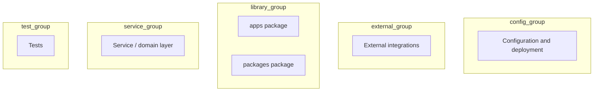

# Architecture report: petyosi/react-virtuoso

> Automated static analysis. **Observed** = directly seen in files/imports/AST; **Inferred** = interpretation from that evidence. Repository code was not executed.

## 1. Repository at a glance

| Item | Value |
| --- | --- |
| Repository | petyosi/react-virtuoso |
| Description | The most powerful virtual list component for React |
| Language | TypeScript |
| Stars | 6491 |
| Licence | Not detected |
| Analysed commit / branch | cb6c1941d340b2d66ffeea830620cbaf7db3c3c5 / main |
| Framework(s) | React |
| Files analysed | 799 |
| Components | 6 |

## 2. Architecture in one minute

petyosi/react-virtuoso - The most powerful virtual list component for React. This repository was analysed statically from 799 file(s) (0 Python). Detected technologies (observed from imports/manifests): GitHub Actions, React, React Router, Tailwind CSS, TypeScript, Vite. Files are grouped into 6 component(s): apps package, Configuration and deployment, External integrations, packages package, Service / domain layer, Tests. Findings below distinguish observed facts from inferred interpretation.

## 3. High-level block diagram

## 4. Main components

### apps package (`apps`)

- **Kind:** library
- **Status:** Observed
- **Confidence:** 0.85
- **Responsibility:** Groups 54 file(s) under apps package (observed from repository paths and static analysis).
- **Paths:** `apps/virtuoso.dev/astro.config.mjs`, `apps/virtuoso.dev/prettier.config.mjs`, `apps/virtuoso.dev/registry/new-york/data-table/column-reorder/draggable-group-header.tsx`, `apps/virtuoso.dev/registry/new-york/data-table/column-reorder/index.ts`, `apps/virtuoso.dev/registry/new-york/data-table/column-reorder/reorder-drop-zone.tsx`, `apps/virtuoso.dev/registry/new-york/data-table/column-reorder/reorder-grip.tsx`, `apps/virtuoso.dev/registry/new-york/data-table/column-resize/index.ts`, `apps/virtuoso.dev/registry/new-york/data-table/column-resize/resize-handle.tsx`, `apps/virtuoso.dev/registry/new-york/data-table/column-sort/index.ts`, `apps/virtuoso.dev/registry/new-york/data-table/column-sort/sort-header-button.tsx`, `apps/virtuoso.dev/registry/new-york/data-table/data-table.tsx`, `apps/virtuoso.dev/src/components/DataTableHeroDemo.tsx`, `apps/virtuoso.dev/src/components/HeroDemo.tsx`, `apps/virtuoso.dev/src/components/LiveCodeBlock/LiveCodeBlock.tsx`, `apps/virtuoso.dev/src/components/LiveCodeBlock/bundleCode.ts`, `apps/virtuoso.dev/src/components/LiveCodeBlock/createCodesandbox.ts`, `apps/virtuoso.dev/src/components/LiveCodeBlock/extraImports.ts`, `apps/virtuoso.dev/src/components/LiveCodeBlock/tailwindTransform.ts`, `apps/virtuoso.dev/src/components/MessageListHeroDemo.tsx`, `apps/virtuoso.dev/src/components/MobileMenu.tsx`, `apps/virtuoso.dev/src/components/OutlinedButton.tsx`, `apps/virtuoso.dev/src/components/Purchase.tsx`, `apps/virtuoso.dev/src/components/StaticCodeBlock/StaticCodeBlock.tsx`, `apps/virtuoso.dev/src/components/ThemeSelect.tsx`, `apps/virtuoso.dev/src/components/theme-utils.ts`, `apps/virtuoso.dev/src/components/ui/button.tsx`, `apps/virtuoso.dev/src/components/ui/card.tsx`, `apps/virtuoso.dev/src/components/ui/tooltip.tsx`, `apps/virtuoso.dev/src/content.config.ts`, `apps/virtuoso.dev/src/env.d.ts`, `apps/virtuoso.dev/src/lib/utils.ts`, `apps/virtuoso.dev/src/pages/og/[...slug].ts`, `apps/virtuoso.dev/src/plugins/astro-typedoc/index.ts`, `apps/virtuoso.dev/src/plugins/astro-typedoc/theme.js`, `apps/virtuoso.dev/src/plugins/auto-imports.ts`, `apps/virtuoso.dev/src/plugins/auto-imports/Exports.ts`, `apps/virtuoso.dev/src/plugins/auto-imports/autoImports.ts`, `apps/virtuoso.dev/src/plugins/auto-imports/findUnresolved.ts`, `apps/virtuoso.dev/src/plugins/auto-imports/getExports.ts`, `apps/virtuoso.dev/src/plugins/auto-imports/index.ts`, `apps/virtuoso.dev/src/plugins/auto-imports/parseExports.ts`, `apps/virtuoso.dev/src/plugins/auto-imports/toImport.ts`, `apps/virtuoso.dev/src/plugins/auto-imports/types.ts`, `apps/virtuoso.dev/src/plugins/common/findExportInMdx.ts`, `apps/virtuoso.dev/src/plugins/common/index.ts`, `apps/virtuoso.dev/src/plugins/common/path.ts`, `apps/virtuoso.dev/src/plugins/common/shortHash.ts`, `apps/virtuoso.dev/src/plugins/common/strings.ts`, `apps/virtuoso.dev/src/plugins/remark-custom-code-blocks.ts`, `apps/virtuoso.dev/src/plugins/types/RemarkPlugin.ts`, `apps/virtuoso.dev/src/plugins/types/VFile.ts`, `apps/virtuoso.dev/src/plugins/types/index.ts`, `apps/virtuoso.dev/src/routeData.ts`, `apps/virtuoso.dev/src/utils/shikiHighlighter.ts`
- **Evidence:** [apps/virtuoso.dev/astro.config.mjs](https://github.com/petyosi/react-virtuoso/blob/cb6c1941d340b2d66ffeea830620cbaf7db3c3c5/apps/virtuoso.dev/astro.config.mjs); [apps/virtuoso.dev/prettier.config.mjs](https://github.com/petyosi/react-virtuoso/blob/cb6c1941d340b2d66ffeea830620cbaf7db3c3c5/apps/virtuoso.dev/prettier.config.mjs); [apps/virtuoso.dev/registry/new-york/data-table/column-reorder/draggable-group-header.tsx](https://github.com/petyosi/react-virtuoso/blob/cb6c1941d340b2d66ffeea830620cbaf7db3c3c5/apps/virtuoso.dev/registry/new-york/data-table/column-reorder/draggable-group-header.tsx); [apps/virtuoso.dev/registry/new-york/data-table/column-reorder/index.ts](https://github.com/petyosi/react-virtuoso/blob/cb6c1941d340b2d66ffeea830620cbaf7db3c3c5/apps/virtuoso.dev/registry/new-york/data-table/column-reorder/index.ts); [apps/virtuoso.dev/registry/new-york/data-table/column-reorder/reorder-drop-zone.tsx](https://github.com/petyosi/react-virtuoso/blob/cb6c1941d340b2d66ffeea830620cbaf7db3c3c5/apps/virtuoso.dev/registry/new-york/data-table/column-reorder/reorder-drop-zone.tsx); [apps/virtuoso.dev/registry/new-york/data-table/column-reorder/reorder-grip.tsx](https://github.com/petyosi/react-virtuoso/blob/cb6c1941d340b2d66ffeea830620cbaf7db3c3c5/apps/virtuoso.dev/registry/new-york/data-table/column-reorder/reorder-grip.tsx); [apps/virtuoso.dev/registry/new-york/data-table/column-resize/index.ts](https://github.com/petyosi/react-virtuoso/blob/cb6c1941d340b2d66ffeea830620cbaf7db3c3c5/apps/virtuoso.dev/registry/new-york/data-table/column-resize/index.ts); [apps/virtuoso.dev/registry/new-york/data-table/column-resize/resize-handle.tsx](https://github.com/petyosi/react-virtuoso/blob/cb6c1941d340b2d66ffeea830620cbaf7db3c3c5/apps/virtuoso.dev/registry/new-york/data-table/column-resize/resize-handle.tsx)

### Configuration and deployment (`config`)

- **Kind:** config
- **Status:** Observed
- **Confidence:** 0.85
- **Responsibility:** Groups 32 file(s) under configuration and deployment (observed from repository paths and static analysis).
- **Paths:** `apps/virtuoso.dev/.claude/settings.local.json`, `apps/virtuoso.dev/.oxlintrc.json`, `apps/virtuoso.dev/components.json`, `apps/virtuoso.dev/package.json`, `apps/virtuoso.dev/registry.json`, `apps/virtuoso.dev/tsconfig.json`, `apps/virtuoso.dev/tsconfig.message-list.json`, `knip.json`, `lefthook.json`, `package.json`, `packages/data-table/.oxlintrc.json`, `packages/data-table/package.json`, `packages/data-table/tsconfig.json`, `packages/gurx/.oxlintrc.json`, `packages/gurx/CHANGELOG.json`, `packages/gurx/package.json`, `packages/gurx/tsconfig.json`, `packages/gurx/tsconfig.node.json`, `packages/masonry/.oxlintrc.json`, `packages/masonry/CHANGELOG.json`, `packages/masonry/package.json`, `packages/masonry/tsconfig.json`, `packages/masonry/tsconfig.node.json`, `packages/react-virtuoso/.oxlintrc.json`, `packages/react-virtuoso/package.json`, `packages/react-virtuoso/tsconfig.json`, `packages/reactive-engine-core/.claude/settings.local.json`, `packages/reactive-engine-core/.oxlintrc.json`, `packages/reactive-engine-core/package.json`, `packages/reactive-engine-core/tsconfig.json`, `packages/reactive-engine-examples/package.json`, `packages/reactive-engine-examples/todo-app/db.json`
- **Evidence:** [apps/virtuoso.dev/.claude/settings.local.json](https://github.com/petyosi/react-virtuoso/blob/cb6c1941d340b2d66ffeea830620cbaf7db3c3c5/apps/virtuoso.dev/.claude/settings.local.json); [apps/virtuoso.dev/.oxlintrc.json](https://github.com/petyosi/react-virtuoso/blob/cb6c1941d340b2d66ffeea830620cbaf7db3c3c5/apps/virtuoso.dev/.oxlintrc.json); [apps/virtuoso.dev/components.json](https://github.com/petyosi/react-virtuoso/blob/cb6c1941d340b2d66ffeea830620cbaf7db3c3c5/apps/virtuoso.dev/components.json); [apps/virtuoso.dev/package.json](https://github.com/petyosi/react-virtuoso/blob/cb6c1941d340b2d66ffeea830620cbaf7db3c3c5/apps/virtuoso.dev/package.json); [apps/virtuoso.dev/registry.json](https://github.com/petyosi/react-virtuoso/blob/cb6c1941d340b2d66ffeea830620cbaf7db3c3c5/apps/virtuoso.dev/registry.json); [apps/virtuoso.dev/tsconfig.json](https://github.com/petyosi/react-virtuoso/blob/cb6c1941d340b2d66ffeea830620cbaf7db3c3c5/apps/virtuoso.dev/tsconfig.json); [apps/virtuoso.dev/tsconfig.message-list.json](https://github.com/petyosi/react-virtuoso/blob/cb6c1941d340b2d66ffeea830620cbaf7db3c3c5/apps/virtuoso.dev/tsconfig.message-list.json); [knip.json](https://github.com/petyosi/react-virtuoso/blob/cb6c1941d340b2d66ffeea830620cbaf7db3c3c5/knip.json)

### External integrations (`external_integrations`)

- **Kind:** external
- **Status:** Observed
- **Confidence:** 0.85
- **Responsibility:** Groups 1 file(s) under external integrations (observed from repository paths and static analysis).
- **Paths:** `apps/virtuoso.dev/src/integrations/docs-sync.ts`
- **Evidence:** [apps/virtuoso.dev/src/integrations/docs-sync.ts](https://github.com/petyosi/react-virtuoso/blob/cb6c1941d340b2d66ffeea830620cbaf7db3c3c5/apps/virtuoso.dev/src/integrations/docs-sync.ts)

### packages package (`packages`)

- **Kind:** library
- **Status:** Observed
- **Confidence:** 0.85
- **Responsibility:** Groups 367 file(s) under packages package (observed from repository paths and static analysis).
- **Paths:** `packages/data-table/.ladle/components.tsx`, `packages/data-table/.ladle/config.mjs`, `packages/data-table/src/VirtuosoDataTableTestingContext.tsx`, `packages/data-table/src/_stories/basic.stories.tsx`, `packages/data-table/src/_stories/card-mode.stories.tsx`, `packages/data-table/src/_stories/column-groups.stories.tsx`, `packages/data-table/src/_stories/column-grow.fixture.tsx`, `packages/data-table/src/_stories/column-grow.stories.tsx`, `packages/data-table/src/_stories/column-reorder.stories.tsx`, `packages/data-table/src/_stories/column-resize.stories.tsx`, `packages/data-table/src/_stories/column-visibility-persistence.stories.tsx`, `packages/data-table/src/_stories/column-width-persistence.stories.tsx`, `packages/data-table/src/_stories/custom-scroll-parent-header-gap.stories.tsx`, `packages/data-table/src/_stories/dynamic-columns.stories.tsx`, `packages/data-table/src/_stories/grouped-data.stories.tsx`, `packages/data-table/src/_stories/initial-location.stories.tsx`, `packages/data-table/src/_stories/model-local.stories.tsx`, `packages/data-table/src/_stories/model-remote.stories.tsx`, `packages/data-table/src/_stories/model-state-persistence.stories.tsx`, `packages/data-table/src/_stories/remote-control.stories.tsx`, `packages/data-table/src/_stories/render-storm.stories.tsx`, `packages/data-table/src/_stories/scrollbar-overlay-handling.stories.tsx`, `packages/data-table/src/_stories/shadcn.stories.tsx`, `packages/data-table/src/_stories/sticky-columns.stories.tsx`, `packages/data-table/src/_stories/test.stories.tsx`, `packages/data-table/src/_stories/zero-height-items.stories.tsx`, `packages/data-table/src/cards/CardPresentation.tsx`, `packages/data-table/src/cards/geometry.ts`, `packages/data-table/src/cards/state.ts`, `packages/data-table/src/columns/Cell.tsx`, `packages/data-table/src/columns/Column.tsx`, `packages/data-table/src/columns/ColumnGroup.tsx`, `packages/data-table/src/columns/ColumnGroupHeader.tsx`, `packages/data-table/src/columns/ColumnHeader.tsx`, `packages/data-table/src/columns/column-sizes.ts`, `packages/data-table/src/columns/column-state.ts`, `packages/data-table/src/columns/column-width-distribution.ts`, `packages/data-table/src/columns/column-width-overrides.ts`, `packages/data-table/src/columns/header-slots/registry.ts`, `packages/data-table/src/columns/header-slots/slots.tsx`, `packages/data-table/src/columns/header-tree.tsx`, `packages/data-table/src/columns/registry.ts`, `packages/data-table/src/debug/row-render-events.ts`, `packages/data-table/src/features/column-reorder/index.ts`, `packages/data-table/src/features/column-resize/index.ts`, `packages/data-table/src/features/column-visibility/index.ts`, `packages/data-table/src/features/dynamic-columns/index.tsx`, `packages/data-table/src/features/state-persistence/index.tsx`, `packages/data-table/src/index.ts`, `packages/data-table/src/interfaces.ts`, `packages/data-table/src/layout/ScrollbarOverlay.tsx`, `packages/data-table/src/layout/TableLayoutRoot.tsx`, `packages/data-table/src/layout/VirtualizedTableContent.tsx`, `packages/data-table/src/layout/scroller-elements.tsx`, `packages/data-table/src/layout/table-ready.ts`, `packages/data-table/src/model/action-state.ts`, `packages/data-table/src/model/local-model.ts`, `packages/data-table/src/model/model-bridge.ts`, `packages/data-table/src/model/model-core.ts`, `packages/data-table/src/model/persistence.ts`, `packages/data-table/src/model/remote-model.ts`, `packages/data-table/src/model/reserved-actions.ts`, `packages/data-table/src/model/types.ts`, `packages/data-table/src/resize/accumulate-size-range.ts`, `packages/data-table/src/resize/resize-observer-singleton.ts`, `packages/data-table/src/resize/resize-observing.ts`, `packages/data-table/src/resize/sizes.ts`, `packages/data-table/src/rows/GroupHeaderCell.tsx`, `packages/data-table/src/rows/Row.tsx`, `packages/data-table/src/rows/row-state.ts`, `packages/data-table/src/scroll/at-bottom.ts`, `packages/data-table/src/scroll/callbacks.ts`, `packages/data-table/src/scroll/dom.ts`, `packages/data-table/src/scroll/reverse-scroll-fix.ts`, `packages/data-table/src/scroll/scroll-to-row.ts`, `packages/data-table/src/scroll/smooth-scroll.ts`, `packages/data-table/src/scroll/state.ts`, `packages/data-table/src/sizing/AATree.ts`, `packages/data-table/src/sizing/SizeState.ts`, `packages/data-table/src/sizing/binaryArraySearch.ts`, `packages/data-table/src/sizing/deleteIndices.ts`, `packages/data-table/src/sizing/insertRanges.ts`, `packages/data-table/src/sizing/itemsWithinOffsets.ts`, `packages/data-table/src/sizing/offsetOf.ts`, `packages/data-table/src/sizing/rangesWithinOffsets.ts`, `packages/data-table/src/sizing/stickyItems.ts`, `packages/data-table/src/utils.ts`, `packages/data-table/src/vite-env.d.ts`, `packages/data-table/vite.config.ts`, `packages/data-table/vitest.config.ts`, `packages/gurx/src/AsyncQuery.ts`, `packages/gurx/src/RefCount.ts`, `packages/gurx/src/SetMap.ts`, `packages/gurx/src/hooks.ts`, `packages/gurx/src/index.ts`, `packages/gurx/src/operators.ts`, `packages/gurx/src/react.tsx`, `packages/gurx/src/realm.ts`, `packages/gurx/src/utils.ts`, `packages/gurx/src/vite-env.d.ts`, `packages/gurx/vite.config.ts`, `packages/gurx/vitest.config.ts`, `packages/masonry/src/VirtuosoMasonry.tsx`, `packages/masonry/src/_stories/masonry.stories.tsx`, `packages/masonry/src/content.tsx`, `packages/masonry/src/data.ts`, `packages/masonry/src/dom.ts`, `packages/masonry/src/index.ts`, `packages/masonry/src/interfaces.ts`, `packages/masonry/src/masonry-item-state.ts`, `packages/masonry/src/masonry-sizes.ts`, `packages/masonry/src/sizing/AATree.ts`, `packages/masonry/src/sizing/binaryArraySearch.ts`, `packages/masonry/src/sizing/insertRanges.ts`, `packages/masonry/src/sizing/offsetTreeReducer.ts`, `packages/masonry/src/sizing/rangesWithinOffsets.ts`, `packages/masonry/src/sizing/sizeTreeReducer.ts`, `packages/masonry/src/vite-env.d.ts`, `packages/masonry/vite.config.ts`, `packages/masonry/vitest.workspace.ts`, `packages/react-virtuoso/.ladle/config.mjs`, `packages/react-virtuoso/e2e/collapsible-long-item.test.ts`, `packages/react-virtuoso/e2e/css-zoom.test.ts`, `packages/react-virtuoso/e2e/data.test.ts`, `packages/react-virtuoso/e2e/follow-output-loading-image.test.ts`, `packages/react-virtuoso/e2e/gap-header.test.ts`, `packages/react-virtuoso/e2e/gap.test.ts`, `packages/react-virtuoso/e2e/grid-end-reached-after-filter.test.ts`, `packages/react-virtuoso/e2e/grid-gap.test.ts`, `packages/react-virtuoso/e2e/grid-scroll-seek-placeholder.test.ts`, `packages/react-virtuoso/e2e/grid.test.ts`, `packages/react-virtuoso/e2e/grouped-topmost-item.test.ts`, `packages/react-virtuoso/e2e/grouped.test.ts`, `packages/react-virtuoso/e2e/hello.test.ts`, `packages/react-virtuoso/e2e/horizontal-rtl.test.ts`, `packages/react-virtuoso/e2e/initial-scroll-top.test.ts`, `packages/react-virtuoso/e2e/initial-topmost-item.test.ts`, `packages/react-virtuoso/e2e/long-last-item.test.ts`, `packages/react-virtuoso/e2e/prepend-items.test.ts`, `packages/react-virtuoso/e2e/reverse-taller-than-viewport.test.ts`, `packages/react-virtuoso/e2e/scroll-seek-placeholder.test.ts`, `packages/react-virtuoso/e2e/scroll-to-index.test.ts`, `packages/react-virtuoso/e2e/table.test.ts`, `packages/react-virtuoso/e2e/test-case-446.test.ts`, `packages/react-virtuoso/e2e/toggle.test.ts`, `packages/react-virtuoso/e2e/top-items.test.ts`, `packages/react-virtuoso/e2e/utils.ts`, `packages/react-virtuoso/e2e/window-at-bottom-detection.test.ts`, `packages/react-virtuoso/e2e/window-offscreen-bootstrap.test.ts`, `packages/react-virtuoso/examples/align-to-bottom.tsx`, `packages/react-virtuoso/examples/at-bottom-detection.tsx`, `packages/react-virtuoso/examples/auto-prepend-items.tsx`, `packages/react-virtuoso/examples/benchmark.tsx`, `packages/react-virtuoso/examples/collapsible-long-item.tsx`, `packages/react-virtuoso/examples/context.tsx`, `packages/react-virtuoso/examples/css-zoom.tsx`, `packages/react-virtuoso/examples/custom-components.tsx`, `packages/react-virtuoso/examples/custom-scroller.tsx`, `packages/react-virtuoso/examples/data.tsx`, `packages/react-virtuoso/examples/decrease-items.tsx`, `packages/react-virtuoso/examples/default-item-height.tsx`, `packages/react-virtuoso/examples/empty-placeholder.tsx`, `packages/react-virtuoso/examples/end-reached.tsx`, `packages/react-virtuoso/examples/endless-scrolling.tsx`, `packages/react-virtuoso/examples/expandable-cards.tsx`, `packages/react-virtuoso/examples/follow-output-async-expanded.tsx`, `packages/react-virtuoso/examples/follow-output-loading-image.tsx`, `packages/react-virtuoso/examples/follow-output.tsx`, `packages/react-virtuoso/examples/gap-header.tsx`, `packages/react-virtuoso/examples/gap.tsx`, `packages/react-virtuoso/examples/grid-data.tsx`, `packages/react-virtuoso/examples/grid-end-reached-after-filter.tsx`, `packages/react-virtuoso/examples/grid-gap.tsx`, `packages/react-virtuoso/examples/grid-header-footer.tsx`, `packages/react-virtuoso/examples/grid-infinite-data.tsx`, `packages/react-virtuoso/examples/grid-initial-item-count-initial-topmost-item-index.tsx`, `packages/react-virtuoso/examples/grid-initial-item-count.tsx`, `packages/react-virtuoso/examples/grid-initial-topmost-item-index.tsx`, `packages/react-virtuoso/examples/grid-optimize-rendering.tsx`, `packages/react-virtuoso/examples/grid-responsive-columns.tsx`, `packages/react-virtuoso/examples/grid-scroll-seek-placeholder.tsx`, `packages/react-virtuoso/examples/grid.tsx`, `packages/react-virtuoso/examples/group-scroll-into-view.tsx`, `packages/react-virtuoso/examples/group-scroll-seek-placeholder.tsx`, `packages/react-virtuoso/examples/grouped-endless-scrolling.tsx`, `packages/react-virtuoso/examples/grouped-load-more.tsx`, `packages/react-virtuoso/examples/grouped-prepend-items.tsx`, `packages/react-virtuoso/examples/grouped-table.tsx`, `packages/react-virtuoso/examples/grouped-topmost-item.tsx`, `packages/react-virtuoso/examples/grouped.tsx`, `packages/react-virtuoso/examples/header-footer.tsx`, `packages/react-virtuoso/examples/height-estimates.tsx`, `packages/react-virtuoso/examples/hello.tsx`, `packages/react-virtuoso/examples/horizontal-dynamic-direction.tsx`, `packages/react-virtuoso/examples/horizontal-rtl.tsx`, `packages/react-virtuoso/examples/horizontal.tsx`, `packages/react-virtuoso/examples/iframe-portal.tsx`, `packages/react-virtuoso/examples/initial-from-zero.tsx`, `packages/react-virtuoso/examples/initial-scroll-top.tsx`, `packages/react-virtuoso/examples/initial-topmost-item-default-height.tsx`, `packages/react-virtuoso/examples/initial-topmost-item.tsx`, `packages/react-virtuoso/examples/iti-multiple.tsx`, `packages/react-virtuoso/examples/long-last-item.tsx`, `packages/react-virtuoso/examples/min-overscan-item-count.tsx`, `packages/react-virtuoso/examples/prepend-as-you-scroll.tsx`, `packages/react-virtuoso/examples/prepend-items.tsx`, `packages/react-virtuoso/examples/prepend-last-tall-item.tsx`, `packages/react-virtuoso/examples/prepend-stress-styles.ts`, `packages/react-virtuoso/examples/prepend-stress.tsx`, `packages/react-virtuoso/examples/remove-items.tsx`, `packages/react-virtuoso/examples/rerender.tsx`, `packages/react-virtuoso/examples/resize-loop.tsx`, `packages/react-virtuoso/examples/resizing-items.tsx`, `packages/react-virtuoso/examples/reverse-taller-than-viewport.tsx`, `packages/react-virtuoso/examples/scroll-element-grid-scroller.tsx`, `packages/react-virtuoso/examples/scroll-element-list-scroller.tsx`, `packages/react-virtuoso/examples/scroll-into-view-align.tsx`, `packages/react-virtuoso/examples/scroll-into-view-on-change.tsx`, `packages/react-virtuoso/examples/scroll-into-view.tsx`, `packages/react-virtuoso/examples/scroll-seek-placeholder.tsx`, `packages/react-virtuoso/examples/scroll-to-index.tsx`, `packages/react-virtuoso/examples/ssr.tsx`, `packages/react-virtuoso/examples/start-reached.tsx`, `packages/react-virtuoso/examples/state.tsx`, `packages/react-virtuoso/examples/subtitles-ui.tsx`, `packages/react-virtuoso/examples/table-markup.tsx`, `packages/react-virtuoso/examples/table-state.tsx`, `packages/react-virtuoso/examples/tall-item-reverse-scrolling.tsx`, `packages/react-virtuoso/examples/test-case-1234.tsx`, `packages/react-virtuoso/examples/test-case-446.tsx`, `packages/react-virtuoso/examples/test-case-460.tsx`, `packages/react-virtuoso/examples/test-case-463.tsx`, `packages/react-virtuoso/examples/test-case-638.tsx`, `packages/react-virtuoso/examples/test-case-722.tsx`, `packages/react-virtuoso/examples/test-case-896.tsx`, `packages/react-virtuoso/examples/toggle-display-grouped.tsx`, `packages/react-virtuoso/examples/toggle.tsx`, `packages/react-virtuoso/examples/top-items.tsx`, `packages/react-virtuoso/examples/upward-scroll.tsx`, `packages/react-virtuoso/examples/window-at-bottom-detection.tsx`, `packages/react-virtuoso/examples/window-grid.tsx`, `packages/react-virtuoso/examples/window-group-scroll.tsx`, `packages/react-virtuoso/examples/window-offscreen-bootstrap.tsx`, `packages/react-virtuoso/examples/window-scroller.tsx`, `packages/react-virtuoso/examples/window-table.tsx`, `packages/react-virtuoso/playwright.config.ts`, `packages/react-virtuoso/src/AATree.ts`, `packages/react-virtuoso/src/TableVirtuoso.tsx`, `packages/react-virtuoso/src/Virtuoso.tsx`, `packages/react-virtuoso/src/VirtuosoGrid.tsx`, `packages/react-virtuoso/src/alignToBottomSystem.ts`, `packages/react-virtuoso/src/comparators.tsx`, `packages/react-virtuoso/src/component-interfaces/TableVirtuoso.ts`, `packages/react-virtuoso/src/component-interfaces/Virtuoso.ts`, `packages/react-virtuoso/src/component-interfaces/VirtuosoGrid.ts`, `packages/react-virtuoso/src/contextSystem.ts`, `packages/react-virtuoso/src/domIOSystem.ts`, `packages/react-virtuoso/src/followOutputSystem.ts`, `packages/react-virtuoso/src/gridSystem.ts`, `packages/react-virtuoso/src/groupedListSystem.ts`, `packages/react-virtuoso/src/hooks/__mocks__/useChangedChildSizes.ts`, `packages/react-virtuoso/src/hooks/__mocks__/useScrollTop.ts`, `packages/react-virtuoso/src/hooks/__mocks__/useSize.ts`, `packages/react-virtuoso/src/hooks/useChangedChildSizes.ts`, `packages/react-virtuoso/src/hooks/useIsomorphicLayoutEffect.ts`, `packages/react-virtuoso/src/hooks/useScrollTop.ts`, `packages/react-virtuoso/src/hooks/useSize.ts`, `packages/react-virtuoso/src/hooks/useWindowViewportRect.ts`, `packages/react-virtuoso/src/index.tsx`, `packages/react-virtuoso/src/initialItemCountSystem.ts`, `packages/react-virtuoso/src/initialScrollTopSystem.ts`, `packages/react-virtuoso/src/initialTopMostItemIndexSystem.ts`, `packages/react-virtuoso/src/interfaces.ts`, `packages/react-virtuoso/src/listStateSystem.ts`, `packages/react-virtuoso/src/listSystem.ts`, `packages/react-virtuoso/src/loggerSystem.ts`, `packages/react-virtuoso/src/propsReadySystem.ts`, `packages/react-virtuoso/src/react-urx/index.tsx`, `packages/react-virtuoso/src/recalcSystem.ts`, `packages/react-virtuoso/src/scrollIntoViewSystem.ts`, `packages/react-virtuoso/src/scrollSeekSystem.ts`, `packages/react-virtuoso/src/scrollToIndexSystem.ts`, `packages/react-virtuoso/src/sizeRangeSystem.ts`, `packages/react-virtuoso/src/sizeSystem.ts`, `packages/react-virtuoso/src/stateFlagsSystem.ts`, `packages/react-virtuoso/src/stateLoadSystem.ts`, `packages/react-virtuoso/src/topItemCountSystem.ts`, `packages/react-virtuoso/src/totalListHeightSystem.ts`, `packages/react-virtuoso/src/upwardScrollFixSystem.ts`, `packages/react-virtuoso/src/urx/actions.ts`, `packages/react-virtuoso/src/urx/constants.ts`, `packages/react-virtuoso/src/urx/index.ts`, `packages/react-virtuoso/src/urx/pipe.ts`, `packages/react-virtuoso/src/urx/streams.ts`, `packages/react-virtuoso/src/urx/system.ts`, `packages/react-virtuoso/src/urx/transformers.ts`, `packages/react-virtuoso/src/urx/utils.ts`, `packages/react-virtuoso/src/utils/approximatelyEqual.ts`, `packages/react-virtuoso/src/utils/binaryArraySearch.ts`, `packages/react-virtuoso/src/utils/context.ts`, `packages/react-virtuoso/src/utils/correctItemSize.ts`, `packages/react-virtuoso/src/utils/horizontalScroll.ts`, `packages/react-virtuoso/src/utils/positionStickyCssValue.ts`, `packages/react-virtuoso/src/utils/simpleMemoize.ts`, `packages/react-virtuoso/src/utils/skipFrames.ts`, `packages/react-virtuoso/src/windowScrollerSystem.ts`, `packages/react-virtuoso/vite.config.ts`, `packages/reactive-engine-core/src/ComputedCell.test.ts`, `packages/reactive-engine-core/src/Engine.test.ts`, `packages/reactive-engine-core/src/Engine.ts`, `packages/reactive-engine-core/src/Pulsar.test.ts`, `packages/reactive-engine-core/src/RefCount.test.ts`, `packages/reactive-engine-core/src/RefCount.ts`, `packages/reactive-engine-core/src/Resource.test.ts`, `packages/reactive-engine-core/src/SetMap.ts`, `packages/reactive-engine-core/src/combinators.test.ts`, `packages/reactive-engine-core/src/combinators.ts`, `packages/reactive-engine-core/src/debug.test.ts`, `packages/reactive-engine-core/src/diagnosticUtils.test.ts`, `packages/reactive-engine-core/src/diagnosticUtils.ts`, `packages/reactive-engine-core/src/diagnostics.test.ts`, `packages/reactive-engine-core/src/diagnostics.ts`, `packages/reactive-engine-core/src/e.ts`, `packages/reactive-engine-core/src/globals.ts`, `packages/reactive-engine-core/src/index.ts`, `packages/reactive-engine-core/src/nodeUtils.ts`, `packages/reactive-engine-core/src/nodes.test.ts`, `packages/reactive-engine-core/src/nodes.ts`, `packages/reactive-engine-core/src/operators.ts`, `packages/reactive-engine-core/src/operators/afterSettle.test.ts`, `packages/reactive-engine-core/src/operators/debounceTime.test.ts`, `packages/reactive-engine-core/src/operators/delayWithMicrotask.test.ts`, `packages/reactive-engine-core/src/operators/filter.test.ts`, `packages/reactive-engine-core/src/operators/filterMap.test.ts`, `packages/reactive-engine-core/src/operators/handlePromise.test.ts`, `packages/reactive-engine-core/src/operators/map.test.ts`, `packages/reactive-engine-core/src/operators/mapTo.test.ts`, `packages/reactive-engine-core/src/operators/onNext.test.ts`, `packages/reactive-engine-core/src/operators/once.test.ts`, `packages/reactive-engine-core/src/operators/scan.test.ts`, `packages/reactive-engine-core/src/operators/switchMapPromise.test.ts`, `packages/reactive-engine-core/src/operators/throttleTime.test.ts`, `packages/reactive-engine-core/src/operators/withLatestFrom.test.ts`, `packages/reactive-engine-core/src/pipe.test.ts`, `packages/reactive-engine-core/src/propagation.ts`, `packages/reactive-engine-core/src/testUtils.ts`, `packages/reactive-engine-core/src/types.ts`, `packages/reactive-engine-core/src/utils.test.ts`, `packages/reactive-engine-core/src/utils.ts`, `packages/reactive-engine-core/vite.config.ts`, `packages/reactive-engine-core/vitest.config.ts`, `packages/reactive-engine-examples/basic/src/App.tsx`, `packages/reactive-engine-examples/basic/src/main.tsx`, `packages/reactive-engine-examples/basic/src/pages/404/NotFoundPage.tsx`, `packages/reactive-engine-examples/basic/src/pages/404/index.tsx`, `packages/reactive-engine-examples/basic/src/pages/about/AboutPage.tsx`, `packages/reactive-engine-examples/basic/src/pages/about/index.tsx`, `packages/reactive-engine-examples/basic/src/pages/blog/BlogPage.tsx`, `packages/reactive-engine-examples/basic/src/pages/blog/index.tsx`, `packages/reactive-engine-examples/basic/src/pages/guarded/GuardedPage.tsx`, `packages/reactive-engine-examples/basic/src/pages/guarded/index.tsx`, `packages/reactive-engine-examples/basic/src/pages/home/HomePage.tsx`, `packages/reactive-engine-examples/basic/src/pages/home/index.tsx`, `packages/reactive-engine-examples/basic/src/pages/users/UserPage.tsx`, `packages/reactive-engine-examples/basic/src/pages/users/index.tsx`, `packages/reactive-engine-examples/basic/vite.config.ts`, `packages/reactive-engine-examples/todo-app/src/App.tsx`
- **Evidence:** [packages/data-table/.ladle/components.tsx](https://github.com/petyosi/react-virtuoso/blob/cb6c1941d340b2d66ffeea830620cbaf7db3c3c5/packages/data-table/.ladle/components.tsx); [packages/data-table/.ladle/config.mjs](https://github.com/petyosi/react-virtuoso/blob/cb6c1941d340b2d66ffeea830620cbaf7db3c3c5/packages/data-table/.ladle/config.mjs); [packages/data-table/src/VirtuosoDataTableTestingContext.tsx](https://github.com/petyosi/react-virtuoso/blob/cb6c1941d340b2d66ffeea830620cbaf7db3c3c5/packages/data-table/src/VirtuosoDataTableTestingContext.tsx); [packages/data-table/src/_stories/basic.stories.tsx](https://github.com/petyosi/react-virtuoso/blob/cb6c1941d340b2d66ffeea830620cbaf7db3c3c5/packages/data-table/src/_stories/basic.stories.tsx); [packages/data-table/src/_stories/card-mode.stories.tsx](https://github.com/petyosi/react-virtuoso/blob/cb6c1941d340b2d66ffeea830620cbaf7db3c3c5/packages/data-table/src/_stories/card-mode.stories.tsx); [packages/data-table/src/_stories/column-groups.stories.tsx](https://github.com/petyosi/react-virtuoso/blob/cb6c1941d340b2d66ffeea830620cbaf7db3c3c5/packages/data-table/src/_stories/column-groups.stories.tsx); [packages/data-table/src/_stories/column-grow.fixture.tsx](https://github.com/petyosi/react-virtuoso/blob/cb6c1941d340b2d66ffeea830620cbaf7db3c3c5/packages/data-table/src/_stories/column-grow.fixture.tsx); [packages/data-table/src/_stories/column-grow.stories.tsx](https://github.com/petyosi/react-virtuoso/blob/cb6c1941d340b2d66ffeea830620cbaf7db3c3c5/packages/data-table/src/_stories/column-grow.stories.tsx)

### Service / domain layer (`service_layer`)

- **Kind:** service
- **Status:** Observed
- **Confidence:** 0.85
- **Responsibility:** Groups 8 file(s) under service / domain layer (observed from repository paths and static analysis).
- **Paths:** `packages/data-table/src/core/VirtuosoDataTable.tsx`, `packages/data-table/src/core/components.tsx`, `packages/data-table/src/core/content.tsx`, `packages/data-table/src/core/data.ts`, `packages/data-table/src/core/hooks.ts`, `packages/data-table/src/core/loading.ts`, `packages/data-table/src/core/model-actions.ts`, `packages/data-table/src/core/presentation.ts`
- **Evidence:** [packages/data-table/src/core/VirtuosoDataTable.tsx](https://github.com/petyosi/react-virtuoso/blob/cb6c1941d340b2d66ffeea830620cbaf7db3c3c5/packages/data-table/src/core/VirtuosoDataTable.tsx); [packages/data-table/src/core/components.tsx](https://github.com/petyosi/react-virtuoso/blob/cb6c1941d340b2d66ffeea830620cbaf7db3c3c5/packages/data-table/src/core/components.tsx); [packages/data-table/src/core/content.tsx](https://github.com/petyosi/react-virtuoso/blob/cb6c1941d340b2d66ffeea830620cbaf7db3c3c5/packages/data-table/src/core/content.tsx); [packages/data-table/src/core/data.ts](https://github.com/petyosi/react-virtuoso/blob/cb6c1941d340b2d66ffeea830620cbaf7db3c3c5/packages/data-table/src/core/data.ts); [packages/data-table/src/core/hooks.ts](https://github.com/petyosi/react-virtuoso/blob/cb6c1941d340b2d66ffeea830620cbaf7db3c3c5/packages/data-table/src/core/hooks.ts); [packages/data-table/src/core/loading.ts](https://github.com/petyosi/react-virtuoso/blob/cb6c1941d340b2d66ffeea830620cbaf7db3c3c5/packages/data-table/src/core/loading.ts); [packages/data-table/src/core/model-actions.ts](https://github.com/petyosi/react-virtuoso/blob/cb6c1941d340b2d66ffeea830620cbaf7db3c3c5/packages/data-table/src/core/model-actions.ts); [packages/data-table/src/core/presentation.ts](https://github.com/petyosi/react-virtuoso/blob/cb6c1941d340b2d66ffeea830620cbaf7db3c3c5/packages/data-table/src/core/presentation.ts)

### Tests (`tests`)

- **Kind:** test
- **Status:** Observed
- **Confidence:** 0.85
- **Responsibility:** Groups 133 file(s) under tests (observed from repository paths and static analysis).
- **Paths:** `packages/data-table/src/cards/tests/browser/card-mode.test.tsx`, `packages/data-table/src/cards/tests/node/geometry.test.ts`, `packages/data-table/src/columns/tests/browser/column-groups.test.tsx`, `packages/data-table/src/columns/tests/browser/column-grow-layout.test.tsx`, `packages/data-table/src/columns/tests/browser/declaration-order.test.tsx`, `packages/data-table/src/columns/tests/browser/sticky-columns.test.tsx`, `packages/data-table/src/columns/tests/node/column-width-distribution.test.ts`, `packages/data-table/src/columns/tests/node/column-width-state.test.ts`, `packages/data-table/src/columns/tests/node/header-slots.test.ts`, `packages/data-table/src/columns/tests/node/reorder-columns.test.ts`, `packages/data-table/src/columns/tests/node/sticky-column-change.test.ts`, `packages/data-table/src/core/tests/browser/compute-row-key.test.tsx`, `packages/data-table/src/core/tests/browser/context.test.tsx`, `packages/data-table/src/core/tests/browser/empty-placeholder.test.tsx`, `packages/data-table/src/core/tests/browser/model-action-bridge.test.tsx`, `packages/data-table/src/core/tests/browser/model-data-change.test.tsx`, `packages/data-table/src/core/tests/node/data.test.ts`, `packages/data-table/src/core/tests/node/initial-data.test.ts`, `packages/data-table/src/features/column-reorder/tests/node/column-order-persistence.test.ts`, `packages/data-table/src/features/column-resize/tests/node/column-width-persistence.test.ts`, `packages/data-table/src/features/column-resize/tests/node/resize-column.test.ts`, `packages/data-table/src/features/column-visibility/tests/node/column-visibility-persistence.test.ts`, `packages/data-table/src/features/dynamic-columns/tests/browser/dynamic-columns-remote.test.tsx`, `packages/data-table/src/features/dynamic-columns/tests/browser/dynamic-columns.test.tsx`, `packages/data-table/src/features/state-persistence/tests/node/model-state-persistence-adapter.test.ts`, `packages/data-table/src/layout/tests/browser/header-rerender-isolation.test.tsx`, `packages/data-table/src/layout/tests/browser/overscan.test.tsx`, `packages/data-table/src/layout/tests/browser/props-update-after-mount.test.tsx`, `packages/data-table/src/model/tests/node/action-state-tracker.test.ts`, `packages/data-table/src/model/tests/node/model-action-bridge.test.ts`, `packages/data-table/src/model/tests/node/model-persistence.test.ts`, `packages/data-table/src/resize/tests/browser/hidden-ancestor.test.tsx`, `packages/data-table/src/resize/tests/node/accumulate-size-range.test.ts`, `packages/data-table/src/rows/tests/browser/basic-behavior.test.tsx`, `packages/data-table/src/rows/tests/browser/data-change-sizing.test.tsx`, `packages/data-table/src/rows/tests/browser/grouped-data.test.tsx`, `packages/data-table/src/rows/tests/browser/grouped-large-multilevel-scroll-gap.test.tsx`, `packages/data-table/src/rows/tests/browser/model-update-data.test.tsx`, `packages/data-table/src/rows/tests/browser/row-render-events.test.tsx`, `packages/data-table/src/rows/tests/node/currentlyRenderedRows.bench.ts`, `packages/data-table/src/rows/tests/node/grouped-data.test.ts`, `packages/data-table/src/rows/tests/node/viewport-range.test.ts`, `packages/data-table/src/scroll/tests/browser/custom-scroll-parent-offscreen-height.test.tsx`, `packages/data-table/src/scroll/tests/browser/custom-scroll-parent-offset.test.tsx`, `packages/data-table/src/scroll/tests/browser/custom-scroll-parent-render-window.test.tsx`, `packages/data-table/src/scroll/tests/browser/initial-location.test.tsx`, `packages/data-table/src/scroll/tests/browser/loading-slots.test.tsx`, `packages/data-table/src/scroll/tests/browser/scroll-callbacks.test.tsx`, `packages/data-table/src/scroll/tests/browser/viewport-sync.test.tsx`, `packages/data-table/src/scroll/tests/browser/window-scroll-render-window.test.tsx`, `packages/data-table/src/sizing/tests/node/AATree.bench.ts`, `packages/data-table/src/sizing/tests/node/AATree.test.ts`, `packages/data-table/src/sizing/tests/node/SizeState.test.ts`, `packages/data-table/src/sizing/tests/node/deleteIndices.test.ts`, `packages/data-table/src/sizing/tests/node/itemsWithinOffsets.test.ts`, `packages/data-table/src/sizing/tests/node/stickyColumnsPadding.test.ts`, `packages/data-table/src/sizing/tests/node/stickyItems.test.ts`, `packages/data-table/src/tests/LocalDataTable.tsx`, `packages/data-table/src/tests/browser/classname-support.test.tsx`, `packages/data-table/src/tests/browser/setup.ts`, `packages/data-table/src/tests/utils.ts`, `packages/data-table/tests/browser/column-resize-slot.test.tsx`, `packages/data-table/tests/browser/custom-scroll-parent-rebind.test.tsx`, `packages/data-table/tests/browser/hello-world.test.tsx`, `packages/data-table/tests/browser/model-state-persistence.test.tsx`, `packages/data-table/tests/browser/remote-control.test.tsx`, `packages/data-table/tests/browser/resize-observer-error-listener-cleanup.test.tsx`, `packages/data-table/tests/browser/scrollbar-overlay-listener-cleanup.test.tsx`, `packages/data-table/tests/node/model/append-abort-recovery.test.ts`, `packages/data-table/tests/node/model/append-mode.test.ts`, `packages/data-table/tests/node/model/bridge-cleanup.test.ts`, `packages/data-table/tests/node/model/cancel.test.ts`, `packages/data-table/tests/node/model/concurrency.test.ts`, `packages/data-table/tests/node/model/event.test.ts`, `packages/data-table/tests/node/model/loading-events.test.ts`, `packages/data-table/tests/node/model/loading-state-bridge.test.ts`, `packages/data-table/tests/node/model/local-model-pipeline.test.ts`, `packages/data-table/tests/node/model/local-model.test.ts`, `packages/data-table/tests/node/model/model-core.test.ts`, `packages/data-table/tests/node/model/multi-view.test.ts`, `packages/data-table/tests/node/model/remote-model-error-propagation.test.ts`, `packages/data-table/tests/node/model/remote-model.test.ts`, `packages/data-table/tests/node/model/viewport-helpers.test.ts`, `packages/data-table/tests/node/model/viewport-sync.test.ts`, `packages/data-table/tests/node/scroll-to-row.test.ts`, `packages/data-table/tests/node/ssr.test.tsx`, `packages/gurx/src/test/browser/react.test.tsx`, `packages/gurx/src/test/node/AsyncQuery.test.ts`, `packages/gurx/src/test/node/RefCount.test.ts`, `packages/gurx/src/test/node/pipe.test.ts`, `packages/gurx/src/test/node/realm.bench.ts`, `packages/gurx/src/test/node/realm.test.ts`, `packages/masonry/src/test/node/AATree.test.ts`, `packages/masonry/src/test/node/ssr.test.tsx`, `packages/react-virtuoso/test/AATree.test.ts`, `packages/react-virtuoso/test/Grid.test.tsx`, `packages/react-virtuoso/test/TableVirtuoso.test.tsx`, `packages/react-virtuoso/test/Virtuoso.test.tsx`, `packages/react-virtuoso/test/VirtuosoMockContext.test.tsx`, `packages/react-virtuoso/test/__snapshots__/VirtuosoMockContext.test.tsx.snap`, `packages/react-virtuoso/test/binaryArraySearch.test.ts`, `packages/react-virtuoso/test/componentTypes.test-d.tsx`, `packages/react-virtuoso/test/cssZoom.test.tsx`, `packages/react-virtuoso/test/gridSystem.test.ts`, `packages/react-virtuoso/test/groupedListSystem.test.ts`, `packages/react-virtuoso/test/horizontalScroll.test.ts`, `packages/react-virtuoso/test/initialTopMostItemIndexIsZero.test.ts`, `packages/react-virtuoso/test/initialTopMostItemIndexSystem.test.ts`, `packages/react-virtuoso/test/listSystem.test.ts`, `packages/react-virtuoso/test/react-urx/index.test.tsx`, `packages/react-virtuoso/test/react-urx/ssr.test.tsx`, `packages/react-virtuoso/test/scrollToIndexSystem.test.ts`, `packages/react-virtuoso/test/sizeRangeSystem.test.ts`, `packages/react-virtuoso/test/sizeSystem.test.ts`, `packages/react-virtuoso/test/ssr.test.tsx`, `packages/react-virtuoso/test/tsconfig.json`, `packages/react-virtuoso/test/upwardScrollFixSystem.test.ts`, `packages/react-virtuoso/test/urx/actions.test.ts`, `packages/react-virtuoso/test/urx/combineLatest.test.ts`, `packages/react-virtuoso/test/urx/eventHandler.test.ts`, `packages/react-virtuoso/test/urx/merge.test.ts`, `packages/react-virtuoso/test/urx/operators.test.ts`, `packages/react-virtuoso/test/urx/statefulStream.test.ts`, `packages/react-virtuoso/test/urx/stream.test.ts`, `packages/react-virtuoso/test/urx/system.test.ts`, `packages/react-virtuoso/test/urx/utils.test.ts`, `packages/react-virtuoso/test/windowScrollerSystem.test.ts`, `packages/reactive-engine-core/src/test/computedCell.test-d.ts`, `packages/reactive-engine-core/src/test/diagnosticUtils.test-d.ts`, `packages/reactive-engine-core/src/test/filter.test-d.ts`, `packages/reactive-engine-core/src/test/graphPrimitives.test-d.ts`, `packages/reactive-engine-core/src/test/pulsar.test-d.ts`, `packages/reactive-engine-core/src/test/switchMapPromise.test-d.ts`
- **Evidence:** [packages/data-table/src/cards/tests/browser/card-mode.test.tsx](https://github.com/petyosi/react-virtuoso/blob/cb6c1941d340b2d66ffeea830620cbaf7db3c3c5/packages/data-table/src/cards/tests/browser/card-mode.test.tsx); [packages/data-table/src/cards/tests/node/geometry.test.ts](https://github.com/petyosi/react-virtuoso/blob/cb6c1941d340b2d66ffeea830620cbaf7db3c3c5/packages/data-table/src/cards/tests/node/geometry.test.ts); [packages/data-table/src/columns/tests/browser/column-groups.test.tsx](https://github.com/petyosi/react-virtuoso/blob/cb6c1941d340b2d66ffeea830620cbaf7db3c3c5/packages/data-table/src/columns/tests/browser/column-groups.test.tsx); [packages/data-table/src/columns/tests/browser/column-grow-layout.test.tsx](https://github.com/petyosi/react-virtuoso/blob/cb6c1941d340b2d66ffeea830620cbaf7db3c3c5/packages/data-table/src/columns/tests/browser/column-grow-layout.test.tsx); [packages/data-table/src/columns/tests/browser/declaration-order.test.tsx](https://github.com/petyosi/react-virtuoso/blob/cb6c1941d340b2d66ffeea830620cbaf7db3c3c5/packages/data-table/src/columns/tests/browser/declaration-order.test.tsx); [packages/data-table/src/columns/tests/browser/sticky-columns.test.tsx](https://github.com/petyosi/react-virtuoso/blob/cb6c1941d340b2d66ffeea830620cbaf7db3c3c5/packages/data-table/src/columns/tests/browser/sticky-columns.test.tsx); [packages/data-table/src/columns/tests/node/column-width-distribution.test.ts](https://github.com/petyosi/react-virtuoso/blob/cb6c1941d340b2d66ffeea830620cbaf7db3c3c5/packages/data-table/src/columns/tests/node/column-width-distribution.test.ts); [packages/data-table/src/columns/tests/node/column-width-state.test.ts](https://github.com/petyosi/react-virtuoso/blob/cb6c1941d340b2d66ffeea830620cbaf7db3c3c5/packages/data-table/src/columns/tests/node/column-width-state.test.ts)

## 5. Execution flow

**Observed** entry point(s):

- [packages/data-table/src/index.ts](https://github.com/petyosi/react-virtuoso/blob/cb6c1941d340b2d66ffeea830620cbaf7db3c3c5/packages/data-table/src/index.ts)
- [packages/gurx/src/index.ts](https://github.com/petyosi/react-virtuoso/blob/cb6c1941d340b2d66ffeea830620cbaf7db3c3c5/packages/gurx/src/index.ts)
- [packages/masonry/src/index.ts](https://github.com/petyosi/react-virtuoso/blob/cb6c1941d340b2d66ffeea830620cbaf7db3c3c5/packages/masonry/src/index.ts)
- [packages/react-virtuoso/src/index.tsx](https://github.com/petyosi/react-virtuoso/blob/cb6c1941d340b2d66ffeea830620cbaf7db3c3c5/packages/react-virtuoso/src/index.tsx)
- [packages/reactive-engine-core/src/index.ts](https://github.com/petyosi/react-virtuoso/blob/cb6c1941d340b2d66ffeea830620cbaf7db3c3c5/packages/reactive-engine-core/src/index.ts)

Representative flow (derived from observed entry points and the import graph; steps beyond the entry point are **Inferred**):

1. Execution starts at an observed entry point listed above, if present.
2. No internal import relationships between components were observed.

## 6. Project structure

### `(root)`

- `.gitignore` - other (338 bytes)
- `.markdownlint.json` - config (513 bytes)
- `.markdownlintignore` - other (401 bytes)
- `.node-version` - other (9 bytes)
- `.oxfmtrc.json` - config (495 bytes)
- `.oxlintrc.json` - config (3569 bytes)
- `AGENTS.md` - docs (7633 bytes)
- `CLAUDE.md` - docs (10693 bytes)
- `CODE_OF_CONDUCT.md` - docs (5488 bytes)
- `CONTRIBUTING.md` - docs (5969 bytes)
- `README.md` - docs (4763 bytes)
- `knip.json` - config (1276 bytes)
- `lefthook.json` - config (1309 bytes)
- `package.json` - manifest (2233 bytes)

### `.agents`

- `.agents/plugins/marketplace.json` - config (370 bytes)

### `.changeset`

- `.changeset/README.md` - docs (510 bytes)
- `.changeset/config.json` - config (402 bytes)

### `.claude-plugin`

- `.claude-plugin/marketplace.json` - config (634 bytes)

### `.codex`

- `.codex/config.toml` - config (287 bytes)
- `.codex/environments/environment.toml` - config (115 bytes)
- `.codex/skills/docs-guidance/SKILL.md` - docs (5322 bytes)
- `.codex/skills/docs-guidance/agents/openai.yaml` - config (221 bytes)
- `.codex/skills/docs-guidance/references/diagnostics.md` - docs (6723 bytes)
- `.codex/skills/docs-guidance/references/example-craft.md` - docs (4072 bytes)
- `.codex/skills/docs-guidance/references/page-shapes.md` - docs (5833 bytes)

### `.github`

- `.github/FUNDING.yml` - config (62 bytes)
- `.github/ISSUE_TEMPLATE/1.bug.md` - docs (1159 bytes)
- `.github/ISSUE_TEMPLATE/config.yml` - config (328 bytes)
- `.github/dependabot.yml` - config (823 bytes)
- `.github/workflows/main.yml` - ci, YAML (3699 bytes)
- `.github/workflows/pr-checks.yml` - ci, YAML (8062 bytes)
- `.github/workflows/sync-skills.yml` - ci, YAML (1517 bytes)
- `.github/workflows/virtuoso.dev.yml` - ci, YAML (1968 bytes)

### `apps`

- `apps/virtuoso.dev/.claude/settings.local.json` - config (428 bytes)
- `apps/virtuoso.dev/.example.env` - other (108 bytes)
- `apps/virtuoso.dev/.gitignore` - other (503 bytes)
- `apps/virtuoso.dev/.oxlintrc.json` - config (1161 bytes)
- `apps/virtuoso.dev/CHANGELOG.md` - docs (1107 bytes)
- `apps/virtuoso.dev/README.md` - docs (1848 bytes)
- `apps/virtuoso.dev/astro.config.mjs` - source, JavaScript (11874 bytes)
- `apps/virtuoso.dev/components.json` - config (472 bytes)
- `apps/virtuoso.dev/docs/guides/virtuoso/overscan.md` - docs (4321 bytes)
- `apps/virtuoso.dev/package.json` - manifest (2750 bytes)
- `apps/virtuoso.dev/prettier.config.mjs` - source, JavaScript (266 bytes)
- `apps/virtuoso.dev/public/favicon.svg` - other (575 bytes)
- `apps/virtuoso.dev/registry.json` - config (5364 bytes)
- `apps/virtuoso.dev/registry/new-york/data-table/column-reorder/draggable-group-header.tsx` - source, TypeScript (3951 bytes)
- `apps/virtuoso.dev/registry/new-york/data-table/column-reorder/index.ts` - source, TypeScript (237 bytes)
- `apps/virtuoso.dev/registry/new-york/data-table/column-reorder/reorder-drop-zone.tsx` - source, TypeScript (3629 bytes)
- `apps/virtuoso.dev/registry/new-york/data-table/column-reorder/reorder-grip.tsx` - source, TypeScript (1311 bytes)
- `apps/virtuoso.dev/registry/new-york/data-table/column-resize/index.ts` - source, TypeScript (47 bytes)
- `apps/virtuoso.dev/registry/new-york/data-table/column-resize/resize-handle.tsx` - source, TypeScript (3537 bytes)
- `apps/virtuoso.dev/registry/new-york/data-table/column-sort/index.ts` - source, TypeScript (150 bytes)
- `apps/virtuoso.dev/registry/new-york/data-table/column-sort/sort-header-button.tsx` - source, TypeScript (2970 bytes)
- `apps/virtuoso.dev/registry/new-york/data-table/data-table.tsx` - source, TypeScript (11802 bytes)
- `apps/virtuoso.dev/src/assets/logo.svg` - other (6828 bytes)
- `apps/virtuoso.dev/src/components/DataTableHero.astro` - other (2497 bytes)
- `apps/virtuoso.dev/src/components/DataTableHeroDemo.tsx` - source, TypeScript (4873 bytes)
- `apps/virtuoso.dev/src/components/FeatureCard.astro` - other (1086 bytes)
- `apps/virtuoso.dev/src/components/FeatureGrid.astro` - other (95 bytes)
- `apps/virtuoso.dev/src/components/Header.astro` - other (4387 bytes)
- `apps/virtuoso.dev/src/components/Hero.astro` - other (2075 bytes)
- `apps/virtuoso.dev/src/components/HeroDemo.tsx` - source, TypeScript (581 bytes)
- `apps/virtuoso.dev/src/components/LiveCodeBlock/LiveCodeBlock.tsx` - source, TypeScript (21032 bytes)
- `apps/virtuoso.dev/src/components/LiveCodeBlock/bundleCode.ts` - source, TypeScript (4055 bytes)
- `apps/virtuoso.dev/src/components/LiveCodeBlock/createCodesandbox.ts` - source, TypeScript (6679 bytes)
- `apps/virtuoso.dev/src/components/LiveCodeBlock/extraImports.ts` - source, TypeScript (11393 bytes)
- `apps/virtuoso.dev/src/components/LiveCodeBlock/iframe-style.css` - other (738 bytes)
- `apps/virtuoso.dev/src/components/LiveCodeBlock/tailwindTransform.ts` - source, TypeScript (127 bytes)
- `apps/virtuoso.dev/src/components/MessageListHero.astro` - other (2161 bytes)
- `apps/virtuoso.dev/src/components/MessageListHeroDemo.tsx` - source, TypeScript (4494 bytes)
- `apps/virtuoso.dev/src/components/MobileMenu.astro` - other (860 bytes)
- `apps/virtuoso.dev/src/components/MobileMenu.tsx` - source, TypeScript (5167 bytes)
- `apps/virtuoso.dev/src/components/OutlinedButton.tsx` - source, TypeScript (1600 bytes)
- `apps/virtuoso.dev/src/components/PageFrame.astro` - other (2621 bytes)
- `apps/virtuoso.dev/src/components/Pagination.astro` - other (1794 bytes)
- `apps/virtuoso.dev/src/components/ProductCard.astro` - other (853 bytes)
- `apps/virtuoso.dev/src/components/Purchase.tsx` - source, TypeScript (5560 bytes)
- `apps/virtuoso.dev/src/components/SiteFooter.astro` - other (430 bytes)
- `apps/virtuoso.dev/src/components/SiteTitle.astro` - other (742 bytes)
- `apps/virtuoso.dev/src/components/StaticCodeBlock/StaticCodeBlock.tsx` - source, TypeScript (3299 bytes)
- `apps/virtuoso.dev/src/components/ThemeSelect.astro` - other (205 bytes)
- `apps/virtuoso.dev/src/components/ThemeSelect.tsx` - source, TypeScript (1994 bytes)
- `apps/virtuoso.dev/src/components/theme-utils.ts` - source, TypeScript (731 bytes)
- `apps/virtuoso.dev/src/components/ui/button.tsx` - source, TypeScript (2102 bytes)
- `apps/virtuoso.dev/src/components/ui/card.tsx` - source, TypeScript (1704 bytes)
- `apps/virtuoso.dev/src/components/ui/tooltip.tsx` - source, TypeScript (1452 bytes)
- `apps/virtuoso.dev/src/content.config.ts` - source, TypeScript (819 bytes)
- `apps/virtuoso.dev/src/content/docs/index.mdx` - docs (2346 bytes)
- `apps/virtuoso.dev/src/content/docs/message-list-eula.md` - docs (21873 bytes)
- `apps/virtuoso.dev/src/content/docs/pricing.mdx` - docs (1412 bytes)
- `apps/virtuoso.dev/src/content/docs/privacy-policy.md` - docs (9694 bytes)
- `apps/virtuoso.dev/src/content/docs/skills.mdx` - docs (2724 bytes)
- `apps/virtuoso.dev/src/content/docs/terms-of-use.md` - docs (4171 bytes)
- `apps/virtuoso.dev/src/env.d.ts` - source, TypeScript (45 bytes)
- `apps/virtuoso.dev/src/integrations/docs-sync.ts` - source, TypeScript (11558 bytes)
- `apps/virtuoso.dev/src/lib/utils.ts` - source, TypeScript (189 bytes)
- `apps/virtuoso.dev/src/pages/og/[...slug].ts` - source, TypeScript (1055 bytes)
- `apps/virtuoso.dev/src/plugins/astro-typedoc/index.ts` - source, TypeScript (18544 bytes)
- `apps/virtuoso.dev/src/plugins/astro-typedoc/theme.js` - source, JavaScript (1495 bytes)
- `apps/virtuoso.dev/src/plugins/auto-imports.ts` - source, TypeScript (3923 bytes)
- `apps/virtuoso.dev/src/plugins/auto-imports/Exports.ts` - source, TypeScript (991 bytes)
- `apps/virtuoso.dev/src/plugins/auto-imports/autoImports.ts` - source, TypeScript (1790 bytes)
- `apps/virtuoso.dev/src/plugins/auto-imports/findUnresolved.ts` - source, TypeScript (429 bytes)
- `apps/virtuoso.dev/src/plugins/auto-imports/getExports.ts` - source, TypeScript (551 bytes)
- `apps/virtuoso.dev/src/plugins/auto-imports/index.ts` - source, TypeScript (338 bytes)
- `apps/virtuoso.dev/src/plugins/auto-imports/parseExports.ts` - source, TypeScript (2358 bytes)
- `apps/virtuoso.dev/src/plugins/auto-imports/toImport.ts` - source, TypeScript (353 bytes)
- `apps/virtuoso.dev/src/plugins/auto-imports/types.ts` - source, TypeScript (155 bytes)
- `apps/virtuoso.dev/src/plugins/common/findExportInMdx.ts` - source, TypeScript (1781 bytes)
- `apps/virtuoso.dev/src/plugins/common/index.ts` - source, TypeScript (243 bytes)
- `apps/virtuoso.dev/src/plugins/common/path.ts` - source, TypeScript (86 bytes)
- `apps/virtuoso.dev/src/plugins/common/shortHash.ts` - source, TypeScript (839 bytes)
- `apps/virtuoso.dev/src/plugins/common/strings.ts` - source, TypeScript (364 bytes)
- `apps/virtuoso.dev/src/plugins/remark-custom-code-blocks.ts` - source, TypeScript (4592 bytes)
- `apps/virtuoso.dev/src/plugins/types/RemarkPlugin.ts` - source, TypeScript (149 bytes)
- `apps/virtuoso.dev/src/plugins/types/VFile.ts` - source, TypeScript (230 bytes)
- `apps/virtuoso.dev/src/plugins/types/index.ts` - source, TypeScript (197 bytes)
- `apps/virtuoso.dev/src/routeData.ts` - source, TypeScript (2333 bytes)
- `apps/virtuoso.dev/src/styles/global.css` - other (12664 bytes)
- `apps/virtuoso.dev/src/utils/shikiHighlighter.ts` - source, TypeScript (1124 bytes)
- `apps/virtuoso.dev/tsconfig.json` - config (255 bytes)
- `apps/virtuoso.dev/tsconfig.message-list.json` - config (390 bytes)

### `examples`

- `examples/.ladle/config.mjs` - source, JavaScript (151 bytes)
- `examples/.oxlintrc.json` - config (165 bytes)
- `examples/CHANGELOG.md` - docs (8772 bytes)
- `examples/package.json` - manifest (892 bytes)
- `examples/react-virtuoso/hello.stories.tsx` - source, TypeScript (39 bytes)
- `examples/react-virtuoso/mui-list.stories.tsx` - source, TypeScript (2344 bytes)
- `examples/react-virtuoso/mui-table.stories.tsx` - source, TypeScript (2009 bytes)
- `examples/react-virtuoso/tanstack-table.stories.tsx` - source, TypeScript (5267 bytes)
- `examples/react-virtuoso/window-scroll-top-items.stories.tsx` - source, TypeScript (2230 bytes)
- `examples/tsconfig.json` - config (102 bytes)

### `packages`

- `packages/data-table/.ladle/components.tsx` - source, TypeScript (329 bytes)
- `packages/data-table/.ladle/config.mjs` - source, JavaScript (109 bytes)
- `packages/data-table/.oxlintrc.json` - config (1455 bytes)
- `packages/data-table/CHANGELOG.md` - docs (10283 bytes)
- `packages/data-table/CLAUDE.md` - docs (6326 bytes)
- `packages/data-table/LICENSE` - docs (1071 bytes)
- `packages/data-table/README.md` - docs (5531 bytes)
- `packages/data-table/docs/1.installation/01.shadcn.md` - docs (5567 bytes)
- `packages/data-table/docs/1.installation/02.headless.md` - docs (3851 bytes)
- `packages/data-table/docs/2.data-model/01.local-data-model.md` - docs (13929 bytes)
- `packages/data-table/docs/2.data-model/02.remote-data-model.md` - docs (11459 bytes)
- `packages/data-table/docs/2.data-model/03.row-keys.md` - docs (3024 bytes)
- `packages/data-table/docs/2.data-model/index.md` - docs (2633 bytes)
- `packages/data-table/docs/3.columns/01.defining-columns.md` - docs (4842 bytes)
- `packages/data-table/docs/3.columns/02.cell-and-header-renderers.md` - docs (11428 bytes)
- `packages/data-table/docs/3.columns/03.column-groups.md` - docs (7337 bytes)
- `packages/data-table/docs/3.columns/04.sticky-columns.md` - docs (4250 bytes)
- `packages/data-table/docs/3.columns/05.column-visibility.md` - docs (8403 bytes)
- `packages/data-table/docs/3.columns/06.column-resizing.md` - docs (8432 bytes)
- `packages/data-table/docs/3.columns/07.column-reordering.md` - docs (7997 bytes)
- `packages/data-table/docs/3.columns/08.runtime-columns.md` - docs (9389 bytes)
- `packages/data-table/docs/3.columns/09.column-layout.md` - docs (4773 bytes)
- `packages/data-table/docs/3.columns/index.md` - docs (4897 bytes)
- `packages/data-table/docs/4.grouped-rows.md` - docs (11637 bytes)
- `packages/data-table/docs/5.state-persistence.md` - docs (8940 bytes)
- `packages/data-table/docs/6.controlling-the-table.md` - docs (12134 bytes)
- `packages/data-table/docs/7.customization/01.styling.md` - docs (5629 bytes)
- `packages/data-table/docs/7.customization/02.replacing-internals.md` - docs (4738 bytes)
- `packages/data-table/docs/7.customization/03.empty-and-loading-states.md` - docs (3693 bytes)
- `packages/data-table/docs/7.customization/04.scroll-containers.md` - docs (4654 bytes)
- `packages/data-table/docs/7.customization/05.ambient-context.md` - docs (4059 bytes)
- `packages/data-table/docs/7.customization/06.header-slots.md` - docs (6260 bytes)
- `packages/data-table/docs/7.customization/07.shadcn-wrapper.md` - docs (7058 bytes)
- `packages/data-table/docs/7.customization/08.card-mode.md` - docs (7492 bytes)
- `packages/data-table/docs/8.examples/01.basic-table.md` - docs (2983 bytes)
- `packages/data-table/docs/8.examples/03.grouped-data.md` - docs (4285 bytes)
- `packages/data-table/docs/8.examples/04.sticky-columns.md` - docs (4554 bytes)
- `packages/data-table/docs/8.examples/06.column-reorder.md` - docs (2645 bytes)
- `packages/data-table/docs/8.examples/07.local-filter-sort-group.md` - docs (7409 bytes)
- `packages/data-table/docs/8.examples/08.remote-offset.md` - docs (4524 bytes)
- `packages/data-table/docs/8.examples/09.remote-append.md` - docs (3582 bytes)
- `packages/data-table/docs/8.examples/10.table-instance-dashboard.md` - docs (4946 bytes)
- `packages/data-table/docs/8.examples/11.scrollbar-overlay.md` - docs (3254 bytes)
- `packages/data-table/docs/8.examples/12.custom-scroll-container.md` - docs (3558 bytes)
- `packages/data-table/docs/8.examples/13.column-resizing.md` - docs (4093 bytes)
- `packages/data-table/docs/8.examples/14.column-visibility.md` - docs (4095 bytes)
- `packages/data-table/docs/8.examples/15.state-persistence.md` - docs (5252 bytes)
- `packages/data-table/docs/8.examples/16.remote-column-sorting.md` - docs (6164 bytes)
- `packages/data-table/docs/9.guides/01.testing.md` - docs (2858 bytes)
- `packages/data-table/docs/9.guides/02.performance.md` - docs (3669 bytes)
- `packages/data-table/docs/9.guides/03.troubleshooting.md` - docs (4194 bytes)
- `packages/data-table/docs/9.guides/04.migrating-from-table-virtuoso.md` - docs (3935 bytes)
- `packages/data-table/docs/9.guides/05.debug-instrumentation.md` - docs (5047 bytes)
- `packages/data-table/package.json` - manifest (3693 bytes)
- `packages/data-table/src/VirtuosoDataTableTestingContext.tsx` - source, TypeScript (779 bytes)
- `packages/data-table/src/_stories/basic.stories.tsx` - source, TypeScript (2558 bytes)
- `packages/data-table/src/_stories/card-mode.css` - other (871 bytes)
- `packages/data-table/src/_stories/card-mode.stories.tsx` - source, TypeScript (11647 bytes)
- `packages/data-table/src/_stories/column-groups.stories.tsx` - source, TypeScript (16926 bytes)
- `packages/data-table/src/_stories/column-grow.fixture.tsx` - source, TypeScript (14855 bytes)
- `packages/data-table/src/_stories/column-grow.stories.tsx` - source, TypeScript (4531 bytes)
- `packages/data-table/src/_stories/column-reorder.stories.tsx` - source, TypeScript (7420 bytes)
- `packages/data-table/src/_stories/column-resize.stories.tsx` - source, TypeScript (2110 bytes)
- `packages/data-table/src/_stories/column-visibility-persistence.stories.tsx` - source, TypeScript (7308 bytes)
- `packages/data-table/src/_stories/column-width-persistence.stories.tsx` - source, TypeScript (6244 bytes)
- `packages/data-table/src/_stories/custom-scroll-parent-header-gap.stories.tsx` - source, TypeScript (6790 bytes)
- `packages/data-table/src/_stories/dynamic-columns.stories.tsx` - source, TypeScript (10933 bytes)
- `packages/data-table/src/_stories/grouped-data.stories.tsx` - source, TypeScript (5990 bytes)
- `packages/data-table/src/_stories/initial-location.stories.tsx` - source, TypeScript (835 bytes)
- `packages/data-table/src/_stories/model-local.stories.tsx` - source, TypeScript (11234 bytes)
- `packages/data-table/src/_stories/model-remote.stories.tsx` - source, TypeScript (14228 bytes)
- `packages/data-table/src/_stories/model-state-persistence.stories.tsx` - source, TypeScript (15313 bytes)
- `packages/data-table/src/_stories/remote-control.stories.tsx` - source, TypeScript (11361 bytes)
- `packages/data-table/src/_stories/render-storm.stories.tsx` - source, TypeScript (8094 bytes)
- `packages/data-table/src/_stories/scrollbar-overlay-handling.stories.tsx` - source, TypeScript (5628 bytes)
- `packages/data-table/src/_stories/shadcn.css` - other (1932 bytes)
- `packages/data-table/src/_stories/shadcn.stories.tsx` - source, TypeScript (14220 bytes)
- `packages/data-table/src/_stories/sticky-columns.stories.tsx` - source, TypeScript (11286 bytes)
- `packages/data-table/src/_stories/test.stories.tsx` - source, TypeScript (1052 bytes)
- `packages/data-table/src/_stories/zero-height-items.stories.tsx` - source, TypeScript (3245 bytes)
- `packages/data-table/src/cards/CardPresentation.tsx` - source, TypeScript (11708 bytes)
- `packages/data-table/src/cards/geometry.ts` - source, TypeScript (1928 bytes)
- `packages/data-table/src/cards/state.ts` - source, TypeScript (677 bytes)
- `packages/data-table/src/cards/tests/browser/card-mode.test.tsx` - test, TypeScript (23618 bytes)
- `packages/data-table/src/cards/tests/node/geometry.test.ts` - test, TypeScript (2246 bytes)
- `packages/data-table/src/columns/Cell.tsx` - source, TypeScript (3485 bytes)
- `packages/data-table/src/columns/Column.tsx` - source, TypeScript (14890 bytes)
- `packages/data-table/src/columns/ColumnGroup.tsx` - source, TypeScript (2162 bytes)
- `packages/data-table/src/columns/ColumnGroupHeader.tsx` - source, TypeScript (2507 bytes)
- `packages/data-table/src/columns/ColumnHeader.tsx` - source, TypeScript (12991 bytes)
- `packages/data-table/src/columns/column-sizes.ts` - source, TypeScript (762 bytes)
- `packages/data-table/src/columns/column-state.ts` - source, TypeScript (5690 bytes)
- `packages/data-table/src/columns/column-width-distribution.ts` - source, TypeScript (1414 bytes)
- `packages/data-table/src/columns/column-width-overrides.ts` - source, TypeScript (197 bytes)
- `packages/data-table/src/columns/header-slots/registry.ts` - source, TypeScript (1662 bytes)
- `packages/data-table/src/columns/header-slots/slots.tsx` - source, TypeScript (2377 bytes)
- `packages/data-table/src/columns/header-tree.tsx` - source, TypeScript (7922 bytes)
- `packages/data-table/src/columns/registry.ts` - source, TypeScript (604 bytes)
- `packages/data-table/src/columns/tests/browser/column-groups.test.tsx` - test, TypeScript (11395 bytes)
- `packages/data-table/src/columns/tests/browser/column-grow-layout.test.tsx` - test, TypeScript (14778 bytes)
- `packages/data-table/src/columns/tests/browser/declaration-order.test.tsx` - test, TypeScript (2553 bytes)
- `packages/data-table/src/columns/tests/browser/sticky-columns.test.tsx` - test, TypeScript (16717 bytes)
- `packages/data-table/src/columns/tests/node/column-width-distribution.test.ts` - test, TypeScript (4364 bytes)
- `packages/data-table/src/columns/tests/node/column-width-state.test.ts` - test, TypeScript (7695 bytes)
- `packages/data-table/src/columns/tests/node/header-slots.test.ts` - test, TypeScript (2324 bytes)
- `packages/data-table/src/columns/tests/node/reorder-columns.test.ts` - test, TypeScript (2772 bytes)
- `packages/data-table/src/columns/tests/node/sticky-column-change.test.ts` - test, TypeScript (7500 bytes)
- `packages/data-table/src/core/VirtuosoDataTable.tsx` - source, TypeScript (9545 bytes)
- `packages/data-table/src/core/components.tsx` - source, TypeScript (3861 bytes)
- `packages/data-table/src/core/content.tsx` - source, TypeScript (241 bytes)
- `packages/data-table/src/core/data.ts` - source, TypeScript (2171 bytes)
- `packages/data-table/src/core/hooks.ts` - source, TypeScript (960 bytes)
- `packages/data-table/src/core/loading.ts` - source, TypeScript (529 bytes)
- `packages/data-table/src/core/model-actions.ts` - source, TypeScript (636 bytes)
- `packages/data-table/src/core/presentation.ts` - source, TypeScript (341 bytes)
- `packages/data-table/src/core/tests/browser/compute-row-key.test.tsx` - test, TypeScript (3471 bytes)
- `packages/data-table/src/core/tests/browser/context.test.tsx` - test, TypeScript (8052 bytes)
- `packages/data-table/src/core/tests/browser/empty-placeholder.test.tsx` - test, TypeScript (7896 bytes)
- `packages/data-table/src/core/tests/browser/model-action-bridge.test.tsx` - test, TypeScript (6481 bytes)
- `packages/data-table/src/core/tests/browser/model-data-change.test.tsx` - test, TypeScript (2991 bytes)
- `packages/data-table/src/core/tests/node/data.test.ts` - test, TypeScript (3362 bytes)
- `packages/data-table/src/core/tests/node/initial-data.test.ts` - test, TypeScript (3922 bytes)
- `packages/data-table/src/debug/row-render-events.ts` - source, TypeScript (909 bytes)
- `packages/data-table/src/features/README.md` - docs (4694 bytes)
- `packages/data-table/src/features/column-reorder/index.ts` - source, TypeScript (12619 bytes)
- `packages/data-table/src/features/column-reorder/tests/node/column-order-persistence.test.ts` - test, TypeScript (11433 bytes)
- `packages/data-table/src/features/column-resize/index.ts` - source, TypeScript (4761 bytes)
- `packages/data-table/src/features/column-resize/tests/node/column-width-persistence.test.ts` - test, TypeScript (7863 bytes)
- `packages/data-table/src/features/column-resize/tests/node/resize-column.test.ts` - test, TypeScript (1930 bytes)
- `packages/data-table/src/features/column-visibility/index.ts` - source, TypeScript (6098 bytes)
- `packages/data-table/src/features/column-visibility/tests/node/column-visibility-persistence.test.ts` - test, TypeScript (10591 bytes)
- `packages/data-table/src/features/dynamic-columns/index.tsx` - source, TypeScript (1776 bytes)
- `packages/data-table/src/features/dynamic-columns/tests/browser/dynamic-columns-remote.test.tsx` - test, TypeScript (8523 bytes)
- `packages/data-table/src/features/dynamic-columns/tests/browser/dynamic-columns.test.tsx` - test, TypeScript (11782 bytes)
- `packages/data-table/src/features/state-persistence/index.tsx` - source, TypeScript (8142 bytes)
- `packages/data-table/src/features/state-persistence/tests/node/model-state-persistence-adapter.test.ts` - test, TypeScript (2504 bytes)
- `packages/data-table/src/index.ts` - source, TypeScript (4551 bytes)
- `packages/data-table/src/interfaces.ts` - source, TypeScript (14103 bytes)
- `packages/data-table/src/layout/ScrollbarOverlay.tsx` - source, TypeScript (7263 bytes)
- `packages/data-table/src/layout/TableLayoutRoot.tsx` - source, TypeScript (1293 bytes)
- `packages/data-table/src/layout/VirtualizedTableContent.tsx` - source, TypeScript (15039 bytes)
- `packages/data-table/src/layout/scroller-elements.tsx` - source, TypeScript (11027 bytes)
- `packages/data-table/src/layout/table-ready.ts` - source, TypeScript (1457 bytes)
- `packages/data-table/src/layout/tests/browser/header-rerender-isolation.test.tsx` - test, TypeScript (4882 bytes)
- `packages/data-table/src/layout/tests/browser/overscan.test.tsx` - test, TypeScript (4820 bytes)
- `packages/data-table/src/layout/tests/browser/props-update-after-mount.test.tsx` - test, TypeScript (2152 bytes)
- `packages/data-table/src/model/action-state.ts` - source, TypeScript (1929 bytes)
- `packages/data-table/src/model/local-model.ts` - source, TypeScript (11930 bytes)
- `packages/data-table/src/model/model-bridge.ts` - source, TypeScript (4236 bytes)
- `packages/data-table/src/model/model-core.ts` - source, TypeScript (10431 bytes)
- `packages/data-table/src/model/persistence.ts` - source, TypeScript (2045 bytes)
- `packages/data-table/src/model/remote-model.ts` - source, TypeScript (30340 bytes)
- `packages/data-table/src/model/reserved-actions.ts` - source, TypeScript (439 bytes)
- `packages/data-table/src/model/tests/node/action-state-tracker.test.ts` - test, TypeScript (11317 bytes)
- `packages/data-table/src/model/tests/node/model-action-bridge.test.ts` - test, TypeScript (10969 bytes)
- `packages/data-table/src/model/tests/node/model-persistence.test.ts` - test, TypeScript (6996 bytes)
- `packages/data-table/src/model/types.ts` - source, TypeScript (2990 bytes)
- `packages/data-table/src/resize/accumulate-size-range.ts` - source, TypeScript (699 bytes)
- `packages/data-table/src/resize/resize-observer-singleton.ts` - source, TypeScript (1284 bytes)
- `packages/data-table/src/resize/resize-observing.ts` - source, TypeScript (5575 bytes)
- `packages/data-table/src/resize/sizes.ts` - source, TypeScript (2950 bytes)
- `packages/data-table/src/resize/tests/browser/hidden-ancestor.test.tsx` - test, TypeScript (3134 bytes)
- `packages/data-table/src/resize/tests/node/accumulate-size-range.test.ts` - test, TypeScript (1612 bytes)
- `packages/data-table/src/rows/GroupHeaderCell.tsx` - source, TypeScript (2737 bytes)
- `packages/data-table/src/rows/Row.tsx` - source, TypeScript (12501 bytes)
- `packages/data-table/src/rows/row-state.ts` - source, TypeScript (13401 bytes)
- `packages/data-table/src/rows/tests/browser/basic-behavior.test.tsx` - test, TypeScript (10254 bytes)
- `packages/data-table/src/rows/tests/browser/data-change-sizing.test.tsx` - test, TypeScript (10915 bytes)
- `packages/data-table/src/rows/tests/browser/grouped-data.test.tsx` - test, TypeScript (10781 bytes)
- `packages/data-table/src/rows/tests/browser/grouped-large-multilevel-scroll-gap.test.tsx` - test, TypeScript (15933 bytes)
- `packages/data-table/src/rows/tests/browser/model-update-data.test.tsx` - test, TypeScript (9914 bytes)
- `packages/data-table/src/rows/tests/browser/row-render-events.test.tsx` - test, TypeScript (3377 bytes)
- `packages/data-table/src/rows/tests/node/currentlyRenderedRows.bench.ts` - test, TypeScript (2314 bytes)
- `packages/data-table/src/rows/tests/node/grouped-data.test.ts` - test, TypeScript (3327 bytes)
- `packages/data-table/src/rows/tests/node/viewport-range.test.ts` - test, TypeScript (9334 bytes)
- `packages/data-table/src/scroll/at-bottom.ts` - source, TypeScript (7235 bytes)
- `packages/data-table/src/scroll/callbacks.ts` - source, TypeScript (2961 bytes)
- `packages/data-table/src/scroll/dom.ts` - source, TypeScript (10632 bytes)
- `packages/data-table/src/scroll/reverse-scroll-fix.ts` - source, TypeScript (561 bytes)
- `packages/data-table/src/scroll/scroll-to-row.ts` - source, TypeScript (9114 bytes)
- `packages/data-table/src/scroll/smooth-scroll.ts` - source, TypeScript (4383 bytes)
- `packages/data-table/src/scroll/state.ts` - source, TypeScript (965 bytes)
- `packages/data-table/src/scroll/tests/browser/custom-scroll-parent-offscreen-height.test.tsx` - test, TypeScript (3413 bytes)
- `packages/data-table/src/scroll/tests/browser/custom-scroll-parent-offset.test.tsx` - test, TypeScript (4738 bytes)
- `packages/data-table/src/scroll/tests/browser/custom-scroll-parent-render-window.test.tsx` - test, TypeScript (2983 bytes)
- `packages/data-table/src/scroll/tests/browser/initial-location.test.tsx` - test, TypeScript (4172 bytes)
- `packages/data-table/src/scroll/tests/browser/loading-slots.test.tsx` - test, TypeScript (8597 bytes)
- `packages/data-table/src/scroll/tests/browser/scroll-callbacks.test.tsx` - test, TypeScript (8094 bytes)
- `packages/data-table/src/scroll/tests/browser/viewport-sync.test.tsx` - test, TypeScript (15972 bytes)
- `packages/data-table/src/scroll/tests/browser/window-scroll-render-window.test.tsx` - test, TypeScript (1658 bytes)
- `packages/data-table/src/sizing/AATree.ts` - source, TypeScript (6966 bytes)
- `packages/data-table/src/sizing/SizeState.ts` - source, TypeScript (4248 bytes)
- `packages/data-table/src/sizing/binaryArraySearch.ts` - source, TypeScript (1268 bytes)
- `packages/data-table/src/sizing/deleteIndices.ts` - source, TypeScript (951 bytes)
- `packages/data-table/src/sizing/insertRanges.ts` - source, TypeScript (2110 bytes)
- `packages/data-table/src/sizing/itemsWithinOffsets.ts` - source, TypeScript (6664 bytes)
- `packages/data-table/src/sizing/offsetOf.ts` - source, TypeScript (1017 bytes)
- `packages/data-table/src/sizing/rangesWithinOffsets.ts` - source, TypeScript (1155 bytes)
- `packages/data-table/src/sizing/stickyItems.ts` - source, TypeScript (9992 bytes)
- `packages/data-table/src/sizing/tests/node/AATree.bench.ts` - test, TypeScript (1798 bytes)
- `packages/data-table/src/sizing/tests/node/AATree.test.ts` - test, TypeScript (6224 bytes)
- `packages/data-table/src/sizing/tests/node/SizeState.test.ts` - test, TypeScript (12818 bytes)
- `packages/data-table/src/sizing/tests/node/deleteIndices.test.ts` - test, TypeScript (1103 bytes)
- `packages/data-table/src/sizing/tests/node/itemsWithinOffsets.test.ts` - test, TypeScript (6155 bytes)
- `packages/data-table/src/sizing/tests/node/stickyColumnsPadding.test.ts` - test, TypeScript (3191 bytes)
- `packages/data-table/src/sizing/tests/node/stickyItems.test.ts` - test, TypeScript (46962 bytes)
- `packages/data-table/src/styles.css` - other (356 bytes)
- `packages/data-table/src/tests/LocalDataTable.tsx` - test, TypeScript (1144 bytes)
- `packages/data-table/src/tests/browser/classname-support.test.tsx` - test, TypeScript (8590 bytes)
- `packages/data-table/src/tests/browser/setup.ts` - test, TypeScript (460 bytes)
- `packages/data-table/src/tests/utils.ts` - test, TypeScript (142 bytes)
- `packages/data-table/src/utils.ts` - source, TypeScript (522 bytes)
- `packages/data-table/src/vite-env.d.ts` - source, TypeScript (78 bytes)
- `packages/data-table/tests/browser/column-resize-slot.test.tsx` - test, TypeScript (37091 bytes)
- `packages/data-table/tests/browser/custom-scroll-parent-rebind.test.tsx` - test, TypeScript (3725 bytes)
- `packages/data-table/tests/browser/hello-world.test.tsx` - test, TypeScript (635 bytes)
- `packages/data-table/tests/browser/model-state-persistence.test.tsx` - test, TypeScript (6453 bytes)
- `packages/data-table/tests/browser/remote-control.test.tsx` - test, TypeScript (16124 bytes)
- `packages/data-table/tests/browser/resize-observer-error-listener-cleanup.test.tsx` - test, TypeScript (1534 bytes)
- `packages/data-table/tests/browser/scrollbar-overlay-listener-cleanup.test.tsx` - test, TypeScript (2663 bytes)
- `packages/data-table/tests/node/model/append-abort-recovery.test.ts` - test, TypeScript (3324 bytes)
- `packages/data-table/tests/node/model/append-mode.test.ts` - test, TypeScript (6291 bytes)
- `packages/data-table/tests/node/model/bridge-cleanup.test.ts` - test, TypeScript (3289 bytes)
- `packages/data-table/tests/node/model/cancel.test.ts` - test, TypeScript (5159 bytes)
- `packages/data-table/tests/node/model/concurrency.test.ts` - test, TypeScript (10335 bytes)
- `packages/data-table/tests/node/model/event.test.ts` - test, TypeScript (3990 bytes)
- `packages/data-table/tests/node/model/loading-events.test.ts` - test, TypeScript (5652 bytes)
- `packages/data-table/tests/node/model/loading-state-bridge.test.ts` - test, TypeScript (3421 bytes)
- `packages/data-table/tests/node/model/local-model-pipeline.test.ts` - test, TypeScript (10282 bytes)
- `packages/data-table/tests/node/model/local-model.test.ts` - test, TypeScript (2698 bytes)
- `packages/data-table/tests/node/model/model-core.test.ts` - test, TypeScript (6593 bytes)
- `packages/data-table/tests/node/model/multi-view.test.ts` - test, TypeScript (6529 bytes)
- `packages/data-table/tests/node/model/remote-model-error-propagation.test.ts` - test, TypeScript (9846 bytes)
- `packages/data-table/tests/node/model/remote-model.test.ts` - test, TypeScript (8222 bytes)
- `packages/data-table/tests/node/model/viewport-helpers.test.ts` - test, TypeScript (4478 bytes)
- `packages/data-table/tests/node/model/viewport-sync.test.ts` - test, TypeScript (13889 bytes)
- `packages/data-table/tests/node/scroll-to-row.test.ts` - test, TypeScript (6398 bytes)
- `packages/data-table/tests/node/ssr.test.tsx` - test, TypeScript (1040 bytes)
- `packages/data-table/tsconfig.json` - config (1196 bytes)
- `packages/data-table/vite.config.ts` - source, TypeScript (4169 bytes)
- `packages/data-table/vitest.config.ts` - source, TypeScript (1801 bytes)
- `packages/gurx/.gitignore` - other (5 bytes)
- `packages/gurx/.oxlintrc.json` - config (110 bytes)
- `packages/gurx/CHANGELOG.json` - config (437 bytes)
- `packages/gurx/CHANGELOG.md` - docs (2849 bytes)
- `packages/gurx/LICENSE` - docs (1069 bytes)
- `packages/gurx/README.md` - docs (8663 bytes)
- `packages/gurx/package.json` - manifest (1620 bytes)
- `packages/gurx/src/AsyncQuery.ts` - source, TypeScript (1197 bytes)
- `packages/gurx/src/RefCount.ts` - source, TypeScript (530 bytes)
- `packages/gurx/src/SetMap.ts` - source, TypeScript (490 bytes)
- `packages/gurx/src/hooks.ts` - source, TypeScript (6697 bytes)
- `packages/gurx/src/index.ts` - source, TypeScript (159 bytes)
- `packages/gurx/src/operators.ts` - source, TypeScript (7997 bytes)
- `packages/gurx/src/react.tsx` - source, TypeScript (946 bytes)
- `packages/gurx/src/realm.ts` - source, TypeScript (49199 bytes)
- `packages/gurx/src/test/browser/react.test.tsx` - test, TypeScript (2727 bytes)
- `packages/gurx/src/test/node/AsyncQuery.test.ts` - test, TypeScript (1112 bytes)
- `packages/gurx/src/test/node/RefCount.test.ts` - test, TypeScript (801 bytes)
- `packages/gurx/src/test/node/pipe.test.ts` - test, TypeScript (7206 bytes)
- `packages/gurx/src/test/node/realm.bench.ts` - test, TypeScript (18766 bytes)
- `packages/gurx/src/test/node/realm.test.ts` - test, TypeScript (13231 bytes)
- `packages/gurx/src/utils.ts` - source, TypeScript (209 bytes)
- `packages/gurx/src/vite-env.d.ts` - source, TypeScript (38 bytes)
- `packages/gurx/tsconfig.json` - config (228 bytes)
- `packages/gurx/tsconfig.node.json` - config (238 bytes)
- `packages/gurx/vite.config.ts` - source, TypeScript (668 bytes)
- `packages/gurx/vitest.config.ts` - source, TypeScript (590 bytes)
- `packages/masonry/.oxlintrc.json` - config (310 bytes)
- `packages/masonry/CHANGELOG.json` - config (448 bytes)
- `packages/masonry/CHANGELOG.md` - docs (2548 bytes)
- `packages/masonry/LICENSE` - docs (1064 bytes)
- `packages/masonry/README.md` - docs (3508 bytes)
- `packages/masonry/package.json` - manifest (2209 bytes)
- `packages/masonry/src/VirtuosoMasonry.tsx` - source, TypeScript (12410 bytes)
- `packages/masonry/src/_stories/masonry.stories.tsx` - source, TypeScript (2434 bytes)
- `packages/masonry/src/content.tsx` - source, TypeScript (245 bytes)
- `packages/masonry/src/data.ts` - source, TypeScript (395 bytes)
- `packages/masonry/src/dom.ts` - source, TypeScript (634 bytes)
- `packages/masonry/src/index.ts` - source, TypeScript (68 bytes)
- `packages/masonry/src/interfaces.ts` - source, TypeScript (1048 bytes)
- `packages/masonry/src/masonry-item-state.ts` - source, TypeScript (7445 bytes)
- `packages/masonry/src/masonry-sizes.ts` - source, TypeScript (6747 bytes)
- `packages/masonry/src/sizing/AATree.ts` - source, TypeScript (6914 bytes)
- `packages/masonry/src/sizing/binaryArraySearch.ts` - source, TypeScript (1261 bytes)
- `packages/masonry/src/sizing/insertRanges.ts` - source, TypeScript (2072 bytes)
- `packages/masonry/src/sizing/offsetTreeReducer.ts` - source, TypeScript (1588 bytes)
- `packages/masonry/src/sizing/rangesWithinOffsets.ts` - source, TypeScript (1057 bytes)
- `packages/masonry/src/sizing/sizeTreeReducer.ts` - source, TypeScript (908 bytes)
- `packages/masonry/src/test/node/AATree.test.ts` - test, TypeScript (5678 bytes)
- `packages/masonry/src/test/node/ssr.test.tsx` - test, TypeScript (949 bytes)
- `packages/masonry/src/vite-env.d.ts` - source, TypeScript (78 bytes)
- `packages/masonry/tsconfig.json` - config (161 bytes)
- `packages/masonry/tsconfig.node.json` - config (214 bytes)
- `packages/masonry/vite.config.ts` - source, TypeScript (1027 bytes)
- `packages/masonry/vitest.workspace.ts` - source, TypeScript (611 bytes)
- `packages/message-list/README.md` - docs (6493 bytes)
- `packages/message-list/docs/10.smooth-scrolling.md` - docs (5608 bytes)
- `packages/message-list/docs/11.testing.md` - docs (2081 bytes)
- `packages/message-list/docs/15.imperative-data-api.md` - docs (15613 bytes)
- `packages/message-list/docs/19.resize-observer-errors.md` - docs (1609 bytes)
- `packages/message-list/docs/2.tutorial/01.intro.md` - docs (3697 bytes)
- `packages/message-list/docs/2.tutorial/02.message-list.md` - docs (11018 bytes)
- `packages/message-list/docs/2.tutorial/03.loading-older-messages.md` - docs (3862 bytes)
- `packages/message-list/docs/2.tutorial/04.scroll-to-bottom-button.md` - docs (3040 bytes)
- `packages/message-list/docs/2.tutorial/05.receive-messages.md` - docs (4957 bytes)
- `packages/message-list/docs/2.tutorial/06.send-messages.md` - docs (3016 bytes)
- `packages/message-list/docs/2.tutorial/07.multiple-channels.md` - docs (2848 bytes)
- `packages/message-list/docs/20.scroll-modifier.md` - docs (7197 bytes)
- `packages/message-list/docs/21.controlled-mode-recipes.md` - docs (6129 bytes)
- `packages/message-list/docs/3.examples/01.messaging.md` - docs (10356 bytes)
- `packages/message-list/docs/3.examples/02.ai-chatbot.md` - docs (4504 bytes)
- `packages/message-list/docs/3.examples/03.gemini.md` - docs (4584 bytes)
- `packages/message-list/docs/3.examples/04.reactions.md` - docs (4392 bytes)
- `packages/message-list/docs/3.examples/05.date-separators.md` - docs (4462 bytes)
- `packages/message-list/docs/3.examples/06.scroll-to-reply.md` - docs (5524 bytes)
- `packages/message-list/docs/3.examples/07.grouped-messages.md` - docs (4720 bytes)
- `packages/message-list/docs/4.headers-footers.md` - docs (5588 bytes)
- `packages/message-list/docs/5.context.md` - docs (2477 bytes)
- `packages/message-list/docs/6.item-keys.md` - docs (2187 bytes)
- `packages/message-list/docs/7.hooks.md` - docs (2175 bytes)
- `packages/message-list/docs/8.custom-scrollbar.md` - docs (1487 bytes)
- `packages/message-list/docs/80.licensing.md` - docs (6112 bytes)
- `packages/message-list/docs/9.scrolling-to-item.md` - docs (1553 bytes)
- `packages/react-virtuoso/.ladle/config.mjs` - source, JavaScript (74 bytes)
- `packages/react-virtuoso/.oxlintrc.json` - config (1688 bytes)
- `packages/react-virtuoso/CHANGELOG.md` - docs (12746 bytes)
- `packages/react-virtuoso/LICENSE` - docs (1068 bytes)
- `packages/react-virtuoso/README.md` - docs (9703 bytes)
- `packages/react-virtuoso/docs/1.virtuoso/auto-resizing.md` - docs (1404 bytes)
- `packages/react-virtuoso/docs/1.virtuoso/basic-usage.md` - docs (2374 bytes)
- `packages/react-virtuoso/docs/1.virtuoso/custom-scroll-container.md` - docs (2020 bytes)
- `packages/react-virtuoso/docs/1.virtuoso/customize-rendering.md` - docs (2500 bytes)
- `packages/react-virtuoso/docs/1.virtuoso/endless-scrolling.md` - docs (1584 bytes)
- `packages/react-virtuoso/docs/1.virtuoso/footer.md` - docs (1317 bytes)
- `packages/react-virtuoso/docs/1.virtuoso/horizontal-mode.md` - docs (1353 bytes)
- `packages/react-virtuoso/docs/1.virtuoso/initial-index.md` - docs (903 bytes)
- `packages/react-virtuoso/docs/1.virtuoso/keyboard-navigation.md` - docs (2337 bytes)
- `packages/react-virtuoso/docs/1.virtuoso/press-to-load-more.md` - docs (2153 bytes)
- `packages/react-virtuoso/docs/1.virtuoso/range-change-callback.md` - docs (1189 bytes)
- `packages/react-virtuoso/docs/1.virtuoso/scroll-handling.md` - docs (1879 bytes)
- `packages/react-virtuoso/docs/1.virtuoso/scroll-seek-placeholders.md` - docs (2458 bytes)
- `packages/react-virtuoso/docs/1.virtuoso/scroll-to-index.md` - docs (2892 bytes)
- `packages/react-virtuoso/docs/1.virtuoso/tailwind-test.md` - docs (2316 bytes)
- `packages/react-virtuoso/docs/1.virtuoso/top-items.md` - docs (801 bytes)
- `packages/react-virtuoso/docs/1.virtuoso/window-scrolling.md` - docs (543 bytes)
- `packages/react-virtuoso/docs/2.grouped-virtuoso/grouped-by-first-letter.md` - docs (1946 bytes)
- `packages/react-virtuoso/docs/2.grouped-virtuoso/grouped-numbers.md` - docs (921 bytes)
- `packages/react-virtuoso/docs/2.grouped-virtuoso/grouped-with-load-on-demand.md` - docs (3281 bytes)
- `packages/react-virtuoso/docs/2.grouped-virtuoso/scroll-to-group.md` - docs (2836 bytes)
- `packages/react-virtuoso/docs/3.virtuoso-grid/grid-responsive-columns.md` - docs (2456 bytes)
- `packages/react-virtuoso/docs/4.table-virtuoso/basic-table.md` - docs (3007 bytes)
- `packages/react-virtuoso/docs/4.table-virtuoso/table-fixed-columns.md` - docs (1762 bytes)
- `packages/react-virtuoso/docs/4.table-virtuoso/table-fixed-headers.md` - docs (1281 bytes)
- `packages/react-virtuoso/docs/4.table-virtuoso/table-grouped.md` - docs (1621 bytes)
- `packages/react-virtuoso/docs/5.third-party-integration/material-ui-endless-scrolling.md` - docs (1140 bytes)
- `packages/react-virtuoso/docs/5.third-party-integration/mocking-in-tests.md` - docs (2380 bytes)
- `packages/react-virtuoso/docs/5.third-party-integration/mui-table-virtual-scroll.md` - docs (1329 bytes)
- `packages/react-virtuoso/docs/5.third-party-integration/tanstack-table-integration.md` - docs (1170 bytes)
- `packages/react-virtuoso/docs/6.troubleshooting.md` - docs (7122 bytes)
- `packages/react-virtuoso/e2e/collapsible-long-item.test.ts` - source, TypeScript (1181 bytes)
- `packages/react-virtuoso/e2e/css-zoom.test.ts` - source, TypeScript (4839 bytes)
- `packages/react-virtuoso/e2e/data.test.ts` - source, TypeScript (1026 bytes)
- `packages/react-virtuoso/e2e/follow-output-loading-image.test.ts` - source, TypeScript (618 bytes)
- `packages/react-virtuoso/e2e/gap-header.test.ts` - source, TypeScript (2085 bytes)
- `packages/react-virtuoso/e2e/gap.test.ts` - source, TypeScript (854 bytes)
- `packages/react-virtuoso/e2e/grid-end-reached-after-filter.test.ts` - source, TypeScript (1318 bytes)
- `packages/react-virtuoso/e2e/grid-gap.test.ts` - source, TypeScript (868 bytes)
- `packages/react-virtuoso/e2e/grid-scroll-seek-placeholder.test.ts` - source, TypeScript (1254 bytes)
- `packages/react-virtuoso/e2e/grid.test.ts` - source, TypeScript (873 bytes)
- `packages/react-virtuoso/e2e/grouped-topmost-item.test.ts` - source, TypeScript (787 bytes)
- `packages/react-virtuoso/e2e/grouped.test.ts` - source, TypeScript (1753 bytes)
- `packages/react-virtuoso/e2e/hello.test.ts` - source, TypeScript (848 bytes)
- `packages/react-virtuoso/e2e/horizontal-rtl.test.ts` - source, TypeScript (2878 bytes)
- `packages/react-virtuoso/e2e/initial-scroll-top.test.ts` - source, TypeScript (562 bytes)
- `packages/react-virtuoso/e2e/initial-topmost-item.test.ts` - source, TypeScript (2216 bytes)
- `packages/react-virtuoso/e2e/long-last-item.test.ts` - source, TypeScript (1210 bytes)
- `packages/react-virtuoso/e2e/prepend-items.test.ts` - source, TypeScript (3037 bytes)
- `packages/react-virtuoso/e2e/reverse-taller-than-viewport.test.ts` - source, TypeScript (969 bytes)
- `packages/react-virtuoso/e2e/scroll-seek-placeholder.test.ts` - source, TypeScript (904 bytes)
- `packages/react-virtuoso/e2e/scroll-to-index.test.ts` - source, TypeScript (1997 bytes)
- `packages/react-virtuoso/e2e/table.test.ts` - source, TypeScript (499 bytes)
- `packages/react-virtuoso/e2e/test-case-446.test.ts` - source, TypeScript (706 bytes)
- `packages/react-virtuoso/e2e/toggle.test.ts` - source, TypeScript (917 bytes)
- `packages/react-virtuoso/e2e/top-items.test.ts` - source, TypeScript (1646 bytes)
- `packages/react-virtuoso/e2e/utils.ts` - source, TypeScript (267 bytes)
- `packages/react-virtuoso/e2e/window-at-bottom-detection.test.ts` - source, TypeScript (1600 bytes)
- `packages/react-virtuoso/e2e/window-offscreen-bootstrap.test.ts` - source, TypeScript (1103 bytes)
- `packages/react-virtuoso/examples/align-to-bottom.tsx` - source, TypeScript (1210 bytes)
- `packages/react-virtuoso/examples/at-bottom-detection.tsx` - source, TypeScript (1963 bytes)
- `packages/react-virtuoso/examples/auto-prepend-items.tsx` - source, TypeScript (2231 bytes)
- `packages/react-virtuoso/examples/benchmark.tsx` - source, TypeScript (1233 bytes)
- `packages/react-virtuoso/examples/collapsible-long-item.tsx` - source, TypeScript (1154 bytes)
- `packages/react-virtuoso/examples/context.tsx` - source, TypeScript (876 bytes)
- `packages/react-virtuoso/examples/css-zoom.tsx` - source, TypeScript (7961 bytes)
- `packages/react-virtuoso/examples/custom-components.tsx` - source, TypeScript (932 bytes)
- `packages/react-virtuoso/examples/custom-scroller.tsx` - source, TypeScript (672 bytes)
- `packages/react-virtuoso/examples/data.tsx` - source, TypeScript (691 bytes)
- `packages/react-virtuoso/examples/decrease-items.tsx` - source, TypeScript (581 bytes)
- `packages/react-virtuoso/examples/default-item-height.tsx` - source, TypeScript (307 bytes)
- `packages/react-virtuoso/examples/empty-placeholder.tsx` - source, TypeScript (840 bytes)
- `packages/react-virtuoso/examples/end-reached.tsx` - source, TypeScript (800 bytes)
- `packages/react-virtuoso/examples/endless-scrolling.tsx` - source, TypeScript (956 bytes)
- `packages/react-virtuoso/examples/expandable-cards.tsx` - source, TypeScript (1483 bytes)
- `packages/react-virtuoso/examples/follow-output-async-expanded.tsx` - source, TypeScript (1346 bytes)
- `packages/react-virtuoso/examples/follow-output-loading-image.tsx` - source, TypeScript (1480 bytes)
- `packages/react-virtuoso/examples/follow-output.tsx` - source, TypeScript (2665 bytes)
- `packages/react-virtuoso/examples/gap-header.tsx` - source, TypeScript (2399 bytes)
- `packages/react-virtuoso/examples/gap.tsx` - source, TypeScript (1730 bytes)
- `packages/react-virtuoso/examples/grid-data.tsx` - source, TypeScript (699 bytes)
- `packages/react-virtuoso/examples/grid-end-reached-after-filter.tsx` - source, TypeScript (1540 bytes)
- `packages/react-virtuoso/examples/grid-gap.tsx` - source, TypeScript (2055 bytes)
- `packages/react-virtuoso/examples/grid-header-footer.tsx` - source, TypeScript (1293 bytes)
- `packages/react-virtuoso/examples/grid-infinite-data.tsx` - source, TypeScript (733 bytes)
- `packages/react-virtuoso/examples/grid-initial-item-count-initial-topmost-item-index.tsx` - source, TypeScript (175 bytes)
- `packages/react-virtuoso/examples/grid-initial-item-count.tsx` - source, TypeScript (5087 bytes)
- `packages/react-virtuoso/examples/grid-initial-topmost-item-index.tsx` - source, TypeScript (1656 bytes)
- `packages/react-virtuoso/examples/grid-optimize-rendering.tsx` - source, TypeScript (1900 bytes)
- `packages/react-virtuoso/examples/grid-responsive-columns.tsx` - source, TypeScript (1252 bytes)
- `packages/react-virtuoso/examples/grid-scroll-seek-placeholder.tsx` - source, TypeScript (1103 bytes)
- `packages/react-virtuoso/examples/grid.tsx` - source, TypeScript (2645 bytes)
- `packages/react-virtuoso/examples/group-scroll-into-view.tsx` - source, TypeScript (1192 bytes)
- `packages/react-virtuoso/examples/group-scroll-seek-placeholder.tsx` - source, TypeScript (890 bytes)
- `packages/react-virtuoso/examples/grouped-endless-scrolling.tsx` - source, TypeScript (3239 bytes)
- `packages/react-virtuoso/examples/grouped-load-more.tsx` - source, TypeScript (3178 bytes)
- `packages/react-virtuoso/examples/grouped-prepend-items.tsx` - source, TypeScript (2933 bytes)
- `packages/react-virtuoso/examples/grouped-table.tsx` - source, TypeScript (1278 bytes)
- `packages/react-virtuoso/examples/grouped-topmost-item.tsx` - source, TypeScript (417 bytes)
- `packages/react-virtuoso/examples/grouped.tsx` - source, TypeScript (3102 bytes)
- `packages/react-virtuoso/examples/header-footer.tsx` - source, TypeScript (477 bytes)
- `packages/react-virtuoso/examples/height-estimates.tsx` - source, TypeScript (2118 bytes)
- `packages/react-virtuoso/examples/hello.tsx` - source, TypeScript (325 bytes)
- `packages/react-virtuoso/examples/horizontal-dynamic-direction.tsx` - source, TypeScript (1710 bytes)
- `packages/react-virtuoso/examples/horizontal-rtl.tsx` - source, TypeScript (1684 bytes)
- `packages/react-virtuoso/examples/horizontal.tsx` - source, TypeScript (479 bytes)
- `packages/react-virtuoso/examples/iframe-portal.tsx` - source, TypeScript (2679 bytes)
- `packages/react-virtuoso/examples/initial-from-zero.tsx` - source, TypeScript (1138 bytes)
- `packages/react-virtuoso/examples/initial-scroll-top.tsx` - source, TypeScript (307 bytes)
- `packages/react-virtuoso/examples/initial-topmost-item-default-height.tsx` - source, TypeScript (2607 bytes)
- `packages/react-virtuoso/examples/initial-topmost-item.tsx` - source, TypeScript (2257 bytes)
- `packages/react-virtuoso/examples/iti-multiple.tsx` - source, TypeScript (1307 bytes)
- `packages/react-virtuoso/examples/long-last-item.tsx` - source, TypeScript (360 bytes)
- `packages/react-virtuoso/examples/min-overscan-item-count.tsx` - source, TypeScript (3375 bytes)
- `packages/react-virtuoso/examples/prepend-as-you-scroll.tsx` - source, TypeScript (2169 bytes)
- `packages/react-virtuoso/examples/prepend-items.tsx` - source, TypeScript (1175 bytes)
- `packages/react-virtuoso/examples/prepend-last-tall-item.tsx` - source, TypeScript (564 bytes)
- `packages/react-virtuoso/examples/prepend-stress-styles.ts` - source, TypeScript (2580 bytes)
- `packages/react-virtuoso/examples/prepend-stress.tsx` - source, TypeScript (10453 bytes)
- `packages/react-virtuoso/examples/remove-items.tsx` - source, TypeScript (985 bytes)
- `packages/react-virtuoso/examples/rerender.tsx` - source, TypeScript (945 bytes)
- `packages/react-virtuoso/examples/resize-loop.tsx` - source, TypeScript (631 bytes)
- `packages/react-virtuoso/examples/resizing-items.tsx` - source, TypeScript (811 bytes)
- `packages/react-virtuoso/examples/reverse-taller-than-viewport.tsx` - source, TypeScript (346 bytes)
- `packages/react-virtuoso/examples/scroll-element-grid-scroller.tsx` - source, TypeScript (11631 bytes)
- `packages/react-virtuoso/examples/scroll-element-list-scroller.tsx` - source, TypeScript (10167 bytes)
- `packages/react-virtuoso/examples/scroll-into-view-align.tsx` - source, TypeScript (1133 bytes)
- `packages/react-virtuoso/examples/scroll-into-view-on-change.tsx` - source, TypeScript (3006 bytes)
- `packages/react-virtuoso/examples/scroll-into-view.tsx` - source, TypeScript (1637 bytes)
- `packages/react-virtuoso/examples/scroll-seek-placeholder.tsx` - source, TypeScript (649 bytes)
- `packages/react-virtuoso/examples/scroll-to-index.tsx` - source, TypeScript (1478 bytes)
- `packages/react-virtuoso/examples/ssr.tsx` - source, TypeScript (322 bytes)
- `packages/react-virtuoso/examples/start-reached.tsx` - source, TypeScript (1350 bytes)
- `packages/react-virtuoso/examples/state.tsx` - source, TypeScript (1178 bytes)
- `packages/react-virtuoso/examples/subtitles-ui.tsx` - source, TypeScript (3599 bytes)
- `packages/react-virtuoso/examples/table-markup.tsx` - source, TypeScript (2494 bytes)
- `packages/react-virtuoso/examples/table-state.tsx` - source, TypeScript (2022 bytes)
- `packages/react-virtuoso/examples/tall-item-reverse-scrolling.tsx` - source, TypeScript (479 bytes)
- `packages/react-virtuoso/examples/test-case-1234.tsx` - source, TypeScript (2541 bytes)
- `packages/react-virtuoso/examples/test-case-446.tsx` - source, TypeScript (1364 bytes)
- `packages/react-virtuoso/examples/test-case-460.tsx` - source, TypeScript (1866 bytes)
- `packages/react-virtuoso/examples/test-case-463.tsx` - source, TypeScript (418 bytes)
- `packages/react-virtuoso/examples/test-case-638.tsx` - source, TypeScript (340 bytes)
- `packages/react-virtuoso/examples/test-case-722.tsx` - source, TypeScript (1572 bytes)
- `packages/react-virtuoso/examples/test-case-896.tsx` - source, TypeScript (1284 bytes)
- `packages/react-virtuoso/examples/toggle-display-grouped.tsx` - source, TypeScript (665 bytes)
- `packages/react-virtuoso/examples/toggle.tsx` - source, TypeScript (1920 bytes)
- `packages/react-virtuoso/examples/top-items.tsx` - source, TypeScript (293 bytes)
- `packages/react-virtuoso/examples/upward-scroll.tsx` - source, TypeScript (392 bytes)
- `packages/react-virtuoso/examples/window-at-bottom-detection.tsx` - source, TypeScript (3500 bytes)
- `packages/react-virtuoso/examples/window-grid.tsx` - source, TypeScript (1953 bytes)
- `packages/react-virtuoso/examples/window-group-scroll.tsx` - source, TypeScript (429 bytes)
- `packages/react-virtuoso/examples/window-offscreen-bootstrap.tsx` - source, TypeScript (1395 bytes)
- `packages/react-virtuoso/examples/window-scroller.tsx` - source, TypeScript (9702 bytes)
- `packages/react-virtuoso/examples/window-table.tsx` - source, TypeScript (1282 bytes)
- `packages/react-virtuoso/package.json` - manifest (2287 bytes)
- `packages/react-virtuoso/playwright.config.ts` - source, TypeScript (317 bytes)
- `packages/react-virtuoso/src/AATree.ts` - source, TypeScript (6140 bytes)
- `packages/react-virtuoso/src/TableVirtuoso.tsx` - source, TypeScript (17937 bytes)
- `packages/react-virtuoso/src/Virtuoso.tsx` - source, TypeScript (23563 bytes)
- `packages/react-virtuoso/src/VirtuosoGrid.tsx` - source, TypeScript (12159 bytes)
- `packages/react-virtuoso/src/alignToBottomSystem.ts` - source, TypeScript (857 bytes)
- `packages/react-virtuoso/src/comparators.tsx` - source, TypeScript (393 bytes)
- `packages/react-virtuoso/src/component-interfaces/TableVirtuoso.ts` - source, TypeScript (13011 bytes)
- `packages/react-virtuoso/src/component-interfaces/Virtuoso.ts` - source, TypeScript (16631 bytes)
- `packages/react-virtuoso/src/component-interfaces/VirtuosoGrid.ts` - source, TypeScript (7190 bytes)
- `packages/react-virtuoso/src/contextSystem.ts` - source, TypeScript (156 bytes)
- `packages/react-virtuoso/src/domIOSystem.ts` - source, TypeScript (2068 bytes)
- `packages/react-virtuoso/src/followOutputSystem.ts` - source, TypeScript (7001 bytes)
- `packages/react-virtuoso/src/gridSystem.ts` - source, TypeScript (16508 bytes)
- `packages/react-virtuoso/src/groupedListSystem.ts` - source, TypeScript (3378 bytes)
- `packages/react-virtuoso/src/hooks/__mocks__/useChangedChildSizes.ts` - source, TypeScript (387 bytes)
- `packages/react-virtuoso/src/hooks/__mocks__/useScrollTop.ts` - source, TypeScript (458 bytes)
- `packages/react-virtuoso/src/hooks/__mocks__/useSize.ts` - source, TypeScript (323 bytes)
- `packages/react-virtuoso/src/hooks/useChangedChildSizes.ts` - source, TypeScript (4755 bytes)
- `packages/react-virtuoso/src/hooks/useIsomorphicLayoutEffect.ts` - source, TypeScript (177 bytes)
- `packages/react-virtuoso/src/hooks/useScrollTop.ts` - source, TypeScript (7058 bytes)
- `packages/react-virtuoso/src/hooks/useSize.ts` - source, TypeScript (1330 bytes)
- `packages/react-virtuoso/src/hooks/useWindowViewportRect.ts` - source, TypeScript (3194 bytes)
- `packages/react-virtuoso/src/index.tsx` - source, TypeScript (447 bytes)
- `packages/react-virtuoso/src/initialItemCountSystem.ts` - source, TypeScript (1064 bytes)
- `packages/react-virtuoso/src/initialScrollTopSystem.ts` - source, TypeScript (990 bytes)
- `packages/react-virtuoso/src/initialTopMostItemIndexSystem.ts` - source, TypeScript (3408 bytes)
- `packages/react-virtuoso/src/interfaces.ts` - source, TypeScript (24831 bytes)
- `packages/react-virtuoso/src/listStateSystem.ts` - source, TypeScript (17661 bytes)
- `packages/react-virtuoso/src/listSystem.ts` - source, TypeScript (4413 bytes)
- `packages/react-virtuoso/src/loggerSystem.ts` - source, TypeScript (1772 bytes)
- `packages/react-virtuoso/src/propsReadySystem.ts` - source, TypeScript (577 bytes)
- `packages/react-virtuoso/src/react-urx/index.tsx` - source, TypeScript (9951 bytes)
- `packages/react-virtuoso/src/recalcSystem.ts` - source, TypeScript (196 bytes)
- `packages/react-virtuoso/src/scrollIntoViewSystem.ts` - source, TypeScript (3091 bytes)
- `packages/react-virtuoso/src/scrollSeekSystem.ts` - source, TypeScript (1570 bytes)
- `packages/react-virtuoso/src/scrollToIndexSystem.ts` - source, TypeScript (5201 bytes)
- `packages/react-virtuoso/src/sizeRangeSystem.ts` - source, TypeScript (3945 bytes)
- `packages/react-virtuoso/src/sizeSystem.ts` - source, TypeScript (23411 bytes)
- `packages/react-virtuoso/src/stateFlagsSystem.ts` - source, TypeScript (7393 bytes)
- `packages/react-virtuoso/src/stateLoadSystem.ts` - source, TypeScript (2623 bytes)
- `packages/react-virtuoso/src/topItemCountSystem.ts` - source, TypeScript (439 bytes)
- `packages/react-virtuoso/src/totalListHeightSystem.ts` - source, TypeScript (942 bytes)
- `packages/react-virtuoso/src/upwardScrollFixSystem.ts` - source, TypeScript (9103 bytes)
- `packages/react-virtuoso/src/urx/actions.ts` - source, TypeScript (4639 bytes)
- `packages/react-virtuoso/src/urx/constants.ts` - source, TypeScript (245 bytes)
- `packages/react-virtuoso/src/urx/index.ts` - source, TypeScript (155 bytes)
- `packages/react-virtuoso/src/urx/pipe.ts` - source, TypeScript (11682 bytes)
- `packages/react-virtuoso/src/urx/streams.ts` - source, TypeScript (6658 bytes)
- `packages/react-virtuoso/src/urx/system.ts` - source, TypeScript (8899 bytes)
- `packages/react-virtuoso/src/urx/transformers.ts` - source, TypeScript (6659 bytes)
- `packages/react-virtuoso/src/urx/utils.ts` - source, TypeScript (2157 bytes)
- `packages/react-virtuoso/src/utils/approximatelyEqual.ts` - source, TypeScript (105 bytes)
- `packages/react-virtuoso/src/utils/binaryArraySearch.ts` - source, TypeScript (1261 bytes)
- `packages/react-virtuoso/src/utils/context.ts` - source, TypeScript (1959 bytes)
- `packages/react-virtuoso/src/utils/correctItemSize.ts` - source, TypeScript (1581 bytes)
- `packages/react-virtuoso/src/utils/horizontalScroll.ts` - source, TypeScript (910 bytes)
- `packages/react-virtuoso/src/utils/positionStickyCssValue.ts` - source, TypeScript (394 bytes)
- `packages/react-virtuoso/src/utils/simpleMemoize.ts` - source, TypeScript (224 bytes)
- `packages/react-virtuoso/src/utils/skipFrames.ts` - source, TypeScript (213 bytes)
- `packages/react-virtuoso/src/windowScrollerSystem.ts` - source, TypeScript (2222 bytes)
- `packages/react-virtuoso/test/AATree.test.ts` - test, TypeScript (4245 bytes)
- `packages/react-virtuoso/test/Grid.test.tsx` - test, TypeScript (4932 bytes)
- `packages/react-virtuoso/test/TableVirtuoso.test.tsx` - test, TypeScript (2383 bytes)
- `packages/react-virtuoso/test/Virtuoso.test.tsx` - test, TypeScript (9650 bytes)
- `packages/react-virtuoso/test/VirtuosoMockContext.test.tsx` - test, TypeScript (8652 bytes)
- `packages/react-virtuoso/test/__snapshots__/VirtuosoMockContext.test.tsx.snap` - test (8792 bytes)
- `packages/react-virtuoso/test/binaryArraySearch.test.ts` - test, TypeScript (1693 bytes)
- `packages/react-virtuoso/test/componentTypes.test-d.tsx` - test, TypeScript (2236 bytes)
- `packages/react-virtuoso/test/cssZoom.test.tsx` - test, TypeScript (3141 bytes)
- `packages/react-virtuoso/test/gridSystem.test.ts` - test, TypeScript (9442 bytes)
- `packages/react-virtuoso/test/groupedListSystem.test.ts` - test, TypeScript (513 bytes)
- `packages/react-virtuoso/test/horizontalScroll.test.ts` - test, TypeScript (1061 bytes)
- `packages/react-virtuoso/test/initialTopMostItemIndexIsZero.test.ts` - test, TypeScript (1408 bytes)
- `packages/react-virtuoso/test/initialTopMostItemIndexSystem.test.ts` - test, TypeScript (1408 bytes)
- `packages/react-virtuoso/test/listSystem.test.ts` - test, TypeScript (45338 bytes)
- `packages/react-virtuoso/test/react-urx/index.test.tsx` - test, TypeScript (7787 bytes)
- `packages/react-virtuoso/test/react-urx/ssr.test.tsx` - test, TypeScript (1027 bytes)
- `packages/react-virtuoso/test/scrollToIndexSystem.test.ts` - test, TypeScript (1020 bytes)
- `packages/react-virtuoso/test/sizeRangeSystem.test.ts` - test, TypeScript (2035 bytes)
- `packages/react-virtuoso/test/sizeSystem.test.ts` - test, TypeScript (24709 bytes)
- `packages/react-virtuoso/test/ssr.test.tsx` - test, TypeScript (3373 bytes)
- `packages/react-virtuoso/test/tsconfig.json` - test (118 bytes)
- `packages/react-virtuoso/test/upwardScrollFixSystem.test.ts` - test, TypeScript (6171 bytes)
- `packages/react-virtuoso/test/urx/actions.test.ts` - test, TypeScript (1075 bytes)
- `packages/react-virtuoso/test/urx/combineLatest.test.ts` - test, TypeScript (807 bytes)
- `packages/react-virtuoso/test/urx/eventHandler.test.ts` - test, TypeScript (1509 bytes)
- `packages/react-virtuoso/test/urx/merge.test.ts` - test, TypeScript (950 bytes)
- `packages/react-virtuoso/test/urx/operators.test.ts` - test, TypeScript (3048 bytes)
- `packages/react-virtuoso/test/urx/statefulStream.test.ts` - test, TypeScript (500 bytes)
- `packages/react-virtuoso/test/urx/stream.test.ts` - test, TypeScript (354 bytes)
- `packages/react-virtuoso/test/urx/system.test.ts` - test, TypeScript (1287 bytes)
- `packages/react-virtuoso/test/urx/utils.test.ts` - test, TypeScript (578 bytes)
- `packages/react-virtuoso/test/windowScrollerSystem.test.ts` - test, TypeScript (6822 bytes)
- `packages/react-virtuoso/tsconfig.json` - config (236 bytes)
- `packages/react-virtuoso/vite.config.ts` - source, TypeScript (917 bytes)
- `packages/reactive-engine-core/.claude/settings.local.json` - config (324 bytes)
- `packages/reactive-engine-core/.oxlintrc.json` - config (177 bytes)
- `packages/reactive-engine-core/CHANGELOG.md` - docs (7279 bytes)
- `packages/reactive-engine-core/README.md` - docs (3381 bytes)
- `packages/reactive-engine-core/docs/01.core-concepts.md` - docs (8056 bytes)
- `packages/reactive-engine-core/docs/02.engine-and-lifecycle.md` - docs (9457 bytes)
- `packages/reactive-engine-core/docs/03.transactions.md` - docs (6271 bytes)
- `packages/reactive-engine-core/docs/04.operators-and-combinators.md` - docs (8877 bytes)
- `packages/reactive-engine-core/docs/05.building-on-the-engine.md` - docs (7803 bytes)
- `packages/reactive-engine-core/docs/06.diagnostics.md` - docs (11216 bytes)
- `packages/reactive-engine-core/package.json` - manifest (1174 bytes)
- `packages/reactive-engine-core/src/ComputedCell.test.ts` - source, TypeScript (9647 bytes)
- `packages/reactive-engine-core/src/Engine.test.ts` - source, TypeScript (27905 bytes)
- `packages/reactive-engine-core/src/Engine.ts` - source, TypeScript (44707 bytes)
- `packages/reactive-engine-core/src/Pulsar.test.ts` - source, TypeScript (11637 bytes)
- `packages/reactive-engine-core/src/RefCount.test.ts` - source, TypeScript (797 bytes)
- `packages/reactive-engine-core/src/RefCount.ts` - source, TypeScript (550 bytes)
- `packages/reactive-engine-core/src/Resource.test.ts` - source, TypeScript (6817 bytes)
- `packages/reactive-engine-core/src/SetMap.ts` - source, TypeScript (528 bytes)
- `packages/reactive-engine-core/src/combinators.test.ts` - source, TypeScript (10344 bytes)
- `packages/reactive-engine-core/src/combinators.ts` - source, TypeScript (29003 bytes)
- `packages/reactive-engine-core/src/debug.test.ts` - source, TypeScript (6450 bytes)
- `packages/reactive-engine-core/src/diagnosticUtils.test.ts` - source, TypeScript (7863 bytes)
- `packages/reactive-engine-core/src/diagnosticUtils.ts` - source, TypeScript (3484 bytes)
- `packages/reactive-engine-core/src/diagnostics.test.ts` - source, TypeScript (25790 bytes)
- `packages/reactive-engine-core/src/diagnostics.ts` - source, TypeScript (19890 bytes)
- `packages/reactive-engine-core/src/e.ts` - source, TypeScript (225 bytes)
- `packages/reactive-engine-core/src/globals.ts` - source, TypeScript (1127 bytes)
- `packages/reactive-engine-core/src/index.ts` - source, TypeScript (1704 bytes)
- `packages/reactive-engine-core/src/nodeUtils.ts` - source, TypeScript (4803 bytes)
- `packages/reactive-engine-core/src/nodes.test.ts` - source, TypeScript (4088 bytes)
- `packages/reactive-engine-core/src/nodes.ts` - source, TypeScript (14024 bytes)
- `packages/reactive-engine-core/src/operators.ts` - source, TypeScript (14947 bytes)
- `packages/reactive-engine-core/src/operators/afterSettle.test.ts` - source, TypeScript (7755 bytes)
- `packages/reactive-engine-core/src/operators/debounceTime.test.ts` - source, TypeScript (10273 bytes)
- `packages/reactive-engine-core/src/operators/delayWithMicrotask.test.ts` - source, TypeScript (2775 bytes)
- `packages/reactive-engine-core/src/operators/filter.test.ts` - source, TypeScript (3860 bytes)
- `packages/reactive-engine-core/src/operators/filterMap.test.ts` - source, TypeScript (2539 bytes)
- `packages/reactive-engine-core/src/operators/handlePromise.test.ts` - source, TypeScript (10320 bytes)
- `packages/reactive-engine-core/src/operators/map.test.ts` - source, TypeScript (6710 bytes)
- `packages/reactive-engine-core/src/operators/mapTo.test.ts` - source, TypeScript (5091 bytes)
- `packages/reactive-engine-core/src/operators/onNext.test.ts` - source, TypeScript (9833 bytes)
- `packages/reactive-engine-core/src/operators/once.test.ts` - source, TypeScript (8889 bytes)
- `packages/reactive-engine-core/src/operators/scan.test.ts` - source, TypeScript (11014 bytes)
- `packages/reactive-engine-core/src/operators/switchMapPromise.test.ts` - source, TypeScript (13555 bytes)
- `packages/reactive-engine-core/src/operators/throttleTime.test.ts` - source, TypeScript (7305 bytes)
- `packages/reactive-engine-core/src/operators/withLatestFrom.test.ts` - source, TypeScript (9559 bytes)
- `packages/reactive-engine-core/src/pipe.test.ts` - source, TypeScript (1823 bytes)
- `packages/reactive-engine-core/src/propagation.ts` - source, TypeScript (2563 bytes)
- `packages/reactive-engine-core/src/test/computedCell.test-d.ts` - test, TypeScript (1881 bytes)
- `packages/reactive-engine-core/src/test/diagnosticUtils.test-d.ts` - test, TypeScript (1057 bytes)
- `packages/reactive-engine-core/src/test/filter.test-d.ts` - test, TypeScript (2208 bytes)
- `packages/reactive-engine-core/src/test/graphPrimitives.test-d.ts` - test, TypeScript (1506 bytes)
- `packages/reactive-engine-core/src/test/pulsar.test-d.ts` - test, TypeScript (1549 bytes)
- `packages/reactive-engine-core/src/test/switchMapPromise.test-d.ts` - test, TypeScript (1475 bytes)
- `packages/reactive-engine-core/src/testUtils.ts` - source, TypeScript (2067 bytes)
- `packages/reactive-engine-core/src/types.ts` - source, TypeScript (4619 bytes)
- `packages/reactive-engine-core/src/utils.test.ts` - source, TypeScript (2379 bytes)
- `packages/reactive-engine-core/src/utils.ts` - source, TypeScript (2161 bytes)
- `packages/reactive-engine-core/tsconfig.json` - config (158 bytes)
- `packages/reactive-engine-core/vite.config.ts` - source, TypeScript (655 bytes)
- `packages/reactive-engine-core/vitest.config.ts` - source, TypeScript (151 bytes)
- `packages/reactive-engine-examples/CHANGELOG.md` - docs (7911 bytes)
- `packages/reactive-engine-examples/basic/index.html` - other (372 bytes)
- `packages/reactive-engine-examples/basic/public/vite.svg` - other (1499 bytes)
- `packages/reactive-engine-examples/basic/src/App.tsx` - source, TypeScript (3203 bytes)
- `packages/reactive-engine-examples/basic/src/index.css` - other (0 bytes)
- `packages/reactive-engine-examples/basic/src/main.tsx` - source, TypeScript (247 bytes)
- `packages/reactive-engine-examples/basic/src/pages/404/NotFoundPage.tsx` - source, TypeScript (207 bytes)
- `packages/reactive-engine-examples/basic/src/pages/404/index.tsx` - source, TypeScript (257 bytes)
- `packages/reactive-engine-examples/basic/src/pages/about/AboutPage.tsx` - source, TypeScript (216 bytes)
- `packages/reactive-engine-examples/basic/src/pages/about/index.tsx` - source, TypeScript (244 bytes)
- `packages/reactive-engine-examples/basic/src/pages/blog/BlogPage.tsx` - source, TypeScript (385 bytes)
- `packages/reactive-engine-examples/basic/src/pages/blog/index.tsx` - source, TypeScript (267 bytes)
- `packages/reactive-engine-examples/basic/src/pages/guarded/GuardedPage.tsx` - source, TypeScript (144 bytes)
- `packages/reactive-engine-examples/basic/src/pages/guarded/index.tsx` - source, TypeScript (438 bytes)
- `packages/reactive-engine-examples/basic/src/pages/home/HomePage.tsx` - source, TypeScript (170 bytes)
- `packages/reactive-engine-examples/basic/src/pages/home/index.tsx` - source, TypeScript (234 bytes)
- `packages/reactive-engine-examples/basic/src/pages/users/UserPage.tsx` - source, TypeScript (277 bytes)
- `packages/reactive-engine-examples/basic/src/pages/users/index.tsx` - source, TypeScript (245 bytes)
- `packages/reactive-engine-examples/basic/vite.config.ts` - source, TypeScript (133 bytes)
- `packages/reactive-engine-examples/package.json` - manifest (851 bytes)
- `packages/reactive-engine-examples/todo-app/db.json` - config (346 bytes)
- `packages/reactive-engine-examples/todo-app/index.html` - other (313 bytes)
- `packages/reactive-engine-examples/todo-app/src/App.tsx` - source, TypeScript (1127 bytes)

## 7. Key dependencies and integrations

| Name | Category | Status | Confidence | Evidence |
| --- | --- | --- | --- | --- |
| GitHub Actions | ci | Observed | 0.90 | [.github/workflows/main.yml](https://github.com/petyosi/react-virtuoso/blob/cb6c1941d340b2d66ffeea830620cbaf7db3c3c5/.github/workflows/main.yml); [.github/workflows/pr-checks.yml](https://github.com/petyosi/react-virtuoso/blob/cb6c1941d340b2d66ffeea830620cbaf7db3c3c5/.github/workflows/pr-checks.yml); [.github/workflows/sync-skills.yml](https://github.com/petyosi/react-virtuoso/blob/cb6c1941d340b2d66ffeea830620cbaf7db3c3c5/.github/workflows/sync-skills.yml); [.github/workflows/virtuoso.dev.yml](https://github.com/petyosi/react-virtuoso/blob/cb6c1941d340b2d66ffeea830620cbaf7db3c3c5/.github/workflows/virtuoso.dev.yml) |
| React | framework | Observed | 0.90 | [apps/virtuoso.dev/package.json:24](https://github.com/petyosi/react-virtuoso/blob/cb6c1941d340b2d66ffeea830620cbaf7db3c3c5/apps/virtuoso.dev/package.json#L24); [apps/virtuoso.dev/package.json:54](https://github.com/petyosi/react-virtuoso/blob/cb6c1941d340b2d66ffeea830620cbaf7db3c3c5/apps/virtuoso.dev/package.json#L54); [examples/package.json:17](https://github.com/petyosi/react-virtuoso/blob/cb6c1941d340b2d66ffeea830620cbaf7db3c3c5/examples/package.json#L17); [examples/package.json:25](https://github.com/petyosi/react-virtuoso/blob/cb6c1941d340b2d66ffeea830620cbaf7db3c3c5/examples/package.json#L25) |
| React Router | library | Observed | 0.85 | [packages/react-virtuoso/package.json:76](https://github.com/petyosi/react-virtuoso/blob/cb6c1941d340b2d66ffeea830620cbaf7db3c3c5/packages/react-virtuoso/package.json#L76) |
| Tailwind CSS | library | Observed | 0.90 | [apps/virtuoso.dev/package.json:37](https://github.com/petyosi/react-virtuoso/blob/cb6c1941d340b2d66ffeea830620cbaf7db3c3c5/apps/virtuoso.dev/package.json#L37); [packages/data-table/package.json:101](https://github.com/petyosi/react-virtuoso/blob/cb6c1941d340b2d66ffeea830620cbaf7db3c3c5/packages/data-table/package.json#L101) |
| TypeScript | tooling | Observed | 0.90 | [apps/virtuoso.dev/package.json:82](https://github.com/petyosi/react-virtuoso/blob/cb6c1941d340b2d66ffeea830620cbaf7db3c3c5/apps/virtuoso.dev/package.json#L82); [examples/package.json:27](https://github.com/petyosi/react-virtuoso/blob/cb6c1941d340b2d66ffeea830620cbaf7db3c3c5/examples/package.json#L27); [package.json:30](https://github.com/petyosi/react-virtuoso/blob/cb6c1941d340b2d66ffeea830620cbaf7db3c3c5/package.json#L30); [packages/data-table/package.json:105](https://github.com/petyosi/react-virtuoso/blob/cb6c1941d340b2d66ffeea830620cbaf7db3c3c5/packages/data-table/package.json#L105) |
| Vite | tooling | Observed | 0.90 | [apps/virtuoso.dev/package.json:37](https://github.com/petyosi/react-virtuoso/blob/cb6c1941d340b2d66ffeea830620cbaf7db3c3c5/apps/virtuoso.dev/package.json#L37); [packages/data-table/package.json:78](https://github.com/petyosi/react-virtuoso/blob/cb6c1941d340b2d66ffeea830620cbaf7db3c3c5/packages/data-table/package.json#L78); [packages/gurx/package.json:31](https://github.com/petyosi/react-virtuoso/blob/cb6c1941d340b2d66ffeea830620cbaf7db3c3c5/packages/gurx/package.json#L31); [packages/masonry/package.json:47](https://github.com/petyosi/react-virtuoso/blob/cb6c1941d340b2d66ffeea830620cbaf7db3c3c5/packages/masonry/package.json#L47) |
| Vitest | tooling | Observed | 0.90 | [packages/data-table/package.json:85](https://github.com/petyosi/react-virtuoso/blob/cb6c1941d340b2d66ffeea830620cbaf7db3c3c5/packages/data-table/package.json#L85); [packages/gurx/package.json:32](https://github.com/petyosi/react-virtuoso/blob/cb6c1941d340b2d66ffeea830620cbaf7db3c3c5/packages/gurx/package.json#L32); [packages/masonry/package.json:50](https://github.com/petyosi/react-virtuoso/blob/cb6c1941d340b2d66ffeea830620cbaf7db3c3c5/packages/masonry/package.json#L50); [packages/react-virtuoso/package.json:49](https://github.com/petyosi/react-virtuoso/blob/cb6c1941d340b2d66ffeea830620cbaf7db3c3c5/packages/react-virtuoso/package.json#L49) |

## 8. Data and state

No database, cache, queue, or persistent-state usage was observed in the analysed files. State handling, if any, may be in-memory or in files that were not analysed.

## 9. Configuration and deployment clues

- `.agents/plugins/marketplace.json` (config)
- `.changeset/config.json` (config)
- `.claude-plugin/marketplace.json` (config)
- `.codex/config.toml` (config)
- `.codex/environments/environment.toml` (config)
- `.codex/skills/docs-guidance/agents/openai.yaml` (config)
- `.github/FUNDING.yml` (config)
- `.github/ISSUE_TEMPLATE/config.yml` (config)
- `.github/dependabot.yml` (config)
- `.github/workflows/main.yml` (ci)
- `.github/workflows/pr-checks.yml` (ci)
- `.github/workflows/sync-skills.yml` (ci)
- `.github/workflows/virtuoso.dev.yml` (ci)
- `.markdownlint.json` (config)
- `.oxfmtrc.json` (config)
- `.oxlintrc.json` (config)
- `apps/virtuoso.dev/.claude/settings.local.json` (config)
- `apps/virtuoso.dev/.oxlintrc.json` (config)
- `apps/virtuoso.dev/components.json` (config)
- `apps/virtuoso.dev/package.json` (manifest)
- `apps/virtuoso.dev/registry.json` (config)
- `apps/virtuoso.dev/tsconfig.json` (config)
- `apps/virtuoso.dev/tsconfig.message-list.json` (config)
- `examples/.oxlintrc.json` (config)
- `examples/package.json` (manifest)
- `examples/tsconfig.json` (config)
- `knip.json` (config)
- `lefthook.json` (config)
- `package.json` (manifest)
- `packages/data-table/.oxlintrc.json` (config)
- `packages/data-table/package.json` (manifest)
- `packages/data-table/tsconfig.json` (config)
- `packages/gurx/.oxlintrc.json` (config)
- `packages/gurx/CHANGELOG.json` (config)
- `packages/gurx/package.json` (manifest)
- `packages/gurx/tsconfig.json` (config)
- `packages/gurx/tsconfig.node.json` (config)
- `packages/masonry/.oxlintrc.json` (config)
- `packages/masonry/CHANGELOG.json` (config)
- `packages/masonry/package.json` (manifest)
- `packages/masonry/tsconfig.json` (config)
- `packages/masonry/tsconfig.node.json` (config)
- `packages/react-virtuoso/.oxlintrc.json` (config)
- `packages/react-virtuoso/package.json` (manifest)
- `packages/react-virtuoso/tsconfig.json` (config)
- `packages/reactive-engine-core/.claude/settings.local.json` (config)
- `packages/reactive-engine-core/.oxlintrc.json` (config)
- `packages/reactive-engine-core/package.json` (manifest)
- `packages/reactive-engine-core/tsconfig.json` (config)
- `packages/reactive-engine-examples/package.json` (manifest)
- `packages/reactive-engine-examples/todo-app/db.json` (config)

## 10. Design observations

- Service/domain code is distinct from entry and data code, suggesting layered separation (Inferred).
- Tests are present alongside source code (Observed from test file paths).
- External integrations appear isolated behind a boundary component (Inferred from imports/paths).

These observations are interpretations (**Inferred**) of the observed structure, not guarantees about runtime design.

## 11. Limitations and unknowns

- Static analysis only: repository code was not executed, installed, or imported at runtime.
- Components and relationships are inferred from file paths, imports, and AST structure; runtime behaviour, dynamic imports, and reflection may not be visible.
- 1 file(s) were skipped during inventory (1 x likely secret file excluded).
- No clear application entry point was observed in the analysed files.
- Repository text was treated as untrusted data; no instructions found in repository files were followed, and likely secret values were redacted/excluded.
- JavaScript and TypeScript files were inventoried from paths and package manifests. They were not parsed with a full language AST, and repository code was not executed.

## 12. Source references

- [.github/workflows/main.yml](https://github.com/petyosi/react-virtuoso/blob/cb6c1941d340b2d66ffeea830620cbaf7db3c3c5/.github/workflows/main.yml)
- [.github/workflows/pr-checks.yml](https://github.com/petyosi/react-virtuoso/blob/cb6c1941d340b2d66ffeea830620cbaf7db3c3c5/.github/workflows/pr-checks.yml)
- [.github/workflows/sync-skills.yml](https://github.com/petyosi/react-virtuoso/blob/cb6c1941d340b2d66ffeea830620cbaf7db3c3c5/.github/workflows/sync-skills.yml)
- [.github/workflows/virtuoso.dev.yml](https://github.com/petyosi/react-virtuoso/blob/cb6c1941d340b2d66ffeea830620cbaf7db3c3c5/.github/workflows/virtuoso.dev.yml)
- [apps/virtuoso.dev/.claude/settings.local.json](https://github.com/petyosi/react-virtuoso/blob/cb6c1941d340b2d66ffeea830620cbaf7db3c3c5/apps/virtuoso.dev/.claude/settings.local.json)
- [apps/virtuoso.dev/.oxlintrc.json](https://github.com/petyosi/react-virtuoso/blob/cb6c1941d340b2d66ffeea830620cbaf7db3c3c5/apps/virtuoso.dev/.oxlintrc.json)
- [apps/virtuoso.dev/astro.config.mjs](https://github.com/petyosi/react-virtuoso/blob/cb6c1941d340b2d66ffeea830620cbaf7db3c3c5/apps/virtuoso.dev/astro.config.mjs)
- [apps/virtuoso.dev/components.json](https://github.com/petyosi/react-virtuoso/blob/cb6c1941d340b2d66ffeea830620cbaf7db3c3c5/apps/virtuoso.dev/components.json)
- [apps/virtuoso.dev/package.json](https://github.com/petyosi/react-virtuoso/blob/cb6c1941d340b2d66ffeea830620cbaf7db3c3c5/apps/virtuoso.dev/package.json)
- [apps/virtuoso.dev/package.json:24](https://github.com/petyosi/react-virtuoso/blob/cb6c1941d340b2d66ffeea830620cbaf7db3c3c5/apps/virtuoso.dev/package.json#L24)
- [apps/virtuoso.dev/package.json:37](https://github.com/petyosi/react-virtuoso/blob/cb6c1941d340b2d66ffeea830620cbaf7db3c3c5/apps/virtuoso.dev/package.json#L37)
- [apps/virtuoso.dev/package.json:54](https://github.com/petyosi/react-virtuoso/blob/cb6c1941d340b2d66ffeea830620cbaf7db3c3c5/apps/virtuoso.dev/package.json#L54)
- [apps/virtuoso.dev/package.json:82](https://github.com/petyosi/react-virtuoso/blob/cb6c1941d340b2d66ffeea830620cbaf7db3c3c5/apps/virtuoso.dev/package.json#L82)
- [apps/virtuoso.dev/prettier.config.mjs](https://github.com/petyosi/react-virtuoso/blob/cb6c1941d340b2d66ffeea830620cbaf7db3c3c5/apps/virtuoso.dev/prettier.config.mjs)
- [apps/virtuoso.dev/registry.json](https://github.com/petyosi/react-virtuoso/blob/cb6c1941d340b2d66ffeea830620cbaf7db3c3c5/apps/virtuoso.dev/registry.json)
- [apps/virtuoso.dev/registry/new-york/data-table/column-reorder/draggable-group-header.tsx](https://github.com/petyosi/react-virtuoso/blob/cb6c1941d340b2d66ffeea830620cbaf7db3c3c5/apps/virtuoso.dev/registry/new-york/data-table/column-reorder/draggable-group-header.tsx)
- [apps/virtuoso.dev/registry/new-york/data-table/column-reorder/index.ts](https://github.com/petyosi/react-virtuoso/blob/cb6c1941d340b2d66ffeea830620cbaf7db3c3c5/apps/virtuoso.dev/registry/new-york/data-table/column-reorder/index.ts)
- [apps/virtuoso.dev/registry/new-york/data-table/column-reorder/reorder-drop-zone.tsx](https://github.com/petyosi/react-virtuoso/blob/cb6c1941d340b2d66ffeea830620cbaf7db3c3c5/apps/virtuoso.dev/registry/new-york/data-table/column-reorder/reorder-drop-zone.tsx)
- [apps/virtuoso.dev/registry/new-york/data-table/column-reorder/reorder-grip.tsx](https://github.com/petyosi/react-virtuoso/blob/cb6c1941d340b2d66ffeea830620cbaf7db3c3c5/apps/virtuoso.dev/registry/new-york/data-table/column-reorder/reorder-grip.tsx)
- [apps/virtuoso.dev/registry/new-york/data-table/column-resize/index.ts](https://github.com/petyosi/react-virtuoso/blob/cb6c1941d340b2d66ffeea830620cbaf7db3c3c5/apps/virtuoso.dev/registry/new-york/data-table/column-resize/index.ts)
- [apps/virtuoso.dev/registry/new-york/data-table/column-resize/resize-handle.tsx](https://github.com/petyosi/react-virtuoso/blob/cb6c1941d340b2d66ffeea830620cbaf7db3c3c5/apps/virtuoso.dev/registry/new-york/data-table/column-resize/resize-handle.tsx)
- [apps/virtuoso.dev/src/integrations/docs-sync.ts](https://github.com/petyosi/react-virtuoso/blob/cb6c1941d340b2d66ffeea830620cbaf7db3c3c5/apps/virtuoso.dev/src/integrations/docs-sync.ts)
- [apps/virtuoso.dev/tsconfig.json](https://github.com/petyosi/react-virtuoso/blob/cb6c1941d340b2d66ffeea830620cbaf7db3c3c5/apps/virtuoso.dev/tsconfig.json)
- [apps/virtuoso.dev/tsconfig.message-list.json](https://github.com/petyosi/react-virtuoso/blob/cb6c1941d340b2d66ffeea830620cbaf7db3c3c5/apps/virtuoso.dev/tsconfig.message-list.json)
- [examples/package.json:17](https://github.com/petyosi/react-virtuoso/blob/cb6c1941d340b2d66ffeea830620cbaf7db3c3c5/examples/package.json#L17)
- [examples/package.json:25](https://github.com/petyosi/react-virtuoso/blob/cb6c1941d340b2d66ffeea830620cbaf7db3c3c5/examples/package.json#L25)
- [examples/package.json:27](https://github.com/petyosi/react-virtuoso/blob/cb6c1941d340b2d66ffeea830620cbaf7db3c3c5/examples/package.json#L27)
- [knip.json](https://github.com/petyosi/react-virtuoso/blob/cb6c1941d340b2d66ffeea830620cbaf7db3c3c5/knip.json)
- [package.json:30](https://github.com/petyosi/react-virtuoso/blob/cb6c1941d340b2d66ffeea830620cbaf7db3c3c5/package.json#L30)
- [packages/data-table/.ladle/components.tsx](https://github.com/petyosi/react-virtuoso/blob/cb6c1941d340b2d66ffeea830620cbaf7db3c3c5/packages/data-table/.ladle/components.tsx)
- [packages/data-table/.ladle/config.mjs](https://github.com/petyosi/react-virtuoso/blob/cb6c1941d340b2d66ffeea830620cbaf7db3c3c5/packages/data-table/.ladle/config.mjs)
- [packages/data-table/package.json:5](https://github.com/petyosi/react-virtuoso/blob/cb6c1941d340b2d66ffeea830620cbaf7db3c3c5/packages/data-table/package.json#L5)
- [packages/data-table/package.json:78](https://github.com/petyosi/react-virtuoso/blob/cb6c1941d340b2d66ffeea830620cbaf7db3c3c5/packages/data-table/package.json#L78)
- [packages/data-table/package.json:85](https://github.com/petyosi/react-virtuoso/blob/cb6c1941d340b2d66ffeea830620cbaf7db3c3c5/packages/data-table/package.json#L85)
- [packages/data-table/package.json:101](https://github.com/petyosi/react-virtuoso/blob/cb6c1941d340b2d66ffeea830620cbaf7db3c3c5/packages/data-table/package.json#L101)
- [packages/data-table/package.json:104](https://github.com/petyosi/react-virtuoso/blob/cb6c1941d340b2d66ffeea830620cbaf7db3c3c5/packages/data-table/package.json#L104)
- [packages/data-table/package.json:105](https://github.com/petyosi/react-virtuoso/blob/cb6c1941d340b2d66ffeea830620cbaf7db3c3c5/packages/data-table/package.json#L105)
- [packages/data-table/src/VirtuosoDataTableTestingContext.tsx](https://github.com/petyosi/react-virtuoso/blob/cb6c1941d340b2d66ffeea830620cbaf7db3c3c5/packages/data-table/src/VirtuosoDataTableTestingContext.tsx)
- [packages/data-table/src/_stories/basic.stories.tsx](https://github.com/petyosi/react-virtuoso/blob/cb6c1941d340b2d66ffeea830620cbaf7db3c3c5/packages/data-table/src/_stories/basic.stories.tsx)
- [packages/data-table/src/_stories/card-mode.stories.tsx](https://github.com/petyosi/react-virtuoso/blob/cb6c1941d340b2d66ffeea830620cbaf7db3c3c5/packages/data-table/src/_stories/card-mode.stories.tsx)
- [packages/data-table/src/_stories/column-groups.stories.tsx](https://github.com/petyosi/react-virtuoso/blob/cb6c1941d340b2d66ffeea830620cbaf7db3c3c5/packages/data-table/src/_stories/column-groups.stories.tsx)
- [packages/data-table/src/_stories/column-grow.fixture.tsx](https://github.com/petyosi/react-virtuoso/blob/cb6c1941d340b2d66ffeea830620cbaf7db3c3c5/packages/data-table/src/_stories/column-grow.fixture.tsx)
- [packages/data-table/src/_stories/column-grow.stories.tsx](https://github.com/petyosi/react-virtuoso/blob/cb6c1941d340b2d66ffeea830620cbaf7db3c3c5/packages/data-table/src/_stories/column-grow.stories.tsx)
- [packages/data-table/src/cards/tests/browser/card-mode.test.tsx](https://github.com/petyosi/react-virtuoso/blob/cb6c1941d340b2d66ffeea830620cbaf7db3c3c5/packages/data-table/src/cards/tests/browser/card-mode.test.tsx)
- [packages/data-table/src/cards/tests/node/geometry.test.ts](https://github.com/petyosi/react-virtuoso/blob/cb6c1941d340b2d66ffeea830620cbaf7db3c3c5/packages/data-table/src/cards/tests/node/geometry.test.ts)
- [packages/data-table/src/columns/tests/browser/column-groups.test.tsx](https://github.com/petyosi/react-virtuoso/blob/cb6c1941d340b2d66ffeea830620cbaf7db3c3c5/packages/data-table/src/columns/tests/browser/column-groups.test.tsx)
- [packages/data-table/src/columns/tests/browser/column-grow-layout.test.tsx](https://github.com/petyosi/react-virtuoso/blob/cb6c1941d340b2d66ffeea830620cbaf7db3c3c5/packages/data-table/src/columns/tests/browser/column-grow-layout.test.tsx)
- [packages/data-table/src/columns/tests/browser/declaration-order.test.tsx](https://github.com/petyosi/react-virtuoso/blob/cb6c1941d340b2d66ffeea830620cbaf7db3c3c5/packages/data-table/src/columns/tests/browser/declaration-order.test.tsx)
- [packages/data-table/src/columns/tests/browser/sticky-columns.test.tsx](https://github.com/petyosi/react-virtuoso/blob/cb6c1941d340b2d66ffeea830620cbaf7db3c3c5/packages/data-table/src/columns/tests/browser/sticky-columns.test.tsx)
- [packages/data-table/src/columns/tests/node/column-width-distribution.test.ts](https://github.com/petyosi/react-virtuoso/blob/cb6c1941d340b2d66ffeea830620cbaf7db3c3c5/packages/data-table/src/columns/tests/node/column-width-distribution.test.ts)
- [packages/data-table/src/columns/tests/node/column-width-state.test.ts](https://github.com/petyosi/react-virtuoso/blob/cb6c1941d340b2d66ffeea830620cbaf7db3c3c5/packages/data-table/src/columns/tests/node/column-width-state.test.ts)
- [packages/data-table/src/core/VirtuosoDataTable.tsx](https://github.com/petyosi/react-virtuoso/blob/cb6c1941d340b2d66ffeea830620cbaf7db3c3c5/packages/data-table/src/core/VirtuosoDataTable.tsx)
- [packages/data-table/src/core/components.tsx](https://github.com/petyosi/react-virtuoso/blob/cb6c1941d340b2d66ffeea830620cbaf7db3c3c5/packages/data-table/src/core/components.tsx)
- [packages/data-table/src/core/content.tsx](https://github.com/petyosi/react-virtuoso/blob/cb6c1941d340b2d66ffeea830620cbaf7db3c3c5/packages/data-table/src/core/content.tsx)
- [packages/data-table/src/core/data.ts](https://github.com/petyosi/react-virtuoso/blob/cb6c1941d340b2d66ffeea830620cbaf7db3c3c5/packages/data-table/src/core/data.ts)
- [packages/data-table/src/core/hooks.ts](https://github.com/petyosi/react-virtuoso/blob/cb6c1941d340b2d66ffeea830620cbaf7db3c3c5/packages/data-table/src/core/hooks.ts)
- [packages/data-table/src/core/loading.ts](https://github.com/petyosi/react-virtuoso/blob/cb6c1941d340b2d66ffeea830620cbaf7db3c3c5/packages/data-table/src/core/loading.ts)
- [packages/data-table/src/core/model-actions.ts](https://github.com/petyosi/react-virtuoso/blob/cb6c1941d340b2d66ffeea830620cbaf7db3c3c5/packages/data-table/src/core/model-actions.ts)
- [packages/data-table/src/core/presentation.ts](https://github.com/petyosi/react-virtuoso/blob/cb6c1941d340b2d66ffeea830620cbaf7db3c3c5/packages/data-table/src/core/presentation.ts)
- [packages/data-table/src/index.ts](https://github.com/petyosi/react-virtuoso/blob/cb6c1941d340b2d66ffeea830620cbaf7db3c3c5/packages/data-table/src/index.ts)
- [packages/gurx/package.json:8](https://github.com/petyosi/react-virtuoso/blob/cb6c1941d340b2d66ffeea830620cbaf7db3c3c5/packages/gurx/package.json#L8)
- [packages/gurx/package.json:31](https://github.com/petyosi/react-virtuoso/blob/cb6c1941d340b2d66ffeea830620cbaf7db3c3c5/packages/gurx/package.json#L31)
- [packages/gurx/package.json:32](https://github.com/petyosi/react-virtuoso/blob/cb6c1941d340b2d66ffeea830620cbaf7db3c3c5/packages/gurx/package.json#L32)
- [packages/gurx/package.json:45](https://github.com/petyosi/react-virtuoso/blob/cb6c1941d340b2d66ffeea830620cbaf7db3c3c5/packages/gurx/package.json#L45)
- [packages/gurx/package.json:52](https://github.com/petyosi/react-virtuoso/blob/cb6c1941d340b2d66ffeea830620cbaf7db3c3c5/packages/gurx/package.json#L52)
- [packages/gurx/src/index.ts](https://github.com/petyosi/react-virtuoso/blob/cb6c1941d340b2d66ffeea830620cbaf7db3c3c5/packages/gurx/src/index.ts)
- [packages/masonry/package.json:47](https://github.com/petyosi/react-virtuoso/blob/cb6c1941d340b2d66ffeea830620cbaf7db3c3c5/packages/masonry/package.json#L47)
- [packages/masonry/package.json:50](https://github.com/petyosi/react-virtuoso/blob/cb6c1941d340b2d66ffeea830620cbaf7db3c3c5/packages/masonry/package.json#L50)
- [packages/masonry/package.json:78](https://github.com/petyosi/react-virtuoso/blob/cb6c1941d340b2d66ffeea830620cbaf7db3c3c5/packages/masonry/package.json#L78)
- [packages/masonry/src/index.ts](https://github.com/petyosi/react-virtuoso/blob/cb6c1941d340b2d66ffeea830620cbaf7db3c3c5/packages/masonry/src/index.ts)
- [packages/react-virtuoso/package.json:47](https://github.com/petyosi/react-virtuoso/blob/cb6c1941d340b2d66ffeea830620cbaf7db3c3c5/packages/react-virtuoso/package.json#L47)
- [packages/react-virtuoso/package.json:49](https://github.com/petyosi/react-virtuoso/blob/cb6c1941d340b2d66ffeea830620cbaf7db3c3c5/packages/react-virtuoso/package.json#L49)
- [packages/react-virtuoso/package.json:76](https://github.com/petyosi/react-virtuoso/blob/cb6c1941d340b2d66ffeea830620cbaf7db3c3c5/packages/react-virtuoso/package.json#L76)
- [packages/react-virtuoso/package.json:77](https://github.com/petyosi/react-virtuoso/blob/cb6c1941d340b2d66ffeea830620cbaf7db3c3c5/packages/react-virtuoso/package.json#L77)
- [packages/react-virtuoso/src/index.tsx](https://github.com/petyosi/react-virtuoso/blob/cb6c1941d340b2d66ffeea830620cbaf7db3c3c5/packages/react-virtuoso/src/index.tsx)
- [packages/reactive-engine-core/package.json:31](https://github.com/petyosi/react-virtuoso/blob/cb6c1941d340b2d66ffeea830620cbaf7db3c3c5/packages/reactive-engine-core/package.json#L31)
- [packages/reactive-engine-core/package.json:32](https://github.com/petyosi/react-virtuoso/blob/cb6c1941d340b2d66ffeea830620cbaf7db3c3c5/packages/reactive-engine-core/package.json#L32)
- [packages/reactive-engine-core/package.json:43](https://github.com/petyosi/react-virtuoso/blob/cb6c1941d340b2d66ffeea830620cbaf7db3c3c5/packages/reactive-engine-core/package.json#L43)
- [packages/reactive-engine-core/src/index.ts](https://github.com/petyosi/react-virtuoso/blob/cb6c1941d340b2d66ffeea830620cbaf7db3c3c5/packages/reactive-engine-core/src/index.ts)
- [packages/reactive-engine-examples/package.json:7](https://github.com/petyosi/react-virtuoso/blob/cb6c1941d340b2d66ffeea830620cbaf7db3c3c5/packages/reactive-engine-examples/package.json#L7)
