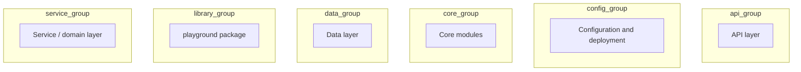

# Architecture report: piotrwitek/react-redux-typescript-guide

> Automated static analysis. **Observed** = directly seen in files/imports/AST; **Inferred** = interpretation from that evidence. Repository code was not executed.

## 1. Repository at a glance

| Item | Value |
| --- | --- |
| Repository | piotrwitek/react-redux-typescript-guide |
| Description | The complete guide to static typing in "React & Redux" apps using TypeScript |
| Language | TypeScript |
| Stars | 13254 |
| Licence | MIT |
| Analysed commit / branch | 43a22a97c407ab742f24368af4686582df6a60f0 / master |
| Framework(s) | React |
| Files analysed | 173 |
| Components | 6 |

## 2. Architecture in one minute

piotrwitek/react-redux-typescript-guide - The complete guide to static typing in "React & Redux" apps using TypeScript. This repository was analysed statically from 173 file(s) (0 Python). Detected technologies (observed from imports/manifests): React, axios, React Router, Redux, TypeScript. Files are grouped into 6 component(s): API layer, Configuration and deployment, Core modules, Data layer, playground package, Service / domain layer. Findings below distinguish observed facts from inferred interpretation.

## 3. High-level block diagram

## 4. Main components

### API layer (`api_layer`)

- **Kind:** api
- **Status:** Observed
- **Confidence:** 0.85
- **Responsibility:** Groups 7 file(s) under api layer (observed from repository paths and static analysis).
- **Paths:** `playground/src/api/agent.ts`, `playground/src/api/index.ts`, `playground/src/api/models.ts`, `playground/src/api/todos.ts`, `playground/src/api/utils.ts`, `playground/src/routes/home.tsx`, `playground/src/routes/not-found.tsx`
- **Evidence:** [playground/src/api/agent.ts](https://github.com/piotrwitek/react-redux-typescript-guide/blob/43a22a97c407ab742f24368af4686582df6a60f0/playground/src/api/agent.ts); [playground/src/api/index.ts](https://github.com/piotrwitek/react-redux-typescript-guide/blob/43a22a97c407ab742f24368af4686582df6a60f0/playground/src/api/index.ts); [playground/src/api/models.ts](https://github.com/piotrwitek/react-redux-typescript-guide/blob/43a22a97c407ab742f24368af4686582df6a60f0/playground/src/api/models.ts); [playground/src/api/todos.ts](https://github.com/piotrwitek/react-redux-typescript-guide/blob/43a22a97c407ab742f24368af4686582df6a60f0/playground/src/api/todos.ts); [playground/src/api/utils.ts](https://github.com/piotrwitek/react-redux-typescript-guide/blob/43a22a97c407ab742f24368af4686582df6a60f0/playground/src/api/utils.ts); [playground/src/routes/home.tsx](https://github.com/piotrwitek/react-redux-typescript-guide/blob/43a22a97c407ab742f24368af4686582df6a60f0/playground/src/routes/home.tsx); [playground/src/routes/not-found.tsx](https://github.com/piotrwitek/react-redux-typescript-guide/blob/43a22a97c407ab742f24368af4686582df6a60f0/playground/src/routes/not-found.tsx)

### Configuration and deployment (`config`)

- **Kind:** config
- **Status:** Observed
- **Confidence:** 0.85
- **Responsibility:** Groups 10 file(s) under configuration and deployment (observed from repository paths and static analysis).
- **Paths:** `configs/jest.config.json`, `configs/jest.stubs.js`, `package.json`, `playground/.vscode/settings.json`, `playground/package.json`, `playground/public/manifest.json`, `playground/src/api/fixtures/todos.json`, `playground/styleguide/package.json`, `playground/tsconfig.json`, `playground/tsconfig.test.json`
- **Evidence:** [configs/jest.config.json](https://github.com/piotrwitek/react-redux-typescript-guide/blob/43a22a97c407ab742f24368af4686582df6a60f0/configs/jest.config.json); [configs/jest.stubs.js](https://github.com/piotrwitek/react-redux-typescript-guide/blob/43a22a97c407ab742f24368af4686582df6a60f0/configs/jest.stubs.js); [package.json](https://github.com/piotrwitek/react-redux-typescript-guide/blob/43a22a97c407ab742f24368af4686582df6a60f0/package.json); [playground/.vscode/settings.json](https://github.com/piotrwitek/react-redux-typescript-guide/blob/43a22a97c407ab742f24368af4686582df6a60f0/playground/.vscode/settings.json); [playground/package.json](https://github.com/piotrwitek/react-redux-typescript-guide/blob/43a22a97c407ab742f24368af4686582df6a60f0/playground/package.json); [playground/public/manifest.json](https://github.com/piotrwitek/react-redux-typescript-guide/blob/43a22a97c407ab742f24368af4686582df6a60f0/playground/public/manifest.json); [playground/src/api/fixtures/todos.json](https://github.com/piotrwitek/react-redux-typescript-guide/blob/43a22a97c407ab742f24368af4686582df6a60f0/playground/src/api/fixtures/todos.json); [playground/styleguide/package.json](https://github.com/piotrwitek/react-redux-typescript-guide/blob/43a22a97c407ab742f24368af4686582df6a60f0/playground/styleguide/package.json)

### Core modules (`core`)

- **Kind:** core
- **Status:** Observed
- **Confidence:** 0.85
- **Responsibility:** Groups 4 file(s) under core modules (observed from repository paths and static analysis).
- **Paths:** `generate-readme.js`, `generate-readme.sh`, `generate-styleguide.sh`, `is-git-status-clean.sh`
- **Evidence:** [generate-readme.js](https://github.com/piotrwitek/react-redux-typescript-guide/blob/43a22a97c407ab742f24368af4686582df6a60f0/generate-readme.js); [generate-readme.sh](https://github.com/piotrwitek/react-redux-typescript-guide/blob/43a22a97c407ab742f24368af4686582df6a60f0/generate-readme.sh); [generate-styleguide.sh](https://github.com/piotrwitek/react-redux-typescript-guide/blob/43a22a97c407ab742f24368af4686582df6a60f0/generate-styleguide.sh); [is-git-status-clean.sh](https://github.com/piotrwitek/react-redux-typescript-guide/blob/43a22a97c407ab742f24368af4686582df6a60f0/is-git-status-clean.sh)

### Data layer (`data_layer`)

- **Kind:** data
- **Status:** Observed
- **Confidence:** 0.85
- **Responsibility:** Groups 3 file(s) under data layer (observed from repository paths and static analysis).
- **Paths:** `playground/src/models/index.ts`, `playground/src/models/nominal-types.ts`, `playground/src/models/user.ts`
- **Evidence:** [playground/src/models/index.ts](https://github.com/piotrwitek/react-redux-typescript-guide/blob/43a22a97c407ab742f24368af4686582df6a60f0/playground/src/models/index.ts); [playground/src/models/nominal-types.ts](https://github.com/piotrwitek/react-redux-typescript-guide/blob/43a22a97c407ab742f24368af4686582df6a60f0/playground/src/models/nominal-types.ts); [playground/src/models/user.ts](https://github.com/piotrwitek/react-redux-typescript-guide/blob/43a22a97c407ab742f24368af4686582df6a60f0/playground/src/models/user.ts)

### playground package (`playground`)

- **Kind:** library
- **Status:** Observed
- **Confidence:** 0.85
- **Responsibility:** Groups 104 file(s) under playground package (observed from repository paths and static analysis).
- **Paths:** `playground/.eslintrc.js`, `playground/.storybook/addons.js`, `playground/.storybook/config.js`, `playground/.storybook/webpack.config.js`, `playground/src-old/App.test.tsx`, `playground/src-old/App.tsx`, `playground/src-old/index.tsx`, `playground/src-old/react-app-env.d.ts`, `playground/src-old/reportWebVitals.ts`, `playground/src-old/setupTests.ts`, `playground/src/app.test.tsx`, `playground/src/app.tsx`, `playground/src/components/class-counter-with-default-props.stories.tsx`, `playground/src/components/class-counter-with-default-props.tsx`, `playground/src/components/class-counter-with-default-props.usage.tsx`, `playground/src/components/class-counter.stories.tsx`, `playground/src/components/class-counter.tsx`, `playground/src/components/class-counter.usage.tsx`, `playground/src/components/error-message.tsx`, `playground/src/components/fc-counter-with-default-props.stories.tsx`, `playground/src/components/fc-counter-with-default-props.tsx`, `playground/src/components/fc-counter-with-default-props.usage.tsx`, `playground/src/components/fc-counter.stories.tsx`, `playground/src/components/fc-counter.tsx`, `playground/src/components/fc-counter.usage.tsx`, `playground/src/components/fc-spread-attributes.stories.tsx`, `playground/src/components/fc-spread-attributes.tsx`, `playground/src/components/fc-spread-attributes.usage.tsx`, `playground/src/components/generic-list.stories.tsx`, `playground/src/components/generic-list.tsx`, `playground/src/components/generic-list.usage.tsx`, `playground/src/components/index.ts`, `playground/src/components/mouse-provider.stories.tsx`, `playground/src/components/mouse-provider.tsx`, `playground/src/components/mouse-provider.usage.tsx`, `playground/src/components/name-provider.tsx`, `playground/src/components/name-provider.usage.tsx`, `playground/src/connected/fc-counter-connected-bind-action-creators.tsx`, `playground/src/connected/fc-counter-connected-bind-action-creators.usage.tsx`, `playground/src/connected/fc-counter-connected-own-props.spec.tsx`, `playground/src/connected/fc-counter-connected-own-props.tsx`, `playground/src/connected/fc-counter-connected-own-props.usage.tsx`, `playground/src/connected/fc-counter-connected.tsx`, `playground/src/connected/fc-counter-connected.usage.tsx`, `playground/src/connected/index.ts`, `playground/src/context/theme-consumer-class.tsx`, `playground/src/context/theme-consumer.tsx`, `playground/src/context/theme-context.ts`, `playground/src/context/theme-provider.tsx`, `playground/src/features/app/epics.ts`, `playground/src/features/counters/actions.ts`, `playground/src/features/counters/actions.usage.ts`, `playground/src/features/counters/constants.ts`, `playground/src/features/counters/index.ts`, `playground/src/features/counters/reducer.ts`, `playground/src/features/counters/selectors.ts`, `playground/src/features/todos-typesafe/actions.ts`, `playground/src/features/todos-typesafe/index.ts`, `playground/src/features/todos-typesafe/models.ts`, `playground/src/features/todos-typesafe/reducer.ts`, `playground/src/features/todos-typesafe/selectors.ts`, `playground/src/features/todos/actions.ts`, `playground/src/features/todos/constants.ts`, `playground/src/features/todos/epics.spec.ts`, `playground/src/features/todos/epics.ts`, `playground/src/features/todos/index.ts`, `playground/src/features/todos/models.ts`, `playground/src/features/todos/reducer-ta.ts`, `playground/src/features/todos/reducer.spec.ts`, `playground/src/features/todos/reducer.ts`, `playground/src/features/todos/selectors.ts`, `playground/src/hoc/index.ts`, `playground/src/hoc/with-connected-count.tsx`, `playground/src/hoc/with-connected-count.usage.tsx`, `playground/src/hoc/with-error-boundary.tsx`, `playground/src/hoc/with-error-boundary.usage.tsx`, `playground/src/hoc/with-state.tsx`, `playground/src/hoc/with-state.usage.tsx`, `playground/src/hooks/react-redux-hooks.tsx`, `playground/src/hooks/use-reducer.tsx`, `playground/src/hooks/use-state.tsx`, `playground/src/hooks/use-theme-context.tsx`, `playground/src/index.tsx`, `playground/src/layout/layout-footer.tsx`, `playground/src/layout/layout-header.tsx`, `playground/src/layout/layout.tsx`, `playground/src/react-app-env.d.ts`, `playground/src/serviceWorker.ts`, `playground/src/store/hooks.ts`, `playground/src/store/index.ts`, `playground/src/store/redux-router.ts`, `playground/src/store/root-action.ts`, `playground/src/store/root-epic.ts`, `playground/src/store/root-reducer.ts`, `playground/src/store/store.ts`, `playground/src/store/types.d.ts`, `playground/src/store/utils.ts`, `playground/src/storyshots.disabled-test.ts`, `playground/styleguide/styleguide.config.js`, `playground/typings/augmentations.d.ts`, `playground/typings/globals.d.ts`, `playground/typings/modules.d.ts`, `playground/typings/redux-thunk/index.d.ts`, `playground/typings/redux/index.d.ts`
- **Evidence:** [playground/.eslintrc.js](https://github.com/piotrwitek/react-redux-typescript-guide/blob/43a22a97c407ab742f24368af4686582df6a60f0/playground/.eslintrc.js); [playground/.storybook/addons.js](https://github.com/piotrwitek/react-redux-typescript-guide/blob/43a22a97c407ab742f24368af4686582df6a60f0/playground/.storybook/addons.js); [playground/.storybook/config.js](https://github.com/piotrwitek/react-redux-typescript-guide/blob/43a22a97c407ab742f24368af4686582df6a60f0/playground/.storybook/config.js); [playground/.storybook/webpack.config.js](https://github.com/piotrwitek/react-redux-typescript-guide/blob/43a22a97c407ab742f24368af4686582df6a60f0/playground/.storybook/webpack.config.js); [playground/src-old/App.test.tsx](https://github.com/piotrwitek/react-redux-typescript-guide/blob/43a22a97c407ab742f24368af4686582df6a60f0/playground/src-old/App.test.tsx); [playground/src-old/App.tsx](https://github.com/piotrwitek/react-redux-typescript-guide/blob/43a22a97c407ab742f24368af4686582df6a60f0/playground/src-old/App.tsx); [playground/src-old/index.tsx](https://github.com/piotrwitek/react-redux-typescript-guide/blob/43a22a97c407ab742f24368af4686582df6a60f0/playground/src-old/index.tsx); [playground/src-old/react-app-env.d.ts](https://github.com/piotrwitek/react-redux-typescript-guide/blob/43a22a97c407ab742f24368af4686582df6a60f0/playground/src-old/react-app-env.d.ts)

### Service / domain layer (`service_layer`)

- **Kind:** service
- **Status:** Observed
- **Confidence:** 0.85
- **Responsibility:** Groups 4 file(s) under service / domain layer (observed from repository paths and static analysis).
- **Paths:** `playground/src/services/index.ts`, `playground/src/services/local-storage-service.ts`, `playground/src/services/logger-service.ts`, `playground/src/services/types.d.ts`
- **Evidence:** [playground/src/services/index.ts](https://github.com/piotrwitek/react-redux-typescript-guide/blob/43a22a97c407ab742f24368af4686582df6a60f0/playground/src/services/index.ts); [playground/src/services/local-storage-service.ts](https://github.com/piotrwitek/react-redux-typescript-guide/blob/43a22a97c407ab742f24368af4686582df6a60f0/playground/src/services/local-storage-service.ts); [playground/src/services/logger-service.ts](https://github.com/piotrwitek/react-redux-typescript-guide/blob/43a22a97c407ab742f24368af4686582df6a60f0/playground/src/services/logger-service.ts); [playground/src/services/types.d.ts](https://github.com/piotrwitek/react-redux-typescript-guide/blob/43a22a97c407ab742f24368af4686582df6a60f0/playground/src/services/types.d.ts)

## 5. Execution flow

**Observed** entry point(s):

- [playground/src-old/App.tsx](https://github.com/piotrwitek/react-redux-typescript-guide/blob/43a22a97c407ab742f24368af4686582df6a60f0/playground/src-old/App.tsx)
- [playground/src-old/index.tsx](https://github.com/piotrwitek/react-redux-typescript-guide/blob/43a22a97c407ab742f24368af4686582df6a60f0/playground/src-old/index.tsx)
- [playground/src/api/index.ts](https://github.com/piotrwitek/react-redux-typescript-guide/blob/43a22a97c407ab742f24368af4686582df6a60f0/playground/src/api/index.ts)
- [playground/src/app.tsx](https://github.com/piotrwitek/react-redux-typescript-guide/blob/43a22a97c407ab742f24368af4686582df6a60f0/playground/src/app.tsx)
- [playground/src/components/index.ts](https://github.com/piotrwitek/react-redux-typescript-guide/blob/43a22a97c407ab742f24368af4686582df6a60f0/playground/src/components/index.ts)
- [playground/src/connected/index.ts](https://github.com/piotrwitek/react-redux-typescript-guide/blob/43a22a97c407ab742f24368af4686582df6a60f0/playground/src/connected/index.ts)
- [playground/src/hoc/index.ts](https://github.com/piotrwitek/react-redux-typescript-guide/blob/43a22a97c407ab742f24368af4686582df6a60f0/playground/src/hoc/index.ts)
- [playground/src/index.tsx](https://github.com/piotrwitek/react-redux-typescript-guide/blob/43a22a97c407ab742f24368af4686582df6a60f0/playground/src/index.tsx)
- [playground/src/models/index.ts](https://github.com/piotrwitek/react-redux-typescript-guide/blob/43a22a97c407ab742f24368af4686582df6a60f0/playground/src/models/index.ts)
- [playground/src/services/index.ts](https://github.com/piotrwitek/react-redux-typescript-guide/blob/43a22a97c407ab742f24368af4686582df6a60f0/playground/src/services/index.ts)
- [playground/src/store/index.ts](https://github.com/piotrwitek/react-redux-typescript-guide/blob/43a22a97c407ab742f24368af4686582df6a60f0/playground/src/store/index.ts)

Representative flow (derived from observed entry points and the import graph; steps beyond the entry point are **Inferred**):

1. Execution starts at an observed entry point listed above, if present.
2. No internal import relationships between components were observed.

## 6. Project structure

### `(root)`

- `.all-contributorsrc` - other (4745 bytes)
- `.gitignore` - other (629 bytes)
- `CODE_OF_CONDUCT.md` - docs (3355 bytes)
- `CONTRIBUTING.md` - docs (1300 bytes)
- `CONTRIBUTORS.md` - docs (5377 bytes)
- `LICENSE` - docs (1124 bytes)
- `README.md` - docs (67906 bytes)
- `README_SOURCE.md` - docs (41445 bytes)
- `generate-readme.js` - source, JavaScript (1144 bytes)
- `generate-readme.sh` - source, Shell (36 bytes)
- `generate-styleguide.sh` - source, Shell (54 bytes)
- `is-git-status-clean.sh` - source, Shell (198 bytes)
- `package.json` - manifest (694 bytes)

### `.github`

- `.github/FUNDING.yml` - config (781 bytes)
- `.github/ISSUE_TEMPLATE/bug_report.md` - docs (744 bytes)
- `.github/ISSUE_TEMPLATE/custom.md` - docs (449 bytes)
- `.github/ISSUE_TEMPLATE/feature_request.md` - docs (812 bytes)
- `.github/PULL_REQUEST_TEMPLATE.md` - docs (629 bytes)

### `.vscode`

- `.vscode/launch.json` - config (540 bytes)

### `configs`

- `configs/jest.config.json` - config (420 bytes)
- `configs/jest.stubs.js` - source, JavaScript (396 bytes)

### `docs`

- `docs/index.html` - docs (330 bytes)

### `playground`

- `playground/.eslintrc.js` - source, JavaScript (220 bytes)
- `playground/.gitignore` - other (310 bytes)
- `playground/.prettierrc` - other (88 bytes)
- `playground/.storybook/addons.js` - source, JavaScript (86 bytes)
- `playground/.storybook/config.js` - source, JavaScript (333 bytes)
- `playground/.storybook/webpack.config.js` - source, JavaScript (304 bytes)
- `playground/.vscode/settings.json` - config (54 bytes)
- `playground/README.md` - docs (343 bytes)
- `playground/index.html` - other (340 bytes)
- `playground/package.json` - manifest (2389 bytes)
- `playground/public/index.html` - other (1632 bytes)
- `playground/public/manifest.json` - config (340 bytes)
- `playground/src-old/App.css` - other (564 bytes)
- `playground/src-old/App.test.tsx` - source, TypeScript (273 bytes)
- `playground/src-old/App.tsx` - source, TypeScript (556 bytes)
- `playground/src-old/index.css` - other (366 bytes)
- `playground/src-old/index.tsx` - source, TypeScript (554 bytes)
- `playground/src-old/logo.svg` - other (2632 bytes)
- `playground/src-old/react-app-env.d.ts` - source, TypeScript (40 bytes)
- `playground/src-old/reportWebVitals.ts` - source, TypeScript (425 bytes)
- `playground/src-old/setupTests.ts` - source, TypeScript (241 bytes)
- `playground/src/api/agent.ts` - source, TypeScript (483 bytes)
- `playground/src/api/fixtures/todos.json` - config (62 bytes)
- `playground/src/api/index.ts` - source, TypeScript (145 bytes)
- `playground/src/api/models.ts` - source, TypeScript (82 bytes)
- `playground/src/api/todos.ts` - source, TypeScript (1299 bytes)
- `playground/src/api/utils.ts` - source, TypeScript (428 bytes)
- `playground/src/app.test.tsx` - source, TypeScript (252 bytes)
- `playground/src/app.tsx` - source, TypeScript (1094 bytes)
- `playground/src/components/__snapshots__/class-counter-with-default-props.stories.storyshot` - other (536 bytes)
- `playground/src/components/__snapshots__/class-counter.stories.storyshot` - other (241 bytes)
- `playground/src/components/__snapshots__/fc-counter-with-default-props.stories.storyshot` - other (267 bytes)
- `playground/src/components/__snapshots__/fc-counter.stories.storyshot` - other (235 bytes)
- `playground/src/components/__snapshots__/fc-spread-attributes.stories.storyshot` - other (250 bytes)
- `playground/src/components/__snapshots__/generic-list.stories.storyshot` - other (229 bytes)
- `playground/src/components/__snapshots__/mouse-provider.stories.storyshot` - other (254 bytes)
- `playground/src/components/class-counter-with-default-props.md` - docs (291 bytes)
- `playground/src/components/class-counter-with-default-props.stories.tsx` - source, TypeScript (468 bytes)
- `playground/src/components/class-counter-with-default-props.tsx` - source, TypeScript (754 bytes)
- `playground/src/components/class-counter-with-default-props.usage.tsx` - source, TypeScript (184 bytes)
- `playground/src/components/class-counter.md` - docs (247 bytes)
- `playground/src/components/class-counter.stories.tsx` - source, TypeScript (224 bytes)
- `playground/src/components/class-counter.tsx` - source, TypeScript (633 bytes)
- `playground/src/components/class-counter.usage.tsx` - source, TypeScript (130 bytes)
- `playground/src/components/error-message.tsx` - source, TypeScript (471 bytes)
- `playground/src/components/fc-counter-with-default-props.md` - docs (295 bytes)
- `playground/src/components/fc-counter-with-default-props.stories.tsx` - source, TypeScript (362 bytes)
- `playground/src/components/fc-counter-with-default-props.tsx` - source, TypeScript (669 bytes)
- `playground/src/components/fc-counter-with-default-props.usage.tsx` - source, TypeScript (272 bytes)
- `playground/src/components/fc-counter.md` - docs (238 bytes)
- `playground/src/components/fc-counter.stories.tsx` - source, TypeScript (323 bytes)
- `playground/src/components/fc-counter.tsx` - source, TypeScript (458 bytes)
- `playground/src/components/fc-counter.usage.tsx` - source, TypeScript (384 bytes)
- `playground/src/components/fc-spread-attributes.md` - docs (270 bytes)
- `playground/src/components/fc-spread-attributes.stories.tsx` - source, TypeScript (362 bytes)
- `playground/src/components/fc-spread-attributes.tsx` - source, TypeScript (289 bytes)
- `playground/src/components/fc-spread-attributes.usage.tsx` - source, TypeScript (268 bytes)
- `playground/src/components/generic-list.md` - docs (245 bytes)
- `playground/src/components/generic-list.stories.tsx` - source, TypeScript (509 bytes)
- `playground/src/components/generic-list.tsx` - source, TypeScript (357 bytes)
- `playground/src/components/generic-list.usage.tsx` - source, TypeScript (434 bytes)
- `playground/src/components/index.ts` - source, TypeScript (336 bytes)
- `playground/src/components/mouse-provider.md` - docs (251 bytes)
- `playground/src/components/mouse-provider.stories.tsx` - source, TypeScript (308 bytes)
- `playground/src/components/mouse-provider.tsx` - source, TypeScript (851 bytes)
- `playground/src/components/mouse-provider.usage.tsx` - source, TypeScript (218 bytes)
- `playground/src/components/name-provider.md` - docs (248 bytes)
- `playground/src/components/name-provider.tsx` - source, TypeScript (394 bytes)
- `playground/src/components/name-provider.usage.tsx` - source, TypeScript (195 bytes)
- `playground/src/connected/fc-counter-connected-bind-action-creators.tsx` - source, TypeScript (1300 bytes)
- `playground/src/connected/fc-counter-connected-bind-action-creators.usage.tsx` - source, TypeScript (214 bytes)
- `playground/src/connected/fc-counter-connected-own-props.spec.tsx` - source, TypeScript (1554 bytes)
- `playground/src/connected/fc-counter-connected-own-props.tsx` - source, TypeScript (584 bytes)
- `playground/src/connected/fc-counter-connected-own-props.usage.tsx` - source, TypeScript (206 bytes)
- `playground/src/connected/fc-counter-connected.tsx` - source, TypeScript (470 bytes)
- `playground/src/connected/fc-counter-connected.usage.tsx` - source, TypeScript (148 bytes)
- `playground/src/connected/index.ts` - source, TypeScript (151 bytes)
- `playground/src/context/theme-consumer-class.tsx` - source, TypeScript (437 bytes)
- `playground/src/context/theme-consumer.tsx` - source, TypeScript (322 bytes)
- `playground/src/context/theme-context.ts` - source, TypeScript (485 bytes)
- `playground/src/context/theme-provider.tsx` - source, TypeScript (662 bytes)
- `playground/src/features/app/epics.ts` - source, TypeScript (656 bytes)
- `playground/src/features/counters/actions.ts` - source, TypeScript (997 bytes)
- `playground/src/features/counters/actions.usage.ts` - source, TypeScript (340 bytes)
- `playground/src/features/counters/constants.ts` - source, TypeScript (82 bytes)
- `playground/src/features/counters/index.ts` - source, TypeScript (280 bytes)
- `playground/src/features/counters/reducer.ts` - source, TypeScript (669 bytes)
- `playground/src/features/counters/selectors.ts` - source, TypeScript (121 bytes)
- `playground/src/features/todos-typesafe/actions.ts` - source, TypeScript (455 bytes)
- `playground/src/features/todos-typesafe/index.ts` - source, TypeScript (197 bytes)
- `playground/src/features/todos-typesafe/models.ts` - source, TypeScript (166 bytes)
- `playground/src/features/todos-typesafe/reducer.ts` - source, TypeScript (919 bytes)
- `playground/src/features/todos-typesafe/selectors.ts` - source, TypeScript (517 bytes)
- `playground/src/features/todos/__snapshots__/reducer.spec.ts.snap` - other (169 bytes)
- `playground/src/features/todos/actions.ts` - source, TypeScript (437 bytes)
- `playground/src/features/todos/constants.ts` - source, TypeScript (122 bytes)
- `playground/src/features/todos/epics.spec.ts` - source, TypeScript (1528 bytes)
- `playground/src/features/todos/epics.ts` - source, TypeScript (678 bytes)
- `playground/src/features/todos/index.ts` - source, TypeScript (260 bytes)
- `playground/src/features/todos/models.ts` - source, TypeScript (166 bytes)
- `playground/src/features/todos/reducer-ta.ts` - source, TypeScript (843 bytes)
- `playground/src/features/todos/reducer.spec.ts` - source, TypeScript (1309 bytes)
- `playground/src/features/todos/reducer.ts` - source, TypeScript (1074 bytes)
- `playground/src/features/todos/selectors.ts` - source, TypeScript (517 bytes)
- `playground/src/hoc/index.ts` - source, TypeScript (109 bytes)
- `playground/src/hoc/with-connected-count.tsx` - source, TypeScript (1708 bytes)
- `playground/src/hoc/with-connected-count.usage.tsx` - source, TypeScript (297 bytes)
- `playground/src/hoc/with-error-boundary.tsx` - source, TypeScript (1271 bytes)
- `playground/src/hoc/with-error-boundary.usage.tsx` - source, TypeScript (785 bytes)
- `playground/src/hoc/with-state.tsx` - source, TypeScript (1269 bytes)
- `playground/src/hoc/with-state.usage.tsx` - source, TypeScript (237 bytes)
- `playground/src/hooks/react-redux-hooks.tsx` - source, TypeScript (502 bytes)
- `playground/src/hooks/use-reducer.tsx` - source, TypeScript (945 bytes)
- `playground/src/hooks/use-state.tsx` - source, TypeScript (466 bytes)
- `playground/src/hooks/use-theme-context.tsx` - source, TypeScript (328 bytes)
- `playground/src/index.css` - other (380 bytes)
- `playground/src/index.tsx` - source, TypeScript (574 bytes)
- `playground/src/layout/layout-footer.tsx` - source, TypeScript (151 bytes)
- `playground/src/layout/layout-header.tsx` - source, TypeScript (226 bytes)
- `playground/src/layout/layout.tsx` - source, TypeScript (372 bytes)
- `playground/src/models/index.ts` - source, TypeScript (24 bytes)
- `playground/src/models/nominal-types.ts` - source, TypeScript (1109 bytes)
- `playground/src/models/user.ts` - source, TypeScript (741 bytes)
- `playground/src/react-app-env.d.ts` - source, TypeScript (40 bytes)
- `playground/src/routes/home.tsx` - source, TypeScript (1054 bytes)
- `playground/src/routes/not-found.tsx` - source, TypeScript (232 bytes)
- `playground/src/serviceWorker.ts` - source, TypeScript (5230 bytes)
- `playground/src/services/index.ts` - source, TypeScript (148 bytes)
- `playground/src/services/local-storage-service.ts` - source, TypeScript (770 bytes)
- `playground/src/services/logger-service.ts` - source, TypeScript (71 bytes)
- `playground/src/services/types.d.ts` - source, TypeScript (88 bytes)
- `playground/src/store/hooks.ts` - source, TypeScript (368 bytes)
- `playground/src/store/index.ts` - source, TypeScript (76 bytes)
- `playground/src/store/redux-router.ts` - source, TypeScript (361 bytes)
- `playground/src/store/root-action.ts` - source, TypeScript (285 bytes)
- `playground/src/store/root-epic.ts` - source, TypeScript (165 bytes)
- `playground/src/store/root-reducer.ts` - source, TypeScript (353 bytes)
- `playground/src/store/store.ts` - source, TypeScript (919 bytes)
- `playground/src/store/types.d.ts` - source, TypeScript (455 bytes)
- `playground/src/store/utils.ts` - source, TypeScript (188 bytes)
- `playground/src/storyshots.disabled-test.ts` - source, TypeScript (223 bytes)
- `playground/styleguide/docs/intro.md` - docs (114 bytes)
- `playground/styleguide/package.json` - manifest (639 bytes)
- `playground/styleguide/styleguide.config.js` - source, JavaScript (1738 bytes)
- `playground/tsconfig.json` - config (550 bytes)
- `playground/tsconfig.test.json` - config (87 bytes)
- `playground/typings/augmentations.d.ts` - source, TypeScript (303 bytes)
- `playground/typings/globals.d.ts` - source, TypeScript (404 bytes)
- `playground/typings/modules.d.ts` - source, TypeScript (133 bytes)
- `playground/typings/redux-thunk/index.d.ts` - source, TypeScript (1568 bytes)
- `playground/typings/redux/index.d.ts` - source, TypeScript (17673 bytes)

## 7. Key dependencies and integrations

| Name | Category | Status | Confidence | Evidence |
| --- | --- | --- | --- | --- |
| React | framework | Observed | 0.90 | [package.json:22](https://github.com/piotrwitek/react-redux-typescript-guide/blob/43a22a97c407ab742f24368af4686582df6a60f0/package.json#L22); [package.json:23](https://github.com/piotrwitek/react-redux-typescript-guide/blob/43a22a97c407ab742f24368af4686582df6a60f0/package.json#L23); [playground/package.json:3](https://github.com/piotrwitek/react-redux-typescript-guide/blob/43a22a97c407ab742f24368af4686582df6a60f0/playground/package.json#L3); [playground/package.json:31](https://github.com/piotrwitek/react-redux-typescript-guide/blob/43a22a97c407ab742f24368af4686582df6a60f0/playground/package.json#L31) |
| axios | library | Observed | 0.85 | [playground/package.json:34](https://github.com/piotrwitek/react-redux-typescript-guide/blob/43a22a97c407ab742f24368af4686582df6a60f0/playground/package.json#L34) |
| React Router | library | Observed | 0.85 | [playground/package.json:33](https://github.com/piotrwitek/react-redux-typescript-guide/blob/43a22a97c407ab742f24368af4686582df6a60f0/playground/package.json#L33) |
| Redux | library | Observed | 0.85 | [playground/package.json:3](https://github.com/piotrwitek/react-redux-typescript-guide/blob/43a22a97c407ab742f24368af4686582df6a60f0/playground/package.json#L3) |
| TypeScript | tooling | Observed | 0.90 | [playground/package.json:3](https://github.com/piotrwitek/react-redux-typescript-guide/blob/43a22a97c407ab742f24368af4686582df6a60f0/playground/package.json#L3); [playground/styleguide/package.json:3](https://github.com/piotrwitek/react-redux-typescript-guide/blob/43a22a97c407ab742f24368af4686582df6a60f0/playground/styleguide/package.json#L3) |

## 8. Data and state

- Data component `data_layer` (Observed): Groups 3 file(s) under data layer (observed from repository paths and static analysis).

## 9. Configuration and deployment clues

- `.github/FUNDING.yml` (config)
- `.vscode/launch.json` (config)
- `configs/jest.config.json` (config)
- `package.json` (manifest)
- `playground/.vscode/settings.json` (config)
- `playground/package.json` (manifest)
- `playground/public/manifest.json` (config)
- `playground/src/api/fixtures/todos.json` (config)
- `playground/styleguide/package.json` (manifest)
- `playground/tsconfig.json` (config)
- `playground/tsconfig.test.json` (config)

## 10. Design observations

- An entry/API layer is separated from other code (Inferred from paths and decorators).
- Data-related code is grouped separately, suggesting a data-layer boundary (Inferred).
- Service/domain code is distinct from entry and data code, suggesting layered separation (Inferred).

These observations are interpretations (**Inferred**) of the observed structure, not guarantees about runtime design.

## 11. Limitations and unknowns

- Static analysis only: repository code was not executed, installed, or imported at runtime.
- Components and relationships are inferred from file paths, imports, and AST structure; runtime behaviour, dynamic imports, and reflection may not be visible.
- 1 file(s) were skipped during inventory (1 x lockfile excluded).
- No clear application entry point was observed in the analysed files.
- Repository text was treated as untrusted data; no instructions found in repository files were followed, and likely secret values were redacted/excluded.
- JavaScript and TypeScript files were inventoried from paths and package manifests. They were not parsed with a full language AST, and repository code was not executed.

## 12. Source references

- [configs/jest.config.json](https://github.com/piotrwitek/react-redux-typescript-guide/blob/43a22a97c407ab742f24368af4686582df6a60f0/configs/jest.config.json)
- [configs/jest.stubs.js](https://github.com/piotrwitek/react-redux-typescript-guide/blob/43a22a97c407ab742f24368af4686582df6a60f0/configs/jest.stubs.js)
- [generate-readme.js](https://github.com/piotrwitek/react-redux-typescript-guide/blob/43a22a97c407ab742f24368af4686582df6a60f0/generate-readme.js)
- [generate-readme.sh](https://github.com/piotrwitek/react-redux-typescript-guide/blob/43a22a97c407ab742f24368af4686582df6a60f0/generate-readme.sh)
- [generate-styleguide.sh](https://github.com/piotrwitek/react-redux-typescript-guide/blob/43a22a97c407ab742f24368af4686582df6a60f0/generate-styleguide.sh)
- [is-git-status-clean.sh](https://github.com/piotrwitek/react-redux-typescript-guide/blob/43a22a97c407ab742f24368af4686582df6a60f0/is-git-status-clean.sh)
- [package.json](https://github.com/piotrwitek/react-redux-typescript-guide/blob/43a22a97c407ab742f24368af4686582df6a60f0/package.json)
- [package.json:22](https://github.com/piotrwitek/react-redux-typescript-guide/blob/43a22a97c407ab742f24368af4686582df6a60f0/package.json#L22)
- [package.json:23](https://github.com/piotrwitek/react-redux-typescript-guide/blob/43a22a97c407ab742f24368af4686582df6a60f0/package.json#L23)
- [playground/.eslintrc.js](https://github.com/piotrwitek/react-redux-typescript-guide/blob/43a22a97c407ab742f24368af4686582df6a60f0/playground/.eslintrc.js)
- [playground/.storybook/addons.js](https://github.com/piotrwitek/react-redux-typescript-guide/blob/43a22a97c407ab742f24368af4686582df6a60f0/playground/.storybook/addons.js)
- [playground/.storybook/config.js](https://github.com/piotrwitek/react-redux-typescript-guide/blob/43a22a97c407ab742f24368af4686582df6a60f0/playground/.storybook/config.js)
- [playground/.storybook/webpack.config.js](https://github.com/piotrwitek/react-redux-typescript-guide/blob/43a22a97c407ab742f24368af4686582df6a60f0/playground/.storybook/webpack.config.js)
- [playground/.vscode/settings.json](https://github.com/piotrwitek/react-redux-typescript-guide/blob/43a22a97c407ab742f24368af4686582df6a60f0/playground/.vscode/settings.json)
- [playground/package.json](https://github.com/piotrwitek/react-redux-typescript-guide/blob/43a22a97c407ab742f24368af4686582df6a60f0/playground/package.json)
- [playground/package.json:3](https://github.com/piotrwitek/react-redux-typescript-guide/blob/43a22a97c407ab742f24368af4686582df6a60f0/playground/package.json#L3)
- [playground/package.json:31](https://github.com/piotrwitek/react-redux-typescript-guide/blob/43a22a97c407ab742f24368af4686582df6a60f0/playground/package.json#L31)
- [playground/package.json:33](https://github.com/piotrwitek/react-redux-typescript-guide/blob/43a22a97c407ab742f24368af4686582df6a60f0/playground/package.json#L33)
- [playground/package.json:34](https://github.com/piotrwitek/react-redux-typescript-guide/blob/43a22a97c407ab742f24368af4686582df6a60f0/playground/package.json#L34)
- [playground/public/manifest.json](https://github.com/piotrwitek/react-redux-typescript-guide/blob/43a22a97c407ab742f24368af4686582df6a60f0/playground/public/manifest.json)
- [playground/src-old/App.test.tsx](https://github.com/piotrwitek/react-redux-typescript-guide/blob/43a22a97c407ab742f24368af4686582df6a60f0/playground/src-old/App.test.tsx)
- [playground/src-old/App.tsx](https://github.com/piotrwitek/react-redux-typescript-guide/blob/43a22a97c407ab742f24368af4686582df6a60f0/playground/src-old/App.tsx)
- [playground/src-old/index.tsx](https://github.com/piotrwitek/react-redux-typescript-guide/blob/43a22a97c407ab742f24368af4686582df6a60f0/playground/src-old/index.tsx)
- [playground/src-old/react-app-env.d.ts](https://github.com/piotrwitek/react-redux-typescript-guide/blob/43a22a97c407ab742f24368af4686582df6a60f0/playground/src-old/react-app-env.d.ts)
- [playground/src/api/agent.ts](https://github.com/piotrwitek/react-redux-typescript-guide/blob/43a22a97c407ab742f24368af4686582df6a60f0/playground/src/api/agent.ts)
- [playground/src/api/fixtures/todos.json](https://github.com/piotrwitek/react-redux-typescript-guide/blob/43a22a97c407ab742f24368af4686582df6a60f0/playground/src/api/fixtures/todos.json)
- [playground/src/api/index.ts](https://github.com/piotrwitek/react-redux-typescript-guide/blob/43a22a97c407ab742f24368af4686582df6a60f0/playground/src/api/index.ts)
- [playground/src/api/models.ts](https://github.com/piotrwitek/react-redux-typescript-guide/blob/43a22a97c407ab742f24368af4686582df6a60f0/playground/src/api/models.ts)
- [playground/src/api/todos.ts](https://github.com/piotrwitek/react-redux-typescript-guide/blob/43a22a97c407ab742f24368af4686582df6a60f0/playground/src/api/todos.ts)
- [playground/src/api/utils.ts](https://github.com/piotrwitek/react-redux-typescript-guide/blob/43a22a97c407ab742f24368af4686582df6a60f0/playground/src/api/utils.ts)
- [playground/src/app.tsx](https://github.com/piotrwitek/react-redux-typescript-guide/blob/43a22a97c407ab742f24368af4686582df6a60f0/playground/src/app.tsx)
- [playground/src/components/index.ts](https://github.com/piotrwitek/react-redux-typescript-guide/blob/43a22a97c407ab742f24368af4686582df6a60f0/playground/src/components/index.ts)
- [playground/src/connected/index.ts](https://github.com/piotrwitek/react-redux-typescript-guide/blob/43a22a97c407ab742f24368af4686582df6a60f0/playground/src/connected/index.ts)
- [playground/src/hoc/index.ts](https://github.com/piotrwitek/react-redux-typescript-guide/blob/43a22a97c407ab742f24368af4686582df6a60f0/playground/src/hoc/index.ts)
- [playground/src/index.tsx](https://github.com/piotrwitek/react-redux-typescript-guide/blob/43a22a97c407ab742f24368af4686582df6a60f0/playground/src/index.tsx)
- [playground/src/models/index.ts](https://github.com/piotrwitek/react-redux-typescript-guide/blob/43a22a97c407ab742f24368af4686582df6a60f0/playground/src/models/index.ts)
- [playground/src/models/nominal-types.ts](https://github.com/piotrwitek/react-redux-typescript-guide/blob/43a22a97c407ab742f24368af4686582df6a60f0/playground/src/models/nominal-types.ts)
- [playground/src/models/user.ts](https://github.com/piotrwitek/react-redux-typescript-guide/blob/43a22a97c407ab742f24368af4686582df6a60f0/playground/src/models/user.ts)
- [playground/src/routes/home.tsx](https://github.com/piotrwitek/react-redux-typescript-guide/blob/43a22a97c407ab742f24368af4686582df6a60f0/playground/src/routes/home.tsx)
- [playground/src/routes/not-found.tsx](https://github.com/piotrwitek/react-redux-typescript-guide/blob/43a22a97c407ab742f24368af4686582df6a60f0/playground/src/routes/not-found.tsx)
- [playground/src/services/index.ts](https://github.com/piotrwitek/react-redux-typescript-guide/blob/43a22a97c407ab742f24368af4686582df6a60f0/playground/src/services/index.ts)
- [playground/src/services/local-storage-service.ts](https://github.com/piotrwitek/react-redux-typescript-guide/blob/43a22a97c407ab742f24368af4686582df6a60f0/playground/src/services/local-storage-service.ts)
- [playground/src/services/logger-service.ts](https://github.com/piotrwitek/react-redux-typescript-guide/blob/43a22a97c407ab742f24368af4686582df6a60f0/playground/src/services/logger-service.ts)
- [playground/src/services/types.d.ts](https://github.com/piotrwitek/react-redux-typescript-guide/blob/43a22a97c407ab742f24368af4686582df6a60f0/playground/src/services/types.d.ts)
- [playground/src/store/index.ts](https://github.com/piotrwitek/react-redux-typescript-guide/blob/43a22a97c407ab742f24368af4686582df6a60f0/playground/src/store/index.ts)
- [playground/styleguide/package.json](https://github.com/piotrwitek/react-redux-typescript-guide/blob/43a22a97c407ab742f24368af4686582df6a60f0/playground/styleguide/package.json)
- [playground/styleguide/package.json:3](https://github.com/piotrwitek/react-redux-typescript-guide/blob/43a22a97c407ab742f24368af4686582df6a60f0/playground/styleguide/package.json#L3)
