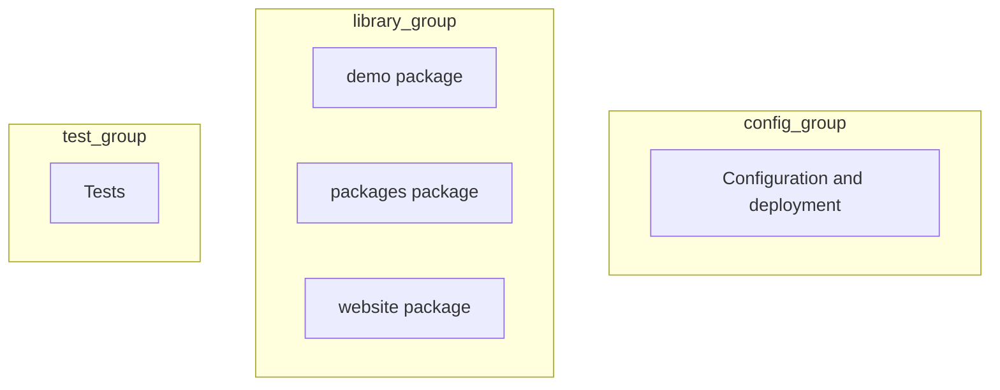

# Architecture report: plouc/mozaik

> Automated static analysis. **Observed** = directly seen in files/imports/AST; **Inferred** = interpretation from that evidence. Repository code was not executed.

## 1. Repository at a glance

| Item | Value |
| --- | --- |
| Repository | plouc/mozaik |
| Description | Mozaïk is a tool based on nodejs / react / redux / nivo / d3 to easily craft beautiful dashboards |
| Language | JavaScript |
| Stars | 3596 |
| Licence | MIT |
| Analysed commit / branch | 5fc9070d9c3aeb1c53ef1719daa3a7239c23a31b / master |
| Framework(s) | Express, React |
| Files analysed | 232 |
| Components | 5 |

## 2. Architecture in one minute

plouc/mozaik - Mozaïk is a tool based on nodejs / react / redux / nivo / d3 to easily craft beautiful dashboards. This repository was analysed statically from 232 file(s) (0 Python). Detected technologies (observed from imports/manifests): Express, React, Redux, Jest, TypeScript. Files are grouped into 5 component(s): Configuration and deployment, demo package, packages package, Tests, website package. Findings below distinguish observed facts from inferred interpretation.

## 3. High-level block diagram

## 4. Main components

### Configuration and deployment (`config`)

- **Kind:** config
- **Status:** Observed
- **Confidence:** 0.85
- **Responsibility:** Groups 25 file(s) under configuration and deployment (observed from repository paths and static analysis).
- **Paths:** `demo/conf/config-ga.yml`, `demo/conf/config-github-stats.yml`, `demo/conf/config-github.yml`, `demo/conf/config-gitlab-labels-charts.yml`, `demo/conf/config-gitlab.yml`, `demo/conf/config-json.yml`, `demo/conf/config-time.yml`, `demo/conf/config-travis.yml`, `demo/conf/config.yml`, `demo/package.json`, `demo/public/manifest.json`, `lerna.json`, `package.json`, `packages/babel-preset/package.json`, `packages/server/package.json`, `packages/server/tsconfig.json`, `packages/server/tslint.json`, `packages/themes/package.json`, `packages/ui/package.json`, `packages/ui/src/components/settings/Settings.js`, `packages/ui/src/components/settings/ThemesSetting.js`, `website/package.json`, `website/src/data/extensions.yml`, `website/src/data/references.yml`, `website/src/data/useCases.yml`
- **Evidence:** [demo/conf/config-ga.yml](https://github.com/plouc/mozaik/blob/5fc9070d9c3aeb1c53ef1719daa3a7239c23a31b/demo/conf/config-ga.yml); [demo/conf/config-github-stats.yml](https://github.com/plouc/mozaik/blob/5fc9070d9c3aeb1c53ef1719daa3a7239c23a31b/demo/conf/config-github-stats.yml); [demo/conf/config-github.yml](https://github.com/plouc/mozaik/blob/5fc9070d9c3aeb1c53ef1719daa3a7239c23a31b/demo/conf/config-github.yml); [demo/conf/config-gitlab-labels-charts.yml](https://github.com/plouc/mozaik/blob/5fc9070d9c3aeb1c53ef1719daa3a7239c23a31b/demo/conf/config-gitlab-labels-charts.yml); [demo/conf/config-gitlab.yml](https://github.com/plouc/mozaik/blob/5fc9070d9c3aeb1c53ef1719daa3a7239c23a31b/demo/conf/config-gitlab.yml); [demo/conf/config-json.yml](https://github.com/plouc/mozaik/blob/5fc9070d9c3aeb1c53ef1719daa3a7239c23a31b/demo/conf/config-json.yml); [demo/conf/config-time.yml](https://github.com/plouc/mozaik/blob/5fc9070d9c3aeb1c53ef1719daa3a7239c23a31b/demo/conf/config-time.yml); [demo/conf/config-travis.yml](https://github.com/plouc/mozaik/blob/5fc9070d9c3aeb1c53ef1719daa3a7239c23a31b/demo/conf/config-travis.yml)

### demo package (`demo`)

- **Kind:** library
- **Status:** Observed
- **Confidence:** 0.85
- **Responsibility:** Groups 5 file(s) under demo package (observed from repository paths and static analysis).
- **Paths:** `demo/register_apis.js`, `demo/server.js`, `demo/src/index.js`, `demo/src/register_extensions.js`, `demo/src/register_themes.js`
- **Evidence:** [demo/register_apis.js](https://github.com/plouc/mozaik/blob/5fc9070d9c3aeb1c53ef1719daa3a7239c23a31b/demo/register_apis.js); [demo/server.js](https://github.com/plouc/mozaik/blob/5fc9070d9c3aeb1c53ef1719daa3a7239c23a31b/demo/server.js); [demo/src/index.js](https://github.com/plouc/mozaik/blob/5fc9070d9c3aeb1c53ef1719daa3a7239c23a31b/demo/src/index.js); [demo/src/register_extensions.js](https://github.com/plouc/mozaik/blob/5fc9070d9c3aeb1c53ef1719daa3a7239c23a31b/demo/src/register_extensions.js); [demo/src/register_themes.js](https://github.com/plouc/mozaik/blob/5fc9070d9c3aeb1c53ef1719daa3a7239c23a31b/demo/src/register_themes.js)

### packages package (`packages`)

- **Kind:** library
- **Status:** Observed
- **Confidence:** 0.85
- **Responsibility:** Groups 101 file(s) under packages package (observed from repository paths and static analysis).
- **Paths:** `packages/babel-preset/index.js`, `packages/server/src/bus.ts`, `packages/server/src/core_api.ts`, `packages/server/src/index.ts`, `packages/server/src/load_yaml.ts`, `packages/server/src/logger.ts`, `packages/server/src/mozaik.ts`, `packages/themes/src/index.js`, `packages/themes/src/mini-kuro/charts.js`, `packages/themes/src/mini-kuro/colors.js`, `packages/themes/src/mini-kuro/index.js`, `packages/themes/src/mini-kuro/typography.js`, `packages/themes/src/mini/charts.js`, `packages/themes/src/mini/colors.js`, `packages/themes/src/mini/index.js`, `packages/themes/src/mini/typography.js`, `packages/themes/src/night-blue/charts.js`, `packages/themes/src/night-blue/colors.js`, `packages/themes/src/night-blue/index.js`, `packages/themes/src/night-blue/typography.js`, `packages/themes/src/snow/charts.js`, `packages/themes/src/snow/colors.js`, `packages/themes/src/snow/index.js`, `packages/themes/src/snow/typography.js`, `packages/themes/src/solarized-dark/charts.js`, `packages/themes/src/solarized-dark/colors.js`, `packages/themes/src/solarized-dark/index.js`, `packages/themes/src/solarized-dark/typography.js`, `packages/themes/src/wine/charts.js`, `packages/themes/src/wine/colors.js`, `packages/themes/src/wine/index.js`, `packages/themes/src/wine/typography.js`, `packages/ui/.storybook/addons.js`, `packages/ui/.storybook/config.js`, `packages/ui/src/App.js`, `packages/ui/src/WidgetsRegistry.js`, `packages/ui/src/actions/apiActions.js`, `packages/ui/src/actions/configurationActions.js`, `packages/ui/src/actions/dashboardsActions.js`, `packages/ui/src/actions/notificationsActions.js`, `packages/ui/src/actions/themesActions.js`, `packages/ui/src/actions/wsActions.js`, `packages/ui/src/components/ConnectionStatus.js`, `packages/ui/src/components/ExternalLink.js`, `packages/ui/src/components/Inspector.js`, `packages/ui/src/components/Mozaik.js`, `packages/ui/src/components/Text.js`, `packages/ui/src/components/ThemeProvider.js`, `packages/ui/src/components/TrapApiError.js`, `packages/ui/src/components/dashboard/Dashboard.js`, `packages/ui/src/components/dashboard/DashboardHeader.js`, `packages/ui/src/components/dashboard/DashboardPlayer.js`, `packages/ui/src/components/dashboard/DashboardTitle.js`, `packages/ui/src/components/icons.js`, `packages/ui/src/components/notifications/Notifications.js`, `packages/ui/src/components/notifications/NotificationsItem.js`, `packages/ui/src/components/widget/UnknowWidgetTypeError.js`, `packages/ui/src/components/widget/Widget.js`, `packages/ui/src/components/widget/WidgetAvatar.js`, `packages/ui/src/components/widget/WidgetBody.js`, `packages/ui/src/components/widget/WidgetCounter.js`, `packages/ui/src/components/widget/WidgetHeader.js`, `packages/ui/src/components/widget/WidgetLabel.js`, `packages/ui/src/components/widget/WidgetLoader.js`, `packages/ui/src/components/widget/WidgetWrapper.js`, `packages/ui/src/components/widget/list/WidgetListItem.js`, `packages/ui/src/components/widget/status/WidgetStatusBadge.js`, `packages/ui/src/components/widget/status/WidgetStatusChip.js`, `packages/ui/src/components/widget/table/WidgetTable.js`, `packages/ui/src/components/widget/table/WidgetTableCell.js`, `packages/ui/src/components/widget/table/WidgetTableHeadCell.js`, `packages/ui/src/configureStore.js`, `packages/ui/src/constants/notificationsConstants.js`, `packages/ui/src/constants/wsConstants.js`, `packages/ui/src/containers/MozaikContainer.js`, `packages/ui/src/containers/NotificationsContainer.js`, `packages/ui/src/containers/WidgetContainer.js`, `packages/ui/src/index.js`, `packages/ui/src/lib/WSHelper.js`, `packages/ui/src/lib/shallowEqual.js`, `packages/ui/src/reducers/apiReducer.js`, `packages/ui/src/reducers/configurationReducer.js`, `packages/ui/src/reducers/dashboardsReducer.js`, `packages/ui/src/reducers/index.js`, `packages/ui/src/reducers/notificationsReducer.js`, `packages/ui/src/reducers/themesReducer.js`, `packages/ui/src/reducers/wsReducer.js`, `packages/ui/src/theming/ThemeManager.js`, `packages/ui/src/theming/defaultTheme.js`, `packages/ui/src/theming/typography.js`, `packages/ui/stories/decorators/MultiTheme.js`, `packages/ui/stories/decorators/registerThemes.js`, `packages/ui/stories/decorators/themed.js`, `packages/ui/stories/decorators/withMultiTheme.js`, `packages/ui/stories/decorators/withWidget.js`, `packages/ui/stories/text.js`, `packages/ui/stories/widget_counter.js`, `packages/ui/stories/widget_header.js`, `packages/ui/stories/widget_label.js`, `packages/ui/stories/widget_list_item.js`, `packages/ui/stories/widget_status_badge.js`
- **Evidence:** [packages/babel-preset/index.js](https://github.com/plouc/mozaik/blob/5fc9070d9c3aeb1c53ef1719daa3a7239c23a31b/packages/babel-preset/index.js); [packages/server/src/bus.ts](https://github.com/plouc/mozaik/blob/5fc9070d9c3aeb1c53ef1719daa3a7239c23a31b/packages/server/src/bus.ts); [packages/server/src/core_api.ts](https://github.com/plouc/mozaik/blob/5fc9070d9c3aeb1c53ef1719daa3a7239c23a31b/packages/server/src/core_api.ts); [packages/server/src/index.ts](https://github.com/plouc/mozaik/blob/5fc9070d9c3aeb1c53ef1719daa3a7239c23a31b/packages/server/src/index.ts); [packages/server/src/load_yaml.ts](https://github.com/plouc/mozaik/blob/5fc9070d9c3aeb1c53ef1719daa3a7239c23a31b/packages/server/src/load_yaml.ts); [packages/server/src/logger.ts](https://github.com/plouc/mozaik/blob/5fc9070d9c3aeb1c53ef1719daa3a7239c23a31b/packages/server/src/logger.ts); [packages/server/src/mozaik.ts](https://github.com/plouc/mozaik/blob/5fc9070d9c3aeb1c53ef1719daa3a7239c23a31b/packages/server/src/mozaik.ts); [packages/themes/src/index.js](https://github.com/plouc/mozaik/blob/5fc9070d9c3aeb1c53ef1719daa3a7239c23a31b/packages/themes/src/index.js)

### Tests (`tests`)

- **Kind:** test
- **Status:** Observed
- **Confidence:** 0.85
- **Responsibility:** Groups 13 file(s) under tests (observed from repository paths and static analysis).
- **Paths:** `packages/server/test/bus.test.ts`, `packages/server/test/bus_add_client.test.ts`, `packages/server/test/bus_process_api_call.test.ts`, `packages/server/test/bus_register_api.test.ts`, `packages/server/test/bus_remove_client.test.ts`, `packages/server/test/bus_subscribe.test.ts`, `packages/server/test/bus_unsubscribe.test.ts`, `packages/server/test/fixtures/config/invalid.yml`, `packages/server/test/fixtures/config/valid.yml`, `packages/server/test/load_yaml.test.ts`, `packages/server/test/logger.ts`, `packages/ui/test/.eslintrc.yml`, `packages/ui/test/reducers/apiReducer.test.js`
- **Evidence:** [packages/server/test/bus.test.ts](https://github.com/plouc/mozaik/blob/5fc9070d9c3aeb1c53ef1719daa3a7239c23a31b/packages/server/test/bus.test.ts); [packages/server/test/bus_add_client.test.ts](https://github.com/plouc/mozaik/blob/5fc9070d9c3aeb1c53ef1719daa3a7239c23a31b/packages/server/test/bus_add_client.test.ts); [packages/server/test/bus_process_api_call.test.ts](https://github.com/plouc/mozaik/blob/5fc9070d9c3aeb1c53ef1719daa3a7239c23a31b/packages/server/test/bus_process_api_call.test.ts); [packages/server/test/bus_register_api.test.ts](https://github.com/plouc/mozaik/blob/5fc9070d9c3aeb1c53ef1719daa3a7239c23a31b/packages/server/test/bus_register_api.test.ts); [packages/server/test/bus_remove_client.test.ts](https://github.com/plouc/mozaik/blob/5fc9070d9c3aeb1c53ef1719daa3a7239c23a31b/packages/server/test/bus_remove_client.test.ts); [packages/server/test/bus_subscribe.test.ts](https://github.com/plouc/mozaik/blob/5fc9070d9c3aeb1c53ef1719daa3a7239c23a31b/packages/server/test/bus_subscribe.test.ts); [packages/server/test/bus_unsubscribe.test.ts](https://github.com/plouc/mozaik/blob/5fc9070d9c3aeb1c53ef1719daa3a7239c23a31b/packages/server/test/bus_unsubscribe.test.ts); [packages/server/test/fixtures/config/invalid.yml](https://github.com/plouc/mozaik/blob/5fc9070d9c3aeb1c53ef1719daa3a7239c23a31b/packages/server/test/fixtures/config/invalid.yml)

### website package (`website`)

- **Kind:** library
- **Status:** Observed
- **Confidence:** 0.85
- **Responsibility:** Groups 32 file(s) under website package (observed from repository paths and static analysis).
- **Paths:** `website/gatsby-browser.js`, `website/gatsby-config.js`, `website/gatsby-node.js`, `website/src/components/Container.js`, `website/src/components/Extensions.js`, `website/src/components/ExtensionsItem.js`, `website/src/components/ExternalPosts.js`, `website/src/components/Features.js`, `website/src/components/FeaturesItem.js`, `website/src/components/Footer.js`, `website/src/components/GeneratedContent.js`, `website/src/components/Global.js`, `website/src/components/Header.js`, `website/src/components/HeaderNav.js`, `website/src/components/HomeBanner.js`, `website/src/components/Pager.js`, `website/src/components/References.js`, `website/src/components/SecondaryNav.js`, `website/src/components/Share.js`, `website/src/components/SubHeader.js`, `website/src/layouts/documentation.js`, `website/src/layouts/index.js`, `website/src/layouts/post.js`, `website/src/pages/404.js`, `website/src/pages/architecture.js`, `website/src/pages/extensions/index.js`, `website/src/pages/faq.js`, `website/src/pages/index.js`, `website/src/styles/media.js`, `website/src/styles/theme.js`, `website/src/templates/documentation.js`, `website/src/templates/post.js`
- **Evidence:** [website/gatsby-browser.js](https://github.com/plouc/mozaik/blob/5fc9070d9c3aeb1c53ef1719daa3a7239c23a31b/website/gatsby-browser.js); [website/gatsby-config.js](https://github.com/plouc/mozaik/blob/5fc9070d9c3aeb1c53ef1719daa3a7239c23a31b/website/gatsby-config.js); [website/gatsby-node.js](https://github.com/plouc/mozaik/blob/5fc9070d9c3aeb1c53ef1719daa3a7239c23a31b/website/gatsby-node.js); [website/src/components/Container.js](https://github.com/plouc/mozaik/blob/5fc9070d9c3aeb1c53ef1719daa3a7239c23a31b/website/src/components/Container.js); [website/src/components/Extensions.js](https://github.com/plouc/mozaik/blob/5fc9070d9c3aeb1c53ef1719daa3a7239c23a31b/website/src/components/Extensions.js); [website/src/components/ExtensionsItem.js](https://github.com/plouc/mozaik/blob/5fc9070d9c3aeb1c53ef1719daa3a7239c23a31b/website/src/components/ExtensionsItem.js); [website/src/components/ExternalPosts.js](https://github.com/plouc/mozaik/blob/5fc9070d9c3aeb1c53ef1719daa3a7239c23a31b/website/src/components/ExternalPosts.js); [website/src/components/Features.js](https://github.com/plouc/mozaik/blob/5fc9070d9c3aeb1c53ef1719daa3a7239c23a31b/website/src/components/Features.js)

## 5. Execution flow

**Observed** entry point(s):

- [demo/server.js](https://github.com/plouc/mozaik/blob/5fc9070d9c3aeb1c53ef1719daa3a7239c23a31b/demo/server.js)
- [demo/src/index.js](https://github.com/plouc/mozaik/blob/5fc9070d9c3aeb1c53ef1719daa3a7239c23a31b/demo/src/index.js)
- [packages/babel-preset/index.js](https://github.com/plouc/mozaik/blob/5fc9070d9c3aeb1c53ef1719daa3a7239c23a31b/packages/babel-preset/index.js)
- [packages/server/src/index.ts](https://github.com/plouc/mozaik/blob/5fc9070d9c3aeb1c53ef1719daa3a7239c23a31b/packages/server/src/index.ts)
- [packages/themes/src/index.js](https://github.com/plouc/mozaik/blob/5fc9070d9c3aeb1c53ef1719daa3a7239c23a31b/packages/themes/src/index.js)
- [packages/ui/src/App.js](https://github.com/plouc/mozaik/blob/5fc9070d9c3aeb1c53ef1719daa3a7239c23a31b/packages/ui/src/App.js)
- [packages/ui/src/index.js](https://github.com/plouc/mozaik/blob/5fc9070d9c3aeb1c53ef1719daa3a7239c23a31b/packages/ui/src/index.js)
- [website/src/layouts/index.js](https://github.com/plouc/mozaik/blob/5fc9070d9c3aeb1c53ef1719daa3a7239c23a31b/website/src/layouts/index.js)
- [website/src/pages/index.js](https://github.com/plouc/mozaik/blob/5fc9070d9c3aeb1c53ef1719daa3a7239c23a31b/website/src/pages/index.js)

Representative flow (derived from observed entry points and the import graph; steps beyond the entry point are **Inferred**):

1. Execution starts at an observed entry point listed above, if present.
2. No internal import relationships between components were observed.

## 6. Project structure

### `(root)`

- `.editorconfig` - config (71 bytes)
- `.eslintrc.yml` - config (265 bytes)
- `.gitignore` - other (240 bytes)
- `.npmignore` - other (148 bytes)
- `.prettierignore` - other (28 bytes)
- `.prettierrc` - other (143 bytes)
- `.travis.yml` - ci, YAML (164 bytes)
- `CHANGELOG.md` - docs (3745 bytes)
- `LICENSE.md` - docs (1054 bytes)
- `Makefile` - other (8623 bytes)
- `README.md` - docs (1396 bytes)
- `browserlist` - other (92 bytes)
- `lerna.json` - config (143 bytes)
- `package.json` - manifest (352 bytes)

### `.github`

- `.github/FUNDING.yml` - config (130 bytes)

### `demo`

- `demo/README.md` - docs (104074 bytes)
- `demo/conf/config-ga.yml` - config (2285 bytes)
- `demo/conf/config-github-stats.yml` - config (1558 bytes)
- `demo/conf/config-github.yml` - config (2935 bytes)
- `demo/conf/config-gitlab-labels-charts.yml` - config (2666 bytes)
- `demo/conf/config-gitlab.yml` - config (2290 bytes)
- `demo/conf/config-json.yml` - config (2537 bytes)
- `demo/conf/config-time.yml` - config (2391 bytes)
- `demo/conf/config-travis.yml` - config (1574 bytes)
- `demo/conf/config.yml` - config (2390 bytes)
- `demo/package.json` - manifest (841 bytes)
- `demo/public/index.html` - other (1612 bytes)
- `demo/public/manifest.json` - config (298 bytes)
- `demo/register_apis.js` - source, JavaScript (392 bytes)
- `demo/server.js` - source, JavaScript (454 bytes)
- `demo/src/index.js` - source, JavaScript (211 bytes)
- `demo/src/register_extensions.js` - source, JavaScript (362 bytes)
- `demo/src/register_themes.js` - source, JavaScript (424 bytes)

### `packages`

- `packages/babel-preset/index.js` - source, JavaScript (2229 bytes)
- `packages/babel-preset/package.json` - manifest (1677 bytes)
- `packages/server/.gitignore` - other (5 bytes)
- `packages/server/.npmignore` - other (81 bytes)
- `packages/server/.prettierrc` - other (143 bytes)
- `packages/server/README.md` - docs (496 bytes)
- `packages/server/package.json` - manifest (1721 bytes)
- `packages/server/src/bus.ts` - source, TypeScript (10638 bytes)
- `packages/server/src/core_api.ts` - source, TypeScript (251 bytes)
- `packages/server/src/index.ts` - source, TypeScript (59 bytes)
- `packages/server/src/load_yaml.ts` - source, TypeScript (463 bytes)
- `packages/server/src/logger.ts` - source, TypeScript (241 bytes)
- `packages/server/src/mozaik.ts` - source, TypeScript (4243 bytes)
- `packages/server/test/bus.test.ts` - test, TypeScript (582 bytes)
- `packages/server/test/bus_add_client.test.ts` - test, TypeScript (1044 bytes)
- `packages/server/test/bus_process_api_call.test.ts` - test, TypeScript (3856 bytes)
- `packages/server/test/bus_register_api.test.ts` - test, TypeScript (1889 bytes)
- `packages/server/test/bus_remove_client.test.ts` - test, TypeScript (1718 bytes)
- `packages/server/test/bus_subscribe.test.ts` - test, TypeScript (6424 bytes)
- `packages/server/test/bus_unsubscribe.test.ts` - test, TypeScript (2056 bytes)
- `packages/server/test/fixtures/config/invalid.yml` - test (50 bytes)
- `packages/server/test/fixtures/config/valid.yml` - test (43 bytes)
- `packages/server/test/load_yaml.test.ts` - test, TypeScript (892 bytes)
- `packages/server/test/logger.ts` - test, TypeScript (255 bytes)
- `packages/server/tsconfig.json` - config (582 bytes)
- `packages/server/tslint.json` - config (476 bytes)
- `packages/themes/.babelrc` - other (42 bytes)
- `packages/themes/.gitignore` - other (8 bytes)
- `packages/themes/.npmignore` - other (110 bytes)
- `packages/themes/LICENSE.md` - docs (1054 bytes)
- `packages/themes/README.md` - docs (749 bytes)
- `packages/themes/package.json` - manifest (1096 bytes)
- `packages/themes/src/index.js` - source, JavaScript (315 bytes)
- `packages/themes/src/mini-kuro/charts.js` - source, JavaScript (421 bytes)
- `packages/themes/src/mini-kuro/colors.js` - source, JavaScript (178 bytes)
- `packages/themes/src/mini-kuro/index.js` - source, JavaScript (2566 bytes)
- `packages/themes/src/mini-kuro/typography.js` - source, JavaScript (536 bytes)
- `packages/themes/src/mini/charts.js` - source, JavaScript (421 bytes)
- `packages/themes/src/mini/colors.js` - source, JavaScript (178 bytes)
- `packages/themes/src/mini/index.js` - source, JavaScript (2494 bytes)
- `packages/themes/src/mini/typography.js` - source, JavaScript (536 bytes)
- `packages/themes/src/night-blue/charts.js` - source, JavaScript (470 bytes)
- `packages/themes/src/night-blue/colors.js` - source, JavaScript (214 bytes)
- `packages/themes/src/night-blue/index.js` - source, JavaScript (2654 bytes)
- `packages/themes/src/night-blue/typography.js` - source, JavaScript (504 bytes)
- `packages/themes/src/snow/charts.js` - source, JavaScript (462 bytes)
- `packages/themes/src/snow/colors.js` - source, JavaScript (181 bytes)
- `packages/themes/src/snow/index.js` - source, JavaScript (2630 bytes)
- `packages/themes/src/snow/typography.js` - source, JavaScript (471 bytes)
- `packages/themes/src/solarized-dark/charts.js` - source, JavaScript (466 bytes)
- `packages/themes/src/solarized-dark/colors.js` - source, JavaScript (214 bytes)
- `packages/themes/src/solarized-dark/index.js` - source, JavaScript (1957 bytes)
- `packages/themes/src/solarized-dark/typography.js` - source, JavaScript (701 bytes)
- `packages/themes/src/wine/charts.js` - source, JavaScript (476 bytes)
- `packages/themes/src/wine/colors.js` - source, JavaScript (229 bytes)
- `packages/themes/src/wine/index.js` - source, JavaScript (2299 bytes)
- `packages/themes/src/wine/typography.js` - source, JavaScript (683 bytes)
- `packages/ui/.babelrc` - other (42 bytes)
- `packages/ui/.gitignore` - other (9 bytes)
- `packages/ui/.npmignore` - other (131 bytes)
- `packages/ui/.storybook/addons.js` - source, JavaScript (84 bytes)
- `packages/ui/.storybook/config.js` - source, JavaScript (562 bytes)
- `packages/ui/README.md` - docs (484 bytes)
- `packages/ui/package.json` - manifest (1687 bytes)
- `packages/ui/src/App.js` - source, JavaScript (687 bytes)
- `packages/ui/src/WidgetsRegistry.js` - source, JavaScript (2032 bytes)
- `packages/ui/src/actions/apiActions.js` - source, JavaScript (1995 bytes)
- `packages/ui/src/actions/configurationActions.js` - source, JavaScript (1909 bytes)
- `packages/ui/src/actions/dashboardsActions.js` - source, JavaScript (4041 bytes)
- `packages/ui/src/actions/notificationsActions.js` - source, JavaScript (2745 bytes)
- `packages/ui/src/actions/themesActions.js` - source, JavaScript (109 bytes)
- `packages/ui/src/actions/wsActions.js` - source, JavaScript (4482 bytes)
- `packages/ui/src/components/ConnectionStatus.js` - source, JavaScript (2917 bytes)
- `packages/ui/src/components/ExternalLink.js` - source, JavaScript (420 bytes)
- `packages/ui/src/components/Inspector.js` - source, JavaScript (3465 bytes)
- `packages/ui/src/components/Mozaik.js` - source, JavaScript (4440 bytes)
- `packages/ui/src/components/Text.js` - source, JavaScript (942 bytes)
- `packages/ui/src/components/ThemeProvider.js` - source, JavaScript (789 bytes)
- `packages/ui/src/components/TrapApiError.js` - source, JavaScript (429 bytes)
- `packages/ui/src/components/dashboard/Dashboard.js` - source, JavaScript (4093 bytes)
- `packages/ui/src/components/dashboard/DashboardHeader.js` - source, JavaScript (3444 bytes)
- `packages/ui/src/components/dashboard/DashboardPlayer.js` - source, JavaScript (2666 bytes)
- `packages/ui/src/components/dashboard/DashboardTitle.js` - source, JavaScript (2521 bytes)
- `packages/ui/src/components/icons.js` - source, JavaScript (2231 bytes)
- `packages/ui/src/components/notifications/Notifications.js` - source, JavaScript (824 bytes)
- `packages/ui/src/components/notifications/NotificationsItem.js` - source, JavaScript (1166 bytes)
- `packages/ui/src/components/settings/Settings.js` - source, JavaScript (3201 bytes)
- `packages/ui/src/components/settings/ThemesSetting.js` - source, JavaScript (1928 bytes)
- `packages/ui/src/components/widget/UnknowWidgetTypeError.js` - source, JavaScript (1351 bytes)
- `packages/ui/src/components/widget/Widget.js` - source, JavaScript (964 bytes)
- `packages/ui/src/components/widget/WidgetAvatar.js` - source, JavaScript (1018 bytes)
- `packages/ui/src/components/widget/WidgetBody.js` - source, JavaScript (1206 bytes)
- `packages/ui/src/components/widget/WidgetCounter.js` - source, JavaScript (2271 bytes)
- `packages/ui/src/components/widget/WidgetHeader.js` - source, JavaScript (3210 bytes)
- `packages/ui/src/components/widget/WidgetLabel.js` - source, JavaScript (1880 bytes)
- `packages/ui/src/components/widget/WidgetLoader.js` - source, JavaScript (1289 bytes)
- `packages/ui/src/components/widget/WidgetWrapper.js` - source, JavaScript (2118 bytes)
- `packages/ui/src/components/widget/list/WidgetListItem.js` - source, JavaScript (2222 bytes)
- `packages/ui/src/components/widget/status/WidgetStatusBadge.js` - source, JavaScript (2650 bytes)
- `packages/ui/src/components/widget/status/WidgetStatusChip.js` - source, JavaScript (1158 bytes)
- `packages/ui/src/components/widget/table/WidgetTable.js` - source, JavaScript (424 bytes)
- `packages/ui/src/components/widget/table/WidgetTableCell.js` - source, JavaScript (384 bytes)
- `packages/ui/src/components/widget/table/WidgetTableHeadCell.js` - source, JavaScript (455 bytes)
- `packages/ui/src/configureStore.js` - source, JavaScript (439 bytes)
- `packages/ui/src/constants/notificationsConstants.js` - source, JavaScript (254 bytes)
- `packages/ui/src/constants/wsConstants.js` - source, JavaScript (287 bytes)
- `packages/ui/src/containers/MozaikContainer.js` - source, JavaScript (1159 bytes)
- `packages/ui/src/containers/NotificationsContainer.js` - source, JavaScript (495 bytes)
- `packages/ui/src/containers/WidgetContainer.js` - source, JavaScript (647 bytes)
- `packages/ui/src/index.js` - source, JavaScript (1657 bytes)
- `packages/ui/src/lib/WSHelper.js` - source, JavaScript (671 bytes)
- `packages/ui/src/lib/shallowEqual.js` - source, JavaScript (487 bytes)
- `packages/ui/src/reducers/apiReducer.js` - source, JavaScript (1789 bytes)
- `packages/ui/src/reducers/configurationReducer.js` - source, JavaScript (626 bytes)
- `packages/ui/src/reducers/dashboardsReducer.js` - source, JavaScript (884 bytes)
- `packages/ui/src/reducers/index.js` - source, JavaScript (404 bytes)
- `packages/ui/src/reducers/notificationsReducer.js` - source, JavaScript (1032 bytes)
- `packages/ui/src/reducers/themesReducer.js` - source, JavaScript (367 bytes)
- `packages/ui/src/reducers/wsReducer.js` - source, JavaScript (692 bytes)
- `packages/ui/src/theming/ThemeManager.js` - source, JavaScript (416 bytes)
- `packages/ui/src/theming/defaultTheme.js` - source, JavaScript (4134 bytes)
- `packages/ui/src/theming/typography.js` - source, JavaScript (638 bytes)
- `packages/ui/stories/decorators/MultiTheme.js` - source, JavaScript (897 bytes)
- `packages/ui/stories/decorators/registerThemes.js` - source, JavaScript (369 bytes)
- `packages/ui/stories/decorators/themed.js` - source, JavaScript (543 bytes)
- `packages/ui/stories/decorators/withMultiTheme.js` - source, JavaScript (150 bytes)
- `packages/ui/stories/decorators/withWidget.js` - source, JavaScript (580 bytes)
- `packages/ui/stories/text.js` - source, JavaScript (2563 bytes)
- `packages/ui/stories/widget_counter.js` - source, JavaScript (3029 bytes)
- `packages/ui/stories/widget_header.js` - source, JavaScript (873 bytes)
- `packages/ui/stories/widget_label.js` - source, JavaScript (934 bytes)
- `packages/ui/stories/widget_list_item.js` - source, JavaScript (4649 bytes)
- `packages/ui/stories/widget_status_badge.js` - source, JavaScript (2259 bytes)
- `packages/ui/test/.eslintrc.yml` - test (18 bytes)
- `packages/ui/test/reducers/apiReducer.test.js` - test, JavaScript (3074 bytes)

### `website`

- `website/README.md` - docs (62 bytes)
- `website/gatsby-browser.js` - source, JavaScript (164 bytes)
- `website/gatsby-config.js` - source, JavaScript (1185 bytes)
- `website/gatsby-node.js` - source, JavaScript (4101 bytes)
- `website/package.json` - manifest (786 bytes)
- `website/src/assets/refs/icelandair.svg` - other (4941 bytes)
- `website/src/assets/refs/jolicode.svg` - other (12218 bytes)
- `website/src/components/Container.js` - source, JavaScript (882 bytes)
- `website/src/components/Extensions.js` - source, JavaScript (763 bytes)
- `website/src/components/ExtensionsItem.js` - source, JavaScript (2770 bytes)
- `website/src/components/ExternalPosts.js` - source, JavaScript (1126 bytes)
- `website/src/components/Features.js` - source, JavaScript (4121 bytes)
- `website/src/components/FeaturesItem.js` - source, JavaScript (2541 bytes)
- `website/src/components/Footer.js` - source, JavaScript (1741 bytes)
- `website/src/components/GeneratedContent.js` - source, JavaScript (410 bytes)
- `website/src/components/Global.js` - source, JavaScript (852 bytes)
- `website/src/components/Header.js` - source, JavaScript (2597 bytes)
- `website/src/components/HeaderNav.js` - source, JavaScript (1972 bytes)
- `website/src/components/HomeBanner.js` - source, JavaScript (2199 bytes)
- `website/src/components/Pager.js` - source, JavaScript (2711 bytes)
- `website/src/components/References.js` - source, JavaScript (2195 bytes)
- `website/src/components/SecondaryNav.js` - source, JavaScript (1867 bytes)
- `website/src/components/Share.js` - source, JavaScript (1090 bytes)
- `website/src/components/SubHeader.js` - source, JavaScript (1051 bytes)
- `website/src/data/extensions.yml` - config (4551 bytes)
- `website/src/data/references.yml` - config (289 bytes)
- `website/src/data/useCases.yml` - config (472 bytes)
- `website/src/layouts/documentation.js` - source, JavaScript (635 bytes)
- `website/src/layouts/index.js` - source, JavaScript (615 bytes)
- `website/src/layouts/post.js` - source, JavaScript (596 bytes)
- `website/src/pages/404.js` - source, JavaScript (198 bytes)
- `website/src/pages/architecture.js` - source, JavaScript (365 bytes)
- `website/src/pages/docs/quick-start/configuration.md` - docs (635 bytes)
- `website/src/pages/docs/quick-start/grid-system.md` - docs (2113 bytes)
- `website/src/pages/docs/quick-start/index.md` - docs (1531 bytes)
- `website/src/pages/docs/quick-start/using-extensions.md` - docs (3341 bytes)
- `website/src/pages/docs/v1/guides/client-poll-mode.md` - docs (776 bytes)
- `website/src/pages/docs/v1/guides/client-push-mode.md` - docs (1022 bytes)
- `website/src/pages/docs/v1/guides/client.md` - docs (4417 bytes)
- `website/src/pages/docs/v1/guides/extension-demo.md` - docs (4720 bytes)
- `website/src/pages/docs/v1/guides/index.md` - docs (1332 bytes)
- `website/src/pages/docs/v1/quick-start/configuration.md` - docs (1016 bytes)
- `website/src/pages/docs/v1/quick-start/grid-system.md` - docs (2238 bytes)
- `website/src/pages/docs/v1/quick-start/index.md` - docs (934 bytes)
- `website/src/pages/docs/v1/quick-start/theming.md` - docs (2022 bytes)
- `website/src/pages/docs/v1/quick-start/widgets.md` - docs (1598 bytes)
- `website/src/pages/extensions/index.js` - source, JavaScript (1502 bytes)
- `website/src/pages/faq.js` - source, JavaScript (325 bytes)
- `website/src/pages/index.js` - source, JavaScript (1460 bytes)
- `website/src/pages/posts/mozaik-1.0.10.md` - docs (231 bytes)
- `website/src/pages/posts/mozaik-1.0.13.md` - docs (268 bytes)
- `website/src/pages/posts/mozaik-1.2.0.md` - docs (449 bytes)
- `website/src/pages/posts/mozaik-1.3.0.md` - docs (847 bytes)
- `website/src/pages/posts/mozaik-saucelabs-extensions.md` - docs (647 bytes)
- `website/src/pages/posts/mozaik-v2.md` - docs (2191 bytes)
- `website/src/pages/posts/mozaik-website-launched.md` - docs (184 bytes)
- `website/src/styles/base.css` - other (477 bytes)
- `website/src/styles/index.css` - other (45 bytes)
- `website/src/styles/media.js` - source, JavaScript (425 bytes)
- `website/src/styles/prism.css` - other (1883 bytes)
- `website/src/styles/theme.js` - source, JavaScript (512 bytes)
- `website/src/templates/documentation.js` - source, JavaScript (2080 bytes)
- `website/src/templates/post.js` - source, JavaScript (2064 bytes)
- `website/static/CNAME` - other (13 bytes)

## 7. Key dependencies and integrations

| Name | Category | Status | Confidence | Evidence |
| --- | --- | --- | --- | --- |
| Express | framework | Observed | 0.85 | [packages/server/package.json:18](https://github.com/plouc/mozaik/blob/5fc9070d9c3aeb1c53ef1719daa3a7239c23a31b/packages/server/package.json#L18) |
| React | framework | Observed | 0.90 | [demo/package.json:16](https://github.com/plouc/mozaik/blob/5fc9070d9c3aeb1c53ef1719daa3a7239c23a31b/demo/package.json#L16); [demo/package.json:17](https://github.com/plouc/mozaik/blob/5fc9070d9c3aeb1c53ef1719daa3a7239c23a31b/demo/package.json#L17); [packages/ui/package.json:22](https://github.com/plouc/mozaik/blob/5fc9070d9c3aeb1c53ef1719daa3a7239c23a31b/packages/ui/package.json#L22); [packages/ui/package.json:45](https://github.com/plouc/mozaik/blob/5fc9070d9c3aeb1c53ef1719daa3a7239c23a31b/packages/ui/package.json#L45) |
| Redux | library | Observed | 0.85 | [packages/ui/package.json:23](https://github.com/plouc/mozaik/blob/5fc9070d9c3aeb1c53ef1719daa3a7239c23a31b/packages/ui/package.json#L23) |
| Jest | tooling | Observed | 0.90 | [packages/server/package.json:19](https://github.com/plouc/mozaik/blob/5fc9070d9c3aeb1c53ef1719daa3a7239c23a31b/packages/server/package.json#L19); [packages/ui/package.json:41](https://github.com/plouc/mozaik/blob/5fc9070d9c3aeb1c53ef1719daa3a7239c23a31b/packages/ui/package.json#L41) |
| TypeScript | tooling | Observed | 0.85 | [packages/server/package.json:29](https://github.com/plouc/mozaik/blob/5fc9070d9c3aeb1c53ef1719daa3a7239c23a31b/packages/server/package.json#L29) |

## 8. Data and state

No database, cache, queue, or persistent-state usage was observed in the analysed files. State handling, if any, may be in-memory or in files that were not analysed.

## 9. Configuration and deployment clues

- `.editorconfig` (config)
- `.eslintrc.yml` (config)
- `.github/FUNDING.yml` (config)
- `.travis.yml` (ci)
- `demo/conf/config-ga.yml` (config)
- `demo/conf/config-github-stats.yml` (config)
- `demo/conf/config-github.yml` (config)
- `demo/conf/config-gitlab-labels-charts.yml` (config)
- `demo/conf/config-gitlab.yml` (config)
- `demo/conf/config-json.yml` (config)
- `demo/conf/config-time.yml` (config)
- `demo/conf/config-travis.yml` (config)
- `demo/conf/config.yml` (config)
- `demo/package.json` (manifest)
- `demo/public/manifest.json` (config)
- `lerna.json` (config)
- `package.json` (manifest)
- `packages/babel-preset/package.json` (manifest)
- `packages/server/package.json` (manifest)
- `packages/server/tsconfig.json` (config)
- `packages/server/tslint.json` (config)
- `packages/themes/package.json` (manifest)
- `packages/ui/package.json` (manifest)
- `website/package.json` (manifest)
- `website/src/data/extensions.yml` (config)
- `website/src/data/references.yml` (config)
- `website/src/data/useCases.yml` (config)

## 10. Design observations

- Tests are present alongside source code (Observed from test file paths).

These observations are interpretations (**Inferred**) of the observed structure, not guarantees about runtime design.

## 11. Limitations and unknowns

- Static analysis only: repository code was not executed, installed, or imported at runtime.
- Components and relationships are inferred from file paths, imports, and AST structure; runtime behaviour, dynamic imports, and reflection may not be visible.
- 5 file(s) were skipped during inventory (4 x lockfile excluded; 1 x vendored/generated directory excluded).
- No clear application entry point was observed in the analysed files.
- Repository text was treated as untrusted data; no instructions found in repository files were followed, and likely secret values were redacted/excluded.
- JavaScript and TypeScript files were inventoried from paths and package manifests. They were not parsed with a full language AST, and repository code was not executed.

## 12. Source references

- [demo/conf/config-ga.yml](https://github.com/plouc/mozaik/blob/5fc9070d9c3aeb1c53ef1719daa3a7239c23a31b/demo/conf/config-ga.yml)
- [demo/conf/config-github-stats.yml](https://github.com/plouc/mozaik/blob/5fc9070d9c3aeb1c53ef1719daa3a7239c23a31b/demo/conf/config-github-stats.yml)
- [demo/conf/config-github.yml](https://github.com/plouc/mozaik/blob/5fc9070d9c3aeb1c53ef1719daa3a7239c23a31b/demo/conf/config-github.yml)
- [demo/conf/config-gitlab-labels-charts.yml](https://github.com/plouc/mozaik/blob/5fc9070d9c3aeb1c53ef1719daa3a7239c23a31b/demo/conf/config-gitlab-labels-charts.yml)
- [demo/conf/config-gitlab.yml](https://github.com/plouc/mozaik/blob/5fc9070d9c3aeb1c53ef1719daa3a7239c23a31b/demo/conf/config-gitlab.yml)
- [demo/conf/config-json.yml](https://github.com/plouc/mozaik/blob/5fc9070d9c3aeb1c53ef1719daa3a7239c23a31b/demo/conf/config-json.yml)
- [demo/conf/config-time.yml](https://github.com/plouc/mozaik/blob/5fc9070d9c3aeb1c53ef1719daa3a7239c23a31b/demo/conf/config-time.yml)
- [demo/conf/config-travis.yml](https://github.com/plouc/mozaik/blob/5fc9070d9c3aeb1c53ef1719daa3a7239c23a31b/demo/conf/config-travis.yml)
- [demo/package.json:16](https://github.com/plouc/mozaik/blob/5fc9070d9c3aeb1c53ef1719daa3a7239c23a31b/demo/package.json#L16)
- [demo/package.json:17](https://github.com/plouc/mozaik/blob/5fc9070d9c3aeb1c53ef1719daa3a7239c23a31b/demo/package.json#L17)
- [demo/register_apis.js](https://github.com/plouc/mozaik/blob/5fc9070d9c3aeb1c53ef1719daa3a7239c23a31b/demo/register_apis.js)
- [demo/server.js](https://github.com/plouc/mozaik/blob/5fc9070d9c3aeb1c53ef1719daa3a7239c23a31b/demo/server.js)
- [demo/src/index.js](https://github.com/plouc/mozaik/blob/5fc9070d9c3aeb1c53ef1719daa3a7239c23a31b/demo/src/index.js)
- [demo/src/register_extensions.js](https://github.com/plouc/mozaik/blob/5fc9070d9c3aeb1c53ef1719daa3a7239c23a31b/demo/src/register_extensions.js)
- [demo/src/register_themes.js](https://github.com/plouc/mozaik/blob/5fc9070d9c3aeb1c53ef1719daa3a7239c23a31b/demo/src/register_themes.js)
- [packages/babel-preset/index.js](https://github.com/plouc/mozaik/blob/5fc9070d9c3aeb1c53ef1719daa3a7239c23a31b/packages/babel-preset/index.js)
- [packages/server/package.json:18](https://github.com/plouc/mozaik/blob/5fc9070d9c3aeb1c53ef1719daa3a7239c23a31b/packages/server/package.json#L18)
- [packages/server/package.json:19](https://github.com/plouc/mozaik/blob/5fc9070d9c3aeb1c53ef1719daa3a7239c23a31b/packages/server/package.json#L19)
- [packages/server/package.json:29](https://github.com/plouc/mozaik/blob/5fc9070d9c3aeb1c53ef1719daa3a7239c23a31b/packages/server/package.json#L29)
- [packages/server/src/bus.ts](https://github.com/plouc/mozaik/blob/5fc9070d9c3aeb1c53ef1719daa3a7239c23a31b/packages/server/src/bus.ts)
- [packages/server/src/core_api.ts](https://github.com/plouc/mozaik/blob/5fc9070d9c3aeb1c53ef1719daa3a7239c23a31b/packages/server/src/core_api.ts)
- [packages/server/src/index.ts](https://github.com/plouc/mozaik/blob/5fc9070d9c3aeb1c53ef1719daa3a7239c23a31b/packages/server/src/index.ts)
- [packages/server/src/load_yaml.ts](https://github.com/plouc/mozaik/blob/5fc9070d9c3aeb1c53ef1719daa3a7239c23a31b/packages/server/src/load_yaml.ts)
- [packages/server/src/logger.ts](https://github.com/plouc/mozaik/blob/5fc9070d9c3aeb1c53ef1719daa3a7239c23a31b/packages/server/src/logger.ts)
- [packages/server/src/mozaik.ts](https://github.com/plouc/mozaik/blob/5fc9070d9c3aeb1c53ef1719daa3a7239c23a31b/packages/server/src/mozaik.ts)
- [packages/server/test/bus.test.ts](https://github.com/plouc/mozaik/blob/5fc9070d9c3aeb1c53ef1719daa3a7239c23a31b/packages/server/test/bus.test.ts)
- [packages/server/test/bus_add_client.test.ts](https://github.com/plouc/mozaik/blob/5fc9070d9c3aeb1c53ef1719daa3a7239c23a31b/packages/server/test/bus_add_client.test.ts)
- [packages/server/test/bus_process_api_call.test.ts](https://github.com/plouc/mozaik/blob/5fc9070d9c3aeb1c53ef1719daa3a7239c23a31b/packages/server/test/bus_process_api_call.test.ts)
- [packages/server/test/bus_register_api.test.ts](https://github.com/plouc/mozaik/blob/5fc9070d9c3aeb1c53ef1719daa3a7239c23a31b/packages/server/test/bus_register_api.test.ts)
- [packages/server/test/bus_remove_client.test.ts](https://github.com/plouc/mozaik/blob/5fc9070d9c3aeb1c53ef1719daa3a7239c23a31b/packages/server/test/bus_remove_client.test.ts)
- [packages/server/test/bus_subscribe.test.ts](https://github.com/plouc/mozaik/blob/5fc9070d9c3aeb1c53ef1719daa3a7239c23a31b/packages/server/test/bus_subscribe.test.ts)
- [packages/server/test/bus_unsubscribe.test.ts](https://github.com/plouc/mozaik/blob/5fc9070d9c3aeb1c53ef1719daa3a7239c23a31b/packages/server/test/bus_unsubscribe.test.ts)
- [packages/server/test/fixtures/config/invalid.yml](https://github.com/plouc/mozaik/blob/5fc9070d9c3aeb1c53ef1719daa3a7239c23a31b/packages/server/test/fixtures/config/invalid.yml)
- [packages/themes/src/index.js](https://github.com/plouc/mozaik/blob/5fc9070d9c3aeb1c53ef1719daa3a7239c23a31b/packages/themes/src/index.js)
- [packages/ui/package.json:22](https://github.com/plouc/mozaik/blob/5fc9070d9c3aeb1c53ef1719daa3a7239c23a31b/packages/ui/package.json#L22)
- [packages/ui/package.json:23](https://github.com/plouc/mozaik/blob/5fc9070d9c3aeb1c53ef1719daa3a7239c23a31b/packages/ui/package.json#L23)
- [packages/ui/package.json:41](https://github.com/plouc/mozaik/blob/5fc9070d9c3aeb1c53ef1719daa3a7239c23a31b/packages/ui/package.json#L41)
- [packages/ui/package.json:45](https://github.com/plouc/mozaik/blob/5fc9070d9c3aeb1c53ef1719daa3a7239c23a31b/packages/ui/package.json#L45)
- [packages/ui/src/App.js](https://github.com/plouc/mozaik/blob/5fc9070d9c3aeb1c53ef1719daa3a7239c23a31b/packages/ui/src/App.js)
- [packages/ui/src/index.js](https://github.com/plouc/mozaik/blob/5fc9070d9c3aeb1c53ef1719daa3a7239c23a31b/packages/ui/src/index.js)
- [website/gatsby-browser.js](https://github.com/plouc/mozaik/blob/5fc9070d9c3aeb1c53ef1719daa3a7239c23a31b/website/gatsby-browser.js)
- [website/gatsby-config.js](https://github.com/plouc/mozaik/blob/5fc9070d9c3aeb1c53ef1719daa3a7239c23a31b/website/gatsby-config.js)
- [website/gatsby-node.js](https://github.com/plouc/mozaik/blob/5fc9070d9c3aeb1c53ef1719daa3a7239c23a31b/website/gatsby-node.js)
- [website/src/components/Container.js](https://github.com/plouc/mozaik/blob/5fc9070d9c3aeb1c53ef1719daa3a7239c23a31b/website/src/components/Container.js)
- [website/src/components/Extensions.js](https://github.com/plouc/mozaik/blob/5fc9070d9c3aeb1c53ef1719daa3a7239c23a31b/website/src/components/Extensions.js)
- [website/src/components/ExtensionsItem.js](https://github.com/plouc/mozaik/blob/5fc9070d9c3aeb1c53ef1719daa3a7239c23a31b/website/src/components/ExtensionsItem.js)
- [website/src/components/ExternalPosts.js](https://github.com/plouc/mozaik/blob/5fc9070d9c3aeb1c53ef1719daa3a7239c23a31b/website/src/components/ExternalPosts.js)
- [website/src/components/Features.js](https://github.com/plouc/mozaik/blob/5fc9070d9c3aeb1c53ef1719daa3a7239c23a31b/website/src/components/Features.js)
- [website/src/layouts/index.js](https://github.com/plouc/mozaik/blob/5fc9070d9c3aeb1c53ef1719daa3a7239c23a31b/website/src/layouts/index.js)
- [website/src/pages/index.js](https://github.com/plouc/mozaik/blob/5fc9070d9c3aeb1c53ef1719daa3a7239c23a31b/website/src/pages/index.js)
