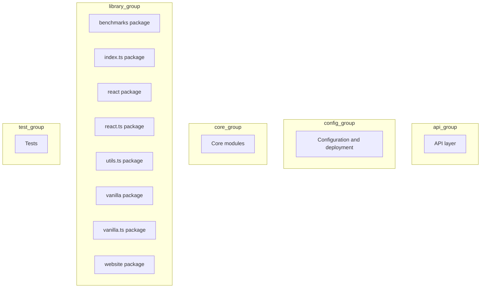

# Architecture report: pmndrs/jotai

> Automated static analysis. **Observed** = directly seen in files/imports/AST; **Inferred** = interpretation from that evidence. Repository code was not executed.

## 1. Repository at a glance

| Item | Value |
| --- | --- |
| Repository | pmndrs/jotai |
| Description | 👻 Primitive and flexible state management for React |
| Language | TypeScript |
| Stars | 21320 |
| Licence | MIT |
| Analysed commit / branch | 9de9377d10a5ac01388764b89458e2d7091d29d4 / main |
| Framework(s) | React |
| Files analysed | 326 |
| Components | 12 |

## 2. Architecture in one minute

pmndrs/jotai - 👻 Primitive and flexible state management for React. This repository was analysed statically from 326 file(s) (0 Python). Detected technologies (observed from imports/manifests): GitHub Actions, React, Tailwind CSS, TypeScript, Vite, Vitest. Files are grouped into 12 component(s): API layer, benchmarks package, Configuration and deployment, Core modules, index.ts package, react package, react.ts package, Tests. Findings below distinguish observed facts from inferred interpretation.

## 3. High-level block diagram

## 4. Main components

### API layer (`api_layer`)

- **Kind:** api
- **Status:** Observed
- **Confidence:** 0.85
- **Responsibility:** Groups 2 file(s) under api layer (observed from repository paths and static analysis).
- **Paths:** `website/api/contact.js`, `website/src/api/contact.js`
- **Evidence:** [website/api/contact.js](https://github.com/pmndrs/jotai/blob/9de9377d10a5ac01388764b89458e2d7091d29d4/website/api/contact.js); [website/src/api/contact.js](https://github.com/pmndrs/jotai/blob/9de9377d10a5ac01388764b89458e2d7091d29d4/website/src/api/contact.js)

### benchmarks package (`benchmarks`)

- **Kind:** library
- **Status:** Observed
- **Confidence:** 0.85
- **Responsibility:** Groups 9 file(s) under benchmarks package (observed from repository paths and static analysis).
- **Paths:** `benchmarks/atom-creation.ts`, `benchmarks/computed-read.ts`, `benchmarks/derived-chain.ts`, `benchmarks/diamond.ts`, `benchmarks/read-write.ts`, `benchmarks/run-all.ts`, `benchmarks/select-atom.ts`, `benchmarks/subscription.ts`, `benchmarks/wide-fan-out.ts`
- **Evidence:** [benchmarks/atom-creation.ts](https://github.com/pmndrs/jotai/blob/9de9377d10a5ac01388764b89458e2d7091d29d4/benchmarks/atom-creation.ts); [benchmarks/computed-read.ts](https://github.com/pmndrs/jotai/blob/9de9377d10a5ac01388764b89458e2d7091d29d4/benchmarks/computed-read.ts); [benchmarks/derived-chain.ts](https://github.com/pmndrs/jotai/blob/9de9377d10a5ac01388764b89458e2d7091d29d4/benchmarks/derived-chain.ts); [benchmarks/diamond.ts](https://github.com/pmndrs/jotai/blob/9de9377d10a5ac01388764b89458e2d7091d29d4/benchmarks/diamond.ts); [benchmarks/read-write.ts](https://github.com/pmndrs/jotai/blob/9de9377d10a5ac01388764b89458e2d7091d29d4/benchmarks/read-write.ts); [benchmarks/run-all.ts](https://github.com/pmndrs/jotai/blob/9de9377d10a5ac01388764b89458e2d7091d29d4/benchmarks/run-all.ts); [benchmarks/select-atom.ts](https://github.com/pmndrs/jotai/blob/9de9377d10a5ac01388764b89458e2d7091d29d4/benchmarks/select-atom.ts); [benchmarks/subscription.ts](https://github.com/pmndrs/jotai/blob/9de9377d10a5ac01388764b89458e2d7091d29d4/benchmarks/subscription.ts)

### Configuration and deployment (`config`)

- **Kind:** config
- **Status:** Observed
- **Confidence:** 0.85
- **Responsibility:** Groups 7 file(s) under configuration and deployment (observed from repository paths and static analysis).
- **Paths:** `package.json`, `pnpm-workspace.yaml`, `tsconfig.build.json`, `tsconfig.json`, `website/jsconfig.json`, `website/package.json`, `website/vercel.json`
- **Evidence:** [package.json](https://github.com/pmndrs/jotai/blob/9de9377d10a5ac01388764b89458e2d7091d29d4/package.json); [pnpm-workspace.yaml](https://github.com/pmndrs/jotai/blob/9de9377d10a5ac01388764b89458e2d7091d29d4/pnpm-workspace.yaml); [tsconfig.build.json](https://github.com/pmndrs/jotai/blob/9de9377d10a5ac01388764b89458e2d7091d29d4/tsconfig.build.json); [tsconfig.json](https://github.com/pmndrs/jotai/blob/9de9377d10a5ac01388764b89458e2d7091d29d4/tsconfig.json); [website/jsconfig.json](https://github.com/pmndrs/jotai/blob/9de9377d10a5ac01388764b89458e2d7091d29d4/website/jsconfig.json); [website/package.json](https://github.com/pmndrs/jotai/blob/9de9377d10a5ac01388764b89458e2d7091d29d4/website/package.json); [website/vercel.json](https://github.com/pmndrs/jotai/blob/9de9377d10a5ac01388764b89458e2d7091d29d4/website/vercel.json)

### Core modules (`core`)

- **Kind:** core
- **Status:** Observed
- **Confidence:** 0.85
- **Responsibility:** Groups 1 file(s) under core modules (observed from repository paths and static analysis).
- **Paths:** `eslint.config.mjs`
- **Evidence:** [eslint.config.mjs](https://github.com/pmndrs/jotai/blob/9de9377d10a5ac01388764b89458e2d7091d29d4/eslint.config.mjs)

### index.ts package (`index_ts`)

- **Kind:** library
- **Status:** Observed
- **Confidence:** 0.85
- **Responsibility:** Groups 1 file(s) under index.ts package (observed from repository paths and static analysis).
- **Paths:** `src/index.ts`
- **Evidence:** [src/index.ts](https://github.com/pmndrs/jotai/blob/9de9377d10a5ac01388764b89458e2d7091d29d4/src/index.ts)

### react package (`react`)

- **Kind:** library
- **Status:** Observed
- **Confidence:** 0.85
- **Responsibility:** Groups 12 file(s) under react package (observed from repository paths and static analysis).
- **Paths:** `src/react/Provider.ts`, `src/react/continuablePromise.ts`, `src/react/useAtom.ts`, `src/react/useAtomValue.ts`, `src/react/useAtomValueRaw.ts`, `src/react/useAtomValueRawSync.ts`, `src/react/useSetAtom.ts`, `src/react/utils.ts`, `src/react/utils/useAtomCallback.ts`, `src/react/utils/useHydrateAtoms.ts`, `src/react/utils/useReducerAtom.ts`, `src/react/utils/useResetAtom.ts`
- **Evidence:** [src/react/Provider.ts](https://github.com/pmndrs/jotai/blob/9de9377d10a5ac01388764b89458e2d7091d29d4/src/react/Provider.ts); [src/react/continuablePromise.ts](https://github.com/pmndrs/jotai/blob/9de9377d10a5ac01388764b89458e2d7091d29d4/src/react/continuablePromise.ts); [src/react/useAtom.ts](https://github.com/pmndrs/jotai/blob/9de9377d10a5ac01388764b89458e2d7091d29d4/src/react/useAtom.ts); [src/react/useAtomValue.ts](https://github.com/pmndrs/jotai/blob/9de9377d10a5ac01388764b89458e2d7091d29d4/src/react/useAtomValue.ts); [src/react/useAtomValueRaw.ts](https://github.com/pmndrs/jotai/blob/9de9377d10a5ac01388764b89458e2d7091d29d4/src/react/useAtomValueRaw.ts); [src/react/useAtomValueRawSync.ts](https://github.com/pmndrs/jotai/blob/9de9377d10a5ac01388764b89458e2d7091d29d4/src/react/useAtomValueRawSync.ts); [src/react/useSetAtom.ts](https://github.com/pmndrs/jotai/blob/9de9377d10a5ac01388764b89458e2d7091d29d4/src/react/useSetAtom.ts); [src/react/utils.ts](https://github.com/pmndrs/jotai/blob/9de9377d10a5ac01388764b89458e2d7091d29d4/src/react/utils.ts)

### react.ts package (`react_ts`)

- **Kind:** library
- **Status:** Observed
- **Confidence:** 0.85
- **Responsibility:** Groups 1 file(s) under react.ts package (observed from repository paths and static analysis).
- **Paths:** `src/react.ts`
- **Evidence:** [src/react.ts](https://github.com/pmndrs/jotai/blob/9de9377d10a5ac01388764b89458e2d7091d29d4/src/react.ts)

### Tests (`tests`)

- **Kind:** test
- **Status:** Observed
- **Confidence:** 0.85
- **Responsibility:** Groups 46 file(s) under tests (observed from repository paths and static analysis).
- **Paths:** `tests/react/abortable.test.tsx`, `tests/react/async.test.tsx`, `tests/react/async2.test.tsx`, `tests/react/basic.test.tsx`, `tests/react/dependency.test.tsx`, `tests/react/error.test.tsx`, `tests/react/items.test.tsx`, `tests/react/onmount.test.tsx`, `tests/react/optimization.test.tsx`, `tests/react/provider.test.tsx`, `tests/react/transition.test.tsx`, `tests/react/types.test.tsx`, `tests/react/useAtomValue.test.tsx`, `tests/react/useAtomValueRaw.test.tsx`, `tests/react/useAtomValueRawSync.test.tsx`, `tests/react/useSetAtom.test.tsx`, `tests/react/utils/types.test.tsx`, `tests/react/utils/useAtomCallback.test.tsx`, `tests/react/utils/useHydrateAtoms.test.tsx`, `tests/react/utils/useReducerAtom.test.tsx`, `tests/react/utils/useResetAtom.test.tsx`, `tests/react/vanilla-utils/atomWithDefault.test.tsx`, `tests/react/vanilla-utils/atomWithObservable.test.tsx`, `tests/react/vanilla-utils/atomWithReducer.test.tsx`, `tests/react/vanilla-utils/atomWithRefresh.test.tsx`, `tests/react/vanilla-utils/atomWithStorage.test.tsx`, `tests/react/vanilla-utils/freezeAtom.test.tsx`, `tests/react/vanilla-utils/selectAtom.test.tsx`, `tests/react/vanilla-utils/splitAtom.test.tsx`, `tests/setup.ts`, `tests/test-utils.ts`, `tests/vanilla/basic.test.tsx`, `tests/vanilla/dependency.test.tsx`, `tests/vanilla/derive.test.tsx`, `tests/vanilla/effect.test.ts`, `tests/vanilla/internals.test.tsx`, `tests/vanilla/memoryleaks.test.ts`, `tests/vanilla/store.test.tsx`, `tests/vanilla/storedev.test.tsx`, `tests/vanilla/types.test.tsx`, `tests/vanilla/utils/atomWithDefault.test.ts`, `tests/vanilla/utils/atomWithLazy.test.ts`, `tests/vanilla/utils/atomWithRefresh.test.ts`, `tests/vanilla/utils/atomWithReset.test.ts`, `tests/vanilla/utils/types.test.tsx`, `tests/vanilla/utils/unwrap.test.ts`
- **Evidence:** [tests/react/abortable.test.tsx](https://github.com/pmndrs/jotai/blob/9de9377d10a5ac01388764b89458e2d7091d29d4/tests/react/abortable.test.tsx); [tests/react/async.test.tsx](https://github.com/pmndrs/jotai/blob/9de9377d10a5ac01388764b89458e2d7091d29d4/tests/react/async.test.tsx); [tests/react/async2.test.tsx](https://github.com/pmndrs/jotai/blob/9de9377d10a5ac01388764b89458e2d7091d29d4/tests/react/async2.test.tsx); [tests/react/basic.test.tsx](https://github.com/pmndrs/jotai/blob/9de9377d10a5ac01388764b89458e2d7091d29d4/tests/react/basic.test.tsx); [tests/react/dependency.test.tsx](https://github.com/pmndrs/jotai/blob/9de9377d10a5ac01388764b89458e2d7091d29d4/tests/react/dependency.test.tsx); [tests/react/error.test.tsx](https://github.com/pmndrs/jotai/blob/9de9377d10a5ac01388764b89458e2d7091d29d4/tests/react/error.test.tsx); [tests/react/items.test.tsx](https://github.com/pmndrs/jotai/blob/9de9377d10a5ac01388764b89458e2d7091d29d4/tests/react/items.test.tsx); [tests/react/onmount.test.tsx](https://github.com/pmndrs/jotai/blob/9de9377d10a5ac01388764b89458e2d7091d29d4/tests/react/onmount.test.tsx)

### utils.ts package (`utils_ts`)

- **Kind:** library
- **Status:** Observed
- **Confidence:** 0.85
- **Responsibility:** Groups 1 file(s) under utils.ts package (observed from repository paths and static analysis).
- **Paths:** `src/utils.ts`
- **Evidence:** [src/utils.ts](https://github.com/pmndrs/jotai/blob/9de9377d10a5ac01388764b89458e2d7091d29d4/src/utils.ts)

### vanilla package (`vanilla`)

- **Kind:** library
- **Status:** Observed
- **Confidence:** 0.85
- **Responsibility:** Groups 17 file(s) under vanilla package (observed from repository paths and static analysis).
- **Paths:** `src/vanilla/atom.ts`, `src/vanilla/internals.ts`, `src/vanilla/store.ts`, `src/vanilla/typeUtils.ts`, `src/vanilla/utils.ts`, `src/vanilla/utils/atomWithDefault.ts`, `src/vanilla/utils/atomWithLazy.ts`, `src/vanilla/utils/atomWithObservable.ts`, `src/vanilla/utils/atomWithReducer.ts`, `src/vanilla/utils/atomWithRefresh.ts`, `src/vanilla/utils/atomWithReset.ts`, `src/vanilla/utils/atomWithStorage.ts`, `src/vanilla/utils/constants.ts`, `src/vanilla/utils/freezeAtom.ts`, `src/vanilla/utils/selectAtom.ts`, `src/vanilla/utils/splitAtom.ts`, `src/vanilla/utils/unwrap.ts`
- **Evidence:** [src/vanilla/atom.ts](https://github.com/pmndrs/jotai/blob/9de9377d10a5ac01388764b89458e2d7091d29d4/src/vanilla/atom.ts); [src/vanilla/internals.ts](https://github.com/pmndrs/jotai/blob/9de9377d10a5ac01388764b89458e2d7091d29d4/src/vanilla/internals.ts); [src/vanilla/store.ts](https://github.com/pmndrs/jotai/blob/9de9377d10a5ac01388764b89458e2d7091d29d4/src/vanilla/store.ts); [src/vanilla/typeUtils.ts](https://github.com/pmndrs/jotai/blob/9de9377d10a5ac01388764b89458e2d7091d29d4/src/vanilla/typeUtils.ts); [src/vanilla/utils.ts](https://github.com/pmndrs/jotai/blob/9de9377d10a5ac01388764b89458e2d7091d29d4/src/vanilla/utils.ts); [src/vanilla/utils/atomWithDefault.ts](https://github.com/pmndrs/jotai/blob/9de9377d10a5ac01388764b89458e2d7091d29d4/src/vanilla/utils/atomWithDefault.ts); [src/vanilla/utils/atomWithLazy.ts](https://github.com/pmndrs/jotai/blob/9de9377d10a5ac01388764b89458e2d7091d29d4/src/vanilla/utils/atomWithLazy.ts); [src/vanilla/utils/atomWithObservable.ts](https://github.com/pmndrs/jotai/blob/9de9377d10a5ac01388764b89458e2d7091d29d4/src/vanilla/utils/atomWithObservable.ts)

### vanilla.ts package (`vanilla_ts`)

- **Kind:** library
- **Status:** Observed
- **Confidence:** 0.85
- **Responsibility:** Groups 1 file(s) under vanilla.ts package (observed from repository paths and static analysis).
- **Paths:** `src/vanilla.ts`
- **Evidence:** [src/vanilla.ts](https://github.com/pmndrs/jotai/blob/9de9377d10a5ac01388764b89458e2d7091d29d4/src/vanilla.ts)

### website package (`website`)

- **Kind:** library
- **Status:** Observed
- **Confidence:** 0.85
- **Responsibility:** Groups 48 file(s) under website package (observed from repository paths and static analysis).
- **Paths:** `website/gatsby-browser.js`, `website/gatsby-config.js`, `website/gatsby-node.js`, `website/gatsby-shared.js`, `website/gatsby-ssr.js`, `website/postcss.config.js`, `website/reach-router.js`, `website/src/atoms/index.js`, `website/src/components/button.js`, `website/src/components/client-only.js`, `website/src/components/code-sandbox.js`, `website/src/components/code.js`, `website/src/components/core-demo.js`, `website/src/components/credits.js`, `website/src/components/docs.js`, `website/src/components/extensions-demo.js`, `website/src/components/external-link.js`, `website/src/components/footer.js`, `website/src/components/headline.js`, `website/src/components/icon.js`, `website/src/components/inline-code.js`, `website/src/components/intro.js`, `website/src/components/jotai.js`, `website/src/components/layout.js`, `website/src/components/logo-cloud.js`, `website/src/components/logo.js`, `website/src/components/main.js`, `website/src/components/mdx.js`, `website/src/components/menu.js`, `website/src/components/meta.js`, `website/src/components/modal.js`, `website/src/components/search-button.js`, `website/src/components/search-modal.js`, `website/src/components/shelf.js`, `website/src/components/sidebar.js`, `website/src/components/stackblitz.js`, `website/src/components/support-modal.js`, `website/src/components/support.js`, `website/src/components/tabs.js`, `website/src/components/toc.js`, `website/src/components/toggle.js`, `website/src/components/utilities-demo.js`, `website/src/components/wrapper.js`, `website/src/hooks/index.js`, `website/src/pages/404.js`, `website/src/pages/index.js`, `website/src/utils/index.js`, `website/tailwind.config.js`
- **Evidence:** [website/gatsby-browser.js](https://github.com/pmndrs/jotai/blob/9de9377d10a5ac01388764b89458e2d7091d29d4/website/gatsby-browser.js); [website/gatsby-config.js](https://github.com/pmndrs/jotai/blob/9de9377d10a5ac01388764b89458e2d7091d29d4/website/gatsby-config.js); [website/gatsby-node.js](https://github.com/pmndrs/jotai/blob/9de9377d10a5ac01388764b89458e2d7091d29d4/website/gatsby-node.js); [website/gatsby-shared.js](https://github.com/pmndrs/jotai/blob/9de9377d10a5ac01388764b89458e2d7091d29d4/website/gatsby-shared.js); [website/gatsby-ssr.js](https://github.com/pmndrs/jotai/blob/9de9377d10a5ac01388764b89458e2d7091d29d4/website/gatsby-ssr.js); [website/postcss.config.js](https://github.com/pmndrs/jotai/blob/9de9377d10a5ac01388764b89458e2d7091d29d4/website/postcss.config.js); [website/reach-router.js](https://github.com/pmndrs/jotai/blob/9de9377d10a5ac01388764b89458e2d7091d29d4/website/reach-router.js); [website/src/atoms/index.js](https://github.com/pmndrs/jotai/blob/9de9377d10a5ac01388764b89458e2d7091d29d4/website/src/atoms/index.js)

## 5. Execution flow

**Observed** entry point(s):

- [src/index.ts](https://github.com/pmndrs/jotai/blob/9de9377d10a5ac01388764b89458e2d7091d29d4/src/index.ts)
- [website/src/atoms/index.js](https://github.com/pmndrs/jotai/blob/9de9377d10a5ac01388764b89458e2d7091d29d4/website/src/atoms/index.js)
- [website/src/components/main.js](https://github.com/pmndrs/jotai/blob/9de9377d10a5ac01388764b89458e2d7091d29d4/website/src/components/main.js)
- [website/src/hooks/index.js](https://github.com/pmndrs/jotai/blob/9de9377d10a5ac01388764b89458e2d7091d29d4/website/src/hooks/index.js)
- [website/src/pages/index.js](https://github.com/pmndrs/jotai/blob/9de9377d10a5ac01388764b89458e2d7091d29d4/website/src/pages/index.js)
- [website/src/utils/index.js](https://github.com/pmndrs/jotai/blob/9de9377d10a5ac01388764b89458e2d7091d29d4/website/src/utils/index.js)

Representative flow (derived from observed entry points and the import graph; steps beyond the entry point are **Inferred**):

1. Execution starts at an observed entry point listed above, if present.
2. No internal import relationships between components were observed.

## 6. Project structure

### `(root)`

- `.gitignore` - other (452 bytes)
- `.prettierignore` - other (20 bytes)
- `CONTRIBUTING.md` - docs (4354 bytes)
- `LICENSE` - docs (1067 bytes)
- `README.md` - docs (5543 bytes)
- `eslint.config.mjs` - source, JavaScript (2807 bytes)
- `package.json` - manifest (4427 bytes)
- `pnpm-workspace.yaml` - config (410 bytes)
- `tsconfig.build.json` - config (216 bytes)
- `tsconfig.json` - config (691 bytes)
- `vitest.config.mts` - other (962 bytes)

### `.github`

- `.github/DISCUSSION_TEMPLATE/bug-report.yml` - config (588 bytes)
- `.github/FUNDING.yml` - config (772 bytes)
- `.github/ISSUE_TEMPLATE/bug_report.md` - docs (171 bytes)
- `.github/ISSUE_TEMPLATE/config.yml` - config (463 bytes)
- `.github/pull_request_template.md` - docs (137 bytes)
- `.github/workflows/compressed-size.yml` - ci, YAML (755 bytes)
- `.github/workflows/ecosystem-ci.yml` - ci, YAML (2216 bytes)
- `.github/workflows/preview-release.yml` - ci, YAML (763 bytes)
- `.github/workflows/publish.yml` - ci, YAML (731 bytes)
- `.github/workflows/test-multiple-builds.yml` - ci, YAML (1798 bytes)
- `.github/workflows/test-multiple-versions.yml` - ci, YAML (1115 bytes)
- `.github/workflows/test-old-typescript.yml` - ci, YAML (1036 bytes)
- `.github/workflows/test.yml` - ci, YAML (971 bytes)

### `.livecodes`

- `.livecodes/react.json` - config (1570 bytes)

### `benchmarks`

- `benchmarks/.gitignore` - other (16 bytes)
- `benchmarks/atom-creation.ts` - source, TypeScript (951 bytes)
- `benchmarks/computed-read.ts` - source, TypeScript (1246 bytes)
- `benchmarks/derived-chain.ts` - source, TypeScript (1191 bytes)
- `benchmarks/diamond.ts` - source, TypeScript (1292 bytes)
- `benchmarks/read-write.ts` - source, TypeScript (2356 bytes)
- `benchmarks/run-all.ts` - source, TypeScript (1206 bytes)
- `benchmarks/select-atom.ts` - source, TypeScript (1770 bytes)
- `benchmarks/subscription.ts` - source, TypeScript (1951 bytes)
- `benchmarks/wide-fan-out.ts` - source, TypeScript (1122 bytes)

### `docs`

- `docs/basics/comparison.mdx` - docs (5767 bytes)
- `docs/basics/concepts.mdx` - docs (1634 bytes)
- `docs/basics/functional-programming-and-jotai.mdx` - docs (4481 bytes)
- `docs/basics/showcase.mdx` - docs (2159 bytes)
- `docs/core/atom.mdx` - docs (8450 bytes)
- `docs/core/provider.mdx` - docs (1664 bytes)
- `docs/core/store.mdx` - docs (848 bytes)
- `docs/core/use-atom.mdx` - docs (8029 bytes)
- `docs/extensions/cache.mdx` - docs (2633 bytes)
- `docs/extensions/effect.mdx` - docs (8446 bytes)
- `docs/extensions/immer.mdx` - docs (3025 bytes)
- `docs/extensions/location.mdx` - docs (4543 bytes)
- `docs/extensions/optics.mdx` - docs (2017 bytes)
- `docs/extensions/query.mdx` - docs (14928 bytes)
- `docs/extensions/redux.mdx` - docs (1260 bytes)
- `docs/extensions/relay.mdx` - docs (2365 bytes)
- `docs/extensions/scope.mdx` - docs (3952 bytes)
- `docs/extensions/trpc.mdx` - docs (2137 bytes)
- `docs/extensions/urql.mdx` - docs (8128 bytes)
- `docs/extensions/valtio.mdx` - docs (2973 bytes)
- `docs/extensions/xstate.mdx` - docs (3540 bytes)
- `docs/extensions/zustand.mdx` - docs (1190 bytes)
- `docs/guides/async.mdx` - docs (4013 bytes)
- `docs/guides/atoms-in-atom.mdx` - docs (3878 bytes)
- `docs/guides/composing-atoms.mdx` - docs (6881 bytes)
- `docs/guides/core-internals.mdx` - docs (6566 bytes)
- `docs/guides/debugging.mdx` - docs (7052 bytes)
- `docs/guides/initialize-atom-on-render.mdx` - docs (3888 bytes)
- `docs/guides/migrating-to-v2-api.mdx` - docs (6225 bytes)
- `docs/guides/migrating-to-v3.mdx` - docs (5475 bytes)
- `docs/guides/nextjs.mdx` - docs (4850 bytes)
- `docs/guides/performance.mdx` - docs (6243 bytes)
- `docs/guides/persistence.mdx` - docs (5300 bytes)
- `docs/guides/react-native.mdx` - docs (1152 bytes)
- `docs/guides/remix.mdx` - docs (256 bytes)
- `docs/guides/resettable.mdx` - docs (2004 bytes)
- `docs/guides/testing.mdx` - docs (4166 bytes)
- `docs/guides/typescript.mdx` - docs (3663 bytes)
- `docs/guides/using-store-outside-react.mdx` - docs (1049 bytes)
- `docs/guides/vite.mdx` - docs (856 bytes)
- `docs/guides/waku.mdx` - docs (249 bytes)
- `docs/index.mdx` - docs (1805 bytes)
- `docs/recipes/atom-with-broadcast.mdx` - docs (2157 bytes)
- `docs/recipes/atom-with-compare.mdx` - docs (1685 bytes)
- `docs/recipes/atom-with-debounce.mdx` - docs (3624 bytes)
- `docs/recipes/atom-with-listeners.mdx` - docs (2230 bytes)
- `docs/recipes/atom-with-refresh-and-default.mdx` - docs (2323 bytes)
- `docs/recipes/atom-with-refresh.mdx` - docs (199 bytes)
- `docs/recipes/atom-with-toggle-and-storage.mdx` - docs (1125 bytes)
- `docs/recipes/atom-with-toggle.mdx` - docs (1370 bytes)
- `docs/recipes/custom-useatom-hooks.mdx` - docs (1896 bytes)
- `docs/recipes/large-objects.mdx` - docs (3646 bytes)
- `docs/recipes/use-atom-effect.mdx` - docs (2176 bytes)
- `docs/recipes/use-reducer-atom.mdx` - docs (1362 bytes)
- `docs/third-party/bunja.mdx` - docs (6897 bytes)
- `docs/third-party/eager.mdx` - docs (7123 bytes)
- `docs/third-party/history.mdx` - docs (2012 bytes)
- `docs/tools/babel.mdx` - docs (3084 bytes)
- `docs/tools/devtools.mdx` - docs (10699 bytes)
- `docs/tools/rolldown.mdx` - docs (2087 bytes)
- `docs/tools/skill.mdx` - docs (1252 bytes)
- `docs/tools/swc.mdx` - docs (2782 bytes)
- `docs/utilities/async.mdx` - docs (4232 bytes)
- `docs/utilities/callback.mdx` - docs (1495 bytes)
- `docs/utilities/family.mdx` - docs (5134 bytes)
- `docs/utilities/lazy.mdx` - docs (2372 bytes)
- `docs/utilities/reducer.mdx` - docs (602 bytes)
- `docs/utilities/resettable.mdx` - docs (5245 bytes)
- `docs/utilities/select.mdx` - docs (2783 bytes)
- `docs/utilities/split.mdx` - docs (3419 bytes)
- `docs/utilities/ssr.mdx` - docs (2689 bytes)
- `docs/utilities/storage.mdx` - docs (9453 bytes)

### `examples`

- `examples/hacker_news/README.md` - docs (689 bytes)
- `examples/hacker_news/index.html` - other (366 bytes)
- `examples/hacker_news/package.json` - manifest (578 bytes)
- `examples/hacker_news/public/index.html` - other (1626 bytes)
- `examples/hacker_news/src/App.tsx` - source, TypeScript (1601 bytes)
- `examples/hacker_news/src/index.tsx` - source, TypeScript (259 bytes)
- `examples/hacker_news/src/styles.css` - other (1195 bytes)
- `examples/hacker_news/src/vite-env.d.ts` - source, TypeScript (38 bytes)
- `examples/hacker_news/tsconfig.json` - config (544 bytes)
- `examples/hacker_news/vite.config.ts` - source, TypeScript (133 bytes)
- `examples/hello/README.md` - docs (565 bytes)
- `examples/hello/index.html` - other (521 bytes)
- `examples/hello/package.json` - manifest (519 bytes)
- `examples/hello/public/index.html` - other (597 bytes)
- `examples/hello/src/App.tsx` - source, TypeScript (1728 bytes)
- `examples/hello/src/index.tsx` - source, TypeScript (725 bytes)
- `examples/hello/src/prism.css` - other (3102 bytes)
- `examples/hello/src/style.css` - other (1038 bytes)
- `examples/hello/src/vite-env.d.ts` - source, TypeScript (38 bytes)
- `examples/hello/tsconfig.json` - config (544 bytes)
- `examples/hello/vite.config.ts` - source, TypeScript (133 bytes)
- `examples/mega-form/README.md` - docs (581 bytes)
- `examples/mega-form/index.html` - other (374 bytes)
- `examples/mega-form/package.json` - manifest (554 bytes)
- `examples/mega-form/public/index.html` - other (362 bytes)
- `examples/mega-form/src/App.tsx` - source, TypeScript (3869 bytes)
- `examples/mega-form/src/index.tsx` - source, TypeScript (185 bytes)
- `examples/mega-form/src/initialValue.ts` - source, TypeScript (1814 bytes)
- `examples/mega-form/src/style.css` - other (930 bytes)
- `examples/mega-form/src/useAtomSlice.ts` - source, TypeScript (558 bytes)
- `examples/mega-form/src/vite-env.d.ts` - source, TypeScript (38 bytes)
- `examples/mega-form/tsconfig.json` - config (544 bytes)
- `examples/mega-form/vite.config.ts` - source, TypeScript (133 bytes)
- `examples/starter/README.md` - docs (573 bytes)
- `examples/starter/index.html` - other (469 bytes)
- `examples/starter/package.json` - manifest (469 bytes)
- `examples/starter/src/index.css` - other (168 bytes)
- `examples/starter/src/index.tsx` - source, TypeScript (1096 bytes)
- `examples/starter/src/vite-env.d.ts` - source, TypeScript (38 bytes)
- `examples/starter/tsconfig.json` - config (562 bytes)
- `examples/starter/vite.config.ts` - source, TypeScript (163 bytes)
- `examples/text_length/README.md` - docs (659 bytes)
- `examples/text_length/index.html` - other (1068 bytes)
- `examples/text_length/package.json` - manifest (524 bytes)
- `examples/text_length/public/cover.svg` - other (67890 bytes)
- `examples/text_length/public/index.html` - other (4096 bytes)
- `examples/text_length/src/App.tsx` - source, TypeScript (681 bytes)
- `examples/text_length/src/index.tsx` - source, TypeScript (237 bytes)
- `examples/text_length/src/react-app-env.d.ts` - source, TypeScript (40 bytes)
- `examples/text_length/tsconfig.json` - config (544 bytes)
- `examples/text_length/vite.config.ts` - source, TypeScript (133 bytes)
- `examples/todos/README.md` - docs (692 bytes)
- `examples/todos/index.html` - other (360 bytes)
- `examples/todos/package.json` - manifest (600 bytes)
- `examples/todos/public/index.html` - other (1620 bytes)
- `examples/todos/src/App.tsx` - source, TypeScript (2926 bytes)
- `examples/todos/src/index.tsx` - source, TypeScript (214 bytes)
- `examples/todos/src/styles.css` - other (1188 bytes)
- `examples/todos/src/vite-env.d.ts` - source, TypeScript (38 bytes)
- `examples/todos/tsconfig.json` - config (307 bytes)
- `examples/todos/vite.config.ts` - source, TypeScript (133 bytes)
- `examples/todos_with_atomFamily/README.md` - docs (1024 bytes)
- `examples/todos_with_atomFamily/index.html` - other (376 bytes)
- `examples/todos_with_atomFamily/package.json` - manifest (656 bytes)
- `examples/todos_with_atomFamily/public/index.html` - other (1636 bytes)
- `examples/todos_with_atomFamily/src/App.tsx` - source, TypeScript (4511 bytes)
- `examples/todos_with_atomFamily/src/index.tsx` - source, TypeScript (214 bytes)
- `examples/todos_with_atomFamily/src/styles.css` - other (1188 bytes)
- `examples/todos_with_atomFamily/src/vite-env.d.ts` - source, TypeScript (38 bytes)
- `examples/todos_with_atomFamily/tsconfig.json` - config (544 bytes)
- `examples/todos_with_atomFamily/vite.config.ts` - source, TypeScript (133 bytes)

### `img`

- `img/title.svg` - other (5317 bytes)

### `src`

- `src/index.ts` - source, TypeScript (56 bytes)
- `src/react.ts` - source, TypeScript (352 bytes)
- `src/react/Provider.ts` - source, TypeScript (1315 bytes)
- `src/react/continuablePromise.ts` - source, TypeScript (1912 bytes)
- `src/react/useAtom.ts` - source, TypeScript (1534 bytes)
- `src/react/useAtomValue.ts` - source, TypeScript (1834 bytes)
- `src/react/useAtomValueRaw.ts` - source, TypeScript (2058 bytes)
- `src/react/useAtomValueRawSync.ts` - source, TypeScript (1097 bytes)
- `src/react/useSetAtom.ts` - source, TypeScript (1207 bytes)
- `src/react/utils.ts` - source, TypeScript (250 bytes)
- `src/react/utils/useAtomCallback.ts` - source, TypeScript (581 bytes)
- `src/react/utils/useHydrateAtoms.ts` - source, TypeScript (1831 bytes)
- `src/react/utils/useReducerAtom.ts` - source, TypeScript (1371 bytes)
- `src/react/utils/useResetAtom.ts` - source, TypeScript (495 bytes)
- `src/utils.ts` - source, TypeScript (68 bytes)
- `src/vanilla.ts` - source, TypeScript (414 bytes)
- `src/vanilla/atom.ts` - source, TypeScript (3360 bytes)
- `src/vanilla/internals.ts` - source, TypeScript (41872 bytes)
- `src/vanilla/store.ts` - source, TypeScript (1246 bytes)
- `src/vanilla/typeUtils.ts` - source, TypeScript (658 bytes)
- `src/vanilla/utils.ts` - source, TypeScript (762 bytes)
- `src/vanilla/utils/atomWithDefault.ts` - source, TypeScript (1247 bytes)
- `src/vanilla/utils/atomWithLazy.ts` - source, TypeScript (373 bytes)
- `src/vanilla/utils/atomWithObservable.ts` - source, TypeScript (5473 bytes)
- `src/vanilla/utils/atomWithReducer.ts` - source, TypeScript (677 bytes)
- `src/vanilla/utils/atomWithRefresh.ts` - source, TypeScript (1292 bytes)
- `src/vanilla/utils/atomWithReset.ts` - source, TypeScript (1008 bytes)
- `src/vanilla/utils/atomWithStorage.ts` - source, TypeScript (7385 bytes)
- `src/vanilla/utils/constants.ts` - source, TypeScript (102 bytes)
- `src/vanilla/utils/freezeAtom.ts` - source, TypeScript (1810 bytes)
- `src/vanilla/utils/selectAtom.ts` - source, TypeScript (1711 bytes)
- `src/vanilla/utils/splitAtom.ts` - source, TypeScript (7584 bytes)
- `src/vanilla/utils/unwrap.ts` - source, TypeScript (4692 bytes)

### `tests`

- `tests/react/abortable.test.tsx` - test, TypeScript (7070 bytes)
- `tests/react/async.test.tsx` - test, TypeScript (30324 bytes)
- `tests/react/async2.test.tsx` - test, TypeScript (9318 bytes)
- `tests/react/basic.test.tsx` - test, TypeScript (25036 bytes)
- `tests/react/dependency.test.tsx` - test, TypeScript (27234 bytes)
- `tests/react/error.test.tsx` - test, TypeScript (13098 bytes)
- `tests/react/items.test.tsx` - test, TypeScript (5261 bytes)
- `tests/react/onmount.test.tsx` - test, TypeScript (13321 bytes)
- `tests/react/optimization.test.tsx` - test, TypeScript (7064 bytes)
- `tests/react/provider.test.tsx` - test, TypeScript (1674 bytes)
- `tests/react/transition.test.tsx` - test, TypeScript (3416 bytes)
- `tests/react/types.test.tsx` - test, TypeScript (5168 bytes)
- `tests/react/useAtomValue.test.tsx` - test, TypeScript (2705 bytes)
- `tests/react/useAtomValueRaw.test.tsx` - test, TypeScript (5519 bytes)
- `tests/react/useAtomValueRawSync.test.tsx` - test, TypeScript (3684 bytes)
- `tests/react/useSetAtom.test.tsx` - test, TypeScript (3235 bytes)
- `tests/react/utils/types.test.tsx` - test, TypeScript (1716 bytes)
- `tests/react/utils/useAtomCallback.test.tsx` - test, TypeScript (4410 bytes)
- `tests/react/utils/useHydrateAtoms.test.tsx` - test, TypeScript (12481 bytes)
- `tests/react/utils/useReducerAtom.test.tsx` - test, TypeScript (3327 bytes)
- `tests/react/utils/useResetAtom.test.tsx` - test, TypeScript (5111 bytes)
- `tests/react/vanilla-utils/atomWithDefault.test.tsx` - test, TypeScript (7214 bytes)
- `tests/react/vanilla-utils/atomWithObservable.test.tsx` - test, TypeScript (25412 bytes)
- `tests/react/vanilla-utils/atomWithReducer.test.tsx` - test, TypeScript (2429 bytes)
- `tests/react/vanilla-utils/atomWithRefresh.test.tsx` - test, TypeScript (3281 bytes)
- `tests/react/vanilla-utils/atomWithStorage.test.tsx` - test, TypeScript (28518 bytes)
- `tests/react/vanilla-utils/freezeAtom.test.tsx` - test, TypeScript (4139 bytes)
- `tests/react/vanilla-utils/selectAtom.test.tsx` - test, TypeScript (4119 bytes)
- `tests/react/vanilla-utils/splitAtom.test.tsx` - test, TypeScript (14635 bytes)
- `tests/setup.ts` - test, TypeScript (42 bytes)
- `tests/test-utils.ts` - test, TypeScript (372 bytes)
- `tests/vanilla/basic.test.tsx` - test, TypeScript (1820 bytes)
- `tests/vanilla/dependency.test.tsx` - test, TypeScript (11368 bytes)
- `tests/vanilla/derive.test.tsx` - test, TypeScript (6965 bytes)
- `tests/vanilla/effect.test.ts` - test, TypeScript (7985 bytes)
- `tests/vanilla/internals.test.tsx` - test, TypeScript (16274 bytes)
- `tests/vanilla/memoryleaks.test.ts` - test, TypeScript (5047 bytes)
- `tests/vanilla/store.test.tsx` - test, TypeScript (45308 bytes)
- `tests/vanilla/storedev.test.tsx` - test, TypeScript (5293 bytes)
- `tests/vanilla/types.test.tsx` - test, TypeScript (3825 bytes)
- `tests/vanilla/utils/atomWithDefault.test.ts` - test, TypeScript (2632 bytes)
- `tests/vanilla/utils/atomWithLazy.test.ts` - test, TypeScript (1103 bytes)
- `tests/vanilla/utils/atomWithRefresh.test.ts` - test, TypeScript (441 bytes)
- `tests/vanilla/utils/atomWithReset.test.ts` - test, TypeScript (1039 bytes)
- `tests/vanilla/utils/types.test.tsx` - test, TypeScript (1612 bytes)
- `tests/vanilla/utils/unwrap.test.ts` - test, TypeScript (9187 bytes)

### `website`

- `website/.babelrc` - other (369 bytes)
- `website/.gitignore` - other (974 bytes)
- `website/README.md` - docs (287 bytes)
- `website/api/contact.js` - source, JavaScript (826 bytes)
- `website/gatsby-browser.js` - source, JavaScript (103 bytes)
- `website/gatsby-config.js` - source, JavaScript (3696 bytes)
- `website/gatsby-node.js` - source, JavaScript (5652 bytes)
- `website/gatsby-shared.js` - source, JavaScript (1170 bytes)
- `website/gatsby-ssr.js` - source, JavaScript (1124 bytes)
- `website/jsconfig.json` - config (181 bytes)
- `website/package.json` - manifest (1947 bytes)
- `website/postcss.config.js` - source, JavaScript (160 bytes)
- `website/public/robots.txt` - docs (76 bytes)
- `website/reach-router.js` - source, JavaScript (178 bytes)
- `website/src/api/contact.js` - source, JavaScript (826 bytes)
- `website/src/atoms/index.js` - source, JavaScript (484 bytes)
- `website/src/components/button.js` - source, JavaScript (2614 bytes)
- `website/src/components/client-only.js` - source, JavaScript (262 bytes)
- `website/src/components/code-sandbox.js` - source, JavaScript (768 bytes)
- `website/src/components/code.js` - source, JavaScript (809 bytes)
- `website/src/components/core-demo.js` - source, JavaScript (1648 bytes)
- `website/src/components/credits.js` - source, JavaScript (1455 bytes)
- `website/src/components/docs.js` - source, JavaScript (3423 bytes)
- `website/src/components/extensions-demo.js` - source, JavaScript (1218 bytes)
- `website/src/components/external-link.js` - source, JavaScript (165 bytes)
- `website/src/components/footer.js` - source, JavaScript (248 bytes)
- `website/src/components/headline.js` - source, JavaScript (301 bytes)
- `website/src/components/icon.js` - source, JavaScript (15762 bytes)
- `website/src/components/inline-code.js` - source, JavaScript (411 bytes)
- `website/src/components/intro.js` - source, JavaScript (1735 bytes)
- `website/src/components/jotai.js` - source, JavaScript (1674 bytes)
- `website/src/components/layout.js` - source, JavaScript (915 bytes)
- `website/src/components/logo-cloud.js` - source, JavaScript (3916 bytes)
- `website/src/components/logo.js` - source, JavaScript (2475 bytes)
- `website/src/components/main.js` - source, JavaScript (205 bytes)
- `website/src/components/mdx.js` - source, JavaScript (1127 bytes)
- `website/src/components/menu.js` - source, JavaScript (2263 bytes)
- `website/src/components/meta.js` - source, JavaScript (2227 bytes)
- `website/src/components/modal.js` - source, JavaScript (737 bytes)
- `website/src/components/search-button.js` - source, JavaScript (351 bytes)
- `website/src/components/search-modal.js` - source, JavaScript (4697 bytes)
- `website/src/components/shelf.js` - source, JavaScript (1168 bytes)
- `website/src/components/sidebar.js` - source, JavaScript (2490 bytes)
- `website/src/components/stackblitz.js` - source, JavaScript (679 bytes)
- `website/src/components/support-modal.js` - source, JavaScript (674 bytes)
- `website/src/components/support.js` - source, JavaScript (6884 bytes)
- `website/src/components/tabs.js` - source, JavaScript (303 bytes)
- `website/src/components/toc.js` - source, JavaScript (2376 bytes)
- `website/src/components/toggle.js` - source, JavaScript (1683 bytes)
- `website/src/components/utilities-demo.js` - source, JavaScript (2326 bytes)
- `website/src/components/wrapper.js` - source, JavaScript (254 bytes)
- `website/src/hooks/index.js` - source, JavaScript (428 bytes)
- `website/src/pages/404.js` - source, JavaScript (174 bytes)
- `website/src/pages/docs/{Mdx.slug}.js` - docs (970 bytes)
- `website/src/pages/index.js` - source, JavaScript (10315 bytes)
- `website/src/styles/base.css` - other (16 bytes)
- `website/src/styles/components.css` - other (2305 bytes)
- `website/src/styles/fonts.css` - other (172 bytes)
- `website/src/styles/index.css` - other (148 bytes)
- `website/src/styles/layout.css` - other (1871 bytes)
- `website/src/styles/pmndrs.css` - other (1815 bytes)
- `website/src/styles/utilities.css` - other (21 bytes)
- `website/src/utils/index.js` - source, JavaScript (513 bytes)
- `website/static/favicon.svg` - other (114 bytes)
- `website/static/robots.txt` - docs (76 bytes)
- `website/static/search-by-algolia.svg` - other (20535 bytes)
- `website/tailwind.config.js` - source, JavaScript (1289 bytes)
- `website/vercel.json` - config (3698 bytes)

## 7. Key dependencies and integrations

| Name | Category | Status | Confidence | Evidence |
| --- | --- | --- | --- | --- |
| GitHub Actions | ci | Observed | 0.90 | [.github/workflows/compressed-size.yml](https://github.com/pmndrs/jotai/blob/9de9377d10a5ac01388764b89458e2d7091d29d4/.github/workflows/compressed-size.yml); [.github/workflows/ecosystem-ci.yml](https://github.com/pmndrs/jotai/blob/9de9377d10a5ac01388764b89458e2d7091d29d4/.github/workflows/ecosystem-ci.yml); [.github/workflows/preview-release.yml](https://github.com/pmndrs/jotai/blob/9de9377d10a5ac01388764b89458e2d7091d29d4/.github/workflows/preview-release.yml); [.github/workflows/publish.yml](https://github.com/pmndrs/jotai/blob/9de9377d10a5ac01388764b89458e2d7091d29d4/.github/workflows/publish.yml) |
| React | framework | Observed | 0.90 | [examples/hacker_news/package.json:12](https://github.com/pmndrs/jotai/blob/9de9377d10a5ac01388764b89458e2d7091d29d4/examples/hacker_news/package.json#L12); [examples/hacker_news/package.json:16](https://github.com/pmndrs/jotai/blob/9de9377d10a5ac01388764b89458e2d7091d29d4/examples/hacker_news/package.json#L16); [examples/hello/package.json:14](https://github.com/pmndrs/jotai/blob/9de9377d10a5ac01388764b89458e2d7091d29d4/examples/hello/package.json#L14); [examples/hello/package.json:15](https://github.com/pmndrs/jotai/blob/9de9377d10a5ac01388764b89458e2d7091d29d4/examples/hello/package.json#L15) |
| Tailwind CSS | library | Observed | 0.85 | [website/package.json:46](https://github.com/pmndrs/jotai/blob/9de9377d10a5ac01388764b89458e2d7091d29d4/website/package.json#L46) |
| TypeScript | tooling | Observed | 0.90 | [examples/hacker_news/package.json:22](https://github.com/pmndrs/jotai/blob/9de9377d10a5ac01388764b89458e2d7091d29d4/examples/hacker_news/package.json#L22); [examples/hello/package.json:22](https://github.com/pmndrs/jotai/blob/9de9377d10a5ac01388764b89458e2d7091d29d4/examples/hello/package.json#L22); [examples/mega-form/package.json:23](https://github.com/pmndrs/jotai/blob/9de9377d10a5ac01388764b89458e2d7091d29d4/examples/mega-form/package.json#L23); [examples/starter/package.json:20](https://github.com/pmndrs/jotai/blob/9de9377d10a5ac01388764b89458e2d7091d29d4/examples/starter/package.json#L20) |
| Vite | tooling | Observed | 0.90 | [examples/hacker_news/package.json:7](https://github.com/pmndrs/jotai/blob/9de9377d10a5ac01388764b89458e2d7091d29d4/examples/hacker_news/package.json#L7); [examples/hello/package.json:7](https://github.com/pmndrs/jotai/blob/9de9377d10a5ac01388764b89458e2d7091d29d4/examples/hello/package.json#L7); [examples/mega-form/package.json:6](https://github.com/pmndrs/jotai/blob/9de9377d10a5ac01388764b89458e2d7091d29d4/examples/mega-form/package.json#L6); [examples/starter/package.json:7](https://github.com/pmndrs/jotai/blob/9de9377d10a5ac01388764b89458e2d7091d29d4/examples/starter/package.json#L7) |
| Vitest | tooling | Observed | 0.85 | [package.json:75](https://github.com/pmndrs/jotai/blob/9de9377d10a5ac01388764b89458e2d7091d29d4/package.json#L75) |

## 8. Data and state

No database, cache, queue, or persistent-state usage was observed in the analysed files. State handling, if any, may be in-memory or in files that were not analysed.

## 9. Configuration and deployment clues

- `.github/DISCUSSION_TEMPLATE/bug-report.yml` (config)
- `.github/FUNDING.yml` (config)
- `.github/ISSUE_TEMPLATE/config.yml` (config)
- `.github/workflows/compressed-size.yml` (ci)
- `.github/workflows/ecosystem-ci.yml` (ci)
- `.github/workflows/preview-release.yml` (ci)
- `.github/workflows/publish.yml` (ci)
- `.github/workflows/test-multiple-builds.yml` (ci)
- `.github/workflows/test-multiple-versions.yml` (ci)
- `.github/workflows/test-old-typescript.yml` (ci)
- `.github/workflows/test.yml` (ci)
- `.livecodes/react.json` (config)
- `examples/hacker_news/package.json` (manifest)
- `examples/hacker_news/tsconfig.json` (config)
- `examples/hello/package.json` (manifest)
- `examples/hello/tsconfig.json` (config)
- `examples/mega-form/package.json` (manifest)
- `examples/mega-form/tsconfig.json` (config)
- `examples/starter/package.json` (manifest)
- `examples/starter/tsconfig.json` (config)
- `examples/text_length/package.json` (manifest)
- `examples/text_length/tsconfig.json` (config)
- `examples/todos/package.json` (manifest)
- `examples/todos/tsconfig.json` (config)
- `examples/todos_with_atomFamily/package.json` (manifest)
- `examples/todos_with_atomFamily/tsconfig.json` (config)
- `package.json` (manifest)
- `pnpm-workspace.yaml` (config)
- `tsconfig.build.json` (config)
- `tsconfig.json` (config)
- `website/jsconfig.json` (config)
- `website/package.json` (manifest)
- `website/vercel.json` (config)

## 10. Design observations

- An entry/API layer is separated from other code (Inferred from paths and decorators).
- Tests are present alongside source code (Observed from test file paths).

These observations are interpretations (**Inferred**) of the observed structure, not guarantees about runtime design.

## 11. Limitations and unknowns

- Static analysis only: repository code was not executed, installed, or imported at runtime.
- Components and relationships are inferred from file paths, imports, and AST structure; runtime behaviour, dynamic imports, and reflection may not be visible.
- No clear application entry point was observed in the analysed files.
- Repository text was treated as untrusted data; no instructions found in repository files were followed, and likely secret values were redacted/excluded.
- JavaScript and TypeScript files were inventoried from paths and package manifests. They were not parsed with a full language AST, and repository code was not executed.

## 12. Source references

- [.github/workflows/compressed-size.yml](https://github.com/pmndrs/jotai/blob/9de9377d10a5ac01388764b89458e2d7091d29d4/.github/workflows/compressed-size.yml)
- [.github/workflows/ecosystem-ci.yml](https://github.com/pmndrs/jotai/blob/9de9377d10a5ac01388764b89458e2d7091d29d4/.github/workflows/ecosystem-ci.yml)
- [.github/workflows/preview-release.yml](https://github.com/pmndrs/jotai/blob/9de9377d10a5ac01388764b89458e2d7091d29d4/.github/workflows/preview-release.yml)
- [.github/workflows/publish.yml](https://github.com/pmndrs/jotai/blob/9de9377d10a5ac01388764b89458e2d7091d29d4/.github/workflows/publish.yml)
- [.github/workflows/test-multiple-builds.yml](https://github.com/pmndrs/jotai/blob/9de9377d10a5ac01388764b89458e2d7091d29d4/.github/workflows/test-multiple-builds.yml)
- [.github/workflows/test-multiple-versions.yml](https://github.com/pmndrs/jotai/blob/9de9377d10a5ac01388764b89458e2d7091d29d4/.github/workflows/test-multiple-versions.yml)
- [.github/workflows/test-old-typescript.yml](https://github.com/pmndrs/jotai/blob/9de9377d10a5ac01388764b89458e2d7091d29d4/.github/workflows/test-old-typescript.yml)
- [.github/workflows/test.yml](https://github.com/pmndrs/jotai/blob/9de9377d10a5ac01388764b89458e2d7091d29d4/.github/workflows/test.yml)
- [benchmarks/atom-creation.ts](https://github.com/pmndrs/jotai/blob/9de9377d10a5ac01388764b89458e2d7091d29d4/benchmarks/atom-creation.ts)
- [benchmarks/computed-read.ts](https://github.com/pmndrs/jotai/blob/9de9377d10a5ac01388764b89458e2d7091d29d4/benchmarks/computed-read.ts)
- [benchmarks/derived-chain.ts](https://github.com/pmndrs/jotai/blob/9de9377d10a5ac01388764b89458e2d7091d29d4/benchmarks/derived-chain.ts)
- [benchmarks/diamond.ts](https://github.com/pmndrs/jotai/blob/9de9377d10a5ac01388764b89458e2d7091d29d4/benchmarks/diamond.ts)
- [benchmarks/read-write.ts](https://github.com/pmndrs/jotai/blob/9de9377d10a5ac01388764b89458e2d7091d29d4/benchmarks/read-write.ts)
- [benchmarks/run-all.ts](https://github.com/pmndrs/jotai/blob/9de9377d10a5ac01388764b89458e2d7091d29d4/benchmarks/run-all.ts)
- [benchmarks/select-atom.ts](https://github.com/pmndrs/jotai/blob/9de9377d10a5ac01388764b89458e2d7091d29d4/benchmarks/select-atom.ts)
- [benchmarks/subscription.ts](https://github.com/pmndrs/jotai/blob/9de9377d10a5ac01388764b89458e2d7091d29d4/benchmarks/subscription.ts)
- [eslint.config.mjs](https://github.com/pmndrs/jotai/blob/9de9377d10a5ac01388764b89458e2d7091d29d4/eslint.config.mjs)
- [examples/hacker_news/package.json:7](https://github.com/pmndrs/jotai/blob/9de9377d10a5ac01388764b89458e2d7091d29d4/examples/hacker_news/package.json#L7)
- [examples/hacker_news/package.json:12](https://github.com/pmndrs/jotai/blob/9de9377d10a5ac01388764b89458e2d7091d29d4/examples/hacker_news/package.json#L12)
- [examples/hacker_news/package.json:16](https://github.com/pmndrs/jotai/blob/9de9377d10a5ac01388764b89458e2d7091d29d4/examples/hacker_news/package.json#L16)
- [examples/hacker_news/package.json:22](https://github.com/pmndrs/jotai/blob/9de9377d10a5ac01388764b89458e2d7091d29d4/examples/hacker_news/package.json#L22)
- [examples/hello/package.json:7](https://github.com/pmndrs/jotai/blob/9de9377d10a5ac01388764b89458e2d7091d29d4/examples/hello/package.json#L7)
- [examples/hello/package.json:14](https://github.com/pmndrs/jotai/blob/9de9377d10a5ac01388764b89458e2d7091d29d4/examples/hello/package.json#L14)
- [examples/hello/package.json:15](https://github.com/pmndrs/jotai/blob/9de9377d10a5ac01388764b89458e2d7091d29d4/examples/hello/package.json#L15)
- [examples/hello/package.json:22](https://github.com/pmndrs/jotai/blob/9de9377d10a5ac01388764b89458e2d7091d29d4/examples/hello/package.json#L22)
- [examples/mega-form/package.json:6](https://github.com/pmndrs/jotai/blob/9de9377d10a5ac01388764b89458e2d7091d29d4/examples/mega-form/package.json#L6)
- [examples/mega-form/package.json:16](https://github.com/pmndrs/jotai/blob/9de9377d10a5ac01388764b89458e2d7091d29d4/examples/mega-form/package.json#L16)
- [examples/mega-form/package.json:17](https://github.com/pmndrs/jotai/blob/9de9377d10a5ac01388764b89458e2d7091d29d4/examples/mega-form/package.json#L17)
- [examples/mega-form/package.json:23](https://github.com/pmndrs/jotai/blob/9de9377d10a5ac01388764b89458e2d7091d29d4/examples/mega-form/package.json#L23)
- [examples/starter/package.json:7](https://github.com/pmndrs/jotai/blob/9de9377d10a5ac01388764b89458e2d7091d29d4/examples/starter/package.json#L7)
- [examples/starter/package.json:13](https://github.com/pmndrs/jotai/blob/9de9377d10a5ac01388764b89458e2d7091d29d4/examples/starter/package.json#L13)
- [examples/starter/package.json:14](https://github.com/pmndrs/jotai/blob/9de9377d10a5ac01388764b89458e2d7091d29d4/examples/starter/package.json#L14)
- [examples/starter/package.json:20](https://github.com/pmndrs/jotai/blob/9de9377d10a5ac01388764b89458e2d7091d29d4/examples/starter/package.json#L20)
- [examples/text_length/package.json:7](https://github.com/pmndrs/jotai/blob/9de9377d10a5ac01388764b89458e2d7091d29d4/examples/text_length/package.json#L7)
- [examples/text_length/package.json:20](https://github.com/pmndrs/jotai/blob/9de9377d10a5ac01388764b89458e2d7091d29d4/examples/text_length/package.json#L20)
- [examples/todos/package.json:7](https://github.com/pmndrs/jotai/blob/9de9377d10a5ac01388764b89458e2d7091d29d4/examples/todos/package.json#L7)
- [examples/todos/package.json:23](https://github.com/pmndrs/jotai/blob/9de9377d10a5ac01388764b89458e2d7091d29d4/examples/todos/package.json#L23)
- [examples/todos_with_atomFamily/package.json:7](https://github.com/pmndrs/jotai/blob/9de9377d10a5ac01388764b89458e2d7091d29d4/examples/todos_with_atomFamily/package.json#L7)
- [examples/todos_with_atomFamily/package.json:24](https://github.com/pmndrs/jotai/blob/9de9377d10a5ac01388764b89458e2d7091d29d4/examples/todos_with_atomFamily/package.json#L24)
- [package.json](https://github.com/pmndrs/jotai/blob/9de9377d10a5ac01388764b89458e2d7091d29d4/package.json)
- [package.json:75](https://github.com/pmndrs/jotai/blob/9de9377d10a5ac01388764b89458e2d7091d29d4/package.json#L75)
- [package.json:117](https://github.com/pmndrs/jotai/blob/9de9377d10a5ac01388764b89458e2d7091d29d4/package.json#L117)
- [pnpm-workspace.yaml](https://github.com/pmndrs/jotai/blob/9de9377d10a5ac01388764b89458e2d7091d29d4/pnpm-workspace.yaml)
- [src/index.ts](https://github.com/pmndrs/jotai/blob/9de9377d10a5ac01388764b89458e2d7091d29d4/src/index.ts)
- [src/react.ts](https://github.com/pmndrs/jotai/blob/9de9377d10a5ac01388764b89458e2d7091d29d4/src/react.ts)
- [src/react/Provider.ts](https://github.com/pmndrs/jotai/blob/9de9377d10a5ac01388764b89458e2d7091d29d4/src/react/Provider.ts)
- [src/react/continuablePromise.ts](https://github.com/pmndrs/jotai/blob/9de9377d10a5ac01388764b89458e2d7091d29d4/src/react/continuablePromise.ts)
- [src/react/useAtom.ts](https://github.com/pmndrs/jotai/blob/9de9377d10a5ac01388764b89458e2d7091d29d4/src/react/useAtom.ts)
- [src/react/useAtomValue.ts](https://github.com/pmndrs/jotai/blob/9de9377d10a5ac01388764b89458e2d7091d29d4/src/react/useAtomValue.ts)
- [src/react/useAtomValueRaw.ts](https://github.com/pmndrs/jotai/blob/9de9377d10a5ac01388764b89458e2d7091d29d4/src/react/useAtomValueRaw.ts)
- [src/react/useAtomValueRawSync.ts](https://github.com/pmndrs/jotai/blob/9de9377d10a5ac01388764b89458e2d7091d29d4/src/react/useAtomValueRawSync.ts)
- [src/react/useSetAtom.ts](https://github.com/pmndrs/jotai/blob/9de9377d10a5ac01388764b89458e2d7091d29d4/src/react/useSetAtom.ts)
- [src/react/utils.ts](https://github.com/pmndrs/jotai/blob/9de9377d10a5ac01388764b89458e2d7091d29d4/src/react/utils.ts)
- [src/utils.ts](https://github.com/pmndrs/jotai/blob/9de9377d10a5ac01388764b89458e2d7091d29d4/src/utils.ts)
- [src/vanilla.ts](https://github.com/pmndrs/jotai/blob/9de9377d10a5ac01388764b89458e2d7091d29d4/src/vanilla.ts)
- [src/vanilla/atom.ts](https://github.com/pmndrs/jotai/blob/9de9377d10a5ac01388764b89458e2d7091d29d4/src/vanilla/atom.ts)
- [src/vanilla/internals.ts](https://github.com/pmndrs/jotai/blob/9de9377d10a5ac01388764b89458e2d7091d29d4/src/vanilla/internals.ts)
- [src/vanilla/store.ts](https://github.com/pmndrs/jotai/blob/9de9377d10a5ac01388764b89458e2d7091d29d4/src/vanilla/store.ts)
- [src/vanilla/typeUtils.ts](https://github.com/pmndrs/jotai/blob/9de9377d10a5ac01388764b89458e2d7091d29d4/src/vanilla/typeUtils.ts)
- [src/vanilla/utils.ts](https://github.com/pmndrs/jotai/blob/9de9377d10a5ac01388764b89458e2d7091d29d4/src/vanilla/utils.ts)
- [src/vanilla/utils/atomWithDefault.ts](https://github.com/pmndrs/jotai/blob/9de9377d10a5ac01388764b89458e2d7091d29d4/src/vanilla/utils/atomWithDefault.ts)
- [src/vanilla/utils/atomWithLazy.ts](https://github.com/pmndrs/jotai/blob/9de9377d10a5ac01388764b89458e2d7091d29d4/src/vanilla/utils/atomWithLazy.ts)
- [src/vanilla/utils/atomWithObservable.ts](https://github.com/pmndrs/jotai/blob/9de9377d10a5ac01388764b89458e2d7091d29d4/src/vanilla/utils/atomWithObservable.ts)
- [tests/react/abortable.test.tsx](https://github.com/pmndrs/jotai/blob/9de9377d10a5ac01388764b89458e2d7091d29d4/tests/react/abortable.test.tsx)
- [tests/react/async.test.tsx](https://github.com/pmndrs/jotai/blob/9de9377d10a5ac01388764b89458e2d7091d29d4/tests/react/async.test.tsx)
- [tests/react/async2.test.tsx](https://github.com/pmndrs/jotai/blob/9de9377d10a5ac01388764b89458e2d7091d29d4/tests/react/async2.test.tsx)
- [tests/react/basic.test.tsx](https://github.com/pmndrs/jotai/blob/9de9377d10a5ac01388764b89458e2d7091d29d4/tests/react/basic.test.tsx)
- [tests/react/dependency.test.tsx](https://github.com/pmndrs/jotai/blob/9de9377d10a5ac01388764b89458e2d7091d29d4/tests/react/dependency.test.tsx)
- [tests/react/error.test.tsx](https://github.com/pmndrs/jotai/blob/9de9377d10a5ac01388764b89458e2d7091d29d4/tests/react/error.test.tsx)
- [tests/react/items.test.tsx](https://github.com/pmndrs/jotai/blob/9de9377d10a5ac01388764b89458e2d7091d29d4/tests/react/items.test.tsx)
- [tests/react/onmount.test.tsx](https://github.com/pmndrs/jotai/blob/9de9377d10a5ac01388764b89458e2d7091d29d4/tests/react/onmount.test.tsx)
- [tsconfig.build.json](https://github.com/pmndrs/jotai/blob/9de9377d10a5ac01388764b89458e2d7091d29d4/tsconfig.build.json)
- [tsconfig.json](https://github.com/pmndrs/jotai/blob/9de9377d10a5ac01388764b89458e2d7091d29d4/tsconfig.json)
- [website/api/contact.js](https://github.com/pmndrs/jotai/blob/9de9377d10a5ac01388764b89458e2d7091d29d4/website/api/contact.js)
- [website/gatsby-browser.js](https://github.com/pmndrs/jotai/blob/9de9377d10a5ac01388764b89458e2d7091d29d4/website/gatsby-browser.js)
- [website/gatsby-config.js](https://github.com/pmndrs/jotai/blob/9de9377d10a5ac01388764b89458e2d7091d29d4/website/gatsby-config.js)
- [website/gatsby-node.js](https://github.com/pmndrs/jotai/blob/9de9377d10a5ac01388764b89458e2d7091d29d4/website/gatsby-node.js)
- [website/gatsby-shared.js](https://github.com/pmndrs/jotai/blob/9de9377d10a5ac01388764b89458e2d7091d29d4/website/gatsby-shared.js)
- [website/gatsby-ssr.js](https://github.com/pmndrs/jotai/blob/9de9377d10a5ac01388764b89458e2d7091d29d4/website/gatsby-ssr.js)
- [website/jsconfig.json](https://github.com/pmndrs/jotai/blob/9de9377d10a5ac01388764b89458e2d7091d29d4/website/jsconfig.json)
- [website/package.json](https://github.com/pmndrs/jotai/blob/9de9377d10a5ac01388764b89458e2d7091d29d4/website/package.json)
- [website/package.json:46](https://github.com/pmndrs/jotai/blob/9de9377d10a5ac01388764b89458e2d7091d29d4/website/package.json#L46)
- [website/postcss.config.js](https://github.com/pmndrs/jotai/blob/9de9377d10a5ac01388764b89458e2d7091d29d4/website/postcss.config.js)
- [website/reach-router.js](https://github.com/pmndrs/jotai/blob/9de9377d10a5ac01388764b89458e2d7091d29d4/website/reach-router.js)
- [website/src/api/contact.js](https://github.com/pmndrs/jotai/blob/9de9377d10a5ac01388764b89458e2d7091d29d4/website/src/api/contact.js)
- [website/src/atoms/index.js](https://github.com/pmndrs/jotai/blob/9de9377d10a5ac01388764b89458e2d7091d29d4/website/src/atoms/index.js)
- [website/src/components/main.js](https://github.com/pmndrs/jotai/blob/9de9377d10a5ac01388764b89458e2d7091d29d4/website/src/components/main.js)
- [website/src/hooks/index.js](https://github.com/pmndrs/jotai/blob/9de9377d10a5ac01388764b89458e2d7091d29d4/website/src/hooks/index.js)
- [website/src/pages/index.js](https://github.com/pmndrs/jotai/blob/9de9377d10a5ac01388764b89458e2d7091d29d4/website/src/pages/index.js)
- [website/src/utils/index.js](https://github.com/pmndrs/jotai/blob/9de9377d10a5ac01388764b89458e2d7091d29d4/website/src/utils/index.js)
- [website/vercel.json](https://github.com/pmndrs/jotai/blob/9de9377d10a5ac01388764b89458e2d7091d29d4/website/vercel.json)
