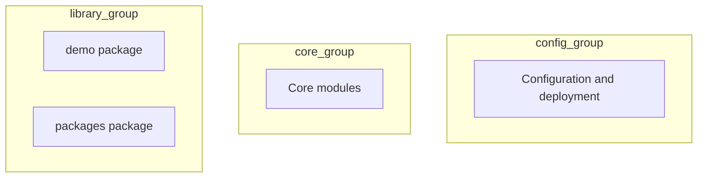

# Architecture report: pmndrs/leva

> Automated static analysis. **Observed** = directly seen in files/imports/AST; **Inferred** = interpretation from that evidence. Repository code was not executed.

## 1. Repository at a glance

| Item | Value |
| --- | --- |
| Repository | pmndrs/leva |
| Description | 🌋 React-first components GUI |
| Language | TypeScript |
| Stars | 6274 |
| Licence | MIT |
| Analysed commit / branch | 402a1e9d0899e6d384993aaffe8dc0d2c39110e1 / main |
| Framework(s) | React |
| Files analysed | 319 |
| Components | 4 |

## 2. Architecture in one minute

pmndrs/leva - 🌋 React-first components GUI. This repository was analysed statically from 319 file(s) (0 Python). Detected technologies (observed from imports/manifests): GitHub Actions, React, TypeScript, Vite, Vitest. Files are grouped into 4 component(s): Configuration and deployment, Core modules, demo package, packages package. Findings below distinguish observed facts from inferred interpretation.

## 3. High-level block diagram

## 4. Main components

### Configuration and deployment (`config`)

- **Kind:** config
- **Status:** Observed
- **Confidence:** 0.85
- **Responsibility:** Groups 25 file(s) under configuration and deployment (observed from repository paths and static analysis).
- **Paths:** `demo/package.json`, `demo/serve.json`, `demo/src/sandboxes/leva-advanced-panels/package.json`, `demo/src/sandboxes/leva-busy/package.json`, `demo/src/sandboxes/leva-custom-plugin/package.json`, `demo/src/sandboxes/leva-minimal/package.json`, `demo/src/sandboxes/leva-plugin-bezier/package.json`, `demo/src/sandboxes/leva-plugin-dates/package.json`, `demo/src/sandboxes/leva-plugin-plot/package.json`, `demo/src/sandboxes/leva-plugin-spring/package.json`, `demo/src/sandboxes/leva-scroll/package.json`, `demo/src/sandboxes/leva-theme/package.json`, `demo/src/sandboxes/leva-transient/package.json`, `demo/src/sandboxes/leva-ui/package.json`, `demo/tsconfig.json`, `package.json`, `packages/leva/headless/package.json`, `packages/leva/package.json`, `packages/leva/plugin/package.json`, `packages/plugin-bezier/package.json`, `packages/plugin-dates/package.json`, `packages/plugin-plot/package.json`, `packages/plugin-spring/package.json`, `pnpm-workspace.yaml`, `tsconfig.json`
- **Evidence:** [demo/package.json](https://github.com/pmndrs/leva/blob/402a1e9d0899e6d384993aaffe8dc0d2c39110e1/demo/package.json); [demo/serve.json](https://github.com/pmndrs/leva/blob/402a1e9d0899e6d384993aaffe8dc0d2c39110e1/demo/serve.json); [demo/src/sandboxes/leva-advanced-panels/package.json](https://github.com/pmndrs/leva/blob/402a1e9d0899e6d384993aaffe8dc0d2c39110e1/demo/src/sandboxes/leva-advanced-panels/package.json); [demo/src/sandboxes/leva-busy/package.json](https://github.com/pmndrs/leva/blob/402a1e9d0899e6d384993aaffe8dc0d2c39110e1/demo/src/sandboxes/leva-busy/package.json); [demo/src/sandboxes/leva-custom-plugin/package.json](https://github.com/pmndrs/leva/blob/402a1e9d0899e6d384993aaffe8dc0d2c39110e1/demo/src/sandboxes/leva-custom-plugin/package.json); [demo/src/sandboxes/leva-minimal/package.json](https://github.com/pmndrs/leva/blob/402a1e9d0899e6d384993aaffe8dc0d2c39110e1/demo/src/sandboxes/leva-minimal/package.json); [demo/src/sandboxes/leva-plugin-bezier/package.json](https://github.com/pmndrs/leva/blob/402a1e9d0899e6d384993aaffe8dc0d2c39110e1/demo/src/sandboxes/leva-plugin-bezier/package.json); [demo/src/sandboxes/leva-plugin-dates/package.json](https://github.com/pmndrs/leva/blob/402a1e9d0899e6d384993aaffe8dc0d2c39110e1/demo/src/sandboxes/leva-plugin-dates/package.json)

### Core modules (`core`)

- **Kind:** core
- **Status:** Observed
- **Confidence:** 0.85
- **Responsibility:** Groups 3 file(s) under core modules (observed from repository paths and static analysis).
- **Paths:** `babel.config.js`, `vitest.config.ts`, `vitest.setup.ts`
- **Evidence:** [babel.config.js](https://github.com/pmndrs/leva/blob/402a1e9d0899e6d384993aaffe8dc0d2c39110e1/babel.config.js); [vitest.config.ts](https://github.com/pmndrs/leva/blob/402a1e9d0899e6d384993aaffe8dc0d2c39110e1/vitest.config.ts); [vitest.setup.ts](https://github.com/pmndrs/leva/blob/402a1e9d0899e6d384993aaffe8dc0d2c39110e1/vitest.setup.ts)

### demo package (`demo`)

- **Kind:** library
- **Status:** Observed
- **Confidence:** 0.85
- **Responsibility:** Groups 28 file(s) under demo package (observed from repository paths and static analysis).
- **Paths:** `demo/src/App.jsx`, `demo/src/index.jsx`, `demo/src/sandboxes/leva-advanced-panels/src/App.jsx`, `demo/src/sandboxes/leva-advanced-panels/src/index.jsx`, `demo/src/sandboxes/leva-busy/src/App.tsx`, `demo/src/sandboxes/leva-busy/src/index.tsx`, `demo/src/sandboxes/leva-custom-plugin/src/App.tsx`, `demo/src/sandboxes/leva-custom-plugin/src/index.tsx`, `demo/src/sandboxes/leva-headless/src/App.tsx`, `demo/src/sandboxes/leva-minimal/src/App.jsx`, `demo/src/sandboxes/leva-minimal/src/index.jsx`, `demo/src/sandboxes/leva-plugin-bezier/src/App.tsx`, `demo/src/sandboxes/leva-plugin-bezier/src/index.tsx`, `demo/src/sandboxes/leva-plugin-dates/src/App.tsx`, `demo/src/sandboxes/leva-plugin-dates/src/index.tsx`, `demo/src/sandboxes/leva-plugin-plot/src/App.tsx`, `demo/src/sandboxes/leva-plugin-plot/src/index.tsx`, `demo/src/sandboxes/leva-plugin-spring/src/App.tsx`, `demo/src/sandboxes/leva-plugin-spring/src/index.tsx`, `demo/src/sandboxes/leva-scroll/src/App.jsx`, `demo/src/sandboxes/leva-scroll/src/index.jsx`, `demo/src/sandboxes/leva-theme/src/App.jsx`, `demo/src/sandboxes/leva-theme/src/index.jsx`, `demo/src/sandboxes/leva-transient/src/App.jsx`, `demo/src/sandboxes/leva-transient/src/index.jsx`, `demo/src/sandboxes/leva-ui/src/App.jsx`, `demo/src/sandboxes/leva-ui/src/index.jsx`, `demo/vite.config.js`
- **Evidence:** [demo/src/App.jsx](https://github.com/pmndrs/leva/blob/402a1e9d0899e6d384993aaffe8dc0d2c39110e1/demo/src/App.jsx); [demo/src/index.jsx](https://github.com/pmndrs/leva/blob/402a1e9d0899e6d384993aaffe8dc0d2c39110e1/demo/src/index.jsx); [demo/src/sandboxes/leva-advanced-panels/src/App.jsx](https://github.com/pmndrs/leva/blob/402a1e9d0899e6d384993aaffe8dc0d2c39110e1/demo/src/sandboxes/leva-advanced-panels/src/App.jsx); [demo/src/sandboxes/leva-advanced-panels/src/index.jsx](https://github.com/pmndrs/leva/blob/402a1e9d0899e6d384993aaffe8dc0d2c39110e1/demo/src/sandboxes/leva-advanced-panels/src/index.jsx); [demo/src/sandboxes/leva-busy/src/App.tsx](https://github.com/pmndrs/leva/blob/402a1e9d0899e6d384993aaffe8dc0d2c39110e1/demo/src/sandboxes/leva-busy/src/App.tsx); [demo/src/sandboxes/leva-busy/src/index.tsx](https://github.com/pmndrs/leva/blob/402a1e9d0899e6d384993aaffe8dc0d2c39110e1/demo/src/sandboxes/leva-busy/src/index.tsx); [demo/src/sandboxes/leva-custom-plugin/src/App.tsx](https://github.com/pmndrs/leva/blob/402a1e9d0899e6d384993aaffe8dc0d2c39110e1/demo/src/sandboxes/leva-custom-plugin/src/App.tsx); [demo/src/sandboxes/leva-custom-plugin/src/index.tsx](https://github.com/pmndrs/leva/blob/402a1e9d0899e6d384993aaffe8dc0d2c39110e1/demo/src/sandboxes/leva-custom-plugin/src/index.tsx)

### packages package (`packages`)

- **Kind:** library
- **Status:** Observed
- **Confidence:** 0.85
- **Responsibility:** Groups 188 file(s) under packages package (observed from repository paths and static analysis).
- **Paths:** `packages/leva/src/components/Button/Button.tsx`, `packages/leva/src/components/Button/StyledButton.ts`, `packages/leva/src/components/Button/index.ts`, `packages/leva/src/components/ButtonGroup/ButtonGroup.tsx`, `packages/leva/src/components/ButtonGroup/StyledButtonGroup.tsx`, `packages/leva/src/components/ButtonGroup/StyledButtonGroupButton.ts`, `packages/leva/src/components/ButtonGroup/index.ts`, `packages/leva/src/components/Control/Control.tsx`, `packages/leva/src/components/Control/ControlInput.tsx`, `packages/leva/src/components/Control/index.ts`, `packages/leva/src/components/Folder/Folder.tsx`, `packages/leva/src/components/Folder/FolderTitle.tsx`, `packages/leva/src/components/Folder/StyledFolder.ts`, `packages/leva/src/components/Folder/index.ts`, `packages/leva/src/components/Leva/Filter.tsx`, `packages/leva/src/components/Leva/Leva.tsx`, `packages/leva/src/components/Leva/LevaPanel.tsx`, `packages/leva/src/components/Leva/LevaRoot.tsx`, `packages/leva/src/components/Leva/StyledFilter.ts`, `packages/leva/src/components/Leva/StyledRoot.ts`, `packages/leva/src/components/Leva/index.ts`, `packages/leva/src/components/Leva/tree.ts`, `packages/leva/src/components/Monitor/Monitor.tsx`, `packages/leva/src/components/Monitor/StyledMonitor.ts`, `packages/leva/src/components/Monitor/index.ts`, `packages/leva/src/components/UI/Chevron.tsx`, `packages/leva/src/components/UI/Label.tsx`, `packages/leva/src/components/UI/Misc.tsx`, `packages/leva/src/components/UI/Row.tsx`, `packages/leva/src/components/UI/StyledUI.ts`, `packages/leva/src/components/UI/index.ts`, `packages/leva/src/components/ValueInput/StyledInput.ts`, `packages/leva/src/components/ValueInput/ValueInput.tsx`, `packages/leva/src/components/ValueInput/index.ts`, `packages/leva/src/context.tsx`, `packages/leva/src/eventEmitter.ts`, `packages/leva/src/headless/hooks.ts`, `packages/leva/src/headless/index.ts`, `packages/leva/src/headless/useControls.test.tsx`, `packages/leva/src/headless/useControls.ts`, `packages/leva/src/headless/useControls.utils.ts`, `packages/leva/src/helpers/button.ts`, `packages/leva/src/helpers/buttonGroup.ts`, `packages/leva/src/helpers/folder.ts`, `packages/leva/src/helpers/index.ts`, `packages/leva/src/helpers/monitor.ts`, `packages/leva/src/hooks/index.ts`, `packages/leva/src/hooks/useCanvas.ts`, `packages/leva/src/hooks/useCompareMemoize.ts`, `packages/leva/src/hooks/useDrag.ts`, `packages/leva/src/hooks/useInput.ts`, `packages/leva/src/hooks/useInputSetters.ts`, `packages/leva/src/hooks/usePopin.ts`, `packages/leva/src/hooks/useToggle.ts`, `packages/leva/src/hooks/useTransform.ts`, `packages/leva/src/hooks/useValue.ts`, `packages/leva/src/hooks/useValuesForPath.ts`, `packages/leva/src/hooks/useVisiblePaths.ts`, `packages/leva/src/index.ts`, `packages/leva/src/plugin.ts`, `packages/leva/src/plugin/index.ts`, `packages/leva/src/plugins/Boolean/Boolean.tsx`, `packages/leva/src/plugins/Boolean/StyledBoolean.ts`, `packages/leva/src/plugins/Boolean/boolean-plugin.ts`, `packages/leva/src/plugins/Boolean/boolean-types.ts`, `packages/leva/src/plugins/Boolean/index.ts`, `packages/leva/src/plugins/Color/Color.tsx`, `packages/leva/src/plugins/Color/StyledColor.ts`, `packages/leva/src/plugins/Color/color-plugin.ts`, `packages/leva/src/plugins/Color/color-types.ts`, `packages/leva/src/plugins/Color/index.ts`, `packages/leva/src/plugins/Image/Image.tsx`, `packages/leva/src/plugins/Image/StyledImage.ts`, `packages/leva/src/plugins/Image/image-plugin.ts`, `packages/leva/src/plugins/Image/image-types.ts`, `packages/leva/src/plugins/Image/index.ts`, `packages/leva/src/plugins/Interval/Interval.tsx`, `packages/leva/src/plugins/Interval/index.ts`, `packages/leva/src/plugins/Interval/interval-plugin.ts`, `packages/leva/src/plugins/Interval/interval-types.ts`, `packages/leva/src/plugins/Number/Number.tsx`, `packages/leva/src/plugins/Number/RangeSlider.tsx`, `packages/leva/src/plugins/Number/StyledNumber.ts`, `packages/leva/src/plugins/Number/StyledRange.ts`, `packages/leva/src/plugins/Number/index.ts`, `packages/leva/src/plugins/Number/number-plugin.ts`, `packages/leva/src/plugins/Number/number-types.ts`, `packages/leva/src/plugins/Select/Select.tsx`, `packages/leva/src/plugins/Select/StyledSelect.ts`, `packages/leva/src/plugins/Select/index.ts`, `packages/leva/src/plugins/Select/select-plugin.ts`, `packages/leva/src/plugins/Select/select-types.ts`, `packages/leva/src/plugins/String/String.tsx`, `packages/leva/src/plugins/String/index.ts`, `packages/leva/src/plugins/String/string-plugin.ts`, `packages/leva/src/plugins/String/string-types.ts`, `packages/leva/src/plugins/Vector/Vector.tsx`, `packages/leva/src/plugins/Vector/index.ts`, `packages/leva/src/plugins/Vector/vector-plugin.ts`, `packages/leva/src/plugins/Vector/vector-types.ts`, `packages/leva/src/plugins/Vector/vector-utils.ts`, `packages/leva/src/plugins/Vector2d/Joystick.tsx`, `packages/leva/src/plugins/Vector2d/StyledJoystick.ts`, `packages/leva/src/plugins/Vector2d/Vector2d.tsx`, `packages/leva/src/plugins/Vector2d/index.ts`, `packages/leva/src/plugins/Vector2d/vector2d-types.ts`, `packages/leva/src/plugins/Vector3d/Vector3d.tsx`, `packages/leva/src/plugins/Vector3d/index.ts`, `packages/leva/src/plugins/Vector3d/vector3d-types.ts`, `packages/leva/src/store.ts`, `packages/leva/src/styles/index.ts`, `packages/leva/src/styles/stitches.config.ts`, `packages/leva/src/types/index.ts`, `packages/leva/src/types/internal.ts`, `packages/leva/src/types/public.test.ts`, `packages/leva/src/types/public.ts`, `packages/leva/src/types/utils.ts`, `packages/leva/src/types/v8n.d.ts`, `packages/leva/src/useControls.ts`, `packages/leva/src/utils/data.ts`, `packages/leva/src/utils/event.ts`, `packages/leva/src/utils/fn.ts`, `packages/leva/src/utils/index.ts`, `packages/leva/src/utils/input.ts`, `packages/leva/src/utils/log.ts`, `packages/leva/src/utils/math.ts`, `packages/leva/src/utils/object.ts`, `packages/leva/src/utils/path.ts`, `packages/leva/src/utils/react.ts`, `packages/leva/stories/Folder.stories.tsx`, `packages/leva/stories/advanced/AdvancedPanels.stories.tsx`, `packages/leva/stories/advanced/Busy.stories.tsx`, `packages/leva/stories/advanced/CustomPlugin.stories.tsx`, `packages/leva/stories/advanced/Minimal.stories.tsx`, `packages/leva/stories/advanced/Scroll.stories.tsx`, `packages/leva/stories/advanced/Theme.stories.tsx`, `packages/leva/stories/advanced/Transient.stories.tsx`, `packages/leva/stories/bug-repros.stories.tsx`, `packages/leva/stories/caching.stories.tsx`, `packages/leva/stories/components/decorator-reset.tsx`, `packages/leva/stories/controlled-inputs.stories.tsx`, `packages/leva/stories/headless.stories.tsx`, `packages/leva/stories/hook-dependencies.stories.tsx`, `packages/leva/stories/input-options.stories.tsx`, `packages/leva/stories/inputs/Boolean.stories.tsx`, `packages/leva/stories/inputs/Button.stories.tsx`, `packages/leva/stories/inputs/ButtonGroup.stories.tsx`, `packages/leva/stories/inputs/Color.stories.tsx`, `packages/leva/stories/inputs/Image.stories.tsx`, `packages/leva/stories/inputs/Interval.stories.tsx`, `packages/leva/stories/inputs/Number.stories.tsx`, `packages/leva/stories/inputs/Select.stories.tsx`, `packages/leva/stories/inputs/String.stories.tsx`, `packages/leva/stories/inputs/Vector.stories.tsx`, `packages/leva/stories/panel-management.stories.tsx`, `packages/leva/stories/panel-options.stories.tsx`, `packages/plugin-bezier/src/Bezier.stories.tsx`, `packages/plugin-bezier/src/Bezier.tsx`, `packages/plugin-bezier/src/BezierPreview.tsx`, `packages/plugin-bezier/src/BezierSvg.tsx`, `packages/plugin-bezier/src/StyledBezier.ts`, `packages/plugin-bezier/src/bezier-plugin.ts`, `packages/plugin-bezier/src/bezier-types.ts`, `packages/plugin-bezier/src/bezier-utils.ts`, `packages/plugin-bezier/src/index.ts`, `packages/plugin-dates/src/Date.stories.tsx`, `packages/plugin-dates/src/Date.tsx`, `packages/plugin-dates/src/StyledDate.ts`, `packages/plugin-dates/src/date-plugin.ts`, `packages/plugin-dates/src/date-types.ts`, `packages/plugin-dates/src/date-utils.ts`, `packages/plugin-dates/src/index.ts`, `packages/plugin-plot/src/Plot.stories.tsx`, `packages/plugin-plot/src/Plot.tsx`, `packages/plugin-plot/src/PlotCanvas.tsx`, `packages/plugin-plot/src/StyledPlot.ts`, `packages/plugin-plot/src/index.ts`, `packages/plugin-plot/src/plot-plugin.ts`, `packages/plugin-plot/src/plot-types.ts`, `packages/plugin-plot/src/plot-utils.ts`, `packages/plugin-spring/src/Spring.stories.tsx`, `packages/plugin-spring/src/Spring.tsx`, `packages/plugin-spring/src/SpringCanvas.tsx`, `packages/plugin-spring/src/StyledSpring.ts`, `packages/plugin-spring/src/index.ts`, `packages/plugin-spring/src/math.ts`, `packages/plugin-spring/src/spring-plugin.ts`, `packages/plugin-spring/src/spring-types.ts`
- **Evidence:** [packages/leva/src/components/Button/Button.tsx](https://github.com/pmndrs/leva/blob/402a1e9d0899e6d384993aaffe8dc0d2c39110e1/packages/leva/src/components/Button/Button.tsx); [packages/leva/src/components/Button/StyledButton.ts](https://github.com/pmndrs/leva/blob/402a1e9d0899e6d384993aaffe8dc0d2c39110e1/packages/leva/src/components/Button/StyledButton.ts); [packages/leva/src/components/Button/index.ts](https://github.com/pmndrs/leva/blob/402a1e9d0899e6d384993aaffe8dc0d2c39110e1/packages/leva/src/components/Button/index.ts); [packages/leva/src/components/ButtonGroup/ButtonGroup.tsx](https://github.com/pmndrs/leva/blob/402a1e9d0899e6d384993aaffe8dc0d2c39110e1/packages/leva/src/components/ButtonGroup/ButtonGroup.tsx); [packages/leva/src/components/ButtonGroup/StyledButtonGroup.tsx](https://github.com/pmndrs/leva/blob/402a1e9d0899e6d384993aaffe8dc0d2c39110e1/packages/leva/src/components/ButtonGroup/StyledButtonGroup.tsx); [packages/leva/src/components/ButtonGroup/StyledButtonGroupButton.ts](https://github.com/pmndrs/leva/blob/402a1e9d0899e6d384993aaffe8dc0d2c39110e1/packages/leva/src/components/ButtonGroup/StyledButtonGroupButton.ts); [packages/leva/src/components/ButtonGroup/index.ts](https://github.com/pmndrs/leva/blob/402a1e9d0899e6d384993aaffe8dc0d2c39110e1/packages/leva/src/components/ButtonGroup/index.ts); [packages/leva/src/components/Control/Control.tsx](https://github.com/pmndrs/leva/blob/402a1e9d0899e6d384993aaffe8dc0d2c39110e1/packages/leva/src/components/Control/Control.tsx)

## 5. Execution flow

**Observed** entry point(s):

- [.storybook/main.js](https://github.com/pmndrs/leva/blob/402a1e9d0899e6d384993aaffe8dc0d2c39110e1/.storybook/main.js)
- [demo/src/App.jsx](https://github.com/pmndrs/leva/blob/402a1e9d0899e6d384993aaffe8dc0d2c39110e1/demo/src/App.jsx)
- [demo/src/index.jsx](https://github.com/pmndrs/leva/blob/402a1e9d0899e6d384993aaffe8dc0d2c39110e1/demo/src/index.jsx)
- [demo/src/sandboxes/leva-advanced-panels/src/index.jsx](https://github.com/pmndrs/leva/blob/402a1e9d0899e6d384993aaffe8dc0d2c39110e1/demo/src/sandboxes/leva-advanced-panels/src/index.jsx)
- [demo/src/sandboxes/leva-custom-plugin/src/index.tsx](https://github.com/pmndrs/leva/blob/402a1e9d0899e6d384993aaffe8dc0d2c39110e1/demo/src/sandboxes/leva-custom-plugin/src/index.tsx)
- [demo/src/sandboxes/leva-minimal/src/index.jsx](https://github.com/pmndrs/leva/blob/402a1e9d0899e6d384993aaffe8dc0d2c39110e1/demo/src/sandboxes/leva-minimal/src/index.jsx)
- [demo/src/sandboxes/leva-scroll/src/index.jsx](https://github.com/pmndrs/leva/blob/402a1e9d0899e6d384993aaffe8dc0d2c39110e1/demo/src/sandboxes/leva-scroll/src/index.jsx)
- [demo/src/sandboxes/leva-theme/src/index.jsx](https://github.com/pmndrs/leva/blob/402a1e9d0899e6d384993aaffe8dc0d2c39110e1/demo/src/sandboxes/leva-theme/src/index.jsx)
- [demo/src/sandboxes/leva-transient/src/index.jsx](https://github.com/pmndrs/leva/blob/402a1e9d0899e6d384993aaffe8dc0d2c39110e1/demo/src/sandboxes/leva-transient/src/index.jsx)
- [demo/src/sandboxes/leva-ui/src/index.jsx](https://github.com/pmndrs/leva/blob/402a1e9d0899e6d384993aaffe8dc0d2c39110e1/demo/src/sandboxes/leva-ui/src/index.jsx)
- [packages/leva/src/index.ts](https://github.com/pmndrs/leva/blob/402a1e9d0899e6d384993aaffe8dc0d2c39110e1/packages/leva/src/index.ts)
- [packages/plugin-bezier/src/index.ts](https://github.com/pmndrs/leva/blob/402a1e9d0899e6d384993aaffe8dc0d2c39110e1/packages/plugin-bezier/src/index.ts)

Representative flow (derived from observed entry points and the import graph; steps beyond the entry point are **Inferred**):

1. Execution starts at an observed entry point listed above, if present.
2. No internal import relationships between components were observed.

## 6. Project structure

### `(root)`

- `.all-contributorsrc` - other (3844 bytes)
- `.eslintignore` - other (26 bytes)
- `.eslintrc.json` - config (74 bytes)
- `.gitignore` - other (464 bytes)
- `.prettierignore` - other (132 bytes)
- `.yarnrc.yml` - config (378 bytes)
- `LICENSE` - docs (1067 bytes)
- `README.md` - docs (7079 bytes)
- `babel.config.js` - source, JavaScript (255 bytes)
- `code_of_conduct.md` - docs (5474 bytes)
- `contributing.md` - docs (126 bytes)
- `package.json` - manifest (3583 bytes)
- `pnpm-workspace.yaml` - config (142 bytes)
- `tsconfig.json` - config (5922 bytes)
- `vitest.config.ts` - source, TypeScript (318 bytes)
- `vitest.setup.ts` - source, TypeScript (103 bytes)

### `.changeset`

- `.changeset/README.md` - docs (512 bytes)
- `.changeset/config.json` - config (246 bytes)
- `.changeset/kind-owls-grin.md` - docs (71 bytes)
- `.changeset/many-games-eat.md` - docs (42 bytes)

### `.codesandbox`

- `.codesandbox/ci.json` - config (584 bytes)

### `.github`

- `.github/workflows/chromatic.yml` - ci, YAML (828 bytes)
- `.github/workflows/docs.yml` - ci, YAML (1195 bytes)
- `.github/workflows/main.yml` - ci, YAML (1607 bytes)
- `.github/workflows/release.yml` - ci, YAML (1330 bytes)

### `.husky`

- `.husky/.gitignore` - other (2 bytes)
- `.husky/pre-commit` - other (55 bytes)

### `.storybook`

- `.storybook/main.js` - source, JavaScript (2454 bytes)
- `.storybook/preview.js` - source, JavaScript (397 bytes)

### `.vscode`

- `.vscode/settings.json` - config (54 bytes)

### `demo`

- `demo/index.html` - other (364 bytes)
- `demo/package.json` - manifest (962 bytes)
- `demo/serve.json` - config (69 bytes)
- `demo/src/App.jsx` - source, JavaScript (2653 bytes)
- `demo/src/index.css` - other (302 bytes)
- `demo/src/index.jsx` - source, JavaScript (278 bytes)
- `demo/src/sandboxes/leva-advanced-panels/package.json` - manifest (478 bytes)
- `demo/src/sandboxes/leva-advanced-panels/public/index.html` - other (1594 bytes)
- `demo/src/sandboxes/leva-advanced-panels/src/App.jsx` - source, JavaScript (845 bytes)
- `demo/src/sandboxes/leva-advanced-panels/src/index.css` - other (302 bytes)
- `demo/src/sandboxes/leva-advanced-panels/src/index.jsx` - source, JavaScript (278 bytes)
- `demo/src/sandboxes/leva-busy/package.json` - manifest (681 bytes)
- `demo/src/sandboxes/leva-busy/public/index.html` - other (1594 bytes)
- `demo/src/sandboxes/leva-busy/src/App.tsx` - source, TypeScript (3327 bytes)
- `demo/src/sandboxes/leva-busy/src/index.css` - other (302 bytes)
- `demo/src/sandboxes/leva-busy/src/index.tsx` - source, TypeScript (278 bytes)
- `demo/src/sandboxes/leva-busy/src/styles.module.css` - other (127 bytes)
- `demo/src/sandboxes/leva-custom-plugin/package.json` - manifest (599 bytes)
- `demo/src/sandboxes/leva-custom-plugin/public/index.html` - other (1594 bytes)
- `demo/src/sandboxes/leva-custom-plugin/src/App.tsx` - source, TypeScript (1653 bytes)
- `demo/src/sandboxes/leva-custom-plugin/src/index.css` - other (302 bytes)
- `demo/src/sandboxes/leva-custom-plugin/src/index.tsx` - source, TypeScript (278 bytes)
- `demo/src/sandboxes/leva-headless/src/App.tsx` - source, TypeScript (4677 bytes)
- `demo/src/sandboxes/leva-minimal/package.json` - manifest (509 bytes)
- `demo/src/sandboxes/leva-minimal/public/index.html` - other (1594 bytes)
- `demo/src/sandboxes/leva-minimal/src/App.jsx` - source, JavaScript (593 bytes)
- `demo/src/sandboxes/leva-minimal/src/index.css` - other (302 bytes)
- `demo/src/sandboxes/leva-minimal/src/index.jsx` - source, JavaScript (278 bytes)
- `demo/src/sandboxes/leva-plugin-bezier/package.json` - manifest (652 bytes)
- `demo/src/sandboxes/leva-plugin-bezier/public/index.html` - other (1594 bytes)
- `demo/src/sandboxes/leva-plugin-bezier/src/App.tsx` - source, TypeScript (419 bytes)
- `demo/src/sandboxes/leva-plugin-bezier/src/index.css` - other (302 bytes)
- `demo/src/sandboxes/leva-plugin-bezier/src/index.tsx` - source, TypeScript (278 bytes)
- `demo/src/sandboxes/leva-plugin-bezier/src/style.css` - other (276 bytes)
- `demo/src/sandboxes/leva-plugin-dates/package.json` - manifest (650 bytes)
- `demo/src/sandboxes/leva-plugin-dates/public/index.html` - other (1594 bytes)
- `demo/src/sandboxes/leva-plugin-dates/src/App.tsx` - source, TypeScript (354 bytes)
- `demo/src/sandboxes/leva-plugin-dates/src/index.css` - other (302 bytes)
- `demo/src/sandboxes/leva-plugin-dates/src/index.tsx` - source, TypeScript (278 bytes)
- `demo/src/sandboxes/leva-plugin-plot/package.json` - manifest (648 bytes)
- `demo/src/sandboxes/leva-plugin-plot/public/index.html` - other (1594 bytes)
- `demo/src/sandboxes/leva-plugin-plot/src/App.tsx` - source, TypeScript (896 bytes)
- `demo/src/sandboxes/leva-plugin-plot/src/index.css` - other (302 bytes)
- `demo/src/sandboxes/leva-plugin-plot/src/index.tsx` - source, TypeScript (278 bytes)
- `demo/src/sandboxes/leva-plugin-spring/package.json` - manifest (652 bytes)
- `demo/src/sandboxes/leva-plugin-spring/public/index.html` - other (1594 bytes)
- `demo/src/sandboxes/leva-plugin-spring/src/App.tsx` - source, TypeScript (390 bytes)
- `demo/src/sandboxes/leva-plugin-spring/src/index.css` - other (302 bytes)
- `demo/src/sandboxes/leva-plugin-spring/src/index.tsx` - source, TypeScript (278 bytes)
- `demo/src/sandboxes/leva-scroll/package.json` - manifest (564 bytes)
- `demo/src/sandboxes/leva-scroll/public/index.html` - other (1594 bytes)
- `demo/src/sandboxes/leva-scroll/src/App.jsx` - source, JavaScript (1311 bytes)
- `demo/src/sandboxes/leva-scroll/src/index.css` - other (302 bytes)
- `demo/src/sandboxes/leva-scroll/src/index.jsx` - source, JavaScript (278 bytes)
- `demo/src/sandboxes/leva-theme/package.json` - manifest (527 bytes)
- `demo/src/sandboxes/leva-theme/public/index.html` - other (1594 bytes)
- `demo/src/sandboxes/leva-theme/src/App.jsx` - source, JavaScript (5024 bytes)
- `demo/src/sandboxes/leva-theme/src/index.css` - other (302 bytes)
- `demo/src/sandboxes/leva-theme/src/index.jsx` - source, JavaScript (278 bytes)
- `demo/src/sandboxes/leva-transient/package.json` - manifest (569 bytes)
- `demo/src/sandboxes/leva-transient/public/index.html` - other (1594 bytes)
- `demo/src/sandboxes/leva-transient/src/App.jsx` - source, JavaScript (856 bytes)
- `demo/src/sandboxes/leva-transient/src/index.css` - other (302 bytes)
- `demo/src/sandboxes/leva-transient/src/index.jsx` - source, JavaScript (278 bytes)
- `demo/src/sandboxes/leva-ui/package.json` - manifest (606 bytes)
- `demo/src/sandboxes/leva-ui/public/index.html` - other (1594 bytes)
- `demo/src/sandboxes/leva-ui/src/App.jsx` - source, JavaScript (4678 bytes)
- `demo/src/sandboxes/leva-ui/src/index.css` - other (302 bytes)
- `demo/src/sandboxes/leva-ui/src/index.jsx` - source, JavaScript (278 bytes)
- `demo/src/sandboxes/leva-ui/src/styles.css` - other (1688 bytes)
- `demo/src/styles.module.css` - other (313 bytes)
- `demo/tsconfig.json` - config (496 bytes)
- `demo/vite.config.js` - source, JavaScript (185 bytes)

### `docs`

- `docs/advanced/controlled-inputs.md` - docs (5930 bytes)
- `docs/advanced/creating-plugins.md` - docs (7735 bytes)
- `docs/getting-started/configuration.md` - docs (3620 bytes)
- `docs/getting-started/inputs.md` - docs (7097 bytes)
- `docs/getting-started/introduction.md` - docs (3304 bytes)
- `docs/getting-started/plugins.md` - docs (3394 bytes)
- `docs/getting-started/special-inputs.md` - docs (93 bytes)
- `docs/getting-started/styling.md` - docs (5174 bytes)
- `docs/getting-started/typescript.md` - docs (4794 bytes)

### `packages`

- `packages/leva/.npmignore` - other (0 bytes)
- `packages/leva/CHANGELOG.md` - docs (13183 bytes)
- `packages/leva/headless/package.json` - manifest (83 bytes)
- `packages/leva/package.json` - manifest (1003 bytes)
- `packages/leva/plugin/package.json` - manifest (119 bytes)
- `packages/leva/src/components/Button/Button.tsx` - source, TypeScript (514 bytes)
- `packages/leva/src/components/Button/StyledButton.ts` - source, TypeScript (461 bytes)
- `packages/leva/src/components/Button/index.ts` - source, TypeScript (25 bytes)
- `packages/leva/src/components/ButtonGroup/ButtonGroup.tsx` - source, TypeScript (1287 bytes)
- `packages/leva/src/components/ButtonGroup/StyledButtonGroup.tsx` - source, TypeScript (152 bytes)
- `packages/leva/src/components/ButtonGroup/StyledButtonGroupButton.ts` - source, TypeScript (214 bytes)
- `packages/leva/src/components/ButtonGroup/index.ts` - source, TypeScript (30 bytes)
- `packages/leva/src/components/Control/Control.tsx` - source, TypeScript (1457 bytes)
- `packages/leva/src/components/Control/ControlInput.tsx` - source, TypeScript (1435 bytes)
- `packages/leva/src/components/Control/index.ts` - source, TypeScript (26 bytes)
- `packages/leva/src/components/Folder/Folder.tsx` - source, TypeScript (2618 bytes)
- `packages/leva/src/components/Folder/FolderTitle.tsx` - source, TypeScript (424 bytes)
- `packages/leva/src/components/Folder/StyledFolder.ts` - source, TypeScript (2603 bytes)
- `packages/leva/src/components/Folder/index.ts` - source, TypeScript (55 bytes)
- `packages/leva/src/components/Leva/Filter.tsx` - source, TypeScript (4701 bytes)
- `packages/leva/src/components/Leva/Leva.tsx` - source, TypeScript (3897 bytes)
- `packages/leva/src/components/Leva/LevaPanel.tsx` - source, TypeScript (683 bytes)
- `packages/leva/src/components/Leva/LevaRoot.tsx` - source, TypeScript (6920 bytes)
- `packages/leva/src/components/Leva/StyledFilter.ts` - source, TypeScript (1809 bytes)
- `packages/leva/src/components/Leva/StyledRoot.ts` - source, TypeScript (1210 bytes)
- `packages/leva/src/components/Leva/index.ts` - source, TypeScript (51 bytes)
- `packages/leva/src/components/Leva/tree.ts` - source, TypeScript (643 bytes)
- `packages/leva/src/components/Monitor/Monitor.tsx` - source, TypeScript (4360 bytes)
- `packages/leva/src/components/Monitor/StyledMonitor.ts` - source, TypeScript (171 bytes)
- `packages/leva/src/components/Monitor/index.ts` - source, TypeScript (26 bytes)
- `packages/leva/src/components/UI/Chevron.tsx` - source, TypeScript (651 bytes)
- `packages/leva/src/components/UI/Label.tsx` - source, TypeScript (3358 bytes)
- `packages/leva/src/components/UI/Misc.tsx` - source, TypeScript (417 bytes)
- `packages/leva/src/components/UI/Row.tsx` - source, TypeScript (299 bytes)
- `packages/leva/src/components/UI/StyledUI.ts` - source, TypeScript (3097 bytes)
- `packages/leva/src/components/UI/index.ts` - source, TypeScript (95 bytes)
- `packages/leva/src/components/ValueInput/StyledInput.ts` - source, TypeScript (1183 bytes)
- `packages/leva/src/components/ValueInput/ValueInput.tsx` - source, TypeScript (3217 bytes)
- `packages/leva/src/components/ValueInput/index.ts` - source, TypeScript (29 bytes)
- `packages/leva/src/context.tsx` - source, TypeScript (1033 bytes)
- `packages/leva/src/eventEmitter.ts` - source, TypeScript (1124 bytes)
- `packages/leva/src/headless/README.md` - docs (6205 bytes)
- `packages/leva/src/headless/hooks.ts` - source, TypeScript (3871 bytes)
- `packages/leva/src/headless/index.ts` - source, TypeScript (1511 bytes)
- `packages/leva/src/headless/useControls.test.tsx` - source, TypeScript (6831 bytes)
- `packages/leva/src/headless/useControls.ts` - source, TypeScript (2787 bytes)
- `packages/leva/src/headless/useControls.utils.ts` - source, TypeScript (3193 bytes)
- `packages/leva/src/helpers/button.ts` - source, TypeScript (449 bytes)
- `packages/leva/src/helpers/buttonGroup.ts` - source, TypeScript (349 bytes)
- `packages/leva/src/helpers/folder.ts` - source, TypeScript (404 bytes)
- `packages/leva/src/helpers/index.ts` - source, TypeScript (106 bytes)
- `packages/leva/src/helpers/monitor.ts` - source, TypeScript (383 bytes)
- `packages/leva/src/hooks/index.ts` - source, TypeScript (733 bytes)
- `packages/leva/src/hooks/useCanvas.ts` - source, TypeScript (1942 bytes)
- `packages/leva/src/hooks/useCompareMemoize.ts` - source, TypeScript (3917 bytes)
- `packages/leva/src/hooks/useDrag.ts` - source, TypeScript (2963 bytes)
- `packages/leva/src/hooks/useInput.ts` - source, TypeScript (4212 bytes)
- `packages/leva/src/hooks/useInputSetters.ts` - source, TypeScript (4262 bytes)
- `packages/leva/src/hooks/usePopin.ts` - source, TypeScript (3920 bytes)
- `packages/leva/src/hooks/useToggle.ts` - source, TypeScript (3983 bytes)
- `packages/leva/src/hooks/useTransform.ts` - source, TypeScript (2928 bytes)
- `packages/leva/src/hooks/useValue.ts` - source, TypeScript (3511 bytes)
- `packages/leva/src/hooks/useValuesForPath.ts` - source, TypeScript (3208 bytes)
- `packages/leva/src/hooks/useVisiblePaths.ts` - source, TypeScript (2789 bytes)
- `packages/leva/src/index.ts` - source, TypeScript (1295 bytes)
- `packages/leva/src/plugin.ts` - source, TypeScript (2822 bytes)
- `packages/leva/src/plugin/index.ts` - source, TypeScript (1508 bytes)
- `packages/leva/src/plugins/Boolean/Boolean.tsx` - source, TypeScript (1115 bytes)
- `packages/leva/src/plugins/Boolean/StyledBoolean.ts` - source, TypeScript (1020 bytes)
- `packages/leva/src/plugins/Boolean/boolean-plugin.ts` - source, TypeScript (203 bytes)
- `packages/leva/src/plugins/Boolean/boolean-types.ts` - source, TypeScript (102 bytes)
- `packages/leva/src/plugins/Boolean/index.ts` - source, TypeScript (251 bytes)
- `packages/leva/src/plugins/Color/Color.tsx` - source, TypeScript (2800 bytes)
- `packages/leva/src/plugins/Color/StyledColor.ts` - source, TypeScript (1464 bytes)
- `packages/leva/src/plugins/Color/color-plugin.ts` - source, TypeScript (1718 bytes)
- `packages/leva/src/plugins/Color/color-types.ts` - source, TypeScript (409 bytes)
- `packages/leva/src/plugins/Color/index.ts` - source, TypeScript (241 bytes)
- `packages/leva/src/plugins/Image/Image.tsx` - source, TypeScript (1929 bytes)
- `packages/leva/src/plugins/Image/StyledImage.ts` - source, TypeScript (1960 bytes)
- `packages/leva/src/plugins/Image/image-plugin.ts` - source, TypeScript (568 bytes)
- `packages/leva/src/plugins/Image/image-types.ts` - source, TypeScript (111 bytes)
- `packages/leva/src/plugins/Image/index.ts` - source, TypeScript (241 bytes)
- `packages/leva/src/plugins/Interval/Interval.tsx` - source, TypeScript (2876 bytes)
- `packages/leva/src/plugins/Interval/index.ts` - source, TypeScript (256 bytes)
- `packages/leva/src/plugins/Interval/interval-plugin.ts` - source, TypeScript (1487 bytes)
- `packages/leva/src/plugins/Interval/interval-types.ts` - source, TypeScript (611 bytes)
- `packages/leva/src/plugins/Number/Number.tsx` - source, TypeScript (2487 bytes)
- `packages/leva/src/plugins/Number/RangeSlider.tsx` - source, TypeScript (1626 bytes)
- `packages/leva/src/plugins/Number/StyledNumber.ts` - source, TypeScript (327 bytes)
- `packages/leva/src/plugins/Number/StyledRange.ts` - source, TypeScript (1130 bytes)
- `packages/leva/src/plugins/Number/index.ts` - source, TypeScript (371 bytes)
- `packages/leva/src/plugins/Number/number-plugin.ts` - source, TypeScript (2283 bytes)
- `packages/leva/src/plugins/Number/number-types.ts` - source, TypeScript (480 bytes)
- `packages/leva/src/plugins/Select/Select.tsx` - source, TypeScript (1665 bytes)
- `packages/leva/src/plugins/Select/StyledSelect.ts` - source, TypeScript (726 bytes)
- `packages/leva/src/plugins/Select/index.ts` - source, TypeScript (246 bytes)
- `packages/leva/src/plugins/Select/select-plugin.ts` - source, TypeScript (1182 bytes)
- `packages/leva/src/plugins/Select/select-types.ts` - source, TypeScript (367 bytes)
- `packages/leva/src/plugins/String/String.tsx` - source, TypeScript (1088 bytes)
- `packages/leva/src/plugins/String/index.ts` - source, TypeScript (246 bytes)
- `packages/leva/src/plugins/String/string-plugin.ts` - source, TypeScript (433 bytes)
- `packages/leva/src/plugins/String/string-types.ts` - source, TypeScript (361 bytes)
- `packages/leva/src/plugins/Vector/Vector.tsx` - source, TypeScript (3902 bytes)
- `packages/leva/src/plugins/Vector/index.ts` - source, TypeScript (57 bytes)
- `packages/leva/src/plugins/Vector/vector-plugin.ts` - source, TypeScript (6358 bytes)
- `packages/leva/src/plugins/Vector/vector-types.ts` - source, TypeScript (2491 bytes)
- `packages/leva/src/plugins/Vector/vector-utils.ts` - source, TypeScript (1057 bytes)
- `packages/leva/src/plugins/Vector2d/Joystick.tsx` - source, TypeScript (4492 bytes)
- `packages/leva/src/plugins/Vector2d/StyledJoystick.ts` - source, TypeScript (1546 bytes)
- `packages/leva/src/plugins/Vector2d/Vector2d.tsx` - source, TypeScript (986 bytes)
- `packages/leva/src/plugins/Vector2d/index.ts` - source, TypeScript (580 bytes)
- `packages/leva/src/plugins/Vector2d/vector2d-types.ts` - source, TypeScript (357 bytes)
- `packages/leva/src/plugins/Vector3d/Vector3d.tsx` - source, TypeScript (489 bytes)
- `packages/leva/src/plugins/Vector3d/index.ts` - source, TypeScript (284 bytes)
- `packages/leva/src/plugins/Vector3d/vector3d-types.ts` - source, TypeScript (327 bytes)
- `packages/leva/src/store.ts` - source, TypeScript (8379 bytes)
- `packages/leva/src/styles/index.ts` - source, TypeScript (1165 bytes)
- `packages/leva/src/styles/stitches.config.ts` - source, TypeScript (4542 bytes)
- `packages/leva/src/types/index.ts` - source, TypeScript (76 bytes)
- `packages/leva/src/types/internal.ts` - source, TypeScript (3050 bytes)
- `packages/leva/src/types/public.test.ts` - source, TypeScript (5797 bytes)
- `packages/leva/src/types/public.ts` - source, TypeScript (10443 bytes)
- `packages/leva/src/types/utils.ts` - source, TypeScript (1002 bytes)
- `packages/leva/src/types/v8n.d.ts` - source, TypeScript (1816 bytes)
- `packages/leva/src/useControls.ts` - source, TypeScript (9031 bytes)
- `packages/leva/src/utils/data.ts` - source, TypeScript (2889 bytes)
- `packages/leva/src/utils/event.ts` - source, TypeScript (92 bytes)
- `packages/leva/src/utils/fn.ts` - source, TypeScript (476 bytes)
- `packages/leva/src/utils/index.ts` - source, TypeScript (209 bytes)
- `packages/leva/src/utils/input.ts` - source, TypeScript (6386 bytes)
- `packages/leva/src/utils/log.ts` - source, TypeScript (2369 bytes)
- `packages/leva/src/utils/math.ts` - source, TypeScript (3019 bytes)
- `packages/leva/src/utils/object.ts` - source, TypeScript (860 bytes)
- `packages/leva/src/utils/path.ts` - source, TypeScript (380 bytes)
- `packages/leva/src/utils/react.ts` - source, TypeScript (1556 bytes)
- `packages/leva/stories/Folder.stories.tsx` - source, TypeScript (2185 bytes)
- `packages/leva/stories/advanced/AdvancedPanels.stories.tsx` - source, TypeScript (1027 bytes)
- `packages/leva/stories/advanced/Busy.stories.tsx` - source, TypeScript (3391 bytes)
- `packages/leva/stories/advanced/CustomPlugin.stories.tsx` - source, TypeScript (1925 bytes)
- `packages/leva/stories/advanced/Minimal.stories.tsx` - source, TypeScript (689 bytes)
- `packages/leva/stories/advanced/Scroll.stories.tsx` - source, TypeScript (1667 bytes)
- `packages/leva/stories/advanced/Theme.stories.tsx` - source, TypeScript (4563 bytes)
- `packages/leva/stories/advanced/Transient.stories.tsx` - source, TypeScript (859 bytes)
- `packages/leva/stories/bug-repros.stories.tsx` - source, TypeScript (2312 bytes)
- `packages/leva/stories/caching.stories.tsx` - source, TypeScript (778 bytes)
- `packages/leva/stories/components/decorator-reset.tsx` - source, TypeScript (337 bytes)
- `packages/leva/stories/controlled-inputs.stories.tsx` - source, TypeScript (3360 bytes)
- `packages/leva/stories/headless.stories.tsx` - source, TypeScript (24980 bytes)
- `packages/leva/stories/hook-dependencies.stories.tsx` - source, TypeScript (2884 bytes)
- `packages/leva/stories/input-options.stories.tsx` - source, TypeScript (7097 bytes)
- `packages/leva/stories/inputs/Boolean.stories.tsx` - source, TypeScript (2048 bytes)
- `packages/leva/stories/inputs/Button.stories.tsx` - source, TypeScript (818 bytes)
- `packages/leva/stories/inputs/ButtonGroup.stories.tsx` - source, TypeScript (2208 bytes)
- `packages/leva/stories/inputs/Color.stories.tsx` - source, TypeScript (1994 bytes)
- `packages/leva/stories/inputs/Image.stories.tsx` - source, TypeScript (545 bytes)
- `packages/leva/stories/inputs/Interval.stories.tsx` - source, TypeScript (649 bytes)
- `packages/leva/stories/inputs/Number.stories.tsx` - source, TypeScript (4557 bytes)
- `packages/leva/stories/inputs/Select.stories.tsx` - source, TypeScript (1253 bytes)
- `packages/leva/stories/inputs/String.stories.tsx` - source, TypeScript (3507 bytes)
- `packages/leva/stories/inputs/Vector.stories.tsx` - source, TypeScript (1377 bytes)
- `packages/leva/stories/panel-management.stories.tsx` - source, TypeScript (4720 bytes)
- `packages/leva/stories/panel-options.stories.tsx` - source, TypeScript (2862 bytes)
- `packages/plugin-bezier/CHANGELOG.md` - docs (1368 bytes)
- `packages/plugin-bezier/README.md` - docs (732 bytes)
- `packages/plugin-bezier/package.json` - manifest (728 bytes)
- `packages/plugin-bezier/src/Bezier.stories.css` - other (276 bytes)
- `packages/plugin-bezier/src/Bezier.stories.tsx` - source, TypeScript (1091 bytes)
- `packages/plugin-bezier/src/Bezier.tsx` - source, TypeScript (2069 bytes)
- `packages/plugin-bezier/src/BezierPreview.tsx` - source, TypeScript (1259 bytes)
- `packages/plugin-bezier/src/BezierSvg.tsx` - source, TypeScript (2845 bytes)
- `packages/plugin-bezier/src/StyledBezier.ts` - source, TypeScript (1655 bytes)
- `packages/plugin-bezier/src/bezier-plugin.ts` - source, TypeScript (2173 bytes)
- `packages/plugin-bezier/src/bezier-types.ts` - source, TypeScript (1040 bytes)
- `packages/plugin-bezier/src/bezier-utils.ts` - source, TypeScript (3600 bytes)
- `packages/plugin-bezier/src/index.ts` - source, TypeScript (379 bytes)
- `packages/plugin-dates/CHANGELOG.md` - docs (471 bytes)
- `packages/plugin-dates/README.md` - docs (346 bytes)
- `packages/plugin-dates/package.json` - manifest (762 bytes)
- `packages/plugin-dates/src/Date.stories.tsx` - source, TypeScript (1155 bytes)
- `packages/plugin-dates/src/Date.tsx` - source, TypeScript (1525 bytes)
- `packages/plugin-dates/src/StyledDate.ts` - source, TypeScript (1377 bytes)
- `packages/plugin-dates/src/date-plugin.ts` - source, TypeScript (846 bytes)
- `packages/plugin-dates/src/date-types.ts` - source, TypeScript (729 bytes)
- `packages/plugin-dates/src/date-utils.ts` - source, TypeScript (186 bytes)
- `packages/plugin-dates/src/index.ts` - source, TypeScript (226 bytes)
- `packages/plugin-plot/CHANGELOG.md` - docs (2640 bytes)
- `packages/plugin-plot/README.md` - docs (346 bytes)
- `packages/plugin-plot/package.json` - manifest (707 bytes)
- `packages/plugin-plot/src/Plot.stories.tsx` - source, TypeScript (1627 bytes)
- `packages/plugin-plot/src/Plot.tsx` - source, TypeScript (1225 bytes)
- `packages/plugin-plot/src/PlotCanvas.tsx` - source, TypeScript (3959 bytes)
- `packages/plugin-plot/src/StyledPlot.ts` - source, TypeScript (1172 bytes)
- `packages/plugin-plot/src/index.ts` - source, TypeScript (226 bytes)
- `packages/plugin-plot/src/plot-plugin.ts` - source, TypeScript (1175 bytes)
- `packages/plugin-plot/src/plot-types.ts` - source, TypeScript (514 bytes)
- `packages/plugin-plot/src/plot-utils.ts` - source, TypeScript (1439 bytes)
- `packages/plugin-spring/CHANGELOG.md` - docs (3135 bytes)
- `packages/plugin-spring/README.md` - docs (342 bytes)
- `packages/plugin-spring/package.json` - manifest (726 bytes)
- `packages/plugin-spring/src/Spring.stories.tsx` - source, TypeScript (627 bytes)
- `packages/plugin-spring/src/Spring.tsx` - source, TypeScript (561 bytes)
- `packages/plugin-spring/src/SpringCanvas.tsx` - source, TypeScript (3505 bytes)
- `packages/plugin-spring/src/StyledSpring.ts` - source, TypeScript (417 bytes)
- `packages/plugin-spring/src/index.ts` - source, TypeScript (218 bytes)
- `packages/plugin-spring/src/math.ts` - source, TypeScript (953 bytes)
- `packages/plugin-spring/src/spring-plugin.ts` - source, TypeScript (1047 bytes)
- `packages/plugin-spring/src/spring-types.ts` - source, TypeScript (634 bytes)

## 7. Key dependencies and integrations

| Name | Category | Status | Confidence | Evidence |
| --- | --- | --- | --- | --- |
| GitHub Actions | ci | Observed | 0.90 | [.github/workflows/chromatic.yml](https://github.com/pmndrs/leva/blob/402a1e9d0899e6d384993aaffe8dc0d2c39110e1/.github/workflows/chromatic.yml); [.github/workflows/docs.yml](https://github.com/pmndrs/leva/blob/402a1e9d0899e6d384993aaffe8dc0d2c39110e1/.github/workflows/docs.yml); [.github/workflows/main.yml](https://github.com/pmndrs/leva/blob/402a1e9d0899e6d384993aaffe8dc0d2c39110e1/.github/workflows/main.yml); [.github/workflows/release.yml](https://github.com/pmndrs/leva/blob/402a1e9d0899e6d384993aaffe8dc0d2c39110e1/.github/workflows/release.yml) |
| React | framework | Observed | 0.90 | [demo/package.json:15](https://github.com/pmndrs/leva/blob/402a1e9d0899e6d384993aaffe8dc0d2c39110e1/demo/package.json#L15); [demo/package.json:23](https://github.com/pmndrs/leva/blob/402a1e9d0899e6d384993aaffe8dc0d2c39110e1/demo/package.json#L23); [demo/src/sandboxes/leva-advanced-panels/package.json:7](https://github.com/pmndrs/leva/blob/402a1e9d0899e6d384993aaffe8dc0d2c39110e1/demo/src/sandboxes/leva-advanced-panels/package.json#L7); [demo/src/sandboxes/leva-advanced-panels/package.json:8](https://github.com/pmndrs/leva/blob/402a1e9d0899e6d384993aaffe8dc0d2c39110e1/demo/src/sandboxes/leva-advanced-panels/package.json#L8) |
| TypeScript | tooling | Observed | 0.90 | [demo/package.json:33](https://github.com/pmndrs/leva/blob/402a1e9d0899e6d384993aaffe8dc0d2c39110e1/demo/package.json#L33); [demo/src/sandboxes/leva-busy/package.json:29](https://github.com/pmndrs/leva/blob/402a1e9d0899e6d384993aaffe8dc0d2c39110e1/demo/src/sandboxes/leva-busy/package.json#L29); [demo/src/sandboxes/leva-custom-plugin/package.json:14](https://github.com/pmndrs/leva/blob/402a1e9d0899e6d384993aaffe8dc0d2c39110e1/demo/src/sandboxes/leva-custom-plugin/package.json#L14); [demo/src/sandboxes/leva-plugin-bezier/package.json:16](https://github.com/pmndrs/leva/blob/402a1e9d0899e6d384993aaffe8dc0d2c39110e1/demo/src/sandboxes/leva-plugin-bezier/package.json#L16) |
| Vite | tooling | Observed | 0.85 | [demo/package.json:6](https://github.com/pmndrs/leva/blob/402a1e9d0899e6d384993aaffe8dc0d2c39110e1/demo/package.json#L6) |
| Vitest | tooling | Observed | 0.85 | [package.json:22](https://github.com/pmndrs/leva/blob/402a1e9d0899e6d384993aaffe8dc0d2c39110e1/package.json#L22) |

## 8. Data and state

No database, cache, queue, or persistent-state usage was observed in the analysed files. State handling, if any, may be in-memory or in files that were not analysed.

## 9. Configuration and deployment clues

- `.changeset/config.json` (config)
- `.codesandbox/ci.json` (config)
- `.eslintrc.json` (config)
- `.github/workflows/chromatic.yml` (ci)
- `.github/workflows/docs.yml` (ci)
- `.github/workflows/main.yml` (ci)
- `.github/workflows/release.yml` (ci)
- `.vscode/settings.json` (config)
- `.yarnrc.yml` (config)
- `demo/package.json` (manifest)
- `demo/serve.json` (config)
- `demo/src/sandboxes/leva-advanced-panels/package.json` (manifest)
- `demo/src/sandboxes/leva-busy/package.json` (manifest)
- `demo/src/sandboxes/leva-custom-plugin/package.json` (manifest)
- `demo/src/sandboxes/leva-minimal/package.json` (manifest)
- `demo/src/sandboxes/leva-plugin-bezier/package.json` (manifest)
- `demo/src/sandboxes/leva-plugin-dates/package.json` (manifest)
- `demo/src/sandboxes/leva-plugin-plot/package.json` (manifest)
- `demo/src/sandboxes/leva-plugin-spring/package.json` (manifest)
- `demo/src/sandboxes/leva-scroll/package.json` (manifest)
- `demo/src/sandboxes/leva-theme/package.json` (manifest)
- `demo/src/sandboxes/leva-transient/package.json` (manifest)
- `demo/src/sandboxes/leva-ui/package.json` (manifest)
- `demo/tsconfig.json` (config)
- `package.json` (manifest)
- `packages/leva/headless/package.json` (manifest)
- `packages/leva/package.json` (manifest)
- `packages/leva/plugin/package.json` (manifest)
- `packages/plugin-bezier/package.json` (manifest)
- `packages/plugin-dates/package.json` (manifest)
- `packages/plugin-plot/package.json` (manifest)
- `packages/plugin-spring/package.json` (manifest)
- `pnpm-workspace.yaml` (config)
- `tsconfig.json` (config)

## 10. Design observations

- No strong design patterns could be established from the available evidence.

These observations are interpretations (**Inferred**) of the observed structure, not guarantees about runtime design.

## 11. Limitations and unknowns

- Static analysis only: repository code was not executed, installed, or imported at runtime.
- Components and relationships are inferred from file paths, imports, and AST structure; runtime behaviour, dynamic imports, and reflection may not be visible.
- No clear application entry point was observed in the analysed files.
- Repository text was treated as untrusted data; no instructions found in repository files were followed, and likely secret values were redacted/excluded.
- JavaScript and TypeScript files were inventoried from paths and package manifests. They were not parsed with a full language AST, and repository code was not executed.

## 12. Source references

- [.github/workflows/chromatic.yml](https://github.com/pmndrs/leva/blob/402a1e9d0899e6d384993aaffe8dc0d2c39110e1/.github/workflows/chromatic.yml)
- [.github/workflows/docs.yml](https://github.com/pmndrs/leva/blob/402a1e9d0899e6d384993aaffe8dc0d2c39110e1/.github/workflows/docs.yml)
- [.github/workflows/main.yml](https://github.com/pmndrs/leva/blob/402a1e9d0899e6d384993aaffe8dc0d2c39110e1/.github/workflows/main.yml)
- [.github/workflows/release.yml](https://github.com/pmndrs/leva/blob/402a1e9d0899e6d384993aaffe8dc0d2c39110e1/.github/workflows/release.yml)
- [.storybook/main.js](https://github.com/pmndrs/leva/blob/402a1e9d0899e6d384993aaffe8dc0d2c39110e1/.storybook/main.js)
- [babel.config.js](https://github.com/pmndrs/leva/blob/402a1e9d0899e6d384993aaffe8dc0d2c39110e1/babel.config.js)
- [demo/package.json](https://github.com/pmndrs/leva/blob/402a1e9d0899e6d384993aaffe8dc0d2c39110e1/demo/package.json)
- [demo/package.json:6](https://github.com/pmndrs/leva/blob/402a1e9d0899e6d384993aaffe8dc0d2c39110e1/demo/package.json#L6)
- [demo/package.json:15](https://github.com/pmndrs/leva/blob/402a1e9d0899e6d384993aaffe8dc0d2c39110e1/demo/package.json#L15)
- [demo/package.json:23](https://github.com/pmndrs/leva/blob/402a1e9d0899e6d384993aaffe8dc0d2c39110e1/demo/package.json#L23)
- [demo/package.json:33](https://github.com/pmndrs/leva/blob/402a1e9d0899e6d384993aaffe8dc0d2c39110e1/demo/package.json#L33)
- [demo/serve.json](https://github.com/pmndrs/leva/blob/402a1e9d0899e6d384993aaffe8dc0d2c39110e1/demo/serve.json)
- [demo/src/App.jsx](https://github.com/pmndrs/leva/blob/402a1e9d0899e6d384993aaffe8dc0d2c39110e1/demo/src/App.jsx)
- [demo/src/index.jsx](https://github.com/pmndrs/leva/blob/402a1e9d0899e6d384993aaffe8dc0d2c39110e1/demo/src/index.jsx)
- [demo/src/sandboxes/leva-advanced-panels/package.json](https://github.com/pmndrs/leva/blob/402a1e9d0899e6d384993aaffe8dc0d2c39110e1/demo/src/sandboxes/leva-advanced-panels/package.json)
- [demo/src/sandboxes/leva-advanced-panels/package.json:7](https://github.com/pmndrs/leva/blob/402a1e9d0899e6d384993aaffe8dc0d2c39110e1/demo/src/sandboxes/leva-advanced-panels/package.json#L7)
- [demo/src/sandboxes/leva-advanced-panels/package.json:8](https://github.com/pmndrs/leva/blob/402a1e9d0899e6d384993aaffe8dc0d2c39110e1/demo/src/sandboxes/leva-advanced-panels/package.json#L8)
- [demo/src/sandboxes/leva-advanced-panels/src/App.jsx](https://github.com/pmndrs/leva/blob/402a1e9d0899e6d384993aaffe8dc0d2c39110e1/demo/src/sandboxes/leva-advanced-panels/src/App.jsx)
- [demo/src/sandboxes/leva-advanced-panels/src/index.jsx](https://github.com/pmndrs/leva/blob/402a1e9d0899e6d384993aaffe8dc0d2c39110e1/demo/src/sandboxes/leva-advanced-panels/src/index.jsx)
- [demo/src/sandboxes/leva-busy/package.json](https://github.com/pmndrs/leva/blob/402a1e9d0899e6d384993aaffe8dc0d2c39110e1/demo/src/sandboxes/leva-busy/package.json)
- [demo/src/sandboxes/leva-busy/package.json:6](https://github.com/pmndrs/leva/blob/402a1e9d0899e6d384993aaffe8dc0d2c39110e1/demo/src/sandboxes/leva-busy/package.json#L6)
- [demo/src/sandboxes/leva-busy/package.json:10](https://github.com/pmndrs/leva/blob/402a1e9d0899e6d384993aaffe8dc0d2c39110e1/demo/src/sandboxes/leva-busy/package.json#L10)
- [demo/src/sandboxes/leva-busy/package.json:29](https://github.com/pmndrs/leva/blob/402a1e9d0899e6d384993aaffe8dc0d2c39110e1/demo/src/sandboxes/leva-busy/package.json#L29)
- [demo/src/sandboxes/leva-busy/src/App.tsx](https://github.com/pmndrs/leva/blob/402a1e9d0899e6d384993aaffe8dc0d2c39110e1/demo/src/sandboxes/leva-busy/src/App.tsx)
- [demo/src/sandboxes/leva-busy/src/index.tsx](https://github.com/pmndrs/leva/blob/402a1e9d0899e6d384993aaffe8dc0d2c39110e1/demo/src/sandboxes/leva-busy/src/index.tsx)
- [demo/src/sandboxes/leva-custom-plugin/package.json](https://github.com/pmndrs/leva/blob/402a1e9d0899e6d384993aaffe8dc0d2c39110e1/demo/src/sandboxes/leva-custom-plugin/package.json)
- [demo/src/sandboxes/leva-custom-plugin/package.json:7](https://github.com/pmndrs/leva/blob/402a1e9d0899e6d384993aaffe8dc0d2c39110e1/demo/src/sandboxes/leva-custom-plugin/package.json#L7)
- [demo/src/sandboxes/leva-custom-plugin/package.json:8](https://github.com/pmndrs/leva/blob/402a1e9d0899e6d384993aaffe8dc0d2c39110e1/demo/src/sandboxes/leva-custom-plugin/package.json#L8)
- [demo/src/sandboxes/leva-custom-plugin/package.json:14](https://github.com/pmndrs/leva/blob/402a1e9d0899e6d384993aaffe8dc0d2c39110e1/demo/src/sandboxes/leva-custom-plugin/package.json#L14)
- [demo/src/sandboxes/leva-custom-plugin/src/App.tsx](https://github.com/pmndrs/leva/blob/402a1e9d0899e6d384993aaffe8dc0d2c39110e1/demo/src/sandboxes/leva-custom-plugin/src/App.tsx)
- [demo/src/sandboxes/leva-custom-plugin/src/index.tsx](https://github.com/pmndrs/leva/blob/402a1e9d0899e6d384993aaffe8dc0d2c39110e1/demo/src/sandboxes/leva-custom-plugin/src/index.tsx)
- [demo/src/sandboxes/leva-minimal/package.json](https://github.com/pmndrs/leva/blob/402a1e9d0899e6d384993aaffe8dc0d2c39110e1/demo/src/sandboxes/leva-minimal/package.json)
- [demo/src/sandboxes/leva-minimal/src/index.jsx](https://github.com/pmndrs/leva/blob/402a1e9d0899e6d384993aaffe8dc0d2c39110e1/demo/src/sandboxes/leva-minimal/src/index.jsx)
- [demo/src/sandboxes/leva-plugin-bezier/package.json](https://github.com/pmndrs/leva/blob/402a1e9d0899e6d384993aaffe8dc0d2c39110e1/demo/src/sandboxes/leva-plugin-bezier/package.json)
- [demo/src/sandboxes/leva-plugin-bezier/package.json:16](https://github.com/pmndrs/leva/blob/402a1e9d0899e6d384993aaffe8dc0d2c39110e1/demo/src/sandboxes/leva-plugin-bezier/package.json#L16)
- [demo/src/sandboxes/leva-plugin-dates/package.json](https://github.com/pmndrs/leva/blob/402a1e9d0899e6d384993aaffe8dc0d2c39110e1/demo/src/sandboxes/leva-plugin-dates/package.json)
- [demo/src/sandboxes/leva-plugin-dates/package.json:16](https://github.com/pmndrs/leva/blob/402a1e9d0899e6d384993aaffe8dc0d2c39110e1/demo/src/sandboxes/leva-plugin-dates/package.json#L16)
- [demo/src/sandboxes/leva-plugin-plot/package.json:16](https://github.com/pmndrs/leva/blob/402a1e9d0899e6d384993aaffe8dc0d2c39110e1/demo/src/sandboxes/leva-plugin-plot/package.json#L16)
- [demo/src/sandboxes/leva-plugin-spring/package.json:16](https://github.com/pmndrs/leva/blob/402a1e9d0899e6d384993aaffe8dc0d2c39110e1/demo/src/sandboxes/leva-plugin-spring/package.json#L16)
- [demo/src/sandboxes/leva-scroll/src/index.jsx](https://github.com/pmndrs/leva/blob/402a1e9d0899e6d384993aaffe8dc0d2c39110e1/demo/src/sandboxes/leva-scroll/src/index.jsx)
- [demo/src/sandboxes/leva-theme/src/index.jsx](https://github.com/pmndrs/leva/blob/402a1e9d0899e6d384993aaffe8dc0d2c39110e1/demo/src/sandboxes/leva-theme/src/index.jsx)
- [demo/src/sandboxes/leva-transient/src/index.jsx](https://github.com/pmndrs/leva/blob/402a1e9d0899e6d384993aaffe8dc0d2c39110e1/demo/src/sandboxes/leva-transient/src/index.jsx)
- [demo/src/sandboxes/leva-ui/src/index.jsx](https://github.com/pmndrs/leva/blob/402a1e9d0899e6d384993aaffe8dc0d2c39110e1/demo/src/sandboxes/leva-ui/src/index.jsx)
- [package.json:22](https://github.com/pmndrs/leva/blob/402a1e9d0899e6d384993aaffe8dc0d2c39110e1/package.json#L22)
- [package.json:60](https://github.com/pmndrs/leva/blob/402a1e9d0899e6d384993aaffe8dc0d2c39110e1/package.json#L60)
- [packages/leva/src/components/Button/Button.tsx](https://github.com/pmndrs/leva/blob/402a1e9d0899e6d384993aaffe8dc0d2c39110e1/packages/leva/src/components/Button/Button.tsx)
- [packages/leva/src/components/Button/StyledButton.ts](https://github.com/pmndrs/leva/blob/402a1e9d0899e6d384993aaffe8dc0d2c39110e1/packages/leva/src/components/Button/StyledButton.ts)
- [packages/leva/src/components/Button/index.ts](https://github.com/pmndrs/leva/blob/402a1e9d0899e6d384993aaffe8dc0d2c39110e1/packages/leva/src/components/Button/index.ts)
- [packages/leva/src/components/ButtonGroup/ButtonGroup.tsx](https://github.com/pmndrs/leva/blob/402a1e9d0899e6d384993aaffe8dc0d2c39110e1/packages/leva/src/components/ButtonGroup/ButtonGroup.tsx)
- [packages/leva/src/components/ButtonGroup/StyledButtonGroup.tsx](https://github.com/pmndrs/leva/blob/402a1e9d0899e6d384993aaffe8dc0d2c39110e1/packages/leva/src/components/ButtonGroup/StyledButtonGroup.tsx)
- [packages/leva/src/components/ButtonGroup/StyledButtonGroupButton.ts](https://github.com/pmndrs/leva/blob/402a1e9d0899e6d384993aaffe8dc0d2c39110e1/packages/leva/src/components/ButtonGroup/StyledButtonGroupButton.ts)
- [packages/leva/src/components/ButtonGroup/index.ts](https://github.com/pmndrs/leva/blob/402a1e9d0899e6d384993aaffe8dc0d2c39110e1/packages/leva/src/components/ButtonGroup/index.ts)
- [packages/leva/src/components/Control/Control.tsx](https://github.com/pmndrs/leva/blob/402a1e9d0899e6d384993aaffe8dc0d2c39110e1/packages/leva/src/components/Control/Control.tsx)
- [packages/leva/src/index.ts](https://github.com/pmndrs/leva/blob/402a1e9d0899e6d384993aaffe8dc0d2c39110e1/packages/leva/src/index.ts)
- [packages/plugin-bezier/src/index.ts](https://github.com/pmndrs/leva/blob/402a1e9d0899e6d384993aaffe8dc0d2c39110e1/packages/plugin-bezier/src/index.ts)
- [vitest.config.ts](https://github.com/pmndrs/leva/blob/402a1e9d0899e6d384993aaffe8dc0d2c39110e1/vitest.config.ts)
- [vitest.setup.ts](https://github.com/pmndrs/leva/blob/402a1e9d0899e6d384993aaffe8dc0d2c39110e1/vitest.setup.ts)
