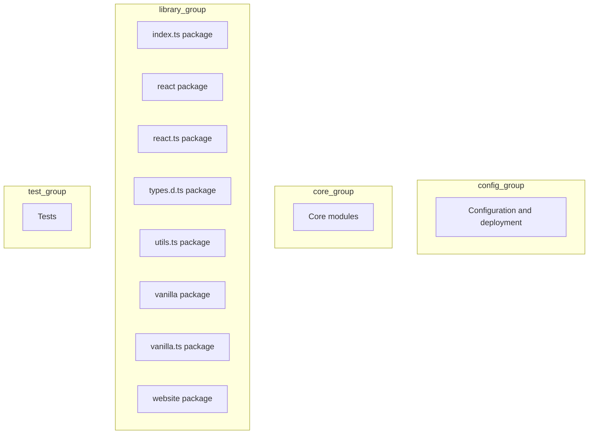

# Architecture report: pmndrs/valtio

> Automated static analysis. **Observed** = directly seen in files/imports/AST; **Inferred** = interpretation from that evidence. Repository code was not executed.

## 1. Repository at a glance

| Item | Value |
| --- | --- |
| Repository | pmndrs/valtio |
| Description | 🧙 Valtio makes proxy-state simple  for React and Vanilla |
| Language | TypeScript |
| Stars | 10245 |
| Licence | MIT |
| Analysed commit / branch | 26d8ca8cb6e5bb3b9516d429e50bc5aab1f42e0d / main |
| Framework(s) | Next.js, React |
| Files analysed | 227 |
| Components | 11 |

## 2. Architecture in one minute

pmndrs/valtio - 🧙 Valtio makes proxy-state simple  for React and Vanilla. This repository was analysed statically from 227 file(s) (0 Python). Detected technologies (observed from imports/manifests): GitHub Actions, Next.js, React, Redux, Tailwind CSS, TypeScript. Files are grouped into 11 component(s): Configuration and deployment, Core modules, index.ts package, react package, react.ts package, Tests, types.d.ts package, utils.ts package. Findings below distinguish observed facts from inferred interpretation.

## 3. High-level block diagram

## 4. Main components

### Configuration and deployment (`config`)

- **Kind:** config
- **Status:** Observed
- **Confidence:** 0.85
- **Responsibility:** Groups 6 file(s) under configuration and deployment (observed from repository paths and static analysis).
- **Paths:** `package.json`, `pnpm-workspace.yaml`, `tsconfig.json`, `website/.eslintrc.json`, `website/package.json`, `website/tsconfig.json`
- **Evidence:** [package.json](https://github.com/pmndrs/valtio/blob/26d8ca8cb6e5bb3b9516d429e50bc5aab1f42e0d/package.json); [pnpm-workspace.yaml](https://github.com/pmndrs/valtio/blob/26d8ca8cb6e5bb3b9516d429e50bc5aab1f42e0d/pnpm-workspace.yaml); [tsconfig.json](https://github.com/pmndrs/valtio/blob/26d8ca8cb6e5bb3b9516d429e50bc5aab1f42e0d/tsconfig.json); [website/.eslintrc.json](https://github.com/pmndrs/valtio/blob/26d8ca8cb6e5bb3b9516d429e50bc5aab1f42e0d/website/.eslintrc.json); [website/package.json](https://github.com/pmndrs/valtio/blob/26d8ca8cb6e5bb3b9516d429e50bc5aab1f42e0d/website/package.json); [website/tsconfig.json](https://github.com/pmndrs/valtio/blob/26d8ca8cb6e5bb3b9516d429e50bc5aab1f42e0d/website/tsconfig.json)

### Core modules (`core`)

- **Kind:** core
- **Status:** Observed
- **Confidence:** 0.85
- **Responsibility:** Groups 2 file(s) under core modules (observed from repository paths and static analysis).
- **Paths:** `eslint.config.mjs`, `rollup.config.mjs`
- **Evidence:** [eslint.config.mjs](https://github.com/pmndrs/valtio/blob/26d8ca8cb6e5bb3b9516d429e50bc5aab1f42e0d/eslint.config.mjs); [rollup.config.mjs](https://github.com/pmndrs/valtio/blob/26d8ca8cb6e5bb3b9516d429e50bc5aab1f42e0d/rollup.config.mjs)

### index.ts package (`index_ts`)

- **Kind:** library
- **Status:** Observed
- **Confidence:** 0.85
- **Responsibility:** Groups 1 file(s) under index.ts package (observed from repository paths and static analysis).
- **Paths:** `src/index.ts`
- **Evidence:** [src/index.ts](https://github.com/pmndrs/valtio/blob/26d8ca8cb6e5bb3b9516d429e50bc5aab1f42e0d/src/index.ts)

### react package (`react`)

- **Kind:** library
- **Status:** Observed
- **Confidence:** 0.85
- **Responsibility:** Groups 2 file(s) under react package (observed from repository paths and static analysis).
- **Paths:** `src/react/utils.ts`, `src/react/utils/useProxy.ts`
- **Evidence:** [src/react/utils.ts](https://github.com/pmndrs/valtio/blob/26d8ca8cb6e5bb3b9516d429e50bc5aab1f42e0d/src/react/utils.ts); [src/react/utils/useProxy.ts](https://github.com/pmndrs/valtio/blob/26d8ca8cb6e5bb3b9516d429e50bc5aab1f42e0d/src/react/utils/useProxy.ts)

### react.ts package (`react_ts`)

- **Kind:** library
- **Status:** Observed
- **Confidence:** 0.85
- **Responsibility:** Groups 1 file(s) under react.ts package (observed from repository paths and static analysis).
- **Paths:** `src/react.ts`
- **Evidence:** [src/react.ts](https://github.com/pmndrs/valtio/blob/26d8ca8cb6e5bb3b9516d429e50bc5aab1f42e0d/src/react.ts)

### Tests (`tests`)

- **Kind:** test
- **Status:** Observed
- **Confidence:** 0.85
- **Responsibility:** Groups 42 file(s) under tests (observed from repository paths and static analysis).
- **Paths:** `tests/perf/memoryleaks.test.ts`, `tests/perf/performance.test.ts`, `tests/perf/proxyMap.bench.ts`, `tests/react/actions.test.tsx`, `tests/react/array.test.tsx`, `tests/react/arrays.test.tsx`, `tests/react/async.test.tsx`, `tests/react/basic.test.tsx`, `tests/react/circular.test.tsx`, `tests/react/class.test.tsx`, `tests/react/component-state.test.tsx`, `tests/react/computed-properties.test.tsx`, `tests/react/container-tracking.test.tsx`, `tests/react/getter-results.test.tsx`, `tests/react/getter.test.tsx`, `tests/react/gotchas.test.tsx`, `tests/react/mapset.test.tsx`, `tests/react/object.test.tsx`, `tests/react/optimization.test.tsx`, `tests/react/ref.test.tsx`, `tests/react/replacement.test.tsx`, `tests/react/ssr.test.tsx`, `tests/react/useProxy.test.tsx`, `tests/regression/react.test.tsx`, `tests/regression/watch.test.ts`, `tests/setup.ts`, `tests/test-utils.ts`, `tests/utils/deepClone.test.ts`, `tests/utils/deepProxy.test.ts`, `tests/utils/devtools.test.tsx`, `tests/utils/proxyMap.test.tsx`, `tests/utils/proxySet.test.tsx`, `tests/utils/subscribeKey.test.ts`, `tests/utils/watch.test.ts`, `tests/vanilla/array-insertion.test.ts`, `tests/vanilla/detachment.test.ts`, `tests/vanilla/entrypoints.test.ts`, `tests/vanilla/proxy.test.ts`, `tests/vanilla/ref.test.ts`, `tests/vanilla/snapshot.test.ts`, `tests/vanilla/subscribe.test.ts`, `tests/vanilla/unstable.test.ts`
- **Evidence:** [tests/perf/memoryleaks.test.ts](https://github.com/pmndrs/valtio/blob/26d8ca8cb6e5bb3b9516d429e50bc5aab1f42e0d/tests/perf/memoryleaks.test.ts); [tests/perf/performance.test.ts](https://github.com/pmndrs/valtio/blob/26d8ca8cb6e5bb3b9516d429e50bc5aab1f42e0d/tests/perf/performance.test.ts); [tests/perf/proxyMap.bench.ts](https://github.com/pmndrs/valtio/blob/26d8ca8cb6e5bb3b9516d429e50bc5aab1f42e0d/tests/perf/proxyMap.bench.ts); [tests/react/actions.test.tsx](https://github.com/pmndrs/valtio/blob/26d8ca8cb6e5bb3b9516d429e50bc5aab1f42e0d/tests/react/actions.test.tsx); [tests/react/array.test.tsx](https://github.com/pmndrs/valtio/blob/26d8ca8cb6e5bb3b9516d429e50bc5aab1f42e0d/tests/react/array.test.tsx); [tests/react/arrays.test.tsx](https://github.com/pmndrs/valtio/blob/26d8ca8cb6e5bb3b9516d429e50bc5aab1f42e0d/tests/react/arrays.test.tsx); [tests/react/async.test.tsx](https://github.com/pmndrs/valtio/blob/26d8ca8cb6e5bb3b9516d429e50bc5aab1f42e0d/tests/react/async.test.tsx); [tests/react/basic.test.tsx](https://github.com/pmndrs/valtio/blob/26d8ca8cb6e5bb3b9516d429e50bc5aab1f42e0d/tests/react/basic.test.tsx)

### types.d.ts package (`types_d_ts`)

- **Kind:** library
- **Status:** Observed
- **Confidence:** 0.85
- **Responsibility:** Groups 1 file(s) under types.d.ts package (observed from repository paths and static analysis).
- **Paths:** `src/types.d.ts`
- **Evidence:** [src/types.d.ts](https://github.com/pmndrs/valtio/blob/26d8ca8cb6e5bb3b9516d429e50bc5aab1f42e0d/src/types.d.ts)

### utils.ts package (`utils_ts`)

- **Kind:** library
- **Status:** Observed
- **Confidence:** 0.85
- **Responsibility:** Groups 1 file(s) under utils.ts package (observed from repository paths and static analysis).
- **Paths:** `src/utils.ts`
- **Evidence:** [src/utils.ts](https://github.com/pmndrs/valtio/blob/26d8ca8cb6e5bb3b9516d429e50bc5aab1f42e0d/src/utils.ts)

### vanilla package (`vanilla`)

- **Kind:** library
- **Status:** Observed
- **Confidence:** 0.85
- **Responsibility:** Groups 8 file(s) under vanilla package (observed from repository paths and static analysis).
- **Paths:** `src/vanilla/utils.ts`, `src/vanilla/utils/deepClone.ts`, `src/vanilla/utils/deepProxy.ts`, `src/vanilla/utils/devtools.ts`, `src/vanilla/utils/proxyMap.ts`, `src/vanilla/utils/proxySet.ts`, `src/vanilla/utils/subscribeKey.ts`, `src/vanilla/utils/watch.ts`
- **Evidence:** [src/vanilla/utils.ts](https://github.com/pmndrs/valtio/blob/26d8ca8cb6e5bb3b9516d429e50bc5aab1f42e0d/src/vanilla/utils.ts); [src/vanilla/utils/deepClone.ts](https://github.com/pmndrs/valtio/blob/26d8ca8cb6e5bb3b9516d429e50bc5aab1f42e0d/src/vanilla/utils/deepClone.ts); [src/vanilla/utils/deepProxy.ts](https://github.com/pmndrs/valtio/blob/26d8ca8cb6e5bb3b9516d429e50bc5aab1f42e0d/src/vanilla/utils/deepProxy.ts); [src/vanilla/utils/devtools.ts](https://github.com/pmndrs/valtio/blob/26d8ca8cb6e5bb3b9516d429e50bc5aab1f42e0d/src/vanilla/utils/devtools.ts); [src/vanilla/utils/proxyMap.ts](https://github.com/pmndrs/valtio/blob/26d8ca8cb6e5bb3b9516d429e50bc5aab1f42e0d/src/vanilla/utils/proxyMap.ts); [src/vanilla/utils/proxySet.ts](https://github.com/pmndrs/valtio/blob/26d8ca8cb6e5bb3b9516d429e50bc5aab1f42e0d/src/vanilla/utils/proxySet.ts); [src/vanilla/utils/subscribeKey.ts](https://github.com/pmndrs/valtio/blob/26d8ca8cb6e5bb3b9516d429e50bc5aab1f42e0d/src/vanilla/utils/subscribeKey.ts); [src/vanilla/utils/watch.ts](https://github.com/pmndrs/valtio/blob/26d8ca8cb6e5bb3b9516d429e50bc5aab1f42e0d/src/vanilla/utils/watch.ts)

### vanilla.ts package (`vanilla_ts`)

- **Kind:** library
- **Status:** Observed
- **Confidence:** 0.85
- **Responsibility:** Groups 1 file(s) under vanilla.ts package (observed from repository paths and static analysis).
- **Paths:** `src/vanilla.ts`
- **Evidence:** [src/vanilla.ts](https://github.com/pmndrs/valtio/blob/26d8ca8cb6e5bb3b9516d429e50bc5aab1f42e0d/src/vanilla.ts)

### website package (`website`)

- **Kind:** library
- **Status:** Observed
- **Confidence:** 0.85
- **Responsibility:** Groups 36 file(s) under website package (observed from repository paths and static analysis).
- **Paths:** `website/_utils/file_helpers.ts`, `website/_utils/index.ts`, `website/components/LandingPage/AnimatedShapes.tsx`, `website/components/LandingPage/CodeExample.tsx`, `website/components/LandingPage/GettingStarted.tsx`, `website/components/LandingPage/state.ts`, `website/components/LandingPage/useFloatAnimation.tsx`, `website/components/MDXRenderer/MDXRenderer.tsx`, `website/components/MDXRenderer/index.ts`, `website/components/SEO/SEO.tsx`, `website/components/SEO/index.ts`, `website/components/ToggleTheme/ToggleTheme.tsx`, `website/components/ToggleTheme/index.ts`, `website/components/layouts/BasicLayout/BasicLayout.tsx`, `website/components/layouts/BasicLayout/index.ts`, `website/components/layouts/DocLayout/DocLayout.tsx`, `website/components/layouts/DocLayout/index.ts`, `website/components/layouts/Header/Header.tsx`, `website/components/layouts/Header/index.ts`, `website/components/layouts/index.ts`, `website/hooks/index.ts`, `website/hooks/useCodesandboxTheme.ts`, `website/hooks/useIsomorphicLayoutEffect.ts`, `website/hooks/useTheme.ts`, `website/lib/mdx.ts`, `website/lib/remarkCodeSandboxURLUpdater.ts`, `website/next-env.d.ts`, `website/next.config.js`, `website/pages/_app.tsx`, `website/pages/_document.tsx`, `website/pages/index.tsx`, `website/postcss.config.js`, `website/state/index.ts`, `website/state/useThemeState.ts`, `website/tailwind.config.js`, `website/types.d.ts`
- **Evidence:** [website/_utils/file_helpers.ts](https://github.com/pmndrs/valtio/blob/26d8ca8cb6e5bb3b9516d429e50bc5aab1f42e0d/website/_utils/file_helpers.ts); [website/_utils/index.ts](https://github.com/pmndrs/valtio/blob/26d8ca8cb6e5bb3b9516d429e50bc5aab1f42e0d/website/_utils/index.ts); [website/components/LandingPage/AnimatedShapes.tsx](https://github.com/pmndrs/valtio/blob/26d8ca8cb6e5bb3b9516d429e50bc5aab1f42e0d/website/components/LandingPage/AnimatedShapes.tsx); [website/components/LandingPage/CodeExample.tsx](https://github.com/pmndrs/valtio/blob/26d8ca8cb6e5bb3b9516d429e50bc5aab1f42e0d/website/components/LandingPage/CodeExample.tsx); [website/components/LandingPage/GettingStarted.tsx](https://github.com/pmndrs/valtio/blob/26d8ca8cb6e5bb3b9516d429e50bc5aab1f42e0d/website/components/LandingPage/GettingStarted.tsx); [website/components/LandingPage/state.ts](https://github.com/pmndrs/valtio/blob/26d8ca8cb6e5bb3b9516d429e50bc5aab1f42e0d/website/components/LandingPage/state.ts); [website/components/LandingPage/useFloatAnimation.tsx](https://github.com/pmndrs/valtio/blob/26d8ca8cb6e5bb3b9516d429e50bc5aab1f42e0d/website/components/LandingPage/useFloatAnimation.tsx); [website/components/MDXRenderer/MDXRenderer.tsx](https://github.com/pmndrs/valtio/blob/26d8ca8cb6e5bb3b9516d429e50bc5aab1f42e0d/website/components/MDXRenderer/MDXRenderer.tsx)

## 5. Execution flow

**Observed** entry point(s):

- [src/index.ts](https://github.com/pmndrs/valtio/blob/26d8ca8cb6e5bb3b9516d429e50bc5aab1f42e0d/src/index.ts)
- [website/_utils/index.ts](https://github.com/pmndrs/valtio/blob/26d8ca8cb6e5bb3b9516d429e50bc5aab1f42e0d/website/_utils/index.ts)
- [website/components/MDXRenderer/index.ts](https://github.com/pmndrs/valtio/blob/26d8ca8cb6e5bb3b9516d429e50bc5aab1f42e0d/website/components/MDXRenderer/index.ts)
- [website/components/SEO/index.ts](https://github.com/pmndrs/valtio/blob/26d8ca8cb6e5bb3b9516d429e50bc5aab1f42e0d/website/components/SEO/index.ts)
- [website/components/ToggleTheme/index.ts](https://github.com/pmndrs/valtio/blob/26d8ca8cb6e5bb3b9516d429e50bc5aab1f42e0d/website/components/ToggleTheme/index.ts)
- [website/components/layouts/index.ts](https://github.com/pmndrs/valtio/blob/26d8ca8cb6e5bb3b9516d429e50bc5aab1f42e0d/website/components/layouts/index.ts)
- [website/hooks/index.ts](https://github.com/pmndrs/valtio/blob/26d8ca8cb6e5bb3b9516d429e50bc5aab1f42e0d/website/hooks/index.ts)
- [website/pages/index.tsx](https://github.com/pmndrs/valtio/blob/26d8ca8cb6e5bb3b9516d429e50bc5aab1f42e0d/website/pages/index.tsx)
- [website/state/index.ts](https://github.com/pmndrs/valtio/blob/26d8ca8cb6e5bb3b9516d429e50bc5aab1f42e0d/website/state/index.ts)

Representative flow (derived from observed entry points and the import graph; steps beyond the entry point are **Inferred**):

1. Execution starts at an observed entry point listed above, if present.
2. No internal import relationships between components were observed.

## 6. Project structure

### `(root)`

- `.gitignore` - other (400 bytes)
- `.prettierignore` - other (20 bytes)
- `CONTRIBUTING.md` - docs (4359 bytes)
- `LICENSE` - docs (1067 bytes)
- `README.md` - docs (11124 bytes)
- `eslint.config.mjs` - source, JavaScript (3039 bytes)
- `logo.svg` - other (7532 bytes)
- `package.json` - manifest (5566 bytes)
- `pnpm-workspace.yaml` - config (144 bytes)
- `rollup.config.mjs` - source, JavaScript (2679 bytes)
- `tsconfig.json` - config (701 bytes)
- `vitest.config.mts` - other (814 bytes)

### `.github`

- `.github/DISCUSSION_TEMPLATE/bug-report.yml` - config (588 bytes)
- `.github/FUNDING.yml` - config (859 bytes)
- `.github/ISSUE_TEMPLATE/bug_report.md` - docs (171 bytes)
- `.github/ISSUE_TEMPLATE/config.yml` - config (466 bytes)
- `.github/pull_request_template.md` - docs (137 bytes)
- `.github/workflows/compressed-size.yml` - ci, YAML (755 bytes)
- `.github/workflows/preview-release.yml` - ci, YAML (772 bytes)
- `.github/workflows/publish.yml` - ci, YAML (763 bytes)
- `.github/workflows/test-multiple-builds.yml` - ci, YAML (2141 bytes)
- `.github/workflows/test-multiple-versions.yml` - ci, YAML (1660 bytes)
- `.github/workflows/test-old-typescript.yml` - ci, YAML (3050 bytes)
- `.github/workflows/test.yml` - ci, YAML (780 bytes)

### `docs`

- `docs/api/advanced/ref.mdx` - docs (2207 bytes)
- `docs/api/advanced/snapshot.mdx` - docs (3766 bytes)
- `docs/api/advanced/subscribe-ops.mdx` - docs (3468 bytes)
- `docs/api/advanced/subscribe.mdx` - docs (1311 bytes)
- `docs/api/basic/proxy.mdx` - docs (2796 bytes)
- `docs/api/basic/useSnapshot.mdx` - docs (5443 bytes)
- `docs/api/hacks/getVersion.mdx` - docs (844 bytes)
- `docs/api/hacks/internals.mdx` - docs (682 bytes)
- `docs/api/utils/derive.mdx` - docs (2582 bytes)
- `docs/api/utils/devtools.mdx` - docs (1449 bytes)
- `docs/api/utils/proxyMap.mdx` - docs (2201 bytes)
- `docs/api/utils/proxySet.mdx` - docs (2176 bytes)
- `docs/api/utils/proxyWithHistory.mdx` - docs (548 bytes)
- `docs/api/utils/subscribeKey.mdx` - docs (366 bytes)
- `docs/api/utils/unstable_deepProxy.mdx` - docs (655 bytes)
- `docs/api/utils/watch.mdx` - docs (3304 bytes)
- `docs/guides/async.mdx` - docs (1647 bytes)
- `docs/guides/component-state.mdx` - docs (1216 bytes)
- `docs/guides/computed-properties.mdx` - docs (6714 bytes)
- `docs/guides/migrating-to-v2.mdx` - docs (3489 bytes)
- `docs/how-tos/how-to-avoid-rerenders-manually.mdx` - docs (1559 bytes)
- `docs/how-tos/how-to-easily-access-the-state-from-anywhere-in-the-application.mdx` - docs (2870 bytes)
- `docs/how-tos/how-to-organize-actions.mdx` - docs (1382 bytes)
- `docs/how-tos/how-to-persist-states.mdx` - docs (584 bytes)
- `docs/how-tos/how-to-reset-state.mdx` - docs (1777 bytes)
- `docs/how-tos/how-to-split-and-compose-states.mdx` - docs (822 bytes)
- `docs/how-tos/how-to-update-values-inside-arrays.mdx` - docs (2693 bytes)
- `docs/how-tos/how-to-use-with-context.mdx` - docs (1071 bytes)
- `docs/how-tos/how-valtio-works.mdx` - docs (4933 bytes)
- `docs/how-tos/some-gotchas.mdx` - docs (7656 bytes)
- `docs/introduction.mdx` - docs (15 bytes)
- `docs/introduction/getting-started.mdx` - docs (5912 bytes)
- `docs/introduction/logo.svg` - docs (7532 bytes)
- `docs/readme.md` - docs (529 bytes)
- `docs/resources/community.mdx` - docs (837 bytes)
- `docs/resources/learn.mdx` - docs (389 bytes)
- `docs/resources/libraries.mdx` - docs (3003 bytes)

### `examples`

- `examples/README.md` - docs (340 bytes)
- `examples/counter/index.html` - other (506 bytes)
- `examples/counter/package.json` - manifest (619 bytes)
- `examples/counter/src/App.tsx` - source, TypeScript (3743 bytes)
- `examples/counter/src/index.css` - other (1456 bytes)
- `examples/counter/src/main.tsx` - source, TypeScript (251 bytes)
- `examples/counter/src/prism.css` - other (3102 bytes)
- `examples/counter/src/vite-env.d.ts` - source, TypeScript (38 bytes)
- `examples/counter/tsconfig.app.json` - config (552 bytes)
- `examples/counter/tsconfig.json` - config (119 bytes)
- `examples/counter/tsconfig.node.json` - config (479 bytes)
- `examples/counter/vite.config.ts` - source, TypeScript (163 bytes)
- `examples/editor-proxyWithHistory/index.html` - other (366 bytes)
- `examples/editor-proxyWithHistory/package.json` - manifest (570 bytes)
- `examples/editor-proxyWithHistory/src/App.tsx` - source, TypeScript (1055 bytes)
- `examples/editor-proxyWithHistory/src/index.css` - other (300 bytes)
- `examples/editor-proxyWithHistory/src/main.tsx` - source, TypeScript (230 bytes)
- `examples/editor-proxyWithHistory/src/vite-env.d.ts` - source, TypeScript (38 bytes)
- `examples/editor-proxyWithHistory/tsconfig.app.json` - config (552 bytes)
- `examples/editor-proxyWithHistory/tsconfig.json` - config (119 bytes)
- `examples/editor-proxyWithHistory/tsconfig.node.json` - config (479 bytes)
- `examples/editor-proxyWithHistory/vite.config.ts` - source, TypeScript (163 bytes)
- `examples/photo-booth-vanillajs/index.html` - other (818 bytes)
- `examples/photo-booth-vanillajs/package.json` - manifest (321 bytes)
- `examples/photo-booth-vanillajs/src/index.css` - other (1948 bytes)
- `examples/photo-booth-vanillajs/src/main.js` - source, JavaScript (4523 bytes)
- `examples/starter/README.md` - docs (577 bytes)
- `examples/starter/index.html` - other (471 bytes)
- `examples/starter/package.json` - manifest (473 bytes)
- `examples/starter/src/assets/banner.svg` - other (7532 bytes)
- `examples/starter/src/index.css` - other (167 bytes)
- `examples/starter/src/index.tsx` - source, TypeScript (1063 bytes)
- `examples/starter/src/vite-env.d.ts` - source, TypeScript (38 bytes)
- `examples/starter/tsconfig.json` - config (562 bytes)
- `examples/starter/vite.config.ts` - source, TypeScript (167 bytes)
- `examples/subscribe/index.html` - other (594 bytes)
- `examples/todo-with-proxyMap/index.html` - other (366 bytes)
- `examples/todo-with-proxyMap/package.json` - manifest (544 bytes)
- `examples/todo-with-proxyMap/src/AddTodoInput.tsx` - source, TypeScript (677 bytes)
- `examples/todo-with-proxyMap/src/App.tsx` - source, TypeScript (296 bytes)
- `examples/todo-with-proxyMap/src/Filter.tsx` - source, TypeScript (1204 bytes)
- `examples/todo-with-proxyMap/src/TodoItem.tsx` - source, TypeScript (2069 bytes)
- `examples/todo-with-proxyMap/src/TodoList.tsx` - source, TypeScript (665 bytes)
- `examples/todo-with-proxyMap/src/main.tsx` - source, TypeScript (142 bytes)
- `examples/todo-with-proxyMap/src/react-app-env.d.ts` - source, TypeScript (40 bytes)
- `examples/todo-with-proxyMap/src/store.ts` - source, TypeScript (1926 bytes)
- `examples/todo-with-proxyMap/src/styles.css` - other (7525 bytes)
- `examples/todo-with-proxyMap/tsconfig.app.json` - config (552 bytes)
- `examples/todo-with-proxyMap/tsconfig.json` - config (119 bytes)
- `examples/todo-with-proxyMap/tsconfig.node.json` - config (479 bytes)
- `examples/todo-with-proxyMap/vite.config.ts` - source, TypeScript (163 bytes)
- `examples/todo/index.html` - other (366 bytes)
- `examples/todo/package.json` - manifest (522 bytes)
- `examples/todo/src/App.tsx` - source, TypeScript (1873 bytes)
- `examples/todo/src/index.css` - other (1456 bytes)
- `examples/todo/src/main.tsx` - source, TypeScript (251 bytes)
- `examples/todo/src/prism.css` - other (3102 bytes)
- `examples/todo/src/store.ts` - source, TypeScript (1200 bytes)
- `examples/todo/src/vite-env.d.ts` - source, TypeScript (38 bytes)
- `examples/todo/tsconfig.app.json` - config (552 bytes)
- `examples/todo/tsconfig.json` - config (119 bytes)
- `examples/todo/tsconfig.node.json` - config (479 bytes)
- `examples/todo/vite.config.ts` - source, TypeScript (163 bytes)

### `src`

- `src/index.ts` - source, TypeScript (56 bytes)
- `src/react.ts` - source, TypeScript (5005 bytes)
- `src/react/utils.ts` - source, TypeScript (47 bytes)
- `src/react/utils/useProxy.ts` - source, TypeScript (1618 bytes)
- `src/types.d.ts` - source, TypeScript (64 bytes)
- `src/utils.ts` - source, TypeScript (68 bytes)
- `src/vanilla.ts` - source, TypeScript (13354 bytes)
- `src/vanilla/utils.ts` - source, TypeScript (368 bytes)
- `src/vanilla/utils/deepClone.ts` - source, TypeScript (860 bytes)
- `src/vanilla/utils/deepProxy.ts` - source, TypeScript (2492 bytes)
- `src/vanilla/utils/devtools.ts` - source, TypeScript (4076 bytes)
- `src/vanilla/utils/proxyMap.ts` - source, TypeScript (5599 bytes)
- `src/vanilla/utils/proxySet.ts` - source, TypeScript (9091 bytes)
- `src/vanilla/utils/subscribeKey.ts` - source, TypeScript (935 bytes)
- `src/vanilla/utils/watch.ts` - source, TypeScript (4406 bytes)

### `tests`

- `tests/perf/memoryleaks.test.ts` - test, TypeScript (4222 bytes)
- `tests/perf/performance.test.ts` - test, TypeScript (2048 bytes)
- `tests/perf/proxyMap.bench.ts` - test, TypeScript (3735 bytes)
- `tests/react/actions.test.tsx` - test, TypeScript (5689 bytes)
- `tests/react/array.test.tsx` - test, TypeScript (3519 bytes)
- `tests/react/arrays.test.tsx` - test, TypeScript (6504 bytes)
- `tests/react/async.test.tsx` - test, TypeScript (4989 bytes)
- `tests/react/basic.test.tsx` - test, TypeScript (3524 bytes)
- `tests/react/circular.test.tsx` - test, TypeScript (1018 bytes)
- `tests/react/class.test.tsx` - test, TypeScript (8341 bytes)
- `tests/react/component-state.test.tsx` - test, TypeScript (2866 bytes)
- `tests/react/computed-properties.test.tsx` - test, TypeScript (5042 bytes)
- `tests/react/container-tracking.test.tsx` - test, TypeScript (6112 bytes)
- `tests/react/getter-results.test.tsx` - test, TypeScript (6777 bytes)
- `tests/react/getter.test.tsx` - test, TypeScript (17156 bytes)
- `tests/react/gotchas.test.tsx` - test, TypeScript (10920 bytes)
- `tests/react/mapset.test.tsx` - test, TypeScript (2915 bytes)
- `tests/react/object.test.tsx` - test, TypeScript (2471 bytes)
- `tests/react/optimization.test.tsx` - test, TypeScript (22918 bytes)
- `tests/react/ref.test.tsx` - test, TypeScript (4932 bytes)
- `tests/react/replacement.test.tsx` - test, TypeScript (7493 bytes)
- `tests/react/ssr.test.tsx` - test, TypeScript (726 bytes)
- `tests/react/useProxy.test.tsx` - test, TypeScript (4784 bytes)
- `tests/regression/react.test.tsx` - test, TypeScript (5006 bytes)
- `tests/regression/watch.test.ts` - test, TypeScript (1879 bytes)
- `tests/setup.ts` - test, TypeScript (42 bytes)
- `tests/test-utils.ts` - test, TypeScript (409 bytes)
- `tests/utils/deepClone.test.ts` - test, TypeScript (1533 bytes)
- `tests/utils/deepProxy.test.ts` - test, TypeScript (9872 bytes)
- `tests/utils/devtools.test.tsx` - test, TypeScript (12404 bytes)
- `tests/utils/proxyMap.test.tsx` - test, TypeScript (30456 bytes)
- `tests/utils/proxySet.test.tsx` - test, TypeScript (30782 bytes)
- `tests/utils/subscribeKey.test.ts` - test, TypeScript (3729 bytes)
- `tests/utils/watch.test.ts` - test, TypeScript (4617 bytes)
- `tests/vanilla/array-insertion.test.ts` - test, TypeScript (2299 bytes)
- `tests/vanilla/detachment.test.ts` - test, TypeScript (2100 bytes)
- `tests/vanilla/entrypoints.test.ts` - test, TypeScript (2960 bytes)
- `tests/vanilla/proxy.test.ts` - test, TypeScript (33961 bytes)
- `tests/vanilla/ref.test.ts` - test, TypeScript (2039 bytes)
- `tests/vanilla/snapshot.test.ts` - test, TypeScript (6953 bytes)
- `tests/vanilla/subscribe.test.ts` - test, TypeScript (8986 bytes)
- `tests/vanilla/unstable.test.ts` - test, TypeScript (5116 bytes)

### `website`

- `website/.eslintrc.json` - config (56 bytes)
- `website/.gitignore` - other (414 bytes)
- `website/README.md` - docs (2235 bytes)
- `website/_utils/file_helpers.ts` - source, TypeScript (1478 bytes)
- `website/_utils/index.ts` - source, TypeScript (218 bytes)
- `website/components/LandingPage/AnimatedShapes.tsx` - source, TypeScript (9368 bytes)
- `website/components/LandingPage/CodeExample.tsx` - source, TypeScript (2246 bytes)
- `website/components/LandingPage/GettingStarted.tsx` - source, TypeScript (792 bytes)
- `website/components/LandingPage/state.ts` - source, TypeScript (304 bytes)
- `website/components/LandingPage/useFloatAnimation.tsx` - source, TypeScript (1486 bytes)
- `website/components/MDXRenderer/MDXRenderer.tsx` - source, TypeScript (455 bytes)
- `website/components/MDXRenderer/index.ts` - source, TypeScript (40 bytes)
- `website/components/SEO/SEO.tsx` - source, TypeScript (330 bytes)
- `website/components/SEO/index.ts` - source, TypeScript (32 bytes)
- `website/components/ToggleTheme/ToggleTheme.tsx` - source, TypeScript (974 bytes)
- `website/components/ToggleTheme/index.ts` - source, TypeScript (40 bytes)
- `website/components/layouts/BasicLayout/BasicLayout.tsx` - source, TypeScript (275 bytes)
- `website/components/layouts/BasicLayout/index.ts` - source, TypeScript (40 bytes)
- `website/components/layouts/DocLayout/DocLayout.tsx` - source, TypeScript (14363 bytes)
- `website/components/layouts/DocLayout/index.ts` - source, TypeScript (38 bytes)
- `website/components/layouts/Header/Header.tsx` - source, TypeScript (9692 bytes)
- `website/components/layouts/Header/index.ts` - source, TypeScript (35 bytes)
- `website/components/layouts/index.ts` - source, TypeScript (151 bytes)
- `website/hooks/index.ts` - source, TypeScript (109 bytes)
- `website/hooks/useCodesandboxTheme.ts` - source, TypeScript (985 bytes)
- `website/hooks/useIsomorphicLayoutEffect.ts` - source, TypeScript (155 bytes)
- `website/hooks/useTheme.ts` - source, TypeScript (2249 bytes)
- `website/lib/mdx.ts` - source, TypeScript (8116 bytes)
- `website/lib/remarkCodeSandboxURLUpdater.ts` - source, TypeScript (935 bytes)
- `website/next-env.d.ts` - source, TypeScript (264 bytes)
- `website/next.config.js` - source, JavaScript (87 bytes)
- `website/package.json` - manifest (1281 bytes)
- `website/pages/_app.tsx` - source, TypeScript (514 bytes)
- `website/pages/_document.tsx` - source, TypeScript (1457 bytes)
- `website/pages/docs/[...slug].tsx` - docs (1058 bytes)
- `website/pages/index.tsx` - source, TypeScript (488 bytes)
- `website/postcss.config.js` - source, JavaScript (82 bytes)
- `website/public/vercel.svg` - other (1101 bytes)
- `website/state/index.ts` - source, TypeScript (32 bytes)
- `website/state/useThemeState.ts` - source, TypeScript (89 bytes)
- `website/styles/landing-page.css` - other (2228 bytes)
- `website/styles/prism-theme.css` - other (2640 bytes)
- `website/styles/tailwind.css` - other (59 bytes)
- `website/tailwind.config.js` - source, JavaScript (463 bytes)
- `website/tsconfig.json` - config (619 bytes)
- `website/types.d.ts` - source, TypeScript (207 bytes)

## 7. Key dependencies and integrations

| Name | Category | Status | Confidence | Evidence |
| --- | --- | --- | --- | --- |
| GitHub Actions | ci | Observed | 0.90 | [.github/workflows/compressed-size.yml](https://github.com/pmndrs/valtio/blob/26d8ca8cb6e5bb3b9516d429e50bc5aab1f42e0d/.github/workflows/compressed-size.yml); [.github/workflows/preview-release.yml](https://github.com/pmndrs/valtio/blob/26d8ca8cb6e5bb3b9516d429e50bc5aab1f42e0d/.github/workflows/preview-release.yml); [.github/workflows/publish.yml](https://github.com/pmndrs/valtio/blob/26d8ca8cb6e5bb3b9516d429e50bc5aab1f42e0d/.github/workflows/publish.yml); [.github/workflows/test-multiple-builds.yml](https://github.com/pmndrs/valtio/blob/26d8ca8cb6e5bb3b9516d429e50bc5aab1f42e0d/.github/workflows/test-multiple-builds.yml) |
| Next.js | framework | Observed | 0.85 | [website/package.json:5](https://github.com/pmndrs/valtio/blob/26d8ca8cb6e5bb3b9516d429e50bc5aab1f42e0d/website/package.json#L5) |
| React | framework | Observed | 0.90 | [examples/counter/package.json:16](https://github.com/pmndrs/valtio/blob/26d8ca8cb6e5bb3b9516d429e50bc5aab1f42e0d/examples/counter/package.json#L16); [examples/counter/package.json:17](https://github.com/pmndrs/valtio/blob/26d8ca8cb6e5bb3b9516d429e50bc5aab1f42e0d/examples/counter/package.json#L17); [examples/editor-proxyWithHistory/package.json:14](https://github.com/pmndrs/valtio/blob/26d8ca8cb6e5bb3b9516d429e50bc5aab1f42e0d/examples/editor-proxyWithHistory/package.json#L14); [examples/editor-proxyWithHistory/package.json:15](https://github.com/pmndrs/valtio/blob/26d8ca8cb6e5bb3b9516d429e50bc5aab1f42e0d/examples/editor-proxyWithHistory/package.json#L15) |
| Redux | library | Observed | 0.85 | [package.json:118](https://github.com/pmndrs/valtio/blob/26d8ca8cb6e5bb3b9516d429e50bc5aab1f42e0d/package.json#L118) |
| Tailwind CSS | library | Observed | 0.85 | [website/package.json:15](https://github.com/pmndrs/valtio/blob/26d8ca8cb6e5bb3b9516d429e50bc5aab1f42e0d/website/package.json#L15) |
| TypeScript | tooling | Observed | 0.90 | [examples/counter/package.json:25](https://github.com/pmndrs/valtio/blob/26d8ca8cb6e5bb3b9516d429e50bc5aab1f42e0d/examples/counter/package.json#L25); [examples/editor-proxyWithHistory/package.json:23](https://github.com/pmndrs/valtio/blob/26d8ca8cb6e5bb3b9516d429e50bc5aab1f42e0d/examples/editor-proxyWithHistory/package.json#L23); [examples/starter/package.json:20](https://github.com/pmndrs/valtio/blob/26d8ca8cb6e5bb3b9516d429e50bc5aab1f42e0d/examples/starter/package.json#L20); [examples/todo-with-proxyMap/package.json:23](https://github.com/pmndrs/valtio/blob/26d8ca8cb6e5bb3b9516d429e50bc5aab1f42e0d/examples/todo-with-proxyMap/package.json#L23) |
| Vite | tooling | Observed | 0.90 | [examples/counter/package.json:7](https://github.com/pmndrs/valtio/blob/26d8ca8cb6e5bb3b9516d429e50bc5aab1f42e0d/examples/counter/package.json#L7); [examples/editor-proxyWithHistory/package.json:7](https://github.com/pmndrs/valtio/blob/26d8ca8cb6e5bb3b9516d429e50bc5aab1f42e0d/examples/editor-proxyWithHistory/package.json#L7); [examples/photo-booth-vanillajs/package.json:5](https://github.com/pmndrs/valtio/blob/26d8ca8cb6e5bb3b9516d429e50bc5aab1f42e0d/examples/photo-booth-vanillajs/package.json#L5); [examples/starter/package.json:7](https://github.com/pmndrs/valtio/blob/26d8ca8cb6e5bb3b9516d429e50bc5aab1f42e0d/examples/starter/package.json#L7) |
| Vitest | tooling | Observed | 0.85 | [package.json:80](https://github.com/pmndrs/valtio/blob/26d8ca8cb6e5bb3b9516d429e50bc5aab1f42e0d/package.json#L80) |

## 8. Data and state

No database, cache, queue, or persistent-state usage was observed in the analysed files. State handling, if any, may be in-memory or in files that were not analysed.

## 9. Configuration and deployment clues

- `.github/DISCUSSION_TEMPLATE/bug-report.yml` (config)
- `.github/FUNDING.yml` (config)
- `.github/ISSUE_TEMPLATE/config.yml` (config)
- `.github/workflows/compressed-size.yml` (ci)
- `.github/workflows/preview-release.yml` (ci)
- `.github/workflows/publish.yml` (ci)
- `.github/workflows/test-multiple-builds.yml` (ci)
- `.github/workflows/test-multiple-versions.yml` (ci)
- `.github/workflows/test-old-typescript.yml` (ci)
- `.github/workflows/test.yml` (ci)
- `examples/counter/package.json` (manifest)
- `examples/counter/tsconfig.app.json` (config)
- `examples/counter/tsconfig.json` (config)
- `examples/counter/tsconfig.node.json` (config)
- `examples/editor-proxyWithHistory/package.json` (manifest)
- `examples/editor-proxyWithHistory/tsconfig.app.json` (config)
- `examples/editor-proxyWithHistory/tsconfig.json` (config)
- `examples/editor-proxyWithHistory/tsconfig.node.json` (config)
- `examples/photo-booth-vanillajs/package.json` (manifest)
- `examples/starter/package.json` (manifest)
- `examples/starter/tsconfig.json` (config)
- `examples/todo-with-proxyMap/package.json` (manifest)
- `examples/todo-with-proxyMap/tsconfig.app.json` (config)
- `examples/todo-with-proxyMap/tsconfig.json` (config)
- `examples/todo-with-proxyMap/tsconfig.node.json` (config)
- `examples/todo/package.json` (manifest)
- `examples/todo/tsconfig.app.json` (config)
- `examples/todo/tsconfig.json` (config)
- `examples/todo/tsconfig.node.json` (config)
- `package.json` (manifest)
- `pnpm-workspace.yaml` (config)
- `tsconfig.json` (config)
- `website/.eslintrc.json` (config)
- `website/package.json` (manifest)
- `website/tsconfig.json` (config)

## 10. Design observations

- Tests are present alongside source code (Observed from test file paths).

These observations are interpretations (**Inferred**) of the observed structure, not guarantees about runtime design.

## 11. Limitations and unknowns

- Static analysis only: repository code was not executed, installed, or imported at runtime.
- Components and relationships are inferred from file paths, imports, and AST structure; runtime behaviour, dynamic imports, and reflection may not be visible.
- 1 file(s) were skipped during inventory (1 x lockfile excluded).
- No clear application entry point was observed in the analysed files.
- Repository text was treated as untrusted data; no instructions found in repository files were followed, and likely secret values were redacted/excluded.
- JavaScript and TypeScript files were inventoried from paths and package manifests. They were not parsed with a full language AST, and repository code was not executed.

## 12. Source references

- [.github/workflows/compressed-size.yml](https://github.com/pmndrs/valtio/blob/26d8ca8cb6e5bb3b9516d429e50bc5aab1f42e0d/.github/workflows/compressed-size.yml)
- [.github/workflows/preview-release.yml](https://github.com/pmndrs/valtio/blob/26d8ca8cb6e5bb3b9516d429e50bc5aab1f42e0d/.github/workflows/preview-release.yml)
- [.github/workflows/publish.yml](https://github.com/pmndrs/valtio/blob/26d8ca8cb6e5bb3b9516d429e50bc5aab1f42e0d/.github/workflows/publish.yml)
- [.github/workflows/test-multiple-builds.yml](https://github.com/pmndrs/valtio/blob/26d8ca8cb6e5bb3b9516d429e50bc5aab1f42e0d/.github/workflows/test-multiple-builds.yml)
- [.github/workflows/test-multiple-versions.yml](https://github.com/pmndrs/valtio/blob/26d8ca8cb6e5bb3b9516d429e50bc5aab1f42e0d/.github/workflows/test-multiple-versions.yml)
- [.github/workflows/test-old-typescript.yml](https://github.com/pmndrs/valtio/blob/26d8ca8cb6e5bb3b9516d429e50bc5aab1f42e0d/.github/workflows/test-old-typescript.yml)
- [.github/workflows/test.yml](https://github.com/pmndrs/valtio/blob/26d8ca8cb6e5bb3b9516d429e50bc5aab1f42e0d/.github/workflows/test.yml)
- [eslint.config.mjs](https://github.com/pmndrs/valtio/blob/26d8ca8cb6e5bb3b9516d429e50bc5aab1f42e0d/eslint.config.mjs)
- [examples/counter/package.json:7](https://github.com/pmndrs/valtio/blob/26d8ca8cb6e5bb3b9516d429e50bc5aab1f42e0d/examples/counter/package.json#L7)
- [examples/counter/package.json:16](https://github.com/pmndrs/valtio/blob/26d8ca8cb6e5bb3b9516d429e50bc5aab1f42e0d/examples/counter/package.json#L16)
- [examples/counter/package.json:17](https://github.com/pmndrs/valtio/blob/26d8ca8cb6e5bb3b9516d429e50bc5aab1f42e0d/examples/counter/package.json#L17)
- [examples/counter/package.json:25](https://github.com/pmndrs/valtio/blob/26d8ca8cb6e5bb3b9516d429e50bc5aab1f42e0d/examples/counter/package.json#L25)
- [examples/editor-proxyWithHistory/package.json:7](https://github.com/pmndrs/valtio/blob/26d8ca8cb6e5bb3b9516d429e50bc5aab1f42e0d/examples/editor-proxyWithHistory/package.json#L7)
- [examples/editor-proxyWithHistory/package.json:14](https://github.com/pmndrs/valtio/blob/26d8ca8cb6e5bb3b9516d429e50bc5aab1f42e0d/examples/editor-proxyWithHistory/package.json#L14)
- [examples/editor-proxyWithHistory/package.json:15](https://github.com/pmndrs/valtio/blob/26d8ca8cb6e5bb3b9516d429e50bc5aab1f42e0d/examples/editor-proxyWithHistory/package.json#L15)
- [examples/editor-proxyWithHistory/package.json:23](https://github.com/pmndrs/valtio/blob/26d8ca8cb6e5bb3b9516d429e50bc5aab1f42e0d/examples/editor-proxyWithHistory/package.json#L23)
- [examples/photo-booth-vanillajs/package.json:5](https://github.com/pmndrs/valtio/blob/26d8ca8cb6e5bb3b9516d429e50bc5aab1f42e0d/examples/photo-booth-vanillajs/package.json#L5)
- [examples/starter/package.json:7](https://github.com/pmndrs/valtio/blob/26d8ca8cb6e5bb3b9516d429e50bc5aab1f42e0d/examples/starter/package.json#L7)
- [examples/starter/package.json:13](https://github.com/pmndrs/valtio/blob/26d8ca8cb6e5bb3b9516d429e50bc5aab1f42e0d/examples/starter/package.json#L13)
- [examples/starter/package.json:14](https://github.com/pmndrs/valtio/blob/26d8ca8cb6e5bb3b9516d429e50bc5aab1f42e0d/examples/starter/package.json#L14)
- [examples/starter/package.json:20](https://github.com/pmndrs/valtio/blob/26d8ca8cb6e5bb3b9516d429e50bc5aab1f42e0d/examples/starter/package.json#L20)
- [examples/todo-with-proxyMap/package.json:7](https://github.com/pmndrs/valtio/blob/26d8ca8cb6e5bb3b9516d429e50bc5aab1f42e0d/examples/todo-with-proxyMap/package.json#L7)
- [examples/todo-with-proxyMap/package.json:15](https://github.com/pmndrs/valtio/blob/26d8ca8cb6e5bb3b9516d429e50bc5aab1f42e0d/examples/todo-with-proxyMap/package.json#L15)
- [examples/todo-with-proxyMap/package.json:16](https://github.com/pmndrs/valtio/blob/26d8ca8cb6e5bb3b9516d429e50bc5aab1f42e0d/examples/todo-with-proxyMap/package.json#L16)
- [examples/todo-with-proxyMap/package.json:23](https://github.com/pmndrs/valtio/blob/26d8ca8cb6e5bb3b9516d429e50bc5aab1f42e0d/examples/todo-with-proxyMap/package.json#L23)
- [examples/todo/package.json:7](https://github.com/pmndrs/valtio/blob/26d8ca8cb6e5bb3b9516d429e50bc5aab1f42e0d/examples/todo/package.json#L7)
- [examples/todo/package.json:22](https://github.com/pmndrs/valtio/blob/26d8ca8cb6e5bb3b9516d429e50bc5aab1f42e0d/examples/todo/package.json#L22)
- [package.json](https://github.com/pmndrs/valtio/blob/26d8ca8cb6e5bb3b9516d429e50bc5aab1f42e0d/package.json)
- [package.json:80](https://github.com/pmndrs/valtio/blob/26d8ca8cb6e5bb3b9516d429e50bc5aab1f42e0d/package.json#L80)
- [package.json:118](https://github.com/pmndrs/valtio/blob/26d8ca8cb6e5bb3b9516d429e50bc5aab1f42e0d/package.json#L118)
- [package.json:122](https://github.com/pmndrs/valtio/blob/26d8ca8cb6e5bb3b9516d429e50bc5aab1f42e0d/package.json#L122)
- [pnpm-workspace.yaml](https://github.com/pmndrs/valtio/blob/26d8ca8cb6e5bb3b9516d429e50bc5aab1f42e0d/pnpm-workspace.yaml)
- [rollup.config.mjs](https://github.com/pmndrs/valtio/blob/26d8ca8cb6e5bb3b9516d429e50bc5aab1f42e0d/rollup.config.mjs)
- [src/index.ts](https://github.com/pmndrs/valtio/blob/26d8ca8cb6e5bb3b9516d429e50bc5aab1f42e0d/src/index.ts)
- [src/react.ts](https://github.com/pmndrs/valtio/blob/26d8ca8cb6e5bb3b9516d429e50bc5aab1f42e0d/src/react.ts)
- [src/react/utils.ts](https://github.com/pmndrs/valtio/blob/26d8ca8cb6e5bb3b9516d429e50bc5aab1f42e0d/src/react/utils.ts)
- [src/react/utils/useProxy.ts](https://github.com/pmndrs/valtio/blob/26d8ca8cb6e5bb3b9516d429e50bc5aab1f42e0d/src/react/utils/useProxy.ts)
- [src/types.d.ts](https://github.com/pmndrs/valtio/blob/26d8ca8cb6e5bb3b9516d429e50bc5aab1f42e0d/src/types.d.ts)
- [src/utils.ts](https://github.com/pmndrs/valtio/blob/26d8ca8cb6e5bb3b9516d429e50bc5aab1f42e0d/src/utils.ts)
- [src/vanilla.ts](https://github.com/pmndrs/valtio/blob/26d8ca8cb6e5bb3b9516d429e50bc5aab1f42e0d/src/vanilla.ts)
- [src/vanilla/utils.ts](https://github.com/pmndrs/valtio/blob/26d8ca8cb6e5bb3b9516d429e50bc5aab1f42e0d/src/vanilla/utils.ts)
- [src/vanilla/utils/deepClone.ts](https://github.com/pmndrs/valtio/blob/26d8ca8cb6e5bb3b9516d429e50bc5aab1f42e0d/src/vanilla/utils/deepClone.ts)
- [src/vanilla/utils/deepProxy.ts](https://github.com/pmndrs/valtio/blob/26d8ca8cb6e5bb3b9516d429e50bc5aab1f42e0d/src/vanilla/utils/deepProxy.ts)
- [src/vanilla/utils/devtools.ts](https://github.com/pmndrs/valtio/blob/26d8ca8cb6e5bb3b9516d429e50bc5aab1f42e0d/src/vanilla/utils/devtools.ts)
- [src/vanilla/utils/proxyMap.ts](https://github.com/pmndrs/valtio/blob/26d8ca8cb6e5bb3b9516d429e50bc5aab1f42e0d/src/vanilla/utils/proxyMap.ts)
- [src/vanilla/utils/proxySet.ts](https://github.com/pmndrs/valtio/blob/26d8ca8cb6e5bb3b9516d429e50bc5aab1f42e0d/src/vanilla/utils/proxySet.ts)
- [src/vanilla/utils/subscribeKey.ts](https://github.com/pmndrs/valtio/blob/26d8ca8cb6e5bb3b9516d429e50bc5aab1f42e0d/src/vanilla/utils/subscribeKey.ts)
- [src/vanilla/utils/watch.ts](https://github.com/pmndrs/valtio/blob/26d8ca8cb6e5bb3b9516d429e50bc5aab1f42e0d/src/vanilla/utils/watch.ts)
- [tests/perf/memoryleaks.test.ts](https://github.com/pmndrs/valtio/blob/26d8ca8cb6e5bb3b9516d429e50bc5aab1f42e0d/tests/perf/memoryleaks.test.ts)
- [tests/perf/performance.test.ts](https://github.com/pmndrs/valtio/blob/26d8ca8cb6e5bb3b9516d429e50bc5aab1f42e0d/tests/perf/performance.test.ts)
- [tests/perf/proxyMap.bench.ts](https://github.com/pmndrs/valtio/blob/26d8ca8cb6e5bb3b9516d429e50bc5aab1f42e0d/tests/perf/proxyMap.bench.ts)
- [tests/react/actions.test.tsx](https://github.com/pmndrs/valtio/blob/26d8ca8cb6e5bb3b9516d429e50bc5aab1f42e0d/tests/react/actions.test.tsx)
- [tests/react/array.test.tsx](https://github.com/pmndrs/valtio/blob/26d8ca8cb6e5bb3b9516d429e50bc5aab1f42e0d/tests/react/array.test.tsx)
- [tests/react/arrays.test.tsx](https://github.com/pmndrs/valtio/blob/26d8ca8cb6e5bb3b9516d429e50bc5aab1f42e0d/tests/react/arrays.test.tsx)
- [tests/react/async.test.tsx](https://github.com/pmndrs/valtio/blob/26d8ca8cb6e5bb3b9516d429e50bc5aab1f42e0d/tests/react/async.test.tsx)
- [tests/react/basic.test.tsx](https://github.com/pmndrs/valtio/blob/26d8ca8cb6e5bb3b9516d429e50bc5aab1f42e0d/tests/react/basic.test.tsx)
- [tsconfig.json](https://github.com/pmndrs/valtio/blob/26d8ca8cb6e5bb3b9516d429e50bc5aab1f42e0d/tsconfig.json)
- [website/.eslintrc.json](https://github.com/pmndrs/valtio/blob/26d8ca8cb6e5bb3b9516d429e50bc5aab1f42e0d/website/.eslintrc.json)
- [website/_utils/file_helpers.ts](https://github.com/pmndrs/valtio/blob/26d8ca8cb6e5bb3b9516d429e50bc5aab1f42e0d/website/_utils/file_helpers.ts)
- [website/_utils/index.ts](https://github.com/pmndrs/valtio/blob/26d8ca8cb6e5bb3b9516d429e50bc5aab1f42e0d/website/_utils/index.ts)
- [website/components/LandingPage/AnimatedShapes.tsx](https://github.com/pmndrs/valtio/blob/26d8ca8cb6e5bb3b9516d429e50bc5aab1f42e0d/website/components/LandingPage/AnimatedShapes.tsx)
- [website/components/LandingPage/CodeExample.tsx](https://github.com/pmndrs/valtio/blob/26d8ca8cb6e5bb3b9516d429e50bc5aab1f42e0d/website/components/LandingPage/CodeExample.tsx)
- [website/components/LandingPage/GettingStarted.tsx](https://github.com/pmndrs/valtio/blob/26d8ca8cb6e5bb3b9516d429e50bc5aab1f42e0d/website/components/LandingPage/GettingStarted.tsx)
- [website/components/LandingPage/state.ts](https://github.com/pmndrs/valtio/blob/26d8ca8cb6e5bb3b9516d429e50bc5aab1f42e0d/website/components/LandingPage/state.ts)
- [website/components/LandingPage/useFloatAnimation.tsx](https://github.com/pmndrs/valtio/blob/26d8ca8cb6e5bb3b9516d429e50bc5aab1f42e0d/website/components/LandingPage/useFloatAnimation.tsx)
- [website/components/MDXRenderer/MDXRenderer.tsx](https://github.com/pmndrs/valtio/blob/26d8ca8cb6e5bb3b9516d429e50bc5aab1f42e0d/website/components/MDXRenderer/MDXRenderer.tsx)
- [website/components/MDXRenderer/index.ts](https://github.com/pmndrs/valtio/blob/26d8ca8cb6e5bb3b9516d429e50bc5aab1f42e0d/website/components/MDXRenderer/index.ts)
- [website/components/SEO/index.ts](https://github.com/pmndrs/valtio/blob/26d8ca8cb6e5bb3b9516d429e50bc5aab1f42e0d/website/components/SEO/index.ts)
- [website/components/ToggleTheme/index.ts](https://github.com/pmndrs/valtio/blob/26d8ca8cb6e5bb3b9516d429e50bc5aab1f42e0d/website/components/ToggleTheme/index.ts)
- [website/components/layouts/index.ts](https://github.com/pmndrs/valtio/blob/26d8ca8cb6e5bb3b9516d429e50bc5aab1f42e0d/website/components/layouts/index.ts)
- [website/hooks/index.ts](https://github.com/pmndrs/valtio/blob/26d8ca8cb6e5bb3b9516d429e50bc5aab1f42e0d/website/hooks/index.ts)
- [website/package.json](https://github.com/pmndrs/valtio/blob/26d8ca8cb6e5bb3b9516d429e50bc5aab1f42e0d/website/package.json)
- [website/package.json:5](https://github.com/pmndrs/valtio/blob/26d8ca8cb6e5bb3b9516d429e50bc5aab1f42e0d/website/package.json#L5)
- [website/package.json:15](https://github.com/pmndrs/valtio/blob/26d8ca8cb6e5bb3b9516d429e50bc5aab1f42e0d/website/package.json#L15)
- [website/package.json:45](https://github.com/pmndrs/valtio/blob/26d8ca8cb6e5bb3b9516d429e50bc5aab1f42e0d/website/package.json#L45)
- [website/pages/index.tsx](https://github.com/pmndrs/valtio/blob/26d8ca8cb6e5bb3b9516d429e50bc5aab1f42e0d/website/pages/index.tsx)
- [website/state/index.ts](https://github.com/pmndrs/valtio/blob/26d8ca8cb6e5bb3b9516d429e50bc5aab1f42e0d/website/state/index.ts)
- [website/tsconfig.json](https://github.com/pmndrs/valtio/blob/26d8ca8cb6e5bb3b9516d429e50bc5aab1f42e0d/website/tsconfig.json)
