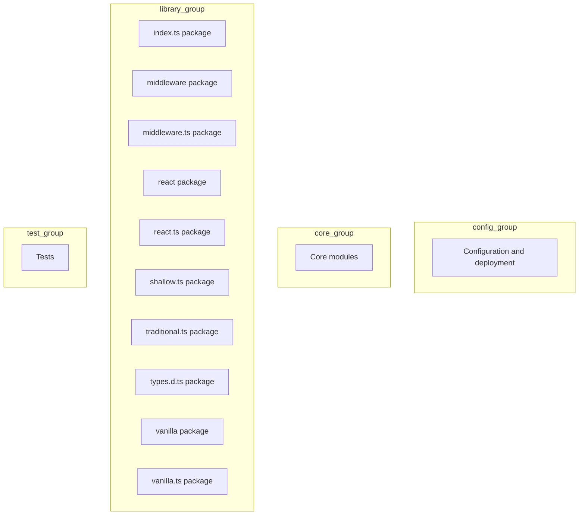

# Architecture report: pmndrs/zustand

> Automated static analysis. **Observed** = directly seen in files/imports/AST; **Inferred** = interpretation from that evidence. Repository code was not executed.

## 1. Repository at a glance

| Item | Value |
| --- | --- |
| Repository | pmndrs/zustand |
| Description | 🐻 Bear necessities for state management in React |
| Language | TypeScript |
| Stars | 58924 |
| Licence | MIT |
| Analysed commit / branch | 9fed2eb2f3af672da9f7bf694b996df3831fc207 / main |
| Framework(s) | React |
| Files analysed | 131 |
| Components | 13 |

## 2. Architecture in one minute

pmndrs/zustand - 🐻 Bear necessities for state management in React. This repository was analysed statically from 131 file(s) (0 Python). Detected technologies (observed from imports/manifests): GitHub Actions, React, Redux, TypeScript, Vite, Vitest. Files are grouped into 13 component(s): Configuration and deployment, Core modules, index.ts package, middleware package, middleware.ts package, react package, react.ts package, shallow.ts package. Findings below distinguish observed facts from inferred interpretation.

## 3. High-level block diagram

## 4. Main components

### Configuration and deployment (`config`)

- **Kind:** config
- **Status:** Observed
- **Confidence:** 0.85
- **Responsibility:** Groups 4 file(s) under configuration and deployment (observed from repository paths and static analysis).
- **Paths:** `FUNDING.json`, `package.json`, `pnpm-workspace.yaml`, `tsconfig.json`
- **Evidence:** [FUNDING.json](https://github.com/pmndrs/zustand/blob/9fed2eb2f3af672da9f7bf694b996df3831fc207/FUNDING.json); [package.json](https://github.com/pmndrs/zustand/blob/9fed2eb2f3af672da9f7bf694b996df3831fc207/package.json); [pnpm-workspace.yaml](https://github.com/pmndrs/zustand/blob/9fed2eb2f3af672da9f7bf694b996df3831fc207/pnpm-workspace.yaml); [tsconfig.json](https://github.com/pmndrs/zustand/blob/9fed2eb2f3af672da9f7bf694b996df3831fc207/tsconfig.json)

### Core modules (`core`)

- **Kind:** core
- **Status:** Observed
- **Confidence:** 0.85
- **Responsibility:** Groups 2 file(s) under core modules (observed from repository paths and static analysis).
- **Paths:** `eslint.config.mjs`, `rollup.config.mjs`
- **Evidence:** [eslint.config.mjs](https://github.com/pmndrs/zustand/blob/9fed2eb2f3af672da9f7bf694b996df3831fc207/eslint.config.mjs); [rollup.config.mjs](https://github.com/pmndrs/zustand/blob/9fed2eb2f3af672da9f7bf694b996df3831fc207/rollup.config.mjs)

### index.ts package (`index_ts`)

- **Kind:** library
- **Status:** Observed
- **Confidence:** 0.85
- **Responsibility:** Groups 1 file(s) under index.ts package (observed from repository paths and static analysis).
- **Paths:** `src/index.ts`
- **Evidence:** [src/index.ts](https://github.com/pmndrs/zustand/blob/9fed2eb2f3af672da9f7bf694b996df3831fc207/src/index.ts)

### middleware package (`middleware`)

- **Kind:** library
- **Status:** Observed
- **Confidence:** 0.85
- **Responsibility:** Groups 7 file(s) under middleware package (observed from repository paths and static analysis).
- **Paths:** `src/middleware/combine.ts`, `src/middleware/devtools.ts`, `src/middleware/immer.ts`, `src/middleware/persist.ts`, `src/middleware/redux.ts`, `src/middleware/ssrSafe.ts`, `src/middleware/subscribeWithSelector.ts`
- **Evidence:** [src/middleware/combine.ts](https://github.com/pmndrs/zustand/blob/9fed2eb2f3af672da9f7bf694b996df3831fc207/src/middleware/combine.ts); [src/middleware/devtools.ts](https://github.com/pmndrs/zustand/blob/9fed2eb2f3af672da9f7bf694b996df3831fc207/src/middleware/devtools.ts); [src/middleware/immer.ts](https://github.com/pmndrs/zustand/blob/9fed2eb2f3af672da9f7bf694b996df3831fc207/src/middleware/immer.ts); [src/middleware/persist.ts](https://github.com/pmndrs/zustand/blob/9fed2eb2f3af672da9f7bf694b996df3831fc207/src/middleware/persist.ts); [src/middleware/redux.ts](https://github.com/pmndrs/zustand/blob/9fed2eb2f3af672da9f7bf694b996df3831fc207/src/middleware/redux.ts); [src/middleware/ssrSafe.ts](https://github.com/pmndrs/zustand/blob/9fed2eb2f3af672da9f7bf694b996df3831fc207/src/middleware/ssrSafe.ts); [src/middleware/subscribeWithSelector.ts](https://github.com/pmndrs/zustand/blob/9fed2eb2f3af672da9f7bf694b996df3831fc207/src/middleware/subscribeWithSelector.ts)

### middleware.ts package (`middleware_ts`)

- **Kind:** library
- **Status:** Observed
- **Confidence:** 0.85
- **Responsibility:** Groups 1 file(s) under middleware.ts package (observed from repository paths and static analysis).
- **Paths:** `src/middleware.ts`
- **Evidence:** [src/middleware.ts](https://github.com/pmndrs/zustand/blob/9fed2eb2f3af672da9f7bf694b996df3831fc207/src/middleware.ts)

### react package (`react`)

- **Kind:** library
- **Status:** Observed
- **Confidence:** 0.85
- **Responsibility:** Groups 1 file(s) under react package (observed from repository paths and static analysis).
- **Paths:** `src/react/shallow.ts`
- **Evidence:** [src/react/shallow.ts](https://github.com/pmndrs/zustand/blob/9fed2eb2f3af672da9f7bf694b996df3831fc207/src/react/shallow.ts)

### react.ts package (`react_ts`)

- **Kind:** library
- **Status:** Observed
- **Confidence:** 0.85
- **Responsibility:** Groups 1 file(s) under react.ts package (observed from repository paths and static analysis).
- **Paths:** `src/react.ts`
- **Evidence:** [src/react.ts](https://github.com/pmndrs/zustand/blob/9fed2eb2f3af672da9f7bf694b996df3831fc207/src/react.ts)

### shallow.ts package (`shallow_ts`)

- **Kind:** library
- **Status:** Observed
- **Confidence:** 0.85
- **Responsibility:** Groups 1 file(s) under shallow.ts package (observed from repository paths and static analysis).
- **Paths:** `src/shallow.ts`
- **Evidence:** [src/shallow.ts](https://github.com/pmndrs/zustand/blob/9fed2eb2f3af672da9f7bf694b996df3831fc207/src/shallow.ts)

### Tests (`tests`)

- **Kind:** test
- **Status:** Observed
- **Confidence:** 0.85
- **Responsibility:** Groups 16 file(s) under tests (observed from repository paths and static analysis).
- **Paths:** `tests/basic.test.tsx`, `tests/devtools.test.tsx`, `tests/immer.test.tsx`, `tests/middlewareTypes.test.tsx`, `tests/persistAsync.test.tsx`, `tests/persistPromiseLike.test.ts`, `tests/persistSync.test.tsx`, `tests/setup.ts`, `tests/shallow.test.tsx`, `tests/ssr.test.tsx`, `tests/subscribe.test.tsx`, `tests/test-utils.ts`, `tests/types.test.tsx`, `tests/vanilla/basic.test.ts`, `tests/vanilla/shallow.test.tsx`, `tests/vanilla/subscribe.test.tsx`
- **Evidence:** [tests/basic.test.tsx](https://github.com/pmndrs/zustand/blob/9fed2eb2f3af672da9f7bf694b996df3831fc207/tests/basic.test.tsx); [tests/devtools.test.tsx](https://github.com/pmndrs/zustand/blob/9fed2eb2f3af672da9f7bf694b996df3831fc207/tests/devtools.test.tsx); [tests/immer.test.tsx](https://github.com/pmndrs/zustand/blob/9fed2eb2f3af672da9f7bf694b996df3831fc207/tests/immer.test.tsx); [tests/middlewareTypes.test.tsx](https://github.com/pmndrs/zustand/blob/9fed2eb2f3af672da9f7bf694b996df3831fc207/tests/middlewareTypes.test.tsx); [tests/persistAsync.test.tsx](https://github.com/pmndrs/zustand/blob/9fed2eb2f3af672da9f7bf694b996df3831fc207/tests/persistAsync.test.tsx); [tests/persistPromiseLike.test.ts](https://github.com/pmndrs/zustand/blob/9fed2eb2f3af672da9f7bf694b996df3831fc207/tests/persistPromiseLike.test.ts); [tests/persistSync.test.tsx](https://github.com/pmndrs/zustand/blob/9fed2eb2f3af672da9f7bf694b996df3831fc207/tests/persistSync.test.tsx); [tests/setup.ts](https://github.com/pmndrs/zustand/blob/9fed2eb2f3af672da9f7bf694b996df3831fc207/tests/setup.ts)

### traditional.ts package (`traditional_ts`)

- **Kind:** library
- **Status:** Observed
- **Confidence:** 0.85
- **Responsibility:** Groups 1 file(s) under traditional.ts package (observed from repository paths and static analysis).
- **Paths:** `src/traditional.ts`
- **Evidence:** [src/traditional.ts](https://github.com/pmndrs/zustand/blob/9fed2eb2f3af672da9f7bf694b996df3831fc207/src/traditional.ts)

### types.d.ts package (`types_d_ts`)

- **Kind:** library
- **Status:** Observed
- **Confidence:** 0.85
- **Responsibility:** Groups 1 file(s) under types.d.ts package (observed from repository paths and static analysis).
- **Paths:** `src/types.d.ts`
- **Evidence:** [src/types.d.ts](https://github.com/pmndrs/zustand/blob/9fed2eb2f3af672da9f7bf694b996df3831fc207/src/types.d.ts)

### vanilla package (`vanilla`)

- **Kind:** library
- **Status:** Observed
- **Confidence:** 0.85
- **Responsibility:** Groups 1 file(s) under vanilla package (observed from repository paths and static analysis).
- **Paths:** `src/vanilla/shallow.ts`
- **Evidence:** [src/vanilla/shallow.ts](https://github.com/pmndrs/zustand/blob/9fed2eb2f3af672da9f7bf694b996df3831fc207/src/vanilla/shallow.ts)

### vanilla.ts package (`vanilla_ts`)

- **Kind:** library
- **Status:** Observed
- **Confidence:** 0.85
- **Responsibility:** Groups 1 file(s) under vanilla.ts package (observed from repository paths and static analysis).
- **Paths:** `src/vanilla.ts`
- **Evidence:** [src/vanilla.ts](https://github.com/pmndrs/zustand/blob/9fed2eb2f3af672da9f7bf694b996df3831fc207/src/vanilla.ts)

## 5. Execution flow

**Observed** entry point(s):

- [src/index.ts](https://github.com/pmndrs/zustand/blob/9fed2eb2f3af672da9f7bf694b996df3831fc207/src/index.ts)

Representative flow (derived from observed entry points and the import graph; steps beyond the entry point are **Inferred**):

1. Execution starts at an observed entry point listed above, if present.
2. No internal import relationships between components were observed.

## 6. Project structure

### `(root)`

- `.gitignore` - other (231 bytes)
- `.prettierignore` - other (20 bytes)
- `CONTRIBUTING.md` - docs (4848 bytes)
- `FUNDING.json` - config (107 bytes)
- `LICENSE` - docs (1070 bytes)
- `README.md` - docs (17827 bytes)
- `eslint.config.mjs` - source, JavaScript (2874 bytes)
- `package.json` - manifest (6019 bytes)
- `pnpm-workspace.yaml` - config (53 bytes)
- `rollup.config.mjs` - source, JavaScript (2838 bytes)
- `tsconfig.json` - config (730 bytes)
- `vitest.config.mts` - other (817 bytes)

### `.github`

- `.github/DISCUSSION_TEMPLATE/bug-report.yml` - config (588 bytes)
- `.github/FUNDING.yml` - config (914 bytes)
- `.github/ISSUE_TEMPLATE/bug_report.md` - docs (171 bytes)
- `.github/ISSUE_TEMPLATE/config.yml` - config (469 bytes)
- `.github/dependabot.yml` - config (499 bytes)
- `.github/pull_request_template.md` - docs (137 bytes)
- `.github/workflows/compressed-size.yml` - ci, YAML (755 bytes)
- `.github/workflows/docs.yml` - ci, YAML (1176 bytes)
- `.github/workflows/preview-release.yml` - ci, YAML (772 bytes)
- `.github/workflows/publish.yml` - ci, YAML (763 bytes)
- `.github/workflows/test-multiple-builds.yml` - ci, YAML (1871 bytes)
- `.github/workflows/test-multiple-versions.yml` - ci, YAML (1124 bytes)
- `.github/workflows/test-old-typescript.yml` - ci, YAML (2640 bytes)
- `.github/workflows/test.yml` - ci, YAML (780 bytes)

### `docs`

- `docs/index.md` - docs (1201 bytes)
- `docs/learn/getting-started/comparison.md` - docs (9947 bytes)
- `docs/learn/getting-started/introduction.md` - docs (2052 bytes)
- `docs/learn/guides/advanced-typescript.md` - docs (19663 bytes)
- `docs/learn/guides/auto-generating-selectors.md` - docs (3397 bytes)
- `docs/learn/guides/beginner-typescript.md` - docs (10966 bytes)
- `docs/learn/guides/connect-to-state-with-url-hash.md` - docs (4717 bytes)
- `docs/learn/guides/event-handler-in-pre-react-18.md` - docs (827 bytes)
- `docs/learn/guides/flux-inspired-practice.md` - docs (2757 bytes)
- `docs/learn/guides/how-to-reset-state.md` - docs (971 bytes)
- `docs/learn/guides/immutable-state-and-merging.md` - docs (1398 bytes)
- `docs/learn/guides/initialize-state-with-props.md` - docs (4046 bytes)
- `docs/learn/guides/maps-and-sets-usage.md` - docs (1967 bytes)
- `docs/learn/guides/nextjs.md` - docs (8821 bytes)
- `docs/learn/guides/practice-with-no-store-actions.md` - docs (1009 bytes)
- `docs/learn/guides/prevent-rerenders-with-use-shallow.md` - docs (1691 bytes)
- `docs/learn/guides/slices-pattern.md` - docs (2999 bytes)
- `docs/learn/guides/ssr-and-hydration.md` - docs (4956 bytes)
- `docs/learn/guides/testing.md` - docs (21237 bytes)
- `docs/learn/guides/tutorial-tic-tac-toe.md` - docs (41931 bytes)
- `docs/learn/guides/updating-state.md` - docs (3346 bytes)
- `docs/learn/index.md` - docs (3202 bytes)
- `docs/reference/apis/create-store.md` - docs (15174 bytes)
- `docs/reference/apis/create-with-equality-fn.md` - docs (17168 bytes)
- `docs/reference/apis/create.md` - docs (15570 bytes)
- `docs/reference/apis/shallow.md` - docs (7037 bytes)
- `docs/reference/hooks/use-shallow.md` - docs (7312 bytes)
- `docs/reference/hooks/use-store-with-equality-fn.md` - docs (23769 bytes)
- `docs/reference/hooks/use-store.md` - docs (22432 bytes)
- `docs/reference/index.md` - docs (2666 bytes)
- `docs/reference/integrations/immer-middleware.md` - docs (3099 bytes)
- `docs/reference/integrations/persisting-store-data.md` - docs (22721 bytes)
- `docs/reference/integrations/third-party-libraries.md` - docs (10199 bytes)
- `docs/reference/middlewares/combine.md` - docs (2797 bytes)
- `docs/reference/middlewares/devtools.md` - docs (10998 bytes)
- `docs/reference/middlewares/immer.md` - docs (5951 bytes)
- `docs/reference/middlewares/persist.md` - docs (28685 bytes)
- `docs/reference/middlewares/redux.md` - docs (4036 bytes)
- `docs/reference/middlewares/subscribe-with-selector.md` - docs (2945 bytes)
- `docs/reference/migrations/migrating-to-v4.md` - docs (7814 bytes)
- `docs/reference/migrations/migrating-to-v5.md` - docs (5791 bytes)
- `docs/reference/previous-versions/zustand-v3-create-context.md` - docs (3162 bytes)

### `examples`

- `examples/demo/.gitignore` - other (253 bytes)
- `examples/demo/eslint.config.js` - source, JavaScript (996 bytes)
- `examples/demo/index.html` - other (726 bytes)
- `examples/demo/package.json` - manifest (1033 bytes)
- `examples/demo/public/manifest.json` - config (518 bytes)
- `examples/demo/public/robots.txt` - docs (67 bytes)
- `examples/demo/public/vite.svg` - other (1497 bytes)
- `examples/demo/src/App.jsx` - source, JavaScript (766 bytes)
- `examples/demo/src/components/CodePreview.jsx` - source, JavaScript (1419 bytes)
- `examples/demo/src/components/CopyButton.jsx` - source, JavaScript (1329 bytes)
- `examples/demo/src/components/Details.jsx` - source, JavaScript (781 bytes)
- `examples/demo/src/components/Fireflies.jsx` - source, JavaScript (1695 bytes)
- `examples/demo/src/components/Scene.jsx` - source, JavaScript (5997 bytes)
- `examples/demo/src/components/SnippetLang.jsx` - source, JavaScript (317 bytes)
- `examples/demo/src/main.jsx` - source, JavaScript (175 bytes)
- `examples/demo/src/materials/layerMaterial.js` - source, JavaScript (1456 bytes)
- `examples/demo/src/pmndrs.css` - other (2297 bytes)
- `examples/demo/src/resources/javascript-code.js` - source, JavaScript (329 bytes)
- `examples/demo/src/resources/typescript-code.js` - source, JavaScript (390 bytes)
- `examples/demo/src/styles.css` - other (3620 bytes)
- `examples/demo/src/utils/copy-to-clipboard.js` - source, JavaScript (88 bytes)
- `examples/demo/vite.config.js` - source, JavaScript (167 bytes)
- `examples/starter/README.md` - docs (581 bytes)
- `examples/starter/index.html` - other (473 bytes)
- `examples/starter/package.json` - manifest (474 bytes)
- `examples/starter/src/assets/zustand-mascot.svg` - other (31423 bytes)
- `examples/starter/src/index.css` - other (161 bytes)
- `examples/starter/src/index.tsx` - source, TypeScript (1233 bytes)
- `examples/starter/src/vite-env.d.ts` - source, TypeScript (38 bytes)
- `examples/starter/tsconfig.json` - config (562 bytes)
- `examples/starter/vite.config.ts` - source, TypeScript (167 bytes)

### `src`

- `src/index.ts` - source, TypeScript (56 bytes)
- `src/middleware.ts` - source, TypeScript (502 bytes)
- `src/middleware/combine.ts` - source, TypeScript (478 bytes)
- `src/middleware/devtools.ts` - source, TypeScript (24213 bytes)
- `src/middleware/immer.ts` - source, TypeScript (2523 bytes)
- `src/middleware/persist.ts` - source, TypeScript (12037 bytes)
- `src/middleware/redux.ts` - source, TypeScript (1329 bytes)
- `src/middleware/ssrSafe.ts` - source, TypeScript (847 bytes)
- `src/middleware/subscribeWithSelector.ts` - source, TypeScript (2409 bytes)
- `src/react.ts` - source, TypeScript (1770 bytes)
- `src/react/shallow.ts` - source, TypeScript (354 bytes)
- `src/shallow.ts` - source, TypeScript (95 bytes)
- `src/traditional.ts` - source, TypeScript (2565 bytes)
- `src/types.d.ts` - source, TypeScript (64 bytes)
- `src/vanilla.ts` - source, TypeScript (3338 bytes)
- `src/vanilla/shallow.ts` - source, TypeScript (1979 bytes)

### `tests`

- `tests/basic.test.tsx` - test, TypeScript (17516 bytes)
- `tests/devtools.test.tsx` - test, TypeScript (118562 bytes)
- `tests/immer.test.tsx` - test, TypeScript (2255 bytes)
- `tests/middlewareTypes.test.tsx` - test, TypeScript (28801 bytes)
- `tests/persistAsync.test.tsx` - test, TypeScript (33138 bytes)
- `tests/persistPromiseLike.test.ts` - test, TypeScript (5496 bytes)
- `tests/persistSync.test.tsx` - test, TypeScript (20079 bytes)
- `tests/setup.ts` - test, TypeScript (42 bytes)
- `tests/shallow.test.tsx` - test, TypeScript (5510 bytes)
- `tests/ssr.test.tsx` - test, TypeScript (2919 bytes)
- `tests/subscribe.test.tsx` - test, TypeScript (4688 bytes)
- `tests/test-utils.ts` - test, TypeScript (718 bytes)
- `tests/types.test.tsx` - test, TypeScript (6475 bytes)
- `tests/vanilla/basic.test.ts` - test, TypeScript (3327 bytes)
- `tests/vanilla/shallow.test.tsx` - test, TypeScript (5871 bytes)
- `tests/vanilla/subscribe.test.tsx` - test, TypeScript (4401 bytes)

## 7. Key dependencies and integrations

| Name | Category | Status | Confidence | Evidence |
| --- | --- | --- | --- | --- |
| GitHub Actions | ci | Observed | 0.90 | [.github/workflows/compressed-size.yml](https://github.com/pmndrs/zustand/blob/9fed2eb2f3af672da9f7bf694b996df3831fc207/.github/workflows/compressed-size.yml); [.github/workflows/docs.yml](https://github.com/pmndrs/zustand/blob/9fed2eb2f3af672da9f7bf694b996df3831fc207/.github/workflows/docs.yml); [.github/workflows/preview-release.yml](https://github.com/pmndrs/zustand/blob/9fed2eb2f3af672da9f7bf694b996df3831fc207/.github/workflows/preview-release.yml); [.github/workflows/publish.yml](https://github.com/pmndrs/zustand/blob/9fed2eb2f3af672da9f7bf694b996df3831fc207/.github/workflows/publish.yml) |
| React | framework | Observed | 0.90 | [examples/demo/package.json:17](https://github.com/pmndrs/zustand/blob/9fed2eb2f3af672da9f7bf694b996df3831fc207/examples/demo/package.json#L17); [examples/demo/package.json:26](https://github.com/pmndrs/zustand/blob/9fed2eb2f3af672da9f7bf694b996df3831fc207/examples/demo/package.json#L26); [examples/starter/package.json:13](https://github.com/pmndrs/zustand/blob/9fed2eb2f3af672da9f7bf694b996df3831fc207/examples/starter/package.json#L13); [examples/starter/package.json:14](https://github.com/pmndrs/zustand/blob/9fed2eb2f3af672da9f7bf694b996df3831fc207/examples/starter/package.json#L14) |
| Redux | library | Observed | 0.85 | [package.json:105](https://github.com/pmndrs/zustand/blob/9fed2eb2f3af672da9f7bf694b996df3831fc207/package.json#L105) |
| TypeScript | tooling | Observed | 0.90 | [examples/starter/package.json:20](https://github.com/pmndrs/zustand/blob/9fed2eb2f3af672da9f7bf694b996df3831fc207/examples/starter/package.json#L20); [package.json:124](https://github.com/pmndrs/zustand/blob/9fed2eb2f3af672da9f7bf694b996df3831fc207/package.json#L124) |
| Vite | tooling | Observed | 0.90 | [examples/demo/package.json:7](https://github.com/pmndrs/zustand/blob/9fed2eb2f3af672da9f7bf694b996df3831fc207/examples/demo/package.json#L7); [examples/starter/package.json:7](https://github.com/pmndrs/zustand/blob/9fed2eb2f3af672da9f7bf694b996df3831fc207/examples/starter/package.json#L7) |
| Vitest | tooling | Observed | 0.85 | [package.json:83](https://github.com/pmndrs/zustand/blob/9fed2eb2f3af672da9f7bf694b996df3831fc207/package.json#L83) |

## 8. Data and state

No database, cache, queue, or persistent-state usage was observed in the analysed files. State handling, if any, may be in-memory or in files that were not analysed.

## 9. Configuration and deployment clues

- `.github/DISCUSSION_TEMPLATE/bug-report.yml` (config)
- `.github/FUNDING.yml` (config)
- `.github/ISSUE_TEMPLATE/config.yml` (config)
- `.github/dependabot.yml` (config)
- `.github/workflows/compressed-size.yml` (ci)
- `.github/workflows/docs.yml` (ci)
- `.github/workflows/preview-release.yml` (ci)
- `.github/workflows/publish.yml` (ci)
- `.github/workflows/test-multiple-builds.yml` (ci)
- `.github/workflows/test-multiple-versions.yml` (ci)
- `.github/workflows/test-old-typescript.yml` (ci)
- `.github/workflows/test.yml` (ci)
- `FUNDING.json` (config)
- `examples/demo/package.json` (manifest)
- `examples/demo/public/manifest.json` (config)
- `examples/starter/package.json` (manifest)
- `examples/starter/tsconfig.json` (config)
- `package.json` (manifest)
- `pnpm-workspace.yaml` (config)
- `tsconfig.json` (config)

## 10. Design observations

- Tests are present alongside source code (Observed from test file paths).

These observations are interpretations (**Inferred**) of the observed structure, not guarantees about runtime design.

## 11. Limitations and unknowns

- Static analysis only: repository code was not executed, installed, or imported at runtime.
- Components and relationships are inferred from file paths, imports, and AST structure; runtime behaviour, dynamic imports, and reflection may not be visible.
- 1 file(s) were skipped during inventory (1 x lockfile excluded).
- No clear application entry point was observed in the analysed files.
- Repository text was treated as untrusted data; no instructions found in repository files were followed, and likely secret values were redacted/excluded.
- JavaScript and TypeScript files were inventoried from paths and package manifests. They were not parsed with a full language AST, and repository code was not executed.

## 12. Source references

- [.github/workflows/compressed-size.yml](https://github.com/pmndrs/zustand/blob/9fed2eb2f3af672da9f7bf694b996df3831fc207/.github/workflows/compressed-size.yml)
- [.github/workflows/docs.yml](https://github.com/pmndrs/zustand/blob/9fed2eb2f3af672da9f7bf694b996df3831fc207/.github/workflows/docs.yml)
- [.github/workflows/preview-release.yml](https://github.com/pmndrs/zustand/blob/9fed2eb2f3af672da9f7bf694b996df3831fc207/.github/workflows/preview-release.yml)
- [.github/workflows/publish.yml](https://github.com/pmndrs/zustand/blob/9fed2eb2f3af672da9f7bf694b996df3831fc207/.github/workflows/publish.yml)
- [.github/workflows/test-multiple-builds.yml](https://github.com/pmndrs/zustand/blob/9fed2eb2f3af672da9f7bf694b996df3831fc207/.github/workflows/test-multiple-builds.yml)
- [.github/workflows/test-multiple-versions.yml](https://github.com/pmndrs/zustand/blob/9fed2eb2f3af672da9f7bf694b996df3831fc207/.github/workflows/test-multiple-versions.yml)
- [.github/workflows/test-old-typescript.yml](https://github.com/pmndrs/zustand/blob/9fed2eb2f3af672da9f7bf694b996df3831fc207/.github/workflows/test-old-typescript.yml)
- [.github/workflows/test.yml](https://github.com/pmndrs/zustand/blob/9fed2eb2f3af672da9f7bf694b996df3831fc207/.github/workflows/test.yml)
- [FUNDING.json](https://github.com/pmndrs/zustand/blob/9fed2eb2f3af672da9f7bf694b996df3831fc207/FUNDING.json)
- [eslint.config.mjs](https://github.com/pmndrs/zustand/blob/9fed2eb2f3af672da9f7bf694b996df3831fc207/eslint.config.mjs)
- [examples/demo/package.json:7](https://github.com/pmndrs/zustand/blob/9fed2eb2f3af672da9f7bf694b996df3831fc207/examples/demo/package.json#L7)
- [examples/demo/package.json:17](https://github.com/pmndrs/zustand/blob/9fed2eb2f3af672da9f7bf694b996df3831fc207/examples/demo/package.json#L17)
- [examples/demo/package.json:26](https://github.com/pmndrs/zustand/blob/9fed2eb2f3af672da9f7bf694b996df3831fc207/examples/demo/package.json#L26)
- [examples/starter/package.json:7](https://github.com/pmndrs/zustand/blob/9fed2eb2f3af672da9f7bf694b996df3831fc207/examples/starter/package.json#L7)
- [examples/starter/package.json:13](https://github.com/pmndrs/zustand/blob/9fed2eb2f3af672da9f7bf694b996df3831fc207/examples/starter/package.json#L13)
- [examples/starter/package.json:14](https://github.com/pmndrs/zustand/blob/9fed2eb2f3af672da9f7bf694b996df3831fc207/examples/starter/package.json#L14)
- [examples/starter/package.json:20](https://github.com/pmndrs/zustand/blob/9fed2eb2f3af672da9f7bf694b996df3831fc207/examples/starter/package.json#L20)
- [package.json](https://github.com/pmndrs/zustand/blob/9fed2eb2f3af672da9f7bf694b996df3831fc207/package.json)
- [package.json:3](https://github.com/pmndrs/zustand/blob/9fed2eb2f3af672da9f7bf694b996df3831fc207/package.json#L3)
- [package.json:83](https://github.com/pmndrs/zustand/blob/9fed2eb2f3af672da9f7bf694b996df3831fc207/package.json#L83)
- [package.json:105](https://github.com/pmndrs/zustand/blob/9fed2eb2f3af672da9f7bf694b996df3831fc207/package.json#L105)
- [package.json:124](https://github.com/pmndrs/zustand/blob/9fed2eb2f3af672da9f7bf694b996df3831fc207/package.json#L124)
- [package.json:129](https://github.com/pmndrs/zustand/blob/9fed2eb2f3af672da9f7bf694b996df3831fc207/package.json#L129)
- [pnpm-workspace.yaml](https://github.com/pmndrs/zustand/blob/9fed2eb2f3af672da9f7bf694b996df3831fc207/pnpm-workspace.yaml)
- [rollup.config.mjs](https://github.com/pmndrs/zustand/blob/9fed2eb2f3af672da9f7bf694b996df3831fc207/rollup.config.mjs)
- [src/index.ts](https://github.com/pmndrs/zustand/blob/9fed2eb2f3af672da9f7bf694b996df3831fc207/src/index.ts)
- [src/middleware.ts](https://github.com/pmndrs/zustand/blob/9fed2eb2f3af672da9f7bf694b996df3831fc207/src/middleware.ts)
- [src/middleware/combine.ts](https://github.com/pmndrs/zustand/blob/9fed2eb2f3af672da9f7bf694b996df3831fc207/src/middleware/combine.ts)
- [src/middleware/devtools.ts](https://github.com/pmndrs/zustand/blob/9fed2eb2f3af672da9f7bf694b996df3831fc207/src/middleware/devtools.ts)
- [src/middleware/immer.ts](https://github.com/pmndrs/zustand/blob/9fed2eb2f3af672da9f7bf694b996df3831fc207/src/middleware/immer.ts)
- [src/middleware/persist.ts](https://github.com/pmndrs/zustand/blob/9fed2eb2f3af672da9f7bf694b996df3831fc207/src/middleware/persist.ts)
- [src/middleware/redux.ts](https://github.com/pmndrs/zustand/blob/9fed2eb2f3af672da9f7bf694b996df3831fc207/src/middleware/redux.ts)
- [src/middleware/ssrSafe.ts](https://github.com/pmndrs/zustand/blob/9fed2eb2f3af672da9f7bf694b996df3831fc207/src/middleware/ssrSafe.ts)
- [src/middleware/subscribeWithSelector.ts](https://github.com/pmndrs/zustand/blob/9fed2eb2f3af672da9f7bf694b996df3831fc207/src/middleware/subscribeWithSelector.ts)
- [src/react.ts](https://github.com/pmndrs/zustand/blob/9fed2eb2f3af672da9f7bf694b996df3831fc207/src/react.ts)
- [src/react/shallow.ts](https://github.com/pmndrs/zustand/blob/9fed2eb2f3af672da9f7bf694b996df3831fc207/src/react/shallow.ts)
- [src/shallow.ts](https://github.com/pmndrs/zustand/blob/9fed2eb2f3af672da9f7bf694b996df3831fc207/src/shallow.ts)
- [src/traditional.ts](https://github.com/pmndrs/zustand/blob/9fed2eb2f3af672da9f7bf694b996df3831fc207/src/traditional.ts)
- [src/types.d.ts](https://github.com/pmndrs/zustand/blob/9fed2eb2f3af672da9f7bf694b996df3831fc207/src/types.d.ts)
- [src/vanilla.ts](https://github.com/pmndrs/zustand/blob/9fed2eb2f3af672da9f7bf694b996df3831fc207/src/vanilla.ts)
- [src/vanilla/shallow.ts](https://github.com/pmndrs/zustand/blob/9fed2eb2f3af672da9f7bf694b996df3831fc207/src/vanilla/shallow.ts)
- [tests/basic.test.tsx](https://github.com/pmndrs/zustand/blob/9fed2eb2f3af672da9f7bf694b996df3831fc207/tests/basic.test.tsx)
- [tests/devtools.test.tsx](https://github.com/pmndrs/zustand/blob/9fed2eb2f3af672da9f7bf694b996df3831fc207/tests/devtools.test.tsx)
- [tests/immer.test.tsx](https://github.com/pmndrs/zustand/blob/9fed2eb2f3af672da9f7bf694b996df3831fc207/tests/immer.test.tsx)
- [tests/middlewareTypes.test.tsx](https://github.com/pmndrs/zustand/blob/9fed2eb2f3af672da9f7bf694b996df3831fc207/tests/middlewareTypes.test.tsx)
- [tests/persistAsync.test.tsx](https://github.com/pmndrs/zustand/blob/9fed2eb2f3af672da9f7bf694b996df3831fc207/tests/persistAsync.test.tsx)
- [tests/persistPromiseLike.test.ts](https://github.com/pmndrs/zustand/blob/9fed2eb2f3af672da9f7bf694b996df3831fc207/tests/persistPromiseLike.test.ts)
- [tests/persistSync.test.tsx](https://github.com/pmndrs/zustand/blob/9fed2eb2f3af672da9f7bf694b996df3831fc207/tests/persistSync.test.tsx)
- [tests/setup.ts](https://github.com/pmndrs/zustand/blob/9fed2eb2f3af672da9f7bf694b996df3831fc207/tests/setup.ts)
- [tsconfig.json](https://github.com/pmndrs/zustand/blob/9fed2eb2f3af672da9f7bf694b996df3831fc207/tsconfig.json)
