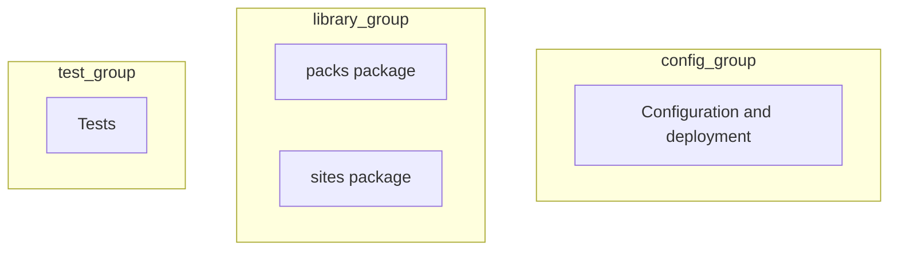

# Architecture report: pomber/code-surfer

> Automated static analysis. **Observed** = directly seen in files/imports/AST; **Inferred** = interpretation from that evidence. Repository code was not executed.

## 1. Repository at a glance

| Item | Value |
| --- | --- |
| Repository | pomber/code-surfer |
| Description | Rad code slides <🏄/> |
| Language | JavaScript |
| Stars | 6366 |
| Licence | MIT |
| Analysed commit / branch | 948452f7c1c8adaf019e29600d7d158747a91a90 / master |
| Framework(s) | React |
| Files analysed | 178 |
| Components | 4 |

## 2. Architecture in one minute

pomber/code-surfer - Rad code slides <🏄/>. This repository was analysed statically from 178 file(s) (0 Python). Detected technologies (observed from imports/manifests): React, TypeScript. Files are grouped into 4 component(s): Configuration and deployment, packs package, sites package, Tests. Findings below distinguish observed facts from inferred interpretation.

## 3. High-level block diagram

## 4. Main components

### Configuration and deployment (`config`)

- **Kind:** config
- **Status:** Observed
- **Confidence:** 0.85
- **Responsibility:** Groups 12 file(s) under configuration and deployment (observed from repository paths and static analysis).
- **Paths:** `netlify.toml`, `package.json`, `packs/code-surfer/package.json`, `packs/code-surfer/tsconfig.json`, `packs/standalone/package.json`, `packs/standalone/tsconfig.json`, `packs/step-parser/package.json`, `packs/step-parser/tsconfig.json`, `packs/themes/package.json`, `packs/themes/tsconfig.json`, `sites/book/package.json`, `sites/docs/package.json`
- **Evidence:** [netlify.toml](https://github.com/pomber/code-surfer/blob/948452f7c1c8adaf019e29600d7d158747a91a90/netlify.toml); [package.json](https://github.com/pomber/code-surfer/blob/948452f7c1c8adaf019e29600d7d158747a91a90/package.json); [packs/code-surfer/package.json](https://github.com/pomber/code-surfer/blob/948452f7c1c8adaf019e29600d7d158747a91a90/packs/code-surfer/package.json); [packs/code-surfer/tsconfig.json](https://github.com/pomber/code-surfer/blob/948452f7c1c8adaf019e29600d7d158747a91a90/packs/code-surfer/tsconfig.json); [packs/standalone/package.json](https://github.com/pomber/code-surfer/blob/948452f7c1c8adaf019e29600d7d158747a91a90/packs/standalone/package.json); [packs/standalone/tsconfig.json](https://github.com/pomber/code-surfer/blob/948452f7c1c8adaf019e29600d7d158747a91a90/packs/standalone/tsconfig.json); [packs/step-parser/package.json](https://github.com/pomber/code-surfer/blob/948452f7c1c8adaf019e29600d7d158747a91a90/packs/step-parser/package.json); [packs/step-parser/tsconfig.json](https://github.com/pomber/code-surfer/blob/948452f7c1c8adaf019e29600d7d158747a91a90/packs/step-parser/tsconfig.json)

### packs package (`packs`)

- **Kind:** library
- **Status:** Observed
- **Confidence:** 0.85
- **Responsibility:** Groups 53 file(s) under packs package (observed from repository paths and static analysis).
- **Paths:** `packs/code-surfer/src/codeblock-metastring-parser.ts`, `packs/code-surfer/src/column-layout.tsx`, `packs/code-surfer/src/error-boundary.tsx`, `packs/code-surfer/src/index.ts`, `packs/code-surfer/src/layout.tsx`, `packs/code-surfer/src/notes.js`, `packs/code-surfer/src/presenter.tsx`, `packs/code-surfer/src/step-reader.js`, `packs/code-surfer/src/step.js`, `packs/code-surfer/src/types.d.ts`, `packs/code-surfer/src/use-spring.js`, `packs/code-surfer/src/use-step-spring.js`, `packs/code-surfer/src/use-steps.js`, `packs/code-surfer/src/use-window-resize.js`, `packs/standalone/src/animation.test.ts`, `packs/standalone/src/animation.ts`, `packs/standalone/src/code-surfer.tsx`, `packs/standalone/src/default-syntaxes.ts`, `packs/standalone/src/dimensions.ts`, `packs/standalone/src/easing.ts`, `packs/standalone/src/errors.tsx`, `packs/standalone/src/frame.tsx`, `packs/standalone/src/index.tsx`, `packs/standalone/src/lines.tsx`, `packs/standalone/src/tuple.test.ts`, `packs/standalone/src/tuple.ts`, `packs/standalone/src/types.d.ts`, `packs/standalone/src/use-window-resize.ts`, `packs/step-parser/src/differ.test.ts`, `packs/step-parser/src/differ.ts`, `packs/step-parser/src/focus-parser.test.ts`, `packs/step-parser/src/focus-parser.ts`, `packs/step-parser/src/index.ts`, `packs/step-parser/src/object-entries.ts`, `packs/step-parser/src/step-parser.test.ts`, `packs/step-parser/src/step-parser.ts`, `packs/step-parser/src/tokenizer.test.ts`, `packs/step-parser/src/tokenizer.ts`, `packs/step-parser/src/types.d.ts`, `packs/themes/src/index.ts`, `packs/themes/src/styles.tsx`, `packs/themes/src/theme.base.ts`, `packs/themes/src/theme.dracula.ts`, `packs/themes/src/theme.duotone-dark.ts`, `packs/themes/src/theme.duotone-light.ts`, `packs/themes/src/theme.github.ts`, `packs/themes/src/theme.night-owl.ts`, `packs/themes/src/theme.oceanic-next.ts`, `packs/themes/src/theme.shades-of-purple.ts`, `packs/themes/src/theme.ultramin.ts`, `packs/themes/src/theme.vs-dark.ts`, `packs/themes/src/utils.test.ts`, `packs/themes/src/utils.ts`
- **Evidence:** [packs/code-surfer/src/codeblock-metastring-parser.ts](https://github.com/pomber/code-surfer/blob/948452f7c1c8adaf019e29600d7d158747a91a90/packs/code-surfer/src/codeblock-metastring-parser.ts); [packs/code-surfer/src/column-layout.tsx](https://github.com/pomber/code-surfer/blob/948452f7c1c8adaf019e29600d7d158747a91a90/packs/code-surfer/src/column-layout.tsx); [packs/code-surfer/src/error-boundary.tsx](https://github.com/pomber/code-surfer/blob/948452f7c1c8adaf019e29600d7d158747a91a90/packs/code-surfer/src/error-boundary.tsx); [packs/code-surfer/src/index.ts](https://github.com/pomber/code-surfer/blob/948452f7c1c8adaf019e29600d7d158747a91a90/packs/code-surfer/src/index.ts); [packs/code-surfer/src/layout.tsx](https://github.com/pomber/code-surfer/blob/948452f7c1c8adaf019e29600d7d158747a91a90/packs/code-surfer/src/layout.tsx); [packs/code-surfer/src/notes.js](https://github.com/pomber/code-surfer/blob/948452f7c1c8adaf019e29600d7d158747a91a90/packs/code-surfer/src/notes.js); [packs/code-surfer/src/presenter.tsx](https://github.com/pomber/code-surfer/blob/948452f7c1c8adaf019e29600d7d158747a91a90/packs/code-surfer/src/presenter.tsx); [packs/code-surfer/src/step-reader.js](https://github.com/pomber/code-surfer/blob/948452f7c1c8adaf019e29600d7d158747a91a90/packs/code-surfer/src/step-reader.js)

### sites package (`sites`)

- **Kind:** library
- **Status:** Observed
- **Confidence:** 0.85
- **Responsibility:** Groups 62 file(s) under sites package (observed from repository paths and static analysis).
- **Paths:** `sites/book/src/basic.story.js`, `sites/book/src/big.story.js`, `sites/book/src/config.js`, `sites/book/src/files/00.jsx`, `sites/book/src/files/01.jsx`, `sites/book/src/files/02.jsx`, `sites/book/src/files/03.jsx`, `sites/book/src/files/04.jsx`, `sites/book/src/files/05.jsx`, `sites/book/src/files/06.jsx`, `sites/book/src/files/07.jsx`, `sites/book/src/files/08.jsx`, `sites/book/src/files/09.jsx`, `sites/book/src/files/10.jsx`, `sites/book/src/files/11.jsx`, `sites/book/src/files/12.jsx`, `sites/book/src/files/13.jsx`, `sites/book/src/files/14.jsx`, `sites/book/src/files/15.jsx`, `sites/book/src/files/16.jsx`, `sites/book/src/files/17.jsx`, `sites/book/src/files/18.jsx`, `sites/book/src/files/19.jsx`, `sites/book/src/files/20.jsx`, `sites/book/src/files/21.jsx`, `sites/book/src/files/22.jsx`, `sites/book/src/files/23.jsx`, `sites/book/src/files/24.jsx`, `sites/book/src/files/25.jsx`, `sites/book/src/files/26.jsx`, `sites/book/src/files/27.jsx`, `sites/book/src/files/28.jsx`, `sites/book/src/files/29.jsx`, `sites/book/src/files/30.jsx`, `sites/book/src/files/31.jsx`, `sites/book/src/files/32.jsx`, `sites/book/src/files/33.jsx`, `sites/book/src/files/34.jsx`, `sites/book/src/files/35.jsx`, `sites/book/src/files/36.jsx`, `sites/book/src/files/37.jsx`, `sites/book/src/files/38.jsx`, `sites/book/src/files/39.jsx`, `sites/book/src/files/40.jsx`, `sites/book/src/files/41.jsx`, `sites/book/src/files/42.jsx`, `sites/book/src/files/43.jsx`, `sites/book/src/files/44.jsx`, `sites/book/src/files/45.jsx`, `sites/book/src/files/46.jsx`, `sites/book/src/files/47.jsx`, `sites/book/src/files/48.jsx`, `sites/book/src/files/49.jsx`, `sites/book/src/files/50.jsx`, `sites/book/src/focus.story.js`, `sites/book/src/index.js`, `sites/book/src/parsed-steps.js`, `sites/book/src/parsed-steps.story.js`, `sites/book/src/themed.story.js`, `sites/book/src/title.story.js`, `sites/book/src/utils.js`, `sites/build.js`
- **Evidence:** [sites/book/src/basic.story.js](https://github.com/pomber/code-surfer/blob/948452f7c1c8adaf019e29600d7d158747a91a90/sites/book/src/basic.story.js); [sites/book/src/big.story.js](https://github.com/pomber/code-surfer/blob/948452f7c1c8adaf019e29600d7d158747a91a90/sites/book/src/big.story.js); [sites/book/src/config.js](https://github.com/pomber/code-surfer/blob/948452f7c1c8adaf019e29600d7d158747a91a90/sites/book/src/config.js); [sites/book/src/files/00.jsx](https://github.com/pomber/code-surfer/blob/948452f7c1c8adaf019e29600d7d158747a91a90/sites/book/src/files/00.jsx); [sites/book/src/files/01.jsx](https://github.com/pomber/code-surfer/blob/948452f7c1c8adaf019e29600d7d158747a91a90/sites/book/src/files/01.jsx); [sites/book/src/files/02.jsx](https://github.com/pomber/code-surfer/blob/948452f7c1c8adaf019e29600d7d158747a91a90/sites/book/src/files/02.jsx); [sites/book/src/files/03.jsx](https://github.com/pomber/code-surfer/blob/948452f7c1c8adaf019e29600d7d158747a91a90/sites/book/src/files/03.jsx); [sites/book/src/files/04.jsx](https://github.com/pomber/code-surfer/blob/948452f7c1c8adaf019e29600d7d158747a91a90/sites/book/src/files/04.jsx)

### Tests (`tests`)

- **Kind:** test
- **Status:** Observed
- **Confidence:** 0.85
- **Responsibility:** Groups 1 file(s) under tests (observed from repository paths and static analysis).
- **Paths:** `packs/code-surfer/test/codeblock-metastring-parser.test.ts`
- **Evidence:** [packs/code-surfer/test/codeblock-metastring-parser.test.ts](https://github.com/pomber/code-surfer/blob/948452f7c1c8adaf019e29600d7d158747a91a90/packs/code-surfer/test/codeblock-metastring-parser.test.ts)

## 5. Execution flow

**Observed** entry point(s):

- [packs/code-surfer/src/index.ts](https://github.com/pomber/code-surfer/blob/948452f7c1c8adaf019e29600d7d158747a91a90/packs/code-surfer/src/index.ts)
- [packs/standalone/src/index.tsx](https://github.com/pomber/code-surfer/blob/948452f7c1c8adaf019e29600d7d158747a91a90/packs/standalone/src/index.tsx)
- [packs/step-parser/src/index.ts](https://github.com/pomber/code-surfer/blob/948452f7c1c8adaf019e29600d7d158747a91a90/packs/step-parser/src/index.ts)
- [packs/themes/src/index.ts](https://github.com/pomber/code-surfer/blob/948452f7c1c8adaf019e29600d7d158747a91a90/packs/themes/src/index.ts)
- [sites/book/src/index.js](https://github.com/pomber/code-surfer/blob/948452f7c1c8adaf019e29600d7d158747a91a90/sites/book/src/index.js)

Representative flow (derived from observed entry points and the import graph; steps beyond the entry point are **Inferred**):

1. Execution starts at an observed entry point listed above, if present.
2. No internal import relationships between components were observed.

## 6. Project structure

### `(root)`

- `.gitignore` - other (145 bytes)
- `.travis.yml` - ci, YAML (123 bytes)
- `contributing.md` - docs (567 bytes)
- `license` - docs (1088 bytes)
- `netlify.toml` - config (78 bytes)
- `package.json` - manifest (1335 bytes)
- `readme-zh.md` - docs (9712 bytes)
- `readme.md` - docs (9767 bytes)

### `.github`

- `.github/FUNDING.yml` - config (83 bytes)

### `.vscode`

- `.vscode/settings.json` - config (108 bytes)

### `packs`

- `packs/code-surfer/package.json` - manifest (1559 bytes)
- `packs/code-surfer/readme.md` - docs (9298 bytes)
- `packs/code-surfer/src/codeblock-metastring-parser.ts` - source, TypeScript (828 bytes)
- `packs/code-surfer/src/column-layout.tsx` - source, TypeScript (4085 bytes)
- `packs/code-surfer/src/error-boundary.tsx` - source, TypeScript (660 bytes)
- `packs/code-surfer/src/index.ts` - source, TypeScript (157 bytes)
- `packs/code-surfer/src/layout.tsx` - source, TypeScript (1255 bytes)
- `packs/code-surfer/src/notes.js` - source, JavaScript (1651 bytes)
- `packs/code-surfer/src/presenter.tsx` - source, TypeScript (7488 bytes)
- `packs/code-surfer/src/step-reader.js` - source, JavaScript (663 bytes)
- `packs/code-surfer/src/step.js` - source, JavaScript (85 bytes)
- `packs/code-surfer/src/types.d.ts` - source, TypeScript (1181 bytes)
- `packs/code-surfer/src/use-spring.js` - source, JavaScript (1143 bytes)
- `packs/code-surfer/src/use-step-spring.js` - source, JavaScript (439 bytes)
- `packs/code-surfer/src/use-steps.js` - source, JavaScript (154 bytes)
- `packs/code-surfer/src/use-window-resize.js` - source, JavaScript (252 bytes)
- `packs/code-surfer/test/codeblock-metastring-parser.test.ts` - test, TypeScript (1211 bytes)
- `packs/code-surfer/tsconfig.json` - config (1311 bytes)
- `packs/standalone/package.json` - manifest (1847 bytes)
- `packs/standalone/readme.md` - docs (485 bytes)
- `packs/standalone/src/__snapshots__/animation.test.ts.snap` - other (9258 bytes)
- `packs/standalone/src/animation.test.ts` - source, TypeScript (3149 bytes)
- `packs/standalone/src/animation.ts` - source, TypeScript (6839 bytes)
- `packs/standalone/src/code-surfer.tsx` - source, TypeScript (2354 bytes)
- `packs/standalone/src/default-syntaxes.ts` - source, TypeScript (1248 bytes)
- `packs/standalone/src/dimensions.ts` - source, TypeScript (3303 bytes)
- `packs/standalone/src/easing.ts` - source, TypeScript (1647 bytes)
- `packs/standalone/src/errors.tsx` - source, TypeScript (3287 bytes)
- `packs/standalone/src/frame.tsx` - source, TypeScript (4793 bytes)
- `packs/standalone/src/index.tsx` - source, TypeScript (1714 bytes)
- `packs/standalone/src/lines.tsx` - source, TypeScript (7199 bytes)
- `packs/standalone/src/tuple.test.ts` - source, TypeScript (1470 bytes)
- `packs/standalone/src/tuple.ts` - source, TypeScript (2562 bytes)
- `packs/standalone/src/types.d.ts` - source, TypeScript (1099 bytes)
- `packs/standalone/src/use-window-resize.ts` - source, TypeScript (626 bytes)
- `packs/standalone/tsconfig.json` - config (732 bytes)
- `packs/step-parser/package.json` - manifest (950 bytes)
- `packs/step-parser/readme.md` - docs (376 bytes)
- `packs/step-parser/src/__snapshots__/differ.test.ts.snap` - other (1085 bytes)
- `packs/step-parser/src/__snapshots__/step-parser.test.ts.snap` - other (4963 bytes)
- `packs/step-parser/src/__snapshots__/tokenizer.test.ts.snap` - other (843 bytes)
- `packs/step-parser/src/differ.test.ts` - source, TypeScript (2190 bytes)
- `packs/step-parser/src/differ.ts` - source, TypeScript (2210 bytes)
- `packs/step-parser/src/focus-parser.test.ts` - source, TypeScript (2083 bytes)
- `packs/step-parser/src/focus-parser.ts` - source, TypeScript (2662 bytes)
- `packs/step-parser/src/index.ts` - source, TypeScript (68 bytes)
- `packs/step-parser/src/object-entries.ts` - source, TypeScript (481 bytes)
- `packs/step-parser/src/step-parser.test.ts` - source, TypeScript (1173 bytes)
- `packs/step-parser/src/step-parser.ts` - source, TypeScript (4318 bytes)
- `packs/step-parser/src/tokenizer.test.ts` - source, TypeScript (452 bytes)
- `packs/step-parser/src/tokenizer.ts` - source, TypeScript (3100 bytes)
- `packs/step-parser/src/types.d.ts` - source, TypeScript (92 bytes)
- `packs/step-parser/tsconfig.json` - config (732 bytes)
- `packs/themes/package.json` - manifest (863 bytes)
- `packs/themes/src/index.ts` - source, TypeScript (706 bytes)
- `packs/themes/src/styles.tsx` - source, TypeScript (2662 bytes)
- `packs/themes/src/theme.base.ts` - source, TypeScript (991 bytes)
- `packs/themes/src/theme.dracula.ts` - source, TypeScript (1308 bytes)
- `packs/themes/src/theme.duotone-dark.ts` - source, TypeScript (1780 bytes)
- `packs/themes/src/theme.duotone-light.ts` - source, TypeScript (1840 bytes)
- `packs/themes/src/theme.github.ts` - source, TypeScript (1435 bytes)
- `packs/themes/src/theme.night-owl.ts` - source, TypeScript (2202 bytes)
- `packs/themes/src/theme.oceanic-next.ts` - source, TypeScript (2427 bytes)
- `packs/themes/src/theme.shades-of-purple.ts` - source, TypeScript (1716 bytes)
- `packs/themes/src/theme.ultramin.ts` - source, TypeScript (670 bytes)
- `packs/themes/src/theme.vs-dark.ts` - source, TypeScript (1942 bytes)
- `packs/themes/src/utils.test.ts` - source, TypeScript (25 bytes)
- `packs/themes/src/utils.ts` - source, TypeScript (1732 bytes)
- `packs/themes/tsconfig.json` - config (732 bytes)

### `sites`

- `sites/book/.gitignore` - other (17 bytes)
- `sites/book/package.json` - manifest (515 bytes)
- `sites/book/src/basic.story.js` - source, JavaScript (1981 bytes)
- `sites/book/src/big.story.js` - source, JavaScript (4100 bytes)
- `sites/book/src/config.js` - source, JavaScript (182 bytes)
- `sites/book/src/files/.prettierrc` - other (66 bytes)
- `sites/book/src/files/00.jsx` - source, JavaScript (157 bytes)
- `sites/book/src/files/01.jsx` - source, JavaScript (219 bytes)
- `sites/book/src/files/02.jsx` - source, JavaScript (350 bytes)
- `sites/book/src/files/03.jsx` - source, JavaScript (612 bytes)
- `sites/book/src/files/04.jsx` - source, JavaScript (652 bytes)
- `sites/book/src/files/05.jsx` - source, JavaScript (620 bytes)
- `sites/book/src/files/06.jsx` - source, JavaScript (679 bytes)
- `sites/book/src/files/07.jsx` - source, JavaScript (750 bytes)
- `sites/book/src/files/08.jsx` - source, JavaScript (820 bytes)
- `sites/book/src/files/09.jsx` - source, JavaScript (899 bytes)
- `sites/book/src/files/10.jsx` - source, JavaScript (1068 bytes)
- `sites/book/src/files/11.jsx` - source, JavaScript (1436 bytes)
- `sites/book/src/files/12.jsx` - source, JavaScript (1374 bytes)
- `sites/book/src/files/13.jsx` - source, JavaScript (1456 bytes)
- `sites/book/src/files/14.jsx` - source, JavaScript (1574 bytes)
- `sites/book/src/files/15.jsx` - source, JavaScript (1855 bytes)
- `sites/book/src/files/16.jsx` - source, JavaScript (2004 bytes)
- `sites/book/src/files/17.jsx` - source, JavaScript (2202 bytes)
- `sites/book/src/files/18.jsx` - source, JavaScript (2131 bytes)
- `sites/book/src/files/19.jsx` - source, JavaScript (2266 bytes)
- `sites/book/src/files/20.jsx` - source, JavaScript (2490 bytes)
- `sites/book/src/files/21.jsx` - source, JavaScript (2565 bytes)
- `sites/book/src/files/22.jsx` - source, JavaScript (2660 bytes)
- `sites/book/src/files/23.jsx` - source, JavaScript (2774 bytes)
- `sites/book/src/files/24.jsx` - source, JavaScript (3029 bytes)
- `sites/book/src/files/25.jsx` - source, JavaScript (3196 bytes)
- `sites/book/src/files/26.jsx` - source, JavaScript (3355 bytes)
- `sites/book/src/files/27.jsx` - source, JavaScript (3383 bytes)
- `sites/book/src/files/28.jsx` - source, JavaScript (3421 bytes)
- `sites/book/src/files/29.jsx` - source, JavaScript (3453 bytes)
- `sites/book/src/files/30.jsx` - source, JavaScript (3534 bytes)
- `sites/book/src/files/31.jsx` - source, JavaScript (3618 bytes)
- `sites/book/src/files/32.jsx` - source, JavaScript (3781 bytes)
- `sites/book/src/files/33.jsx` - source, JavaScript (3842 bytes)
- `sites/book/src/files/34.jsx` - source, JavaScript (4223 bytes)
- `sites/book/src/files/35.jsx` - source, JavaScript (4286 bytes)
- `sites/book/src/files/36.jsx` - source, JavaScript (4665 bytes)
- `sites/book/src/files/37.jsx` - source, JavaScript (4961 bytes)
- `sites/book/src/files/38.jsx` - source, JavaScript (4987 bytes)
- `sites/book/src/files/39.jsx` - source, JavaScript (5061 bytes)
- `sites/book/src/files/40.jsx` - source, JavaScript (4987 bytes)
- `sites/book/src/files/41.jsx` - source, JavaScript (5228 bytes)
- `sites/book/src/files/42.jsx` - source, JavaScript (5300 bytes)
- `sites/book/src/files/43.jsx` - source, JavaScript (5418 bytes)
- `sites/book/src/files/44.jsx` - source, JavaScript (5579 bytes)
- `sites/book/src/files/45.jsx` - source, JavaScript (5684 bytes)
- `sites/book/src/files/46.jsx` - source, JavaScript (5726 bytes)
- `sites/book/src/files/47.jsx` - source, JavaScript (5825 bytes)
- `sites/book/src/files/48.jsx` - source, JavaScript (6063 bytes)
- `sites/book/src/files/49.jsx` - source, JavaScript (6312 bytes)
- `sites/book/src/files/50.jsx` - source, JavaScript (6431 bytes)
- `sites/book/src/focus.story.js` - source, JavaScript (3872 bytes)
- `sites/book/src/index.js` - source, JavaScript (128 bytes)
- `sites/book/src/parsed-steps.js` - source, JavaScript (81044 bytes)
- `sites/book/src/parsed-steps.story.js` - source, JavaScript (639 bytes)
- `sites/book/src/themed.story.js` - source, JavaScript (664 bytes)
- `sites/book/src/title.story.js` - source, JavaScript (1645 bytes)
- `sites/book/src/utils.js` - source, JavaScript (1633 bytes)
- `sites/build.js` - source, JavaScript (1632 bytes)
- `sites/docs/.gitignore` - docs (108 bytes)
- `sites/docs/decks/.prettierrc` - docs (139 bytes)
- `sites/docs/decks/code.js` - docs (161 bytes)
- `sites/docs/decks/custom-theme.js` - docs (736 bytes)
- `sites/docs/decks/demo.mdx` - docs (5167 bytes)
- `sites/docs/decks/demo/image.js` - docs (774 bytes)
- `sites/docs/decks/demo/logo.small.svg` - docs (46597 bytes)
- `sites/docs/decks/demo/theme.js` - docs (86 bytes)
- `sites/docs/decks/errors.mdx` - docs (775 bytes)
- `sites/docs/decks/full.mdx` - docs (3519 bytes)
- `sites/docs/decks/full/custom-theme.js` - docs (1174 bytes)
- `sites/docs/decks/full/my-component.js` - docs (474 bytes)
- `sites/docs/decks/test.mdx` - docs (1090 bytes)
- `sites/docs/decks/themes.mdx` - docs (1392 bytes)
- `sites/docs/gatsby-browser.js` - docs (35 bytes)
- `sites/docs/gatsby-config.js` - docs (89 bytes)
- `sites/docs/gatsby-ssr.js` - docs (163 bytes)
- `sites/docs/package.json` - manifest (507 bytes)
- `sites/docs/src/gatsby-theme-mdx-deck/templates/decks.js` - docs (57 bytes)
- `sites/docs/src/home/app.js` - docs (996 bytes)
- `sites/docs/src/home/code-block.js` - docs (1479 bytes)
- `sites/docs/src/home/deck.js` - docs (879 bytes)
- `sites/docs/src/home/docs.js` - docs (1447 bytes)
- `sites/docs/src/home/index.css` - docs (433 bytes)
- `sites/docs/src/home/logo.small.svg` - docs (46597 bytes)
- `sites/docs/src/home/logos/ocollective.svg` - docs (1671 bytes)
- `sites/docs/src/home/readme.mdx` - docs (9426 bytes)
- `sites/docs/src/home/speaker.js` - docs (616 bytes)
- `sites/docs/src/home/stage.js` - docs (9754 bytes)
- `sites/docs/src/home/use-window-size.js` - docs (625 bytes)
- `sites/docs/src/home/wip.js` - docs (1327 bytes)
- `sites/docs/src/remove-overlay.css` - docs (35 bytes)
- `sites/docs/static/_redirects` - docs (147 bytes)
- `sites/docs/static/site.webmanifest` - docs (382 bytes)

## 7. Key dependencies and integrations

| Name | Category | Status | Confidence | Evidence |
| --- | --- | --- | --- | --- |
| React | framework | Observed | 0.90 | [packs/code-surfer/package.json:26](https://github.com/pomber/code-surfer/blob/948452f7c1c8adaf019e29600d7d158747a91a90/packs/code-surfer/package.json#L26); [packs/code-surfer/package.json:42](https://github.com/pomber/code-surfer/blob/948452f7c1c8adaf019e29600d7d158747a91a90/packs/code-surfer/package.json#L42); [packs/standalone/package.json:3](https://github.com/pomber/code-surfer/blob/948452f7c1c8adaf019e29600d7d158747a91a90/packs/standalone/package.json#L3); [packs/standalone/package.json:44](https://github.com/pomber/code-surfer/blob/948452f7c1c8adaf019e29600d7d158747a91a90/packs/standalone/package.json#L44) |
| TypeScript | tooling | Observed | 0.90 | [packs/code-surfer/package.json:52](https://github.com/pomber/code-surfer/blob/948452f7c1c8adaf019e29600d7d158747a91a90/packs/code-surfer/package.json#L52); [packs/standalone/package.json:58](https://github.com/pomber/code-surfer/blob/948452f7c1c8adaf019e29600d7d158747a91a90/packs/standalone/package.json#L58); [packs/step-parser/package.json:36](https://github.com/pomber/code-surfer/blob/948452f7c1c8adaf019e29600d7d158747a91a90/packs/step-parser/package.json#L36); [packs/themes/package.json:33](https://github.com/pomber/code-surfer/blob/948452f7c1c8adaf019e29600d7d158747a91a90/packs/themes/package.json#L33) |

## 8. Data and state

No database, cache, queue, or persistent-state usage was observed in the analysed files. State handling, if any, may be in-memory or in files that were not analysed.

## 9. Configuration and deployment clues

- `.github/FUNDING.yml` (config)
- `.travis.yml` (ci)
- `.vscode/settings.json` (config)
- `netlify.toml` (config)
- `package.json` (manifest)
- `packs/code-surfer/package.json` (manifest)
- `packs/code-surfer/tsconfig.json` (config)
- `packs/standalone/package.json` (manifest)
- `packs/standalone/tsconfig.json` (config)
- `packs/step-parser/package.json` (manifest)
- `packs/step-parser/tsconfig.json` (config)
- `packs/themes/package.json` (manifest)
- `packs/themes/tsconfig.json` (config)
- `sites/book/package.json` (manifest)
- `sites/docs/package.json` (manifest)

## 10. Design observations

- Tests are present alongside source code (Observed from test file paths).

These observations are interpretations (**Inferred**) of the observed structure, not guarantees about runtime design.

## 11. Limitations and unknowns

- Static analysis only: repository code was not executed, installed, or imported at runtime.
- Components and relationships are inferred from file paths, imports, and AST structure; runtime behaviour, dynamic imports, and reflection may not be visible.
- No clear application entry point was observed in the analysed files.
- Repository text was treated as untrusted data; no instructions found in repository files were followed, and likely secret values were redacted/excluded.
- JavaScript and TypeScript files were inventoried from paths and package manifests. They were not parsed with a full language AST, and repository code was not executed.

## 12. Source references

- [netlify.toml](https://github.com/pomber/code-surfer/blob/948452f7c1c8adaf019e29600d7d158747a91a90/netlify.toml)
- [package.json](https://github.com/pomber/code-surfer/blob/948452f7c1c8adaf019e29600d7d158747a91a90/package.json)
- [packs/code-surfer/package.json](https://github.com/pomber/code-surfer/blob/948452f7c1c8adaf019e29600d7d158747a91a90/packs/code-surfer/package.json)
- [packs/code-surfer/package.json:26](https://github.com/pomber/code-surfer/blob/948452f7c1c8adaf019e29600d7d158747a91a90/packs/code-surfer/package.json#L26)
- [packs/code-surfer/package.json:42](https://github.com/pomber/code-surfer/blob/948452f7c1c8adaf019e29600d7d158747a91a90/packs/code-surfer/package.json#L42)
- [packs/code-surfer/package.json:52](https://github.com/pomber/code-surfer/blob/948452f7c1c8adaf019e29600d7d158747a91a90/packs/code-surfer/package.json#L52)
- [packs/code-surfer/src/codeblock-metastring-parser.ts](https://github.com/pomber/code-surfer/blob/948452f7c1c8adaf019e29600d7d158747a91a90/packs/code-surfer/src/codeblock-metastring-parser.ts)
- [packs/code-surfer/src/column-layout.tsx](https://github.com/pomber/code-surfer/blob/948452f7c1c8adaf019e29600d7d158747a91a90/packs/code-surfer/src/column-layout.tsx)
- [packs/code-surfer/src/error-boundary.tsx](https://github.com/pomber/code-surfer/blob/948452f7c1c8adaf019e29600d7d158747a91a90/packs/code-surfer/src/error-boundary.tsx)
- [packs/code-surfer/src/index.ts](https://github.com/pomber/code-surfer/blob/948452f7c1c8adaf019e29600d7d158747a91a90/packs/code-surfer/src/index.ts)
- [packs/code-surfer/src/layout.tsx](https://github.com/pomber/code-surfer/blob/948452f7c1c8adaf019e29600d7d158747a91a90/packs/code-surfer/src/layout.tsx)
- [packs/code-surfer/src/notes.js](https://github.com/pomber/code-surfer/blob/948452f7c1c8adaf019e29600d7d158747a91a90/packs/code-surfer/src/notes.js)
- [packs/code-surfer/src/presenter.tsx](https://github.com/pomber/code-surfer/blob/948452f7c1c8adaf019e29600d7d158747a91a90/packs/code-surfer/src/presenter.tsx)
- [packs/code-surfer/src/step-reader.js](https://github.com/pomber/code-surfer/blob/948452f7c1c8adaf019e29600d7d158747a91a90/packs/code-surfer/src/step-reader.js)
- [packs/code-surfer/test/codeblock-metastring-parser.test.ts](https://github.com/pomber/code-surfer/blob/948452f7c1c8adaf019e29600d7d158747a91a90/packs/code-surfer/test/codeblock-metastring-parser.test.ts)
- [packs/code-surfer/tsconfig.json](https://github.com/pomber/code-surfer/blob/948452f7c1c8adaf019e29600d7d158747a91a90/packs/code-surfer/tsconfig.json)
- [packs/standalone/package.json](https://github.com/pomber/code-surfer/blob/948452f7c1c8adaf019e29600d7d158747a91a90/packs/standalone/package.json)
- [packs/standalone/package.json:3](https://github.com/pomber/code-surfer/blob/948452f7c1c8adaf019e29600d7d158747a91a90/packs/standalone/package.json#L3)
- [packs/standalone/package.json:44](https://github.com/pomber/code-surfer/blob/948452f7c1c8adaf019e29600d7d158747a91a90/packs/standalone/package.json#L44)
- [packs/standalone/package.json:58](https://github.com/pomber/code-surfer/blob/948452f7c1c8adaf019e29600d7d158747a91a90/packs/standalone/package.json#L58)
- [packs/standalone/src/index.tsx](https://github.com/pomber/code-surfer/blob/948452f7c1c8adaf019e29600d7d158747a91a90/packs/standalone/src/index.tsx)
- [packs/standalone/tsconfig.json](https://github.com/pomber/code-surfer/blob/948452f7c1c8adaf019e29600d7d158747a91a90/packs/standalone/tsconfig.json)
- [packs/step-parser/package.json](https://github.com/pomber/code-surfer/blob/948452f7c1c8adaf019e29600d7d158747a91a90/packs/step-parser/package.json)
- [packs/step-parser/package.json:36](https://github.com/pomber/code-surfer/blob/948452f7c1c8adaf019e29600d7d158747a91a90/packs/step-parser/package.json#L36)
- [packs/step-parser/src/index.ts](https://github.com/pomber/code-surfer/blob/948452f7c1c8adaf019e29600d7d158747a91a90/packs/step-parser/src/index.ts)
- [packs/step-parser/tsconfig.json](https://github.com/pomber/code-surfer/blob/948452f7c1c8adaf019e29600d7d158747a91a90/packs/step-parser/tsconfig.json)
- [packs/themes/package.json:26](https://github.com/pomber/code-surfer/blob/948452f7c1c8adaf019e29600d7d158747a91a90/packs/themes/package.json#L26)
- [packs/themes/package.json:33](https://github.com/pomber/code-surfer/blob/948452f7c1c8adaf019e29600d7d158747a91a90/packs/themes/package.json#L33)
- [packs/themes/src/index.ts](https://github.com/pomber/code-surfer/blob/948452f7c1c8adaf019e29600d7d158747a91a90/packs/themes/src/index.ts)
- [sites/book/package.json:12](https://github.com/pomber/code-surfer/blob/948452f7c1c8adaf019e29600d7d158747a91a90/sites/book/package.json#L12)
- [sites/book/package.json:13](https://github.com/pomber/code-surfer/blob/948452f7c1c8adaf019e29600d7d158747a91a90/sites/book/package.json#L13)
- [sites/book/src/basic.story.js](https://github.com/pomber/code-surfer/blob/948452f7c1c8adaf019e29600d7d158747a91a90/sites/book/src/basic.story.js)
- [sites/book/src/big.story.js](https://github.com/pomber/code-surfer/blob/948452f7c1c8adaf019e29600d7d158747a91a90/sites/book/src/big.story.js)
- [sites/book/src/config.js](https://github.com/pomber/code-surfer/blob/948452f7c1c8adaf019e29600d7d158747a91a90/sites/book/src/config.js)
- [sites/book/src/files/00.jsx](https://github.com/pomber/code-surfer/blob/948452f7c1c8adaf019e29600d7d158747a91a90/sites/book/src/files/00.jsx)
- [sites/book/src/files/01.jsx](https://github.com/pomber/code-surfer/blob/948452f7c1c8adaf019e29600d7d158747a91a90/sites/book/src/files/01.jsx)
- [sites/book/src/files/02.jsx](https://github.com/pomber/code-surfer/blob/948452f7c1c8adaf019e29600d7d158747a91a90/sites/book/src/files/02.jsx)
- [sites/book/src/files/03.jsx](https://github.com/pomber/code-surfer/blob/948452f7c1c8adaf019e29600d7d158747a91a90/sites/book/src/files/03.jsx)
- [sites/book/src/files/04.jsx](https://github.com/pomber/code-surfer/blob/948452f7c1c8adaf019e29600d7d158747a91a90/sites/book/src/files/04.jsx)
- [sites/book/src/index.js](https://github.com/pomber/code-surfer/blob/948452f7c1c8adaf019e29600d7d158747a91a90/sites/book/src/index.js)
- [sites/docs/package.json:9](https://github.com/pomber/code-surfer/blob/948452f7c1c8adaf019e29600d7d158747a91a90/sites/docs/package.json#L9)
