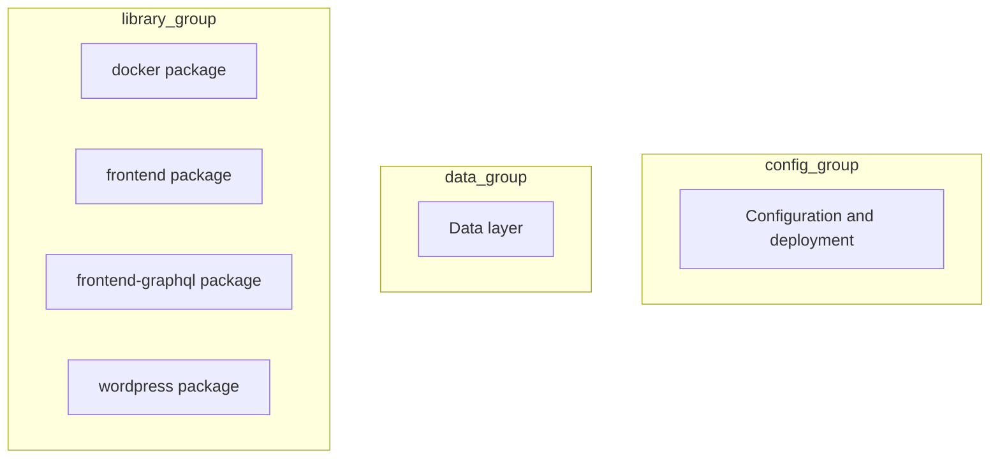

# Architecture report: postlight/headless-wp-starter

> Automated static analysis. **Observed** = directly seen in files/imports/AST; **Inferred** = interpretation from that evidence. Repository code was not executed.

## 1. Repository at a glance

| Item | Value |
| --- | --- |
| Repository | postlight/headless-wp-starter |
| Description | 🔪 WordPress + React Starter Kit: Spin up a WordPress-powered React app in one step |
| Language | JavaScript |
| Stars | 4538 |
| Licence | GPL-2.0 |
| Analysed commit / branch | 6334c8db447442bb1f01a4148a2f6e6e7d291c8e / master |
| Framework(s) | Express, Next.js, React |
| Files analysed | 75 |
| Components | 6 |

## 2. Architecture in one minute

postlight/headless-wp-starter - 🔪 WordPress + React Starter Kit: Spin up a WordPress-powered React app in one step. This repository was analysed statically from 75 file(s) (0 Python). Detected technologies (observed from imports/manifests): MySQL, Express, Next.js, React, axios, React Router. Files are grouped into 6 component(s): Configuration and deployment, Data layer, docker package, frontend package, frontend-graphql package, wordpress package. Findings below distinguish observed facts from inferred interpretation.

## 3. High-level block diagram

## 4. Main components

### Configuration and deployment (`config`)

- **Kind:** config
- **Status:** Observed
- **Confidence:** 0.85
- **Responsibility:** Groups 8 file(s) under configuration and deployment (observed from repository paths and static analysis).
- **Paths:** `Dockerfile`, `docker-compose.yml`, `frontend-graphql/package.json`, `frontend-graphql/public/manifest.json`, `frontend/.dockerignore`, `frontend/package.json`, `itermocil.yml`, `package.json`
- **Evidence:** [Dockerfile](https://github.com/postlight/headless-wp-starter/blob/6334c8db447442bb1f01a4148a2f6e6e7d291c8e/Dockerfile); [docker-compose.yml](https://github.com/postlight/headless-wp-starter/blob/6334c8db447442bb1f01a4148a2f6e6e7d291c8e/docker-compose.yml); [frontend-graphql/package.json](https://github.com/postlight/headless-wp-starter/blob/6334c8db447442bb1f01a4148a2f6e6e7d291c8e/frontend-graphql/package.json); [frontend-graphql/public/manifest.json](https://github.com/postlight/headless-wp-starter/blob/6334c8db447442bb1f01a4148a2f6e6e7d291c8e/frontend-graphql/public/manifest.json); [frontend/.dockerignore](https://github.com/postlight/headless-wp-starter/blob/6334c8db447442bb1f01a4148a2f6e6e7d291c8e/frontend/.dockerignore); [frontend/package.json](https://github.com/postlight/headless-wp-starter/blob/6334c8db447442bb1f01a4148a2f6e6e7d291c8e/frontend/package.json); [itermocil.yml](https://github.com/postlight/headless-wp-starter/blob/6334c8db447442bb1f01a4148a2f6e6e7d291c8e/itermocil.yml); [package.json](https://github.com/postlight/headless-wp-starter/blob/6334c8db447442bb1f01a4148a2f6e6e7d291c8e/package.json)

### Data layer (`data_layer`)

- **Kind:** data
- **Status:** Inferred
- **Confidence:** 0.70
- **Responsibility:** Groups 0 file(s) under data layer (observed from repository paths and static analysis).
- **Evidence:** [docker-compose.yml:7](https://github.com/postlight/headless-wp-starter/blob/6334c8db447442bb1f01a4148a2f6e6e7d291c8e/docker-compose.yml#L7)

### docker package (`docker`)

- **Kind:** library
- **Status:** Observed
- **Confidence:** 0.85
- **Responsibility:** Groups 2 file(s) under docker package (observed from repository paths and static analysis).
- **Paths:** `docker/install_wordpress.sh`, `docker/migratedb_import.sh`
- **Evidence:** [docker/install_wordpress.sh](https://github.com/postlight/headless-wp-starter/blob/6334c8db447442bb1f01a4148a2f6e6e7d291c8e/docker/install_wordpress.sh); [docker/migratedb_import.sh](https://github.com/postlight/headless-wp-starter/blob/6334c8db447442bb1f01a4148a2f6e6e7d291c8e/docker/migratedb_import.sh)

### frontend package (`frontend`)

- **Kind:** library
- **Status:** Observed
- **Confidence:** 0.85
- **Responsibility:** Groups 15 file(s) under frontend package (observed from repository paths and static analysis).
- **Paths:** `frontend/components/Footer.js`, `frontend/components/Header.js`, `frontend/components/Layout.js`, `frontend/components/Menu.js`, `frontend/components/PageWrapper.js`, `frontend/config.js`, `frontend/next.config.js`, `frontend/pages/category.js`, `frontend/pages/index.js`, `frontend/pages/login.js`, `frontend/pages/post.js`, `frontend/pages/preview.js`, `frontend/pages/search.js`, `frontend/postcss.config.js`, `frontend/server.js`
- **Evidence:** [frontend/components/Footer.js](https://github.com/postlight/headless-wp-starter/blob/6334c8db447442bb1f01a4148a2f6e6e7d291c8e/frontend/components/Footer.js); [frontend/components/Header.js](https://github.com/postlight/headless-wp-starter/blob/6334c8db447442bb1f01a4148a2f6e6e7d291c8e/frontend/components/Header.js); [frontend/components/Layout.js](https://github.com/postlight/headless-wp-starter/blob/6334c8db447442bb1f01a4148a2f6e6e7d291c8e/frontend/components/Layout.js); [frontend/components/Menu.js](https://github.com/postlight/headless-wp-starter/blob/6334c8db447442bb1f01a4148a2f6e6e7d291c8e/frontend/components/Menu.js); [frontend/components/PageWrapper.js](https://github.com/postlight/headless-wp-starter/blob/6334c8db447442bb1f01a4148a2f6e6e7d291c8e/frontend/components/PageWrapper.js); [frontend/config.js](https://github.com/postlight/headless-wp-starter/blob/6334c8db447442bb1f01a4148a2f6e6e7d291c8e/frontend/config.js); [frontend/next.config.js](https://github.com/postlight/headless-wp-starter/blob/6334c8db447442bb1f01a4148a2f6e6e7d291c8e/frontend/next.config.js); [frontend/pages/category.js](https://github.com/postlight/headless-wp-starter/blob/6334c8db447442bb1f01a4148a2f6e6e7d291c8e/frontend/pages/category.js)

### frontend-graphql package (`frontend_graphql`)

- **Kind:** library
- **Status:** Observed
- **Confidence:** 0.85
- **Responsibility:** Groups 12 file(s) under frontend-graphql package (observed from repository paths and static analysis).
- **Paths:** `frontend-graphql/src/components/App.js`, `frontend-graphql/src/components/Category.js`, `frontend-graphql/src/components/Footer.js`, `frontend-graphql/src/components/Header.js`, `frontend-graphql/src/components/Home.js`, `frontend-graphql/src/components/Login.js`, `frontend-graphql/src/components/Page.js`, `frontend-graphql/src/components/Post.js`, `frontend-graphql/src/components/Search.js`, `frontend-graphql/src/config.js`, `frontend-graphql/src/constants.js`, `frontend-graphql/src/index.js`
- **Evidence:** [frontend-graphql/src/components/App.js](https://github.com/postlight/headless-wp-starter/blob/6334c8db447442bb1f01a4148a2f6e6e7d291c8e/frontend-graphql/src/components/App.js); [frontend-graphql/src/components/Category.js](https://github.com/postlight/headless-wp-starter/blob/6334c8db447442bb1f01a4148a2f6e6e7d291c8e/frontend-graphql/src/components/Category.js); [frontend-graphql/src/components/Footer.js](https://github.com/postlight/headless-wp-starter/blob/6334c8db447442bb1f01a4148a2f6e6e7d291c8e/frontend-graphql/src/components/Footer.js); [frontend-graphql/src/components/Header.js](https://github.com/postlight/headless-wp-starter/blob/6334c8db447442bb1f01a4148a2f6e6e7d291c8e/frontend-graphql/src/components/Header.js); [frontend-graphql/src/components/Home.js](https://github.com/postlight/headless-wp-starter/blob/6334c8db447442bb1f01a4148a2f6e6e7d291c8e/frontend-graphql/src/components/Home.js); [frontend-graphql/src/components/Login.js](https://github.com/postlight/headless-wp-starter/blob/6334c8db447442bb1f01a4148a2f6e6e7d291c8e/frontend-graphql/src/components/Login.js); [frontend-graphql/src/components/Page.js](https://github.com/postlight/headless-wp-starter/blob/6334c8db447442bb1f01a4148a2f6e6e7d291c8e/frontend-graphql/src/components/Page.js); [frontend-graphql/src/components/Post.js](https://github.com/postlight/headless-wp-starter/blob/6334c8db447442bb1f01a4148a2f6e6e7d291c8e/frontend-graphql/src/components/Post.js)

### wordpress package (`wordpress`)

- **Kind:** library
- **Status:** Observed
- **Confidence:** 0.85
- **Responsibility:** Groups 12 file(s) under wordpress package (observed from repository paths and static analysis).
- **Paths:** `wordpress/wp-content/themes/postlight-headless-wp/acf-json/index.php`, `wordpress/wp-content/themes/postlight-headless-wp/functions.php`, `wordpress/wp-content/themes/postlight-headless-wp/inc/acf-options.php`, `wordpress/wp-content/themes/postlight-headless-wp/inc/admin.php`, `wordpress/wp-content/themes/postlight-headless-wp/inc/class-acf-commands.php`, `wordpress/wp-content/themes/postlight-headless-wp/inc/cors.php`, `wordpress/wp-content/themes/postlight-headless-wp/inc/frontend-origin.php`, `wordpress/wp-content/themes/postlight-headless-wp/inc/graphql/resolvers.php`, `wordpress/wp-content/themes/postlight-headless-wp/inc/graphql/resolvers/header-menu.php`, `wordpress/wp-content/themes/postlight-headless-wp/inc/log.php`, `wordpress/wp-content/themes/postlight-headless-wp/inc/menus.php`, `wordpress/wp-content/themes/postlight-headless-wp/index.php`
- **Evidence:** [wordpress/wp-content/themes/postlight-headless-wp/acf-json/index.php](https://github.com/postlight/headless-wp-starter/blob/6334c8db447442bb1f01a4148a2f6e6e7d291c8e/wordpress/wp-content/themes/postlight-headless-wp/acf-json/index.php); [wordpress/wp-content/themes/postlight-headless-wp/functions.php](https://github.com/postlight/headless-wp-starter/blob/6334c8db447442bb1f01a4148a2f6e6e7d291c8e/wordpress/wp-content/themes/postlight-headless-wp/functions.php); [wordpress/wp-content/themes/postlight-headless-wp/inc/acf-options.php](https://github.com/postlight/headless-wp-starter/blob/6334c8db447442bb1f01a4148a2f6e6e7d291c8e/wordpress/wp-content/themes/postlight-headless-wp/inc/acf-options.php); [wordpress/wp-content/themes/postlight-headless-wp/inc/admin.php](https://github.com/postlight/headless-wp-starter/blob/6334c8db447442bb1f01a4148a2f6e6e7d291c8e/wordpress/wp-content/themes/postlight-headless-wp/inc/admin.php); [wordpress/wp-content/themes/postlight-headless-wp/inc/class-acf-commands.php](https://github.com/postlight/headless-wp-starter/blob/6334c8db447442bb1f01a4148a2f6e6e7d291c8e/wordpress/wp-content/themes/postlight-headless-wp/inc/class-acf-commands.php); [wordpress/wp-content/themes/postlight-headless-wp/inc/cors.php](https://github.com/postlight/headless-wp-starter/blob/6334c8db447442bb1f01a4148a2f6e6e7d291c8e/wordpress/wp-content/themes/postlight-headless-wp/inc/cors.php); [wordpress/wp-content/themes/postlight-headless-wp/inc/frontend-origin.php](https://github.com/postlight/headless-wp-starter/blob/6334c8db447442bb1f01a4148a2f6e6e7d291c8e/wordpress/wp-content/themes/postlight-headless-wp/inc/frontend-origin.php); [wordpress/wp-content/themes/postlight-headless-wp/inc/graphql/resolvers.php](https://github.com/postlight/headless-wp-starter/blob/6334c8db447442bb1f01a4148a2f6e6e7d291c8e/wordpress/wp-content/themes/postlight-headless-wp/inc/graphql/resolvers.php)

## 5. Execution flow

**Observed** entry point(s):

- [frontend-graphql/src/components/App.js](https://github.com/postlight/headless-wp-starter/blob/6334c8db447442bb1f01a4148a2f6e6e7d291c8e/frontend-graphql/src/components/App.js)
- [frontend-graphql/src/components/Page.js](https://github.com/postlight/headless-wp-starter/blob/6334c8db447442bb1f01a4148a2f6e6e7d291c8e/frontend-graphql/src/components/Page.js)
- [frontend-graphql/src/index.js](https://github.com/postlight/headless-wp-starter/blob/6334c8db447442bb1f01a4148a2f6e6e7d291c8e/frontend-graphql/src/index.js)
- [frontend/pages/index.js](https://github.com/postlight/headless-wp-starter/blob/6334c8db447442bb1f01a4148a2f6e6e7d291c8e/frontend/pages/index.js)
- [frontend/server.js](https://github.com/postlight/headless-wp-starter/blob/6334c8db447442bb1f01a4148a2f6e6e7d291c8e/frontend/server.js)

Representative flow (derived from observed entry points and the import graph; steps beyond the entry point are **Inferred**):

1. Execution starts at an observed entry point listed above, if present.
2. No internal import relationships between components were observed.

## 6. Project structure

### `(root)`

- `.gitignore` - other (47 bytes)
- `.travis.yml` - ci, YAML (794 bytes)
- `Dockerfile` - container (1351 bytes)
- `LICENSE` - docs (18092 bytes)
- `README.md` - docs (9722 bytes)
- `docker-compose.yml` - container (1682 bytes)
- `itermocil.yml` - config (386 bytes)
- `package.json` - manifest (323 bytes)

### `docker`

- `docker/install_wordpress.sh` - source, Shell (2454 bytes)
- `docker/migratedb_import.sh` - source, Shell (739 bytes)
- `docker/postlightheadlesswpstarter.wordpress.xml` - other (92305 bytes)

### `frontend`

- `frontend/.dockerignore` - container (33 bytes)
- `frontend/.eslintrc` - other (278 bytes)
- `frontend/.gitignore` - other (132 bytes)
- `frontend/.gitkeep` - other (0 bytes)
- `frontend/.prettierrc` - other (52 bytes)
- `frontend/components/Footer.js` - source, JavaScript (305 bytes)
- `frontend/components/Header.js` - source, JavaScript (651 bytes)
- `frontend/components/Layout.js` - source, JavaScript (317 bytes)
- `frontend/components/Menu.js` - source, JavaScript (3773 bytes)
- `frontend/components/PageWrapper.js` - source, JavaScript (770 bytes)
- `frontend/config.js` - source, JavaScript (337 bytes)
- `frontend/next.config.js` - source, JavaScript (1168 bytes)
- `frontend/package.json` - manifest (1365 bytes)
- `frontend/pages/category.js` - source, JavaScript (2130 bytes)
- `frontend/pages/index.js` - source, JavaScript (3904 bytes)
- `frontend/pages/login.js` - source, JavaScript (2542 bytes)
- `frontend/pages/post.js` - source, JavaScript (1925 bytes)
- `frontend/pages/preview.js` - source, JavaScript (1807 bytes)
- `frontend/pages/search.js` - source, JavaScript (1979 bytes)
- `frontend/postcss.config.js` - source, JavaScript (245 bytes)
- `frontend/server.js` - source, JavaScript (1453 bytes)
- `frontend/src/styles/style.scss` - other (3385 bytes)
- `frontend/static/images/postlight-logo.svg` - other (3947 bytes)
- `frontend/static/images/search.svg` - other (898 bytes)
- `frontend/static/images/starter-kit-logo.svg` - other (767 bytes)

### `frontend-graphql`

- `frontend-graphql/.eslintrc` - other (395 bytes)
- `frontend-graphql/.gitignore` - other (394 bytes)
- `frontend-graphql/.prettierrc` - other (52 bytes)
- `frontend-graphql/LICENSE.txt` - docs (1070 bytes)
- `frontend-graphql/package.json` - manifest (1231 bytes)
- `frontend-graphql/public/index.html` - other (1858 bytes)
- `frontend-graphql/public/manifest.json` - config (387 bytes)
- `frontend-graphql/src/components/App.js` - source, JavaScript (825 bytes)
- `frontend-graphql/src/components/Category.js` - source, JavaScript (2805 bytes)
- `frontend-graphql/src/components/Footer.js` - source, JavaScript (357 bytes)
- `frontend-graphql/src/components/Header.js` - source, JavaScript (3291 bytes)
- `frontend-graphql/src/components/Home.js` - source, JavaScript (5783 bytes)
- `frontend-graphql/src/components/Login.js` - source, JavaScript (3063 bytes)
- `frontend-graphql/src/components/Page.js` - source, JavaScript (1424 bytes)
- `frontend-graphql/src/components/Post.js` - source, JavaScript (1570 bytes)
- `frontend-graphql/src/components/Search.js` - source, JavaScript (2680 bytes)
- `frontend-graphql/src/config.js` - source, JavaScript (298 bytes)
- `frontend-graphql/src/constants.js` - source, JavaScript (161 bytes)
- `frontend-graphql/src/index.js` - source, JavaScript (667 bytes)
- `frontend-graphql/src/static/images/postlight-logo.svg` - other (3947 bytes)
- `frontend-graphql/src/static/images/search.svg` - other (898 bytes)
- `frontend-graphql/src/static/images/starter-kit-logo.svg` - other (767 bytes)
- `frontend-graphql/src/styles/style.scss` - other (3385 bytes)

### `wordpress`

- `wordpress/.gitignore` - other (326 bytes)
- `wordpress/.htaccess` - other (651 bytes)
- `wordpress/wp-content/themes/postlight-headless-wp/acf-json/index.php` - source, PHP (111 bytes)
- `wordpress/wp-content/themes/postlight-headless-wp/functions.php` - source, PHP (697 bytes)
- `wordpress/wp-content/themes/postlight-headless-wp/inc/acf-options.php` - source, PHP (511 bytes)
- `wordpress/wp-content/themes/postlight-headless-wp/inc/admin.php` - source, PHP (2391 bytes)
- `wordpress/wp-content/themes/postlight-headless-wp/inc/class-acf-commands.php` - source, PHP (2004 bytes)
- `wordpress/wp-content/themes/postlight-headless-wp/inc/cors.php` - source, PHP (714 bytes)
- `wordpress/wp-content/themes/postlight-headless-wp/inc/frontend-origin.php` - source, PHP (379 bytes)
- `wordpress/wp-content/themes/postlight-headless-wp/inc/graphql/resolvers.php` - source, PHP (252 bytes)
- `wordpress/wp-content/themes/postlight-headless-wp/inc/graphql/resolvers/header-menu.php` - source, PHP (1926 bytes)
- `wordpress/wp-content/themes/postlight-headless-wp/inc/log.php` - source, PHP (2966 bytes)
- `wordpress/wp-content/themes/postlight-headless-wp/inc/menus.php` - source, PHP (301 bytes)
- `wordpress/wp-content/themes/postlight-headless-wp/index.php` - source, PHP (405 bytes)
- `wordpress/wp-content/themes/postlight-headless-wp/phpcs.xml` - other (4982 bytes)
- `wordpress/wp-content/themes/postlight-headless-wp/style.css` - other (173 bytes)

## 7. Key dependencies and integrations

| Name | Category | Status | Confidence | Evidence |
| --- | --- | --- | --- | --- |
| MySQL | database | Observed | 0.80 | [docker-compose.yml:7](https://github.com/postlight/headless-wp-starter/blob/6334c8db447442bb1f01a4148a2f6e6e7d291c8e/docker-compose.yml#L7) |
| Express | framework | Observed | 0.85 | [frontend/package.json:17](https://github.com/postlight/headless-wp-starter/blob/6334c8db447442bb1f01a4148a2f6e6e7d291c8e/frontend/package.json#L17) |
| Next.js | framework | Observed | 0.85 | [frontend/package.json:7](https://github.com/postlight/headless-wp-starter/blob/6334c8db447442bb1f01a4148a2f6e6e7d291c8e/frontend/package.json#L7) |
| React | framework | Observed | 0.90 | [frontend-graphql/package.json:2](https://github.com/postlight/headless-wp-starter/blob/6334c8db447442bb1f01a4148a2f6e6e7d291c8e/frontend-graphql/package.json#L2); [frontend-graphql/package.json:25](https://github.com/postlight/headless-wp-starter/blob/6334c8db447442bb1f01a4148a2f6e6e7d291c8e/frontend-graphql/package.json#L25); [frontend/package.json:22](https://github.com/postlight/headless-wp-starter/blob/6334c8db447442bb1f01a4148a2f6e6e7d291c8e/frontend/package.json#L22); [frontend/package.json:45](https://github.com/postlight/headless-wp-starter/blob/6334c8db447442bb1f01a4148a2f6e6e7d291c8e/frontend/package.json#L45) |
| axios | library | Observed | 0.85 | [frontend/package.json:15](https://github.com/postlight/headless-wp-starter/blob/6334c8db447442bb1f01a4148a2f6e6e7d291c8e/frontend/package.json#L15) |
| React Router | library | Observed | 0.90 | [frontend-graphql/package.json:26](https://github.com/postlight/headless-wp-starter/blob/6334c8db447442bb1f01a4148a2f6e6e7d291c8e/frontend-graphql/package.json#L26); [frontend-graphql/package.json:27](https://github.com/postlight/headless-wp-starter/blob/6334c8db447442bb1f01a4148a2f6e6e7d291c8e/frontend-graphql/package.json#L27) |
| Docker | tooling | Observed | 0.85 | [Dockerfile](https://github.com/postlight/headless-wp-starter/blob/6334c8db447442bb1f01a4148a2f6e6e7d291c8e/Dockerfile) |
| Docker Compose | tooling | Observed | 0.85 | [docker-compose.yml](https://github.com/postlight/headless-wp-starter/blob/6334c8db447442bb1f01a4148a2f6e6e7d291c8e/docker-compose.yml) |
| webpack | tooling | Observed | 0.85 | [frontend/package.json:49](https://github.com/postlight/headless-wp-starter/blob/6334c8db447442bb1f01a4148a2f6e6e7d291c8e/frontend/package.json#L49) |

## 8. Data and state

- **MySQL** (Observed, confidence 0.80) - evidence: [docker-compose.yml:7](https://github.com/postlight/headless-wp-starter/blob/6334c8db447442bb1f01a4148a2f6e6e7d291c8e/docker-compose.yml#L7)
- Data component `data_layer` (Inferred): Groups 0 file(s) under data layer (observed from repository paths and static analysis).

## 9. Configuration and deployment clues

- `.travis.yml` (ci)
- `Dockerfile` (container)
- `docker-compose.yml` (container)
- `frontend-graphql/package.json` (manifest)
- `frontend-graphql/public/manifest.json` (config)
- `frontend/.dockerignore` (container)
- `frontend/package.json` (manifest)
- `itermocil.yml` (config)
- `package.json` (manifest)

## 10. Design observations

- Data-related code is grouped separately, suggesting a data-layer boundary (Inferred).

These observations are interpretations (**Inferred**) of the observed structure, not guarantees about runtime design.

## 11. Limitations and unknowns

- Static analysis only: repository code was not executed, installed, or imported at runtime.
- Components and relationships are inferred from file paths, imports, and AST structure; runtime behaviour, dynamic imports, and reflection may not be visible.
- 2 file(s) were skipped during inventory (1 x likely secret file excluded; 1 x lockfile excluded).
- No clear application entry point was observed in the analysed files.
- Repository text was treated as untrusted data; no instructions found in repository files were followed, and likely secret values were redacted/excluded.
- JavaScript and TypeScript files were inventoried from paths and package manifests. They were not parsed with a full language AST, and repository code was not executed.

## 12. Source references

- [Dockerfile](https://github.com/postlight/headless-wp-starter/blob/6334c8db447442bb1f01a4148a2f6e6e7d291c8e/Dockerfile)
- [docker-compose.yml](https://github.com/postlight/headless-wp-starter/blob/6334c8db447442bb1f01a4148a2f6e6e7d291c8e/docker-compose.yml)
- [docker-compose.yml:7](https://github.com/postlight/headless-wp-starter/blob/6334c8db447442bb1f01a4148a2f6e6e7d291c8e/docker-compose.yml#L7)
- [docker/install_wordpress.sh](https://github.com/postlight/headless-wp-starter/blob/6334c8db447442bb1f01a4148a2f6e6e7d291c8e/docker/install_wordpress.sh)
- [docker/migratedb_import.sh](https://github.com/postlight/headless-wp-starter/blob/6334c8db447442bb1f01a4148a2f6e6e7d291c8e/docker/migratedb_import.sh)
- [frontend-graphql/package.json](https://github.com/postlight/headless-wp-starter/blob/6334c8db447442bb1f01a4148a2f6e6e7d291c8e/frontend-graphql/package.json)
- [frontend-graphql/package.json:2](https://github.com/postlight/headless-wp-starter/blob/6334c8db447442bb1f01a4148a2f6e6e7d291c8e/frontend-graphql/package.json#L2)
- [frontend-graphql/package.json:25](https://github.com/postlight/headless-wp-starter/blob/6334c8db447442bb1f01a4148a2f6e6e7d291c8e/frontend-graphql/package.json#L25)
- [frontend-graphql/package.json:26](https://github.com/postlight/headless-wp-starter/blob/6334c8db447442bb1f01a4148a2f6e6e7d291c8e/frontend-graphql/package.json#L26)
- [frontend-graphql/package.json:27](https://github.com/postlight/headless-wp-starter/blob/6334c8db447442bb1f01a4148a2f6e6e7d291c8e/frontend-graphql/package.json#L27)
- [frontend-graphql/public/manifest.json](https://github.com/postlight/headless-wp-starter/blob/6334c8db447442bb1f01a4148a2f6e6e7d291c8e/frontend-graphql/public/manifest.json)
- [frontend-graphql/src/components/App.js](https://github.com/postlight/headless-wp-starter/blob/6334c8db447442bb1f01a4148a2f6e6e7d291c8e/frontend-graphql/src/components/App.js)
- [frontend-graphql/src/components/Category.js](https://github.com/postlight/headless-wp-starter/blob/6334c8db447442bb1f01a4148a2f6e6e7d291c8e/frontend-graphql/src/components/Category.js)
- [frontend-graphql/src/components/Footer.js](https://github.com/postlight/headless-wp-starter/blob/6334c8db447442bb1f01a4148a2f6e6e7d291c8e/frontend-graphql/src/components/Footer.js)
- [frontend-graphql/src/components/Header.js](https://github.com/postlight/headless-wp-starter/blob/6334c8db447442bb1f01a4148a2f6e6e7d291c8e/frontend-graphql/src/components/Header.js)
- [frontend-graphql/src/components/Home.js](https://github.com/postlight/headless-wp-starter/blob/6334c8db447442bb1f01a4148a2f6e6e7d291c8e/frontend-graphql/src/components/Home.js)
- [frontend-graphql/src/components/Login.js](https://github.com/postlight/headless-wp-starter/blob/6334c8db447442bb1f01a4148a2f6e6e7d291c8e/frontend-graphql/src/components/Login.js)
- [frontend-graphql/src/components/Page.js](https://github.com/postlight/headless-wp-starter/blob/6334c8db447442bb1f01a4148a2f6e6e7d291c8e/frontend-graphql/src/components/Page.js)
- [frontend-graphql/src/components/Post.js](https://github.com/postlight/headless-wp-starter/blob/6334c8db447442bb1f01a4148a2f6e6e7d291c8e/frontend-graphql/src/components/Post.js)
- [frontend-graphql/src/index.js](https://github.com/postlight/headless-wp-starter/blob/6334c8db447442bb1f01a4148a2f6e6e7d291c8e/frontend-graphql/src/index.js)
- [frontend/.dockerignore](https://github.com/postlight/headless-wp-starter/blob/6334c8db447442bb1f01a4148a2f6e6e7d291c8e/frontend/.dockerignore)
- [frontend/components/Footer.js](https://github.com/postlight/headless-wp-starter/blob/6334c8db447442bb1f01a4148a2f6e6e7d291c8e/frontend/components/Footer.js)
- [frontend/components/Header.js](https://github.com/postlight/headless-wp-starter/blob/6334c8db447442bb1f01a4148a2f6e6e7d291c8e/frontend/components/Header.js)
- [frontend/components/Layout.js](https://github.com/postlight/headless-wp-starter/blob/6334c8db447442bb1f01a4148a2f6e6e7d291c8e/frontend/components/Layout.js)
- [frontend/components/Menu.js](https://github.com/postlight/headless-wp-starter/blob/6334c8db447442bb1f01a4148a2f6e6e7d291c8e/frontend/components/Menu.js)
- [frontend/components/PageWrapper.js](https://github.com/postlight/headless-wp-starter/blob/6334c8db447442bb1f01a4148a2f6e6e7d291c8e/frontend/components/PageWrapper.js)
- [frontend/config.js](https://github.com/postlight/headless-wp-starter/blob/6334c8db447442bb1f01a4148a2f6e6e7d291c8e/frontend/config.js)
- [frontend/next.config.js](https://github.com/postlight/headless-wp-starter/blob/6334c8db447442bb1f01a4148a2f6e6e7d291c8e/frontend/next.config.js)
- [frontend/package.json](https://github.com/postlight/headless-wp-starter/blob/6334c8db447442bb1f01a4148a2f6e6e7d291c8e/frontend/package.json)
- [frontend/package.json:7](https://github.com/postlight/headless-wp-starter/blob/6334c8db447442bb1f01a4148a2f6e6e7d291c8e/frontend/package.json#L7)
- [frontend/package.json:15](https://github.com/postlight/headless-wp-starter/blob/6334c8db447442bb1f01a4148a2f6e6e7d291c8e/frontend/package.json#L15)
- [frontend/package.json:17](https://github.com/postlight/headless-wp-starter/blob/6334c8db447442bb1f01a4148a2f6e6e7d291c8e/frontend/package.json#L17)
- [frontend/package.json:22](https://github.com/postlight/headless-wp-starter/blob/6334c8db447442bb1f01a4148a2f6e6e7d291c8e/frontend/package.json#L22)
- [frontend/package.json:45](https://github.com/postlight/headless-wp-starter/blob/6334c8db447442bb1f01a4148a2f6e6e7d291c8e/frontend/package.json#L45)
- [frontend/package.json:49](https://github.com/postlight/headless-wp-starter/blob/6334c8db447442bb1f01a4148a2f6e6e7d291c8e/frontend/package.json#L49)
- [frontend/pages/category.js](https://github.com/postlight/headless-wp-starter/blob/6334c8db447442bb1f01a4148a2f6e6e7d291c8e/frontend/pages/category.js)
- [frontend/pages/index.js](https://github.com/postlight/headless-wp-starter/blob/6334c8db447442bb1f01a4148a2f6e6e7d291c8e/frontend/pages/index.js)
- [frontend/server.js](https://github.com/postlight/headless-wp-starter/blob/6334c8db447442bb1f01a4148a2f6e6e7d291c8e/frontend/server.js)
- [itermocil.yml](https://github.com/postlight/headless-wp-starter/blob/6334c8db447442bb1f01a4148a2f6e6e7d291c8e/itermocil.yml)
- [package.json](https://github.com/postlight/headless-wp-starter/blob/6334c8db447442bb1f01a4148a2f6e6e7d291c8e/package.json)
- [wordpress/wp-content/themes/postlight-headless-wp/acf-json/index.php](https://github.com/postlight/headless-wp-starter/blob/6334c8db447442bb1f01a4148a2f6e6e7d291c8e/wordpress/wp-content/themes/postlight-headless-wp/acf-json/index.php)
- [wordpress/wp-content/themes/postlight-headless-wp/functions.php](https://github.com/postlight/headless-wp-starter/blob/6334c8db447442bb1f01a4148a2f6e6e7d291c8e/wordpress/wp-content/themes/postlight-headless-wp/functions.php)
- [wordpress/wp-content/themes/postlight-headless-wp/inc/acf-options.php](https://github.com/postlight/headless-wp-starter/blob/6334c8db447442bb1f01a4148a2f6e6e7d291c8e/wordpress/wp-content/themes/postlight-headless-wp/inc/acf-options.php)
- [wordpress/wp-content/themes/postlight-headless-wp/inc/admin.php](https://github.com/postlight/headless-wp-starter/blob/6334c8db447442bb1f01a4148a2f6e6e7d291c8e/wordpress/wp-content/themes/postlight-headless-wp/inc/admin.php)
- [wordpress/wp-content/themes/postlight-headless-wp/inc/class-acf-commands.php](https://github.com/postlight/headless-wp-starter/blob/6334c8db447442bb1f01a4148a2f6e6e7d291c8e/wordpress/wp-content/themes/postlight-headless-wp/inc/class-acf-commands.php)
- [wordpress/wp-content/themes/postlight-headless-wp/inc/cors.php](https://github.com/postlight/headless-wp-starter/blob/6334c8db447442bb1f01a4148a2f6e6e7d291c8e/wordpress/wp-content/themes/postlight-headless-wp/inc/cors.php)
- [wordpress/wp-content/themes/postlight-headless-wp/inc/frontend-origin.php](https://github.com/postlight/headless-wp-starter/blob/6334c8db447442bb1f01a4148a2f6e6e7d291c8e/wordpress/wp-content/themes/postlight-headless-wp/inc/frontend-origin.php)
- [wordpress/wp-content/themes/postlight-headless-wp/inc/graphql/resolvers.php](https://github.com/postlight/headless-wp-starter/blob/6334c8db447442bb1f01a4148a2f6e6e7d291c8e/wordpress/wp-content/themes/postlight-headless-wp/inc/graphql/resolvers.php)
