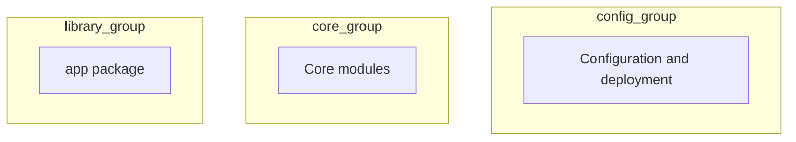

# Architecture report: prazzon/Flexbox-Labs

> Automated static analysis. **Observed** = directly seen in files/imports/AST; **Inferred** = interpretation from that evidence. Repository code was not executed.

## 1. Repository at a glance

| Item | Value |
| --- | --- |
| Repository | prazzon/Flexbox-Labs |
| Description | A web app for creating flexible layouts with the power of CSS Flexbox. |
| Language | TypeScript |
| Stars | 4061 |
| Licence | MIT |
| Analysed commit / branch | 39416e136100825caf10e1963579e6bd3c19f873 / master |
| Framework(s) | Next.js, React |
| Files analysed | 171 |
| Components | 3 |

## 2. Architecture in one minute

prazzon/Flexbox-Labs - A web app for creating flexible layouts with the power of CSS Flexbox.. This repository was analysed statically from 171 file(s) (0 Python). Detected technologies (observed from imports/manifests): Next.js, React, Redux Toolkit, TypeScript. Files are grouped into 3 component(s): app package, Configuration and deployment, Core modules. Findings below distinguish observed facts from inferred interpretation.

## 3. High-level block diagram

## 4. Main components

### app package (`app`)

- **Kind:** library
- **Status:** Observed
- **Confidence:** 0.85
- **Responsibility:** Groups 95 file(s) under app package (observed from repository paths and static analysis).
- **Paths:** `app/(playground)/flexbox/page.tsx`, `app/(playground)/grid/page.tsx`, `app/_components/CustomToaster.tsx`, `app/_components/Header/Header.tsx`, `app/_components/Pages/Flexbox/FlexboxItem/FlexboxItem.tsx`, `app/_components/Pages/Flexbox/FlexboxPage.tsx`, `app/_components/Pages/Flexbox/FlexboxSidebar/FlexboxSidebar.tsx`, `app/_components/Pages/Flexbox/FlexboxSnackbar/FlexboxSnackbar.tsx`, `app/_components/Pages/Flexbox/FlexboxToolbar/FlexboxToolbar.tsx`, `app/_components/Pages/Flexbox/MainAxisPointer/MainAxisPointer.tsx`, `app/_components/Pages/Grid/GridArea/GridArea.tsx`, `app/_components/Pages/Grid/GridItem/GridItem.tsx`, `app/_components/Pages/Grid/GridPage.tsx`, `app/_components/Pages/Grid/GridSidebar/GridSidebar.tsx`, `app/_components/Pages/Grid/GridToolbar/GridToolbar.tsx`, `app/_components/Playground/Playground.tsx`, `app/_components/Playground/Snackbar/Snackbar.tsx`, `app/_components/Playground/Toolbar/Toolbar.tsx`, `app/_components/Playground/Toolbar/ToolbarBtn/ToolbarBtn.tsx`, `app/_components/SettingsInit.tsx`, `app/_components/SideBar/About/About.tsx`, `app/_components/SideBar/Edit/Edit.tsx`, `app/_components/SideBar/Edit/EditContainer/EditContainer.tsx`, `app/_components/SideBar/Edit/EditItems/EditItems.tsx`, `app/_components/SideBar/Edit/EditItems/Empty/Empty.tsx`, `app/_components/SideBar/Edit/Item/Item.tsx`, `app/_components/SideBar/Edit/Item/ItemDropdown.tsx`, `app/_components/SideBar/Layout/Layout.tsx`, `app/_components/SideBar/Save/Save.tsx`, `app/_components/SideBar/Save/SaveItem/SaveItem.tsx`, `app/_components/SideBar/SideBar.tsx`, `app/_components/SideBar/SidebarContent/SidebarContent.tsx`, `app/_components/SideBar/SidebarTab/SidebarTab.tsx`, `app/_components/SideBar/useSidebarState.ts`, `app/_components/UI/Copy/Copy.tsx`, `app/_components/UI/DisplayCode/CodeHighlighter.tsx`, `app/_components/UI/DisplayCode/CodeTabs/CodeTabs.tsx`, `app/_components/UI/DisplayCode/DisplayCode.tsx`, `app/_components/UI/DisplayCode/ExportButton/ExportButton.tsx`, `app/_components/UI/LayoutGroup.tsx`, `app/_components/UI/Loader/Loader.tsx`, `app/_components/UI/MainContent/MainContent.tsx`, `app/_components/UI/Modal/Modal.tsx`, `app/_components/UI/Modal/ModalContext.ts`, `app/_components/UI/Modal/useModalContext.ts`, `app/_components/UI/PlaygroundItem/PlaygroundItem.tsx`, `app/_components/UI/Popover/Popover.tsx`, `app/_components/UI/Resizable/Resizable.tsx`, `app/_components/UI/Select/Select.tsx`, `app/_components/UI/Select/SelectContext.ts`, `app/_components/UI/Select/useSelectContext.ts`, `app/_components/UI/ShinyText/ShinyText.tsx`, `app/_components/UI/Slider/Slider.tsx`, `app/_components/UI/TextInput/TextInput.tsx`, `app/_components/UI/Toggle/Toggle.tsx`, `app/_components/UI/Tooltip/Tooltip.tsx`, `app/_context/SettingsContext.tsx`, `app/_data/dataTypes.ts`, `app/_data/flexbox/containerConfig.ts`, `app/_data/flexbox/itemsConfig.ts`, `app/_data/flexbox/layouts.ts`, `app/_data/grid/containerConfig.ts`, `app/_data/grid/itemsConfig.ts`, `app/_data/grid/layouts.ts`, `app/_helpers/helpers.ts`, `app/_hooks/useFlexbox.ts`, `app/_hooks/useGrid.ts`, `app/_hooks/useInsideContainerClick.ts`, `app/_hooks/useKeyPress.ts`, `app/_hooks/useOutsideClick.ts`, `app/_hooks/usePersistedState.ts`, `app/_hooks/useRaisedShadow.ts`, `app/_hooks/useResize.ts`, `app/_hooks/useRipple.ts`, `app/_hooks/useSettings.ts`, `app/_lib/features/flexbox/flexboxSlice.ts`, `app/_lib/features/grid/gridSlice.ts`, `app/_lib/features/playground/playgroundSliceFactory.ts`, `app/_lib/history.ts`, `app/_lib/hooks.ts`, `app/_lib/hooks/useBoundActions.ts`, `app/_lib/store.ts`, `app/_lib/types/flexbox.ts`, `app/_lib/types/grid.ts`, `app/_utils/cssTailwindConverter.ts`, `app/_utils/formatters.ts`, `app/_utils/generateFullHtml.ts`, `app/_utils/generateGridArea.ts`, `app/_utils/generateGridElements.ts`, `app/error.tsx`, `app/layout.tsx`, `app/loading.tsx`, `app/page.tsx`, `app/storeProvider.tsx`, `app/types.ts`
- **Evidence:** [app/(playground)/flexbox/page.tsx](https://github.com/prazzon/Flexbox-Labs/blob/39416e136100825caf10e1963579e6bd3c19f873/app/%28playground%29/flexbox/page.tsx); [app/(playground)/grid/page.tsx](https://github.com/prazzon/Flexbox-Labs/blob/39416e136100825caf10e1963579e6bd3c19f873/app/%28playground%29/grid/page.tsx); [app/_components/CustomToaster.tsx](https://github.com/prazzon/Flexbox-Labs/blob/39416e136100825caf10e1963579e6bd3c19f873/app/_components/CustomToaster.tsx); [app/_components/Header/Header.tsx](https://github.com/prazzon/Flexbox-Labs/blob/39416e136100825caf10e1963579e6bd3c19f873/app/_components/Header/Header.tsx); [app/_components/Pages/Flexbox/FlexboxItem/FlexboxItem.tsx](https://github.com/prazzon/Flexbox-Labs/blob/39416e136100825caf10e1963579e6bd3c19f873/app/_components/Pages/Flexbox/FlexboxItem/FlexboxItem.tsx); [app/_components/Pages/Flexbox/FlexboxPage.tsx](https://github.com/prazzon/Flexbox-Labs/blob/39416e136100825caf10e1963579e6bd3c19f873/app/_components/Pages/Flexbox/FlexboxPage.tsx); [app/_components/Pages/Flexbox/FlexboxSidebar/FlexboxSidebar.tsx](https://github.com/prazzon/Flexbox-Labs/blob/39416e136100825caf10e1963579e6bd3c19f873/app/_components/Pages/Flexbox/FlexboxSidebar/FlexboxSidebar.tsx); [app/_components/Pages/Flexbox/FlexboxSnackbar/FlexboxSnackbar.tsx](https://github.com/prazzon/Flexbox-Labs/blob/39416e136100825caf10e1963579e6bd3c19f873/app/_components/Pages/Flexbox/FlexboxSnackbar/FlexboxSnackbar.tsx)

### Configuration and deployment (`config`)

- **Kind:** config
- **Status:** Observed
- **Confidence:** 0.85
- **Responsibility:** Groups 4 file(s) under configuration and deployment (observed from repository paths and static analysis).
- **Paths:** `app/_components/SideBar/Settings/Settings.tsx`, `app/_lib/features/settings/settingsSlice.ts`, `package.json`, `tsconfig.json`
- **Evidence:** [app/_components/SideBar/Settings/Settings.tsx](https://github.com/prazzon/Flexbox-Labs/blob/39416e136100825caf10e1963579e6bd3c19f873/app/_components/SideBar/Settings/Settings.tsx); [app/_lib/features/settings/settingsSlice.ts](https://github.com/prazzon/Flexbox-Labs/blob/39416e136100825caf10e1963579e6bd3c19f873/app/_lib/features/settings/settingsSlice.ts); [package.json](https://github.com/prazzon/Flexbox-Labs/blob/39416e136100825caf10e1963579e6bd3c19f873/package.json); [tsconfig.json](https://github.com/prazzon/Flexbox-Labs/blob/39416e136100825caf10e1963579e6bd3c19f873/tsconfig.json)

### Core modules (`core`)

- **Kind:** core
- **Status:** Observed
- **Confidence:** 0.85
- **Responsibility:** Groups 2 file(s) under core modules (observed from repository paths and static analysis).
- **Paths:** `eslint.config.js`, `next.config.ts`
- **Evidence:** [eslint.config.js](https://github.com/prazzon/Flexbox-Labs/blob/39416e136100825caf10e1963579e6bd3c19f873/eslint.config.js); [next.config.ts](https://github.com/prazzon/Flexbox-Labs/blob/39416e136100825caf10e1963579e6bd3c19f873/next.config.ts)

## 5. Execution flow

**Observed** entry point(s):

- [app/(playground)/flexbox/page.tsx](https://github.com/prazzon/Flexbox-Labs/blob/39416e136100825caf10e1963579e6bd3c19f873/app/%28playground%29/flexbox/page.tsx)
- [app/(playground)/grid/page.tsx](https://github.com/prazzon/Flexbox-Labs/blob/39416e136100825caf10e1963579e6bd3c19f873/app/%28playground%29/grid/page.tsx)
- [app/page.tsx](https://github.com/prazzon/Flexbox-Labs/blob/39416e136100825caf10e1963579e6bd3c19f873/app/page.tsx)

Representative flow (derived from observed entry points and the import graph; steps beyond the entry point are **Inferred**):

1. Execution starts at an observed entry point listed above, if present.
2. No internal import relationships between components were observed.

## 6. Project structure

### `(root)`

- `.gitignore` - other (279 bytes)
- `.nvmrc` - other (2 bytes)
- `LICENSE` - docs (1072 bytes)
- `README.md` - docs (3922 bytes)
- `bun.lock` - other (176513 bytes)
- `eslint.config.js` - source, JavaScript (840 bytes)
- `next.config.ts` - source, TypeScript (535 bytes)
- `package.json` - manifest (1416 bytes)
- `tsconfig.json` - config (1003 bytes)

### `.github`

- `.github/FUNDING.yml` - config (853 bytes)
- `.github/ISSUE_TEMPLATE/bug_report.md` - docs (858 bytes)
- `.github/ISSUE_TEMPLATE/feature_request.md` - docs (615 bytes)

### `app`

- `app/(playground)/flexbox/page.tsx` - source, TypeScript (134 bytes)
- `app/(playground)/grid/page.tsx` - source, TypeScript (304 bytes)
- `app/_components/CustomToaster.tsx` - source, TypeScript (676 bytes)
- `app/_components/Header/Header.module.scss` - other (3159 bytes)
- `app/_components/Header/Header.tsx` - source, TypeScript (2480 bytes)
- `app/_components/Pages/Flexbox/FlexboxItem/FlexboxItem.module.scss` - other (3516 bytes)
- `app/_components/Pages/Flexbox/FlexboxItem/FlexboxItem.tsx` - source, TypeScript (3178 bytes)
- `app/_components/Pages/Flexbox/FlexboxPage.tsx` - source, TypeScript (2323 bytes)
- `app/_components/Pages/Flexbox/FlexboxSidebar/FlexboxSidebar.tsx` - source, TypeScript (2358 bytes)
- `app/_components/Pages/Flexbox/FlexboxSnackbar/FlexboxSnackbar.tsx` - source, TypeScript (409 bytes)
- `app/_components/Pages/Flexbox/FlexboxToolbar/FlexboxToolbar.tsx` - source, TypeScript (2329 bytes)
- `app/_components/Pages/Flexbox/MainAxisPointer/MainAxisPointer.module.scss` - other (417 bytes)
- `app/_components/Pages/Flexbox/MainAxisPointer/MainAxisPointer.tsx` - source, TypeScript (1904 bytes)
- `app/_components/Pages/Grid/GridArea/GridArea.module.scss` - other (1587 bytes)
- `app/_components/Pages/Grid/GridArea/GridArea.tsx` - source, TypeScript (1948 bytes)
- `app/_components/Pages/Grid/GridItem/GridItem.module.scss` - other (3811 bytes)
- `app/_components/Pages/Grid/GridItem/GridItem.tsx` - source, TypeScript (3209 bytes)
- `app/_components/Pages/Grid/GridPage.tsx` - source, TypeScript (1633 bytes)
- `app/_components/Pages/Grid/GridSidebar/GridSidebar.tsx` - source, TypeScript (2098 bytes)
- `app/_components/Pages/Grid/GridToolbar/GridToolbar.tsx` - source, TypeScript (2264 bytes)
- `app/_components/Playground/Playground.module.scss` - other (943 bytes)
- `app/_components/Playground/Playground.tsx` - source, TypeScript (1362 bytes)
- `app/_components/Playground/Snackbar/Snackbar.module.scss` - other (1115 bytes)
- `app/_components/Playground/Snackbar/Snackbar.tsx` - source, TypeScript (1777 bytes)
- `app/_components/Playground/Toolbar/Toolbar.module.scss` - other (672 bytes)
- `app/_components/Playground/Toolbar/Toolbar.tsx` - source, TypeScript (384 bytes)
- `app/_components/Playground/Toolbar/ToolbarBtn/ToolbarBtn.module.scss` - other (1018 bytes)
- `app/_components/Playground/Toolbar/ToolbarBtn/ToolbarBtn.tsx` - source, TypeScript (1719 bytes)
- `app/_components/SettingsInit.tsx` - source, TypeScript (1873 bytes)
- `app/_components/SideBar/About/About.module.scss` - other (1297 bytes)
- `app/_components/SideBar/About/About.tsx` - source, TypeScript (2208 bytes)
- `app/_components/SideBar/Edit/Edit.module.scss` - other (1323 bytes)
- `app/_components/SideBar/Edit/Edit.tsx` - source, TypeScript (2609 bytes)
- `app/_components/SideBar/Edit/EditContainer/EditContainer.tsx` - source, TypeScript (1618 bytes)
- `app/_components/SideBar/Edit/EditItems/EditItems.tsx` - source, TypeScript (2775 bytes)
- `app/_components/SideBar/Edit/EditItems/Empty/Empty.module.scss` - other (754 bytes)
- `app/_components/SideBar/Edit/EditItems/Empty/Empty.tsx` - source, TypeScript (416 bytes)
- `app/_components/SideBar/Edit/Item.module.scss` - other (3276 bytes)
- `app/_components/SideBar/Edit/Item/Item.tsx` - source, TypeScript (2475 bytes)
- `app/_components/SideBar/Edit/Item/ItemDropdown.tsx` - source, TypeScript (7141 bytes)
- `app/_components/SideBar/Layout/Layout.module.scss` - other (1077 bytes)
- `app/_components/SideBar/Layout/Layout.tsx` - source, TypeScript (1011 bytes)
- `app/_components/SideBar/Save/Save.module.scss` - other (2257 bytes)
- `app/_components/SideBar/Save/Save.tsx` - source, TypeScript (3976 bytes)
- `app/_components/SideBar/Save/SaveItem/SaveItem.module.scss` - other (1423 bytes)
- `app/_components/SideBar/Save/SaveItem/SaveItem.tsx` - source, TypeScript (2415 bytes)
- `app/_components/SideBar/Settings/Settings.module.scss` - other (4467 bytes)
- `app/_components/SideBar/Settings/Settings.tsx` - source, TypeScript (7209 bytes)
- `app/_components/SideBar/SideBar.module.scss` - other (161 bytes)
- `app/_components/SideBar/SideBar.tsx` - source, TypeScript (1067 bytes)
- `app/_components/SideBar/SidebarContent/SidebarContent.module.scss` - other (465 bytes)
- `app/_components/SideBar/SidebarContent/SidebarContent.tsx` - source, TypeScript (1446 bytes)
- `app/_components/SideBar/SidebarTab/SidebarTab.module.scss` - other (1508 bytes)
- `app/_components/SideBar/SidebarTab/SidebarTab.tsx` - source, TypeScript (3916 bytes)
- `app/_components/SideBar/useSidebarState.ts` - source, TypeScript (742 bytes)
- `app/_components/UI/Copy/Copy.module.scss` - other (437 bytes)
- `app/_components/UI/Copy/Copy.tsx` - source, TypeScript (1163 bytes)
- `app/_components/UI/DisplayCode/CodeHighlighter.tsx` - source, TypeScript (612 bytes)
- `app/_components/UI/DisplayCode/CodeTabs/CodeTabs.module.scss` - other (1404 bytes)
- `app/_components/UI/DisplayCode/CodeTabs/CodeTabs.tsx` - source, TypeScript (1006 bytes)
- `app/_components/UI/DisplayCode/DisplayCode.module.scss` - other (1687 bytes)
- `app/_components/UI/DisplayCode/DisplayCode.tsx` - source, TypeScript (2754 bytes)
- `app/_components/UI/DisplayCode/ExportButton/ExportButton.module.scss` - other (343 bytes)
- `app/_components/UI/DisplayCode/ExportButton/ExportButton.tsx` - source, TypeScript (1560 bytes)
- `app/_components/UI/LayoutGroup.tsx` - source, TypeScript (209 bytes)
- `app/_components/UI/Loader/Loader.module.scss` - other (1488 bytes)
- `app/_components/UI/Loader/Loader.tsx` - source, TypeScript (438 bytes)
- `app/_components/UI/MainContent/MainContent.module.scss` - other (419 bytes)
- `app/_components/UI/MainContent/MainContent.tsx` - source, TypeScript (294 bytes)
- `app/_components/UI/Modal/Modal.module.scss` - other (1716 bytes)
- `app/_components/UI/Modal/Modal.tsx` - source, TypeScript (1026 bytes)
- `app/_components/UI/Modal/ModalContext.ts` - source, TypeScript (244 bytes)
- `app/_components/UI/Modal/useModalContext.ts` - source, TypeScript (306 bytes)
- `app/_components/UI/PlaygroundItem/PlaygroundItem.module.scss` - other (2958 bytes)
- `app/_components/UI/PlaygroundItem/PlaygroundItem.tsx` - source, TypeScript (3965 bytes)
- `app/_components/UI/Popover/Popover.module.scss` - other (1582 bytes)
- `app/_components/UI/Popover/Popover.tsx` - source, TypeScript (1267 bytes)
- `app/_components/UI/Resizable/Resizable.module.scss` - other (1326 bytes)
- `app/_components/UI/Resizable/Resizable.tsx` - source, TypeScript (1388 bytes)
- `app/_components/UI/Select/Select.module.scss` - other (1585 bytes)
- `app/_components/UI/Select/Select.tsx` - source, TypeScript (1539 bytes)
- `app/_components/UI/Select/SelectContext.ts` - source, TypeScript (315 bytes)
- `app/_components/UI/Select/useSelectContext.ts` - source, TypeScript (309 bytes)
- `app/_components/UI/ShinyText/ShinyText.module.scss` - other (565 bytes)
- `app/_components/UI/ShinyText/ShinyText.tsx` - source, TypeScript (542 bytes)
- `app/_components/UI/Slider/Slider.module.scss` - other (799 bytes)
- `app/_components/UI/Slider/Slider.tsx` - source, TypeScript (960 bytes)
- `app/_components/UI/TextInput/TextInput.module.scss` - other (631 bytes)
- `app/_components/UI/TextInput/TextInput.tsx` - source, TypeScript (2316 bytes)
- `app/_components/UI/Toggle/Toggle.module.scss` - other (704 bytes)
- `app/_components/UI/Toggle/Toggle.tsx` - source, TypeScript (498 bytes)
- `app/_components/UI/Tooltip/Tooltip.module.scss` - other (926 bytes)
- `app/_components/UI/Tooltip/Tooltip.tsx` - source, TypeScript (2060 bytes)
- `app/_context/SettingsContext.tsx` - source, TypeScript (3305 bytes)
- `app/_data/dataTypes.ts` - source, TypeScript (1531 bytes)
- `app/_data/flexbox/containerConfig.ts` - source, TypeScript (2676 bytes)
- `app/_data/flexbox/itemsConfig.ts` - source, TypeScript (2272 bytes)
- `app/_data/flexbox/layouts.ts` - source, TypeScript (12834 bytes)
- `app/_data/grid/containerConfig.ts` - source, TypeScript (4610 bytes)
- `app/_data/grid/itemsConfig.ts` - source, TypeScript (3175 bytes)
- `app/_data/grid/layouts.ts` - source, TypeScript (8890 bytes)
- `app/_helpers/helpers.ts` - source, TypeScript (400 bytes)
- `app/_hooks/useFlexbox.ts` - source, TypeScript (3515 bytes)
- `app/_hooks/useGrid.ts` - source, TypeScript (3768 bytes)
- `app/_hooks/useInsideContainerClick.ts` - source, TypeScript (835 bytes)
- `app/_hooks/useKeyPress.ts` - source, TypeScript (2358 bytes)
- `app/_hooks/useOutsideClick.ts` - source, TypeScript (593 bytes)
- `app/_hooks/usePersistedState.ts` - source, TypeScript (1490 bytes)
- `app/_hooks/useRaisedShadow.ts` - source, TypeScript (858 bytes)
- `app/_hooks/useResize.ts` - source, TypeScript (4581 bytes)
- `app/_hooks/useRipple.ts` - source, TypeScript (1374 bytes)
- `app/_hooks/useSettings.ts` - source, TypeScript (1466 bytes)
- `app/_lib/features/flexbox/flexboxSlice.ts` - source, TypeScript (5444 bytes)
- `app/_lib/features/grid/gridSlice.ts` - source, TypeScript (5257 bytes)
- `app/_lib/features/playground/playgroundSliceFactory.ts` - source, TypeScript (8759 bytes)
- `app/_lib/features/settings/settingsSlice.ts` - source, TypeScript (3228 bytes)
- `app/_lib/history.ts` - source, TypeScript (3239 bytes)
- `app/_lib/hooks.ts` - source, TypeScript (400 bytes)
- `app/_lib/hooks/useBoundActions.ts` - source, TypeScript (385 bytes)
- `app/_lib/store.ts` - source, TypeScript (617 bytes)
- `app/_lib/types/flexbox.ts` - source, TypeScript (877 bytes)
- `app/_lib/types/grid.ts` - source, TypeScript (1586 bytes)
- `app/_utils/cssTailwindConverter.ts` - source, TypeScript (12129 bytes)
- `app/_utils/formatters.ts` - source, TypeScript (3122 bytes)
- `app/_utils/generateFullHtml.ts` - source, TypeScript (2721 bytes)
- `app/_utils/generateGridArea.ts` - source, TypeScript (304 bytes)
- `app/_utils/generateGridElements.ts` - source, TypeScript (4232 bytes)
- `app/error.module.scss` - other (614 bytes)
- `app/error.tsx` - source, TypeScript (659 bytes)
- `app/global.scss` - other (5091 bytes)
- `app/layout.tsx` - source, TypeScript (1893 bytes)
- `app/loading.tsx` - source, TypeScript (114 bytes)
- `app/page.tsx` - source, TypeScript (165 bytes)
- `app/storeProvider.tsx` - source, TypeScript (532 bytes)
- `app/types.ts` - source, TypeScript (402 bytes)

### `public`

- `public/img/12columnSystem.svg` - other (1346 bytes)
- `public/img/alignCenter.svg` - other (1897 bytes)
- `public/img/alternatingGrid.svg` - other (1668 bytes)
- `public/img/collage.svg` - other (1924 bytes)
- `public/img/fillRemainingSpace.svg` - other (1223 bytes)
- `public/img/fillRemainingSpace2.svg` - other (1224 bytes)
- `public/img/fillSpace.svg` - other (1183 bytes)
- `public/img/grid3x3.svg` - other (2560 bytes)
- `public/img/grid4x4.svg` - other (4205 bytes)
- `public/img/horizontalBars.svg` - other (21443 bytes)
- `public/img/html5-2.svg` - other (1152 bytes)
- `public/img/html5.svg` - other (1391 bytes)
- `public/img/infiniteColumns.svg` - other (50813 bytes)
- `public/img/infiniteRows.svg` - other (55025 bytes)
- `public/img/logo.svg` - other (458 bytes)
- `public/img/masonryColumn.svg` - other (2581 bytes)
- `public/img/masonryRow.svg` - other (1898 bytes)
- `public/img/pancakeStack.svg` - other (753 bytes)
- `public/img/rowWrap.svg` - other (3714 bytes)
- `public/img/sidebar.svg` - other (549 bytes)
- `public/img/stretchMiddle.svg` - other (1191 bytes)
- `public/img/verticalBars.svg` - other (1689 bytes)
- `public/img/verticalStack.svg` - other (1428 bytes)
- `public/loader.css` - other (1189 bytes)

## 7. Key dependencies and integrations

| Name | Category | Status | Confidence | Evidence |
| --- | --- | --- | --- | --- |
| Next.js | framework | Observed | 0.85 | [package.json:7](https://github.com/prazzon/Flexbox-Labs/blob/39416e136100825caf10e1963579e6bd3c19f873/package.json#L7) |
| React | framework | Observed | 0.90 | [package.json:14](https://github.com/prazzon/Flexbox-Labs/blob/39416e136100825caf10e1963579e6bd3c19f873/package.json#L14); [package.json:22](https://github.com/prazzon/Flexbox-Labs/blob/39416e136100825caf10e1963579e6bd3c19f873/package.json#L22) |
| Redux Toolkit | library | Observed | 0.85 | [package.json:15](https://github.com/prazzon/Flexbox-Labs/blob/39416e136100825caf10e1963579e6bd3c19f873/package.json#L15) |
| TypeScript | tooling | Observed | 0.85 | [package.json:40](https://github.com/prazzon/Flexbox-Labs/blob/39416e136100825caf10e1963579e6bd3c19f873/package.json#L40) |

## 8. Data and state

No database, cache, queue, or persistent-state usage was observed in the analysed files. State handling, if any, may be in-memory or in files that were not analysed.

## 9. Configuration and deployment clues

- `.github/FUNDING.yml` (config)
- `package.json` (manifest)
- `tsconfig.json` (config)

## 10. Design observations

- No strong design patterns could be established from the available evidence.

These observations are interpretations (**Inferred**) of the observed structure, not guarantees about runtime design.

## 11. Limitations and unknowns

- Static analysis only: repository code was not executed, installed, or imported at runtime.
- Components and relationships are inferred from file paths, imports, and AST structure; runtime behaviour, dynamic imports, and reflection may not be visible.
- No clear application entry point was observed in the analysed files.
- Repository text was treated as untrusted data; no instructions found in repository files were followed, and likely secret values were redacted/excluded.
- JavaScript and TypeScript files were inventoried from paths and package manifests. They were not parsed with a full language AST, and repository code was not executed.

## 12. Source references

- [app/(playground)/flexbox/page.tsx](https://github.com/prazzon/Flexbox-Labs/blob/39416e136100825caf10e1963579e6bd3c19f873/app/%28playground%29/flexbox/page.tsx)
- [app/(playground)/grid/page.tsx](https://github.com/prazzon/Flexbox-Labs/blob/39416e136100825caf10e1963579e6bd3c19f873/app/%28playground%29/grid/page.tsx)
- [app/_components/CustomToaster.tsx](https://github.com/prazzon/Flexbox-Labs/blob/39416e136100825caf10e1963579e6bd3c19f873/app/_components/CustomToaster.tsx)
- [app/_components/Header/Header.tsx](https://github.com/prazzon/Flexbox-Labs/blob/39416e136100825caf10e1963579e6bd3c19f873/app/_components/Header/Header.tsx)
- [app/_components/Pages/Flexbox/FlexboxItem/FlexboxItem.tsx](https://github.com/prazzon/Flexbox-Labs/blob/39416e136100825caf10e1963579e6bd3c19f873/app/_components/Pages/Flexbox/FlexboxItem/FlexboxItem.tsx)
- [app/_components/Pages/Flexbox/FlexboxPage.tsx](https://github.com/prazzon/Flexbox-Labs/blob/39416e136100825caf10e1963579e6bd3c19f873/app/_components/Pages/Flexbox/FlexboxPage.tsx)
- [app/_components/Pages/Flexbox/FlexboxSidebar/FlexboxSidebar.tsx](https://github.com/prazzon/Flexbox-Labs/blob/39416e136100825caf10e1963579e6bd3c19f873/app/_components/Pages/Flexbox/FlexboxSidebar/FlexboxSidebar.tsx)
- [app/_components/Pages/Flexbox/FlexboxSnackbar/FlexboxSnackbar.tsx](https://github.com/prazzon/Flexbox-Labs/blob/39416e136100825caf10e1963579e6bd3c19f873/app/_components/Pages/Flexbox/FlexboxSnackbar/FlexboxSnackbar.tsx)
- [app/_components/SideBar/Settings/Settings.tsx](https://github.com/prazzon/Flexbox-Labs/blob/39416e136100825caf10e1963579e6bd3c19f873/app/_components/SideBar/Settings/Settings.tsx)
- [app/_lib/features/settings/settingsSlice.ts](https://github.com/prazzon/Flexbox-Labs/blob/39416e136100825caf10e1963579e6bd3c19f873/app/_lib/features/settings/settingsSlice.ts)
- [app/page.tsx](https://github.com/prazzon/Flexbox-Labs/blob/39416e136100825caf10e1963579e6bd3c19f873/app/page.tsx)
- [eslint.config.js](https://github.com/prazzon/Flexbox-Labs/blob/39416e136100825caf10e1963579e6bd3c19f873/eslint.config.js)
- [next.config.ts](https://github.com/prazzon/Flexbox-Labs/blob/39416e136100825caf10e1963579e6bd3c19f873/next.config.ts)
- [package.json](https://github.com/prazzon/Flexbox-Labs/blob/39416e136100825caf10e1963579e6bd3c19f873/package.json)
- [package.json:7](https://github.com/prazzon/Flexbox-Labs/blob/39416e136100825caf10e1963579e6bd3c19f873/package.json#L7)
- [package.json:14](https://github.com/prazzon/Flexbox-Labs/blob/39416e136100825caf10e1963579e6bd3c19f873/package.json#L14)
- [package.json:15](https://github.com/prazzon/Flexbox-Labs/blob/39416e136100825caf10e1963579e6bd3c19f873/package.json#L15)
- [package.json:22](https://github.com/prazzon/Flexbox-Labs/blob/39416e136100825caf10e1963579e6bd3c19f873/package.json#L22)
- [package.json:40](https://github.com/prazzon/Flexbox-Labs/blob/39416e136100825caf10e1963579e6bd3c19f873/package.json#L40)
- [tsconfig.json](https://github.com/prazzon/Flexbox-Labs/blob/39416e136100825caf10e1963579e6bd3c19f873/tsconfig.json)
