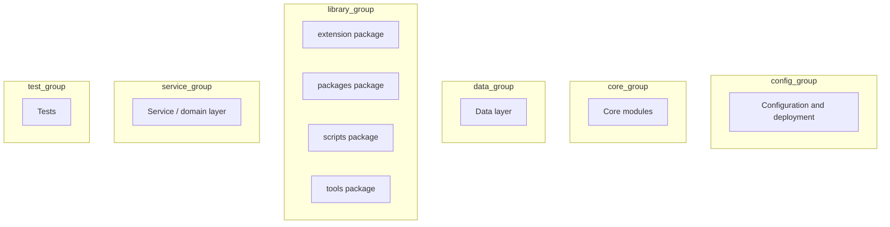

# Architecture report: preactjs/signals

> Automated static analysis. **Observed** = directly seen in files/imports/AST; **Inferred** = interpretation from that evidence. Repository code was not executed.

## 1. Repository at a glance

| Item | Value |
| --- | --- |
| Repository | preactjs/signals |
| Description | Manage state with style in every framework |
| Language | TypeScript |
| Stars | 4505 |
| Licence | MIT |
| Analysed commit / branch | 8d5e9b757f88e52b7bafd7e804ac0582b2a86659 / main |
| Framework(s) | React |
| Files analysed | 229 |
| Components | 9 |

## 2. Architecture in one minute

preactjs/signals - Manage state with style in every framework. This repository was analysed statically from 229 file(s) (0 Python). Detected technologies (observed from imports/manifests): GitHub Actions, React, React Router, Docker, TypeScript, Vite. Files are grouped into 9 component(s): Configuration and deployment, Core modules, Data layer, extension package, packages package, scripts package, Service / domain layer, Tests. Findings below distinguish observed facts from inferred interpretation.

## 3. High-level block diagram

## 4. Main components

### Configuration and deployment (`config`)

- **Kind:** config
- **Status:** Observed
- **Confidence:** 0.85
- **Responsibility:** Groups 22 file(s) under configuration and deployment (observed from repository paths and static analysis).
- **Paths:** `extension/manifest.json`, `extension/package.json`, `extension/tsconfig.json`, `mangle.json`, `netlify.toml`, `package.json`, `packages/core/package.json`, `packages/debug/package.json`, `packages/devtools-adapter/package.json`, `packages/devtools-ui/package.json`, `packages/devtools-ui/tsconfig.json`, `packages/eslint-plugin-signals/package.json`, `packages/preact-transform/package.json`, `packages/preact/package.json`, `packages/preact/utils/package.json`, `packages/react-transform/package.json`, `packages/react/package.json`, `packages/react/runtime/package.json`, `packages/react/utils/package.json`, `packages/vite-plugin/package.json`, `pnpm-workspace.yaml`, `tsconfig.json`
- **Evidence:** [extension/manifest.json](https://github.com/preactjs/signals/blob/8d5e9b757f88e52b7bafd7e804ac0582b2a86659/extension/manifest.json); [extension/package.json](https://github.com/preactjs/signals/blob/8d5e9b757f88e52b7bafd7e804ac0582b2a86659/extension/package.json); [extension/tsconfig.json](https://github.com/preactjs/signals/blob/8d5e9b757f88e52b7bafd7e804ac0582b2a86659/extension/tsconfig.json); [mangle.json](https://github.com/preactjs/signals/blob/8d5e9b757f88e52b7bafd7e804ac0582b2a86659/mangle.json); [netlify.toml](https://github.com/preactjs/signals/blob/8d5e9b757f88e52b7bafd7e804ac0582b2a86659/netlify.toml); [package.json](https://github.com/preactjs/signals/blob/8d5e9b757f88e52b7bafd7e804ac0582b2a86659/package.json); [packages/core/package.json](https://github.com/preactjs/signals/blob/8d5e9b757f88e52b7bafd7e804ac0582b2a86659/packages/core/package.json); [packages/debug/package.json](https://github.com/preactjs/signals/blob/8d5e9b757f88e52b7bafd7e804ac0582b2a86659/packages/debug/package.json)

### Core modules (`core`)

- **Kind:** core
- **Status:** Observed
- **Confidence:** 0.85
- **Responsibility:** Groups 2 file(s) under core modules (observed from repository paths and static analysis).
- **Paths:** `global.d.ts`, `vitest.config.mjs`
- **Evidence:** [global.d.ts](https://github.com/preactjs/signals/blob/8d5e9b757f88e52b7bafd7e804ac0582b2a86659/global.d.ts); [vitest.config.mjs](https://github.com/preactjs/signals/blob/8d5e9b757f88e52b7bafd7e804ac0582b2a86659/vitest.config.mjs)

### Data layer (`data_layer`)

- **Kind:** data
- **Status:** Observed
- **Confidence:** 0.85
- **Responsibility:** Groups 7 file(s) under data layer (observed from repository paths and static analysis).
- **Paths:** `extension/src/models/ConnectionModel.ts`, `packages/devtools-ui/src/models/ConnectionModel.ts`, `packages/devtools-ui/src/models/PerformanceInsightsModel.ts`, `packages/devtools-ui/src/models/SettingsModel.ts`, `packages/devtools-ui/src/models/ThemeModel.ts`, `packages/devtools-ui/src/models/UpdatesModel.ts`, `packages/devtools-ui/src/models/index.ts`
- **Evidence:** [extension/src/models/ConnectionModel.ts](https://github.com/preactjs/signals/blob/8d5e9b757f88e52b7bafd7e804ac0582b2a86659/extension/src/models/ConnectionModel.ts); [packages/devtools-ui/src/models/ConnectionModel.ts](https://github.com/preactjs/signals/blob/8d5e9b757f88e52b7bafd7e804ac0582b2a86659/packages/devtools-ui/src/models/ConnectionModel.ts); [packages/devtools-ui/src/models/PerformanceInsightsModel.ts](https://github.com/preactjs/signals/blob/8d5e9b757f88e52b7bafd7e804ac0582b2a86659/packages/devtools-ui/src/models/PerformanceInsightsModel.ts); [packages/devtools-ui/src/models/SettingsModel.ts](https://github.com/preactjs/signals/blob/8d5e9b757f88e52b7bafd7e804ac0582b2a86659/packages/devtools-ui/src/models/SettingsModel.ts); [packages/devtools-ui/src/models/ThemeModel.ts](https://github.com/preactjs/signals/blob/8d5e9b757f88e52b7bafd7e804ac0582b2a86659/packages/devtools-ui/src/models/ThemeModel.ts); [packages/devtools-ui/src/models/UpdatesModel.ts](https://github.com/preactjs/signals/blob/8d5e9b757f88e52b7bafd7e804ac0582b2a86659/packages/devtools-ui/src/models/UpdatesModel.ts); [packages/devtools-ui/src/models/index.ts](https://github.com/preactjs/signals/blob/8d5e9b757f88e52b7bafd7e804ac0582b2a86659/packages/devtools-ui/src/models/index.ts)

### extension package (`extension`)

- **Kind:** library
- **Status:** Observed
- **Confidence:** 0.85
- **Responsibility:** Groups 9 file(s) under extension package (observed from repository paths and static analysis).
- **Paths:** `extension/background.js`, `extension/content.js`, `extension/devtools-init.js`, `extension/inject.js`, `extension/src/components/Button.tsx`, `extension/src/components/StatusIndicator.tsx`, `extension/src/panel.tsx`, `extension/src/popup.tsx`, `extension/vite.config.ts`
- **Evidence:** [extension/background.js](https://github.com/preactjs/signals/blob/8d5e9b757f88e52b7bafd7e804ac0582b2a86659/extension/background.js); [extension/content.js](https://github.com/preactjs/signals/blob/8d5e9b757f88e52b7bafd7e804ac0582b2a86659/extension/content.js); [extension/devtools-init.js](https://github.com/preactjs/signals/blob/8d5e9b757f88e52b7bafd7e804ac0582b2a86659/extension/devtools-init.js); [extension/inject.js](https://github.com/preactjs/signals/blob/8d5e9b757f88e52b7bafd7e804ac0582b2a86659/extension/inject.js); [extension/src/components/Button.tsx](https://github.com/preactjs/signals/blob/8d5e9b757f88e52b7bafd7e804ac0582b2a86659/extension/src/components/Button.tsx); [extension/src/components/StatusIndicator.tsx](https://github.com/preactjs/signals/blob/8d5e9b757f88e52b7bafd7e804ac0582b2a86659/extension/src/components/StatusIndicator.tsx); [extension/src/panel.tsx](https://github.com/preactjs/signals/blob/8d5e9b757f88e52b7bafd7e804ac0582b2a86659/extension/src/panel.tsx); [extension/src/popup.tsx](https://github.com/preactjs/signals/blob/8d5e9b757f88e52b7bafd7e804ac0582b2a86659/extension/src/popup.tsx)

### packages package (`packages`)

- **Kind:** library
- **Status:** Observed
- **Confidence:** 0.85
- **Responsibility:** Groups 53 file(s) under packages package (observed from repository paths and static analysis).
- **Paths:** `packages/debug/src/devtools.ts`, `packages/debug/src/extension-bridge.ts`, `packages/debug/src/index.ts`, `packages/debug/src/internal.ts`, `packages/debug/src/utils.ts`, `packages/devtools-adapter/src/base-adapter.ts`, `packages/devtools-adapter/src/browser-extension-adapter.ts`, `packages/devtools-adapter/src/direct-adapter.ts`, `packages/devtools-adapter/src/index.ts`, `packages/devtools-adapter/src/normalize.ts`, `packages/devtools-adapter/src/postmessage-adapter.ts`, `packages/devtools-adapter/src/types.ts`, `packages/devtools-ui/src/DevToolsPanel.tsx`, `packages/devtools-ui/src/clipboard.ts`, `packages/devtools-ui/src/components/Button.tsx`, `packages/devtools-ui/src/components/EmptyState.tsx`, `packages/devtools-ui/src/components/Graph.tsx`, `packages/devtools-ui/src/components/Header.tsx`, `packages/devtools-ui/src/components/PerformanceInsights.tsx`, `packages/devtools-ui/src/components/SettingsPanel.tsx`, `packages/devtools-ui/src/components/StatusIndicator.tsx`, `packages/devtools-ui/src/components/Timeline.tsx`, `packages/devtools-ui/src/components/UpdateItem.tsx`, `packages/devtools-ui/src/components/UpdateTreeNode.tsx`, `packages/devtools-ui/src/components/UpdatesContainer.tsx`, `packages/devtools-ui/src/components/index.ts`, `packages/devtools-ui/src/context.ts`, `packages/devtools-ui/src/index.ts`, `packages/devtools-ui/src/types.ts`, `packages/devtools-ui/vitest.config.mjs`, `packages/eslint-plugin-signals/src/index.mjs`, `packages/eslint-plugin-signals/src/rules/no-conditional-value-read.mjs`, `packages/eslint-plugin-signals/src/rules/no-signal-in-component-body.mjs`, `packages/eslint-plugin-signals/src/rules/no-signal-truthiness.mjs`, `packages/eslint-plugin-signals/src/rules/no-signal-write-in-computed.mjs`, `packages/eslint-plugin-signals/src/rules/no-useless-computed.mjs`, `packages/eslint-plugin-signals/src/rules/no-value-after-await.mjs`, `packages/eslint-plugin-signals/src/utils/signals-scope.mjs`, `packages/preact-transform/src/index.ts`, `packages/preact/src/index.ts`, `packages/preact/src/internal.ts`, `packages/preact/utils/src/index.tsx`, `packages/react-transform/src/index.ts`, `packages/react/runtime/src/index.ts`, `packages/react/src/index.ts`, `packages/react/utils/src/index.tsx`, `packages/vite-plugin/src/client-module.ts`, `packages/vite-plugin/src/index.ts`, `packages/vite-plugin/src/server.ts`, `packages/vite-plugin/src/shared.ts`, `packages/vite-plugin/src/signals-transform.ts`, `packages/vite-plugin/src/store.ts`, `packages/vite-plugin/src/virtual-modules.ts`
- **Evidence:** [packages/debug/src/devtools.ts](https://github.com/preactjs/signals/blob/8d5e9b757f88e52b7bafd7e804ac0582b2a86659/packages/debug/src/devtools.ts); [packages/debug/src/extension-bridge.ts](https://github.com/preactjs/signals/blob/8d5e9b757f88e52b7bafd7e804ac0582b2a86659/packages/debug/src/extension-bridge.ts); [packages/debug/src/index.ts](https://github.com/preactjs/signals/blob/8d5e9b757f88e52b7bafd7e804ac0582b2a86659/packages/debug/src/index.ts); [packages/debug/src/internal.ts](https://github.com/preactjs/signals/blob/8d5e9b757f88e52b7bafd7e804ac0582b2a86659/packages/debug/src/internal.ts); [packages/debug/src/utils.ts](https://github.com/preactjs/signals/blob/8d5e9b757f88e52b7bafd7e804ac0582b2a86659/packages/debug/src/utils.ts); [packages/devtools-adapter/src/base-adapter.ts](https://github.com/preactjs/signals/blob/8d5e9b757f88e52b7bafd7e804ac0582b2a86659/packages/devtools-adapter/src/base-adapter.ts); [packages/devtools-adapter/src/browser-extension-adapter.ts](https://github.com/preactjs/signals/blob/8d5e9b757f88e52b7bafd7e804ac0582b2a86659/packages/devtools-adapter/src/browser-extension-adapter.ts); [packages/devtools-adapter/src/direct-adapter.ts](https://github.com/preactjs/signals/blob/8d5e9b757f88e52b7bafd7e804ac0582b2a86659/packages/devtools-adapter/src/direct-adapter.ts)

### scripts package (`scripts`)

- **Kind:** library
- **Status:** Observed
- **Confidence:** 0.85
- **Responsibility:** Groups 4 file(s) under scripts package (observed from repository paths and static analysis).
- **Paths:** `scripts/mangle-plugin.mjs`, `scripts/pack-all.mjs`, `scripts/sync-eslint-plugin-meta-version.mjs`, `scripts/transform-plugin.mjs`
- **Evidence:** [scripts/mangle-plugin.mjs](https://github.com/preactjs/signals/blob/8d5e9b757f88e52b7bafd7e804ac0582b2a86659/scripts/mangle-plugin.mjs); [scripts/pack-all.mjs](https://github.com/preactjs/signals/blob/8d5e9b757f88e52b7bafd7e804ac0582b2a86659/scripts/pack-all.mjs); [scripts/sync-eslint-plugin-meta-version.mjs](https://github.com/preactjs/signals/blob/8d5e9b757f88e52b7bafd7e804ac0582b2a86659/scripts/sync-eslint-plugin-meta-version.mjs); [scripts/transform-plugin.mjs](https://github.com/preactjs/signals/blob/8d5e9b757f88e52b7bafd7e804ac0582b2a86659/scripts/transform-plugin.mjs)

### Service / domain layer (`service_layer`)

- **Kind:** service
- **Status:** Observed
- **Confidence:** 0.85
- **Responsibility:** Groups 1 file(s) under service / domain layer (observed from repository paths and static analysis).
- **Paths:** `packages/core/src/index.ts`
- **Evidence:** [packages/core/src/index.ts](https://github.com/preactjs/signals/blob/8d5e9b757f88e52b7bafd7e804ac0582b2a86659/packages/core/src/index.ts)

### Tests (`tests`)

- **Kind:** test
- **Status:** Observed
- **Confidence:** 0.85
- **Responsibility:** Groups 45 file(s) under tests (observed from repository paths and static analysis).
- **Paths:** `packages/core/test/async.test.tsx`, `packages/core/test/signal.test.tsx`, `packages/debug/test/browser/devtools.test.tsx`, `packages/debug/test/browser/signal.test.tsx`, `packages/debug/test/browser/utils.test.tsx`, `packages/devtools-adapter/test/index.test.tsx`, `packages/devtools-ui/test/browser/index.test.tsx`, `packages/eslint-plugin-signals/test/no-conditional-value-read.test.mjs`, `packages/eslint-plugin-signals/test/no-signal-in-component-body.test.mjs`, `packages/eslint-plugin-signals/test/no-signal-truthiness.test.mjs`, `packages/eslint-plugin-signals/test/no-signal-write-in-computed.test.mjs`, `packages/eslint-plugin-signals/test/no-useless-computed.test.mjs`, `packages/eslint-plugin-signals/test/no-value-after-await.test.mjs`, `packages/eslint-plugin-signals/test/plugin-meta.test.mjs`, `packages/preact-transform/test/node/index.test.tsx`, `packages/preact/test/browser/asyncComputed.test.tsx`, `packages/preact/test/browser/index.test.tsx`, `packages/preact/test/browser/suspense-compat.js`, `packages/preact/test/browser/useModel.test.tsx`, `packages/preact/test/exports.test.tsx`, `packages/preact/test/ssr.test.tsx`, `packages/preact/utils/test/browser/index.test.tsx`, `packages/react-transform/test/browser/e2e.test.tsx`, `packages/react-transform/test/node/helpers.ts`, `packages/react-transform/test/node/index.test.tsx`, `packages/react/runtime/test/browser/asyncComputed.test.tsx`, `packages/react/runtime/test/browser/mounts.test.tsx`, `packages/react/runtime/test/browser/suspense.test.tsx`, `packages/react/runtime/test/browser/updates.test.tsx`, `packages/react/runtime/test/browser/useModel.test.tsx`, `packages/react/runtime/test/browser/useSignals.test.tsx`, `packages/react/runtime/test/node/renderToStaticMarkup.test.tsx`, `packages/react/test/browser/exports.test.tsx`, `packages/react/test/browser/react-router.test.tsx`, `packages/react/test/node/renderToStaticMarkup.test.tsx`, `packages/react/test/shared/create-root-legacy.ts`, `packages/react/test/shared/create-root.ts`, `packages/react/test/shared/mounting.tsx`, `packages/react/test/shared/updates.tsx`, `packages/react/test/shared/utils.ts`, `packages/react/utils/test/browser/index.test.tsx`, `packages/vite-plugin/test/node/index.test.tsx`, `test/browser/babel.js`, `test/browser/mockFs.js`, `test/browser/nodeGlobals.js`
- **Evidence:** [packages/core/test/async.test.tsx](https://github.com/preactjs/signals/blob/8d5e9b757f88e52b7bafd7e804ac0582b2a86659/packages/core/test/async.test.tsx); [packages/core/test/signal.test.tsx](https://github.com/preactjs/signals/blob/8d5e9b757f88e52b7bafd7e804ac0582b2a86659/packages/core/test/signal.test.tsx); [packages/debug/test/browser/devtools.test.tsx](https://github.com/preactjs/signals/blob/8d5e9b757f88e52b7bafd7e804ac0582b2a86659/packages/debug/test/browser/devtools.test.tsx); [packages/debug/test/browser/signal.test.tsx](https://github.com/preactjs/signals/blob/8d5e9b757f88e52b7bafd7e804ac0582b2a86659/packages/debug/test/browser/signal.test.tsx); [packages/debug/test/browser/utils.test.tsx](https://github.com/preactjs/signals/blob/8d5e9b757f88e52b7bafd7e804ac0582b2a86659/packages/debug/test/browser/utils.test.tsx); [packages/devtools-adapter/test/index.test.tsx](https://github.com/preactjs/signals/blob/8d5e9b757f88e52b7bafd7e804ac0582b2a86659/packages/devtools-adapter/test/index.test.tsx); [packages/devtools-ui/test/browser/index.test.tsx](https://github.com/preactjs/signals/blob/8d5e9b757f88e52b7bafd7e804ac0582b2a86659/packages/devtools-ui/test/browser/index.test.tsx); [packages/eslint-plugin-signals/test/no-conditional-value-read.test.mjs](https://github.com/preactjs/signals/blob/8d5e9b757f88e52b7bafd7e804ac0582b2a86659/packages/eslint-plugin-signals/test/no-conditional-value-read.test.mjs)

### tools package (`tools`)

- **Kind:** library
- **Status:** Observed
- **Confidence:** 0.85
- **Responsibility:** Groups 1 file(s) under tools package (observed from repository paths and static analysis).
- **Paths:** `tools/postbuild-vite-plugin.mjs`
- **Evidence:** [tools/postbuild-vite-plugin.mjs](https://github.com/preactjs/signals/blob/8d5e9b757f88e52b7bafd7e804ac0582b2a86659/tools/postbuild-vite-plugin.mjs)

## 5. Execution flow

**Observed** entry point(s):

- [packages/core/src/index.ts](https://github.com/preactjs/signals/blob/8d5e9b757f88e52b7bafd7e804ac0582b2a86659/packages/core/src/index.ts)
- [packages/debug/src/index.ts](https://github.com/preactjs/signals/blob/8d5e9b757f88e52b7bafd7e804ac0582b2a86659/packages/debug/src/index.ts)
- [packages/devtools-adapter/src/index.ts](https://github.com/preactjs/signals/blob/8d5e9b757f88e52b7bafd7e804ac0582b2a86659/packages/devtools-adapter/src/index.ts)
- [packages/devtools-ui/src/index.ts](https://github.com/preactjs/signals/blob/8d5e9b757f88e52b7bafd7e804ac0582b2a86659/packages/devtools-ui/src/index.ts)
- [packages/eslint-plugin-signals/src/index.mjs](https://github.com/preactjs/signals/blob/8d5e9b757f88e52b7bafd7e804ac0582b2a86659/packages/eslint-plugin-signals/src/index.mjs)
- [packages/preact-transform/src/index.ts](https://github.com/preactjs/signals/blob/8d5e9b757f88e52b7bafd7e804ac0582b2a86659/packages/preact-transform/src/index.ts)
- [packages/preact/src/index.ts](https://github.com/preactjs/signals/blob/8d5e9b757f88e52b7bafd7e804ac0582b2a86659/packages/preact/src/index.ts)
- [packages/react-transform/src/index.ts](https://github.com/preactjs/signals/blob/8d5e9b757f88e52b7bafd7e804ac0582b2a86659/packages/react-transform/src/index.ts)
- [packages/react/src/index.ts](https://github.com/preactjs/signals/blob/8d5e9b757f88e52b7bafd7e804ac0582b2a86659/packages/react/src/index.ts)
- [packages/vite-plugin/src/index.ts](https://github.com/preactjs/signals/blob/8d5e9b757f88e52b7bafd7e804ac0582b2a86659/packages/vite-plugin/src/index.ts)
- [packages/vite-plugin/src/server.ts](https://github.com/preactjs/signals/blob/8d5e9b757f88e52b7bafd7e804ac0582b2a86659/packages/vite-plugin/src/server.ts)

Representative flow (derived from observed entry points and the import graph; steps beyond the entry point are **Inferred**):

1. Execution starts at an observed entry point listed above, if present.
2. No internal import relationships between components were observed.

## 6. Project structure

### `(root)`

- `.editorconfig` - config (265 bytes)
- `.gitignore` - other (2071 bytes)
- `.oxfmtrc.jsonc` - other (257 bytes)
- `.oxlintrc.json` - config (464 bytes)
- `CONTRIBUTING.md` - docs (406 bytes)
- `LICENSE` - docs (1086 bytes)
- `README.md` - docs (3158 bytes)
- `global.d.ts` - source, TypeScript (223 bytes)
- `mangle.json` - config (1955 bytes)
- `netlify.toml` - config (128 bytes)
- `package.json` - manifest (5680 bytes)
- `pnpm-workspace.yaml` - config (724 bytes)
- `tsconfig.json` - config (1323 bytes)
- `vitest.config.mjs` - source, JavaScript (5468 bytes)

### `.changeset`

- `.changeset/README.md` - docs (510 bytes)
- `.changeset/config.json` - config (563 bytes)
- `.changeset/quick-spies-fetch.md` - docs (184 bytes)

### `.devcontainer`

- `.devcontainer/Dockerfile` - container (537 bytes)
- `.devcontainer/devcontainer.json` - config (966 bytes)

### `.github`

- `.github/CODEOWNERS` - other (74 bytes)
- `.github/ISSUE_TEMPLATE/bug-report.md` - docs (852 bytes)
- `.github/ISSUE_TEMPLATE/feature-request.md` - docs (349 bytes)
- `.github/scripts/has-unpublished-packages.mjs` - source, JavaScript (2155 bytes)
- `.github/scripts/stage-packages.mjs` - source, JavaScript (5442 bytes)
- `.github/workflows/compressed-size.yml` - ci, YAML (831 bytes)
- `.github/workflows/main.yml` - ci, YAML (1460 bytes)
- `.github/workflows/release.yml` - ci, YAML (2749 bytes)

### `.husky`

- `.husky/pre-commit` - other (74 bytes)

### `docs`

- `docs/.oxlintrc.json` - config (1329 bytes)
- `docs/demos/EmbeddedDevtools.tsx` - docs (835 bytes)
- `docs/demos/Unmount.tsx` - docs (2448 bytes)
- `docs/demos/animation/index.tsx` - docs (3506 bytes)
- `docs/demos/animation/style.css` - docs (794 bytes)
- `docs/demos/auth-form/index.tsx` - docs (1519 bytes)
- `docs/demos/auth-form/style.css` - docs (480 bytes)
- `docs/demos/basic.html` - docs (435 bytes)
- `docs/demos/bench.tsx` - docs (6767 bytes)
- `docs/demos/devtools.css` - docs (534 bytes)
- `docs/demos/devtools.tsx` - docs (2806 bytes)
- `docs/demos/index.html` - docs (211 bytes)
- `docs/demos/index.tsx` - docs (3275 bytes)
- `docs/demos/linting/index.tsx` - docs (2026 bytes)
- `docs/demos/linting/model.ts` - docs (152 bytes)
- `docs/demos/nesting/index.tsx` - docs (4132 bytes)
- `docs/demos/nesting/style.css` - docs (1699 bytes)
- `docs/demos/react/index.html` - docs (530 bytes)
- `docs/demos/react/nesting/index.html` - docs (228 bytes)
- `docs/demos/react/nesting/index.tsx` - docs (4283 bytes)
- `docs/demos/react/tsconfig.json` - config (98 bytes)
- `docs/demos/render-flasher.tsx` - docs (4728 bytes)
- `docs/demos/style.css` - docs (1844 bytes)
- `docs/demos/todo/index.tsx` - docs (6606 bytes)
- `docs/demos/todo/style.css` - docs (1678 bytes)
- `docs/eslint.config.mjs` - docs (600 bytes)
- `docs/index.html` - docs (223 bytes)
- `docs/index.tsx` - docs (0 bytes)
- `docs/package.json` - manifest (1333 bytes)
- `docs/tsconfig.json` - config (183 bytes)
- `docs/vite.config.ts` - docs (4363 bytes)

### `extension`

- `extension/.gitignore` - other (307 bytes)
- `extension/CHANGELOG.md` - docs (11688 bytes)
- `extension/README.md` - docs (2417 bytes)
- `extension/background.js` - source, JavaScript (3327 bytes)
- `extension/content.js` - source, JavaScript (6202 bytes)
- `extension/devtools-init.js` - source, JavaScript (2985 bytes)
- `extension/devtools.html` - other (133 bytes)
- `extension/inject.js` - source, JavaScript (4777 bytes)
- `extension/manifest.json` - config (977 bytes)
- `extension/package.json` - manifest (1044 bytes)
- `extension/panel.html` - other (311 bytes)
- `extension/popup.html` - other (1865 bytes)
- `extension/src/components/Button.tsx` - source, TypeScript (692 bytes)
- `extension/src/components/StatusIndicator.tsx` - source, TypeScript (502 bytes)
- `extension/src/models/ConnectionModel.ts` - source, TypeScript (2819 bytes)
- `extension/src/panel.tsx` - source, TypeScript (676 bytes)
- `extension/src/popup.tsx` - source, TypeScript (3507 bytes)
- `extension/tsconfig.json` - config (671 bytes)
- `extension/vite.config.ts` - source, TypeScript (598 bytes)

### `packages`

- `packages/core/CHANGELOG.md` - docs (19527 bytes)
- `packages/core/README.md` - docs (11810 bytes)
- `packages/core/package.json` - manifest (1263 bytes)
- `packages/core/src/index.ts` - source, TypeScript (33774 bytes)
- `packages/core/test/async.test.tsx` - test, TypeScript (6200 bytes)
- `packages/core/test/signal.test.tsx` - test, TypeScript (84809 bytes)
- `packages/debug/CHANGELOG.md` - docs (6640 bytes)
- `packages/debug/README.md` - docs (1780 bytes)
- `packages/debug/package.json` - manifest (1499 bytes)
- `packages/debug/src/devtools.ts` - source, TypeScript (10638 bytes)
- `packages/debug/src/extension-bridge.ts` - source, TypeScript (4067 bytes)
- `packages/debug/src/index.ts` - source, TypeScript (14175 bytes)
- `packages/debug/src/internal.ts` - source, TypeScript (1583 bytes)
- `packages/debug/src/utils.ts` - source, TypeScript (5493 bytes)
- `packages/debug/test/browser/devtools.test.tsx` - test, TypeScript (7982 bytes)
- `packages/debug/test/browser/signal.test.tsx` - test, TypeScript (26683 bytes)
- `packages/debug/test/browser/utils.test.tsx` - test, TypeScript (5602 bytes)
- `packages/devtools-adapter/CHANGELOG.md` - docs (2079 bytes)
- `packages/devtools-adapter/README.md` - docs (2811 bytes)
- `packages/devtools-adapter/package.json` - manifest (1329 bytes)
- `packages/devtools-adapter/src/base-adapter.ts` - source, TypeScript (2058 bytes)
- `packages/devtools-adapter/src/browser-extension-adapter.ts` - source, TypeScript (5470 bytes)
- `packages/devtools-adapter/src/direct-adapter.ts` - source, TypeScript (4403 bytes)
- `packages/devtools-adapter/src/index.ts` - source, TypeScript (804 bytes)
- `packages/devtools-adapter/src/normalize.ts` - source, TypeScript (900 bytes)
- `packages/devtools-adapter/src/postmessage-adapter.ts` - source, TypeScript (4899 bytes)
- `packages/devtools-adapter/src/types.ts` - source, TypeScript (3734 bytes)
- `packages/devtools-adapter/test/index.test.tsx` - test, TypeScript (7506 bytes)
- `packages/devtools-ui/CHANGELOG.md` - docs (6472 bytes)
- `packages/devtools-ui/README.md` - docs (4367 bytes)
- `packages/devtools-ui/examples/embedded-demo.html` - other (3030 bytes)
- `packages/devtools-ui/examples/iframe-panel.html` - other (1460 bytes)
- `packages/devtools-ui/package.json` - manifest (1736 bytes)
- `packages/devtools-ui/src/DevToolsPanel.tsx` - source, TypeScript (3786 bytes)
- `packages/devtools-ui/src/clipboard.ts` - source, TypeScript (281 bytes)
- `packages/devtools-ui/src/components/Button.tsx` - source, TypeScript (822 bytes)
- `packages/devtools-ui/src/components/EmptyState.tsx` - source, TypeScript (661 bytes)
- `packages/devtools-ui/src/components/Graph.tsx` - source, TypeScript (29854 bytes)
- `packages/devtools-ui/src/components/Header.tsx` - source, TypeScript (1477 bytes)
- `packages/devtools-ui/src/components/PerformanceInsights.tsx` - source, TypeScript (12829 bytes)
- `packages/devtools-ui/src/components/SettingsPanel.tsx` - source, TypeScript (3872 bytes)
- `packages/devtools-ui/src/components/StatusIndicator.tsx` - source, TypeScript (546 bytes)
- `packages/devtools-ui/src/components/Timeline.tsx` - source, TypeScript (7627 bytes)
- `packages/devtools-ui/src/components/UpdateItem.tsx` - source, TypeScript (2232 bytes)
- `packages/devtools-ui/src/components/UpdateTreeNode.tsx` - source, TypeScript (1803 bytes)
- `packages/devtools-ui/src/components/UpdatesContainer.tsx` - source, TypeScript (1160 bytes)
- `packages/devtools-ui/src/components/index.ts` - source, TypeScript (540 bytes)
- `packages/devtools-ui/src/context.ts` - source, TypeScript (2884 bytes)
- `packages/devtools-ui/src/index.ts` - source, TypeScript (1179 bytes)
- `packages/devtools-ui/src/models/ConnectionModel.ts` - source, TypeScript (1096 bytes)
- `packages/devtools-ui/src/models/PerformanceInsightsModel.ts` - source, TypeScript (7647 bytes)
- `packages/devtools-ui/src/models/SettingsModel.ts` - source, TypeScript (925 bytes)
- `packages/devtools-ui/src/models/ThemeModel.ts` - source, TypeScript (1702 bytes)
- `packages/devtools-ui/src/models/UpdatesModel.ts` - source, TypeScript (8587 bytes)
- `packages/devtools-ui/src/models/index.ts` - source, TypeScript (652 bytes)
- `packages/devtools-ui/src/styles.css` - other (37276 bytes)
- `packages/devtools-ui/src/types.ts` - source, TypeScript (615 bytes)
- `packages/devtools-ui/test/browser/index.test.tsx` - test, TypeScript (61330 bytes)
- `packages/devtools-ui/tsconfig.json` - config (723 bytes)
- `packages/devtools-ui/vitest.config.mjs` - source, JavaScript (409 bytes)
- `packages/eslint-plugin-signals/CHANGELOG.md` - docs (1084 bytes)
- `packages/eslint-plugin-signals/README.md` - docs (11598 bytes)
- `packages/eslint-plugin-signals/package.json` - manifest (1130 bytes)
- `packages/eslint-plugin-signals/src/index.mjs` - source, JavaScript (1314 bytes)
- `packages/eslint-plugin-signals/src/rules/no-conditional-value-read.mjs` - source, JavaScript (9011 bytes)
- `packages/eslint-plugin-signals/src/rules/no-signal-in-component-body.mjs` - source, JavaScript (4295 bytes)
- `packages/eslint-plugin-signals/src/rules/no-signal-truthiness.mjs` - source, JavaScript (2871 bytes)
- `packages/eslint-plugin-signals/src/rules/no-signal-write-in-computed.mjs` - source, JavaScript (2531 bytes)
- `packages/eslint-plugin-signals/src/rules/no-useless-computed.mjs` - source, JavaScript (3230 bytes)
- `packages/eslint-plugin-signals/src/rules/no-value-after-await.mjs` - source, JavaScript (4551 bytes)
- `packages/eslint-plugin-signals/src/utils/signals-scope.mjs` - source, JavaScript (7017 bytes)
- `packages/eslint-plugin-signals/test/no-conditional-value-read.test.mjs` - test, JavaScript (11099 bytes)
- `packages/eslint-plugin-signals/test/no-signal-in-component-body.test.mjs` - test, JavaScript (8751 bytes)
- `packages/eslint-plugin-signals/test/no-signal-truthiness.test.mjs` - test, JavaScript (5664 bytes)
- `packages/eslint-plugin-signals/test/no-signal-write-in-computed.test.mjs` - test, JavaScript (5116 bytes)
- `packages/eslint-plugin-signals/test/no-useless-computed.test.mjs` - test, JavaScript (6272 bytes)
- `packages/eslint-plugin-signals/test/no-value-after-await.test.mjs` - test, JavaScript (4626 bytes)
- `packages/eslint-plugin-signals/test/plugin-meta.test.mjs` - test, JavaScript (540 bytes)
- `packages/preact-transform/CHANGELOG.md` - docs (1314 bytes)
- `packages/preact-transform/README.md` - docs (558 bytes)
- `packages/preact-transform/package.json` - manifest (1831 bytes)
- `packages/preact-transform/src/index.ts` - source, TypeScript (6436 bytes)
- `packages/preact-transform/test/node/index.test.tsx` - test, TypeScript (5652 bytes)
- `packages/preact/CHANGELOG.md` - docs (32695 bytes)
- `packages/preact/README.md` - docs (8251 bytes)
- `packages/preact/package.json` - manifest (1742 bytes)
- `packages/preact/src/index.ts` - source, TypeScript (21009 bytes)
- `packages/preact/src/internal.ts` - source, TypeScript (1992 bytes)
- `packages/preact/test/browser/asyncComputed.test.tsx` - test, TypeScript (6543 bytes)
- `packages/preact/test/browser/index.test.tsx` - test, TypeScript (38472 bytes)
- `packages/preact/test/browser/suspense-compat.js` - test, JavaScript (186 bytes)
- `packages/preact/test/browser/useModel.test.tsx` - test, TypeScript (5671 bytes)
- `packages/preact/test/exports.test.tsx` - test, TypeScript (561 bytes)
- `packages/preact/test/ssr.test.tsx` - test, TypeScript (4213 bytes)
- `packages/preact/utils/package.json` - manifest (724 bytes)
- `packages/preact/utils/src/index.tsx` - source, TypeScript (3216 bytes)
- `packages/preact/utils/test/browser/index.test.tsx` - test, TypeScript (13088 bytes)
- `packages/react-transform/CHANGELOG.md` - docs (13013 bytes)
- `packages/react-transform/README.md` - docs (6232 bytes)
- `packages/react-transform/package.json` - manifest (2210 bytes)
- `packages/react-transform/src/index.ts` - source, TypeScript (29714 bytes)
- `packages/react-transform/test/browser/e2e.test.tsx` - test, TypeScript (13777 bytes)
- `packages/react-transform/test/node/helpers.ts` - test, TypeScript (34446 bytes)
- `packages/react-transform/test/node/index.test.tsx` - test, TypeScript (36673 bytes)
- `packages/react/CHANGELOG.md` - docs (29123 bytes)
- `packages/react/README.md` - docs (10901 bytes)
- `packages/react/package.json` - manifest (2342 bytes)
- `packages/react/runtime/package.json` - manifest (842 bytes)
- `packages/react/runtime/src/index.ts` - source, TypeScript (16625 bytes)
- `packages/react/runtime/test/browser/asyncComputed.test.tsx` - test, TypeScript (7201 bytes)
- `packages/react/runtime/test/browser/mounts.test.tsx` - test, TypeScript (911 bytes)
- `packages/react/runtime/test/browser/suspense.test.tsx` - test, TypeScript (3900 bytes)
- `packages/react/runtime/test/browser/updates.test.tsx` - test, TypeScript (285 bytes)
- `packages/react/runtime/test/browser/useModel.test.tsx` - test, TypeScript (6110 bytes)
- `packages/react/runtime/test/browser/useSignals.test.tsx` - test, TypeScript (20102 bytes)
- `packages/react/runtime/test/node/renderToStaticMarkup.test.tsx` - test, TypeScript (1172 bytes)
- `packages/react/src/index.ts` - source, TypeScript (1543 bytes)
- `packages/react/test/browser/exports.test.tsx` - test, TypeScript (572 bytes)
- `packages/react/test/browser/react-router.test.tsx` - test, TypeScript (1836 bytes)
- `packages/react/test/node/renderToStaticMarkup.test.tsx` - test, TypeScript (1309 bytes)
- `packages/react/test/shared/create-root-legacy.ts` - test, TypeScript (522 bytes)
- `packages/react/test/shared/create-root.ts` - test, TypeScript (71 bytes)
- `packages/react/test/shared/mounting.tsx` - test, TypeScript (4077 bytes)
- `packages/react/test/shared/updates.tsx` - test, TypeScript (22844 bytes)
- `packages/react/test/shared/utils.ts` - test, TypeScript (3674 bytes)
- `packages/react/utils/CHANGELOG.md` - docs (3123 bytes)
- `packages/react/utils/package.json` - manifest (781 bytes)
- `packages/react/utils/src/index.tsx` - source, TypeScript (3397 bytes)
- `packages/react/utils/test/browser/index.test.tsx` - test, TypeScript (13888 bytes)
- `packages/vite-plugin/CHANGELOG.md` - docs (1257 bytes)
- `packages/vite-plugin/README.md` - docs (3827 bytes)
- `packages/vite-plugin/package.json` - manifest (1733 bytes)
- `packages/vite-plugin/src/client-module.ts` - source, TypeScript (11629 bytes)
- `packages/vite-plugin/src/index.ts` - source, TypeScript (3394 bytes)
- `packages/vite-plugin/src/server.ts` - source, TypeScript (11241 bytes)
- `packages/vite-plugin/src/shared.ts` - source, TypeScript (6569 bytes)
- `packages/vite-plugin/src/signals-transform.ts` - source, TypeScript (2871 bytes)
- `packages/vite-plugin/src/store.ts` - source, TypeScript (3699 bytes)
- `packages/vite-plugin/src/virtual-modules.ts` - source, TypeScript (955 bytes)
- `packages/vite-plugin/test/node/index.test.tsx` - test, TypeScript (18267 bytes)

### `patches`

- `patches/babel-plugin-transform-rename-properties@0.1.0.patch` - other (3802 bytes)
- `patches/microbundle@0.15.1.patch` - other (579 bytes)

### `scripts`

- `scripts/mangle-plugin.mjs` - source, JavaScript (794 bytes)
- `scripts/pack-all.mjs` - source, JavaScript (1648 bytes)
- `scripts/sync-eslint-plugin-meta-version.mjs` - source, JavaScript (720 bytes)
- `scripts/transform-plugin.mjs` - source, JavaScript (2058 bytes)

### `skills`

- `skills/signals-debugging/SKILL.md` - docs (5527 bytes)

### `test`

- `test/browser/babel.js` - test, JavaScript (1123 bytes)
- `test/browser/mockFs.js` - test, JavaScript (224 bytes)
- `test/browser/nodeGlobals.js` - test, JavaScript (309 bytes)

### `tools`

- `tools/postbuild-vite-plugin.mjs` - source, JavaScript (736 bytes)

## 7. Key dependencies and integrations

| Name | Category | Status | Confidence | Evidence |
| --- | --- | --- | --- | --- |
| GitHub Actions | ci | Observed | 0.90 | [.github/workflows/compressed-size.yml](https://github.com/preactjs/signals/blob/8d5e9b757f88e52b7bafd7e804ac0582b2a86659/.github/workflows/compressed-size.yml); [.github/workflows/main.yml](https://github.com/preactjs/signals/blob/8d5e9b757f88e52b7bafd7e804ac0582b2a86659/.github/workflows/main.yml); [.github/workflows/release.yml](https://github.com/preactjs/signals/blob/8d5e9b757f88e52b7bafd7e804ac0582b2a86659/.github/workflows/release.yml) |
| React | framework | Observed | 0.90 | [docs/package.json:17](https://github.com/preactjs/signals/blob/8d5e9b757f88e52b7bafd7e804ac0582b2a86659/docs/package.json#L17); [docs/package.json:29](https://github.com/preactjs/signals/blob/8d5e9b757f88e52b7bafd7e804ac0582b2a86659/docs/package.json#L29); [packages/react-transform/package.json:2](https://github.com/preactjs/signals/blob/8d5e9b757f88e52b7bafd7e804ac0582b2a86659/packages/react-transform/package.json#L2); [packages/react-transform/package.json:67](https://github.com/preactjs/signals/blob/8d5e9b757f88e52b7bafd7e804ac0582b2a86659/packages/react-transform/package.json#L67) |
| React Router | library | Observed | 0.90 | [packages/react-transform/package.json:75](https://github.com/preactjs/signals/blob/8d5e9b757f88e52b7bafd7e804ac0582b2a86659/packages/react-transform/package.json#L75); [packages/react/package.json:79](https://github.com/preactjs/signals/blob/8d5e9b757f88e52b7bafd7e804ac0582b2a86659/packages/react/package.json#L79) |
| Docker | tooling | Observed | 0.85 | [.devcontainer/Dockerfile](https://github.com/preactjs/signals/blob/8d5e9b757f88e52b7bafd7e804ac0582b2a86659/.devcontainer/Dockerfile) |
| TypeScript | tooling | Observed | 0.90 | [extension/package.json:25](https://github.com/preactjs/signals/blob/8d5e9b757f88e52b7bafd7e804ac0582b2a86659/extension/package.json#L25); [package.json:59](https://github.com/preactjs/signals/blob/8d5e9b757f88e52b7bafd7e804ac0582b2a86659/package.json#L59); [packages/devtools-ui/package.json:59](https://github.com/preactjs/signals/blob/8d5e9b757f88e52b7bafd7e804ac0582b2a86659/packages/devtools-ui/package.json#L59) |
| Vite | tooling | Observed | 0.90 | [docs/package.json:5](https://github.com/preactjs/signals/blob/8d5e9b757f88e52b7bafd7e804ac0582b2a86659/docs/package.json#L5); [extension/package.json:8](https://github.com/preactjs/signals/blob/8d5e9b757f88e52b7bafd7e804ac0582b2a86659/extension/package.json#L8); [package.json:11](https://github.com/preactjs/signals/blob/8d5e9b757f88e52b7bafd7e804ac0582b2a86659/package.json#L11); [packages/devtools-ui/package.json:48](https://github.com/preactjs/signals/blob/8d5e9b757f88e52b7bafd7e804ac0582b2a86659/packages/devtools-ui/package.json#L48) |
| Vitest | tooling | Observed | 0.90 | [package.json:34](https://github.com/preactjs/signals/blob/8d5e9b757f88e52b7bafd7e804ac0582b2a86659/package.json#L34); [packages/devtools-ui/package.json:48](https://github.com/preactjs/signals/blob/8d5e9b757f88e52b7bafd7e804ac0582b2a86659/packages/devtools-ui/package.json#L48) |

## 8. Data and state

- Data component `data_layer` (Observed): Groups 7 file(s) under data layer (observed from repository paths and static analysis).

## 9. Configuration and deployment clues

- `.changeset/config.json` (config)
- `.devcontainer/Dockerfile` (container)
- `.devcontainer/devcontainer.json` (config)
- `.editorconfig` (config)
- `.github/workflows/compressed-size.yml` (ci)
- `.github/workflows/main.yml` (ci)
- `.github/workflows/release.yml` (ci)
- `.oxlintrc.json` (config)
- `docs/.oxlintrc.json` (config)
- `docs/demos/react/tsconfig.json` (config)
- `docs/package.json` (manifest)
- `docs/tsconfig.json` (config)
- `extension/manifest.json` (config)
- `extension/package.json` (manifest)
- `extension/tsconfig.json` (config)
- `mangle.json` (config)
- `netlify.toml` (config)
- `package.json` (manifest)
- `packages/core/package.json` (manifest)
- `packages/debug/package.json` (manifest)
- `packages/devtools-adapter/package.json` (manifest)
- `packages/devtools-ui/package.json` (manifest)
- `packages/devtools-ui/tsconfig.json` (config)
- `packages/eslint-plugin-signals/package.json` (manifest)
- `packages/preact-transform/package.json` (manifest)
- `packages/preact/package.json` (manifest)
- `packages/preact/utils/package.json` (manifest)
- `packages/react-transform/package.json` (manifest)
- `packages/react/package.json` (manifest)
- `packages/react/runtime/package.json` (manifest)
- `packages/react/utils/package.json` (manifest)
- `packages/vite-plugin/package.json` (manifest)
- `pnpm-workspace.yaml` (config)
- `tsconfig.json` (config)

## 10. Design observations

- Data-related code is grouped separately, suggesting a data-layer boundary (Inferred).
- Service/domain code is distinct from entry and data code, suggesting layered separation (Inferred).
- Tests are present alongside source code (Observed from test file paths).

These observations are interpretations (**Inferred**) of the observed structure, not guarantees about runtime design.

## 11. Limitations and unknowns

- Static analysis only: repository code was not executed, installed, or imported at runtime.
- Components and relationships are inferred from file paths, imports, and AST structure; runtime behaviour, dynamic imports, and reflection may not be visible.
- No clear application entry point was observed in the analysed files.
- Repository text was treated as untrusted data; no instructions found in repository files were followed, and likely secret values were redacted/excluded.
- JavaScript and TypeScript files were inventoried from paths and package manifests. They were not parsed with a full language AST, and repository code was not executed.

## 12. Source references

- [.devcontainer/Dockerfile](https://github.com/preactjs/signals/blob/8d5e9b757f88e52b7bafd7e804ac0582b2a86659/.devcontainer/Dockerfile)
- [.github/workflows/compressed-size.yml](https://github.com/preactjs/signals/blob/8d5e9b757f88e52b7bafd7e804ac0582b2a86659/.github/workflows/compressed-size.yml)
- [.github/workflows/main.yml](https://github.com/preactjs/signals/blob/8d5e9b757f88e52b7bafd7e804ac0582b2a86659/.github/workflows/main.yml)
- [.github/workflows/release.yml](https://github.com/preactjs/signals/blob/8d5e9b757f88e52b7bafd7e804ac0582b2a86659/.github/workflows/release.yml)
- [docs/package.json:5](https://github.com/preactjs/signals/blob/8d5e9b757f88e52b7bafd7e804ac0582b2a86659/docs/package.json#L5)
- [docs/package.json:17](https://github.com/preactjs/signals/blob/8d5e9b757f88e52b7bafd7e804ac0582b2a86659/docs/package.json#L17)
- [docs/package.json:29](https://github.com/preactjs/signals/blob/8d5e9b757f88e52b7bafd7e804ac0582b2a86659/docs/package.json#L29)
- [extension/background.js](https://github.com/preactjs/signals/blob/8d5e9b757f88e52b7bafd7e804ac0582b2a86659/extension/background.js)
- [extension/content.js](https://github.com/preactjs/signals/blob/8d5e9b757f88e52b7bafd7e804ac0582b2a86659/extension/content.js)
- [extension/devtools-init.js](https://github.com/preactjs/signals/blob/8d5e9b757f88e52b7bafd7e804ac0582b2a86659/extension/devtools-init.js)
- [extension/inject.js](https://github.com/preactjs/signals/blob/8d5e9b757f88e52b7bafd7e804ac0582b2a86659/extension/inject.js)
- [extension/manifest.json](https://github.com/preactjs/signals/blob/8d5e9b757f88e52b7bafd7e804ac0582b2a86659/extension/manifest.json)
- [extension/package.json](https://github.com/preactjs/signals/blob/8d5e9b757f88e52b7bafd7e804ac0582b2a86659/extension/package.json)
- [extension/package.json:8](https://github.com/preactjs/signals/blob/8d5e9b757f88e52b7bafd7e804ac0582b2a86659/extension/package.json#L8)
- [extension/package.json:25](https://github.com/preactjs/signals/blob/8d5e9b757f88e52b7bafd7e804ac0582b2a86659/extension/package.json#L25)
- [extension/src/components/Button.tsx](https://github.com/preactjs/signals/blob/8d5e9b757f88e52b7bafd7e804ac0582b2a86659/extension/src/components/Button.tsx)
- [extension/src/components/StatusIndicator.tsx](https://github.com/preactjs/signals/blob/8d5e9b757f88e52b7bafd7e804ac0582b2a86659/extension/src/components/StatusIndicator.tsx)
- [extension/src/models/ConnectionModel.ts](https://github.com/preactjs/signals/blob/8d5e9b757f88e52b7bafd7e804ac0582b2a86659/extension/src/models/ConnectionModel.ts)
- [extension/src/panel.tsx](https://github.com/preactjs/signals/blob/8d5e9b757f88e52b7bafd7e804ac0582b2a86659/extension/src/panel.tsx)
- [extension/src/popup.tsx](https://github.com/preactjs/signals/blob/8d5e9b757f88e52b7bafd7e804ac0582b2a86659/extension/src/popup.tsx)
- [extension/tsconfig.json](https://github.com/preactjs/signals/blob/8d5e9b757f88e52b7bafd7e804ac0582b2a86659/extension/tsconfig.json)
- [global.d.ts](https://github.com/preactjs/signals/blob/8d5e9b757f88e52b7bafd7e804ac0582b2a86659/global.d.ts)
- [mangle.json](https://github.com/preactjs/signals/blob/8d5e9b757f88e52b7bafd7e804ac0582b2a86659/mangle.json)
- [netlify.toml](https://github.com/preactjs/signals/blob/8d5e9b757f88e52b7bafd7e804ac0582b2a86659/netlify.toml)
- [package.json](https://github.com/preactjs/signals/blob/8d5e9b757f88e52b7bafd7e804ac0582b2a86659/package.json)
- [package.json:11](https://github.com/preactjs/signals/blob/8d5e9b757f88e52b7bafd7e804ac0582b2a86659/package.json#L11)
- [package.json:34](https://github.com/preactjs/signals/blob/8d5e9b757f88e52b7bafd7e804ac0582b2a86659/package.json#L34)
- [package.json:59](https://github.com/preactjs/signals/blob/8d5e9b757f88e52b7bafd7e804ac0582b2a86659/package.json#L59)
- [packages/core/package.json](https://github.com/preactjs/signals/blob/8d5e9b757f88e52b7bafd7e804ac0582b2a86659/packages/core/package.json)
- [packages/core/src/index.ts](https://github.com/preactjs/signals/blob/8d5e9b757f88e52b7bafd7e804ac0582b2a86659/packages/core/src/index.ts)
- [packages/core/test/async.test.tsx](https://github.com/preactjs/signals/blob/8d5e9b757f88e52b7bafd7e804ac0582b2a86659/packages/core/test/async.test.tsx)
- [packages/core/test/signal.test.tsx](https://github.com/preactjs/signals/blob/8d5e9b757f88e52b7bafd7e804ac0582b2a86659/packages/core/test/signal.test.tsx)
- [packages/debug/package.json](https://github.com/preactjs/signals/blob/8d5e9b757f88e52b7bafd7e804ac0582b2a86659/packages/debug/package.json)
- [packages/debug/src/devtools.ts](https://github.com/preactjs/signals/blob/8d5e9b757f88e52b7bafd7e804ac0582b2a86659/packages/debug/src/devtools.ts)
- [packages/debug/src/extension-bridge.ts](https://github.com/preactjs/signals/blob/8d5e9b757f88e52b7bafd7e804ac0582b2a86659/packages/debug/src/extension-bridge.ts)
- [packages/debug/src/index.ts](https://github.com/preactjs/signals/blob/8d5e9b757f88e52b7bafd7e804ac0582b2a86659/packages/debug/src/index.ts)
- [packages/debug/src/internal.ts](https://github.com/preactjs/signals/blob/8d5e9b757f88e52b7bafd7e804ac0582b2a86659/packages/debug/src/internal.ts)
- [packages/debug/src/utils.ts](https://github.com/preactjs/signals/blob/8d5e9b757f88e52b7bafd7e804ac0582b2a86659/packages/debug/src/utils.ts)
- [packages/debug/test/browser/devtools.test.tsx](https://github.com/preactjs/signals/blob/8d5e9b757f88e52b7bafd7e804ac0582b2a86659/packages/debug/test/browser/devtools.test.tsx)
- [packages/debug/test/browser/signal.test.tsx](https://github.com/preactjs/signals/blob/8d5e9b757f88e52b7bafd7e804ac0582b2a86659/packages/debug/test/browser/signal.test.tsx)
- [packages/debug/test/browser/utils.test.tsx](https://github.com/preactjs/signals/blob/8d5e9b757f88e52b7bafd7e804ac0582b2a86659/packages/debug/test/browser/utils.test.tsx)
- [packages/devtools-adapter/src/base-adapter.ts](https://github.com/preactjs/signals/blob/8d5e9b757f88e52b7bafd7e804ac0582b2a86659/packages/devtools-adapter/src/base-adapter.ts)
- [packages/devtools-adapter/src/browser-extension-adapter.ts](https://github.com/preactjs/signals/blob/8d5e9b757f88e52b7bafd7e804ac0582b2a86659/packages/devtools-adapter/src/browser-extension-adapter.ts)
- [packages/devtools-adapter/src/direct-adapter.ts](https://github.com/preactjs/signals/blob/8d5e9b757f88e52b7bafd7e804ac0582b2a86659/packages/devtools-adapter/src/direct-adapter.ts)
- [packages/devtools-adapter/src/index.ts](https://github.com/preactjs/signals/blob/8d5e9b757f88e52b7bafd7e804ac0582b2a86659/packages/devtools-adapter/src/index.ts)
- [packages/devtools-adapter/test/index.test.tsx](https://github.com/preactjs/signals/blob/8d5e9b757f88e52b7bafd7e804ac0582b2a86659/packages/devtools-adapter/test/index.test.tsx)
- [packages/devtools-ui/package.json:48](https://github.com/preactjs/signals/blob/8d5e9b757f88e52b7bafd7e804ac0582b2a86659/packages/devtools-ui/package.json#L48)
- [packages/devtools-ui/package.json:59](https://github.com/preactjs/signals/blob/8d5e9b757f88e52b7bafd7e804ac0582b2a86659/packages/devtools-ui/package.json#L59)
- [packages/devtools-ui/src/index.ts](https://github.com/preactjs/signals/blob/8d5e9b757f88e52b7bafd7e804ac0582b2a86659/packages/devtools-ui/src/index.ts)
- [packages/devtools-ui/src/models/ConnectionModel.ts](https://github.com/preactjs/signals/blob/8d5e9b757f88e52b7bafd7e804ac0582b2a86659/packages/devtools-ui/src/models/ConnectionModel.ts)
- [packages/devtools-ui/src/models/PerformanceInsightsModel.ts](https://github.com/preactjs/signals/blob/8d5e9b757f88e52b7bafd7e804ac0582b2a86659/packages/devtools-ui/src/models/PerformanceInsightsModel.ts)
- [packages/devtools-ui/src/models/SettingsModel.ts](https://github.com/preactjs/signals/blob/8d5e9b757f88e52b7bafd7e804ac0582b2a86659/packages/devtools-ui/src/models/SettingsModel.ts)
- [packages/devtools-ui/src/models/ThemeModel.ts](https://github.com/preactjs/signals/blob/8d5e9b757f88e52b7bafd7e804ac0582b2a86659/packages/devtools-ui/src/models/ThemeModel.ts)
- [packages/devtools-ui/src/models/UpdatesModel.ts](https://github.com/preactjs/signals/blob/8d5e9b757f88e52b7bafd7e804ac0582b2a86659/packages/devtools-ui/src/models/UpdatesModel.ts)
- [packages/devtools-ui/src/models/index.ts](https://github.com/preactjs/signals/blob/8d5e9b757f88e52b7bafd7e804ac0582b2a86659/packages/devtools-ui/src/models/index.ts)
- [packages/devtools-ui/test/browser/index.test.tsx](https://github.com/preactjs/signals/blob/8d5e9b757f88e52b7bafd7e804ac0582b2a86659/packages/devtools-ui/test/browser/index.test.tsx)
- [packages/eslint-plugin-signals/src/index.mjs](https://github.com/preactjs/signals/blob/8d5e9b757f88e52b7bafd7e804ac0582b2a86659/packages/eslint-plugin-signals/src/index.mjs)
- [packages/eslint-plugin-signals/test/no-conditional-value-read.test.mjs](https://github.com/preactjs/signals/blob/8d5e9b757f88e52b7bafd7e804ac0582b2a86659/packages/eslint-plugin-signals/test/no-conditional-value-read.test.mjs)
- [packages/preact-transform/src/index.ts](https://github.com/preactjs/signals/blob/8d5e9b757f88e52b7bafd7e804ac0582b2a86659/packages/preact-transform/src/index.ts)
- [packages/preact/src/index.ts](https://github.com/preactjs/signals/blob/8d5e9b757f88e52b7bafd7e804ac0582b2a86659/packages/preact/src/index.ts)
- [packages/react-transform/package.json:2](https://github.com/preactjs/signals/blob/8d5e9b757f88e52b7bafd7e804ac0582b2a86659/packages/react-transform/package.json#L2)
- [packages/react-transform/package.json:67](https://github.com/preactjs/signals/blob/8d5e9b757f88e52b7bafd7e804ac0582b2a86659/packages/react-transform/package.json#L67)
- [packages/react-transform/package.json:75](https://github.com/preactjs/signals/blob/8d5e9b757f88e52b7bafd7e804ac0582b2a86659/packages/react-transform/package.json#L75)
- [packages/react-transform/src/index.ts](https://github.com/preactjs/signals/blob/8d5e9b757f88e52b7bafd7e804ac0582b2a86659/packages/react-transform/src/index.ts)
- [packages/react/package.json:2](https://github.com/preactjs/signals/blob/8d5e9b757f88e52b7bafd7e804ac0582b2a86659/packages/react/package.json#L2)
- [packages/react/package.json:75](https://github.com/preactjs/signals/blob/8d5e9b757f88e52b7bafd7e804ac0582b2a86659/packages/react/package.json#L75)
- [packages/react/package.json:79](https://github.com/preactjs/signals/blob/8d5e9b757f88e52b7bafd7e804ac0582b2a86659/packages/react/package.json#L79)
- [packages/react/runtime/package.json:2](https://github.com/preactjs/signals/blob/8d5e9b757f88e52b7bafd7e804ac0582b2a86659/packages/react/runtime/package.json#L2)
- [packages/react/src/index.ts](https://github.com/preactjs/signals/blob/8d5e9b757f88e52b7bafd7e804ac0582b2a86659/packages/react/src/index.ts)
- [packages/react/utils/package.json:2](https://github.com/preactjs/signals/blob/8d5e9b757f88e52b7bafd7e804ac0582b2a86659/packages/react/utils/package.json#L2)
- [packages/vite-plugin/package.json:2](https://github.com/preactjs/signals/blob/8d5e9b757f88e52b7bafd7e804ac0582b2a86659/packages/vite-plugin/package.json#L2)
- [packages/vite-plugin/src/index.ts](https://github.com/preactjs/signals/blob/8d5e9b757f88e52b7bafd7e804ac0582b2a86659/packages/vite-plugin/src/index.ts)
- [packages/vite-plugin/src/server.ts](https://github.com/preactjs/signals/blob/8d5e9b757f88e52b7bafd7e804ac0582b2a86659/packages/vite-plugin/src/server.ts)
- [scripts/mangle-plugin.mjs](https://github.com/preactjs/signals/blob/8d5e9b757f88e52b7bafd7e804ac0582b2a86659/scripts/mangle-plugin.mjs)
- [scripts/pack-all.mjs](https://github.com/preactjs/signals/blob/8d5e9b757f88e52b7bafd7e804ac0582b2a86659/scripts/pack-all.mjs)
- [scripts/sync-eslint-plugin-meta-version.mjs](https://github.com/preactjs/signals/blob/8d5e9b757f88e52b7bafd7e804ac0582b2a86659/scripts/sync-eslint-plugin-meta-version.mjs)
- [scripts/transform-plugin.mjs](https://github.com/preactjs/signals/blob/8d5e9b757f88e52b7bafd7e804ac0582b2a86659/scripts/transform-plugin.mjs)
- [tools/postbuild-vite-plugin.mjs](https://github.com/preactjs/signals/blob/8d5e9b757f88e52b7bafd7e804ac0582b2a86659/tools/postbuild-vite-plugin.mjs)
- [vitest.config.mjs](https://github.com/preactjs/signals/blob/8d5e9b757f88e52b7bafd7e804ac0582b2a86659/vitest.config.mjs)
