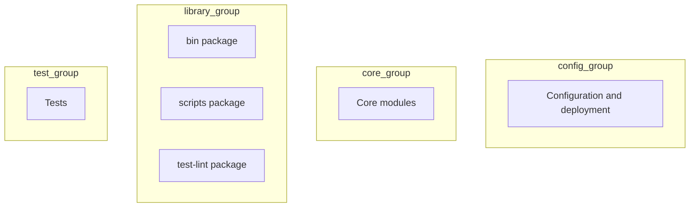

# Architecture report: prettier/eslint-config-prettier

> Automated static analysis. **Observed** = directly seen in files/imports/AST; **Inferred** = interpretation from that evidence. Repository code was not executed.

## 1. Repository at a glance

| Item | Value |
| --- | --- |
| Repository | prettier/eslint-config-prettier |
| Description | Turns off all rules that are unnecessary or might conflict with Prettier. |
| Language | JavaScript |
| Stars | 5899 |
| Licence | MIT |
| Analysed commit / branch | bd6e6171434c7b34dec3dd0f325aab792c126ec6 / main |
| Framework(s) | None detected |
| Files analysed | 56 |
| Components | 6 |

## 2. Architecture in one minute

prettier/eslint-config-prettier - Turns off all rules that are unnecessary or might conflict with Prettier.. This repository was analysed statically from 56 file(s) (0 Python). Detected technologies (observed from imports/manifests): GitHub Actions, Jest, TypeScript. Files are grouped into 6 component(s): bin package, Configuration and deployment, Core modules, scripts package, test-lint package, Tests. Findings below distinguish observed facts from inferred interpretation.

## 3. High-level block diagram

## 4. Main components

### bin package (`bin`)

- **Kind:** library
- **Status:** Observed
- **Confidence:** 0.85
- **Responsibility:** Groups 2 file(s) under bin package (observed from repository paths and static analysis).
- **Paths:** `bin/cli.js`, `bin/validators.js`
- **Evidence:** [bin/cli.js](https://github.com/prettier/eslint-config-prettier/blob/bd6e6171434c7b34dec3dd0f325aab792c126ec6/bin/cli.js); [bin/validators.js](https://github.com/prettier/eslint-config-prettier/blob/bd6e6171434c7b34dec3dd0f325aab792c126ec6/bin/validators.js)

### Configuration and deployment (`config`)

- **Kind:** config
- **Status:** Observed
- **Confidence:** 0.85
- **Responsibility:** Groups 3 file(s) under configuration and deployment (observed from repository paths and static analysis).
- **Paths:** `babel.config.json`, `package.json`, `test-lint/.prettierrc.json`
- **Evidence:** [babel.config.json](https://github.com/prettier/eslint-config-prettier/blob/bd6e6171434c7b34dec3dd0f325aab792c126ec6/babel.config.json); [package.json](https://github.com/prettier/eslint-config-prettier/blob/bd6e6171434c7b34dec3dd0f325aab792c126ec6/package.json); [test-lint/.prettierrc.json](https://github.com/prettier/eslint-config-prettier/blob/bd6e6171434c7b34dec3dd0f325aab792c126ec6/test-lint/.prettierrc.json)

### Core modules (`core`)

- **Kind:** core
- **Status:** Observed
- **Confidence:** 0.85
- **Responsibility:** Groups 8 file(s) under core modules (observed from repository paths and static analysis).
- **Paths:** `eslint.base.config.mjs`, `eslint.config.mjs`, `flat.d.ts`, `flat.js`, `index.d.ts`, `index.js`, `prettier.d.ts`, `prettier.js`
- **Evidence:** [eslint.base.config.mjs](https://github.com/prettier/eslint-config-prettier/blob/bd6e6171434c7b34dec3dd0f325aab792c126ec6/eslint.base.config.mjs); [eslint.config.mjs](https://github.com/prettier/eslint-config-prettier/blob/bd6e6171434c7b34dec3dd0f325aab792c126ec6/eslint.config.mjs); [flat.d.ts](https://github.com/prettier/eslint-config-prettier/blob/bd6e6171434c7b34dec3dd0f325aab792c126ec6/flat.d.ts); [flat.js](https://github.com/prettier/eslint-config-prettier/blob/bd6e6171434c7b34dec3dd0f325aab792c126ec6/flat.js); [index.d.ts](https://github.com/prettier/eslint-config-prettier/blob/bd6e6171434c7b34dec3dd0f325aab792c126ec6/index.d.ts); [index.js](https://github.com/prettier/eslint-config-prettier/blob/bd6e6171434c7b34dec3dd0f325aab792c126ec6/index.js); [prettier.d.ts](https://github.com/prettier/eslint-config-prettier/blob/bd6e6171434c7b34dec3dd0f325aab792c126ec6/prettier.d.ts); [prettier.js](https://github.com/prettier/eslint-config-prettier/blob/bd6e6171434c7b34dec3dd0f325aab792c126ec6/prettier.js)

### scripts package (`scripts`)

- **Kind:** library
- **Status:** Observed
- **Confidence:** 0.85
- **Responsibility:** Groups 1 file(s) under scripts package (observed from repository paths and static analysis).
- **Paths:** `scripts/generate-stylistic.js`
- **Evidence:** [scripts/generate-stylistic.js](https://github.com/prettier/eslint-config-prettier/blob/bd6e6171434c7b34dec3dd0f325aab792c126ec6/scripts/generate-stylistic.js)

### test-lint package (`test_lint`)

- **Kind:** library
- **Status:** Observed
- **Confidence:** 0.85
- **Responsibility:** Groups 14 file(s) under test-lint package (observed from repository paths and static analysis).
- **Paths:** `test-lint/@babel.js`, `test-lint/@stylistic.js`, `test-lint/@stylistic__js.js`, `test-lint/@stylistic__jsx.jsx`, `test-lint/@stylistic__ts.ts`, `test-lint/@typescript-eslint.ts`, `test-lint/babel.js`, `test-lint/core.js`, `test-lint/flowtype.js`, `test-lint/prettier.js`, `test-lint/react.js`, `test-lint/standard.js`, `test-lint/unicorn.js`, `test-lint/vue-file.vue`
- **Evidence:** [test-lint/@babel.js](https://github.com/prettier/eslint-config-prettier/blob/bd6e6171434c7b34dec3dd0f325aab792c126ec6/test-lint/%40babel.js); [test-lint/@stylistic.js](https://github.com/prettier/eslint-config-prettier/blob/bd6e6171434c7b34dec3dd0f325aab792c126ec6/test-lint/%40stylistic.js); [test-lint/@stylistic__js.js](https://github.com/prettier/eslint-config-prettier/blob/bd6e6171434c7b34dec3dd0f325aab792c126ec6/test-lint/%40stylistic__js.js); [test-lint/@stylistic__jsx.jsx](https://github.com/prettier/eslint-config-prettier/blob/bd6e6171434c7b34dec3dd0f325aab792c126ec6/test-lint/%40stylistic__jsx.jsx); [test-lint/@stylistic__ts.ts](https://github.com/prettier/eslint-config-prettier/blob/bd6e6171434c7b34dec3dd0f325aab792c126ec6/test-lint/%40stylistic__ts.ts); [test-lint/@typescript-eslint.ts](https://github.com/prettier/eslint-config-prettier/blob/bd6e6171434c7b34dec3dd0f325aab792c126ec6/test-lint/%40typescript-eslint.ts); [test-lint/babel.js](https://github.com/prettier/eslint-config-prettier/blob/bd6e6171434c7b34dec3dd0f325aab792c126ec6/test-lint/babel.js); [test-lint/core.js](https://github.com/prettier/eslint-config-prettier/blob/bd6e6171434c7b34dec3dd0f325aab792c126ec6/test-lint/core.js)

### Tests (`tests`)

- **Kind:** test
- **Status:** Observed
- **Confidence:** 0.85
- **Responsibility:** Groups 6 file(s) under tests (observed from repository paths and static analysis).
- **Paths:** `test/cli.test.js`, `test/fixtures/empty-config/eslint.config.mjs`, `test/fixtures/empty-config/index.js`, `test/lint-verify-fail.test.js`, `test/rules.test.js`, `test/validators.test.js`
- **Evidence:** [test/cli.test.js](https://github.com/prettier/eslint-config-prettier/blob/bd6e6171434c7b34dec3dd0f325aab792c126ec6/test/cli.test.js); [test/fixtures/empty-config/eslint.config.mjs](https://github.com/prettier/eslint-config-prettier/blob/bd6e6171434c7b34dec3dd0f325aab792c126ec6/test/fixtures/empty-config/eslint.config.mjs); [test/fixtures/empty-config/index.js](https://github.com/prettier/eslint-config-prettier/blob/bd6e6171434c7b34dec3dd0f325aab792c126ec6/test/fixtures/empty-config/index.js); [test/lint-verify-fail.test.js](https://github.com/prettier/eslint-config-prettier/blob/bd6e6171434c7b34dec3dd0f325aab792c126ec6/test/lint-verify-fail.test.js); [test/rules.test.js](https://github.com/prettier/eslint-config-prettier/blob/bd6e6171434c7b34dec3dd0f325aab792c126ec6/test/rules.test.js); [test/validators.test.js](https://github.com/prettier/eslint-config-prettier/blob/bd6e6171434c7b34dec3dd0f325aab792c126ec6/test/validators.test.js)

## 5. Execution flow

**Observed** entry point(s):

- [bin/cli.js](https://github.com/prettier/eslint-config-prettier/blob/bd6e6171434c7b34dec3dd0f325aab792c126ec6/bin/cli.js)
- [index.js](https://github.com/prettier/eslint-config-prettier/blob/bd6e6171434c7b34dec3dd0f325aab792c126ec6/index.js)

Representative flow (derived from observed entry points and the import graph; steps beyond the entry point are **Inferred**):

1. Execution starts at an observed entry point listed above, if present.
2. No internal import relationships between components were observed.

## 6. Project structure

### `(root)`

- `.eslintrc.base.js` - source, JavaScript (3743 bytes)
- `.eslintrc.js` - source, JavaScript (1300 bytes)
- `.gitignore` - other (84 bytes)
- `.prettierignore` - other (36 bytes)
- `.prettierrc.json` - config (121 bytes)
- `.renovaterc` - other (204 bytes)
- `.yarnrc.yml` - config (476 bytes)
- `CHANGELOG.md` - docs (32114 bytes)
- `LICENSE` - docs (1132 bytes)
- `README.md` - docs (31475 bytes)
- `babel.config.json` - config (75 bytes)
- `eslint.base.config.mjs` - source, JavaScript (3015 bytes)
- `eslint.config.mjs` - source, JavaScript (1024 bytes)
- `flat.d.ts` - source, TypeScript (186 bytes)
- `flat.js` - source, JavaScript (114 bytes)
- `index.d.ts` - source, TypeScript (109 bytes)
- `index.js` - source, JavaScript (15461 bytes)
- `package.json` - manifest (3810 bytes)
- `prettier.d.ts` - source, TypeScript (39 bytes)
- `prettier.js` - source, JavaScript (357 bytes)

### `.changeset`

- `.changeset/README.md` - docs (510 bytes)
- `.changeset/config.json` - config (339 bytes)

### `.github`

- `.github/FUNDING.yml` - config (358 bytes)
- `.github/workflows/autofix.yml` - ci, YAML (944 bytes)
- `.github/workflows/check.yml` - ci, YAML (887 bytes)
- `.github/workflows/pkg-pr-new.yml` - ci, YAML (661 bytes)
- `.github/workflows/release.yml` - ci, YAML (1216 bytes)
- `.github/workflows/test.yml` - ci, YAML (2047 bytes)

### `.yarn`

- `.yarn/plugins/plugin-prepare-lifecycle.cjs` - source, JavaScript (202 bytes)

### `bin`

- `bin/cli.js` - source, JavaScript (6885 bytes)
- `bin/validators.js` - source, JavaScript (2129 bytes)

### `patches`

- `patches/eslint-plugin-babel+5.3.1.patch` - other (4616 bytes)
- `patches/eslint-plugin-flowtype+8.0.3.patch` - other (7541 bytes)
- `patches/eslint-plugin-standard+5.0.0.patch` - other (3316 bytes)

### `scripts`

- `scripts/generate-stylistic.js` - source, JavaScript (1889 bytes)

### `test`

- `test/cli.test.js` - test, JavaScript (6926 bytes)
- `test/fixtures/empty-config/eslint.config.mjs` - test, JavaScript (21 bytes)
- `test/fixtures/empty-config/index.js` - test, JavaScript (0 bytes)
- `test/lint-verify-fail.test.js` - test, JavaScript (3352 bytes)
- `test/rules.test.js` - test, JavaScript (4513 bytes)
- `test/validators.test.js` - test, JavaScript (2570 bytes)

### `test-lint`

- `test-lint/.prettierrc.json` - config (26 bytes)
- `test-lint/@babel.js` - source, JavaScript (200 bytes)
- `test-lint/@stylistic.js` - source, JavaScript (228 bytes)
- `test-lint/@stylistic__js.js` - source, JavaScript (228 bytes)
- `test-lint/@stylistic__jsx.jsx` - source, JavaScript (222 bytes)
- `test-lint/@stylistic__ts.ts` - source, TypeScript (228 bytes)
- `test-lint/@typescript-eslint.ts` - source, TypeScript (176 bytes)
- `test-lint/babel.js` - source, JavaScript (200 bytes)
- `test-lint/core.js` - source, JavaScript (186 bytes)
- `test-lint/flowtype.js` - source, JavaScript (181 bytes)
- `test-lint/prettier.js` - source, JavaScript (213 bytes)
- `test-lint/react.js` - source, JavaScript (222 bytes)
- `test-lint/standard.js` - source, JavaScript (269 bytes)
- `test-lint/unicorn.js` - source, JavaScript (290 bytes)
- `test-lint/vue-file.vue` - source, Vue (197 bytes)

## 7. Key dependencies and integrations

| Name | Category | Status | Confidence | Evidence |
| --- | --- | --- | --- | --- |
| GitHub Actions | ci | Observed | 0.90 | [.github/workflows/autofix.yml](https://github.com/prettier/eslint-config-prettier/blob/bd6e6171434c7b34dec3dd0f325aab792c126ec6/.github/workflows/autofix.yml); [.github/workflows/check.yml](https://github.com/prettier/eslint-config-prettier/blob/bd6e6171434c7b34dec3dd0f325aab792c126ec6/.github/workflows/check.yml); [.github/workflows/pkg-pr-new.yml](https://github.com/prettier/eslint-config-prettier/blob/bd6e6171434c7b34dec3dd0f325aab792c126ec6/.github/workflows/pkg-pr-new.yml); [.github/workflows/release.yml](https://github.com/prettier/eslint-config-prettier/blob/bd6e6171434c7b34dec3dd0f325aab792c126ec6/.github/workflows/release.yml) |
| Jest | tooling | Observed | 0.85 | [package.json:58](https://github.com/prettier/eslint-config-prettier/blob/bd6e6171434c7b34dec3dd0f325aab792c126ec6/package.json#L58) |
| TypeScript | tooling | Observed | 0.85 | [package.json:83](https://github.com/prettier/eslint-config-prettier/blob/bd6e6171434c7b34dec3dd0f325aab792c126ec6/package.json#L83) |

## 8. Data and state

No database, cache, queue, or persistent-state usage was observed in the analysed files. State handling, if any, may be in-memory or in files that were not analysed.

## 9. Configuration and deployment clues

- `.changeset/config.json` (config)
- `.github/FUNDING.yml` (config)
- `.github/workflows/autofix.yml` (ci)
- `.github/workflows/check.yml` (ci)
- `.github/workflows/pkg-pr-new.yml` (ci)
- `.github/workflows/release.yml` (ci)
- `.github/workflows/test.yml` (ci)
- `.prettierrc.json` (config)
- `.yarnrc.yml` (config)
- `babel.config.json` (config)
- `package.json` (manifest)
- `test-lint/.prettierrc.json` (config)

## 10. Design observations

- Tests are present alongside source code (Observed from test file paths).

These observations are interpretations (**Inferred**) of the observed structure, not guarantees about runtime design.

## 11. Limitations and unknowns

- Static analysis only: repository code was not executed, installed, or imported at runtime.
- Components and relationships are inferred from file paths, imports, and AST structure; runtime behaviour, dynamic imports, and reflection may not be visible.
- No clear application entry point was observed in the analysed files.
- Repository text was treated as untrusted data; no instructions found in repository files were followed, and likely secret values were redacted/excluded.
- JavaScript and TypeScript files were inventoried from paths and package manifests. They were not parsed with a full language AST, and repository code was not executed.

## 12. Source references

- [.github/workflows/autofix.yml](https://github.com/prettier/eslint-config-prettier/blob/bd6e6171434c7b34dec3dd0f325aab792c126ec6/.github/workflows/autofix.yml)
- [.github/workflows/check.yml](https://github.com/prettier/eslint-config-prettier/blob/bd6e6171434c7b34dec3dd0f325aab792c126ec6/.github/workflows/check.yml)
- [.github/workflows/pkg-pr-new.yml](https://github.com/prettier/eslint-config-prettier/blob/bd6e6171434c7b34dec3dd0f325aab792c126ec6/.github/workflows/pkg-pr-new.yml)
- [.github/workflows/release.yml](https://github.com/prettier/eslint-config-prettier/blob/bd6e6171434c7b34dec3dd0f325aab792c126ec6/.github/workflows/release.yml)
- [.github/workflows/test.yml](https://github.com/prettier/eslint-config-prettier/blob/bd6e6171434c7b34dec3dd0f325aab792c126ec6/.github/workflows/test.yml)
- [babel.config.json](https://github.com/prettier/eslint-config-prettier/blob/bd6e6171434c7b34dec3dd0f325aab792c126ec6/babel.config.json)
- [bin/cli.js](https://github.com/prettier/eslint-config-prettier/blob/bd6e6171434c7b34dec3dd0f325aab792c126ec6/bin/cli.js)
- [bin/validators.js](https://github.com/prettier/eslint-config-prettier/blob/bd6e6171434c7b34dec3dd0f325aab792c126ec6/bin/validators.js)
- [eslint.base.config.mjs](https://github.com/prettier/eslint-config-prettier/blob/bd6e6171434c7b34dec3dd0f325aab792c126ec6/eslint.base.config.mjs)
- [eslint.config.mjs](https://github.com/prettier/eslint-config-prettier/blob/bd6e6171434c7b34dec3dd0f325aab792c126ec6/eslint.config.mjs)
- [flat.d.ts](https://github.com/prettier/eslint-config-prettier/blob/bd6e6171434c7b34dec3dd0f325aab792c126ec6/flat.d.ts)
- [flat.js](https://github.com/prettier/eslint-config-prettier/blob/bd6e6171434c7b34dec3dd0f325aab792c126ec6/flat.js)
- [index.d.ts](https://github.com/prettier/eslint-config-prettier/blob/bd6e6171434c7b34dec3dd0f325aab792c126ec6/index.d.ts)
- [index.js](https://github.com/prettier/eslint-config-prettier/blob/bd6e6171434c7b34dec3dd0f325aab792c126ec6/index.js)
- [package.json](https://github.com/prettier/eslint-config-prettier/blob/bd6e6171434c7b34dec3dd0f325aab792c126ec6/package.json)
- [package.json:58](https://github.com/prettier/eslint-config-prettier/blob/bd6e6171434c7b34dec3dd0f325aab792c126ec6/package.json#L58)
- [package.json:83](https://github.com/prettier/eslint-config-prettier/blob/bd6e6171434c7b34dec3dd0f325aab792c126ec6/package.json#L83)
- [prettier.d.ts](https://github.com/prettier/eslint-config-prettier/blob/bd6e6171434c7b34dec3dd0f325aab792c126ec6/prettier.d.ts)
- [prettier.js](https://github.com/prettier/eslint-config-prettier/blob/bd6e6171434c7b34dec3dd0f325aab792c126ec6/prettier.js)
- [scripts/generate-stylistic.js](https://github.com/prettier/eslint-config-prettier/blob/bd6e6171434c7b34dec3dd0f325aab792c126ec6/scripts/generate-stylistic.js)
- [test-lint/.prettierrc.json](https://github.com/prettier/eslint-config-prettier/blob/bd6e6171434c7b34dec3dd0f325aab792c126ec6/test-lint/.prettierrc.json)
- [test-lint/@babel.js](https://github.com/prettier/eslint-config-prettier/blob/bd6e6171434c7b34dec3dd0f325aab792c126ec6/test-lint/%40babel.js)
- [test-lint/@stylistic.js](https://github.com/prettier/eslint-config-prettier/blob/bd6e6171434c7b34dec3dd0f325aab792c126ec6/test-lint/%40stylistic.js)
- [test-lint/@stylistic__js.js](https://github.com/prettier/eslint-config-prettier/blob/bd6e6171434c7b34dec3dd0f325aab792c126ec6/test-lint/%40stylistic__js.js)
- [test-lint/@stylistic__jsx.jsx](https://github.com/prettier/eslint-config-prettier/blob/bd6e6171434c7b34dec3dd0f325aab792c126ec6/test-lint/%40stylistic__jsx.jsx)
- [test-lint/@stylistic__ts.ts](https://github.com/prettier/eslint-config-prettier/blob/bd6e6171434c7b34dec3dd0f325aab792c126ec6/test-lint/%40stylistic__ts.ts)
- [test-lint/@typescript-eslint.ts](https://github.com/prettier/eslint-config-prettier/blob/bd6e6171434c7b34dec3dd0f325aab792c126ec6/test-lint/%40typescript-eslint.ts)
- [test-lint/babel.js](https://github.com/prettier/eslint-config-prettier/blob/bd6e6171434c7b34dec3dd0f325aab792c126ec6/test-lint/babel.js)
- [test-lint/core.js](https://github.com/prettier/eslint-config-prettier/blob/bd6e6171434c7b34dec3dd0f325aab792c126ec6/test-lint/core.js)
- [test/cli.test.js](https://github.com/prettier/eslint-config-prettier/blob/bd6e6171434c7b34dec3dd0f325aab792c126ec6/test/cli.test.js)
- [test/fixtures/empty-config/eslint.config.mjs](https://github.com/prettier/eslint-config-prettier/blob/bd6e6171434c7b34dec3dd0f325aab792c126ec6/test/fixtures/empty-config/eslint.config.mjs)
- [test/fixtures/empty-config/index.js](https://github.com/prettier/eslint-config-prettier/blob/bd6e6171434c7b34dec3dd0f325aab792c126ec6/test/fixtures/empty-config/index.js)
- [test/lint-verify-fail.test.js](https://github.com/prettier/eslint-config-prettier/blob/bd6e6171434c7b34dec3dd0f325aab792c126ec6/test/lint-verify-fail.test.js)
- [test/rules.test.js](https://github.com/prettier/eslint-config-prettier/blob/bd6e6171434c7b34dec3dd0f325aab792c126ec6/test/rules.test.js)
- [test/validators.test.js](https://github.com/prettier/eslint-config-prettier/blob/bd6e6171434c7b34dec3dd0f325aab792c126ec6/test/validators.test.js)
