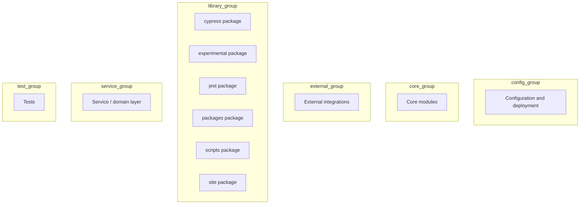

# Architecture report: prevwong/craft.js

> Automated static analysis. **Observed** = directly seen in files/imports/AST; **Inferred** = interpretation from that evidence. Repository code was not executed.

## 1. Repository at a glance

| Item | Value |
| --- | --- |
| Repository | prevwong/craft.js |
| Description | 🚀 A React Framework for building extensible drag and drop page editors |
| Language | TypeScript |
| Stars | 8767 |
| Licence | MIT |
| Analysed commit / branch | 23f44f3208ebf78d1632ec4aa7094001f513eb41 / main |
| Framework(s) | Next.js, React |
| Files analysed | 355 |
| Components | 11 |

## 2. Architecture in one minute

prevwong/craft.js - 🚀 A React Framework for building extensible drag and drop page editors. This repository was analysed statically from 355 file(s) (0 Python). Detected technologies (observed from imports/manifests): GitHub Actions, Next.js, React, Tailwind CSS, Jest, TypeScript. Files are grouped into 11 component(s): Configuration and deployment, Core modules, cypress package, experimental package, External integrations, jest package, packages package, scripts package. Findings below distinguish observed facts from inferred interpretation.

## 3. High-level block diagram

## 4. Main components

### Configuration and deployment (`config`)

- **Kind:** config
- **Status:** Observed
- **Confidence:** 0.85
- **Responsibility:** Groups 19 file(s) under configuration and deployment (observed from repository paths and static analysis).
- **Paths:** `cypress.json`, `cypress/tsconfig.json`, `experimental/slate/nodemon.json`, `experimental/slate/package.json`, `experimental/slate/tsconfig.json`, `lerna.json`, `package.json`, `packages/core/nodemon.json`, `packages/core/package.json`, `packages/core/tsconfig.json`, `packages/layers/package.json`, `packages/layers/tsconfig.json`, `packages/utils/nodemon.json`, `packages/utils/package.json`, `packages/utils/tsconfig.json`, `site/package.json`, `tsconfig.base.json`, `tsconfig.jest.json`, `tsconfig.json`
- **Evidence:** [cypress.json](https://github.com/prevwong/craft.js/blob/23f44f3208ebf78d1632ec4aa7094001f513eb41/cypress.json); [cypress/tsconfig.json](https://github.com/prevwong/craft.js/blob/23f44f3208ebf78d1632ec4aa7094001f513eb41/cypress/tsconfig.json); [experimental/slate/nodemon.json](https://github.com/prevwong/craft.js/blob/23f44f3208ebf78d1632ec4aa7094001f513eb41/experimental/slate/nodemon.json); [experimental/slate/package.json](https://github.com/prevwong/craft.js/blob/23f44f3208ebf78d1632ec4aa7094001f513eb41/experimental/slate/package.json); [experimental/slate/tsconfig.json](https://github.com/prevwong/craft.js/blob/23f44f3208ebf78d1632ec4aa7094001f513eb41/experimental/slate/tsconfig.json); [lerna.json](https://github.com/prevwong/craft.js/blob/23f44f3208ebf78d1632ec4aa7094001f513eb41/lerna.json); [package.json](https://github.com/prevwong/craft.js/blob/23f44f3208ebf78d1632ec4aa7094001f513eb41/package.json); [packages/core/nodemon.json](https://github.com/prevwong/craft.js/blob/23f44f3208ebf78d1632ec4aa7094001f513eb41/packages/core/nodemon.json)

### Core modules (`core`)

- **Kind:** core
- **Status:** Observed
- **Confidence:** 0.85
- **Responsibility:** Groups 2 file(s) under core modules (observed from repository paths and static analysis).
- **Paths:** `jest.config.js`, `rollup.config.js`
- **Evidence:** [jest.config.js](https://github.com/prevwong/craft.js/blob/23f44f3208ebf78d1632ec4aa7094001f513eb41/jest.config.js); [rollup.config.js](https://github.com/prevwong/craft.js/blob/23f44f3208ebf78d1632ec4aa7094001f513eb41/rollup.config.js)

### cypress package (`cypress`)

- **Kind:** library
- **Status:** Observed
- **Confidence:** 0.85
- **Responsibility:** Groups 4 file(s) under cypress package (observed from repository paths and static analysis).
- **Paths:** `cypress/plugins/index.js`, `cypress/support/commands.ts`, `cypress/support/dnd.ts`, `cypress/support/index.ts`
- **Evidence:** [cypress/plugins/index.js](https://github.com/prevwong/craft.js/blob/23f44f3208ebf78d1632ec4aa7094001f513eb41/cypress/plugins/index.js); [cypress/support/commands.ts](https://github.com/prevwong/craft.js/blob/23f44f3208ebf78d1632ec4aa7094001f513eb41/cypress/support/commands.ts); [cypress/support/dnd.ts](https://github.com/prevwong/craft.js/blob/23f44f3208ebf78d1632ec4aa7094001f513eb41/cypress/support/dnd.ts); [cypress/support/index.ts](https://github.com/prevwong/craft.js/blob/23f44f3208ebf78d1632ec4aa7094001f513eb41/cypress/support/index.ts)

### experimental package (`experimental`)

- **Kind:** library
- **Status:** Observed
- **Confidence:** 0.85
- **Responsibility:** Groups 28 file(s) under experimental package (observed from repository paths and static analysis).
- **Paths:** `experimental/slate/rollup.config.js`, `experimental/slate/src/extend/editable/Editable.tsx`, `experimental/slate/src/extend/editable/Element.tsx`, `experimental/slate/src/extend/editable/Leaf.tsx`, `experimental/slate/src/extend/editable/RenderEditable.tsx`, `experimental/slate/src/extend/editable/index.ts`, `experimental/slate/src/extend/editable/useCraftStateSync.tsx`, `experimental/slate/src/extend/index.ts`, `experimental/slate/src/extend/slate/Slate.tsx`, `experimental/slate/src/extend/slate/SlateNodeContext.tsx`, `experimental/slate/src/extend/slate/index.ts`, `experimental/slate/src/extend/slate/useSlateNode.ts`, `experimental/slate/src/index.ts`, `experimental/slate/src/interfaces/index.ts`, `experimental/slate/src/interfaces/nodes.ts`, `experimental/slate/src/interfaces/slate.ts`, `experimental/slate/src/normalization/deleteNodes.ts`, `experimental/slate/src/normalization/getSplitOperations.ts`, `experimental/slate/src/normalization/index.ts`, `experimental/slate/src/normalization/mergeElements.ts`, `experimental/slate/src/normalization/normalizeSlate.ts`, `experimental/slate/src/normalization/removeInvalidNodes.ts`, `experimental/slate/src/normalization/splitSlate.ts`, `experimental/slate/src/normalization/wrapRogueElement.ts`, `experimental/slate/src/setup/SlateSetupContext.tsx`, `experimental/slate/src/setup/index.ts`, `experimental/slate/src/utils/applyIdOnOperation.ts`, `experimental/slate/src/utils/formats.ts`
- **Evidence:** [experimental/slate/rollup.config.js](https://github.com/prevwong/craft.js/blob/23f44f3208ebf78d1632ec4aa7094001f513eb41/experimental/slate/rollup.config.js); [experimental/slate/src/extend/editable/Editable.tsx](https://github.com/prevwong/craft.js/blob/23f44f3208ebf78d1632ec4aa7094001f513eb41/experimental/slate/src/extend/editable/Editable.tsx); [experimental/slate/src/extend/editable/Element.tsx](https://github.com/prevwong/craft.js/blob/23f44f3208ebf78d1632ec4aa7094001f513eb41/experimental/slate/src/extend/editable/Element.tsx); [experimental/slate/src/extend/editable/Leaf.tsx](https://github.com/prevwong/craft.js/blob/23f44f3208ebf78d1632ec4aa7094001f513eb41/experimental/slate/src/extend/editable/Leaf.tsx); [experimental/slate/src/extend/editable/RenderEditable.tsx](https://github.com/prevwong/craft.js/blob/23f44f3208ebf78d1632ec4aa7094001f513eb41/experimental/slate/src/extend/editable/RenderEditable.tsx); [experimental/slate/src/extend/editable/index.ts](https://github.com/prevwong/craft.js/blob/23f44f3208ebf78d1632ec4aa7094001f513eb41/experimental/slate/src/extend/editable/index.ts); [experimental/slate/src/extend/editable/useCraftStateSync.tsx](https://github.com/prevwong/craft.js/blob/23f44f3208ebf78d1632ec4aa7094001f513eb41/experimental/slate/src/extend/editable/useCraftStateSync.tsx); [experimental/slate/src/extend/index.ts](https://github.com/prevwong/craft.js/blob/23f44f3208ebf78d1632ec4aa7094001f513eb41/experimental/slate/src/extend/index.ts)

### External integrations (`external_integrations`)

- **Kind:** external
- **Status:** Observed
- **Confidence:** 0.85
- **Responsibility:** Groups 4 file(s) under external integrations (observed from repository paths and static analysis).
- **Paths:** `cypress/integration/frame.ts`, `cypress/integration/history.ts`, `cypress/integration/props.ts`, `cypress/integration/toolbox.ts`
- **Evidence:** [cypress/integration/frame.ts](https://github.com/prevwong/craft.js/blob/23f44f3208ebf78d1632ec4aa7094001f513eb41/cypress/integration/frame.ts); [cypress/integration/history.ts](https://github.com/prevwong/craft.js/blob/23f44f3208ebf78d1632ec4aa7094001f513eb41/cypress/integration/history.ts); [cypress/integration/props.ts](https://github.com/prevwong/craft.js/blob/23f44f3208ebf78d1632ec4aa7094001f513eb41/cypress/integration/props.ts); [cypress/integration/toolbox.ts](https://github.com/prevwong/craft.js/blob/23f44f3208ebf78d1632ec4aa7094001f513eb41/cypress/integration/toolbox.ts)

### jest package (`jest`)

- **Kind:** library
- **Status:** Observed
- **Confidence:** 0.85
- **Responsibility:** Groups 1 file(s) under jest package (observed from repository paths and static analysis).
- **Paths:** `jest/setup.js`
- **Evidence:** [jest/setup.js](https://github.com/prevwong/craft.js/blob/23f44f3208ebf78d1632ec4aa7094001f513eb41/jest/setup.js)

### packages package (`packages`)

- **Kind:** library
- **Status:** Observed
- **Confidence:** 0.85
- **Responsibility:** Groups 44 file(s) under packages package (observed from repository paths and static analysis).
- **Paths:** `packages/layers/rollup.config.js`, `packages/layers/src/events/LayerEventContext.tsx`, `packages/layers/src/events/LayerEventContextProvider.tsx`, `packages/layers/src/events/LayerHandlers.ts`, `packages/layers/src/events/RenderLayerIndicator.tsx`, `packages/layers/src/events/index.tsx`, `packages/layers/src/index.tsx`, `packages/layers/src/interfaces.tsx`, `packages/layers/src/layers/DefaultLayer/DefaultLayer.tsx`, `packages/layers/src/layers/DefaultLayer/DefaultLayerHeader.tsx`, `packages/layers/src/layers/DefaultLayer/EditableLayerName.tsx`, `packages/layers/src/layers/DefaultLayer/index.tsx`, `packages/layers/src/layers/LayerContext.tsx`, `packages/layers/src/layers/LayerContextProvider.tsx`, `packages/layers/src/layers/LayerIndicator.tsx`, `packages/layers/src/layers/LayerNode.tsx`, `packages/layers/src/layers/index.ts`, `packages/layers/src/layers/useLayer.tsx`, `packages/layers/src/manager/LayerManagerProvider.tsx`, `packages/layers/src/manager/actions.tsx`, `packages/layers/src/manager/context.tsx`, `packages/layers/src/manager/index.tsx`, `packages/layers/src/manager/useLayerManager.tsx`, `packages/layers/svg.d.ts`, `packages/utils/rollup.config.js`, `packages/utils/src/EventHandlers/ConnectorRegistry.ts`, `packages/utils/src/EventHandlers/DerivedEventHandlers.ts`, `packages/utils/src/EventHandlers/EventHandlers.ts`, `packages/utils/src/EventHandlers/index.ts`, `packages/utils/src/EventHandlers/interfaces.ts`, `packages/utils/src/EventHandlers/isEventBlockedByDescendant.ts`, `packages/utils/src/EventHandlers/wrapConnectorHooks.tsx`, `packages/utils/src/History.ts`, `packages/utils/src/RenderIndicator.tsx`, `packages/utils/src/constants.ts`, `packages/utils/src/deprecate.ts`, `packages/utils/src/getDOMInfo.ts`, `packages/utils/src/getRandomId.ts`, `packages/utils/src/index.ts`, `packages/utils/src/platform.ts`, `packages/utils/src/useCollector.tsx`, `packages/utils/src/useEffectOnce.tsx`, `packages/utils/src/useMethods.ts`, `packages/utils/src/utilityTypes.ts`
- **Evidence:** [packages/layers/rollup.config.js](https://github.com/prevwong/craft.js/blob/23f44f3208ebf78d1632ec4aa7094001f513eb41/packages/layers/rollup.config.js); [packages/layers/src/events/LayerEventContext.tsx](https://github.com/prevwong/craft.js/blob/23f44f3208ebf78d1632ec4aa7094001f513eb41/packages/layers/src/events/LayerEventContext.tsx); [packages/layers/src/events/LayerEventContextProvider.tsx](https://github.com/prevwong/craft.js/blob/23f44f3208ebf78d1632ec4aa7094001f513eb41/packages/layers/src/events/LayerEventContextProvider.tsx); [packages/layers/src/events/LayerHandlers.ts](https://github.com/prevwong/craft.js/blob/23f44f3208ebf78d1632ec4aa7094001f513eb41/packages/layers/src/events/LayerHandlers.ts); [packages/layers/src/events/RenderLayerIndicator.tsx](https://github.com/prevwong/craft.js/blob/23f44f3208ebf78d1632ec4aa7094001f513eb41/packages/layers/src/events/RenderLayerIndicator.tsx); [packages/layers/src/events/index.tsx](https://github.com/prevwong/craft.js/blob/23f44f3208ebf78d1632ec4aa7094001f513eb41/packages/layers/src/events/index.tsx); [packages/layers/src/index.tsx](https://github.com/prevwong/craft.js/blob/23f44f3208ebf78d1632ec4aa7094001f513eb41/packages/layers/src/index.tsx); [packages/layers/src/interfaces.tsx](https://github.com/prevwong/craft.js/blob/23f44f3208ebf78d1632ec4aa7094001f513eb41/packages/layers/src/interfaces.tsx)

### scripts package (`scripts`)

- **Kind:** library
- **Status:** Observed
- **Confidence:** 0.85
- **Responsibility:** Groups 5 file(s) under scripts package (observed from repository paths and static analysis).
- **Paths:** `scripts/build.sh`, `scripts/deploy.sh`, `scripts/dev.sh`, `scripts/publish.sh`, `scripts/yalc.sh`
- **Evidence:** [scripts/build.sh](https://github.com/prevwong/craft.js/blob/23f44f3208ebf78d1632ec4aa7094001f513eb41/scripts/build.sh); [scripts/deploy.sh](https://github.com/prevwong/craft.js/blob/23f44f3208ebf78d1632ec4aa7094001f513eb41/scripts/deploy.sh); [scripts/dev.sh](https://github.com/prevwong/craft.js/blob/23f44f3208ebf78d1632ec4aa7094001f513eb41/scripts/dev.sh); [scripts/publish.sh](https://github.com/prevwong/craft.js/blob/23f44f3208ebf78d1632ec4aa7094001f513eb41/scripts/publish.sh); [scripts/yalc.sh](https://github.com/prevwong/craft.js/blob/23f44f3208ebf78d1632ec4aa7094001f513eb41/scripts/yalc.sh)

### Service / domain layer (`service_layer`)

- **Kind:** service
- **Status:** Observed
- **Confidence:** 0.85
- **Responsibility:** Groups 57 file(s) under service / domain layer (observed from repository paths and static analysis).
- **Paths:** `packages/core/rollup.config.js`, `packages/core/src/editor/Editor.tsx`, `packages/core/src/editor/EditorContext.tsx`, `packages/core/src/editor/EventHelpers.ts`, `packages/core/src/editor/NodeHelpers.ts`, `packages/core/src/editor/actions.ts`, `packages/core/src/editor/index.tsx`, `packages/core/src/editor/query.tsx`, `packages/core/src/editor/store.tsx`, `packages/core/src/editor/useInternalEditor.ts`, `packages/core/src/events/CoreEventHandlers.ts`, `packages/core/src/events/DefaultEventHandlers.ts`, `packages/core/src/events/EventContext.ts`, `packages/core/src/events/Events.tsx`, `packages/core/src/events/Positioner.ts`, `packages/core/src/events/RenderEditorIndicator.tsx`, `packages/core/src/events/createShadow.ts`, `packages/core/src/events/defineEventListener.ts`, `packages/core/src/events/findPosition.ts`, `packages/core/src/events/index.tsx`, `packages/core/src/events/isEventBlockedByDescendant.ts`, `packages/core/src/events/movePlaceholder.ts`, `packages/core/src/hooks/index.ts`, `packages/core/src/hooks/legacy/connectEditor.tsx`, `packages/core/src/hooks/legacy/connectNode.tsx`, `packages/core/src/hooks/useEditor.tsx`, `packages/core/src/hooks/useNode.ts`, `packages/core/src/index.tsx`, `packages/core/src/interfaces/editor.ts`, `packages/core/src/interfaces/events.ts`, `packages/core/src/interfaces/index.ts`, `packages/core/src/interfaces/nodes.ts`, `packages/core/src/nodes/Canvas.tsx`, `packages/core/src/nodes/Element.tsx`, `packages/core/src/nodes/NodeContext.tsx`, `packages/core/src/nodes/NodeElement.tsx`, `packages/core/src/nodes/index.ts`, `packages/core/src/nodes/useInternalNode.ts`, `packages/core/src/render/DefaultRender.tsx`, `packages/core/src/render/Frame.tsx`, `packages/core/src/render/RenderNode.tsx`, `packages/core/src/render/RenderPlaceholder.tsx`, `packages/core/src/render/SimpleElement.tsx`, `packages/core/src/render/index.tsx`, `packages/core/src/utils/createNode.ts`, `packages/core/src/utils/createTestNode.ts`, `packages/core/src/utils/deserializeNode.tsx`, `packages/core/src/utils/fromEntries.ts`, `packages/core/src/utils/getNodesFromSelector.ts`, `packages/core/src/utils/isObject.ts`, `packages/core/src/utils/mapChildrenToNodes.ts`, `packages/core/src/utils/mergeTrees.tsx`, `packages/core/src/utils/parseNodeFromJSX.tsx`, `packages/core/src/utils/removeNodeFromEvents.ts`, `packages/core/src/utils/resolveComponent.ts`, `packages/core/src/utils/serializeNode.tsx`, `packages/core/src/utils/testHelpers.ts`
- **Evidence:** [packages/core/rollup.config.js](https://github.com/prevwong/craft.js/blob/23f44f3208ebf78d1632ec4aa7094001f513eb41/packages/core/rollup.config.js); [packages/core/src/editor/Editor.tsx](https://github.com/prevwong/craft.js/blob/23f44f3208ebf78d1632ec4aa7094001f513eb41/packages/core/src/editor/Editor.tsx); [packages/core/src/editor/EditorContext.tsx](https://github.com/prevwong/craft.js/blob/23f44f3208ebf78d1632ec4aa7094001f513eb41/packages/core/src/editor/EditorContext.tsx); [packages/core/src/editor/EventHelpers.ts](https://github.com/prevwong/craft.js/blob/23f44f3208ebf78d1632ec4aa7094001f513eb41/packages/core/src/editor/EventHelpers.ts); [packages/core/src/editor/NodeHelpers.ts](https://github.com/prevwong/craft.js/blob/23f44f3208ebf78d1632ec4aa7094001f513eb41/packages/core/src/editor/NodeHelpers.ts); [packages/core/src/editor/actions.ts](https://github.com/prevwong/craft.js/blob/23f44f3208ebf78d1632ec4aa7094001f513eb41/packages/core/src/editor/actions.ts); [packages/core/src/editor/index.tsx](https://github.com/prevwong/craft.js/blob/23f44f3208ebf78d1632ec4aa7094001f513eb41/packages/core/src/editor/index.tsx); [packages/core/src/editor/query.tsx](https://github.com/prevwong/craft.js/blob/23f44f3208ebf78d1632ec4aa7094001f513eb41/packages/core/src/editor/query.tsx)

### site package (`site`)

- **Kind:** library
- **Status:** Observed
- **Confidence:** 0.85
- **Responsibility:** Groups 13 file(s) under site package (observed from repository paths and static analysis).
- **Paths:** `site/docusaurus.config.js`, `site/sidebars.js`, `site/src/components/API.js`, `site/src/components/Badge.js`, `site/src/components/Image.js`, `site/src/components/index.js`, `site/src/pages/index.js`, `site/src/theme/DocSidebar/Desktop/CollapseButton/index.js`, `site/src/theme/DocSidebar/Desktop/Content/index.js`, `site/src/theme/DocSidebar/Desktop/index.js`, `site/src/theme/DocSidebar/Mobile/index.js`, `site/src/theme/DocSidebar/index.js`, `site/src/theme/Root/index.js`
- **Evidence:** [site/docusaurus.config.js](https://github.com/prevwong/craft.js/blob/23f44f3208ebf78d1632ec4aa7094001f513eb41/site/docusaurus.config.js); [site/sidebars.js](https://github.com/prevwong/craft.js/blob/23f44f3208ebf78d1632ec4aa7094001f513eb41/site/sidebars.js); [site/src/components/API.js](https://github.com/prevwong/craft.js/blob/23f44f3208ebf78d1632ec4aa7094001f513eb41/site/src/components/API.js); [site/src/components/Badge.js](https://github.com/prevwong/craft.js/blob/23f44f3208ebf78d1632ec4aa7094001f513eb41/site/src/components/Badge.js); [site/src/components/Image.js](https://github.com/prevwong/craft.js/blob/23f44f3208ebf78d1632ec4aa7094001f513eb41/site/src/components/Image.js); [site/src/components/index.js](https://github.com/prevwong/craft.js/blob/23f44f3208ebf78d1632ec4aa7094001f513eb41/site/src/components/index.js); [site/src/pages/index.js](https://github.com/prevwong/craft.js/blob/23f44f3208ebf78d1632ec4aa7094001f513eb41/site/src/pages/index.js); [site/src/theme/DocSidebar/Desktop/CollapseButton/index.js](https://github.com/prevwong/craft.js/blob/23f44f3208ebf78d1632ec4aa7094001f513eb41/site/src/theme/DocSidebar/Desktop/CollapseButton/index.js)

### Tests (`tests`)

- **Kind:** test
- **Status:** Observed
- **Confidence:** 0.85
- **Responsibility:** Groups 21 file(s) under tests (observed from repository paths and static analysis).
- **Paths:** `experimental/slate/src/normalization/tests/fixtures.ts`, `experimental/slate/src/normalization/tests/getSplitOperations.test.ts`, `experimental/slate/src/normalization/tests/removeInvalidNodes.test.ts`, `experimental/slate/src/normalization/tests/splitSlate.test.ts`, `experimental/slate/src/normalization/tests/wrapRogueElement.test.ts`, `packages/core/src/editor/tests/EventHelpers.test.ts`, `packages/core/src/editor/tests/NodeHelpers.test.ts`, `packages/core/src/editor/tests/actions.test.ts`, `packages/core/src/editor/tests/query.test.tsx`, `packages/core/src/hooks/tests/EditorContext.test.tsx`, `packages/core/src/hooks/tests/useEditor.test.tsx`, `packages/core/src/render/tests/Frame.test.tsx`, `packages/core/src/render/tests/RenderNode.test.tsx`, `packages/core/src/tests/fixtures.ts`, `packages/core/src/utils/tests/createNode.test.tsx`, `packages/core/src/utils/tests/getNodesFromSelector.test.ts`, `packages/core/src/utils/tests/parseNodeFromJSX.test.tsx`, `packages/utils/src/EventHandlers/tests/DerivedEventHandlers.test.ts`, `packages/utils/src/EventHandlers/tests/EventHandlers.test.ts`, `packages/utils/src/EventHandlers/tests/fixtures.ts`, `packages/utils/src/tests/History.test.ts`
- **Evidence:** [experimental/slate/src/normalization/tests/fixtures.ts](https://github.com/prevwong/craft.js/blob/23f44f3208ebf78d1632ec4aa7094001f513eb41/experimental/slate/src/normalization/tests/fixtures.ts); [experimental/slate/src/normalization/tests/getSplitOperations.test.ts](https://github.com/prevwong/craft.js/blob/23f44f3208ebf78d1632ec4aa7094001f513eb41/experimental/slate/src/normalization/tests/getSplitOperations.test.ts); [experimental/slate/src/normalization/tests/removeInvalidNodes.test.ts](https://github.com/prevwong/craft.js/blob/23f44f3208ebf78d1632ec4aa7094001f513eb41/experimental/slate/src/normalization/tests/removeInvalidNodes.test.ts); [experimental/slate/src/normalization/tests/splitSlate.test.ts](https://github.com/prevwong/craft.js/blob/23f44f3208ebf78d1632ec4aa7094001f513eb41/experimental/slate/src/normalization/tests/splitSlate.test.ts); [experimental/slate/src/normalization/tests/wrapRogueElement.test.ts](https://github.com/prevwong/craft.js/blob/23f44f3208ebf78d1632ec4aa7094001f513eb41/experimental/slate/src/normalization/tests/wrapRogueElement.test.ts); [packages/core/src/editor/tests/EventHelpers.test.ts](https://github.com/prevwong/craft.js/blob/23f44f3208ebf78d1632ec4aa7094001f513eb41/packages/core/src/editor/tests/EventHelpers.test.ts); [packages/core/src/editor/tests/NodeHelpers.test.ts](https://github.com/prevwong/craft.js/blob/23f44f3208ebf78d1632ec4aa7094001f513eb41/packages/core/src/editor/tests/NodeHelpers.test.ts); [packages/core/src/editor/tests/actions.test.ts](https://github.com/prevwong/craft.js/blob/23f44f3208ebf78d1632ec4aa7094001f513eb41/packages/core/src/editor/tests/actions.test.ts)

## 5. Execution flow

**Observed** entry point(s):

- [cypress/plugins/index.js](https://github.com/prevwong/craft.js/blob/23f44f3208ebf78d1632ec4aa7094001f513eb41/cypress/plugins/index.js)
- [cypress/support/index.ts](https://github.com/prevwong/craft.js/blob/23f44f3208ebf78d1632ec4aa7094001f513eb41/cypress/support/index.ts)
- [experimental/slate/src/index.ts](https://github.com/prevwong/craft.js/blob/23f44f3208ebf78d1632ec4aa7094001f513eb41/experimental/slate/src/index.ts)
- [packages/core/src/index.tsx](https://github.com/prevwong/craft.js/blob/23f44f3208ebf78d1632ec4aa7094001f513eb41/packages/core/src/index.tsx)
- [packages/layers/src/index.tsx](https://github.com/prevwong/craft.js/blob/23f44f3208ebf78d1632ec4aa7094001f513eb41/packages/layers/src/index.tsx)
- [packages/utils/src/index.ts](https://github.com/prevwong/craft.js/blob/23f44f3208ebf78d1632ec4aa7094001f513eb41/packages/utils/src/index.ts)
- [site/src/components/index.js](https://github.com/prevwong/craft.js/blob/23f44f3208ebf78d1632ec4aa7094001f513eb41/site/src/components/index.js)
- [site/src/pages/index.js](https://github.com/prevwong/craft.js/blob/23f44f3208ebf78d1632ec4aa7094001f513eb41/site/src/pages/index.js)

Representative flow (derived from observed entry points and the import graph; steps beyond the entry point are **Inferred**):

1. Execution starts at an observed entry point listed above, if present.
2. No internal import relationships between components were observed.

## 6. Project structure

### `(root)`

- `.all-contributorsrc` - other (3519 bytes)
- `.eslintignore` - other (127 bytes)
- `.eslintrc.js` - source, JavaScript (618 bytes)
- `.gitignore` - other (213 bytes)
- `.prettierignore` - other (28 bytes)
- `.prettierrc` - other (69 bytes)
- `.yarnrc.yml` - config (66 bytes)
- `CODEOWNERS` - other (231 bytes)
- `CODE_OF_CONDUCT.md` - docs (3350 bytes)
- `CONTRIBUTING.md` - docs (2549 bytes)
- `LICENSE` - docs (1081 bytes)
- `cypress.json` - config (41 bytes)
- `jest.config.js` - source, JavaScript (533 bytes)
- `lerna.json` - config (48 bytes)
- `package.json` - manifest (3021 bytes)
- `rollup.config.js` - source, JavaScript (1978 bytes)
- `tsconfig.base.json` - config (448 bytes)
- `tsconfig.jest.json` - config (36 bytes)
- `tsconfig.json` - config (531 bytes)

### `.changeset`

- `.changeset/README.md` - docs (510 bytes)
- `.changeset/config.json` - config (453 bytes)

### `.github`

- `.github/.kodiak.toml` - config (351 bytes)
- `.github/FUNDING.yml` - config (109 bytes)
- `.github/ISSUE_TEMPLATE/bug_report.md` - docs (758 bytes)
- `.github/ISSUE_TEMPLATE/feature_request.md` - docs (470 bytes)
- `.github/ISSUE_TEMPLATE/improve-documentation.md` - docs (120 bytes)
- `.github/workflows/pull-request.yml` - ci, YAML (770 bytes)
- `.github/workflows/release.yml` - ci, YAML (780 bytes)

### `cypress`

- `cypress/integration/frame.ts` - source, TypeScript (5150 bytes)
- `cypress/integration/history.ts` - source, TypeScript (7185 bytes)
- `cypress/integration/props.ts` - source, TypeScript (6175 bytes)
- `cypress/integration/toolbox.ts` - source, TypeScript (12824 bytes)
- `cypress/plugins/index.js` - source, JavaScript (102 bytes)
- `cypress/support/commands.ts` - source, TypeScript (576 bytes)
- `cypress/support/dnd.ts` - source, TypeScript (5703 bytes)
- `cypress/support/index.ts` - source, TypeScript (671 bytes)
- `cypress/tsconfig.json` - config (138 bytes)

### `examples`

- `examples/basic/.gitignore` - other (261 bytes)
- `examples/basic/README.md` - docs (324 bytes)
- `examples/basic/components/Header.js` - source, JavaScript (1438 bytes)
- `examples/basic/components/SettingsPanel.js` - source, JavaScript (1866 bytes)
- `examples/basic/components/Toolbox.js` - source, JavaScript (1980 bytes)
- `examples/basic/components/Topbar.js` - source, JavaScript (4423 bytes)
- `examples/basic/components/user/Button.js` - source, JavaScript (3262 bytes)
- `examples/basic/components/user/Card.js` - source, JavaScript (1985 bytes)
- `examples/basic/components/user/Container.js` - source, JavaScript (1659 bytes)
- `examples/basic/components/user/Text.js` - source, JavaScript (1864 bytes)
- `examples/basic/next.config.js` - source, JavaScript (122 bytes)
- `examples/basic/package.json` - manifest (718 bytes)
- `examples/basic/pages/_app.js` - source, JavaScript (946 bytes)
- `examples/basic/pages/_document.js` - source, JavaScript (1463 bytes)
- `examples/basic/pages/index.js` - source, JavaScript (2256 bytes)
- `examples/basic/src/Link.js` - source, JavaScript (1626 bytes)
- `examples/basic/src/theme.js` - source, JavaScript (294 bytes)
- `examples/basic/styles/main.css` - other (169 bytes)
- `examples/landing/.babelrc` - other (67 bytes)
- `examples/landing/.gitignore` - other (277 bytes)
- `examples/landing/README.md` - docs (310 bytes)
- `examples/landing/components/editor/RenderNode.tsx` - source, TypeScript (3975 bytes)
- `examples/landing/components/editor/Toolbar/ToolbarDropdown.tsx` - source, TypeScript (382 bytes)
- `examples/landing/components/editor/Toolbar/ToolbarItem.tsx` - source, TypeScript (3426 bytes)
- `examples/landing/components/editor/Toolbar/ToolbarRadio.tsx` - source, TypeScript (509 bytes)
- `examples/landing/components/editor/Toolbar/ToolbarSection.tsx` - source, TypeScript (2047 bytes)
- `examples/landing/components/editor/Toolbar/ToolbarTextInput.tsx` - source, TypeScript (3148 bytes)
- `examples/landing/components/editor/Toolbar/index.tsx` - source, TypeScript (1213 bytes)
- `examples/landing/components/editor/Viewport/Header.tsx` - source, TypeScript (2620 bytes)
- `examples/landing/components/editor/Viewport/Sidebar/SidebarItem.tsx` - source, TypeScript (2065 bytes)
- `examples/landing/components/editor/Viewport/Sidebar/index.tsx` - source, TypeScript (3916 bytes)
- `examples/landing/components/editor/Viewport/Toolbox.tsx` - source, TypeScript (3031 bytes)
- `examples/landing/components/editor/Viewport/index.tsx` - source, TypeScript (1637 bytes)
- `examples/landing/components/editor/index.ts` - source, TypeScript (85 bytes)
- `examples/landing/components/selectors/Button/ButtonSettings.tsx` - source, TypeScript (2178 bytes)
- `examples/landing/components/selectors/Button/index.tsx` - source, TypeScript (2195 bytes)
- `examples/landing/components/selectors/Container/ContainerSettings.tsx` - source, TypeScript (4353 bytes)
- `examples/landing/components/selectors/Container/index.tsx` - source, TypeScript (2089 bytes)
- `examples/landing/components/selectors/Custom1/index.tsx` - source, TypeScript (1079 bytes)
- `examples/landing/components/selectors/Custom2/index.tsx` - source, TypeScript (1106 bytes)
- `examples/landing/components/selectors/Custom3/index.tsx` - source, TypeScript (1385 bytes)
- `examples/landing/components/selectors/Resizer.tsx` - source, TypeScript (7279 bytes)
- `examples/landing/components/selectors/Text/TextSettings.tsx` - source, TypeScript (2692 bytes)
- `examples/landing/components/selectors/Text/index.tsx` - source, TypeScript (1617 bytes)
- `examples/landing/components/selectors/Video/VideoSettings.tsx` - source, TypeScript (382 bytes)
- `examples/landing/components/selectors/Video/index.tsx` - source, TypeScript (1143 bytes)
- `examples/landing/components/selectors/index.ts` - source, TypeScript (53 bytes)
- `examples/landing/next-env.d.ts` - source, TypeScript (213 bytes)
- `examples/landing/next.config.js` - source, JavaScript (170 bytes)
- `examples/landing/package.json` - manifest (1358 bytes)
- `examples/landing/pages/_app.tsx` - source, TypeScript (634 bytes)
- `examples/landing/pages/_document.tsx` - source, TypeScript (836 bytes)
- `examples/landing/pages/index.tsx` - source, TypeScript (13918 bytes)
- `examples/landing/postcss.config.js` - source, JavaScript (83 bytes)
- `examples/landing/public/icons/arrow-up.svg` - other (138 bytes)
- `examples/landing/public/icons/arrow.svg` - other (354 bytes)
- `examples/landing/public/icons/button.svg` - other (371 bytes)
- `examples/landing/public/icons/check.svg` - other (392 bytes)
- `examples/landing/public/icons/customize.svg` - other (570 bytes)
- `examples/landing/public/icons/delete.svg` - other (708 bytes)
- `examples/landing/public/icons/edit.svg` - other (696 bytes)
- `examples/landing/public/icons/layers.svg` - other (591 bytes)
- `examples/landing/public/icons/move.svg` - other (1076 bytes)
- `examples/landing/public/icons/square.svg` - other (280 bytes)
- `examples/landing/public/icons/toolbox/button.svg` - other (430 bytes)
- `examples/landing/public/icons/toolbox/container.svg` - other (280 bytes)
- `examples/landing/public/icons/toolbox/link.svg` - other (278 bytes)
- `examples/landing/public/icons/toolbox/rectangle.svg` - other (356 bytes)
- `examples/landing/public/icons/toolbox/redo.svg` - other (601 bytes)
- `examples/landing/public/icons/toolbox/text-fill.svg` - other (232 bytes)
- `examples/landing/public/icons/toolbox/text.svg` - other (249 bytes)
- `examples/landing/public/icons/toolbox/undo.svg` - other (605 bytes)
- `examples/landing/public/icons/toolbox/video-fill.svg` - other (370 bytes)
- `examples/landing/public/icons/toolbox/video-line.svg` - other (387 bytes)
- `examples/landing/public/icons/type.svg` - other (352 bytes)
- `examples/landing/public/icons/youtube.svg` - other (565 bytes)
- `examples/landing/seo/googlee6ec608adf0c9ed0.html` - other (54 bytes)
- `examples/landing/seo/sitemap.xml` - other (507 bytes)
- `examples/landing/seo/urllist.txt` - docs (22 bytes)
- `examples/landing/styles/app.css` - other (978 bytes)
- `examples/landing/tailwind.config.js` - source, JavaScript (509 bytes)
- `examples/landing/tsconfig.json` - config (804 bytes)
- `examples/landing/types/svg.d.ts` - source, TypeScript (78 bytes)
- `examples/landing/utils/numToMeasurement.ts` - source, TypeScript (998 bytes)
- `examples/landing/utils/text.ts` - source, TypeScript (219 bytes)

### `experimental`

- `experimental/README.md` - docs (167 bytes)
- `experimental/slate/.npmignore` - other (47 bytes)
- `experimental/slate/LICENSE` - docs (1081 bytes)
- `experimental/slate/README.md` - docs (691 bytes)
- `experimental/slate/nodemon.json` - config (34 bytes)
- `experimental/slate/package.json` - manifest (731 bytes)
- `experimental/slate/rollup.config.js` - source, JavaScript (103 bytes)
- `experimental/slate/src/extend/editable/Editable.tsx` - source, TypeScript (1131 bytes)
- `experimental/slate/src/extend/editable/Element.tsx` - source, TypeScript (2077 bytes)
- `experimental/slate/src/extend/editable/Leaf.tsx` - source, TypeScript (533 bytes)
- `experimental/slate/src/extend/editable/RenderEditable.tsx` - source, TypeScript (650 bytes)
- `experimental/slate/src/extend/editable/index.ts` - source, TypeScript (28 bytes)
- `experimental/slate/src/extend/editable/useCraftStateSync.tsx` - source, TypeScript (4661 bytes)
- `experimental/slate/src/extend/index.ts` - source, TypeScript (53 bytes)
- `experimental/slate/src/extend/slate/Slate.tsx` - source, TypeScript (298 bytes)
- `experimental/slate/src/extend/slate/SlateNodeContext.tsx` - source, TypeScript (2096 bytes)
- `experimental/slate/src/extend/slate/index.ts` - source, TypeScript (57 bytes)
- `experimental/slate/src/extend/slate/useSlateNode.ts` - source, TypeScript (371 bytes)
- `experimental/slate/src/index.ts` - source, TypeScript (51 bytes)
- `experimental/slate/src/interfaces/index.ts` - source, TypeScript (50 bytes)
- `experimental/slate/src/interfaces/nodes.ts` - source, TypeScript (102 bytes)
- `experimental/slate/src/interfaces/slate.ts` - source, TypeScript (560 bytes)
- `experimental/slate/src/normalization/deleteNodes.ts` - source, TypeScript (1357 bytes)
- `experimental/slate/src/normalization/getSplitOperations.ts` - source, TypeScript (2548 bytes)
- `experimental/slate/src/normalization/index.ts` - source, TypeScript (34 bytes)
- `experimental/slate/src/normalization/mergeElements.ts` - source, TypeScript (1979 bytes)
- `experimental/slate/src/normalization/normalizeSlate.ts` - source, TypeScript (1086 bytes)
- `experimental/slate/src/normalization/removeInvalidNodes.ts` - source, TypeScript (1052 bytes)
- `experimental/slate/src/normalization/splitSlate.ts` - source, TypeScript (6597 bytes)
- `experimental/slate/src/normalization/tests/fixtures.ts` - test, TypeScript (1010 bytes)
- `experimental/slate/src/normalization/tests/getSplitOperations.test.ts` - test, TypeScript (7330 bytes)
- `experimental/slate/src/normalization/tests/removeInvalidNodes.test.ts` - test, TypeScript (1636 bytes)
- `experimental/slate/src/normalization/tests/splitSlate.test.ts` - test, TypeScript (7738 bytes)
- `experimental/slate/src/normalization/tests/wrapRogueElement.test.ts` - test, TypeScript (1538 bytes)
- `experimental/slate/src/normalization/wrapRogueElement.ts` - source, TypeScript (1304 bytes)
- `experimental/slate/src/setup/SlateSetupContext.tsx` - source, TypeScript (1755 bytes)
- `experimental/slate/src/setup/index.ts` - source, TypeScript (37 bytes)
- `experimental/slate/src/utils/applyIdOnOperation.ts` - source, TypeScript (1182 bytes)
- `experimental/slate/src/utils/formats.ts` - source, TypeScript (2686 bytes)
- `experimental/slate/tsconfig.json` - config (295 bytes)

### `jest`

- `jest/setup.js` - source, JavaScript (59 bytes)

### `packages`

- `packages/core/.npmignore` - other (61 bytes)
- `packages/core/CHANGELOG.md` - docs (5991 bytes)
- `packages/core/LICENSE` - docs (1081 bytes)
- `packages/core/README.md` - docs (8891 bytes)
- `packages/core/nodemon.json` - config (34 bytes)
- `packages/core/package.json` - manifest (1362 bytes)
- `packages/core/rollup.config.js` - source, JavaScript (104 bytes)
- `packages/core/src/editor/Editor.tsx` - source, TypeScript (2929 bytes)
- `packages/core/src/editor/EditorContext.tsx` - source, TypeScript (194 bytes)
- `packages/core/src/editor/EventHelpers.ts` - source, TypeScript (698 bytes)
- `packages/core/src/editor/NodeHelpers.ts` - source, TypeScript (7386 bytes)
- `packages/core/src/editor/actions.ts` - source, TypeScript (11832 bytes)
- `packages/core/src/editor/index.tsx` - source, TypeScript (107 bytes)
- `packages/core/src/editor/query.tsx` - source, TypeScript (7045 bytes)
- `packages/core/src/editor/store.tsx` - source, TypeScript (2873 bytes)
- `packages/core/src/editor/tests/EventHelpers.test.ts` - test, TypeScript (1864 bytes)
- `packages/core/src/editor/tests/NodeHelpers.test.ts` - test, TypeScript (6918 bytes)
- `packages/core/src/editor/tests/actions.test.ts` - test, TypeScript (16359 bytes)
- `packages/core/src/editor/tests/query.test.tsx` - test, TypeScript (5321 bytes)
- `packages/core/src/editor/useInternalEditor.ts` - source, TypeScript (1700 bytes)
- `packages/core/src/events/CoreEventHandlers.ts` - source, TypeScript (980 bytes)
- `packages/core/src/events/DefaultEventHandlers.ts` - source, TypeScript (11250 bytes)
- `packages/core/src/events/EventContext.ts` - source, TypeScript (256 bytes)
- `packages/core/src/events/Events.tsx` - source, TypeScript (674 bytes)
- `packages/core/src/events/Positioner.ts` - source, TypeScript (8091 bytes)
- `packages/core/src/events/RenderEditorIndicator.tsx` - source, TypeScript (1428 bytes)
- `packages/core/src/events/createShadow.ts` - source, TypeScript (1897 bytes)
- `packages/core/src/events/defineEventListener.ts` - source, TypeScript (152 bytes)
- `packages/core/src/events/findPosition.ts` - source, TypeScript (1666 bytes)
- `packages/core/src/events/index.tsx` - source, TypeScript (252 bytes)
- `packages/core/src/events/isEventBlockedByDescendant.ts` - source, TypeScript (520 bytes)
- `packages/core/src/events/movePlaceholder.ts` - source, TypeScript (1257 bytes)
- `packages/core/src/hooks/index.ts` - source, TypeScript (134 bytes)
- `packages/core/src/hooks/legacy/connectEditor.tsx` - source, TypeScript (409 bytes)
- `packages/core/src/hooks/legacy/connectNode.tsx` - source, TypeScript (365 bytes)
- `packages/core/src/hooks/tests/EditorContext.test.tsx` - test, TypeScript (1093 bytes)
- `packages/core/src/hooks/tests/useEditor.test.tsx` - test, TypeScript (1291 bytes)
- `packages/core/src/hooks/useEditor.tsx` - source, TypeScript (2307 bytes)
- `packages/core/src/hooks/useNode.ts` - source, TypeScript (945 bytes)
- `packages/core/src/index.tsx` - source, TypeScript (294 bytes)
- `packages/core/src/interfaces/editor.ts` - source, TypeScript (1623 bytes)
- `packages/core/src/interfaces/events.ts` - source, TypeScript (772 bytes)
- `packages/core/src/interfaces/index.ts` - source, TypeScript (77 bytes)
- `packages/core/src/interfaces/nodes.ts` - source, TypeScript (3022 bytes)
- `packages/core/src/nodes/Canvas.tsx` - source, TypeScript (540 bytes)
- `packages/core/src/nodes/Element.tsx` - source, TypeScript (1982 bytes)
- `packages/core/src/nodes/NodeContext.tsx` - source, TypeScript (528 bytes)
- `packages/core/src/nodes/NodeElement.tsx` - source, TypeScript (437 bytes)
- `packages/core/src/nodes/index.ts` - source, TypeScript (130 bytes)
- `packages/core/src/nodes/useInternalNode.ts` - source, TypeScript (1747 bytes)
- `packages/core/src/render/DefaultRender.tsx` - source, TypeScript (1088 bytes)
- `packages/core/src/render/Frame.tsx` - source, TypeScript (1560 bytes)
- `packages/core/src/render/RenderNode.tsx` - source, TypeScript (738 bytes)
- `packages/core/src/render/RenderPlaceholder.tsx` - source, TypeScript (727 bytes)
- `packages/core/src/render/SimpleElement.tsx` - source, TypeScript (294 bytes)
- `packages/core/src/render/index.tsx` - source, TypeScript (25 bytes)
- `packages/core/src/render/tests/Frame.test.tsx` - test, TypeScript (1099 bytes)
- `packages/core/src/render/tests/RenderNode.test.tsx` - test, TypeScript (2828 bytes)
- `packages/core/src/tests/fixtures.ts` - test, TypeScript (4436 bytes)
- `packages/core/src/utils/createNode.ts` - source, TypeScript (3807 bytes)
- `packages/core/src/utils/createTestNode.ts` - source, TypeScript (606 bytes)
- `packages/core/src/utils/deserializeNode.tsx` - source, TypeScript (2848 bytes)
- `packages/core/src/utils/fromEntries.ts` - source, TypeScript (222 bytes)
- `packages/core/src/utils/getNodesFromSelector.ts` - source, TypeScript (1196 bytes)
- `packages/core/src/utils/isObject.ts` - source, TypeScript (105 bytes)
- `packages/core/src/utils/mapChildrenToNodes.ts` - source, TypeScript (397 bytes)
- `packages/core/src/utils/mergeTrees.tsx` - source, TypeScript (943 bytes)
- `packages/core/src/utils/parseNodeFromJSX.tsx` - source, TypeScript (712 bytes)
- `packages/core/src/utils/removeNodeFromEvents.ts` - source, TypeScript (392 bytes)
- `packages/core/src/utils/resolveComponent.ts` - source, TypeScript (1531 bytes)
- `packages/core/src/utils/serializeNode.tsx` - source, TypeScript (1603 bytes)
- `packages/core/src/utils/testHelpers.ts` - source, TypeScript (3111 bytes)
- `packages/core/src/utils/tests/createNode.test.tsx` - test, TypeScript (3402 bytes)
- `packages/core/src/utils/tests/getNodesFromSelector.test.ts` - test, TypeScript (1457 bytes)
- `packages/core/src/utils/tests/parseNodeFromJSX.test.tsx` - test, TypeScript (1780 bytes)
- `packages/core/tsconfig.json` - config (296 bytes)
- `packages/layers/.npmignore` - other (48 bytes)
- `packages/layers/CHANGELOG.md` - docs (2852 bytes)
- `packages/layers/LICENSE` - docs (1081 bytes)
- `packages/layers/README.md` - docs (1281 bytes)
- `packages/layers/package.json` - manifest (1240 bytes)
- `packages/layers/rollup.config.js` - source, JavaScript (180 bytes)
- `packages/layers/src/events/LayerEventContext.tsx` - source, TypeScript (259 bytes)
- `packages/layers/src/events/LayerEventContextProvider.tsx` - source, TypeScript (792 bytes)
- `packages/layers/src/events/LayerHandlers.ts` - source, TypeScript (7693 bytes)
- `packages/layers/src/events/RenderLayerIndicator.tsx` - source, TypeScript (2264 bytes)
- `packages/layers/src/events/index.tsx` - source, TypeScript (45 bytes)
- `packages/layers/src/index.tsx` - source, TypeScript (606 bytes)
- `packages/layers/src/interfaces.tsx` - source, TypeScript (634 bytes)
- `packages/layers/src/layers/DefaultLayer/DefaultLayer.tsx` - source, TypeScript (2013 bytes)
- `packages/layers/src/layers/DefaultLayer/DefaultLayerHeader.tsx` - source, TypeScript (3757 bytes)
- `packages/layers/src/layers/DefaultLayer/EditableLayerName.tsx` - source, TypeScript (1558 bytes)
- `packages/layers/src/layers/DefaultLayer/index.tsx` - source, TypeScript (107 bytes)
- `packages/layers/src/layers/DefaultLayer/svg/arrow.svg` - other (354 bytes)
- `packages/layers/src/layers/DefaultLayer/svg/corner-arrow.svg` - other (297 bytes)
- `packages/layers/src/layers/DefaultLayer/svg/eye.svg` - other (324 bytes)
- `packages/layers/src/layers/DefaultLayer/svg/linked.svg` - other (675 bytes)
- `packages/layers/src/layers/LayerContext.tsx` - source, TypeScript (419 bytes)
- `packages/layers/src/layers/LayerContextProvider.tsx` - source, TypeScript (1326 bytes)
- `packages/layers/src/layers/LayerIndicator.tsx` - source, TypeScript (690 bytes)
- `packages/layers/src/layers/LayerNode.tsx` - source, TypeScript (1969 bytes)
- `packages/layers/src/layers/index.ts` - source, TypeScript (121 bytes)
- `packages/layers/src/layers/useLayer.tsx` - source, TypeScript (1405 bytes)
- `packages/layers/src/manager/LayerManagerProvider.tsx` - source, TypeScript (959 bytes)
- `packages/layers/src/manager/actions.tsx` - source, TypeScript (1419 bytes)
- `packages/layers/src/manager/context.tsx` - source, TypeScript (391 bytes)
- `packages/layers/src/manager/index.tsx` - source, TypeScript (62 bytes)
- `packages/layers/src/manager/useLayerManager.tsx` - source, TypeScript (471 bytes)
- `packages/layers/svg.d.ts` - source, TypeScript (74 bytes)
- `packages/layers/tsconfig.json` - config (250 bytes)
- `packages/utils/.gitignore` - other (108 bytes)
- `packages/utils/.npmignore` - other (61 bytes)
- `packages/utils/CHANGELOG.md` - docs (1477 bytes)
- `packages/utils/LICENSE` - docs (1081 bytes)
- `packages/utils/README.md` - docs (138 bytes)
- `packages/utils/nodemon.json` - config (34 bytes)
- `packages/utils/package.json` - manifest (902 bytes)
- `packages/utils/rollup.config.js` - source, JavaScript (103 bytes)
- `packages/utils/src/EventHandlers/ConnectorRegistry.ts` - source, TypeScript (2874 bytes)
- `packages/utils/src/EventHandlers/DerivedEventHandlers.ts` - source, TypeScript (1299 bytes)
- `packages/utils/src/EventHandlers/EventHandlers.ts` - source, TypeScript (5304 bytes)
- `packages/utils/src/EventHandlers/index.ts` - source, TypeScript (141 bytes)
- `packages/utils/src/EventHandlers/interfaces.ts` - source, TypeScript (1469 bytes)
- `packages/utils/src/EventHandlers/isEventBlockedByDescendant.ts` - source, TypeScript (758 bytes)
- `packages/utils/src/EventHandlers/tests/DerivedEventHandlers.test.ts` - test, TypeScript (3496 bytes)
- `packages/utils/src/EventHandlers/tests/EventHandlers.test.ts` - test, TypeScript (4871 bytes)
- `packages/utils/src/EventHandlers/tests/fixtures.ts` - test, TypeScript (3218 bytes)
- `packages/utils/src/EventHandlers/wrapConnectorHooks.tsx` - source, TypeScript (2553 bytes)
- `packages/utils/src/History.ts` - source, TypeScript (2679 bytes)
- `packages/utils/src/RenderIndicator.tsx` - source, TypeScript (745 bytes)
- `packages/utils/src/constants.ts` - source, TypeScript (2869 bytes)
- `packages/utils/src/deprecate.ts` - source, TypeScript (492 bytes)
- `packages/utils/src/getDOMInfo.ts` - source, TypeScript (1785 bytes)
- `packages/utils/src/getRandomId.ts` - source, TypeScript (458 bytes)
- `packages/utils/src/index.ts` - source, TypeScript (369 bytes)
- `packages/utils/src/platform.ts` - source, TypeScript (255 bytes)
- `packages/utils/src/tests/History.test.ts` - test, TypeScript (1997 bytes)
- `packages/utils/src/useCollector.tsx` - source, TypeScript (1726 bytes)
- `packages/utils/src/useEffectOnce.tsx` - source, TypeScript (180 bytes)
- `packages/utils/src/useMethods.ts` - source, TypeScript (13829 bytes)
- `packages/utils/src/utilityTypes.ts` - source, TypeScript (370 bytes)
- `packages/utils/tsconfig.json` - config (295 bytes)

### `scripts`

- `scripts/build.sh` - source, Shell (315 bytes)
- `scripts/deploy.sh` - source, Shell (280 bytes)
- `scripts/dev.sh` - source, Shell (298 bytes)
- `scripts/publish.sh` - source, Shell (739 bytes)
- `scripts/yalc.sh` - source, Shell (299 bytes)

### `site`

- `site/.gitignore` - other (233 bytes)
- `site/docs/acknowledgements.md` - docs (790 bytes)
- `site/docs/additional/layers.md` - docs (3066 bytes)
- `site/docs/api/Editor.md` - docs (4150 bytes)
- `site/docs/api/EditorState.md` - docs (1381 bytes)
- `site/docs/api/Element.md` - docs (3130 bytes)
- `site/docs/api/Frame.md` - docs (2579 bytes)
- `site/docs/api/Node.md` - docs (4898 bytes)
- `site/docs/api/NodeHelpers.md` - docs (9424 bytes)
- `site/docs/api/NodeTree.md` - docs (817 bytes)
- `site/docs/api/UserComponent.md` - docs (2754 bytes)
- `site/docs/api/useEditor.md` - docs (13883 bytes)
- `site/docs/api/useNode.md` - docs (6223 bytes)
- `site/docs/concepts/editor.md` - docs (3593 bytes)
- `site/docs/concepts/nodes.md` - docs (3640 bytes)
- `site/docs/concepts/user-components.md` - docs (11118 bytes)
- `site/docs/guides/basic-tutorial.md` - docs (36049 bytes)
- `site/docs/guides/save-load.md` - docs (9219 bytes)
- `site/docs/migrating/0.1.x.md` - docs (2346 bytes)
- `site/docs/overview.md` - docs (4753 bytes)
- `site/docs/sponsor.md` - docs (1358 bytes)
- `site/docusaurus.config.js` - source, JavaScript (3681 bytes)
- `site/package.json` - manifest (778 bytes)
- `site/sidebars.js` - source, JavaScript (807 bytes)
- `site/src/components/API.js` - source, JavaScript (1459 bytes)
- `site/src/components/Badge.js` - source, JavaScript (512 bytes)
- `site/src/components/Image.js` - source, JavaScript (507 bytes)
- `site/src/components/index.js` - source, JavaScript (73 bytes)
- `site/src/css/custom.css` - other (10968 bytes)
- `site/src/pages/index.js` - source, JavaScript (715 bytes)
- `site/src/pages/styles.module.css` - other (690 bytes)
- `site/src/theme/DocSidebar/Desktop/CollapseButton/index.js` - source, JavaScript (933 bytes)
- `site/src/theme/DocSidebar/Desktop/CollapseButton/styles.module.css` - other (907 bytes)
- `site/src/theme/DocSidebar/Desktop/Content/index.js` - source, JavaScript (2177 bytes)
- `site/src/theme/DocSidebar/Desktop/Content/styles.module.css` - other (313 bytes)
- `site/src/theme/DocSidebar/Desktop/index.js` - source, JavaScript (927 bytes)
- `site/src/theme/DocSidebar/Desktop/styles.module.css` - other (699 bytes)
- `site/src/theme/DocSidebar/Mobile/index.js` - source, JavaScript (1167 bytes)
- `site/src/theme/DocSidebar/index.js` - source, JavaScript (738 bytes)
- `site/src/theme/Root/index.js` - source, JavaScript (1110 bytes)
- `site/static/img/ChevronDownSmall.svg` - other (404 bytes)
- `site/static/img/logo.svg` - other (6438 bytes)
- `site/static/img/undraw_docusaurus_mountain.svg` - other (31457 bytes)
- `site/static/img/undraw_docusaurus_react.svg` - other (35968 bytes)
- `site/static/img/undraw_docusaurus_tree.svg` - other (11784 bytes)

## 7. Key dependencies and integrations

| Name | Category | Status | Confidence | Evidence |
| --- | --- | --- | --- | --- |
| GitHub Actions | ci | Observed | 0.90 | [.github/workflows/pull-request.yml](https://github.com/prevwong/craft.js/blob/23f44f3208ebf78d1632ec4aa7094001f513eb41/.github/workflows/pull-request.yml); [.github/workflows/release.yml](https://github.com/prevwong/craft.js/blob/23f44f3208ebf78d1632ec4aa7094001f513eb41/.github/workflows/release.yml) |
| Next.js | framework | Observed | 0.90 | [examples/basic/package.json:13](https://github.com/prevwong/craft.js/blob/23f44f3208ebf78d1632ec4aa7094001f513eb41/examples/basic/package.json#L13); [examples/landing/package.json:6](https://github.com/prevwong/craft.js/blob/23f44f3208ebf78d1632ec4aa7094001f513eb41/examples/landing/package.json#L6) |
| React | framework | Observed | 0.90 | [examples/basic/package.json:7](https://github.com/prevwong/craft.js/blob/23f44f3208ebf78d1632ec4aa7094001f513eb41/examples/basic/package.json#L7); [examples/basic/package.json:18](https://github.com/prevwong/craft.js/blob/23f44f3208ebf78d1632ec4aa7094001f513eb41/examples/basic/package.json#L18); [examples/landing/package.json:13](https://github.com/prevwong/craft.js/blob/23f44f3208ebf78d1632ec4aa7094001f513eb41/examples/landing/package.json#L13); [examples/landing/package.json:29](https://github.com/prevwong/craft.js/blob/23f44f3208ebf78d1632ec4aa7094001f513eb41/examples/landing/package.json#L29) |
| Tailwind CSS | library | Observed | 0.85 | [examples/landing/package.json:47](https://github.com/prevwong/craft.js/blob/23f44f3208ebf78d1632ec4aa7094001f513eb41/examples/landing/package.json#L47) |
| Jest | tooling | Observed | 0.85 | [package.json:17](https://github.com/prevwong/craft.js/blob/23f44f3208ebf78d1632ec4aa7094001f513eb41/package.json#L17) |
| TypeScript | tooling | Observed | 0.90 | [examples/landing/package.json:48](https://github.com/prevwong/craft.js/blob/23f44f3208ebf78d1632ec4aa7094001f513eb41/examples/landing/package.json#L48); [package.json:30](https://github.com/prevwong/craft.js/blob/23f44f3208ebf78d1632ec4aa7094001f513eb41/package.json#L30) |

## 8. Data and state

No database, cache, queue, or persistent-state usage was observed in the analysed files. State handling, if any, may be in-memory or in files that were not analysed.

## 9. Configuration and deployment clues

- `.changeset/config.json` (config)
- `.github/.kodiak.toml` (config)
- `.github/FUNDING.yml` (config)
- `.github/workflows/pull-request.yml` (ci)
- `.github/workflows/release.yml` (ci)
- `.yarnrc.yml` (config)
- `cypress.json` (config)
- `cypress/tsconfig.json` (config)
- `examples/basic/package.json` (manifest)
- `examples/landing/package.json` (manifest)
- `examples/landing/tsconfig.json` (config)
- `experimental/slate/nodemon.json` (config)
- `experimental/slate/package.json` (manifest)
- `experimental/slate/tsconfig.json` (config)
- `lerna.json` (config)
- `package.json` (manifest)
- `packages/core/nodemon.json` (config)
- `packages/core/package.json` (manifest)
- `packages/core/tsconfig.json` (config)
- `packages/layers/package.json` (manifest)
- `packages/layers/tsconfig.json` (config)
- `packages/utils/nodemon.json` (config)
- `packages/utils/package.json` (manifest)
- `packages/utils/tsconfig.json` (config)
- `site/package.json` (manifest)
- `tsconfig.base.json` (config)
- `tsconfig.jest.json` (config)
- `tsconfig.json` (config)

## 10. Design observations

- Service/domain code is distinct from entry and data code, suggesting layered separation (Inferred).
- Tests are present alongside source code (Observed from test file paths).
- External integrations appear isolated behind a boundary component (Inferred from imports/paths).

These observations are interpretations (**Inferred**) of the observed structure, not guarantees about runtime design.

## 11. Limitations and unknowns

- Static analysis only: repository code was not executed, installed, or imported at runtime.
- Components and relationships are inferred from file paths, imports, and AST structure; runtime behaviour, dynamic imports, and reflection may not be visible.
- No clear application entry point was observed in the analysed files.
- Repository text was treated as untrusted data; no instructions found in repository files were followed, and likely secret values were redacted/excluded.
- JavaScript and TypeScript files were inventoried from paths and package manifests. They were not parsed with a full language AST, and repository code was not executed.

## 12. Source references

- [.github/workflows/pull-request.yml](https://github.com/prevwong/craft.js/blob/23f44f3208ebf78d1632ec4aa7094001f513eb41/.github/workflows/pull-request.yml)
- [.github/workflows/release.yml](https://github.com/prevwong/craft.js/blob/23f44f3208ebf78d1632ec4aa7094001f513eb41/.github/workflows/release.yml)
- [cypress.json](https://github.com/prevwong/craft.js/blob/23f44f3208ebf78d1632ec4aa7094001f513eb41/cypress.json)
- [cypress/integration/frame.ts](https://github.com/prevwong/craft.js/blob/23f44f3208ebf78d1632ec4aa7094001f513eb41/cypress/integration/frame.ts)
- [cypress/integration/history.ts](https://github.com/prevwong/craft.js/blob/23f44f3208ebf78d1632ec4aa7094001f513eb41/cypress/integration/history.ts)
- [cypress/integration/props.ts](https://github.com/prevwong/craft.js/blob/23f44f3208ebf78d1632ec4aa7094001f513eb41/cypress/integration/props.ts)
- [cypress/integration/toolbox.ts](https://github.com/prevwong/craft.js/blob/23f44f3208ebf78d1632ec4aa7094001f513eb41/cypress/integration/toolbox.ts)
- [cypress/plugins/index.js](https://github.com/prevwong/craft.js/blob/23f44f3208ebf78d1632ec4aa7094001f513eb41/cypress/plugins/index.js)
- [cypress/support/commands.ts](https://github.com/prevwong/craft.js/blob/23f44f3208ebf78d1632ec4aa7094001f513eb41/cypress/support/commands.ts)
- [cypress/support/dnd.ts](https://github.com/prevwong/craft.js/blob/23f44f3208ebf78d1632ec4aa7094001f513eb41/cypress/support/dnd.ts)
- [cypress/support/index.ts](https://github.com/prevwong/craft.js/blob/23f44f3208ebf78d1632ec4aa7094001f513eb41/cypress/support/index.ts)
- [cypress/tsconfig.json](https://github.com/prevwong/craft.js/blob/23f44f3208ebf78d1632ec4aa7094001f513eb41/cypress/tsconfig.json)
- [examples/basic/package.json:7](https://github.com/prevwong/craft.js/blob/23f44f3208ebf78d1632ec4aa7094001f513eb41/examples/basic/package.json#L7)
- [examples/basic/package.json:13](https://github.com/prevwong/craft.js/blob/23f44f3208ebf78d1632ec4aa7094001f513eb41/examples/basic/package.json#L13)
- [examples/basic/package.json:18](https://github.com/prevwong/craft.js/blob/23f44f3208ebf78d1632ec4aa7094001f513eb41/examples/basic/package.json#L18)
- [examples/landing/package.json:6](https://github.com/prevwong/craft.js/blob/23f44f3208ebf78d1632ec4aa7094001f513eb41/examples/landing/package.json#L6)
- [examples/landing/package.json:13](https://github.com/prevwong/craft.js/blob/23f44f3208ebf78d1632ec4aa7094001f513eb41/examples/landing/package.json#L13)
- [examples/landing/package.json:29](https://github.com/prevwong/craft.js/blob/23f44f3208ebf78d1632ec4aa7094001f513eb41/examples/landing/package.json#L29)
- [examples/landing/package.json:47](https://github.com/prevwong/craft.js/blob/23f44f3208ebf78d1632ec4aa7094001f513eb41/examples/landing/package.json#L47)
- [examples/landing/package.json:48](https://github.com/prevwong/craft.js/blob/23f44f3208ebf78d1632ec4aa7094001f513eb41/examples/landing/package.json#L48)
- [experimental/slate/nodemon.json](https://github.com/prevwong/craft.js/blob/23f44f3208ebf78d1632ec4aa7094001f513eb41/experimental/slate/nodemon.json)
- [experimental/slate/package.json](https://github.com/prevwong/craft.js/blob/23f44f3208ebf78d1632ec4aa7094001f513eb41/experimental/slate/package.json)
- [experimental/slate/package.json:14](https://github.com/prevwong/craft.js/blob/23f44f3208ebf78d1632ec4aa7094001f513eb41/experimental/slate/package.json#L14)
- [experimental/slate/rollup.config.js](https://github.com/prevwong/craft.js/blob/23f44f3208ebf78d1632ec4aa7094001f513eb41/experimental/slate/rollup.config.js)
- [experimental/slate/src/extend/editable/Editable.tsx](https://github.com/prevwong/craft.js/blob/23f44f3208ebf78d1632ec4aa7094001f513eb41/experimental/slate/src/extend/editable/Editable.tsx)
- [experimental/slate/src/extend/editable/Element.tsx](https://github.com/prevwong/craft.js/blob/23f44f3208ebf78d1632ec4aa7094001f513eb41/experimental/slate/src/extend/editable/Element.tsx)
- [experimental/slate/src/extend/editable/Leaf.tsx](https://github.com/prevwong/craft.js/blob/23f44f3208ebf78d1632ec4aa7094001f513eb41/experimental/slate/src/extend/editable/Leaf.tsx)
- [experimental/slate/src/extend/editable/RenderEditable.tsx](https://github.com/prevwong/craft.js/blob/23f44f3208ebf78d1632ec4aa7094001f513eb41/experimental/slate/src/extend/editable/RenderEditable.tsx)
- [experimental/slate/src/extend/editable/index.ts](https://github.com/prevwong/craft.js/blob/23f44f3208ebf78d1632ec4aa7094001f513eb41/experimental/slate/src/extend/editable/index.ts)
- [experimental/slate/src/extend/editable/useCraftStateSync.tsx](https://github.com/prevwong/craft.js/blob/23f44f3208ebf78d1632ec4aa7094001f513eb41/experimental/slate/src/extend/editable/useCraftStateSync.tsx)
- [experimental/slate/src/extend/index.ts](https://github.com/prevwong/craft.js/blob/23f44f3208ebf78d1632ec4aa7094001f513eb41/experimental/slate/src/extend/index.ts)
- [experimental/slate/src/index.ts](https://github.com/prevwong/craft.js/blob/23f44f3208ebf78d1632ec4aa7094001f513eb41/experimental/slate/src/index.ts)
- [experimental/slate/src/normalization/tests/fixtures.ts](https://github.com/prevwong/craft.js/blob/23f44f3208ebf78d1632ec4aa7094001f513eb41/experimental/slate/src/normalization/tests/fixtures.ts)
- [experimental/slate/src/normalization/tests/getSplitOperations.test.ts](https://github.com/prevwong/craft.js/blob/23f44f3208ebf78d1632ec4aa7094001f513eb41/experimental/slate/src/normalization/tests/getSplitOperations.test.ts)
- [experimental/slate/src/normalization/tests/removeInvalidNodes.test.ts](https://github.com/prevwong/craft.js/blob/23f44f3208ebf78d1632ec4aa7094001f513eb41/experimental/slate/src/normalization/tests/removeInvalidNodes.test.ts)
- [experimental/slate/src/normalization/tests/splitSlate.test.ts](https://github.com/prevwong/craft.js/blob/23f44f3208ebf78d1632ec4aa7094001f513eb41/experimental/slate/src/normalization/tests/splitSlate.test.ts)
- [experimental/slate/src/normalization/tests/wrapRogueElement.test.ts](https://github.com/prevwong/craft.js/blob/23f44f3208ebf78d1632ec4aa7094001f513eb41/experimental/slate/src/normalization/tests/wrapRogueElement.test.ts)
- [experimental/slate/tsconfig.json](https://github.com/prevwong/craft.js/blob/23f44f3208ebf78d1632ec4aa7094001f513eb41/experimental/slate/tsconfig.json)
- [jest.config.js](https://github.com/prevwong/craft.js/blob/23f44f3208ebf78d1632ec4aa7094001f513eb41/jest.config.js)
- [jest/setup.js](https://github.com/prevwong/craft.js/blob/23f44f3208ebf78d1632ec4aa7094001f513eb41/jest/setup.js)
- [lerna.json](https://github.com/prevwong/craft.js/blob/23f44f3208ebf78d1632ec4aa7094001f513eb41/lerna.json)
- [package.json](https://github.com/prevwong/craft.js/blob/23f44f3208ebf78d1632ec4aa7094001f513eb41/package.json)
- [package.json:17](https://github.com/prevwong/craft.js/blob/23f44f3208ebf78d1632ec4aa7094001f513eb41/package.json#L17)
- [package.json:30](https://github.com/prevwong/craft.js/blob/23f44f3208ebf78d1632ec4aa7094001f513eb41/package.json#L30)
- [packages/core/nodemon.json](https://github.com/prevwong/craft.js/blob/23f44f3208ebf78d1632ec4aa7094001f513eb41/packages/core/nodemon.json)
- [packages/core/package.json:4](https://github.com/prevwong/craft.js/blob/23f44f3208ebf78d1632ec4aa7094001f513eb41/packages/core/package.json#L4)
- [packages/core/rollup.config.js](https://github.com/prevwong/craft.js/blob/23f44f3208ebf78d1632ec4aa7094001f513eb41/packages/core/rollup.config.js)
- [packages/core/src/editor/Editor.tsx](https://github.com/prevwong/craft.js/blob/23f44f3208ebf78d1632ec4aa7094001f513eb41/packages/core/src/editor/Editor.tsx)
- [packages/core/src/editor/EditorContext.tsx](https://github.com/prevwong/craft.js/blob/23f44f3208ebf78d1632ec4aa7094001f513eb41/packages/core/src/editor/EditorContext.tsx)
- [packages/core/src/editor/EventHelpers.ts](https://github.com/prevwong/craft.js/blob/23f44f3208ebf78d1632ec4aa7094001f513eb41/packages/core/src/editor/EventHelpers.ts)
- [packages/core/src/editor/NodeHelpers.ts](https://github.com/prevwong/craft.js/blob/23f44f3208ebf78d1632ec4aa7094001f513eb41/packages/core/src/editor/NodeHelpers.ts)
- [packages/core/src/editor/actions.ts](https://github.com/prevwong/craft.js/blob/23f44f3208ebf78d1632ec4aa7094001f513eb41/packages/core/src/editor/actions.ts)
- [packages/core/src/editor/index.tsx](https://github.com/prevwong/craft.js/blob/23f44f3208ebf78d1632ec4aa7094001f513eb41/packages/core/src/editor/index.tsx)
- [packages/core/src/editor/query.tsx](https://github.com/prevwong/craft.js/blob/23f44f3208ebf78d1632ec4aa7094001f513eb41/packages/core/src/editor/query.tsx)
- [packages/core/src/editor/tests/EventHelpers.test.ts](https://github.com/prevwong/craft.js/blob/23f44f3208ebf78d1632ec4aa7094001f513eb41/packages/core/src/editor/tests/EventHelpers.test.ts)
- [packages/core/src/editor/tests/NodeHelpers.test.ts](https://github.com/prevwong/craft.js/blob/23f44f3208ebf78d1632ec4aa7094001f513eb41/packages/core/src/editor/tests/NodeHelpers.test.ts)
- [packages/core/src/editor/tests/actions.test.ts](https://github.com/prevwong/craft.js/blob/23f44f3208ebf78d1632ec4aa7094001f513eb41/packages/core/src/editor/tests/actions.test.ts)
- [packages/core/src/index.tsx](https://github.com/prevwong/craft.js/blob/23f44f3208ebf78d1632ec4aa7094001f513eb41/packages/core/src/index.tsx)
- [packages/layers/package.json:12](https://github.com/prevwong/craft.js/blob/23f44f3208ebf78d1632ec4aa7094001f513eb41/packages/layers/package.json#L12)
- [packages/layers/rollup.config.js](https://github.com/prevwong/craft.js/blob/23f44f3208ebf78d1632ec4aa7094001f513eb41/packages/layers/rollup.config.js)
- [packages/layers/src/events/LayerEventContext.tsx](https://github.com/prevwong/craft.js/blob/23f44f3208ebf78d1632ec4aa7094001f513eb41/packages/layers/src/events/LayerEventContext.tsx)
- [packages/layers/src/events/LayerEventContextProvider.tsx](https://github.com/prevwong/craft.js/blob/23f44f3208ebf78d1632ec4aa7094001f513eb41/packages/layers/src/events/LayerEventContextProvider.tsx)
- [packages/layers/src/events/LayerHandlers.ts](https://github.com/prevwong/craft.js/blob/23f44f3208ebf78d1632ec4aa7094001f513eb41/packages/layers/src/events/LayerHandlers.ts)
- [packages/layers/src/events/RenderLayerIndicator.tsx](https://github.com/prevwong/craft.js/blob/23f44f3208ebf78d1632ec4aa7094001f513eb41/packages/layers/src/events/RenderLayerIndicator.tsx)
- [packages/layers/src/events/index.tsx](https://github.com/prevwong/craft.js/blob/23f44f3208ebf78d1632ec4aa7094001f513eb41/packages/layers/src/events/index.tsx)
- [packages/layers/src/index.tsx](https://github.com/prevwong/craft.js/blob/23f44f3208ebf78d1632ec4aa7094001f513eb41/packages/layers/src/index.tsx)
- [packages/layers/src/interfaces.tsx](https://github.com/prevwong/craft.js/blob/23f44f3208ebf78d1632ec4aa7094001f513eb41/packages/layers/src/interfaces.tsx)
- [packages/utils/package.json:28](https://github.com/prevwong/craft.js/blob/23f44f3208ebf78d1632ec4aa7094001f513eb41/packages/utils/package.json#L28)
- [packages/utils/src/index.ts](https://github.com/prevwong/craft.js/blob/23f44f3208ebf78d1632ec4aa7094001f513eb41/packages/utils/src/index.ts)
- [rollup.config.js](https://github.com/prevwong/craft.js/blob/23f44f3208ebf78d1632ec4aa7094001f513eb41/rollup.config.js)
- [scripts/build.sh](https://github.com/prevwong/craft.js/blob/23f44f3208ebf78d1632ec4aa7094001f513eb41/scripts/build.sh)
- [scripts/deploy.sh](https://github.com/prevwong/craft.js/blob/23f44f3208ebf78d1632ec4aa7094001f513eb41/scripts/deploy.sh)
- [scripts/dev.sh](https://github.com/prevwong/craft.js/blob/23f44f3208ebf78d1632ec4aa7094001f513eb41/scripts/dev.sh)
- [scripts/publish.sh](https://github.com/prevwong/craft.js/blob/23f44f3208ebf78d1632ec4aa7094001f513eb41/scripts/publish.sh)
- [scripts/yalc.sh](https://github.com/prevwong/craft.js/blob/23f44f3208ebf78d1632ec4aa7094001f513eb41/scripts/yalc.sh)
- [site/docusaurus.config.js](https://github.com/prevwong/craft.js/blob/23f44f3208ebf78d1632ec4aa7094001f513eb41/site/docusaurus.config.js)
- [site/sidebars.js](https://github.com/prevwong/craft.js/blob/23f44f3208ebf78d1632ec4aa7094001f513eb41/site/sidebars.js)
- [site/src/components/API.js](https://github.com/prevwong/craft.js/blob/23f44f3208ebf78d1632ec4aa7094001f513eb41/site/src/components/API.js)
- [site/src/components/Badge.js](https://github.com/prevwong/craft.js/blob/23f44f3208ebf78d1632ec4aa7094001f513eb41/site/src/components/Badge.js)
- [site/src/components/Image.js](https://github.com/prevwong/craft.js/blob/23f44f3208ebf78d1632ec4aa7094001f513eb41/site/src/components/Image.js)
- [site/src/components/index.js](https://github.com/prevwong/craft.js/blob/23f44f3208ebf78d1632ec4aa7094001f513eb41/site/src/components/index.js)
- [site/src/pages/index.js](https://github.com/prevwong/craft.js/blob/23f44f3208ebf78d1632ec4aa7094001f513eb41/site/src/pages/index.js)
- [site/src/theme/DocSidebar/Desktop/CollapseButton/index.js](https://github.com/prevwong/craft.js/blob/23f44f3208ebf78d1632ec4aa7094001f513eb41/site/src/theme/DocSidebar/Desktop/CollapseButton/index.js)
