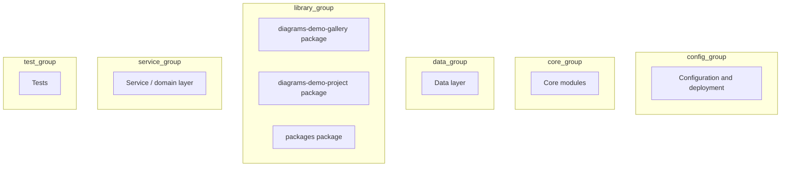

# Architecture report: projectstorm/react-diagrams

> Automated static analysis. **Observed** = directly seen in files/imports/AST; **Inferred** = interpretation from that evidence. Repository code was not executed.

## 1. Repository at a glance

| Item | Value |
| --- | --- |
| Repository | projectstorm/react-diagrams |
| Description | a super simple, no-nonsense diagramming library written in react that just works |
| Language | TypeScript |
| Stars | 9437 |
| Licence | MIT |
| Analysed commit / branch | cd3bdd119376836a0c675be5e3e58ee807cfd0c1 / master |
| Framework(s) | React |
| Files analysed | 229 |
| Components | 8 |

## 2. Architecture in one minute

projectstorm/react-diagrams - a super simple, no-nonsense diagramming library written in react that just works. This repository was analysed statically from 229 file(s) (0 Python). Detected technologies (observed from imports/manifests): GitHub Actions, React, Jest, TypeScript, webpack. Files are grouped into 8 component(s): Configuration and deployment, Core modules, Data layer, diagrams-demo-gallery package, diagrams-demo-project package, packages package, Service / domain layer, Tests. Findings below distinguish observed facts from inferred interpretation.

## 3. High-level block diagram

## 4. Main components

### Configuration and deployment (`config`)

- **Kind:** config
- **Status:** Observed
- **Confidence:** 0.85
- **Responsibility:** Groups 21 file(s) under configuration and deployment (observed from repository paths and static analysis).
- **Paths:** `diagrams-demo-gallery/.babelrc.json`, `diagrams-demo-gallery/package.json`, `diagrams-demo-gallery/tsconfig.json`, `diagrams-demo-project/package.json`, `diagrams-demo-project/tsconfig.json`, `package.json`, `packages/geometry/package.json`, `packages/geometry/tsconfig.json`, `packages/react-canvas-core/package.json`, `packages/react-canvas-core/tsconfig.json`, `packages/react-diagrams-core/package.json`, `packages/react-diagrams-core/tsconfig.json`, `packages/react-diagrams-defaults/package.json`, `packages/react-diagrams-defaults/tsconfig.json`, `packages/react-diagrams-routing/package.json`, `packages/react-diagrams-routing/tsconfig.json`, `packages/react-diagrams/package.json`, `packages/react-diagrams/tsconfig.json`, `pnpm-workspace.yaml`, `tsconfig.base.json`, `tsconfig.json`
- **Evidence:** [diagrams-demo-gallery/.babelrc.json](https://github.com/projectstorm/react-diagrams/blob/cd3bdd119376836a0c675be5e3e58ee807cfd0c1/diagrams-demo-gallery/.babelrc.json); [diagrams-demo-gallery/package.json](https://github.com/projectstorm/react-diagrams/blob/cd3bdd119376836a0c675be5e3e58ee807cfd0c1/diagrams-demo-gallery/package.json); [diagrams-demo-gallery/tsconfig.json](https://github.com/projectstorm/react-diagrams/blob/cd3bdd119376836a0c675be5e3e58ee807cfd0c1/diagrams-demo-gallery/tsconfig.json); [diagrams-demo-project/package.json](https://github.com/projectstorm/react-diagrams/blob/cd3bdd119376836a0c675be5e3e58ee807cfd0c1/diagrams-demo-project/package.json); [diagrams-demo-project/tsconfig.json](https://github.com/projectstorm/react-diagrams/blob/cd3bdd119376836a0c675be5e3e58ee807cfd0c1/diagrams-demo-project/tsconfig.json); [package.json](https://github.com/projectstorm/react-diagrams/blob/cd3bdd119376836a0c675be5e3e58ee807cfd0c1/package.json); [packages/geometry/package.json](https://github.com/projectstorm/react-diagrams/blob/cd3bdd119376836a0c675be5e3e58ee807cfd0c1/packages/geometry/package.json); [packages/geometry/tsconfig.json](https://github.com/projectstorm/react-diagrams/blob/cd3bdd119376836a0c675be5e3e58ee807cfd0c1/packages/geometry/tsconfig.json)

### Core modules (`core`)

- **Kind:** core
- **Status:** Observed
- **Confidence:** 0.85
- **Responsibility:** Groups 1 file(s) under core modules (observed from repository paths and static analysis).
- **Paths:** `webpack.shared.js`
- **Evidence:** [webpack.shared.js](https://github.com/projectstorm/react-diagrams/blob/cd3bdd119376836a0c675be5e3e58ee807cfd0c1/webpack.shared.js)

### Data layer (`data_layer`)

- **Kind:** data
- **Status:** Observed
- **Confidence:** 0.85
- **Responsibility:** Groups 1 file(s) under data layer (observed from repository paths and static analysis).
- **Paths:** `packages/react-diagrams-core/src/models/DiagramModel.ts`
- **Evidence:** [packages/react-diagrams-core/src/models/DiagramModel.ts](https://github.com/projectstorm/react-diagrams/blob/cd3bdd119376836a0c675be5e3e58ee807cfd0c1/packages/react-diagrams-core/src/models/DiagramModel.ts)

### diagrams-demo-gallery package (`diagrams_demo_gallery`)

- **Kind:** library
- **Status:** Observed
- **Confidence:** 0.85
- **Responsibility:** Groups 52 file(s) under diagrams-demo-gallery package (observed from repository paths and static analysis).
- **Paths:** `diagrams-demo-gallery/.storybook/main.js`, `diagrams-demo-gallery/.storybook/manager.js`, `diagrams-demo-gallery/.storybook/preview.js`, `diagrams-demo-gallery/.storybook/theme.js`, `diagrams-demo-gallery/demos/1_SimpleUsage.stories.tsx`, `diagrams-demo-gallery/demos/2_AdvancedUsage.stories.tsx`, `diagrams-demo-gallery/demos/3_Customization.stories.tsx`, `diagrams-demo-gallery/demos/4_Libraries.stories.tsx`, `diagrams-demo-gallery/demos/demo-alternative-linking/CreateLinkState.ts`, `diagrams-demo-gallery/demos/demo-alternative-linking/DefaultState.ts`, `diagrams-demo-gallery/demos/demo-alternative-linking/index.tsx`, `diagrams-demo-gallery/demos/demo-animation/index.tsx`, `diagrams-demo-gallery/demos/demo-canvas-drag/index.tsx`, `diagrams-demo-gallery/demos/demo-cloning/index.tsx`, `diagrams-demo-gallery/demos/demo-custom-action/index.tsx`, `diagrams-demo-gallery/demos/demo-custom-link-label/EditableLabelFactory.tsx`, `diagrams-demo-gallery/demos/demo-custom-link-label/EditableLabelModel.ts`, `diagrams-demo-gallery/demos/demo-custom-link-label/EditableLabelWidget.tsx`, `diagrams-demo-gallery/demos/demo-custom-link-label/index.tsx`, `diagrams-demo-gallery/demos/demo-custom-link1/index.tsx`, `diagrams-demo-gallery/demos/demo-custom-link2/index.tsx`, `diagrams-demo-gallery/demos/demo-custom-node1/DiamondNodeFactory.tsx`, `diagrams-demo-gallery/demos/demo-custom-node1/DiamondNodeModel.ts`, `diagrams-demo-gallery/demos/demo-custom-node1/DiamondNodeWidget.tsx`, `diagrams-demo-gallery/demos/demo-custom-node1/DiamondPortModel.ts`, `diagrams-demo-gallery/demos/demo-custom-node1/SimplePortFactory.ts`, `diagrams-demo-gallery/demos/demo-custom-node1/index.tsx`, `diagrams-demo-gallery/demos/demo-custom_delete_keys/index.tsx`, `diagrams-demo-gallery/demos/demo-dagre/index.tsx`, `diagrams-demo-gallery/demos/demo-drag-and-drop/Application.ts`, `diagrams-demo-gallery/demos/demo-drag-and-drop/components/BodyWidget.tsx`, `diagrams-demo-gallery/demos/demo-drag-and-drop/components/TrayItemWidget.tsx`, `diagrams-demo-gallery/demos/demo-drag-and-drop/components/TrayWidget.tsx`, `diagrams-demo-gallery/demos/demo-drag-and-drop/index.tsx`, `diagrams-demo-gallery/demos/demo-dynamic-ports/index.tsx`, `diagrams-demo-gallery/demos/demo-grid/index.tsx`, `diagrams-demo-gallery/demos/demo-labelled-links/index.tsx`, `diagrams-demo-gallery/demos/demo-listeners/index.tsx`, `diagrams-demo-gallery/demos/demo-locks/index.tsx`, `diagrams-demo-gallery/demos/demo-mutate-graph/index.tsx`, `diagrams-demo-gallery/demos/demo-pan-and-zoom/index.tsx`, `diagrams-demo-gallery/demos/demo-performance/index.tsx`, `diagrams-demo-gallery/demos/demo-right-angles-routing/index.tsx`, `diagrams-demo-gallery/demos/demo-serializing/index.tsx`, `diagrams-demo-gallery/demos/demo-simple-flow/index.tsx`, `diagrams-demo-gallery/demos/demo-simple/index.tsx`, `diagrams-demo-gallery/demos/demo-smart-routing/index.tsx`, `diagrams-demo-gallery/demos/demo-zoom-to-fit-nodes/index.tsx`, `diagrams-demo-gallery/demos/demo-zoom-to-fit/index.tsx`, `diagrams-demo-gallery/demos/helpers/DemoCanvasWidget.tsx`, `diagrams-demo-gallery/demos/helpers/DemoWorkspaceWidget.tsx`, `diagrams-demo-gallery/demos/helpers/Helper.tsx`
- **Evidence:** [diagrams-demo-gallery/.storybook/main.js](https://github.com/projectstorm/react-diagrams/blob/cd3bdd119376836a0c675be5e3e58ee807cfd0c1/diagrams-demo-gallery/.storybook/main.js); [diagrams-demo-gallery/.storybook/manager.js](https://github.com/projectstorm/react-diagrams/blob/cd3bdd119376836a0c675be5e3e58ee807cfd0c1/diagrams-demo-gallery/.storybook/manager.js); [diagrams-demo-gallery/.storybook/preview.js](https://github.com/projectstorm/react-diagrams/blob/cd3bdd119376836a0c675be5e3e58ee807cfd0c1/diagrams-demo-gallery/.storybook/preview.js); [diagrams-demo-gallery/.storybook/theme.js](https://github.com/projectstorm/react-diagrams/blob/cd3bdd119376836a0c675be5e3e58ee807cfd0c1/diagrams-demo-gallery/.storybook/theme.js); [diagrams-demo-gallery/demos/1_SimpleUsage.stories.tsx](https://github.com/projectstorm/react-diagrams/blob/cd3bdd119376836a0c675be5e3e58ee807cfd0c1/diagrams-demo-gallery/demos/1_SimpleUsage.stories.tsx); [diagrams-demo-gallery/demos/2_AdvancedUsage.stories.tsx](https://github.com/projectstorm/react-diagrams/blob/cd3bdd119376836a0c675be5e3e58ee807cfd0c1/diagrams-demo-gallery/demos/2_AdvancedUsage.stories.tsx); [diagrams-demo-gallery/demos/3_Customization.stories.tsx](https://github.com/projectstorm/react-diagrams/blob/cd3bdd119376836a0c675be5e3e58ee807cfd0c1/diagrams-demo-gallery/demos/3_Customization.stories.tsx); [diagrams-demo-gallery/demos/4_Libraries.stories.tsx](https://github.com/projectstorm/react-diagrams/blob/cd3bdd119376836a0c675be5e3e58ee807cfd0c1/diagrams-demo-gallery/demos/4_Libraries.stories.tsx)

### diagrams-demo-project package (`diagrams_demo_project`)

- **Kind:** library
- **Status:** Observed
- **Confidence:** 0.85
- **Responsibility:** Groups 9 file(s) under diagrams-demo-project package (observed from repository paths and static analysis).
- **Paths:** `diagrams-demo-project/src/BodyWidget.tsx`, `diagrams-demo-project/src/custom-node-js/JSCustomNodeFactory.jsx`, `diagrams-demo-project/src/custom-node-js/JSCustomNodeModel.js`, `diagrams-demo-project/src/custom-node-js/JSCustomNodeWidget.jsx`, `diagrams-demo-project/src/custom-node-ts/TSCustomNodeFactory.tsx`, `diagrams-demo-project/src/custom-node-ts/TSCustomNodeModel.ts`, `diagrams-demo-project/src/custom-node-ts/TSCustomNodeWidget.tsx`, `diagrams-demo-project/src/main.tsx`, `diagrams-demo-project/webpack.config.js`
- **Evidence:** [diagrams-demo-project/src/BodyWidget.tsx](https://github.com/projectstorm/react-diagrams/blob/cd3bdd119376836a0c675be5e3e58ee807cfd0c1/diagrams-demo-project/src/BodyWidget.tsx); [diagrams-demo-project/src/custom-node-js/JSCustomNodeFactory.jsx](https://github.com/projectstorm/react-diagrams/blob/cd3bdd119376836a0c675be5e3e58ee807cfd0c1/diagrams-demo-project/src/custom-node-js/JSCustomNodeFactory.jsx); [diagrams-demo-project/src/custom-node-js/JSCustomNodeModel.js](https://github.com/projectstorm/react-diagrams/blob/cd3bdd119376836a0c675be5e3e58ee807cfd0c1/diagrams-demo-project/src/custom-node-js/JSCustomNodeModel.js); [diagrams-demo-project/src/custom-node-js/JSCustomNodeWidget.jsx](https://github.com/projectstorm/react-diagrams/blob/cd3bdd119376836a0c675be5e3e58ee807cfd0c1/diagrams-demo-project/src/custom-node-js/JSCustomNodeWidget.jsx); [diagrams-demo-project/src/custom-node-ts/TSCustomNodeFactory.tsx](https://github.com/projectstorm/react-diagrams/blob/cd3bdd119376836a0c675be5e3e58ee807cfd0c1/diagrams-demo-project/src/custom-node-ts/TSCustomNodeFactory.tsx); [diagrams-demo-project/src/custom-node-ts/TSCustomNodeModel.ts](https://github.com/projectstorm/react-diagrams/blob/cd3bdd119376836a0c675be5e3e58ee807cfd0c1/diagrams-demo-project/src/custom-node-ts/TSCustomNodeModel.ts); [diagrams-demo-project/src/custom-node-ts/TSCustomNodeWidget.tsx](https://github.com/projectstorm/react-diagrams/blob/cd3bdd119376836a0c675be5e3e58ee807cfd0c1/diagrams-demo-project/src/custom-node-ts/TSCustomNodeWidget.tsx); [diagrams-demo-project/src/main.tsx](https://github.com/projectstorm/react-diagrams/blob/cd3bdd119376836a0c675be5e3e58ee807cfd0c1/diagrams-demo-project/src/main.tsx)

### packages package (`packages`)

- **Kind:** library
- **Status:** Observed
- **Confidence:** 0.85
- **Responsibility:** Groups 88 file(s) under packages package (observed from repository paths and static analysis).
- **Paths:** `packages/geometry/src/BezierCurve.ts`, `packages/geometry/src/Bounds.ts`, `packages/geometry/src/Matrix.ts`, `packages/geometry/src/Point.ts`, `packages/geometry/src/Polygon.ts`, `packages/geometry/src/Rectangle.ts`, `packages/geometry/src/index.ts`, `packages/geometry/src/toolkit.ts`, `packages/geometry/webpack.config.js`, `packages/react-canvas-core/src/CanvasEngine.ts`, `packages/react-canvas-core/src/Toolkit.ts`, `packages/react-canvas-core/src/actions/DeleteItemsAction.ts`, `packages/react-canvas-core/src/actions/PanAndZoomCanvasAction.ts`, `packages/react-canvas-core/src/actions/ZoomCanvasAction.ts`, `packages/react-canvas-core/src/core-actions/Action.ts`, `packages/react-canvas-core/src/core-actions/ActionEventBus.ts`, `packages/react-canvas-core/src/core-models/BaseEntity.ts`, `packages/react-canvas-core/src/core-models/BaseModel.ts`, `packages/react-canvas-core/src/core-models/BasePositionModel.ts`, `packages/react-canvas-core/src/core-state/AbstractDisplacementState.ts`, `packages/react-canvas-core/src/core-state/State.ts`, `packages/react-canvas-core/src/core-state/StateMachine.ts`, `packages/react-canvas-core/src/entities/canvas/CanvasModel.ts`, `packages/react-canvas-core/src/entities/canvas/CanvasWidget.tsx`, `packages/react-canvas-core/src/entities/layer/LayerModel.ts`, `packages/react-canvas-core/src/entities/layer/SmartLayerWidget.tsx`, `packages/react-canvas-core/src/entities/layer/TransformLayerWidget.tsx`, `packages/react-canvas-core/src/entities/selection/SelectionBoxLayerFactory.tsx`, `packages/react-canvas-core/src/entities/selection/SelectionBoxWidget.tsx`, `packages/react-canvas-core/src/entities/selection/SelectionLayerModel.ts`, `packages/react-canvas-core/src/index.ts`, `packages/react-canvas-core/src/states/DefaultState.ts`, `packages/react-canvas-core/src/states/DragCanvasState.ts`, `packages/react-canvas-core/src/states/MoveItemsState.ts`, `packages/react-canvas-core/src/states/SelectingState.ts`, `packages/react-canvas-core/src/states/SelectionBoxState.ts`, `packages/react-canvas-core/src/widgets/PeformanceWidget.tsx`, `packages/react-canvas-core/webpack.config.js`, `packages/react-diagrams-core/src/DiagramEngine.ts`, `packages/react-diagrams-core/src/entities/label/LabelModel.ts`, `packages/react-diagrams-core/src/entities/label/LabelWidget.tsx`, `packages/react-diagrams-core/src/entities/link-layer/LinkLayerFactory.tsx`, `packages/react-diagrams-core/src/entities/link-layer/LinkLayerModel.ts`, `packages/react-diagrams-core/src/entities/link-layer/LinkLayerWidget.tsx`, `packages/react-diagrams-core/src/entities/link/LinkModel.ts`, `packages/react-diagrams-core/src/entities/link/LinkWidget.tsx`, `packages/react-diagrams-core/src/entities/link/PointModel.ts`, `packages/react-diagrams-core/src/entities/node-layer/NodeLayerFactory.tsx`, `packages/react-diagrams-core/src/entities/node-layer/NodeLayerModel.ts`, `packages/react-diagrams-core/src/entities/node-layer/NodeLayerWidget.tsx`, `packages/react-diagrams-core/src/entities/node/NodeModel.ts`, `packages/react-diagrams-core/src/entities/node/NodeWidget.tsx`, `packages/react-diagrams-core/src/entities/port/PortModel.ts`, `packages/react-diagrams-core/src/entities/port/PortWidget.tsx`, `packages/react-diagrams-core/src/index.ts`, `packages/react-diagrams-core/src/states/DefaultDiagramState.ts`, `packages/react-diagrams-core/src/states/DragDiagramItemsState.ts`, `packages/react-diagrams-core/src/states/DragNewLinkState.ts`, `packages/react-diagrams-core/webpack.config.js`, `packages/react-diagrams-defaults/src/index.ts`, `packages/react-diagrams-defaults/src/label/DefaultLabelFactory.tsx`, `packages/react-diagrams-defaults/src/label/DefaultLabelModel.tsx`, `packages/react-diagrams-defaults/src/label/DefaultLabelWidget.tsx`, `packages/react-diagrams-defaults/src/link/DefaultLinkFactory.tsx`, `packages/react-diagrams-defaults/src/link/DefaultLinkModel.ts`, `packages/react-diagrams-defaults/src/link/DefaultLinkPointWidget.tsx`, `packages/react-diagrams-defaults/src/link/DefaultLinkSegmentWidget.tsx`, `packages/react-diagrams-defaults/src/link/DefaultLinkWidget.tsx`, `packages/react-diagrams-defaults/src/node/DefaultNodeFactory.tsx`, `packages/react-diagrams-defaults/src/node/DefaultNodeModel.ts`, `packages/react-diagrams-defaults/src/node/DefaultNodeWidget.tsx`, `packages/react-diagrams-defaults/src/port/DefaultPortFactory.tsx`, `packages/react-diagrams-defaults/src/port/DefaultPortLabelWidget.tsx`, `packages/react-diagrams-defaults/src/port/DefaultPortModel.ts`, `packages/react-diagrams-defaults/webpack.config.js`, `packages/react-diagrams-routing/jest.config.js`, `packages/react-diagrams-routing/src/dagre/DagreEngine.ts`, `packages/react-diagrams-routing/src/engine/PathFinding.ts`, `packages/react-diagrams-routing/src/index.ts`, `packages/react-diagrams-routing/src/link/PathFindingLinkFactory.tsx`, `packages/react-diagrams-routing/src/link/PathFindingLinkModel.ts`, `packages/react-diagrams-routing/src/link/PathFindingLinkWidget.tsx`, `packages/react-diagrams-routing/src/link/RightAngleLinkFactory.tsx`, `packages/react-diagrams-routing/src/link/RightAngleLinkModel.ts`, `packages/react-diagrams-routing/src/link/RightAngleLinkWidget.tsx`, `packages/react-diagrams-routing/webpack.config.js`, `packages/react-diagrams/src/index.ts`, `packages/react-diagrams/webpack.config.js`
- **Evidence:** [packages/geometry/src/BezierCurve.ts](https://github.com/projectstorm/react-diagrams/blob/cd3bdd119376836a0c675be5e3e58ee807cfd0c1/packages/geometry/src/BezierCurve.ts); [packages/geometry/src/Bounds.ts](https://github.com/projectstorm/react-diagrams/blob/cd3bdd119376836a0c675be5e3e58ee807cfd0c1/packages/geometry/src/Bounds.ts); [packages/geometry/src/Matrix.ts](https://github.com/projectstorm/react-diagrams/blob/cd3bdd119376836a0c675be5e3e58ee807cfd0c1/packages/geometry/src/Matrix.ts); [packages/geometry/src/Point.ts](https://github.com/projectstorm/react-diagrams/blob/cd3bdd119376836a0c675be5e3e58ee807cfd0c1/packages/geometry/src/Point.ts); [packages/geometry/src/Polygon.ts](https://github.com/projectstorm/react-diagrams/blob/cd3bdd119376836a0c675be5e3e58ee807cfd0c1/packages/geometry/src/Polygon.ts); [packages/geometry/src/Rectangle.ts](https://github.com/projectstorm/react-diagrams/blob/cd3bdd119376836a0c675be5e3e58ee807cfd0c1/packages/geometry/src/Rectangle.ts); [packages/geometry/src/index.ts](https://github.com/projectstorm/react-diagrams/blob/cd3bdd119376836a0c675be5e3e58ee807cfd0c1/packages/geometry/src/index.ts); [packages/geometry/src/toolkit.ts](https://github.com/projectstorm/react-diagrams/blob/cd3bdd119376836a0c675be5e3e58ee807cfd0c1/packages/geometry/src/toolkit.ts)

### Service / domain layer (`service_layer`)

- **Kind:** service
- **Status:** Observed
- **Confidence:** 0.85
- **Responsibility:** Groups 6 file(s) under service / domain layer (observed from repository paths and static analysis).
- **Paths:** `packages/react-canvas-core/src/core/AbstractFactory.ts`, `packages/react-canvas-core/src/core/AbstractModelFactory.ts`, `packages/react-canvas-core/src/core/AbstractReactFactory.tsx`, `packages/react-canvas-core/src/core/BaseObserver.ts`, `packages/react-canvas-core/src/core/FactoryBank.ts`, `packages/react-canvas-core/src/core/ModelGeometryInterface.ts`
- **Evidence:** [packages/react-canvas-core/src/core/AbstractFactory.ts](https://github.com/projectstorm/react-diagrams/blob/cd3bdd119376836a0c675be5e3e58ee807cfd0c1/packages/react-canvas-core/src/core/AbstractFactory.ts); [packages/react-canvas-core/src/core/AbstractModelFactory.ts](https://github.com/projectstorm/react-diagrams/blob/cd3bdd119376836a0c675be5e3e58ee807cfd0c1/packages/react-canvas-core/src/core/AbstractModelFactory.ts); [packages/react-canvas-core/src/core/AbstractReactFactory.tsx](https://github.com/projectstorm/react-diagrams/blob/cd3bdd119376836a0c675be5e3e58ee807cfd0c1/packages/react-canvas-core/src/core/AbstractReactFactory.tsx); [packages/react-canvas-core/src/core/BaseObserver.ts](https://github.com/projectstorm/react-diagrams/blob/cd3bdd119376836a0c675be5e3e58ee807cfd0c1/packages/react-canvas-core/src/core/BaseObserver.ts); [packages/react-canvas-core/src/core/FactoryBank.ts](https://github.com/projectstorm/react-diagrams/blob/cd3bdd119376836a0c675be5e3e58ee807cfd0c1/packages/react-canvas-core/src/core/FactoryBank.ts); [packages/react-canvas-core/src/core/ModelGeometryInterface.ts](https://github.com/projectstorm/react-diagrams/blob/cd3bdd119376836a0c675be5e3e58ee807cfd0c1/packages/react-canvas-core/src/core/ModelGeometryInterface.ts)

### Tests (`tests`)

- **Kind:** test
- **Status:** Observed
- **Confidence:** 0.85
- **Responsibility:** Groups 1 file(s) under tests (observed from repository paths and static analysis).
- **Paths:** `packages/react-diagrams-routing/tests/PathFinding.test.tsx`
- **Evidence:** [packages/react-diagrams-routing/tests/PathFinding.test.tsx](https://github.com/projectstorm/react-diagrams/blob/cd3bdd119376836a0c675be5e3e58ee807cfd0c1/packages/react-diagrams-routing/tests/PathFinding.test.tsx)

## 5. Execution flow

**Observed** entry point(s):

- [diagrams-demo-gallery/.storybook/main.js](https://github.com/projectstorm/react-diagrams/blob/cd3bdd119376836a0c675be5e3e58ee807cfd0c1/diagrams-demo-gallery/.storybook/main.js)
- [diagrams-demo-gallery/demos/demo-alternative-linking/index.tsx](https://github.com/projectstorm/react-diagrams/blob/cd3bdd119376836a0c675be5e3e58ee807cfd0c1/diagrams-demo-gallery/demos/demo-alternative-linking/index.tsx)
- [diagrams-demo-gallery/demos/demo-animation/index.tsx](https://github.com/projectstorm/react-diagrams/blob/cd3bdd119376836a0c675be5e3e58ee807cfd0c1/diagrams-demo-gallery/demos/demo-animation/index.tsx)
- [diagrams-demo-gallery/demos/demo-canvas-drag/index.tsx](https://github.com/projectstorm/react-diagrams/blob/cd3bdd119376836a0c675be5e3e58ee807cfd0c1/diagrams-demo-gallery/demos/demo-canvas-drag/index.tsx)
- [diagrams-demo-gallery/demos/demo-cloning/index.tsx](https://github.com/projectstorm/react-diagrams/blob/cd3bdd119376836a0c675be5e3e58ee807cfd0c1/diagrams-demo-gallery/demos/demo-cloning/index.tsx)
- [diagrams-demo-gallery/demos/demo-custom-action/index.tsx](https://github.com/projectstorm/react-diagrams/blob/cd3bdd119376836a0c675be5e3e58ee807cfd0c1/diagrams-demo-gallery/demos/demo-custom-action/index.tsx)
- [diagrams-demo-gallery/demos/demo-custom-link-label/index.tsx](https://github.com/projectstorm/react-diagrams/blob/cd3bdd119376836a0c675be5e3e58ee807cfd0c1/diagrams-demo-gallery/demos/demo-custom-link-label/index.tsx)
- [diagrams-demo-gallery/demos/demo-custom-link1/index.tsx](https://github.com/projectstorm/react-diagrams/blob/cd3bdd119376836a0c675be5e3e58ee807cfd0c1/diagrams-demo-gallery/demos/demo-custom-link1/index.tsx)
- [diagrams-demo-gallery/demos/demo-custom-link2/index.tsx](https://github.com/projectstorm/react-diagrams/blob/cd3bdd119376836a0c675be5e3e58ee807cfd0c1/diagrams-demo-gallery/demos/demo-custom-link2/index.tsx)
- [diagrams-demo-gallery/demos/demo-custom-node1/index.tsx](https://github.com/projectstorm/react-diagrams/blob/cd3bdd119376836a0c675be5e3e58ee807cfd0c1/diagrams-demo-gallery/demos/demo-custom-node1/index.tsx)
- [diagrams-demo-gallery/demos/demo-custom_delete_keys/index.tsx](https://github.com/projectstorm/react-diagrams/blob/cd3bdd119376836a0c675be5e3e58ee807cfd0c1/diagrams-demo-gallery/demos/demo-custom_delete_keys/index.tsx)
- [diagrams-demo-gallery/demos/demo-dagre/index.tsx](https://github.com/projectstorm/react-diagrams/blob/cd3bdd119376836a0c675be5e3e58ee807cfd0c1/diagrams-demo-gallery/demos/demo-dagre/index.tsx)

Representative flow (derived from observed entry points and the import graph; steps beyond the entry point are **Inferred**):

1. Execution starts at an observed entry point listed above, if present.
2. No internal import relationships between components were observed.

## 6. Project structure

### `(root)`

- `.editorconfig` - config (150 bytes)
- `.envrc` - other (29 bytes)
- `.gitbook.yaml` - config (46 bytes)
- `.gitignore` - other (78 bytes)
- `.prettierignore` - other (23 bytes)
- `.prettierrc` - other (104 bytes)
- `CHANGELOG.md` - docs (9491 bytes)
- `CONTRIBUTING.md` - docs (1444 bytes)
- `LICENSE` - docs (1072 bytes)
- `README.md` - docs (3907 bytes)
- `package.json` - manifest (1369 bytes)
- `pnpm-workspace.yaml` - config (82 bytes)
- `tsconfig.base.json` - config (359 bytes)
- `tsconfig.json` - config (344 bytes)
- `webpack.shared.js` - source, JavaScript (924 bytes)

### `.changeset`

- `.changeset/README.md` - docs (510 bytes)
- `.changeset/cold-drinks-unite.md` - docs (345 bytes)
- `.changeset/config.json` - config (268 bytes)

### `.github`

- `.github/PULL_REQUEST_TEMPLATE.md` - docs (457 bytes)
- `.github/workflows/prettier.yml` - ci, YAML (596 bytes)
- `.github/workflows/release.yml` - ci, YAML (1167 bytes)
- `.github/workflows/test.yml` - ci, YAML (627 bytes)

### `diagrams-demo-gallery`

- `diagrams-demo-gallery/.babelrc.json` - config (286 bytes)
- `diagrams-demo-gallery/.storybook/main.js` - source, JavaScript (183 bytes)
- `diagrams-demo-gallery/.storybook/manager.js` - source, JavaScript (133 bytes)
- `diagrams-demo-gallery/.storybook/preview-head.html` - other (66 bytes)
- `diagrams-demo-gallery/.storybook/preview.js` - source, JavaScript (53 bytes)
- `diagrams-demo-gallery/.storybook/theme.js` - source, JavaScript (186 bytes)
- `diagrams-demo-gallery/CHANGELOG.md` - docs (3621 bytes)
- `diagrams-demo-gallery/demos/1_SimpleUsage.stories.tsx` - source, TypeScript (1235 bytes)
- `diagrams-demo-gallery/demos/2_AdvancedUsage.stories.tsx` - source, TypeScript (1055 bytes)
- `diagrams-demo-gallery/demos/3_Customization.stories.tsx` - source, TypeScript (664 bytes)
- `diagrams-demo-gallery/demos/4_Libraries.stories.tsx` - source, TypeScript (302 bytes)
- `diagrams-demo-gallery/demos/demo-alternative-linking/CreateLinkState.ts` - source, TypeScript (2774 bytes)
- `diagrams-demo-gallery/demos/demo-alternative-linking/DefaultState.ts` - source, TypeScript (1893 bytes)
- `diagrams-demo-gallery/demos/demo-alternative-linking/index.tsx` - source, TypeScript (938 bytes)
- `diagrams-demo-gallery/demos/demo-animation/index.tsx` - source, TypeScript (2198 bytes)
- `diagrams-demo-gallery/demos/demo-canvas-drag/index.tsx` - source, TypeScript (1946 bytes)
- `diagrams-demo-gallery/demos/demo-cloning/index.tsx` - source, TypeScript (2339 bytes)
- `diagrams-demo-gallery/demos/demo-custom-action/index.tsx` - source, TypeScript (2193 bytes)
- `diagrams-demo-gallery/demos/demo-custom-link-label/EditableLabelFactory.tsx` - source, TypeScript (707 bytes)
- `diagrams-demo-gallery/demos/demo-custom-link-label/EditableLabelModel.ts` - source, TypeScript (648 bytes)
- `diagrams-demo-gallery/demos/demo-custom-link-label/EditableLabelWidget.tsx` - source, TypeScript (1022 bytes)
- `diagrams-demo-gallery/demos/demo-custom-link-label/index.tsx` - source, TypeScript (1373 bytes)
- `diagrams-demo-gallery/demos/demo-custom-link1/index.tsx` - source, TypeScript (3685 bytes)
- `diagrams-demo-gallery/demos/demo-custom-link2/index.tsx` - source, TypeScript (5863 bytes)
- `diagrams-demo-gallery/demos/demo-custom-node1/DiamondNodeFactory.tsx` - source, TypeScript (641 bytes)
- `diagrams-demo-gallery/demos/demo-custom-node1/DiamondNodeModel.ts` - source, TypeScript (632 bytes)
- `diagrams-demo-gallery/demos/demo-custom-node1/DiamondNodeWidget.tsx` - source, TypeScript (2564 bytes)
- `diagrams-demo-gallery/demos/demo-custom-node1/DiamondPortModel.ts` - source, TypeScript (358 bytes)
- `diagrams-demo-gallery/demos/demo-custom-node1/SimplePortFactory.ts` - source, TypeScript (459 bytes)
- `diagrams-demo-gallery/demos/demo-custom-node1/index.tsx` - source, TypeScript (2203 bytes)
- `diagrams-demo-gallery/demos/demo-custom_delete_keys/index.tsx` - source, TypeScript (1230 bytes)
- `diagrams-demo-gallery/demos/demo-dagre/index.tsx` - source, TypeScript (3967 bytes)
- `diagrams-demo-gallery/demos/demo-drag-and-drop/Application.ts` - source, TypeScript (1004 bytes)
- `diagrams-demo-gallery/demos/demo-drag-and-drop/components/BodyWidget.tsx` - source, TypeScript (2445 bytes)
- `diagrams-demo-gallery/demos/demo-drag-and-drop/components/TrayItemWidget.tsx` - source, TypeScript (779 bytes)
- `diagrams-demo-gallery/demos/demo-drag-and-drop/components/TrayWidget.tsx` - source, TypeScript (326 bytes)
- `diagrams-demo-gallery/demos/demo-drag-and-drop/index.tsx` - source, TypeScript (223 bytes)
- `diagrams-demo-gallery/demos/demo-dynamic-ports/index.tsx` - source, TypeScript (1783 bytes)
- `diagrams-demo-gallery/demos/demo-grid/index.tsx` - source, TypeScript (1089 bytes)
- `diagrams-demo-gallery/demos/demo-labelled-links/index.tsx` - source, TypeScript (2027 bytes)
- `diagrams-demo-gallery/demos/demo-listeners/index.tsx` - source, TypeScript (1444 bytes)
- `diagrams-demo-gallery/demos/demo-locks/index.tsx` - source, TypeScript (1593 bytes)
- `diagrams-demo-gallery/demos/demo-mutate-graph/index.tsx` - source, TypeScript (2561 bytes)
- `diagrams-demo-gallery/demos/demo-pan-and-zoom/index.tsx` - source, TypeScript (1681 bytes)
- `diagrams-demo-gallery/demos/demo-performance/index.tsx` - source, TypeScript (1431 bytes)
- `diagrams-demo-gallery/demos/demo-right-angles-routing/index.tsx` - source, TypeScript (2308 bytes)
- `diagrams-demo-gallery/demos/demo-serializing/index.tsx` - source, TypeScript (1780 bytes)
- `diagrams-demo-gallery/demos/demo-simple-flow/index.tsx` - source, TypeScript (1527 bytes)
- `diagrams-demo-gallery/demos/demo-simple/index.tsx` - source, TypeScript (1166 bytes)
- `diagrams-demo-gallery/demos/demo-smart-routing/index.tsx` - source, TypeScript (2308 bytes)
- `diagrams-demo-gallery/demos/demo-zoom-to-fit-nodes/index.tsx` - source, TypeScript (1625 bytes)
- `diagrams-demo-gallery/demos/demo-zoom-to-fit/index.tsx` - source, TypeScript (1604 bytes)
- `diagrams-demo-gallery/demos/helpers/DemoCanvasWidget.tsx` - source, TypeScript (1431 bytes)
- `diagrams-demo-gallery/demos/helpers/DemoWorkspaceWidget.tsx` - source, TypeScript (1014 bytes)
- `diagrams-demo-gallery/demos/helpers/Helper.tsx` - source, TypeScript (709 bytes)
- `diagrams-demo-gallery/demos/helpers/index.css` - other (72 bytes)
- `diagrams-demo-gallery/package.json` - manifest (1513 bytes)
- `diagrams-demo-gallery/tsconfig.json` - config (364 bytes)

### `diagrams-demo-project`

- `diagrams-demo-project/.babelrc` - other (114 bytes)
- `diagrams-demo-project/CHANGELOG.md` - docs (2208 bytes)
- `diagrams-demo-project/README.md` - docs (367 bytes)
- `diagrams-demo-project/index.html` - other (278 bytes)
- `diagrams-demo-project/package.json` - manifest (1007 bytes)
- `diagrams-demo-project/src/BodyWidget.tsx` - source, TypeScript (339 bytes)
- `diagrams-demo-project/src/custom-node-js/JSCustomNodeFactory.jsx` - source, JavaScript (500 bytes)
- `diagrams-demo-project/src/custom-node-js/JSCustomNodeModel.js` - source, JavaScript (697 bytes)
- `diagrams-demo-project/src/custom-node-js/JSCustomNodeWidget.jsx` - source, JavaScript (592 bytes)
- `diagrams-demo-project/src/custom-node-ts/TSCustomNodeFactory.tsx` - source, TypeScript (663 bytes)
- `diagrams-demo-project/src/custom-node-ts/TSCustomNodeModel.ts` - source, TypeScript (779 bytes)
- `diagrams-demo-project/src/custom-node-ts/TSCustomNodeWidget.tsx` - source, TypeScript (941 bytes)
- `diagrams-demo-project/src/main.css` - other (680 bytes)
- `diagrams-demo-project/src/main.tsx` - source, TypeScript (1586 bytes)
- `diagrams-demo-project/tsconfig.json` - config (185 bytes)
- `diagrams-demo-project/webpack.config.js` - source, JavaScript (1077 bytes)

### `docs`

- `docs/README.md` - docs (522 bytes)
- `docs/about-the-project/architecture-questions.md` - docs (4130 bytes)
- `docs/about-the-project/testing.md` - docs (1003 bytes)
- `docs/customizing/README.md` - docs (1227 bytes)
- `docs/customizing/extending-default-links.md` - docs (2149 bytes)
- `docs/customizing/nodes.md` - docs (6007 bytes)
- `docs/customizing/ports.md` - docs (3122 bytes)
- `docs/getting-started/README.md` - docs (532 bytes)
- `docs/getting-started/using-the-library.md` - docs (1625 bytes)

### `packages`

- `packages/geometry/.npmignore` - other (53 bytes)
- `packages/geometry/CHANGELOG.md` - docs (1961 bytes)
- `packages/geometry/package.json` - manifest (671 bytes)
- `packages/geometry/src/BezierCurve.ts` - source, TypeScript (1330 bytes)
- `packages/geometry/src/Bounds.ts` - source, TypeScript (765 bytes)
- `packages/geometry/src/Matrix.ts` - source, TypeScript (1579 bytes)
- `packages/geometry/src/Point.ts` - source, TypeScript (678 bytes)
- `packages/geometry/src/Polygon.ts` - source, TypeScript (1695 bytes)
- `packages/geometry/src/Rectangle.ts` - source, TypeScript (2389 bytes)
- `packages/geometry/src/index.ts` - source, TypeScript (191 bytes)
- `packages/geometry/src/toolkit.ts` - source, TypeScript (1085 bytes)
- `packages/geometry/tsconfig.json` - config (277 bytes)
- `packages/geometry/webpack.config.js` - source, JavaScript (178 bytes)
- `packages/react-canvas-core/.npmignore` - other (53 bytes)
- `packages/react-canvas-core/CHANGELOG.md` - docs (2324 bytes)
- `packages/react-canvas-core/package.json` - manifest (840 bytes)
- `packages/react-canvas-core/src/CanvasEngine.ts` - source, TypeScript (5250 bytes)
- `packages/react-canvas-core/src/Toolkit.ts` - source, TypeScript (876 bytes)
- `packages/react-canvas-core/src/actions/DeleteItemsAction.ts` - source, TypeScript (1198 bytes)
- `packages/react-canvas-core/src/actions/PanAndZoomCanvasAction.ts` - source, TypeScript (2389 bytes)
- `packages/react-canvas-core/src/actions/ZoomCanvasAction.ts` - source, TypeScript (2340 bytes)
- `packages/react-canvas-core/src/core-actions/Action.ts` - source, TypeScript (1382 bytes)
- `packages/react-canvas-core/src/core-actions/ActionEventBus.ts` - source, TypeScript (2552 bytes)
- `packages/react-canvas-core/src/core-models/BaseEntity.ts` - source, TypeScript (2478 bytes)
- `packages/react-canvas-core/src/core-models/BaseModel.ts` - source, TypeScript (2284 bytes)
- `packages/react-canvas-core/src/core-models/BasePositionModel.ts` - source, TypeScript (1716 bytes)
- `packages/react-canvas-core/src/core-state/AbstractDisplacementState.ts` - source, TypeScript (2897 bytes)
- `packages/react-canvas-core/src/core-state/State.ts` - source, TypeScript (2748 bytes)
- `packages/react-canvas-core/src/core-state/StateMachine.ts` - source, TypeScript (1221 bytes)
- `packages/react-canvas-core/src/core/AbstractFactory.ts` - source, TypeScript (735 bytes)
- `packages/react-canvas-core/src/core/AbstractModelFactory.ts` - source, TypeScript (486 bytes)
- `packages/react-canvas-core/src/core/AbstractReactFactory.tsx` - source, TypeScript (669 bytes)
- `packages/react-canvas-core/src/core/BaseObserver.ts` - source, TypeScript (2979 bytes)
- `packages/react-canvas-core/src/core/FactoryBank.ts` - source, TypeScript (1601 bytes)
- `packages/react-canvas-core/src/core/ModelGeometryInterface.ts` - source, TypeScript (127 bytes)
- `packages/react-canvas-core/src/entities/canvas/CanvasModel.ts` - source, TypeScript (4849 bytes)
- `packages/react-canvas-core/src/entities/canvas/CanvasWidget.tsx` - source, TypeScript (2856 bytes)
- `packages/react-canvas-core/src/entities/layer/LayerModel.ts` - source, TypeScript (2667 bytes)
- `packages/react-canvas-core/src/entities/layer/SmartLayerWidget.tsx` - source, TypeScript (510 bytes)
- `packages/react-canvas-core/src/entities/layer/TransformLayerWidget.tsx` - source, TypeScript (1396 bytes)
- `packages/react-canvas-core/src/entities/selection/SelectionBoxLayerFactory.tsx` - source, TypeScript (729 bytes)
- `packages/react-canvas-core/src/entities/selection/SelectionBoxWidget.tsx` - source, TypeScript (680 bytes)
- `packages/react-canvas-core/src/entities/selection/SelectionLayerModel.ts` - source, TypeScript (671 bytes)
- `packages/react-canvas-core/src/index.ts` - source, TypeScript (1533 bytes)
- `packages/react-canvas-core/src/states/DefaultState.ts` - source, TypeScript (1184 bytes)
- `packages/react-canvas-core/src/states/DragCanvasState.ts` - source, TypeScript (1562 bytes)
- `packages/react-canvas-core/src/states/MoveItemsState.ts` - source, TypeScript (1867 bytes)
- `packages/react-canvas-core/src/states/SelectingState.ts` - source, TypeScript (872 bytes)
- `packages/react-canvas-core/src/states/SelectionBoxState.ts` - source, TypeScript (2852 bytes)
- `packages/react-canvas-core/src/widgets/PeformanceWidget.tsx` - source, TypeScript (858 bytes)
- `packages/react-canvas-core/tsconfig.json` - config (287 bytes)
- `packages/react-canvas-core/webpack.config.js` - source, JavaScript (171 bytes)
- `packages/react-diagrams-core/.npmignore` - other (53 bytes)
- `packages/react-diagrams-core/CHANGELOG.md` - docs (3095 bytes)
- `packages/react-diagrams-core/README.md` - docs (82 bytes)
- `packages/react-diagrams-core/package.json` - manifest (1070 bytes)
- `packages/react-diagrams-core/src/DiagramEngine.ts` - source, TypeScript (8671 bytes)
- `packages/react-diagrams-core/src/entities/label/LabelModel.ts` - source, TypeScript (917 bytes)
- `packages/react-diagrams-core/src/entities/label/LabelWidget.tsx` - source, TypeScript (2822 bytes)
- `packages/react-diagrams-core/src/entities/link-layer/LinkLayerFactory.tsx` - source, TypeScript (722 bytes)
- `packages/react-diagrams-core/src/entities/link-layer/LinkLayerModel.ts` - source, TypeScript (995 bytes)
- `packages/react-diagrams-core/src/entities/link-layer/LinkLayerWidget.tsx` - source, TypeScript (748 bytes)
- `packages/react-diagrams-core/src/entities/link/LinkModel.ts` - source, TypeScript (7912 bytes)
- `packages/react-diagrams-core/src/entities/link/LinkWidget.tsx` - source, TypeScript (3339 bytes)
- `packages/react-diagrams-core/src/entities/link/PointModel.ts` - source, TypeScript (1004 bytes)
- `packages/react-diagrams-core/src/entities/node-layer/NodeLayerFactory.tsx` - source, TypeScript (722 bytes)
- `packages/react-diagrams-core/src/entities/node-layer/NodeLayerModel.ts` - source, TypeScript (996 bytes)
- `packages/react-diagrams-core/src/entities/node-layer/NodeLayerWidget.tsx` - source, TypeScript (641 bytes)
- `packages/react-diagrams-core/src/entities/node/NodeModel.ts` - source, TypeScript (3588 bytes)
- `packages/react-diagrams-core/src/entities/node/NodeWidget.tsx` - source, TypeScript (2650 bytes)
- `packages/react-diagrams-core/src/entities/port/PortModel.ts` - source, TypeScript (3950 bytes)
- `packages/react-diagrams-core/src/entities/port/PortWidget.tsx` - source, TypeScript (1691 bytes)
- `packages/react-diagrams-core/src/index.ts` - source, TypeScript (895 bytes)
- `packages/react-diagrams-core/src/models/DiagramModel.ts` - source, TypeScript (4088 bytes)
- `packages/react-diagrams-core/src/states/DefaultDiagramState.ts` - source, TypeScript (1717 bytes)
- `packages/react-diagrams-core/src/states/DragDiagramItemsState.ts` - source, TypeScript (1248 bytes)
- `packages/react-diagrams-core/src/states/DragNewLinkState.ts` - source, TypeScript (3399 bytes)
- `packages/react-diagrams-core/tsconfig.json` - config (330 bytes)
- `packages/react-diagrams-core/webpack.config.js` - source, JavaScript (171 bytes)
- `packages/react-diagrams-defaults/.npmignore` - other (53 bytes)
- `packages/react-diagrams-defaults/CHANGELOG.md` - docs (3146 bytes)
- `packages/react-diagrams-defaults/README.md` - docs (86 bytes)
- `packages/react-diagrams-defaults/package.json` - manifest (949 bytes)
- `packages/react-diagrams-defaults/src/index.ts` - source, TypeScript (614 bytes)
- `packages/react-diagrams-defaults/src/label/DefaultLabelFactory.tsx` - source, TypeScript (671 bytes)
- `packages/react-diagrams-defaults/src/label/DefaultLabelModel.tsx` - source, TypeScript (892 bytes)
- `packages/react-diagrams-defaults/src/label/DefaultLabelWidget.tsx` - source, TypeScript (582 bytes)
- `packages/react-diagrams-defaults/src/link/DefaultLinkFactory.tsx` - source, TypeScript (1432 bytes)
- `packages/react-diagrams-defaults/src/link/DefaultLinkModel.ts` - source, TypeScript (3274 bytes)
- `packages/react-diagrams-defaults/src/link/DefaultLinkPointWidget.tsx` - source, TypeScript (1254 bytes)
- `packages/react-diagrams-defaults/src/link/DefaultLinkSegmentWidget.tsx` - source, TypeScript (1408 bytes)
- `packages/react-diagrams-defaults/src/link/DefaultLinkWidget.tsx` - source, TypeScript (3542 bytes)
- `packages/react-diagrams-defaults/src/node/DefaultNodeFactory.tsx` - source, TypeScript (649 bytes)
- `packages/react-diagrams-defaults/src/node/DefaultNodeModel.ts` - source, TypeScript (3063 bytes)
- `packages/react-diagrams-defaults/src/node/DefaultNodeWidget.tsx` - source, TypeScript (2176 bytes)
- `packages/react-diagrams-defaults/src/port/DefaultPortFactory.tsx` - source, TypeScript (431 bytes)
- `packages/react-diagrams-defaults/src/port/DefaultPortLabelWidget.tsx` - source, TypeScript (1095 bytes)
- `packages/react-diagrams-defaults/src/port/DefaultPortModel.ts` - source, TypeScript (1963 bytes)
- `packages/react-diagrams-defaults/tsconfig.json` - config (298 bytes)
- `packages/react-diagrams-defaults/webpack.config.js` - source, JavaScript (177 bytes)
- `packages/react-diagrams-routing/.npmignore` - other (52 bytes)
- `packages/react-diagrams-routing/CHANGELOG.md` - docs (3413 bytes)
- `packages/react-diagrams-routing/README.md` - docs (109 bytes)
- `packages/react-diagrams-routing/jest.config.js` - source, JavaScript (173 bytes)
- `packages/react-diagrams-routing/package.json` - manifest (1089 bytes)
- `packages/react-diagrams-routing/src/dagre/DagreEngine.ts` - source, TypeScript (7680 bytes)
- `packages/react-diagrams-routing/src/engine/PathFinding.ts` - source, TypeScript (3521 bytes)
- `packages/react-diagrams-routing/src/index.ts` - source, TypeScript (349 bytes)
- `packages/react-diagrams-routing/src/link/PathFindingLinkFactory.tsx` - source, TypeScript (9219 bytes)
- `packages/react-diagrams-routing/src/link/PathFindingLinkModel.ts` - source, TypeScript (396 bytes)
- `packages/react-diagrams-routing/src/link/PathFindingLinkWidget.tsx` - source, TypeScript (3146 bytes)
- `packages/react-diagrams-routing/src/link/RightAngleLinkFactory.tsx` - source, TypeScript (697 bytes)
- `packages/react-diagrams-routing/src/link/RightAngleLinkModel.ts` - source, TypeScript (1899 bytes)
- `packages/react-diagrams-routing/src/link/RightAngleLinkWidget.tsx` - source, TypeScript (9713 bytes)
- `packages/react-diagrams-routing/tests/PathFinding.test.tsx` - test, TypeScript (1222 bytes)
- `packages/react-diagrams-routing/tsconfig.json` - config (402 bytes)
- `packages/react-diagrams-routing/webpack.config.js` - source, JavaScript (176 bytes)
- `packages/react-diagrams/.npmignore` - other (53 bytes)
- `packages/react-diagrams/CHANGELOG.md` - docs (2928 bytes)
- `packages/react-diagrams/README.md` - docs (0 bytes)
- `packages/react-diagrams/package.json` - manifest (817 bytes)
- `packages/react-diagrams/src/index.ts` - source, TypeScript (1589 bytes)
- `packages/react-diagrams/tsconfig.json` - config (353 bytes)
- `packages/react-diagrams/webpack.config.js` - source, JavaScript (168 bytes)

## 7. Key dependencies and integrations

| Name | Category | Status | Confidence | Evidence |
| --- | --- | --- | --- | --- |
| GitHub Actions | ci | Observed | 0.90 | [.github/workflows/prettier.yml](https://github.com/projectstorm/react-diagrams/blob/cd3bdd119376836a0c675be5e3e58ee807cfd0c1/.github/workflows/prettier.yml); [.github/workflows/release.yml](https://github.com/projectstorm/react-diagrams/blob/cd3bdd119376836a0c675be5e3e58ee807cfd0c1/.github/workflows/release.yml); [.github/workflows/test.yml](https://github.com/projectstorm/react-diagrams/blob/cd3bdd119376836a0c675be5e3e58ee807cfd0c1/.github/workflows/test.yml) |
| React | framework | Observed | 0.90 | [diagrams-demo-gallery/package.json:2](https://github.com/projectstorm/react-diagrams/blob/cd3bdd119376836a0c675be5e3e58ee807cfd0c1/diagrams-demo-gallery/package.json#L2); [diagrams-demo-gallery/package.json:35](https://github.com/projectstorm/react-diagrams/blob/cd3bdd119376836a0c675be5e3e58ee807cfd0c1/diagrams-demo-gallery/package.json#L35); [diagrams-demo-project/package.json:2](https://github.com/projectstorm/react-diagrams/blob/cd3bdd119376836a0c675be5e3e58ee807cfd0c1/diagrams-demo-project/package.json#L2); [diagrams-demo-project/package.json:30](https://github.com/projectstorm/react-diagrams/blob/cd3bdd119376836a0c675be5e3e58ee807cfd0c1/diagrams-demo-project/package.json#L30) |
| Jest | tooling | Observed | 0.85 | [package.json:32](https://github.com/projectstorm/react-diagrams/blob/cd3bdd119376836a0c675be5e3e58ee807cfd0c1/package.json#L32) |
| TypeScript | tooling | Observed | 0.85 | [package.json:14](https://github.com/projectstorm/react-diagrams/blob/cd3bdd119376836a0c675be5e3e58ee807cfd0c1/package.json#L14) |
| webpack | tooling | Observed | 0.90 | [diagrams-demo-project/package.json:12](https://github.com/projectstorm/react-diagrams/blob/cd3bdd119376836a0c675be5e3e58ee807cfd0c1/diagrams-demo-project/package.json#L12); [package.json:39](https://github.com/projectstorm/react-diagrams/blob/cd3bdd119376836a0c675be5e3e58ee807cfd0c1/package.json#L39) |

## 8. Data and state

- Data component `data_layer` (Observed): Groups 1 file(s) under data layer (observed from repository paths and static analysis).

## 9. Configuration and deployment clues

- `.changeset/config.json` (config)
- `.editorconfig` (config)
- `.gitbook.yaml` (config)
- `.github/workflows/prettier.yml` (ci)
- `.github/workflows/release.yml` (ci)
- `.github/workflows/test.yml` (ci)
- `diagrams-demo-gallery/.babelrc.json` (config)
- `diagrams-demo-gallery/package.json` (manifest)
- `diagrams-demo-gallery/tsconfig.json` (config)
- `diagrams-demo-project/package.json` (manifest)
- `diagrams-demo-project/tsconfig.json` (config)
- `package.json` (manifest)
- `packages/geometry/package.json` (manifest)
- `packages/geometry/tsconfig.json` (config)
- `packages/react-canvas-core/package.json` (manifest)
- `packages/react-canvas-core/tsconfig.json` (config)
- `packages/react-diagrams-core/package.json` (manifest)
- `packages/react-diagrams-core/tsconfig.json` (config)
- `packages/react-diagrams-defaults/package.json` (manifest)
- `packages/react-diagrams-defaults/tsconfig.json` (config)
- `packages/react-diagrams-routing/package.json` (manifest)
- `packages/react-diagrams-routing/tsconfig.json` (config)
- `packages/react-diagrams/package.json` (manifest)
- `packages/react-diagrams/tsconfig.json` (config)
- `pnpm-workspace.yaml` (config)
- `tsconfig.base.json` (config)
- `tsconfig.json` (config)

## 10. Design observations

- Data-related code is grouped separately, suggesting a data-layer boundary (Inferred).
- Service/domain code is distinct from entry and data code, suggesting layered separation (Inferred).
- Tests are present alongside source code (Observed from test file paths).

These observations are interpretations (**Inferred**) of the observed structure, not guarantees about runtime design.

## 11. Limitations and unknowns

- Static analysis only: repository code was not executed, installed, or imported at runtime.
- Components and relationships are inferred from file paths, imports, and AST structure; runtime behaviour, dynamic imports, and reflection may not be visible.
- No clear application entry point was observed in the analysed files.
- Repository text was treated as untrusted data; no instructions found in repository files were followed, and likely secret values were redacted/excluded.
- JavaScript and TypeScript files were inventoried from paths and package manifests. They were not parsed with a full language AST, and repository code was not executed.

## 12. Source references

- [.github/workflows/prettier.yml](https://github.com/projectstorm/react-diagrams/blob/cd3bdd119376836a0c675be5e3e58ee807cfd0c1/.github/workflows/prettier.yml)
- [.github/workflows/release.yml](https://github.com/projectstorm/react-diagrams/blob/cd3bdd119376836a0c675be5e3e58ee807cfd0c1/.github/workflows/release.yml)
- [.github/workflows/test.yml](https://github.com/projectstorm/react-diagrams/blob/cd3bdd119376836a0c675be5e3e58ee807cfd0c1/.github/workflows/test.yml)
- [diagrams-demo-gallery/.babelrc.json](https://github.com/projectstorm/react-diagrams/blob/cd3bdd119376836a0c675be5e3e58ee807cfd0c1/diagrams-demo-gallery/.babelrc.json)
- [diagrams-demo-gallery/.storybook/main.js](https://github.com/projectstorm/react-diagrams/blob/cd3bdd119376836a0c675be5e3e58ee807cfd0c1/diagrams-demo-gallery/.storybook/main.js)
- [diagrams-demo-gallery/.storybook/manager.js](https://github.com/projectstorm/react-diagrams/blob/cd3bdd119376836a0c675be5e3e58ee807cfd0c1/diagrams-demo-gallery/.storybook/manager.js)
- [diagrams-demo-gallery/.storybook/preview.js](https://github.com/projectstorm/react-diagrams/blob/cd3bdd119376836a0c675be5e3e58ee807cfd0c1/diagrams-demo-gallery/.storybook/preview.js)
- [diagrams-demo-gallery/.storybook/theme.js](https://github.com/projectstorm/react-diagrams/blob/cd3bdd119376836a0c675be5e3e58ee807cfd0c1/diagrams-demo-gallery/.storybook/theme.js)
- [diagrams-demo-gallery/demos/1_SimpleUsage.stories.tsx](https://github.com/projectstorm/react-diagrams/blob/cd3bdd119376836a0c675be5e3e58ee807cfd0c1/diagrams-demo-gallery/demos/1_SimpleUsage.stories.tsx)
- [diagrams-demo-gallery/demos/2_AdvancedUsage.stories.tsx](https://github.com/projectstorm/react-diagrams/blob/cd3bdd119376836a0c675be5e3e58ee807cfd0c1/diagrams-demo-gallery/demos/2_AdvancedUsage.stories.tsx)
- [diagrams-demo-gallery/demos/3_Customization.stories.tsx](https://github.com/projectstorm/react-diagrams/blob/cd3bdd119376836a0c675be5e3e58ee807cfd0c1/diagrams-demo-gallery/demos/3_Customization.stories.tsx)
- [diagrams-demo-gallery/demos/4_Libraries.stories.tsx](https://github.com/projectstorm/react-diagrams/blob/cd3bdd119376836a0c675be5e3e58ee807cfd0c1/diagrams-demo-gallery/demos/4_Libraries.stories.tsx)
- [diagrams-demo-gallery/demos/demo-alternative-linking/index.tsx](https://github.com/projectstorm/react-diagrams/blob/cd3bdd119376836a0c675be5e3e58ee807cfd0c1/diagrams-demo-gallery/demos/demo-alternative-linking/index.tsx)
- [diagrams-demo-gallery/demos/demo-animation/index.tsx](https://github.com/projectstorm/react-diagrams/blob/cd3bdd119376836a0c675be5e3e58ee807cfd0c1/diagrams-demo-gallery/demos/demo-animation/index.tsx)
- [diagrams-demo-gallery/demos/demo-canvas-drag/index.tsx](https://github.com/projectstorm/react-diagrams/blob/cd3bdd119376836a0c675be5e3e58ee807cfd0c1/diagrams-demo-gallery/demos/demo-canvas-drag/index.tsx)
- [diagrams-demo-gallery/demos/demo-cloning/index.tsx](https://github.com/projectstorm/react-diagrams/blob/cd3bdd119376836a0c675be5e3e58ee807cfd0c1/diagrams-demo-gallery/demos/demo-cloning/index.tsx)
- [diagrams-demo-gallery/demos/demo-custom-action/index.tsx](https://github.com/projectstorm/react-diagrams/blob/cd3bdd119376836a0c675be5e3e58ee807cfd0c1/diagrams-demo-gallery/demos/demo-custom-action/index.tsx)
- [diagrams-demo-gallery/demos/demo-custom-link-label/index.tsx](https://github.com/projectstorm/react-diagrams/blob/cd3bdd119376836a0c675be5e3e58ee807cfd0c1/diagrams-demo-gallery/demos/demo-custom-link-label/index.tsx)
- [diagrams-demo-gallery/demos/demo-custom-link1/index.tsx](https://github.com/projectstorm/react-diagrams/blob/cd3bdd119376836a0c675be5e3e58ee807cfd0c1/diagrams-demo-gallery/demos/demo-custom-link1/index.tsx)
- [diagrams-demo-gallery/demos/demo-custom-link2/index.tsx](https://github.com/projectstorm/react-diagrams/blob/cd3bdd119376836a0c675be5e3e58ee807cfd0c1/diagrams-demo-gallery/demos/demo-custom-link2/index.tsx)
- [diagrams-demo-gallery/demos/demo-custom-node1/index.tsx](https://github.com/projectstorm/react-diagrams/blob/cd3bdd119376836a0c675be5e3e58ee807cfd0c1/diagrams-demo-gallery/demos/demo-custom-node1/index.tsx)
- [diagrams-demo-gallery/demos/demo-custom_delete_keys/index.tsx](https://github.com/projectstorm/react-diagrams/blob/cd3bdd119376836a0c675be5e3e58ee807cfd0c1/diagrams-demo-gallery/demos/demo-custom_delete_keys/index.tsx)
- [diagrams-demo-gallery/demos/demo-dagre/index.tsx](https://github.com/projectstorm/react-diagrams/blob/cd3bdd119376836a0c675be5e3e58ee807cfd0c1/diagrams-demo-gallery/demos/demo-dagre/index.tsx)
- [diagrams-demo-gallery/package.json](https://github.com/projectstorm/react-diagrams/blob/cd3bdd119376836a0c675be5e3e58ee807cfd0c1/diagrams-demo-gallery/package.json)
- [diagrams-demo-gallery/package.json:2](https://github.com/projectstorm/react-diagrams/blob/cd3bdd119376836a0c675be5e3e58ee807cfd0c1/diagrams-demo-gallery/package.json#L2)
- [diagrams-demo-gallery/package.json:35](https://github.com/projectstorm/react-diagrams/blob/cd3bdd119376836a0c675be5e3e58ee807cfd0c1/diagrams-demo-gallery/package.json#L35)
- [diagrams-demo-gallery/tsconfig.json](https://github.com/projectstorm/react-diagrams/blob/cd3bdd119376836a0c675be5e3e58ee807cfd0c1/diagrams-demo-gallery/tsconfig.json)
- [diagrams-demo-project/package.json](https://github.com/projectstorm/react-diagrams/blob/cd3bdd119376836a0c675be5e3e58ee807cfd0c1/diagrams-demo-project/package.json)
- [diagrams-demo-project/package.json:2](https://github.com/projectstorm/react-diagrams/blob/cd3bdd119376836a0c675be5e3e58ee807cfd0c1/diagrams-demo-project/package.json#L2)
- [diagrams-demo-project/package.json:12](https://github.com/projectstorm/react-diagrams/blob/cd3bdd119376836a0c675be5e3e58ee807cfd0c1/diagrams-demo-project/package.json#L12)
- [diagrams-demo-project/package.json:30](https://github.com/projectstorm/react-diagrams/blob/cd3bdd119376836a0c675be5e3e58ee807cfd0c1/diagrams-demo-project/package.json#L30)
- [diagrams-demo-project/src/BodyWidget.tsx](https://github.com/projectstorm/react-diagrams/blob/cd3bdd119376836a0c675be5e3e58ee807cfd0c1/diagrams-demo-project/src/BodyWidget.tsx)
- [diagrams-demo-project/src/custom-node-js/JSCustomNodeFactory.jsx](https://github.com/projectstorm/react-diagrams/blob/cd3bdd119376836a0c675be5e3e58ee807cfd0c1/diagrams-demo-project/src/custom-node-js/JSCustomNodeFactory.jsx)
- [diagrams-demo-project/src/custom-node-js/JSCustomNodeModel.js](https://github.com/projectstorm/react-diagrams/blob/cd3bdd119376836a0c675be5e3e58ee807cfd0c1/diagrams-demo-project/src/custom-node-js/JSCustomNodeModel.js)
- [diagrams-demo-project/src/custom-node-js/JSCustomNodeWidget.jsx](https://github.com/projectstorm/react-diagrams/blob/cd3bdd119376836a0c675be5e3e58ee807cfd0c1/diagrams-demo-project/src/custom-node-js/JSCustomNodeWidget.jsx)
- [diagrams-demo-project/src/custom-node-ts/TSCustomNodeFactory.tsx](https://github.com/projectstorm/react-diagrams/blob/cd3bdd119376836a0c675be5e3e58ee807cfd0c1/diagrams-demo-project/src/custom-node-ts/TSCustomNodeFactory.tsx)
- [diagrams-demo-project/src/custom-node-ts/TSCustomNodeModel.ts](https://github.com/projectstorm/react-diagrams/blob/cd3bdd119376836a0c675be5e3e58ee807cfd0c1/diagrams-demo-project/src/custom-node-ts/TSCustomNodeModel.ts)
- [diagrams-demo-project/src/custom-node-ts/TSCustomNodeWidget.tsx](https://github.com/projectstorm/react-diagrams/blob/cd3bdd119376836a0c675be5e3e58ee807cfd0c1/diagrams-demo-project/src/custom-node-ts/TSCustomNodeWidget.tsx)
- [diagrams-demo-project/src/main.tsx](https://github.com/projectstorm/react-diagrams/blob/cd3bdd119376836a0c675be5e3e58ee807cfd0c1/diagrams-demo-project/src/main.tsx)
- [diagrams-demo-project/tsconfig.json](https://github.com/projectstorm/react-diagrams/blob/cd3bdd119376836a0c675be5e3e58ee807cfd0c1/diagrams-demo-project/tsconfig.json)
- [package.json](https://github.com/projectstorm/react-diagrams/blob/cd3bdd119376836a0c675be5e3e58ee807cfd0c1/package.json)
- [package.json:14](https://github.com/projectstorm/react-diagrams/blob/cd3bdd119376836a0c675be5e3e58ee807cfd0c1/package.json#L14)
- [package.json:32](https://github.com/projectstorm/react-diagrams/blob/cd3bdd119376836a0c675be5e3e58ee807cfd0c1/package.json#L32)
- [package.json:39](https://github.com/projectstorm/react-diagrams/blob/cd3bdd119376836a0c675be5e3e58ee807cfd0c1/package.json#L39)
- [packages/geometry/package.json](https://github.com/projectstorm/react-diagrams/blob/cd3bdd119376836a0c675be5e3e58ee807cfd0c1/packages/geometry/package.json)
- [packages/geometry/src/BezierCurve.ts](https://github.com/projectstorm/react-diagrams/blob/cd3bdd119376836a0c675be5e3e58ee807cfd0c1/packages/geometry/src/BezierCurve.ts)
- [packages/geometry/src/Bounds.ts](https://github.com/projectstorm/react-diagrams/blob/cd3bdd119376836a0c675be5e3e58ee807cfd0c1/packages/geometry/src/Bounds.ts)
- [packages/geometry/src/Matrix.ts](https://github.com/projectstorm/react-diagrams/blob/cd3bdd119376836a0c675be5e3e58ee807cfd0c1/packages/geometry/src/Matrix.ts)
- [packages/geometry/src/Point.ts](https://github.com/projectstorm/react-diagrams/blob/cd3bdd119376836a0c675be5e3e58ee807cfd0c1/packages/geometry/src/Point.ts)
- [packages/geometry/src/Polygon.ts](https://github.com/projectstorm/react-diagrams/blob/cd3bdd119376836a0c675be5e3e58ee807cfd0c1/packages/geometry/src/Polygon.ts)
- [packages/geometry/src/Rectangle.ts](https://github.com/projectstorm/react-diagrams/blob/cd3bdd119376836a0c675be5e3e58ee807cfd0c1/packages/geometry/src/Rectangle.ts)
- [packages/geometry/src/index.ts](https://github.com/projectstorm/react-diagrams/blob/cd3bdd119376836a0c675be5e3e58ee807cfd0c1/packages/geometry/src/index.ts)
- [packages/geometry/src/toolkit.ts](https://github.com/projectstorm/react-diagrams/blob/cd3bdd119376836a0c675be5e3e58ee807cfd0c1/packages/geometry/src/toolkit.ts)
- [packages/geometry/tsconfig.json](https://github.com/projectstorm/react-diagrams/blob/cd3bdd119376836a0c675be5e3e58ee807cfd0c1/packages/geometry/tsconfig.json)
- [packages/react-canvas-core/package.json:2](https://github.com/projectstorm/react-diagrams/blob/cd3bdd119376836a0c675be5e3e58ee807cfd0c1/packages/react-canvas-core/package.json#L2)
- [packages/react-canvas-core/src/core/AbstractFactory.ts](https://github.com/projectstorm/react-diagrams/blob/cd3bdd119376836a0c675be5e3e58ee807cfd0c1/packages/react-canvas-core/src/core/AbstractFactory.ts)
- [packages/react-canvas-core/src/core/AbstractModelFactory.ts](https://github.com/projectstorm/react-diagrams/blob/cd3bdd119376836a0c675be5e3e58ee807cfd0c1/packages/react-canvas-core/src/core/AbstractModelFactory.ts)
- [packages/react-canvas-core/src/core/AbstractReactFactory.tsx](https://github.com/projectstorm/react-diagrams/blob/cd3bdd119376836a0c675be5e3e58ee807cfd0c1/packages/react-canvas-core/src/core/AbstractReactFactory.tsx)
- [packages/react-canvas-core/src/core/BaseObserver.ts](https://github.com/projectstorm/react-diagrams/blob/cd3bdd119376836a0c675be5e3e58ee807cfd0c1/packages/react-canvas-core/src/core/BaseObserver.ts)
- [packages/react-canvas-core/src/core/FactoryBank.ts](https://github.com/projectstorm/react-diagrams/blob/cd3bdd119376836a0c675be5e3e58ee807cfd0c1/packages/react-canvas-core/src/core/FactoryBank.ts)
- [packages/react-canvas-core/src/core/ModelGeometryInterface.ts](https://github.com/projectstorm/react-diagrams/blob/cd3bdd119376836a0c675be5e3e58ee807cfd0c1/packages/react-canvas-core/src/core/ModelGeometryInterface.ts)
- [packages/react-diagrams-core/package.json:2](https://github.com/projectstorm/react-diagrams/blob/cd3bdd119376836a0c675be5e3e58ee807cfd0c1/packages/react-diagrams-core/package.json#L2)
- [packages/react-diagrams-core/src/models/DiagramModel.ts](https://github.com/projectstorm/react-diagrams/blob/cd3bdd119376836a0c675be5e3e58ee807cfd0c1/packages/react-diagrams-core/src/models/DiagramModel.ts)
- [packages/react-diagrams-defaults/package.json:2](https://github.com/projectstorm/react-diagrams/blob/cd3bdd119376836a0c675be5e3e58ee807cfd0c1/packages/react-diagrams-defaults/package.json#L2)
- [packages/react-diagrams-routing/package.json:2](https://github.com/projectstorm/react-diagrams/blob/cd3bdd119376836a0c675be5e3e58ee807cfd0c1/packages/react-diagrams-routing/package.json#L2)
- [packages/react-diagrams-routing/tests/PathFinding.test.tsx](https://github.com/projectstorm/react-diagrams/blob/cd3bdd119376836a0c675be5e3e58ee807cfd0c1/packages/react-diagrams-routing/tests/PathFinding.test.tsx)
- [webpack.shared.js](https://github.com/projectstorm/react-diagrams/blob/cd3bdd119376836a0c675be5e3e58ee807cfd0c1/webpack.shared.js)
