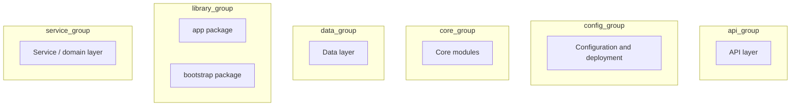

# Architecture report: pterodactyl/panel

> Automated static analysis. **Observed** = directly seen in files/imports/AST; **Inferred** = interpretation from that evidence. Repository code was not executed.

## 1. Repository at a glance

| Item | Value |
| --- | --- |
| Repository | pterodactyl/panel |
| Description | Pterodactyl® is a free, open-source game server management panel built with PHP, React, and Go. Designed with security in mind, Pterodactyl runs all game servers in isolated Docker containers while exposing a beautiful and intuitive UI to end users. |
| Language | PHP |
| Stars | 9512 |
| Licence | Other |
| Analysed commit / branch | 90b2aa87469da4fffd941b3c99f3c1ca48a01b78 / 1.0-develop |
| Framework(s) | None detected |
| Files analysed | 799 |
| Components | 7 |

## 2. Architecture in one minute

pterodactyl/panel - Pterodactyl® is a free, open-source game server management panel built with PHP, React, and Go. Designed with security in mind, Pterodactyl runs all game servers in isolated Docker containers while e…. This repository was analysed statically from 799 file(s) (0 Python). Detected technologies (observed from imports/manifests): GitHub Actions, Redis, Docker. Files are grouped into 7 component(s): API layer, app package, bootstrap package, Configuration and deployment, Core modules, Data layer, Service / domain layer. Findings below distinguish observed facts from inferred interpretation.

## 3. High-level block diagram

## 4. Main components

### API layer (`api_layer`)

- **Kind:** api
- **Status:** Observed
- **Confidence:** 0.85
- **Responsibility:** Groups 211 file(s) under api layer (observed from repository paths and static analysis).
- **Paths:** `app/Http/Controllers/Admin/ApiController.php`, `app/Http/Controllers/Admin/BaseController.php`, `app/Http/Controllers/Admin/DatabaseController.php`, `app/Http/Controllers/Admin/LocationController.php`, `app/Http/Controllers/Admin/MountController.php`, `app/Http/Controllers/Admin/Nests/EggController.php`, `app/Http/Controllers/Admin/Nests/EggScriptController.php`, `app/Http/Controllers/Admin/Nests/EggShareController.php`, `app/Http/Controllers/Admin/Nests/EggVariableController.php`, `app/Http/Controllers/Admin/Nests/NestController.php`, `app/Http/Controllers/Admin/NodeAutoDeployController.php`, `app/Http/Controllers/Admin/Nodes/NodeController.php`, `app/Http/Controllers/Admin/Nodes/NodeViewController.php`, `app/Http/Controllers/Admin/Nodes/SystemInformationController.php`, `app/Http/Controllers/Admin/NodesController.php`, `app/Http/Controllers/Admin/Servers/CreateServerController.php`, `app/Http/Controllers/Admin/Servers/ServerController.php`, `app/Http/Controllers/Admin/Servers/ServerTransferController.php`, `app/Http/Controllers/Admin/Servers/ServerViewController.php`, `app/Http/Controllers/Admin/ServersController.php`, `app/Http/Controllers/Admin/Settings/AdvancedController.php`, `app/Http/Controllers/Admin/Settings/IndexController.php`, `app/Http/Controllers/Admin/Settings/MailController.php`, `app/Http/Controllers/Admin/UserController.php`, `app/Http/Controllers/Api/Application/ApplicationApiController.php`, `app/Http/Controllers/Api/Application/Locations/LocationController.php`, `app/Http/Controllers/Api/Application/Nests/EggController.php`, `app/Http/Controllers/Api/Application/Nests/NestController.php`, `app/Http/Controllers/Api/Application/Nodes/AllocationController.php`, `app/Http/Controllers/Api/Application/Nodes/NodeConfigurationController.php`, `app/Http/Controllers/Api/Application/Nodes/NodeController.php`, `app/Http/Controllers/Api/Application/Nodes/NodeDeploymentController.php`, `app/Http/Controllers/Api/Application/Servers/DatabaseController.php`, `app/Http/Controllers/Api/Application/Servers/ExternalServerController.php`, `app/Http/Controllers/Api/Application/Servers/ServerController.php`, `app/Http/Controllers/Api/Application/Servers/ServerDetailsController.php`, `app/Http/Controllers/Api/Application/Servers/ServerManagementController.php`, `app/Http/Controllers/Api/Application/Servers/StartupController.php`, `app/Http/Controllers/Api/Application/Users/ExternalUserController.php`, `app/Http/Controllers/Api/Application/Users/UserController.php`, `app/Http/Controllers/Api/Client/AccountController.php`, `app/Http/Controllers/Api/Client/ActivityLogController.php`, `app/Http/Controllers/Api/Client/ApiKeyController.php`, `app/Http/Controllers/Api/Client/ClientApiController.php`, `app/Http/Controllers/Api/Client/ClientController.php`, `app/Http/Controllers/Api/Client/SSHKeyController.php`, `app/Http/Controllers/Api/Client/Servers/ActivityLogController.php`, `app/Http/Controllers/Api/Client/Servers/BackupController.php`, `app/Http/Controllers/Api/Client/Servers/CommandController.php`, `app/Http/Controllers/Api/Client/Servers/DatabaseController.php`, `app/Http/Controllers/Api/Client/Servers/FileController.php`, `app/Http/Controllers/Api/Client/Servers/FileUploadController.php`, `app/Http/Controllers/Api/Client/Servers/NetworkAllocationController.php`, `app/Http/Controllers/Api/Client/Servers/PowerController.php`, `app/Http/Controllers/Api/Client/Servers/ResourceUtilizationController.php`, `app/Http/Controllers/Api/Client/Servers/ScheduleController.php`, `app/Http/Controllers/Api/Client/Servers/ScheduleTaskController.php`, `app/Http/Controllers/Api/Client/Servers/ServerController.php`, `app/Http/Controllers/Api/Client/Servers/SettingsController.php`, `app/Http/Controllers/Api/Client/Servers/StartupController.php`, `app/Http/Controllers/Api/Client/Servers/SubuserController.php`, `app/Http/Controllers/Api/Client/Servers/WebsocketController.php`, `app/Http/Controllers/Api/Client/TwoFactorController.php`, `app/Http/Controllers/Api/Remote/ActivityProcessingController.php`, `app/Http/Controllers/Api/Remote/Backups/BackupRemoteUploadController.php`, `app/Http/Controllers/Api/Remote/Backups/BackupStatusController.php`, `app/Http/Controllers/Api/Remote/EggInstallController.php`, `app/Http/Controllers/Api/Remote/Servers/ServerDetailsController.php`, `app/Http/Controllers/Api/Remote/Servers/ServerInstallController.php`, `app/Http/Controllers/Api/Remote/Servers/ServerTransferController.php`, `app/Http/Controllers/Api/Remote/SftpAuthenticationController.php`, `app/Http/Controllers/Auth/AbstractLoginController.php`, `app/Http/Controllers/Auth/ForgotPasswordController.php`, `app/Http/Controllers/Auth/LoginCheckpointController.php`, `app/Http/Controllers/Auth/LoginController.php`, `app/Http/Controllers/Auth/ResetPasswordController.php`, `app/Http/Controllers/Base/IndexController.php`, `app/Http/Controllers/Base/LocaleController.php`, `app/Http/Controllers/Controller.php`, `app/Http/Middleware/Api/Application/AuthenticateApplicationUser.php`, `app/Http/Middleware/Api/AuthenticateIPAccess.php`, `app/Http/Middleware/Api/Client/RequireClientApiKey.php`, `app/Http/Middleware/Api/Client/Server/AuthenticateServerAccess.php`, `app/Http/Middleware/Api/Client/Server/ResourceBelongsToServer.php`, `app/Http/Middleware/Api/Client/SubstituteClientBindings.php`, `app/Http/Middleware/Api/Daemon/DaemonAuthenticate.php`, `app/Http/Middleware/Api/IsValidJson.php`, `app/Http/Requests/Admin/Api/StoreApplicationApiKeyRequest.php`, `app/Http/Requests/Api/Application/Allocations/DeleteAllocationRequest.php`, `app/Http/Requests/Api/Application/Allocations/GetAllocationsRequest.php`, `app/Http/Requests/Api/Application/Allocations/StoreAllocationRequest.php`, `app/Http/Requests/Api/Application/ApplicationApiRequest.php`, `app/Http/Requests/Api/Application/Locations/DeleteLocationRequest.php`, `app/Http/Requests/Api/Application/Locations/GetLocationRequest.php`, `app/Http/Requests/Api/Application/Locations/GetLocationsRequest.php`, `app/Http/Requests/Api/Application/Locations/StoreLocationRequest.php`, `app/Http/Requests/Api/Application/Locations/UpdateLocationRequest.php`, `app/Http/Requests/Api/Application/Nests/Eggs/GetEggRequest.php`, `app/Http/Requests/Api/Application/Nests/Eggs/GetEggsRequest.php`, `app/Http/Requests/Api/Application/Nests/GetNestsRequest.php`, `app/Http/Requests/Api/Application/Nodes/DeleteNodeRequest.php`, `app/Http/Requests/Api/Application/Nodes/GetDeployableNodesRequest.php`, `app/Http/Requests/Api/Application/Nodes/GetNodeConfigurationRequest.php`, `app/Http/Requests/Api/Application/Nodes/GetNodeRequest.php`, `app/Http/Requests/Api/Application/Nodes/GetNodesRequest.php`, `app/Http/Requests/Api/Application/Nodes/StoreNodeRequest.php`, `app/Http/Requests/Api/Application/Nodes/UpdateNodeRequest.php`, `app/Http/Requests/Api/Application/Servers/Databases/GetServerDatabaseRequest.php`, `app/Http/Requests/Api/Application/Servers/Databases/GetServerDatabasesRequest.php`, `app/Http/Requests/Api/Application/Servers/Databases/ServerDatabaseWriteRequest.php`, `app/Http/Requests/Api/Application/Servers/Databases/StoreServerDatabaseRequest.php`, `app/Http/Requests/Api/Application/Servers/GetExternalServerRequest.php`, `app/Http/Requests/Api/Application/Servers/GetServerRequest.php`, `app/Http/Requests/Api/Application/Servers/GetServersRequest.php`, `app/Http/Requests/Api/Application/Servers/ServerWriteRequest.php`, `app/Http/Requests/Api/Application/Servers/StoreServerRequest.php`, `app/Http/Requests/Api/Application/Servers/UpdateServerBuildConfigurationRequest.php`, `app/Http/Requests/Api/Application/Servers/UpdateServerDetailsRequest.php`, `app/Http/Requests/Api/Application/Servers/UpdateServerStartupRequest.php`, `app/Http/Requests/Api/Application/Users/DeleteUserRequest.php`, `app/Http/Requests/Api/Application/Users/GetExternalUserRequest.php`, `app/Http/Requests/Api/Application/Users/GetUsersRequest.php`, `app/Http/Requests/Api/Application/Users/StoreUserRequest.php`, `app/Http/Requests/Api/Application/Users/UpdateUserRequest.php`, `app/Http/Requests/Api/Client/Account/StoreApiKeyRequest.php`, `app/Http/Requests/Api/Client/Account/StoreSSHKeyRequest.php`, `app/Http/Requests/Api/Client/Account/UpdateEmailRequest.php`, `app/Http/Requests/Api/Client/Account/UpdatePasswordRequest.php`, `app/Http/Requests/Api/Client/ClientApiRequest.php`, `app/Http/Requests/Api/Client/GetServersRequest.php`, `app/Http/Requests/Api/Client/Servers/Backups/RestoreBackupRequest.php`, `app/Http/Requests/Api/Client/Servers/Backups/StoreBackupRequest.php`, `app/Http/Requests/Api/Client/Servers/Databases/DeleteDatabaseRequest.php`, `app/Http/Requests/Api/Client/Servers/Databases/GetDatabasesRequest.php`, `app/Http/Requests/Api/Client/Servers/Databases/RotatePasswordRequest.php`, `app/Http/Requests/Api/Client/Servers/Databases/StoreDatabaseRequest.php`, `app/Http/Requests/Api/Client/Servers/Files/ChmodFilesRequest.php`, `app/Http/Requests/Api/Client/Servers/Files/CompressFilesRequest.php`, `app/Http/Requests/Api/Client/Servers/Files/CopyFileRequest.php`, `app/Http/Requests/Api/Client/Servers/Files/CreateFolderRequest.php`, `app/Http/Requests/Api/Client/Servers/Files/DecompressFilesRequest.php`, `app/Http/Requests/Api/Client/Servers/Files/DeleteFileRequest.php`, `app/Http/Requests/Api/Client/Servers/Files/DownloadFileRequest.php`, `app/Http/Requests/Api/Client/Servers/Files/GetFileContentsRequest.php`, `app/Http/Requests/Api/Client/Servers/Files/ListFilesRequest.php`, `app/Http/Requests/Api/Client/Servers/Files/PullFileRequest.php`, `app/Http/Requests/Api/Client/Servers/Files/RenameFileRequest.php`, `app/Http/Requests/Api/Client/Servers/Files/UploadFileRequest.php`, `app/Http/Requests/Api/Client/Servers/Files/WriteFileContentRequest.php`, `app/Http/Requests/Api/Client/Servers/GetServerRequest.php`, `app/Http/Requests/Api/Client/Servers/Network/DeleteAllocationRequest.php`, `app/Http/Requests/Api/Client/Servers/Network/GetNetworkRequest.php`, `app/Http/Requests/Api/Client/Servers/Network/NewAllocationRequest.php`, `app/Http/Requests/Api/Client/Servers/Network/SetPrimaryAllocationRequest.php`, `app/Http/Requests/Api/Client/Servers/Network/UpdateAllocationRequest.php`, `app/Http/Requests/Api/Client/Servers/Schedules/DeleteScheduleRequest.php`, `app/Http/Requests/Api/Client/Servers/Schedules/StoreScheduleRequest.php`, `app/Http/Requests/Api/Client/Servers/Schedules/StoreTaskRequest.php`, `app/Http/Requests/Api/Client/Servers/Schedules/TriggerScheduleRequest.php`, `app/Http/Requests/Api/Client/Servers/Schedules/UpdateScheduleRequest.php`, `app/Http/Requests/Api/Client/Servers/Schedules/ViewScheduleRequest.php`, `app/Http/Requests/Api/Client/Servers/SendCommandRequest.php`, `app/Http/Requests/Api/Client/Servers/SendPowerRequest.php`, `app/Http/Requests/Api/Client/Servers/Settings/ReinstallServerRequest.php`, `app/Http/Requests/Api/Client/Servers/Settings/RenameServerRequest.php`, `app/Http/Requests/Api/Client/Servers/Settings/SetDockerImageRequest.php`, `app/Http/Requests/Api/Client/Servers/Startup/GetStartupRequest.php`, `app/Http/Requests/Api/Client/Servers/Startup/UpdateStartupVariableRequest.php`, `app/Http/Requests/Api/Client/Servers/Subusers/DeleteSubuserRequest.php`, `app/Http/Requests/Api/Client/Servers/Subusers/GetSubuserRequest.php`, `app/Http/Requests/Api/Client/Servers/Subusers/StoreSubuserRequest.php`, `app/Http/Requests/Api/Client/Servers/Subusers/SubuserRequest.php`, `app/Http/Requests/Api/Client/Servers/Subusers/UpdateSubuserRequest.php`, `app/Http/Requests/Api/Remote/ActivityEventRequest.php`, `app/Http/Requests/Api/Remote/AuthenticateWebsocketDetailsRequest.php`, `app/Http/Requests/Api/Remote/InstallationDataRequest.php`, `app/Http/Requests/Api/Remote/ReportBackupCompleteRequest.php`, `app/Http/Requests/Api/Remote/SftpAuthenticationFormRequest.php`, `app/Services/Acl/Api/AdminAcl.php`, `app/Services/Api/KeyCreationService.php`, `app/Traits/Controllers/JavascriptInjection.php`, `app/Transformers/Api/Application/AllocationTransformer.php`, `app/Transformers/Api/Application/BaseTransformer.php`, `app/Transformers/Api/Application/DatabaseHostTransformer.php`, `app/Transformers/Api/Application/EggTransformer.php`, `app/Transformers/Api/Application/EggVariableTransformer.php`, `app/Transformers/Api/Application/LocationTransformer.php`, `app/Transformers/Api/Application/NestTransformer.php`, `app/Transformers/Api/Application/NodeTransformer.php`, `app/Transformers/Api/Application/ServerDatabaseTransformer.php`, `app/Transformers/Api/Application/ServerTransformer.php`, `app/Transformers/Api/Application/ServerVariableTransformer.php`, `app/Transformers/Api/Application/SubuserTransformer.php`, `app/Transformers/Api/Application/UserTransformer.php`, `app/Transformers/Api/Client/AccountTransformer.php`, `app/Transformers/Api/Client/ActivityLogTransformer.php`, `app/Transformers/Api/Client/AllocationTransformer.php`, `app/Transformers/Api/Client/ApiKeyTransformer.php`, `app/Transformers/Api/Client/BackupTransformer.php`, `app/Transformers/Api/Client/BaseClientTransformer.php`, `app/Transformers/Api/Client/DatabaseTransformer.php`, `app/Transformers/Api/Client/EggTransformer.php`, `app/Transformers/Api/Client/EggVariableTransformer.php`, `app/Transformers/Api/Client/FileObjectTransformer.php`, `app/Transformers/Api/Client/ScheduleTransformer.php`, `app/Transformers/Api/Client/ServerTransformer.php`, `app/Transformers/Api/Client/StatsTransformer.php`, `app/Transformers/Api/Client/SubuserTransformer.php`, `app/Transformers/Api/Client/TaskTransformer.php`, `app/Transformers/Api/Client/UserSSHKeyTransformer.php`, `app/Transformers/Api/Client/UserTransformer.php`
- **Evidence:** [app/Http/Controllers/Admin/ApiController.php](https://github.com/pterodactyl/panel/blob/90b2aa87469da4fffd941b3c99f3c1ca48a01b78/app/Http/Controllers/Admin/ApiController.php); [app/Http/Controllers/Admin/BaseController.php](https://github.com/pterodactyl/panel/blob/90b2aa87469da4fffd941b3c99f3c1ca48a01b78/app/Http/Controllers/Admin/BaseController.php); [app/Http/Controllers/Admin/DatabaseController.php](https://github.com/pterodactyl/panel/blob/90b2aa87469da4fffd941b3c99f3c1ca48a01b78/app/Http/Controllers/Admin/DatabaseController.php); [app/Http/Controllers/Admin/LocationController.php](https://github.com/pterodactyl/panel/blob/90b2aa87469da4fffd941b3c99f3c1ca48a01b78/app/Http/Controllers/Admin/LocationController.php); [app/Http/Controllers/Admin/MountController.php](https://github.com/pterodactyl/panel/blob/90b2aa87469da4fffd941b3c99f3c1ca48a01b78/app/Http/Controllers/Admin/MountController.php); [app/Http/Controllers/Admin/Nests/EggController.php](https://github.com/pterodactyl/panel/blob/90b2aa87469da4fffd941b3c99f3c1ca48a01b78/app/Http/Controllers/Admin/Nests/EggController.php); [app/Http/Controllers/Admin/Nests/EggScriptController.php](https://github.com/pterodactyl/panel/blob/90b2aa87469da4fffd941b3c99f3c1ca48a01b78/app/Http/Controllers/Admin/Nests/EggScriptController.php); [app/Http/Controllers/Admin/Nests/EggShareController.php](https://github.com/pterodactyl/panel/blob/90b2aa87469da4fffd941b3c99f3c1ca48a01b78/app/Http/Controllers/Admin/Nests/EggShareController.php)

### app package (`app`)

- **Kind:** library
- **Status:** Observed
- **Confidence:** 0.85
- **Responsibility:** Groups 159 file(s) under app package (observed from repository paths and static analysis).
- **Paths:** `app/Console/Commands/Environment/Addons/RunHooksCommand.php`, `app/Console/Commands/Environment/AppSettingsCommand.php`, `app/Console/Commands/Environment/DatabaseSettingsCommand.php`, `app/Console/Commands/Environment/EmailSettingsCommand.php`, `app/Console/Commands/InfoCommand.php`, `app/Console/Commands/Location/DeleteLocationCommand.php`, `app/Console/Commands/Location/MakeLocationCommand.php`, `app/Console/Commands/Maintenance/CleanServiceBackupFilesCommand.php`, `app/Console/Commands/Maintenance/PruneOrphanedBackupsCommand.php`, `app/Console/Commands/Node/MakeNodeCommand.php`, `app/Console/Commands/Node/NodeConfigurationCommand.php`, `app/Console/Commands/Node/NodeListCommand.php`, `app/Console/Commands/Overrides/KeyGenerateCommand.php`, `app/Console/Commands/Overrides/SeedCommand.php`, `app/Console/Commands/Overrides/UpCommand.php`, `app/Console/Commands/Schedule/ProcessRunnableCommand.php`, `app/Console/Commands/Server/BulkPowerActionCommand.php`, `app/Console/Commands/TelemetryCommand.php`, `app/Console/Commands/UpgradeCommand.php`, `app/Console/Commands/User/DeleteUserCommand.php`, `app/Console/Commands/User/DisableTwoFactorCommand.php`, `app/Console/Commands/User/MakeUserCommand.php`, `app/Console/Kernel.php`, `app/Console/RequiresDatabaseMigrations.php`, `app/Contracts/Criteria/CriteriaInterface.php`, `app/Contracts/Extensions/HashidsInterface.php`, `app/Contracts/Http/ClientPermissionsRequest.php`, `app/Enum/JwtScope.php`, `app/Enum/ResourceLimit.php`, `app/Events/ActivityLogged.php`, `app/Events/Auth/DirectLogin.php`, `app/Events/Auth/FailedCaptcha.php`, `app/Events/Auth/FailedPasswordReset.php`, `app/Events/Auth/ProvidedAuthenticationToken.php`, `app/Events/Event.php`, `app/Events/Server/Created.php`, `app/Events/Server/Creating.php`, `app/Events/Server/Deleted.php`, `app/Events/Server/Deleting.php`, `app/Events/Server/Installed.php`, `app/Events/Server/Saved.php`, `app/Events/Server/Saving.php`, `app/Events/Server/Updated.php`, `app/Events/Server/Updating.php`, `app/Events/Subuser/Created.php`, `app/Events/Subuser/Creating.php`, `app/Events/Subuser/Deleted.php`, `app/Events/Subuser/Deleting.php`, `app/Events/User/Created.php`, `app/Events/User/Creating.php`, `app/Events/User/Deleted.php`, `app/Events/User/Deleting.php`, `app/Events/User/PasswordChanged.php`, `app/Exceptions/AccountNotFoundException.php`, `app/Exceptions/AutoDeploymentException.php`, `app/Exceptions/DisplayException.php`, `app/Exceptions/Handler.php`, `app/Exceptions/Http/Base/InvalidPasswordProvidedException.php`, `app/Exceptions/Http/Connection/DaemonConnectionException.php`, `app/Exceptions/Http/HttpForbiddenException.php`, `app/Exceptions/Http/Server/FileSizeTooLargeException.php`, `app/Exceptions/Http/Server/FileTypeNotEditableException.php`, `app/Exceptions/Http/Server/ServerStateConflictException.php`, `app/Exceptions/Http/TwoFactorAuthRequiredException.php`, `app/Exceptions/ManifestDoesNotExistException.php`, `app/Exceptions/Model/DataValidationException.php`, `app/Exceptions/PterodactylException.php`, `app/Exceptions/Solutions/ManifestDoesNotExistSolution.php`, `app/Exceptions/Transformer/InvalidTransformerLevelException.php`, `app/Extensions/Backups/BackupManager.php`, `app/Extensions/DynamicDatabaseConnection.php`, `app/Extensions/Facades/Theme.php`, `app/Extensions/Filesystem/S3Filesystem.php`, `app/Extensions/Hashids.php`, `app/Extensions/Illuminate/Events/Contracts/SubscribesToEvents.php`, `app/Extensions/Laravel/Sanctum/NewAccessToken.php`, `app/Extensions/Lcobucci/JWT/Encoding/TimestampDates.php`, `app/Extensions/League/Fractal/Serializers/PterodactylSerializer.php`, `app/Extensions/Spatie/Fractalistic/Fractal.php`, `app/Extensions/Themes/Theme.php`, `app/Facades/Activity.php`, `app/Facades/LogBatch.php`, `app/Facades/LogTarget.php`, `app/Helpers/Time.php`, `app/Helpers/Utilities.php`, `app/Http/Kernel.php`, `app/Http/Middleware/Activity/AccountSubject.php`, `app/Http/Middleware/Activity/ServerSubject.php`, `app/Http/Middleware/Activity/TrackAPIKey.php`, `app/Http/Middleware/Admin/Servers/ServerInstalled.php`, `app/Http/Middleware/AdminAuthenticate.php`, `app/Http/Middleware/EncryptCookies.php`, `app/Http/Middleware/EnsureStatefulRequests.php`, `app/Http/Middleware/LanguageMiddleware.php`, `app/Http/Middleware/MaintenanceMiddleware.php`, `app/Http/Middleware/RedirectIfAuthenticated.php`, `app/Http/Middleware/RequireTwoFactorAuthentication.php`, `app/Http/Middleware/SetSecurityHeaders.php`, `app/Http/Middleware/TrimStrings.php`, `app/Http/Middleware/VerifyCsrfToken.php`, `app/Http/Middleware/VerifyReCaptcha.php`, `app/Http/Requests/Admin/AdminFormRequest.php`, `app/Http/Requests/Admin/BaseFormRequest.php`, `app/Http/Requests/Admin/DatabaseHostFormRequest.php`, `app/Http/Requests/Admin/Egg/EggFormRequest.php`, `app/Http/Requests/Admin/Egg/EggImportFormRequest.php`, `app/Http/Requests/Admin/Egg/EggScriptFormRequest.php`, `app/Http/Requests/Admin/Egg/EggVariableFormRequest.php`, `app/Http/Requests/Admin/LocationFormRequest.php`, `app/Http/Requests/Admin/MountFormRequest.php`, `app/Http/Requests/Admin/Nest/StoreNestFormRequest.php`, `app/Http/Requests/Admin/NewUserFormRequest.php`, `app/Http/Requests/Admin/Node/AllocationAliasFormRequest.php`, `app/Http/Requests/Admin/Node/AllocationFormRequest.php`, `app/Http/Requests/Admin/Node/NodeFormRequest.php`, `app/Http/Requests/Admin/ServerDetailsFormRequest.php`, `app/Http/Requests/Admin/ServerFormRequest.php`, `app/Http/Requests/Admin/Servers/Databases/StoreServerDatabaseRequest.php`, `app/Http/Requests/Admin/UserFormRequest.php`, `app/Http/Requests/Auth/LoginCheckpointRequest.php`, `app/Http/Requests/Auth/LoginRequest.php`, `app/Http/Requests/Auth/ResetPasswordRequest.php`, `app/Http/Requests/Base/LocaleRequest.php`, `app/Http/Requests/FrontendUserFormRequest.php`, `app/Http/Resources/Wings/ServerConfigurationCollection.php`, `app/Http/ViewComposers/AssetComposer.php`, `app/Jobs/RevokeSftpAccessJob.php`, `app/Jobs/Schedule/RunTaskJob.php`, `app/Listeners/AuthenticationListener.php`, `app/Listeners/RevocationListener.php`, `app/Listeners/TwoFactorListener.php`, `app/Notifications/AccountCreated.php`, `app/Notifications/AddedToServer.php`, `app/Notifications/MailTested.php`, `app/Notifications/RemovedFromServer.php`, `app/Notifications/SendPasswordReset.php`, `app/Notifications/ServerInstalled.php`, `app/Observers/EggVariableObserver.php`, `app/Observers/ServerObserver.php`, `app/Observers/SubuserObserver.php`, `app/Observers/UserObserver.php`, `app/Policies/ServerPolicy.php`, `app/Providers/ActivityLogServiceProvider.php`, `app/Providers/AppServiceProvider.php`, `app/Providers/AuthServiceProvider.php`, `app/Providers/BackupsServiceProvider.php`, `app/Providers/BladeServiceProvider.php`, `app/Providers/BroadcastServiceProvider.php`, `app/Providers/EventServiceProvider.php`, `app/Providers/HashidsServiceProvider.php`, `app/Providers/RepositoryServiceProvider.php`, `app/Providers/RouteServiceProvider.php`, `app/Providers/SettingsServiceProvider.php`, `app/Providers/ViewComposerServiceProvider.php`, `app/Rules/Fqdn.php`, `app/Rules/Username.php`, `app/Traits/Commands/EnvironmentWriterTrait.php`, `app/Traits/Helpers/AvailableLanguages.php`, `app/helpers.php`
- **Evidence:** [app/Console/Commands/Environment/Addons/RunHooksCommand.php](https://github.com/pterodactyl/panel/blob/90b2aa87469da4fffd941b3c99f3c1ca48a01b78/app/Console/Commands/Environment/Addons/RunHooksCommand.php); [app/Console/Commands/Environment/AppSettingsCommand.php](https://github.com/pterodactyl/panel/blob/90b2aa87469da4fffd941b3c99f3c1ca48a01b78/app/Console/Commands/Environment/AppSettingsCommand.php); [app/Console/Commands/Environment/DatabaseSettingsCommand.php](https://github.com/pterodactyl/panel/blob/90b2aa87469da4fffd941b3c99f3c1ca48a01b78/app/Console/Commands/Environment/DatabaseSettingsCommand.php); [app/Console/Commands/Environment/EmailSettingsCommand.php](https://github.com/pterodactyl/panel/blob/90b2aa87469da4fffd941b3c99f3c1ca48a01b78/app/Console/Commands/Environment/EmailSettingsCommand.php); [app/Console/Commands/InfoCommand.php](https://github.com/pterodactyl/panel/blob/90b2aa87469da4fffd941b3c99f3c1ca48a01b78/app/Console/Commands/InfoCommand.php); [app/Console/Commands/Location/DeleteLocationCommand.php](https://github.com/pterodactyl/panel/blob/90b2aa87469da4fffd941b3c99f3c1ca48a01b78/app/Console/Commands/Location/DeleteLocationCommand.php); [app/Console/Commands/Location/MakeLocationCommand.php](https://github.com/pterodactyl/panel/blob/90b2aa87469da4fffd941b3c99f3c1ca48a01b78/app/Console/Commands/Location/MakeLocationCommand.php); [app/Console/Commands/Maintenance/CleanServiceBackupFilesCommand.php](https://github.com/pterodactyl/panel/blob/90b2aa87469da4fffd941b3c99f3c1ca48a01b78/app/Console/Commands/Maintenance/CleanServiceBackupFilesCommand.php)

### bootstrap package (`bootstrap`)

- **Kind:** library
- **Status:** Observed
- **Confidence:** 0.85
- **Responsibility:** Groups 2 file(s) under bootstrap package (observed from repository paths and static analysis).
- **Paths:** `bootstrap/app.php`, `bootstrap/tests.php`
- **Evidence:** [bootstrap/app.php](https://github.com/pterodactyl/panel/blob/90b2aa87469da4fffd941b3c99f3c1ca48a01b78/bootstrap/app.php); [bootstrap/tests.php](https://github.com/pterodactyl/panel/blob/90b2aa87469da4fffd941b3c99f3c1ca48a01b78/bootstrap/tests.php)

### Configuration and deployment (`config`)

- **Kind:** config
- **Status:** Observed
- **Confidence:** 0.85
- **Responsibility:** Groups 48 file(s) under configuration and deployment (observed from repository paths and static analysis).
- **Paths:** `Dockerfile`, `app/Http/Requests/Admin/Settings/AdvancedSettingsFormRequest.php`, `app/Http/Requests/Admin/Settings/BaseSettingsFormRequest.php`, `app/Http/Requests/Admin/Settings/MailSettingsFormRequest.php`, `composer.json`, `config/activity.php`, `config/addons.php`, `config/app.php`, `config/auth.php`, `config/backups.php`, `config/broadcasting.php`, `config/cache.php`, `config/compile.php`, `config/cors.php`, `config/database.php`, `config/egg_features/eula.php`, `config/filesystems.php`, `config/fractal.php`, `config/hashids.php`, `config/hashing.php`, `config/http.php`, `config/ide-helper.php`, `config/javascript.php`, `config/logging.php`, `config/mail.php`, `config/prologue/alerts.php`, `config/pterodactyl.php`, `config/queue.php`, `config/recaptcha.php`, `config/sanctum.php`, `config/services.php`, `config/session.php`, `config/trustedproxy.php`, `config/view.php`, `database/Seeders/eggs/minecraft/egg-bungeecord.json`, `database/Seeders/eggs/minecraft/egg-forge-minecraft.json`, `database/Seeders/eggs/minecraft/egg-paper.json`, `database/Seeders/eggs/minecraft/egg-sponge--sponge-vanilla.json`, `database/Seeders/eggs/minecraft/egg-vanilla-minecraft.json`, `database/Seeders/eggs/rust/egg-rust.json`, `database/Seeders/eggs/source-engine/egg-ark--survival-evolved.json`, `database/Seeders/eggs/source-engine/egg-counter--strike--global-offensive.json`, `database/Seeders/eggs/source-engine/egg-custom-source-engine-game.json`, `database/Seeders/eggs/source-engine/egg-garrys-mod.json`, `database/Seeders/eggs/source-engine/egg-insurgency.json`, `database/Seeders/eggs/source-engine/egg-team-fortress2.json`, `database/Seeders/eggs/voice-servers/egg-mumble-server.json`, `database/Seeders/eggs/voice-servers/egg-teamspeak3-server.json`
- **Evidence:** [Dockerfile](https://github.com/pterodactyl/panel/blob/90b2aa87469da4fffd941b3c99f3c1ca48a01b78/Dockerfile); [app/Http/Requests/Admin/Settings/AdvancedSettingsFormRequest.php](https://github.com/pterodactyl/panel/blob/90b2aa87469da4fffd941b3c99f3c1ca48a01b78/app/Http/Requests/Admin/Settings/AdvancedSettingsFormRequest.php); [app/Http/Requests/Admin/Settings/BaseSettingsFormRequest.php](https://github.com/pterodactyl/panel/blob/90b2aa87469da4fffd941b3c99f3c1ca48a01b78/app/Http/Requests/Admin/Settings/BaseSettingsFormRequest.php); [app/Http/Requests/Admin/Settings/MailSettingsFormRequest.php](https://github.com/pterodactyl/panel/blob/90b2aa87469da4fffd941b3c99f3c1ca48a01b78/app/Http/Requests/Admin/Settings/MailSettingsFormRequest.php); [composer.json](https://github.com/pterodactyl/panel/blob/90b2aa87469da4fffd941b3c99f3c1ca48a01b78/composer.json); [config/activity.php](https://github.com/pterodactyl/panel/blob/90b2aa87469da4fffd941b3c99f3c1ca48a01b78/config/activity.php); [config/addons.php](https://github.com/pterodactyl/panel/blob/90b2aa87469da4fffd941b3c99f3c1ca48a01b78/config/addons.php); [config/app.php](https://github.com/pterodactyl/panel/blob/90b2aa87469da4fffd941b3c99f3c1ca48a01b78/config/app.php)

### Core modules (`core`)

- **Kind:** core
- **Status:** Observed
- **Confidence:** 0.85
- **Responsibility:** Groups 1 file(s) under core modules (observed from repository paths and static analysis).
- **Paths:** `babel.config.js`
- **Evidence:** [babel.config.js](https://github.com/pterodactyl/panel/blob/90b2aa87469da4fffd941b3c99f3c1ca48a01b78/babel.config.js)

### Data layer (`data_layer`)

- **Kind:** data
- **Status:** Observed
- **Confidence:** 0.85
- **Responsibility:** Groups 251 file(s) under data layer (observed from repository paths and static analysis).
- **Paths:** `app/Contracts/Models/Identifiable.php`, `app/Contracts/Repository/AllocationRepositoryInterface.php`, `app/Contracts/Repository/ApiKeyRepositoryInterface.php`, `app/Contracts/Repository/ApiPermissionRepositoryInterface.php`, `app/Contracts/Repository/DatabaseHostRepositoryInterface.php`, `app/Contracts/Repository/DatabaseRepositoryInterface.php`, `app/Contracts/Repository/EggRepositoryInterface.php`, `app/Contracts/Repository/EggVariableRepositoryInterface.php`, `app/Contracts/Repository/LocationRepositoryInterface.php`, `app/Contracts/Repository/NestRepositoryInterface.php`, `app/Contracts/Repository/NodeRepositoryInterface.php`, `app/Contracts/Repository/PermissionRepositoryInterface.php`, `app/Contracts/Repository/RepositoryInterface.php`, `app/Contracts/Repository/ScheduleRepositoryInterface.php`, `app/Contracts/Repository/ServerRepositoryInterface.php`, `app/Contracts/Repository/ServerVariableRepositoryInterface.php`, `app/Contracts/Repository/SessionRepositoryInterface.php`, `app/Contracts/Repository/SettingsRepositoryInterface.php`, `app/Contracts/Repository/SubuserRepositoryInterface.php`, `app/Contracts/Repository/TaskRepositoryInterface.php`, `app/Contracts/Repository/UserRepositoryInterface.php`, `app/Exceptions/Repository/Daemon/InvalidPowerSignalException.php`, `app/Exceptions/Repository/DuplicateDatabaseNameException.php`, `app/Exceptions/Repository/RecordNotFoundException.php`, `app/Exceptions/Repository/RepositoryException.php`, `app/Exceptions/Service/Database/DatabaseClientFeatureNotEnabledException.php`, `app/Exceptions/Service/Database/NoSuitableDatabaseHostException.php`, `app/Exceptions/Service/Database/TooManyDatabasesException.php`, `app/Extensions/Illuminate/Database/Eloquent/Builder.php`, `app/Models/APILog.php`, `app/Models/ActivityLog.php`, `app/Models/ActivityLogSubject.php`, `app/Models/Allocation.php`, `app/Models/ApiKey.php`, `app/Models/Attributes/Identifiable.php`, `app/Models/AuditLog.php`, `app/Models/Backup.php`, `app/Models/Database.php`, `app/Models/DatabaseHost.php`, `app/Models/Egg.php`, `app/Models/EggMount.php`, `app/Models/EggVariable.php`, `app/Models/Filters/AdminServerFilter.php`, `app/Models/Filters/MultiFieldServerFilter.php`, `app/Models/Location.php`, `app/Models/Model.php`, `app/Models/Mount.php`, `app/Models/MountNode.php`, `app/Models/MountServer.php`, `app/Models/Nest.php`, `app/Models/Node.php`, `app/Models/Objects/DeploymentObject.php`, `app/Models/Permission.php`, `app/Models/RecoveryToken.php`, `app/Models/Schedule.php`, `app/Models/Server.php`, `app/Models/ServerTransfer.php`, `app/Models/ServerVariable.php`, `app/Models/Session.php`, `app/Models/Setting.php`, `app/Models/Subuser.php`, `app/Models/Task.php`, `app/Models/TaskLog.php`, `app/Models/Traits/HasAccessTokens.php`, `app/Models/Traits/HasRealtimeIdentifier.php`, `app/Models/User.php`, `app/Models/UserSSHKey.php`, `app/Repositories/Eloquent/AllocationRepository.php`, `app/Repositories/Eloquent/ApiKeyRepository.php`, `app/Repositories/Eloquent/BackupRepository.php`, `app/Repositories/Eloquent/DatabaseHostRepository.php`, `app/Repositories/Eloquent/DatabaseRepository.php`, `app/Repositories/Eloquent/EggRepository.php`, `app/Repositories/Eloquent/EggVariableRepository.php`, `app/Repositories/Eloquent/EloquentRepository.php`, `app/Repositories/Eloquent/LocationRepository.php`, `app/Repositories/Eloquent/MountRepository.php`, `app/Repositories/Eloquent/NestRepository.php`, `app/Repositories/Eloquent/NodeRepository.php`, `app/Repositories/Eloquent/PermissionRepository.php`, `app/Repositories/Eloquent/RecoveryTokenRepository.php`, `app/Repositories/Eloquent/ScheduleRepository.php`, `app/Repositories/Eloquent/ServerRepository.php`, `app/Repositories/Eloquent/ServerVariableRepository.php`, `app/Repositories/Eloquent/SessionRepository.php`, `app/Repositories/Eloquent/SettingsRepository.php`, `app/Repositories/Eloquent/SubuserRepository.php`, `app/Repositories/Eloquent/TaskRepository.php`, `app/Repositories/Eloquent/UserRepository.php`, `app/Repositories/Repository.php`, `app/Repositories/Wings/DaemonBackupRepository.php`, `app/Repositories/Wings/DaemonCommandRepository.php`, `app/Repositories/Wings/DaemonConfigurationRepository.php`, `app/Repositories/Wings/DaemonFileRepository.php`, `app/Repositories/Wings/DaemonPowerRepository.php`, `app/Repositories/Wings/DaemonRepository.php`, `app/Repositories/Wings/DaemonRevocationRepository.php`, `app/Repositories/Wings/DaemonServerRepository.php`, `app/Repositories/Wings/DaemonTransferRepository.php`, `database/Factories/AllocationFactory.php`, `database/Factories/ApiKeyFactory.php`, `database/Factories/BackupFactory.php`, `database/Factories/DatabaseFactory.php`, `database/Factories/DatabaseHostFactory.php`, `database/Factories/EggFactory.php`, `database/Factories/EggVariableFactory.php`, `database/Factories/LocationFactory.php`, `database/Factories/NestFactory.php`, `database/Factories/NodeFactory.php`, `database/Factories/ScheduleFactory.php`, `database/Factories/ServerFactory.php`, `database/Factories/ServerTransferFactory.php`, `database/Factories/SubuserFactory.php`, `database/Factories/TaskFactory.php`, `database/Factories/UserFactory.php`, `database/Factories/UserSSHKeyFactory.php`, `database/Seeders/DatabaseSeeder.php`, `database/Seeders/EggSeeder.php`, `database/Seeders/NestSeeder.php`, `database/migrations/2016_01_23_195641_add_allocations_table.php`, `database/migrations/2016_01_23_195851_add_api_keys.php`, `database/migrations/2016_01_23_200044_add_api_permissions.php`, `database/migrations/2016_01_23_200159_add_downloads.php`, `database/migrations/2016_01_23_200421_create_failed_jobs_table.php`, `database/migrations/2016_01_23_200440_create_jobs_table.php`, `database/migrations/2016_01_23_200528_add_locations.php`, `database/migrations/2016_01_23_200648_add_nodes.php`, `database/migrations/2016_01_23_201433_add_password_resets.php`, `database/migrations/2016_01_23_201531_add_permissions.php`, `database/migrations/2016_01_23_201649_add_server_variables.php`, `database/migrations/2016_01_23_201748_add_servers.php`, `database/migrations/2016_01_23_202544_add_service_options.php`, `database/migrations/2016_01_23_202731_add_service_varibles.php`, `database/migrations/2016_01_23_202943_add_services.php`, `database/migrations/2016_01_23_203119_create_settings_table.php`, `database/migrations/2016_01_23_203150_add_subusers.php`, `database/migrations/2016_01_23_203159_add_users.php`, `database/migrations/2016_01_23_203947_create_sessions_table.php`, `database/migrations/2016_01_25_234418_rename_permissions_column.php`, `database/migrations/2016_02_07_172148_add_databases_tables.php`, `database/migrations/2016_02_07_181319_add_database_servers_table.php`, `database/migrations/2016_02_13_154306_add_service_option_default_startup.php`, `database/migrations/2016_02_20_155318_add_unique_service_field.php`, `database/migrations/2016_02_27_163411_add_tasks_table.php`, `database/migrations/2016_02_27_163447_add_tasks_log_table.php`, `database/migrations/2016_03_18_155649_add_nullable_field_lastrun.php`, `database/migrations/2016_08_30_212718_add_ip_alias.php`, `database/migrations/2016_08_30_213301_modify_ip_storage_method.php`, `database/migrations/2016_09_01_193520_add_suspension_for_servers.php`, `database/migrations/2016_09_01_211924_remove_active_column.php`, `database/migrations/2016_09_02_190647_add_sftp_password_storage.php`, `database/migrations/2016_09_04_171338_update_jobs_tables.php`, `database/migrations/2016_09_04_172028_update_failed_jobs_table.php`, `database/migrations/2016_09_04_182835_create_notifications_table.php`, `database/migrations/2016_09_07_163017_add_unique_identifier.php`, `database/migrations/2016_09_14_145945_allow_longer_regex_field.php`, `database/migrations/2016_09_17_194246_add_docker_image_column.php`, `database/migrations/2016_09_21_165554_update_servers_column_name.php`, `database/migrations/2016_09_29_213518_rename_double_insurgency.php`, `database/migrations/2016_10_07_152117_build_api_log_table.php`, `database/migrations/2016_10_14_164802_update_api_keys.php`, `database/migrations/2016_10_23_181719_update_misnamed_bungee.php`, `database/migrations/2016_10_23_193810_add_foreign_keys_servers.php`, `database/migrations/2016_10_23_201624_add_foreign_allocations.php`, `database/migrations/2016_10_23_202222_add_foreign_api_keys.php`, `database/migrations/2016_10_23_202703_add_foreign_api_permissions.php`, `database/migrations/2016_10_23_202953_add_foreign_database_servers.php`, `database/migrations/2016_10_23_203105_add_foreign_databases.php`, `database/migrations/2016_10_23_203335_add_foreign_nodes.php`, `database/migrations/2016_10_23_203522_add_foreign_permissions.php`, `database/migrations/2016_10_23_203857_add_foreign_server_variables.php`, `database/migrations/2016_10_23_204157_add_foreign_service_options.php`, `database/migrations/2016_10_23_204321_add_foreign_service_variables.php`, `database/migrations/2016_10_23_204454_add_foreign_subusers.php`, `database/migrations/2016_10_23_204610_add_foreign_tasks.php`, `database/migrations/2016_11_04_000949_add_ark_service_option_fixed.php`, `database/migrations/2016_11_11_220649_add_pack_support.php`, `database/migrations/2016_11_11_231731_set_service_name_unique.php`, `database/migrations/2016_11_27_142519_add_pack_column.php`, `database/migrations/2016_12_01_173018_add_configurable_upload_limit.php`, `database/migrations/2016_12_02_185206_correct_service_variables.php`, `database/migrations/2017_01_03_150436_fix_misnamed_option_tag.php`, `database/migrations/2017_01_07_154228_create_node_configuration_tokens_table.php`, `database/migrations/2017_01_12_135449_add_more_user_data.php`, `database/migrations/2017_02_02_175548_UpdateColumnNames.php`, `database/migrations/2017_02_03_140948_UpdateNodesTable.php`, `database/migrations/2017_02_03_155554_RenameColumns.php`, `database/migrations/2017_02_05_164123_AdjustColumnNames.php`, `database/migrations/2017_02_05_164516_AdjustColumnNamesForServicePacks.php`, `database/migrations/2017_02_09_174834_SetupPermissionsPivotTable.php`, `database/migrations/2017_02_10_171858_UpdateAPIKeyColumnNames.php`, `database/migrations/2017_03_03_224254_UpdateNodeConfigTokensColumns.php`, `database/migrations/2017_03_05_212803_DeleteServiceExecutableOption.php`, `database/migrations/2017_03_10_162934_AddNewServiceOptionsColumns.php`, `database/migrations/2017_03_10_173607_MigrateToNewServiceSystem.php`, `database/migrations/2017_03_11_215455_ChangeServiceVariablesValidationRules.php`, `database/migrations/2017_03_12_150648_MoveFunctionsFromFileToDatabase.php`, `database/migrations/2017_03_14_175631_RenameServicePacksToSingluarPacks.php`, `database/migrations/2017_03_14_200326_AddLockedStatusToTable.php`, `database/migrations/2017_03_16_181109_ReOrganizeDatabaseServersToDatabaseHost.php`, `database/migrations/2017_03_16_181515_CleanupDatabasesDatabase.php`, `database/migrations/2017_03_18_204953_AddForeignKeyToPacks.php`, `database/migrations/2017_03_31_221948_AddServerDescriptionColumn.php`, `database/migrations/2017_04_02_163232_DropDeletedAtColumnFromServers.php`, `database/migrations/2017_04_15_125021_UpgradeTaskSystem.php`, `database/migrations/2017_04_20_171943_AddScriptsToServiceOptions.php`, `database/migrations/2017_04_21_151432_AddServiceScriptTrackingToServers.php`, `database/migrations/2017_04_27_145300_AddCopyScriptFromColumn.php`, `database/migrations/2017_04_27_223629_AddAbilityToDefineConnectionOverSSLWithDaemonBehindProxy.php`, `database/migrations/2017_05_01_141528_DeleteDownloadTable.php`, `database/migrations/2017_05_01_141559_DeleteNodeConfigurationTable.php`, `database/migrations/2017_06_10_152951_add_external_id_to_users.php`, `database/migrations/2017_06_25_133923_ChangeForeignKeyToBeOnCascadeDelete.php`, `database/migrations/2017_07_08_152806_ChangeUserPermissionsToDeleteOnUserDeletion.php`, `database/migrations/2017_07_08_154416_SetAllocationToReferenceNullOnServerDelete.php`, `database/migrations/2017_07_08_154650_CascadeDeletionWhenAServerOrVariableIsDeleted.php`, `database/migrations/2017_07_24_194433_DeleteTaskWhenParentServerIsDeleted.php`, `database/migrations/2017_08_05_115800_CascadeNullValuesForDatabaseHostWhenNodeIsDeleted.php`, `database/migrations/2017_08_05_144104_AllowNegativeValuesForOverallocation.php`, `database/migrations/2017_08_05_174811_SetAllocationUnqiueUsingMultipleFields.php`, `database/migrations/2017_08_15_214555_CascadeDeletionWhenAParentServiceIsDeleted.php`, `database/migrations/2017_08_18_215428_RemovePackWhenParentServiceOptionIsDeleted.php`, `database/migrations/2017_09_10_225749_RenameTasksTableForStructureRefactor.php`, `database/migrations/2017_09_10_225941_CreateSchedulesTable.php`, `database/migrations/2017_09_10_230309_CreateNewTasksTableForSchedules.php`, `database/migrations/2017_09_11_002938_TransferOldTasksToNewScheduler.php`, `database/migrations/2017_09_13_211810_UpdateOldPermissionsToPointToNewScheduleSystem.php`, `database/migrations/2017_09_23_170933_CreateDaemonKeysTable.php`, `database/migrations/2017_09_23_173628_RemoveDaemonSecretFromServersTable.php`, `database/migrations/2017_09_23_185022_RemoveDaemonSecretFromSubusersTable.php`, `database/migrations/2017_10_02_202000_ChangeServicesToUseAMoreUniqueIdentifier.php`, `database/migrations/2017_10_02_202007_ChangeToABetterUniqueServiceConfiguration.php`, `database/migrations/2017_10_03_233202_CascadeDeletionWhenServiceOptionIsDeleted.php`, `database/migrations/2017_10_06_214026_ServicesToNestsConversion.php`, `database/migrations/2017_10_06_214053_ServiceOptionsToEggsConversion.php`, `database/migrations/2017_10_06_215741_ServiceVariablesToEggVariablesConversion.php`, `database/migrations/2017_10_24_222238_RemoveLegacySFTPInformation.php`, `database/migrations/2017_11_11_161922_Add2FaLastAuthorizationTimeColumn.php`, `database/migrations/2017_11_19_122708_MigratePubPrivFormatToSingleKey.php`, `database/migrations/2017_12_04_184012_DropAllocationsWhenNodeIsDeleted.php`, `database/migrations/2017_12_12_220426_MigrateSettingsTableToNewFormat.php`, `database/migrations/2018_01_01_122821_AllowNegativeValuesForServerSwap.php`, `database/migrations/2018_01_11_213943_AddApiKeyPermissionColumns.php`, `database/migrations/2018_01_13_142012_SetupTableForKeyEncryption.php`, `database/migrations/2018_01_13_145209_AddLastUsedAtColumn.php`, `database/migrations/2018_02_04_145617_AllowTextInUserExternalId.php`, `database/migrations/2018_02_10_151150_remove_unique_index_on_external_id_column.php`, `database/migrations/2018_02_17_134254_ensure_unique_allocation_id_on_servers_table.php`, `database/migrations/2018_02_24_112356_add_external_id_column_to_servers_table.php`, `database/migrations/2018_02_25_160152_remove_default_null_value_on_table.php`, `database/migrations/2018_02_25_160604_define_unique_index_on_users_external_id.php`
- **Evidence:** [app/Contracts/Models/Identifiable.php](https://github.com/pterodactyl/panel/blob/90b2aa87469da4fffd941b3c99f3c1ca48a01b78/app/Contracts/Models/Identifiable.php); [app/Contracts/Repository/AllocationRepositoryInterface.php](https://github.com/pterodactyl/panel/blob/90b2aa87469da4fffd941b3c99f3c1ca48a01b78/app/Contracts/Repository/AllocationRepositoryInterface.php); [app/Contracts/Repository/ApiKeyRepositoryInterface.php](https://github.com/pterodactyl/panel/blob/90b2aa87469da4fffd941b3c99f3c1ca48a01b78/app/Contracts/Repository/ApiKeyRepositoryInterface.php); [app/Contracts/Repository/ApiPermissionRepositoryInterface.php](https://github.com/pterodactyl/panel/blob/90b2aa87469da4fffd941b3c99f3c1ca48a01b78/app/Contracts/Repository/ApiPermissionRepositoryInterface.php); [app/Contracts/Repository/DatabaseHostRepositoryInterface.php](https://github.com/pterodactyl/panel/blob/90b2aa87469da4fffd941b3c99f3c1ca48a01b78/app/Contracts/Repository/DatabaseHostRepositoryInterface.php); [app/Contracts/Repository/DatabaseRepositoryInterface.php](https://github.com/pterodactyl/panel/blob/90b2aa87469da4fffd941b3c99f3c1ca48a01b78/app/Contracts/Repository/DatabaseRepositoryInterface.php); [app/Contracts/Repository/EggRepositoryInterface.php](https://github.com/pterodactyl/panel/blob/90b2aa87469da4fffd941b3c99f3c1ca48a01b78/app/Contracts/Repository/EggRepositoryInterface.php); [app/Contracts/Repository/EggVariableRepositoryInterface.php](https://github.com/pterodactyl/panel/blob/90b2aa87469da4fffd941b3c99f3c1ca48a01b78/app/Contracts/Repository/EggVariableRepositoryInterface.php)

### Service / domain layer (`service_layer`)

- **Kind:** service
- **Status:** Observed
- **Confidence:** 0.85
- **Responsibility:** Groups 93 file(s) under service / domain layer (observed from repository paths and static analysis).
- **Paths:** `app/Contracts/Core/ReceivesEvents.php`, `app/Exceptions/Service/Allocation/AllocationDoesNotBelongToServerException.php`, `app/Exceptions/Service/Allocation/AutoAllocationNotEnabledException.php`, `app/Exceptions/Service/Allocation/CidrOutOfRangeException.php`, `app/Exceptions/Service/Allocation/InvalidPortMappingException.php`, `app/Exceptions/Service/Allocation/NoAutoAllocationSpaceAvailableException.php`, `app/Exceptions/Service/Allocation/PortOutOfRangeException.php`, `app/Exceptions/Service/Allocation/ServerUsingAllocationException.php`, `app/Exceptions/Service/Allocation/TooManyPortsInRangeException.php`, `app/Exceptions/Service/Backup/BackupLockedException.php`, `app/Exceptions/Service/Backup/TooManyBackupsException.php`, `app/Exceptions/Service/Deployment/NoViableAllocationException.php`, `app/Exceptions/Service/Deployment/NoViableNodeException.php`, `app/Exceptions/Service/Egg/BadJsonFormatException.php`, `app/Exceptions/Service/Egg/HasChildrenException.php`, `app/Exceptions/Service/Egg/InvalidCopyFromException.php`, `app/Exceptions/Service/Egg/NoParentConfigurationFoundException.php`, `app/Exceptions/Service/Egg/Variable/BadValidationRuleException.php`, `app/Exceptions/Service/Egg/Variable/ReservedVariableNameException.php`, `app/Exceptions/Service/HasActiveServersException.php`, `app/Exceptions/Service/Helper/CdnVersionFetchingException.php`, `app/Exceptions/Service/InvalidFileUploadException.php`, `app/Exceptions/Service/Location/HasActiveNodesException.php`, `app/Exceptions/Service/Node/ConfigurationNotPersistedException.php`, `app/Exceptions/Service/Schedule/Task/TaskIntervalTooLongException.php`, `app/Exceptions/Service/Server/RequiredVariableMissingException.php`, `app/Exceptions/Service/ServiceLimitExceededException.php`, `app/Exceptions/Service/Subuser/ServerSubuserExistsException.php`, `app/Exceptions/Service/Subuser/UserIsServerOwnerException.php`, `app/Exceptions/Service/User/TwoFactorAuthenticationTokenInvalid.php`, `app/Services/Activity/ActivityLogBatchService.php`, `app/Services/Activity/ActivityLogService.php`, `app/Services/Activity/ActivityLogTargetableService.php`, `app/Services/Allocations/AllocationDeletionService.php`, `app/Services/Allocations/AssignmentService.php`, `app/Services/Allocations/FindAssignableAllocationService.php`, `app/Services/Backups/DeleteBackupService.php`, `app/Services/Backups/DownloadLinkService.php`, `app/Services/Backups/InitiateBackupService.php`, `app/Services/Databases/DatabaseManagementService.php`, `app/Services/Databases/DatabasePasswordService.php`, `app/Services/Databases/DeployServerDatabaseService.php`, `app/Services/Databases/Hosts/HostCreationService.php`, `app/Services/Databases/Hosts/HostDeletionService.php`, `app/Services/Databases/Hosts/HostUpdateService.php`, `app/Services/Deployment/AllocationSelectionService.php`, `app/Services/Deployment/FindViableNodesService.php`, `app/Services/Eggs/EggConfigurationService.php`, `app/Services/Eggs/EggCreationService.php`, `app/Services/Eggs/EggDeletionService.php`, `app/Services/Eggs/EggParserService.php`, `app/Services/Eggs/EggUpdateService.php`, `app/Services/Eggs/Scripts/InstallScriptService.php`, `app/Services/Eggs/Sharing/EggExporterService.php`, `app/Services/Eggs/Sharing/EggImporterService.php`, `app/Services/Eggs/Sharing/EggUpdateImporterService.php`, `app/Services/Eggs/Variables/VariableCreationService.php`, `app/Services/Eggs/Variables/VariableUpdateService.php`, `app/Services/Helpers/AssetHashService.php`, `app/Services/Helpers/SoftwareVersionService.php`, `app/Services/Locations/LocationCreationService.php`, `app/Services/Locations/LocationDeletionService.php`, `app/Services/Locations/LocationUpdateService.php`, `app/Services/Nests/NestCreationService.php`, `app/Services/Nests/NestDeletionService.php`, `app/Services/Nests/NestUpdateService.php`, `app/Services/Nodes/NodeCreationService.php`, `app/Services/Nodes/NodeDeletionService.php`, `app/Services/Nodes/NodeJWTService.php`, `app/Services/Nodes/NodeUpdateService.php`, `app/Services/Schedules/ProcessScheduleService.php`, `app/Services/Servers/BuildModificationService.php`, `app/Services/Servers/DetailsModificationService.php`, `app/Services/Servers/EnvironmentService.php`, `app/Services/Servers/GetUserPermissionsService.php`, `app/Services/Servers/ReinstallServerService.php`, `app/Services/Servers/ServerConfigurationStructureService.php`, `app/Services/Servers/ServerCreationService.php`, `app/Services/Servers/ServerDeletionService.php`, `app/Services/Servers/StartupCommandService.php`, `app/Services/Servers/StartupModificationService.php`, `app/Services/Servers/SuspensionService.php`, `app/Services/Servers/VariableValidatorService.php`, `app/Services/Subusers/SubuserCreationService.php`, `app/Services/Telemetry/TelemetryCollectionService.php`, `app/Services/Users/ToggleTwoFactorService.php`, `app/Services/Users/TwoFactorSetupService.php`, `app/Services/Users/UserCreationService.php`, `app/Services/Users/UserDeletionService.php`, `app/Services/Users/UserUpdateService.php`, `app/Traits/Services/HasUserLevels.php`, `app/Traits/Services/ReturnsUpdatedModels.php`, `app/Traits/Services/ValidatesValidationRules.php`
- **Evidence:** [app/Contracts/Core/ReceivesEvents.php](https://github.com/pterodactyl/panel/blob/90b2aa87469da4fffd941b3c99f3c1ca48a01b78/app/Contracts/Core/ReceivesEvents.php); [app/Exceptions/Service/Allocation/AllocationDoesNotBelongToServerException.php](https://github.com/pterodactyl/panel/blob/90b2aa87469da4fffd941b3c99f3c1ca48a01b78/app/Exceptions/Service/Allocation/AllocationDoesNotBelongToServerException.php); [app/Exceptions/Service/Allocation/AutoAllocationNotEnabledException.php](https://github.com/pterodactyl/panel/blob/90b2aa87469da4fffd941b3c99f3c1ca48a01b78/app/Exceptions/Service/Allocation/AutoAllocationNotEnabledException.php); [app/Exceptions/Service/Allocation/CidrOutOfRangeException.php](https://github.com/pterodactyl/panel/blob/90b2aa87469da4fffd941b3c99f3c1ca48a01b78/app/Exceptions/Service/Allocation/CidrOutOfRangeException.php); [app/Exceptions/Service/Allocation/InvalidPortMappingException.php](https://github.com/pterodactyl/panel/blob/90b2aa87469da4fffd941b3c99f3c1ca48a01b78/app/Exceptions/Service/Allocation/InvalidPortMappingException.php); [app/Exceptions/Service/Allocation/NoAutoAllocationSpaceAvailableException.php](https://github.com/pterodactyl/panel/blob/90b2aa87469da4fffd941b3c99f3c1ca48a01b78/app/Exceptions/Service/Allocation/NoAutoAllocationSpaceAvailableException.php); [app/Exceptions/Service/Allocation/PortOutOfRangeException.php](https://github.com/pterodactyl/panel/blob/90b2aa87469da4fffd941b3c99f3c1ca48a01b78/app/Exceptions/Service/Allocation/PortOutOfRangeException.php); [app/Exceptions/Service/Allocation/ServerUsingAllocationException.php](https://github.com/pterodactyl/panel/blob/90b2aa87469da4fffd941b3c99f3c1ca48a01b78/app/Exceptions/Service/Allocation/ServerUsingAllocationException.php)

## 5. Execution flow

No entry point was observed; the startup flow below is therefore limited.

Representative flow (derived from observed entry points and the import graph; steps beyond the entry point are **Inferred**):

1. Execution starts at an observed entry point listed above, if present.
2. No internal import relationships between components were observed.

## 6. Project structure

### `(root)`

- `.editorconfig` - config (255 bytes)
- `.env.example` - config (892 bytes)
- `.eslintignore` - other (89 bytes)
- `.eslintrc.js` - source, JavaScript (1909 bytes)
- `.gitignore` - other (552 bytes)
- `.php-cs-fixer.dist.php` - source, PHP (1640 bytes)
- `.prettierrc.json` - config (140 bytes)
- `BUILDING.md` - docs (3032 bytes)
- `CHANGELOG.md` - docs (137339 bytes)
- `CONTRIBUTING.md` - docs (2198 bytes)
- `Dockerfile` - container (2022 bytes)
- `LICENSE.md` - docs (1137 bytes)
- `README.md` - docs (6962 bytes)
- `SECURITY.md` - docs (1332 bytes)
- `artisan` - other (1687 bytes)
- `babel.config.js` - source, JavaScript (913 bytes)
- `composer.json` - config (3787 bytes)

### `.github`

- `.github/FUNDING.yml` - config (22 bytes)
- `.github/ISSUE_TEMPLATE/1-bug-report.yml` - config (2796 bytes)
- `.github/ISSUE_TEMPLATE/2-approved.yml` - config (792 bytes)
- `.github/ISSUE_TEMPLATE/config.yml` - config (425 bytes)
- `.github/assets/logo-dark.svg` - other (5373 bytes)
- `.github/assets/logo-light.svg` - other (5373 bytes)
- `.github/docker/README.md` - docs (5990 bytes)
- `.github/docker/default.conf` - other (1448 bytes)
- `.github/docker/default_ssl.conf` - other (2631 bytes)
- `.github/docker/entrypoint.sh` - source, Shell (3147 bytes)
- `.github/docker/supervisord.conf` - other (1494 bytes)
- `.github/docker/www.conf` - other (277 bytes)
- `.github/workflows/build.yaml` - ci, YAML (621 bytes)
- `.github/workflows/ci.yaml` - ci, YAML (1684 bytes)
- `.github/workflows/docker.yaml` - ci, YAML (1994 bytes)
- `.github/workflows/release.yaml` - ci, YAML (2589 bytes)

### `app`

- `app/Console/Commands/Environment/Addons/RunHooksCommand.php` - source, PHP (2163 bytes)
- `app/Console/Commands/Environment/AppSettingsCommand.php` - source, PHP (7667 bytes)
- `app/Console/Commands/Environment/DatabaseSettingsCommand.php` - source, PHP (4494 bytes)
- `app/Console/Commands/Environment/EmailSettingsCommand.php` - source, PHP (5577 bytes)
- `app/Console/Commands/InfoCommand.php` - source, PHP (3509 bytes)
- `app/Console/Commands/Location/DeleteLocationCommand.php` - source, PHP (1712 bytes)
- `app/Console/Commands/Location/MakeLocationCommand.php` - source, PHP (1282 bytes)
- `app/Console/Commands/Maintenance/CleanServiceBackupFilesCommand.php` - source, PHP (1359 bytes)
- `app/Console/Commands/Maintenance/PruneOrphanedBackupsCommand.php` - source, PHP (1555 bytes)
- `app/Console/Commands/Node/MakeNodeCommand.php` - source, PHP (4800 bytes)
- `app/Console/Commands/Node/NodeConfigurationCommand.php` - source, PHP (1323 bytes)
- `app/Console/Commands/Node/NodeListCommand.php` - source, PHP (974 bytes)
- `app/Console/Commands/Overrides/KeyGenerateCommand.php` - source, PHP (1184 bytes)
- `app/Console/Commands/Overrides/SeedCommand.php` - source, PHP (593 bytes)
- `app/Console/Commands/Overrides/UpCommand.php` - source, PHP (579 bytes)
- `app/Console/Commands/Schedule/ProcessRunnableCommand.php` - source, PHP (2346 bytes)
- `app/Console/Commands/Server/BulkPowerActionCommand.php` - source, PHP (3819 bytes)
- `app/Console/Commands/TelemetryCommand.php` - source, PHP (938 bytes)
- `app/Console/Commands/UpgradeCommand.php` - source, PHP (7964 bytes)
- `app/Console/Commands/User/DeleteUserCommand.php` - source, PHP (2183 bytes)
- `app/Console/Commands/User/DisableTwoFactorCommand.php` - source, PHP (1420 bytes)
- `app/Console/Commands/User/MakeUserCommand.php` - source, PHP (2043 bytes)
- `app/Console/Kernel.php` - source, PHP (2827 bytes)
- `app/Console/RequiresDatabaseMigrations.php` - source, PHP (1824 bytes)
- `app/Contracts/Core/ReceivesEvents.php` - source, PHP (233 bytes)
- `app/Contracts/Criteria/CriteriaInterface.php` - source, PHP (305 bytes)
- `app/Contracts/Extensions/HashidsInterface.php` - source, PHP (378 bytes)
- `app/Contracts/Http/ClientPermissionsRequest.php` - source, PHP (353 bytes)
- `app/Contracts/Models/Identifiable.php` - source, PHP (204 bytes)
- `app/Contracts/Repository/AllocationRepositoryInterface.php` - source, PHP (534 bytes)
- `app/Contracts/Repository/ApiKeyRepositoryInterface.php` - source, PHP (490 bytes)
- `app/Contracts/Repository/ApiPermissionRepositoryInterface.php` - source, PHP (127 bytes)
- `app/Contracts/Repository/DatabaseHostRepositoryInterface.php` - source, PHP (345 bytes)
- `app/Contracts/Repository/DatabaseRepositoryInterface.php` - source, PHP (1727 bytes)
- `app/Contracts/Repository/EggRepositoryInterface.php` - source, PHP (1133 bytes)
- `app/Contracts/Repository/EggVariableRepositoryInterface.php` - source, PHP (389 bytes)
- `app/Contracts/Repository/LocationRepositoryInterface.php` - source, PHP (932 bytes)
- `app/Contracts/Repository/NestRepositoryInterface.php` - source, PHP (927 bytes)
- `app/Contracts/Repository/NodeRepositoryInterface.php` - source, PHP (1092 bytes)
- `app/Contracts/Repository/PermissionRepositoryInterface.php` - source, PHP (124 bytes)
- `app/Contracts/Repository/RepositoryInterface.php` - source, PHP (4094 bytes)
- `app/Contracts/Repository/ScheduleRepositoryInterface.php` - source, PHP (570 bytes)
- `app/Contracts/Repository/ServerRepositoryInterface.php` - source, PHP (2541 bytes)
- `app/Contracts/Repository/ServerVariableRepositoryInterface.php` - source, PHP (128 bytes)
- `app/Contracts/Repository/SessionRepositoryInterface.php` - source, PHP (415 bytes)
- `app/Contracts/Repository/SettingsRepositoryInterface.php` - source, PHP (641 bytes)
- `app/Contracts/Repository/SubuserRepositoryInterface.php` - source, PHP (781 bytes)
- `app/Contracts/Repository/TaskRepositoryInterface.php` - source, PHP (491 bytes)
- `app/Contracts/Repository/UserRepositoryInterface.php` - source, PHP (118 bytes)
- `app/Enum/JwtScope.php` - source, PHP (257 bytes)
- `app/Enum/ResourceLimit.php` - source, PHP (1995 bytes)
- `app/Events/ActivityLogged.php` - source, PHP (686 bytes)
- `app/Events/Auth/DirectLogin.php` - source, PHP (225 bytes)
- `app/Events/Auth/FailedCaptcha.php` - source, PHP (316 bytes)
- `app/Events/Auth/FailedPasswordReset.php` - source, PHP (321 bytes)
- `app/Events/Auth/ProvidedAuthenticationToken.php` - source, PHP (249 bytes)
- `app/Events/Event.php` - source, PHP (63 bytes)
- `app/Events/Server/Created.php` - source, PHP (324 bytes)
- `app/Events/Server/Creating.php` - source, PHP (325 bytes)
- `app/Events/Server/Deleted.php` - source, PHP (324 bytes)
- `app/Events/Server/Deleting.php` - source, PHP (325 bytes)
- `app/Events/Server/Installed.php` - source, PHP (326 bytes)
- `app/Events/Server/Saved.php` - source, PHP (322 bytes)
- `app/Events/Server/Saving.php` - source, PHP (323 bytes)
- `app/Events/Server/Updated.php` - source, PHP (324 bytes)
- `app/Events/Server/Updating.php` - source, PHP (325 bytes)
- `app/Events/Subuser/Created.php` - source, PHP (328 bytes)
- `app/Events/Subuser/Creating.php` - source, PHP (329 bytes)
- `app/Events/Subuser/Deleted.php` - source, PHP (328 bytes)
- `app/Events/Subuser/Deleting.php` - source, PHP (329 bytes)
- `app/Events/User/Created.php` - source, PHP (316 bytes)
- `app/Events/User/Creating.php` - source, PHP (317 bytes)
- `app/Events/User/Deleted.php` - source, PHP (316 bytes)
- `app/Events/User/Deleting.php` - source, PHP (317 bytes)
- `app/Events/User/PasswordChanged.php` - source, PHP (247 bytes)
- `app/Exceptions/AccountNotFoundException.php` - source, PHP (96 bytes)
- `app/Exceptions/AutoDeploymentException.php` - source, PHP (95 bytes)
- `app/Exceptions/DisplayException.php` - source, PHP (2378 bytes)
- `app/Exceptions/Handler.php` - source, PHP (9998 bytes)
- `app/Exceptions/Http/Base/InvalidPasswordProvidedException.php` - source, PHP (166 bytes)
- `app/Exceptions/Http/Connection/DaemonConnectionException.php` - source, PHP (3545 bytes)
- `app/Exceptions/Http/HttpForbiddenException.php` - source, PHP (425 bytes)
- `app/Exceptions/Http/Server/FileSizeTooLargeException.php` - source, PHP (378 bytes)
- `app/Exceptions/Http/Server/FileTypeNotEditableException.php` - source, PHP (164 bytes)
- `app/Exceptions/Http/Server/ServerStateConflictException.php` - source, PHP (1437 bytes)
- `app/Exceptions/Http/TwoFactorAuthRequiredException.php` - source, PHP (600 bytes)
- `app/Exceptions/ManifestDoesNotExistException.php` - source, PHP (335 bytes)
- `app/Exceptions/Model/DataValidationException.php` - source, PHP (1403 bytes)
- `app/Exceptions/PterodactylException.php` - source, PHP (92 bytes)
- `app/Exceptions/Repository/Daemon/InvalidPowerSignalException.php` - source, PHP (186 bytes)
- `app/Exceptions/Repository/DuplicateDatabaseNameException.php` - source, PHP (165 bytes)
- `app/Exceptions/Repository/RecordNotFoundException.php` - source, PHP (510 bytes)
- `app/Exceptions/Repository/RepositoryException.php` - source, PHP (162 bytes)
- `app/Exceptions/Service/Allocation/AllocationDoesNotBelongToServerException.php` - source, PHP (191 bytes)
- `app/Exceptions/Service/Allocation/AutoAllocationNotEnabledException.php` - source, PHP (403 bytes)
- `app/Exceptions/Service/Allocation/CidrOutOfRangeException.php` - source, PHP (352 bytes)
- `app/Exceptions/Service/Allocation/InvalidPortMappingException.php` - source, PHP (388 bytes)
- `app/Exceptions/Service/Allocation/NoAutoAllocationSpaceAvailableException.php` - source, PHP (428 bytes)
- `app/Exceptions/Service/Allocation/PortOutOfRangeException.php` - source, PHP (352 bytes)
- `app/Exceptions/Service/Allocation/ServerUsingAllocationException.php` - source, PHP (173 bytes)
- `app/Exceptions/Service/Allocation/TooManyPortsInRangeException.php` - source, PHP (359 bytes)
- `app/Exceptions/Service/Backup/BackupLockedException.php` - source, PHP (347 bytes)
- `app/Exceptions/Service/Backup/TooManyBackupsException.php` - source, PHP (438 bytes)
- `app/Exceptions/Service/Database/DatabaseClientFeatureNotEnabledException.php` - source, PHP (322 bytes)
- `app/Exceptions/Service/Database/NoSuitableDatabaseHostException.php` - source, PHP (390 bytes)
- `app/Exceptions/Service/Database/TooManyDatabasesException.php` - source, PHP (333 bytes)
- `app/Exceptions/Service/Deployment/NoViableAllocationException.php` - source, PHP (170 bytes)
- `app/Exceptions/Service/Deployment/NoViableNodeException.php` - source, PHP (164 bytes)
- `app/Exceptions/Service/Egg/BadJsonFormatException.php` - source, PHP (158 bytes)
- `app/Exceptions/Service/Egg/HasChildrenException.php` - source, PHP (156 bytes)
- `app/Exceptions/Service/Egg/InvalidCopyFromException.php` - source, PHP (160 bytes)
- `app/Exceptions/Service/Egg/NoParentConfigurationFoundException.php` - source, PHP (171 bytes)
- `app/Exceptions/Service/Egg/Variable/BadValidationRuleException.php` - source, PHP (171 bytes)
- `app/Exceptions/Service/Egg/Variable/ReservedVariableNameException.php` - source, PHP (174 bytes)
- `app/Exceptions/Service/HasActiveServersException.php` - source, PHP (283 bytes)
- `app/Exceptions/Service/Helper/CdnVersionFetchingException.php` - source, PHP (114 bytes)
- `app/Exceptions/Service/InvalidFileUploadException.php` - source, PHP (158 bytes)
- `app/Exceptions/Service/Location/HasActiveNodesException.php` - source, PHP (290 bytes)
- `app/Exceptions/Service/Node/ConfigurationNotPersistedException.php` - source, PHP (171 bytes)
- `app/Exceptions/Service/Schedule/Task/TaskIntervalTooLongException.php` - source, PHP (174 bytes)
- `app/Exceptions/Service/Server/RequiredVariableMissingException.php` - source, PHP (179 bytes)
- `app/Exceptions/Service/ServiceLimitExceededException.php` - source, PHP (460 bytes)
- `app/Exceptions/Service/Subuser/ServerSubuserExistsException.php` - source, PHP (168 bytes)
- `app/Exceptions/Service/Subuser/UserIsServerOwnerException.php` - source, PHP (166 bytes)
- `app/Exceptions/Service/User/TwoFactorAuthenticationTokenInvalid.php` - source, PHP (382 bytes)
- `app/Exceptions/Solutions/ManifestDoesNotExistSolution.php` - source, PHP (601 bytes)
- `app/Exceptions/Transformer/InvalidTransformerLevelException.php` - source, PHP (176 bytes)
- `app/Extensions/Backups/BackupManager.php` - source, PHP (4344 bytes)
- `app/Extensions/DynamicDatabaseConnection.php` - source, PHP (1494 bytes)
- `app/Extensions/Facades/Theme.php` - source, PHP (227 bytes)
- `app/Extensions/Filesystem/S3Filesystem.php` - source, PHP (693 bytes)
- `app/Extensions/Hashids.php` - source, PHP (421 bytes)
- `app/Extensions/Illuminate/Database/Eloquent/Builder.php` - source, PHP (279 bytes)
- `app/Extensions/Illuminate/Events/Contracts/SubscribesToEvents.php` - source, PHP (205 bytes)
- `app/Extensions/Laravel/Sanctum/NewAccessToken.php` - source, PHP (880 bytes)
- `app/Extensions/Lcobucci/JWT/Encoding/TimestampDates.php` - source, PHP (909 bytes)
- `app/Extensions/League/Fractal/Serializers/PterodactylSerializer.php` - source, PHP (1306 bytes)
- `app/Extensions/Spatie/Fractalistic/Fractal.php` - source, PHP (1554 bytes)
- `app/Extensions/Themes/Theme.php` - source, PHP (492 bytes)
- `app/Facades/Activity.php` - source, PHP (279 bytes)
- `app/Facades/LogBatch.php` - source, PHP (289 bytes)
- `app/Facades/LogTarget.php` - source, PHP (378 bytes)
- `app/Helpers/Time.php` - source, PHP (593 bytes)
- `app/Helpers/Utilities.php` - source, PHP (1866 bytes)
- `app/Http/Controllers/Admin/ApiController.php` - source, PHP (2511 bytes)
- `app/Http/Controllers/Admin/BaseController.php` - source, PHP (529 bytes)
- `app/Http/Controllers/Admin/DatabaseController.php` - source, PHP (4542 bytes)
- `app/Http/Controllers/Admin/LocationController.php` - source, PHP (3107 bytes)
- `app/Http/Controllers/Admin/MountController.php` - source, PHP (4561 bytes)
- `app/Http/Controllers/Admin/Nests/EggController.php` - source, PHP (4381 bytes)
- `app/Http/Controllers/Admin/Nests/EggScriptController.php` - source, PHP (2104 bytes)
- `app/Http/Controllers/Admin/Nests/EggShareController.php` - source, PHP (2889 bytes)
- `app/Http/Controllers/Admin/Nests/EggVariableController.php` - source, PHP (3412 bytes)
- `app/Http/Controllers/Admin/Nests/NestController.php` - source, PHP (3151 bytes)
- `app/Http/Controllers/Admin/NodeAutoDeployController.php` - source, PHP (1729 bytes)
- `app/Http/Controllers/Admin/Nodes/NodeController.php` - source, PHP (685 bytes)
- `app/Http/Controllers/Admin/Nodes/NodeViewController.php` - source, PHP (3044 bytes)
- `app/Http/Controllers/Admin/Nodes/SystemInformationController.php` - source, PHP (1203 bytes)
- `app/Http/Controllers/Admin/NodesController.php` - source, PHP (6854 bytes)
- `app/Http/Controllers/Admin/Servers/CreateServerController.php` - source, PHP (2700 bytes)
- `app/Http/Controllers/Admin/Servers/ServerController.php` - source, PHP (1028 bytes)
- `app/Http/Controllers/Admin/Servers/ServerTransferController.php` - source, PHP (4691 bytes)
- `app/Http/Controllers/Admin/Servers/ServerViewController.php` - source, PHP (4782 bytes)
- `app/Http/Controllers/Admin/ServersController.php` - source, PHP (10217 bytes)
- `app/Http/Controllers/Admin/Settings/AdvancedController.php` - source, PHP (1995 bytes)
- `app/Http/Controllers/Admin/Settings/IndexController.php` - source, PHP (1802 bytes)
- `app/Http/Controllers/Admin/Settings/MailController.php` - source, PHP (2806 bytes)
- `app/Http/Controllers/Admin/UserController.php` - source, PHP (4818 bytes)
- `app/Http/Controllers/Api/Application/ApplicationApiController.php` - source, PHP (2151 bytes)
- `app/Http/Controllers/Api/Application/Locations/LocationController.php` - source, PHP (3712 bytes)
- `app/Http/Controllers/Api/Application/Nests/EggController.php` - source, PHP (1080 bytes)
- `app/Http/Controllers/Api/Application/Nests/NestController.php` - source, PHP (1262 bytes)
- `app/Http/Controllers/Api/Application/Nodes/AllocationController.php` - source, PHP (3197 bytes)
- `app/Http/Controllers/Api/Application/Nodes/NodeConfigurationController.php` - source, PHP (768 bytes)
- `app/Http/Controllers/Api/Application/Nodes/NodeController.php` - source, PHP (3571 bytes)
- `app/Http/Controllers/Api/Application/Nodes/NodeDeploymentController.php` - source, PHP (1491 bytes)
- `app/Http/Controllers/Api/Application/Servers/DatabaseController.php` - source, PHP (3352 bytes)
- `app/Http/Controllers/Api/Application/Servers/ExternalServerController.php` - source, PHP (817 bytes)
- `app/Http/Controllers/Api/Application/Servers/ServerController.php` - source, PHP (3128 bytes)
- `app/Http/Controllers/Api/Application/Servers/ServerDetailsController.php` - source, PHP (2180 bytes)
- `app/Http/Controllers/Api/Application/Servers/ServerManagementController.php` - source, PHP (1783 bytes)
- `app/Http/Controllers/Api/Application/Servers/StartupController.php` - source, PHP (1438 bytes)
- `app/Http/Controllers/Api/Application/Users/ExternalUserController.php` - source, PHP (795 bytes)
- `app/Http/Controllers/Api/Application/Users/UserController.php` - source, PHP (4147 bytes)
- `app/Http/Controllers/Api/Client/AccountController.php` - source, PHP (3562 bytes)
- `app/Http/Controllers/Api/Client/ActivityLogController.php` - source, PHP (1056 bytes)
- `app/Http/Controllers/Api/Client/ApiKeyController.php` - source, PHP (2398 bytes)
- `app/Http/Controllers/Api/Client/ClientApiController.php` - source, PHP (1654 bytes)
- `app/Http/Controllers/Api/Client/ClientController.php` - source, PHP (3070 bytes)
- `app/Http/Controllers/Api/Client/SSHKeyController.php` - source, PHP (2106 bytes)
- `app/Http/Controllers/Api/Client/Servers/ActivityLogController.php` - source, PHP (2335 bytes)
- `app/Http/Controllers/Api/Client/Servers/BackupController.php` - source, PHP (8996 bytes)
- `app/Http/Controllers/Api/Client/Servers/CommandController.php` - source, PHP (1688 bytes)
- `app/Http/Controllers/Api/Client/Servers/DatabaseController.php` - source, PHP (3972 bytes)
- `app/Http/Controllers/Api/Client/Servers/FileController.php` - source, PHP (9230 bytes)
- `app/Http/Controllers/Api/Client/Servers/FileUploadController.php` - source, PHP (1628 bytes)
- `app/Http/Controllers/Api/Client/Servers/NetworkAllocationController.php` - source, PHP (5428 bytes)
- `app/Http/Controllers/Api/Client/Servers/PowerController.php` - source, PHP (958 bytes)
- `app/Http/Controllers/Api/Client/Servers/ResourceUtilizationController.php` - source, PHP (1477 bytes)
- `app/Http/Controllers/Api/Client/Servers/ScheduleController.php` - source, PHP (7132 bytes)
- `app/Http/Controllers/Api/Client/Servers/ScheduleTaskController.php` - source, PHP (7397 bytes)
- `app/Http/Controllers/Api/Client/Servers/ServerController.php` - source, PHP (1169 bytes)
- `app/Http/Controllers/Api/Client/Servers/SettingsController.php` - source, PHP (3293 bytes)
- `app/Http/Controllers/Api/Client/Servers/StartupController.php` - source, PHP (3715 bytes)
- `app/Http/Controllers/Api/Client/Servers/SubuserController.php` - source, PHP (6034 bytes)
- `app/Http/Controllers/Api/Client/Servers/WebsocketController.php` - source, PHP (2863 bytes)
- `app/Http/Controllers/Api/Client/TwoFactorController.php` - source, PHP (3214 bytes)
- `app/Http/Controllers/Api/Remote/ActivityProcessingController.php` - source, PHP (3394 bytes)
- `app/Http/Controllers/Api/Remote/Backups/BackupRemoteUploadController.php` - source, PHP (4962 bytes)
- `app/Http/Controllers/Api/Remote/Backups/BackupStatusController.php` - source, PHP (6594 bytes)
- `app/Http/Controllers/Api/Remote/EggInstallController.php` - source, PHP (1666 bytes)
- `app/Http/Controllers/Api/Remote/Servers/ServerDetailsController.php` - source, PHP (5809 bytes)
- `app/Http/Controllers/Api/Remote/Servers/ServerInstallController.php` - source, PHP (3392 bytes)
- `app/Http/Controllers/Api/Remote/Servers/ServerTransferController.php` - source, PHP (4843 bytes)
- `app/Http/Controllers/Api/Remote/SftpAuthenticationController.php` - source, PHP (6327 bytes)
- `app/Http/Controllers/Auth/AbstractLoginController.php` - source, PHP (3089 bytes)
- `app/Http/Controllers/Auth/ForgotPasswordController.php` - source, PHP (1215 bytes)
- `app/Http/Controllers/Auth/LoginCheckpointController.php` - source, PHP (5046 bytes)
- `app/Http/Controllers/Auth/LoginController.php` - source, PHP (2501 bytes)
- `app/Http/Controllers/Auth/ResetPasswordController.php` - source, PHP (3669 bytes)
- `app/Http/Controllers/Base/IndexController.php` - source, PHP (620 bytes)
- `app/Http/Controllers/Base/LocaleController.php` - source, PHP (2420 bytes)
- `app/Http/Controllers/Controller.php` - source, PHP (394 bytes)
- `app/Http/Kernel.php` - source, PHP (3905 bytes)
- `app/Http/Middleware/Activity/AccountSubject.php` - source, PHP (498 bytes)
- `app/Http/Middleware/Activity/ServerSubject.php` - source, PHP (883 bytes)
- `app/Http/Middleware/Activity/TrackAPIKey.php` - source, PHP (817 bytes)
- `app/Http/Middleware/Admin/Servers/ServerInstalled.php` - source, PHP (967 bytes)
- `app/Http/Middleware/AdminAuthenticate.php` - source, PHP (514 bytes)
- `app/Http/Middleware/Api/Application/AuthenticateApplicationUser.php` - source, PHP (730 bytes)
- `app/Http/Middleware/Api/AuthenticateIPAccess.php` - source, PHP (1633 bytes)
- `app/Http/Middleware/Api/Client/RequireClientApiKey.php` - source, PHP (833 bytes)
- `app/Http/Middleware/Api/Client/Server/AuthenticateServerAccess.php` - source, PHP (2336 bytes)
- `app/Http/Middleware/Api/Client/Server/ResourceBelongsToServer.php` - source, PHP (4014 bytes)
- `app/Http/Middleware/Api/Client/SubstituteClientBindings.php` - source, PHP (1275 bytes)
- `app/Http/Middleware/Api/Daemon/DaemonAuthenticate.php` - source, PHP (2316 bytes)
- `app/Http/Middleware/Api/IsValidJson.php` - source, PHP (967 bytes)
- `app/Http/Middleware/EncryptCookies.php` - source, PHP (267 bytes)
- `app/Http/Middleware/EnsureStatefulRequests.php` - source, PHP (834 bytes)
- `app/Http/Middleware/LanguageMiddleware.php` - source, PHP (562 bytes)
- `app/Http/Middleware/MaintenanceMiddleware.php` - source, PHP (731 bytes)
- `app/Http/Middleware/RedirectIfAuthenticated.php` - source, PHP (585 bytes)
- `app/Http/Middleware/RequireTwoFactorAuthentication.php` - source, PHP (2339 bytes)
- `app/Http/Middleware/SetSecurityHeaders.php` - source, PHP (1364 bytes)
- `app/Http/Middleware/TrimStrings.php` - source, PHP (325 bytes)
- `app/Http/Middleware/VerifyCsrfToken.php` - source, PHP (399 bytes)
- `app/Http/Middleware/VerifyReCaptcha.php` - source, PHP (2140 bytes)
- `app/Http/Requests/Admin/AdminFormRequest.php` - source, PHP (859 bytes)
- `app/Http/Requests/Admin/Api/StoreApplicationApiKeyRequest.php` - source, PHP (1074 bytes)
- `app/Http/Requests/Admin/BaseFormRequest.php` - source, PHP (228 bytes)
- `app/Http/Requests/Admin/DatabaseHostFormRequest.php` - source, PHP (726 bytes)
- `app/Http/Requests/Admin/Egg/EggFormRequest.php` - source, PHP (1660 bytes)
- `app/Http/Requests/Admin/Egg/EggImportFormRequest.php` - source, PHP (497 bytes)
- `app/Http/Requests/Admin/Egg/EggScriptFormRequest.php` - source, PHP (653 bytes)
- `app/Http/Requests/Admin/Egg/EggVariableFormRequest.php` - source, PHP (707 bytes)
- `app/Http/Requests/Admin/LocationFormRequest.php` - source, PHP (485 bytes)
- `app/Http/Requests/Admin/MountFormRequest.php` - source, PHP (470 bytes)
- `app/Http/Requests/Admin/Nest/StoreNestFormRequest.php` - source, PHP (364 bytes)
- `app/Http/Requests/Admin/NewUserFormRequest.php` - source, PHP (596 bytes)
- `app/Http/Requests/Admin/Node/AllocationAliasFormRequest.php` - source, PHP (371 bytes)
- `app/Http/Requests/Admin/Node/AllocationFormRequest.php` - source, PHP (416 bytes)
- `app/Http/Requests/Admin/Node/NodeFormRequest.php` - source, PHP (571 bytes)
- `app/Http/Requests/Admin/ServerDetailsFormRequest.php` - source, PHP (651 bytes)
- `app/Http/Requests/Admin/ServerFormRequest.php` - source, PHP (1777 bytes)
- `app/Http/Requests/Admin/Servers/Databases/StoreServerDatabaseRequest.php` - source, PHP (925 bytes)
- `app/Http/Requests/Admin/Settings/AdvancedSettingsFormRequest.php` - source, PHP (2051 bytes)
- `app/Http/Requests/Admin/Settings/BaseSettingsFormRequest.php` - source, PHP (849 bytes)
- `app/Http/Requests/Admin/Settings/MailSettingsFormRequest.php` - source, PHP (1302 bytes)
- `app/Http/Requests/Admin/UserFormRequest.php` - source, PHP (635 bytes)
- `app/Http/Requests/Api/Application/Allocations/DeleteAllocationRequest.php` - source, PHP (366 bytes)
- `app/Http/Requests/Api/Application/Allocations/GetAllocationsRequest.php` - source, PHP (363 bytes)
- `app/Http/Requests/Api/Application/Allocations/StoreAllocationRequest.php` - source, PHP (914 bytes)
- `app/Http/Requests/Api/Application/ApplicationApiRequest.php` - source, PHP (2624 bytes)
- `app/Http/Requests/Api/Application/Locations/DeleteLocationRequest.php` - source, PHP (360 bytes)
- `app/Http/Requests/Api/Application/Locations/GetLocationRequest.php` - source, PHP (128 bytes)
- `app/Http/Requests/Api/Application/Locations/GetLocationsRequest.php` - source, PHP (357 bytes)
- `app/Http/Requests/Api/Application/Locations/StoreLocationRequest.php` - source, PHP (865 bytes)
- `app/Http/Requests/Api/Application/Locations/UpdateLocationRequest.php` - source, PHP (517 bytes)
- `app/Http/Requests/Api/Application/Nests/Eggs/GetEggRequest.php` - source, PHP (347 bytes)
- `app/Http/Requests/Api/Application/Nests/Eggs/GetEggsRequest.php` - source, PHP (348 bytes)
- `app/Http/Requests/Api/Application/Nests/GetNestsRequest.php` - source, PHP (345 bytes)
- `app/Http/Requests/Api/Application/Nodes/DeleteNodeRequest.php` - source, PHP (348 bytes)
- `app/Http/Requests/Api/Application/Nodes/GetDeployableNodesRequest.php` - source, PHP (415 bytes)
- `app/Http/Requests/Api/Application/Nodes/GetNodeConfigurationRequest.php` - source, PHP (222 bytes)
- `app/Http/Requests/Api/Application/Nodes/GetNodeRequest.php` - source, PHP (116 bytes)
- `app/Http/Requests/Api/Application/Nodes/GetNodesRequest.php` - source, PHP (345 bytes)
- `app/Http/Requests/Api/Application/Nodes/StoreNodeRequest.php` - source, PHP (2143 bytes)
- `app/Http/Requests/Api/Application/Nodes/UpdateNodeRequest.php` - source, PHP (503 bytes)
- `app/Http/Requests/Api/Application/Servers/Databases/GetServerDatabaseRequest.php` - source, PHP (377 bytes)
- `app/Http/Requests/Api/Application/Servers/Databases/GetServerDatabasesRequest.php` - source, PHP (378 bytes)
- `app/Http/Requests/Api/Application/Servers/Databases/ServerDatabaseWriteRequest.php` - source, PHP (243 bytes)
- `app/Http/Requests/Api/Application/Servers/Databases/StoreServerDatabaseRequest.php` - source, PHP (2300 bytes)
- `app/Http/Requests/Api/Application/Servers/GetExternalServerRequest.php` - source, PHP (358 bytes)
- `app/Http/Requests/Api/Application/Servers/GetServerRequest.php` - source, PHP (350 bytes)
- `app/Http/Requests/Api/Application/Servers/GetServersRequest.php` - source, PHP (239 bytes)
- `app/Http/Requests/Api/Application/Servers/ServerWriteRequest.php` - source, PHP (353 bytes)
- `app/Http/Requests/Api/Application/Servers/StoreServerRequest.php` - source, PHP (5635 bytes)
- `app/Http/Requests/Api/Application/Servers/UpdateServerBuildConfigurationRequest.php` - source, PHP (4388 bytes)
- `app/Http/Requests/Api/Application/Servers/UpdateServerDetailsRequest.php` - source, PHP (1304 bytes)
- `app/Http/Requests/Api/Application/Servers/UpdateServerStartupRequest.php` - source, PHP (1266 bytes)
- `app/Http/Requests/Api/Application/Users/DeleteUserRequest.php` - source, PHP (348 bytes)
- `app/Http/Requests/Api/Application/Users/GetExternalUserRequest.php` - source, PHP (352 bytes)
- `app/Http/Requests/Api/Application/Users/GetUsersRequest.php` - source, PHP (342 bytes)
- `app/Http/Requests/Api/Application/Users/StoreUserRequest.php` - source, PHP (1551 bytes)
- `app/Http/Requests/Api/Application/Users/UpdateUserRequest.php` - source, PHP (412 bytes)
- `app/Http/Requests/Api/Client/Account/StoreApiKeyRequest.php` - source, PHP (1417 bytes)
- `app/Http/Requests/Api/Client/Account/StoreSSHKeyRequest.php` - source, PHP (2827 bytes)
- `app/Http/Requests/Api/Client/Account/UpdateEmailRequest.php` - source, PHP (1044 bytes)
- `app/Http/Requests/Api/Client/Account/UpdatePasswordRequest.php` - source, PHP (1023 bytes)
- `app/Http/Requests/Api/Client/ClientApiRequest.php` - source, PHP (989 bytes)
- `app/Http/Requests/Api/Client/GetServersRequest.php` - source, PHP (180 bytes)
- `app/Http/Requests/Api/Client/Servers/Backups/RestoreBackupRequest.php` - source, PHP (425 bytes)
- `app/Http/Requests/Api/Client/Servers/Backups/StoreBackupRequest.php` - source, PHP (539 bytes)
- `app/Http/Requests/Api/Client/Servers/Databases/DeleteDatabaseRequest.php` - source, PHP (423 bytes)
- `app/Http/Requests/Api/Client/Servers/Databases/GetDatabasesRequest.php` - source, PHP (419 bytes)
- `app/Http/Requests/Api/Client/Servers/Databases/RotatePasswordRequest.php` - source, PHP (412 bytes)
- `app/Http/Requests/Api/Client/Servers/Databases/StoreDatabaseRequest.php` - source, PHP (1831 bytes)
- `app/Http/Requests/Api/Client/Servers/Files/ChmodFilesRequest.php` - source, PHP (677 bytes)
- `app/Http/Requests/Api/Client/Servers/Files/CompressFilesRequest.php` - source, PHP (630 bytes)
- `app/Http/Requests/Api/Client/Servers/Files/CopyFileRequest.php` - source, PHP (530 bytes)
- `app/Http/Requests/Api/Client/Servers/Files/CreateFolderRequest.php` - source, PHP (588 bytes)
- `app/Http/Requests/Api/Client/Servers/Files/DecompressFilesRequest.php` - source, PHP (757 bytes)
- `app/Http/Requests/Api/Client/Servers/Files/DeleteFileRequest.php` - source, PHP (613 bytes)
- `app/Http/Requests/Api/Client/Servers/Files/DownloadFileRequest.php` - source, PHP (479 bytes)
- `app/Http/Requests/Api/Client/Servers/Files/GetFileContentsRequest.php` - source, PHP (765 bytes)
- `app/Http/Requests/Api/Client/Servers/Files/ListFilesRequest.php` - source, PHP (595 bytes)
- `app/Http/Requests/Api/Client/Servers/Files/PullFileRequest.php` - source, PHP (698 bytes)
- `app/Http/Requests/Api/Client/Servers/Files/RenameFileRequest.php` - source, PHP (823 bytes)
- `app/Http/Requests/Api/Client/Servers/Files/UploadFileRequest.php` - source, PHP (318 bytes)
- `app/Http/Requests/Api/Client/Servers/Files/WriteFileContentRequest.php` - source, PHP (1008 bytes)
- `app/Http/Requests/Api/Client/Servers/GetServerRequest.php` - source, PHP (450 bytes)
- `app/Http/Requests/Api/Client/Servers/Network/DeleteAllocationRequest.php` - source, PHP (332 bytes)
- `app/Http/Requests/Api/Client/Servers/Network/GetNetworkRequest.php` - source, PHP (430 bytes)
- `app/Http/Requests/Api/Client/Servers/Network/NewAllocationRequest.php` - source, PHP (329 bytes)
- `app/Http/Requests/Api/Client/Servers/Network/SetPrimaryAllocationRequest.php` - source, PHP (208 bytes)
- `app/Http/Requests/Api/Client/Servers/Network/UpdateAllocationRequest.php` - source, PHP (551 bytes)
- `app/Http/Requests/Api/Client/Servers/Schedules/DeleteScheduleRequest.php` - source, PHP (274 bytes)
- `app/Http/Requests/Api/Client/Servers/Schedules/StoreScheduleRequest.php` - source, PHP (739 bytes)
- `app/Http/Requests/Api/Client/Servers/Schedules/StoreTaskRequest.php` - source, PHP (1492 bytes)
- `app/Http/Requests/Api/Client/Servers/Schedules/TriggerScheduleRequest.php` - source, PHP (398 bytes)
- `app/Http/Requests/Api/Client/Servers/Schedules/UpdateScheduleRequest.php` - source, PHP (275 bytes)
- `app/Http/Requests/Api/Client/Servers/Schedules/ViewScheduleRequest.php` - source, PHP (1373 bytes)
- `app/Http/Requests/Api/Client/Servers/SendCommandRequest.php` - source, PHP (594 bytes)
- `app/Http/Requests/Api/Client/Servers/SendPowerRequest.php` - source, PHP (678 bytes)
- `app/Http/Requests/Api/Client/Servers/Settings/ReinstallServerRequest.php` - source, PHP (333 bytes)
- `app/Http/Requests/Api/Client/Servers/Settings/RenameServerRequest.php` - source, PHP (923 bytes)
- `app/Http/Requests/Api/Client/Servers/Settings/SetDockerImageRequest.php` - source, PHP (870 bytes)
- `app/Http/Requests/Api/Client/Servers/Startup/GetStartupRequest.php` - source, PHP (321 bytes)
- `app/Http/Requests/Api/Client/Servers/Startup/UpdateStartupVariableRequest.php` - source, PHP (588 bytes)
- `app/Http/Requests/Api/Client/Servers/Subusers/DeleteSubuserRequest.php` - source, PHP (263 bytes)
- `app/Http/Requests/Api/Client/Servers/Subusers/GetSubuserRequest.php` - source, PHP (352 bytes)
- `app/Http/Requests/Api/Client/Servers/Subusers/StoreSubuserRequest.php` - source, PHP (488 bytes)
- `app/Http/Requests/Api/Client/Servers/Subusers/SubuserRequest.php` - source, PHP (2508 bytes)
- `app/Http/Requests/Api/Client/Servers/Subusers/UpdateSubuserRequest.php` - source, PHP (427 bytes)
- `app/Http/Requests/Api/Remote/ActivityEventRequest.php` - source, PHP (1383 bytes)
- `app/Http/Requests/Api/Remote/AuthenticateWebsocketDetailsRequest.php` - source, PHP (362 bytes)
- `app/Http/Requests/Api/Remote/InstallationDataRequest.php` - source, PHP (397 bytes)
- `app/Http/Requests/Api/Remote/ReportBackupCompleteRequest.php` - source, PHP (650 bytes)
- `app/Http/Requests/Api/Remote/SftpAuthenticationFormRequest.php` - source, PHP (848 bytes)
- `app/Http/Requests/Auth/LoginCheckpointRequest.php` - source, PHP (982 bytes)
- `app/Http/Requests/Auth/LoginRequest.php` - source, PHP (378 bytes)
- `app/Http/Requests/Auth/ResetPasswordRequest.php` - source, PHP (437 bytes)
- `app/Http/Requests/Base/LocaleRequest.php` - source, PHP (363 bytes)
- `app/Http/Requests/FrontendUserFormRequest.php` - source, PHP (646 bytes)
- `app/Http/Resources/Wings/ServerConfigurationCollection.php` - source, PHP (1275 bytes)
- `app/Http/ViewComposers/AssetComposer.php` - source, PHP (822 bytes)
- `app/Jobs/RevokeSftpAccessJob.php` - source, PHP (1810 bytes)
- `app/Jobs/Schedule/RunTaskJob.php` - source, PHP (4433 bytes)
- `app/Listeners/AuthenticationListener.php` - source, PHP (1436 bytes)
- `app/Listeners/RevocationListener.php` - source, PHP (1188 bytes)
- `app/Listeners/TwoFactorListener.php` - source, PHP (710 bytes)
- `app/Models/APILog.php` - source, PHP (551 bytes)
- `app/Models/ActivityLog.php` - source, PHP (5094 bytes)
- `app/Models/ActivityLogSubject.php` - source, PHP (1589 bytes)
- `app/Models/Allocation.php` - source, PHP (4196 bytes)
- `app/Models/ApiKey.php` - source, PHP (8250 bytes)
- `app/Models/Attributes/Identifiable.php` - source, PHP (220 bytes)
- `app/Models/AuditLog.php` - source, PHP (2495 bytes)
- `app/Models/Backup.php` - source, PHP (2486 bytes)
- `app/Models/Database.php` - source, PHP (3416 bytes)
- `app/Models/DatabaseHost.php` - source, PHP (2432 bytes)
- `app/Models/Egg.php` - source, PHP (9960 bytes)
- `app/Models/EggMount.php` - source, PHP (170 bytes)
- `app/Models/EggVariable.php` - source, PHP (2925 bytes)
- `app/Models/Filters/AdminServerFilter.php` - source, PHP (1345 bytes)
- `app/Models/Filters/MultiFieldServerFilter.php` - source, PHP (2965 bytes)
- `app/Models/Location.php` - source, PHP (1935 bytes)
- `app/Models/Model.php` - source, PHP (5490 bytes)
- `app/Models/Mount.php` - source, PHP (3516 bytes)
- `app/Models/MountNode.php` - source, PHP (213 bytes)
- `app/Models/MountServer.php` - source, PHP (250 bytes)
- `app/Models/Nest.php` - source, PHP (1772 bytes)
- `app/Models/Node.php` - source, PHP (8208 bytes)
- `app/Models/Objects/DeploymentObject.php` - source, PHP (811 bytes)
- `app/Models/Permission.php` - source, PHP (10738 bytes)
- `app/Models/RecoveryToken.php` - source, PHP (785 bytes)
- `app/Models/Schedule.php` - source, PHP (4397 bytes)
- `app/Models/Server.php` - source, PHP (16662 bytes)
- `app/Models/ServerTransfer.php` - source, PHP (3082 bytes)
- `app/Models/ServerVariable.php` - source, PHP (1624 bytes)
- `app/Models/Session.php` - source, PHP (349 bytes)
- `app/Models/Setting.php` - source, PHP (490 bytes)
- `app/Models/Subuser.php` - source, PHP (2485 bytes)
- `app/Models/Task.php` - source, PHP (4483 bytes)
- `app/Models/TaskLog.php` - source, PHP (614 bytes)
- `app/Models/Traits/HasAccessTokens.php` - source, PHP (1248 bytes)
- `app/Models/Traits/HasRealtimeIdentifier.php` - source, PHP (2263 bytes)
- `app/Models/User.php` - source, PHP (10126 bytes)
- `app/Models/UserSSHKey.php` - source, PHP (3535 bytes)
- `app/Notifications/AccountCreated.php` - source, PHP (1303 bytes)
- `app/Notifications/AddedToServer.php` - source, PHP (1116 bytes)
- `app/Notifications/MailTested.php` - source, PHP (635 bytes)
- `app/Notifications/RemovedFromServer.php` - source, PHP (1069 bytes)
- `app/Notifications/SendPasswordReset.php` - source, PHP (1123 bytes)
- `app/Notifications/ServerInstalled.php` - source, PHP (1917 bytes)
- `app/Observers/EggVariableObserver.php` - source, PHP (537 bytes)
- `app/Observers/ServerObserver.php` - source, PHP (1574 bytes)
- `app/Observers/SubuserObserver.php` - source, PHP (1317 bytes)
- `app/Observers/UserObserver.php` - source, PHP (804 bytes)
- `app/Policies/.gitkeep` - other (0 bytes)
- `app/Policies/ServerPolicy.php` - source, PHP (1224 bytes)
- `app/Providers/ActivityLogServiceProvider.php` - source, PHP (559 bytes)
- `app/Providers/AppServiceProvider.php` - source, PHP (3205 bytes)
- `app/Providers/AuthServiceProvider.php` - source, PHP (571 bytes)
- `app/Providers/BackupsServiceProvider.php` - source, PHP (589 bytes)
- `app/Providers/BladeServiceProvider.php` - source, PHP (581 bytes)
- `app/Providers/BroadcastServiceProvider.php` - source, PHP (530 bytes)
- `app/Providers/EventServiceProvider.php` - source, PHP (1485 bytes)
- `app/Providers/HashidsServiceProvider.php` - source, PHP (864 bytes)
- `app/Providers/RepositoryServiceProvider.php` - source, PHP (3858 bytes)
- `app/Providers/RouteServiceProvider.php` - source, PHP (4704 bytes)
- `app/Providers/SettingsServiceProvider.php` - source, PHP (3631 bytes)
- `app/Providers/ViewComposerServiceProvider.php` - source, PHP (369 bytes)
- `app/Repositories/Eloquent/AllocationRepository.php` - source, PHP (2996 bytes)
- `app/Repositories/Eloquent/ApiKeyRepository.php` - source, PHP (1122 bytes)
- `app/Repositories/Eloquent/BackupRepository.php` - source, PHP (1440 bytes)
- `app/Repositories/Eloquent/DatabaseHostRepository.php` - source, PHP (724 bytes)
- `app/Repositories/Eloquent/DatabaseRepository.php` - source, PHP (3971 bytes)
- `app/Repositories/Eloquent/EggRepository.php` - source, PHP (2702 bytes)
- `app/Repositories/Eloquent/EggVariableRepository.php` - source, PHP (878 bytes)
- `app/Repositories/Eloquent/EloquentRepository.php` - source, PHP (8890 bytes)
- `app/Repositories/Eloquent/LocationRepository.php` - source, PHP (1865 bytes)
- `app/Repositories/Eloquent/MountRepository.php` - source, PHP (1658 bytes)
- `app/Repositories/Eloquent/NestRepository.php` - source, PHP (2342 bytes)
- `app/Repositories/Eloquent/NodeRepository.php` - source, PHP (5450 bytes)
- `app/Repositories/Eloquent/PermissionRepository.php` - source, PHP (439 bytes)
- `app/Repositories/Eloquent/RecoveryTokenRepository.php` - source, PHP (238 bytes)
- `app/Repositories/Eloquent/ScheduleRepository.php` - source, PHP (1246 bytes)
- `app/Repositories/Eloquent/ServerRepository.php` - source, PHP (5661 bytes)
- `app/Repositories/Eloquent/ServerVariableRepository.php` - source, PHP (423 bytes)
- `app/Repositories/Eloquent/SessionRepository.php` - source, PHP (885 bytes)
- `app/Repositories/Eloquent/SettingsRepository.php` - source, PHP (2027 bytes)
- `app/Repositories/Eloquent/SubuserRepository.php` - source, PHP (1867 bytes)
- `app/Repositories/Eloquent/TaskRepository.php` - source, PHP (1251 bytes)
- `app/Repositories/Eloquent/UserRepository.php` - source, PHP (373 bytes)
- `app/Repositories/Repository.php` - source, PHP (2475 bytes)
- `app/Repositories/Wings/DaemonBackupRepository.php` - source, PHP (3064 bytes)
- `app/Repositories/Wings/DaemonCommandRepository.php` - source, PHP (1228 bytes)
- `app/Repositories/Wings/DaemonConfigurationRepository.php` - source, PHP (1758 bytes)
- `app/Repositories/Wings/DaemonFileRepository.php` - source, PHP (9670 bytes)
- `app/Repositories/Wings/DaemonPowerRepository.php` - source, PHP (1114 bytes)
- `app/Repositories/Wings/DaemonRepository.php` - source, PHP (1639 bytes)
- `app/Repositories/Wings/DaemonRevocationRepository.php` - source, PHP (861 bytes)
- `app/Repositories/Wings/DaemonServerRepository.php` - source, PHP (5041 bytes)
- `app/Repositories/Wings/DaemonTransferRepository.php` - source, PHP (1314 bytes)
- `app/Rules/Fqdn.php` - source, PHP (2600 bytes)
- `app/Rules/Username.php` - source, PHP (1153 bytes)
- `app/Services/Acl/Api/AdminAcl.php` - source, PHP (2161 bytes)
- `app/Services/Activity/ActivityLogBatchService.php` - source, PHP (1316 bytes)
- `app/Services/Activity/ActivityLogService.php` - source, PHP (6687 bytes)
- `app/Services/Activity/ActivityLogTargetableService.php` - source, PHP (921 bytes)
- `app/Services/Allocations/AllocationDeletionService.php` - source, PHP (903 bytes)
- `app/Services/Allocations/AssignmentService.php` - source, PHP (4300 bytes)
- `app/Services/Allocations/FindAssignableAllocationService.php` - source, PHP (4513 bytes)
- `app/Services/Api/KeyCreationService.php` - source, PHP (1562 bytes)
- `app/Services/Backups/DeleteBackupService.php` - source, PHP (3064 bytes)
- `app/Services/Backups/DownloadLinkService.php` - source, PHP (2159 bytes)
- `app/Services/Backups/InitiateBackupService.php` - source, PHP (4991 bytes)
- `app/Services/Databases/DatabaseManagementService.php` - source, PHP (6841 bytes)
- `app/Services/Databases/DatabasePasswordService.php` - source, PHP (1757 bytes)
- `app/Services/Databases/DeployServerDatabaseService.php` - source, PHP (1663 bytes)
- `app/Services/Databases/Hosts/HostCreationService.php` - source, PHP (1697 bytes)
- `app/Services/Databases/Hosts/HostDeletionService.php` - source, PHP (1006 bytes)
- `app/Services/Databases/Hosts/HostUpdateService.php` - source, PHP (1437 bytes)
- `app/Services/Deployment/AllocationSelectionService.php` - source, PHP (2830 bytes)
- `app/Services/Deployment/FindViableNodesService.php` - source, PHP (3657 bytes)
- `app/Services/Eggs/EggConfigurationService.php` - source, PHP (8620 bytes)
- `app/Services/Eggs/EggCreationService.php` - source, PHP (1528 bytes)
- `app/Services/Eggs/EggDeletionService.php` - source, PHP (1262 bytes)
- `app/Services/Eggs/EggParserService.php` - source, PHP (3457 bytes)
- `app/Services/Eggs/EggUpdateService.php` - source, PHP (1388 bytes)
- `app/Services/Eggs/Scripts/InstallScriptService.php` - source, PHP (1443 bytes)
- `app/Services/Eggs/Sharing/EggExporterService.php` - source, PHP (2366 bytes)
- `app/Services/Eggs/Sharing/EggImporterService.php` - source, PHP (1529 bytes)
- `app/Services/Eggs/Sharing/EggUpdateImporterService.php` - source, PHP (1652 bytes)
- `app/Services/Eggs/Variables/VariableCreationService.php` - source, PHP (2135 bytes)
- `app/Services/Eggs/Variables/VariableUpdateService.php` - source, PHP (2911 bytes)
- `app/Services/Helpers/AssetHashService.php` - source, PHP (3032 bytes)
- `app/Services/Helpers/SoftwareVersionService.php` - source, PHP (2733 bytes)
- `app/Services/Locations/LocationCreationService.php` - source, PHP (573 bytes)
- `app/Services/Locations/LocationDeletionService.php` - source, PHP (1057 bytes)
- `app/Services/Locations/LocationUpdateService.php` - source, PHP (766 bytes)
- `app/Services/Nests/NestCreationService.php` - source, PHP (959 bytes)
- `app/Services/Nests/NestDeletionService.php` - source, PHP (953 bytes)
- `app/Services/Nests/NestUpdateService.php` - source, PHP (756 bytes)
- `app/Services/Nodes/NodeCreationService.php` - source, PHP (897 bytes)
- `app/Services/Nodes/NodeDeletionService.php` - source, PHP (1182 bytes)
- `app/Services/Nodes/NodeJWTService.php` - source, PHP (3031 bytes)
- `app/Services/Nodes/NodeUpdateService.php` - source, PHP (3261 bytes)
- `app/Services/Schedules/ProcessScheduleService.php` - source, PHP (3214 bytes)
- `app/Services/Servers/BuildModificationService.php` - source, PHP (5800 bytes)
- `app/Services/Servers/DetailsModificationService.php` - source, PHP (1756 bytes)
- `app/Services/Servers/EnvironmentService.php` - source, PHP (2233 bytes)
- `app/Services/Servers/GetUserPermissionsService.php` - source, PHP (1050 bytes)
- `app/Services/Servers/ReinstallServerService.php` - source, PHP (1100 bytes)
- `app/Services/Servers/ServerConfigurationStructureService.php` - source, PHP (4624 bytes)
- `app/Services/Servers/ServerCreationService.php` - source, PHP (8587 bytes)
- `app/Services/Servers/ServerDeletionService.php` - source, PHP (3032 bytes)
- `app/Services/Servers/StartupCommandService.php` - source, PHP (778 bytes)
- `app/Services/Servers/StartupModificationService.php` - source, PHP (3059 bytes)
- `app/Services/Servers/SuspensionService.php` - source, PHP (2024 bytes)
- `app/Services/Servers/VariableValidatorService.php` - source, PHP (2105 bytes)
- `app/Services/Subusers/SubuserCreationService.php` - source, PHP (2972 bytes)
- `app/Services/Telemetry/TelemetryCollectionService.php` - source, PHP (6695 bytes)
- `app/Services/Users/ToggleTwoFactorService.php` - source, PHP (3557 bytes)
- `app/Services/Users/TwoFactorSetupService.php` - source, PHP (1920 bytes)
- `app/Services/Users/UserCreationService.php` - source, PHP (1984 bytes)
- `app/Services/Users/UserDeletionService.php` - source, PHP (709 bytes)
- `app/Services/Users/UserUpdateService.php` - source, PHP (939 bytes)
- `app/Traits/Commands/EnvironmentWriterTrait.php` - source, PHP (1676 bytes)
- `app/Traits/Controllers/JavascriptInjection.php` - source, PHP (521 bytes)
- `app/Traits/Helpers/AvailableLanguages.php` - source, PHP (1290 bytes)
- `app/Traits/Services/HasUserLevels.php` - source, PHP (705 bytes)
- `app/Traits/Services/ReturnsUpdatedModels.php` - source, PHP (592 bytes)
- `app/Traits/Services/ValidatesValidationRules.php` - source, PHP (1118 bytes)
- `app/Transformers/Api/Application/AllocationTransformer.php` - source, PHP (2174 bytes)
- `app/Transformers/Api/Application/BaseTransformer.php` - source, PHP (3383 bytes)
- `app/Transformers/Api/Application/DatabaseHostTransformer.php` - source, PHP (1672 bytes)
- `app/Transformers/Api/Application/EggTransformer.php` - source, PHP (5850 bytes)
- `app/Transformers/Api/Application/EggVariableTransformer.php` - source, PHP (444 bytes)
- `app/Transformers/Api/Application/LocationTransformer.php` - source, PHP (2095 bytes)
- `app/Transformers/Api/Application/NestTransformer.php` - source, PHP (2170 bytes)
- `app/Transformers/Api/Application/NodeTransformer.php` - source, PHP (3321 bytes)
- `app/Transformers/Api/Application/ServerDatabaseTransformer.php` - source, PHP (2354 bytes)
- `app/Transformers/Api/Application/ServerTransformer.php` - source, PHP (7829 bytes)
- `app/Transformers/Api/Application/ServerVariableTransformer.php` - source, PHP (1316 bytes)
- `app/Transformers/Api/Application/SubuserTransformer.php` - source, PHP (2102 bytes)
- `app/Transformers/Api/Application/UserTransformer.php` - source, PHP (1824 bytes)
- `app/Transformers/Api/Client/AccountTransformer.php` - source, PHP (767 bytes)
- `app/Transformers/Api/Client/ActivityLogTransformer.php` - source, PHP (4247 bytes)
- `app/Transformers/Api/Client/AllocationTransformer.php` - source, PHP (665 bytes)
- `app/Transformers/Api/Client/ApiKeyTransformer.php` - source, PHP (737 bytes)
- `app/Transformers/Api/Client/BackupTransformer.php` - source, PHP (815 bytes)
- `app/Transformers/Api/Client/BaseClientTransformer.php` - source, PHP (1162 bytes)
- `app/Transformers/Api/Client/DatabaseTransformer.php` - source, PHP (1870 bytes)
- `app/Transformers/Api/Client/EggTransformer.php` - source, PHP (460 bytes)
- `app/Transformers/Api/Client/EggVariableTransformer.php` - source, PHP (1175 bytes)
- `app/Transformers/Api/Client/FileObjectTransformer.php` - source, PHP (1026 bytes)
- `app/Transformers/Api/Client/ScheduleTransformer.php` - source, PHP (1832 bytes)
- `app/Transformers/Api/Client/ServerTransformer.php` - source, PHP (6003 bytes)
- `app/Transformers/Api/Client/StatsTransformer.php` - source, PHP (1104 bytes)
- `app/Transformers/Api/Client/SubuserTransformer.php` - source, PHP (744 bytes)
- `app/Transformers/Api/Client/TaskTransformer.php` - source, PHP (863 bytes)
- `app/Transformers/Api/Client/UserSSHKeyTransformer.php` - source, PHP (624 bytes)
- `app/Transformers/Api/Client/UserTransformer.php` - source, PHP (914 bytes)
- `app/helpers.php` - source, PHP (991 bytes)

### `bootstrap`

- `bootstrap/app.php` - source, PHP (1740 bytes)
- `bootstrap/cache/.gitignore` - other (14 bytes)
- `bootstrap/tests.php` - source, PHP (1449 bytes)

### `config`

- `config/activity.php` - source, PHP (477 bytes)
- `config/addons.php` - source, PHP (676 bytes)
- `config/app.php` - source, PHP (8920 bytes)
- `config/auth.php` - source, PHP (4380 bytes)
- `config/backups.php` - source, PHP (3075 bytes)
- `config/broadcasting.php` - source, PHP (2150 bytes)
- `config/cache.php` - source, PHP (3347 bytes)
- `config/compile.php` - source, PHP (959 bytes)
- `config/cors.php` - source, PHP (1708 bytes)
- `config/database.php` - source, PHP (7009 bytes)
- `config/egg_features/eula.php` - source, PHP (505 bytes)
- `config/filesystems.php` - source, PHP (2405 bytes)
- `config/fractal.php` - source, PHP (966 bytes)
- `config/hashids.php` - source, PHP (502 bytes)
- `config/hashing.php` - source, PHP (1570 bytes)
- `config/http.php` - source, PHP (652 bytes)
- `config/ide-helper.php` - source, PHP (11966 bytes)
- `config/javascript.php` - source, PHP (1008 bytes)
- `config/logging.php` - source, PHP (4311 bytes)
- `config/mail.php` - source, PHP (3667 bytes)
- `config/prologue/alerts.php` - source, PHP (958 bytes)
- `config/pterodactyl.php` - source, PHP (6669 bytes)
- `config/queue.php` - source, PHP (3320 bytes)
- `config/recaptcha.php` - source, PHP (1030 bytes)
- `config/sanctum.php` - source, PHP (2388 bytes)
- `config/services.php` - source, PHP (1033 bytes)
- `config/session.php` - source, PHP (7852 bytes)
- `config/trustedproxy.php` - source, PHP (1032 bytes)
- `config/view.php` - source, PHP (1051 bytes)

### `database`

- `database/.gitignore` - other (9 bytes)
- `database/Factories/AllocationFactory.php` - source, PHP (797 bytes)
- `database/Factories/ApiKeyFactory.php` - source, PHP (892 bytes)
- `database/Factories/BackupFactory.php` - source, PHP (767 bytes)
- `database/Factories/DatabaseFactory.php` - source, PHP (774 bytes)
- `database/Factories/DatabaseHostFactory.php` - source, PHP (730 bytes)
- `database/Factories/EggFactory.php` - source, PHP (655 bytes)
- `database/Factories/EggVariableFactory.php` - source, PHP (1386 bytes)
- `database/Factories/LocationFactory.php` - source, PHP (474 bytes)
- `database/Factories/NestFactory.php` - source, PHP (626 bytes)
- `database/Factories/NodeFactory.php` - source, PHP (1235 bytes)
- `database/Factories/ScheduleFactory.php` - source, PHP (489 bytes)
- `database/Factories/ServerFactory.php` - source, PHP (1297 bytes)
- `database/Factories/ServerTransferFactory.php` - source, PHP (642 bytes)
- `database/Factories/SubuserFactory.php` - source, PHP (572 bytes)
- `database/Factories/TaskFactory.php` - source, PHP (475 bytes)
- `database/Factories/UserFactory.php` - source, PHP (1193 bytes)
- `database/Factories/UserSSHKeyFactory.php` - source, PHP (3221 bytes)
- `database/Seeders/.gitkeep` - other (0 bytes)
- `database/Seeders/DatabaseSeeder.php` - source, PHP (273 bytes)
- `database/Seeders/EggSeeder.php` - source, PHP (2520 bytes)
- `database/Seeders/NestSeeder.php` - source, PHP (3205 bytes)
- `database/Seeders/eggs/minecraft/egg-bungeecord.json` - config (3305 bytes)
- `database/Seeders/eggs/minecraft/egg-forge-minecraft.json` - config (9364 bytes)
- `database/Seeders/eggs/minecraft/egg-paper.json` - config (6082 bytes)
- `database/Seeders/eggs/minecraft/egg-sponge--sponge-vanilla.json` - config (2657 bytes)
- `database/Seeders/eggs/minecraft/egg-vanilla-minecraft.json` - config (4273 bytes)
- `database/Seeders/eggs/rust/egg-rust.json` - config (9765 bytes)
- `database/Seeders/eggs/source-engine/egg-ark--survival-evolved.json` - config (8963 bytes)
- `database/Seeders/eggs/source-engine/egg-counter--strike--global-offensive.json` - config (3618 bytes)
- `database/Seeders/eggs/source-engine/egg-custom-source-engine-game.json` - config (5047 bytes)
- `database/Seeders/eggs/source-engine/egg-garrys-mod.json` - config (7325 bytes)
- `database/Seeders/eggs/source-engine/egg-insurgency.json` - config (2887 bytes)
- `database/Seeders/eggs/source-engine/egg-team-fortress2.json` - config (4493 bytes)
- `database/Seeders/eggs/voice-servers/egg-mumble-server.json` - config (2170 bytes)
- `database/Seeders/eggs/voice-servers/egg-teamspeak3-server.json` - config (4812 bytes)
- `database/migrations/2016_01_23_195641_add_allocations_table.php` - source, PHP (777 bytes)
- `database/migrations/2016_01_23_195851_add_api_keys.php` - source, PHP (673 bytes)
- `database/migrations/2016_01_23_200044_add_api_permissions.php` - source, PHP (630 bytes)
- `database/migrations/2016_01_23_200159_add_downloads.php` - source, PHP (671 bytes)
- `database/migrations/2016_01_23_200421_create_failed_jobs_table.php` - source, PHP (687 bytes)
- `database/migrations/2016_01_23_200440_create_jobs_table.php` - source, PHP (936 bytes)
- `database/migrations/2016_01_23_200528_add_locations.php` - source, PHP (631 bytes)
- `database/migrations/2016_01_23_200648_add_nodes.php` - source, PHP (1322 bytes)
- `database/migrations/2016_01_23_201433_add_password_resets.php` - source, PHP (630 bytes)
- `database/migrations/2016_01_23_201531_add_permissions.php` - source, PHP (703 bytes)
- `database/migrations/2016_01_23_201649_add_server_variables.php` - source, PHP (736 bytes)
- `database/migrations/2016_01_23_201748_add_servers.php` - source, PHP (1572 bytes)
- `database/migrations/2016_01_23_202544_add_service_options.php` - source, PHP (784 bytes)
- `database/migrations/2016_01_23_202731_add_service_varibles.php` - source, PHP (1026 bytes)
- `database/migrations/2016_01_23_202943_add_services.php` - source, PHP (737 bytes)
- `database/migrations/2016_01_23_203119_create_settings_table.php` - source, PHP (561 bytes)
- `database/migrations/2016_01_23_203150_add_subusers.php` - source, PHP (707 bytes)
- `database/migrations/2016_01_23_203159_add_users.php` - source, PHP (968 bytes)
- `database/migrations/2016_01_23_203947_create_sessions_table.php` - source, PHP (762 bytes)
- `database/migrations/2016_01_25_234418_rename_permissions_column.php` - source, PHP (587 bytes)
- `database/migrations/2016_02_07_172148_add_databases_tables.php` - source, PHP (841 bytes)
- `database/migrations/2016_02_07_181319_add_database_servers_table.php` - source, PHP (902 bytes)
- `database/migrations/2016_02_13_154306_add_service_option_default_startup.php` - source, PHP (803 bytes)
- `database/migrations/2016_02_20_155318_add_unique_service_field.php` - source, PHP (614 bytes)
- `database/migrations/2016_02_27_163411_add_tasks_table.php` - source, PHP (1206 bytes)
- `database/migrations/2016_02_27_163447_add_tasks_log_table.php` - source, PHP (732 bytes)
- `database/migrations/2016_03_18_155649_add_nullable_field_lastrun.php` - source, PHP (584 bytes)
- `database/migrations/2016_08_30_212718_add_ip_alias.php` - source, PHP (983 bytes)
- `database/migrations/2016_08_30_213301_modify_ip_storage_method.php` - source, PHP (2522 bytes)
- `database/migrations/2016_09_01_193520_add_suspension_for_servers.php` - source, PHP (648 bytes)
- `database/migrations/2016_09_01_211924_remove_active_column.php` - source, PHP (635 bytes)
- `database/migrations/2016_09_02_190647_add_sftp_password_storage.php` - source, PHP (638 bytes)
- `database/migrations/2016_09_04_171338_update_jobs_tables.php` - source, PHP (850 bytes)
- `database/migrations/2016_09_04_172028_update_failed_jobs_table.php` - source, PHP (606 bytes)
- `database/migrations/2016_09_04_182835_create_notifications_table.php` - source, PHP (733 bytes)
- `database/migrations/2016_09_07_163017_add_unique_identifier.php` - source, PHP (609 bytes)
- `database/migrations/2016_09_14_145945_allow_longer_regex_field.php` - source, PHP (626 bytes)
- `database/migrations/2016_09_17_194246_add_docker_image_column.php` - source, PHP (1119 bytes)
- `database/migrations/2016_09_21_165554_update_servers_column_name.php` - source, PHP (634 bytes)
- `database/migrations/2016_09_29_213518_rename_double_insurgency.php` - source, PHP (589 bytes)
- `database/migrations/2016_10_07_152117_build_api_log_table.php` - source, PHP (891 bytes)
- `database/migrations/2016_10_14_164802_update_api_keys.php` - source, PHP (832 bytes)
- `database/migrations/2016_10_23_181719_update_misnamed_bungee.php` - source, PHP (455 bytes)
- `database/migrations/2016_10_23_193810_add_foreign_keys_servers.php` - source, PHP (2072 bytes)
- `database/migrations/2016_10_23_201624_add_foreign_allocations.php` - source, PHP (1401 bytes)
- `database/migrations/2016_10_23_202222_add_foreign_api_keys.php` - source, PHP (664 bytes)
- `database/migrations/2016_10_23_202703_add_foreign_api_permissions.php` - source, PHP (859 bytes)
- `database/migrations/2016_10_23_202953_add_foreign_database_servers.php` - source, PHP (709 bytes)
- `database/migrations/2016_10_23_203105_add_foreign_databases.php` - source, PHP (864 bytes)
- `database/migrations/2016_10_23_203335_add_foreign_nodes.php` - source, PHP (841 bytes)
- `database/migrations/2016_10_23_203522_add_foreign_permissions.php` - source, PHP (853 bytes)
- `database/migrations/2016_10_23_203857_add_foreign_server_variables.php` - source, PHP (1130 bytes)
- `database/migrations/2016_10_23_204157_add_foreign_service_options.php` - source, PHP (865 bytes)
- `database/migrations/2016_10_23_204321_add_foreign_service_variables.php` - source, PHP (853 bytes)
- `database/migrations/2016_10_23_204454_add_foreign_subusers.php` - source, PHP (844 bytes)
- `database/migrations/2016_10_23_204610_add_foreign_tasks.php` - source, PHP (621 bytes)
- `database/migrations/2016_11_04_000949_add_ark_service_option_fixed.php` - source, PHP (4035 bytes)
- `database/migrations/2016_11_11_220649_add_pack_support.php` - source, PHP (967 bytes)
- `database/migrations/2016_11_11_231731_set_service_name_unique.php` - source, PHP (607 bytes)
- `database/migrations/2016_11_27_142519_add_pack_column.php` - source, PHP (740 bytes)
- `database/migrations/2016_12_01_173018_add_configurable_upload_limit.php` - source, PHP (656 bytes)
- `database/migrations/2016_12_02_185206_correct_service_variables.php` - source, PHP (2487 bytes)
- `database/migrations/2017_01_03_150436_fix_misnamed_option_tag.php` - source, PHP (878 bytes)
- `database/migrations/2017_01_07_154228_create_node_configuration_tokens_table.php` - source, PHP (803 bytes)
- `database/migrations/2017_01_12_135449_add_more_user_data.php` - source, PHP (1313 bytes)
- `database/migrations/2017_02_02_175548_UpdateColumnNames.php` - source, PHP (2557 bytes)
- `database/migrations/2017_02_03_140948_UpdateNodesTable.php` - source, PHP (881 bytes)
- `database/migrations/2017_02_03_155554_RenameColumns.php` - source, PHP (1314 bytes)
- `database/migrations/2017_02_05_164123_AdjustColumnNames.php` - source, PHP (967 bytes)
- `database/migrations/2017_02_05_164516_AdjustColumnNamesForServicePacks.php` - source, PHP (955 bytes)
- `database/migrations/2017_02_09_174834_SetupPermissionsPivotTable.php` - source, PHP (2269 bytes)
- `database/migrations/2017_02_10_171858_UpdateAPIKeyColumnNames.php` - source, PHP (854 bytes)
- `database/migrations/2017_03_03_224254_UpdateNodeConfigTokensColumns.php` - source, PHP (1001 bytes)
- `database/migrations/2017_03_05_212803_DeleteServiceExecutableOption.php` - source, PHP (987 bytes)
- `database/migrations/2017_03_10_162934_AddNewServiceOptionsColumns.php` - source, PHP (1434 bytes)
- `database/migrations/2017_03_10_173607_MigrateToNewServiceSystem.php` - source, PHP (1185 bytes)
- `database/migrations/2017_03_11_215455_ChangeServiceVariablesValidationRules.php` - source, PHP (1435 bytes)
- `database/migrations/2017_03_12_150648_MoveFunctionsFromFileToDatabase.php` - source, PHP (4057 bytes)
- `database/migrations/2017_03_14_175631_RenameServicePacksToSingluarPacks.php` - source, PHP (1050 bytes)
- `database/migrations/2017_03_14_200326_AddLockedStatusToTable.php` - source, PHP (626 bytes)
- `database/migrations/2017_03_16_181109_ReOrganizeDatabaseServersToDatabaseHost.php` - source, PHP (1206 bytes)
- `database/migrations/2017_03_16_181515_CleanupDatabasesDatabase.php` - source, PHP (933 bytes)
- `database/migrations/2017_03_18_204953_AddForeignKeyToPacks.php` - source, PHP (630 bytes)
- `database/migrations/2017_03_31_221948_AddServerDescriptionColumn.php` - source, PHP (622 bytes)
- `database/migrations/2017_04_02_163232_DropDeletedAtColumnFromServers.php` - source, PHP (626 bytes)
- `database/migrations/2017_04_15_125021_UpgradeTaskSystem.php` - source, PHP (1353 bytes)
- `database/migrations/2017_04_20_171943_AddScriptsToServiceOptions.php` - source, PHP (1068 bytes)
- `database/migrations/2017_04_21_151432_AddServiceScriptTrackingToServers.php` - source, PHP (657 bytes)
- `database/migrations/2017_04_27_145300_AddCopyScriptFromColumn.php` - source, PHP (826 bytes)
- `database/migrations/2017_04_27_223629_AddAbilityToDefineConnectionOverSSLWithDaemonBehindProxy.php` - source, PHP (671 bytes)
- `database/migrations/2017_05_01_141528_DeleteDownloadTable.php` - source, PHP (678 bytes)
- `database/migrations/2017_05_01_141559_DeleteNodeConfigurationTable.php` - source, PHP (848 bytes)
- `database/migrations/2017_06_10_152951_add_external_id_to_users.php` - source, PHP (643 bytes)
- `database/migrations/2017_06_25_133923_ChangeForeignKeyToBeOnCascadeDelete.php` - source, PHP (803 bytes)
- `database/migrations/2017_07_08_152806_ChangeUserPermissionsToDeleteOnUserDeletion.php` - source, PHP (1497 bytes)
- `database/migrations/2017_07_08_154416_SetAllocationToReferenceNullOnServerDelete.php` - source, PHP (813 bytes)
- `database/migrations/2017_07_08_154650_CascadeDeletionWhenAServerOrVariableIsDeleted.php` - source, PHP (1120 bytes)
- `database/migrations/2017_07_24_194433_DeleteTaskWhenParentServerIsDeleted.php` - source, PHP (596 bytes)
- `database/migrations/2017_08_05_115800_CascadeNullValuesForDatabaseHostWhenNodeIsDeleted.php` - source, PHP (812 bytes)
- `database/migrations/2017_08_05_144104_AllowNegativeValuesForOverallocation.php` - source, PHP (899 bytes)
- `database/migrations/2017_08_05_174811_SetAllocationUnqiueUsingMultipleFields.php` - source, PHP (770 bytes)
- `database/migrations/2017_08_15_214555_CascadeDeletionWhenAParentServiceIsDeleted.php` - source, PHP (826 bytes)
- `database/migrations/2017_08_18_215428_RemovePackWhenParentServiceOptionIsDeleted.php` - source, PHP (816 bytes)
- `database/migrations/2017_09_10_225749_RenameTasksTableForStructureRefactor.php` - source, PHP (429 bytes)
- `database/migrations/2017_09_10_225941_CreateSchedulesTable.php` - source, PHP (1136 bytes)
- `database/migrations/2017_09_10_230309_CreateNewTasksTableForSchedules.php` - source, PHP (992 bytes)
- `database/migrations/2017_09_11_002938_TransferOldTasksToNewScheduler.php` - source, PHP (2719 bytes)
- `database/migrations/2017_09_13_211810_UpdateOldPermissionsToPointToNewScheduleSystem.php` - source, PHP (1441 bytes)
- `database/migrations/2017_09_23_170933_CreateDaemonKeysTable.php` - source, PHP (994 bytes)
- `database/migrations/2017_09_23_173628_RemoveDaemonSecretFromServersTable.php` - source, PHP (1655 bytes)
- `database/migrations/2017_09_23_185022_RemoveDaemonSecretFromSubusersTable.php` - source, PHP (1944 bytes)
- `database/migrations/2017_10_02_202000_ChangeServicesToUseAMoreUniqueIdentifier.php` - source, PHP (1741 bytes)
- `database/migrations/2017_10_02_202007_ChangeToABetterUniqueServiceConfiguration.php` - source, PHP (1885 bytes)
- `database/migrations/2017_10_03_233202_CascadeDeletionWhenServiceOptionIsDeleted.php` - source, PHP (839 bytes)
- `database/migrations/2017_10_06_214026_ServicesToNestsConversion.php` - source, PHP (1740 bytes)
- `database/migrations/2017_10_06_214053_ServiceOptionsToEggsConversion.php` - source, PHP (3240 bytes)
- `database/migrations/2017_10_06_215741_ServiceVariablesToEggVariablesConversion.php` - source, PHP (1185 bytes)
- `database/migrations/2017_10_24_222238_RemoveLegacySFTPInformation.php` - source, PHP (797 bytes)
- `database/migrations/2017_11_11_161922_Add2FaLastAuthorizationTimeColumn.php` - source, PHP (1826 bytes)
- `database/migrations/2017_11_19_122708_MigratePubPrivFormatToSingleKey.php` - source, PHP (2289 bytes)
- `database/migrations/2017_12_04_184012_DropAllocationsWhenNodeIsDeleted.php` - source, PHP (790 bytes)
- `database/migrations/2017_12_12_220426_MigrateSettingsTableToNewFormat.php` - source, PHP (689 bytes)
- `database/migrations/2018_01_01_122821_AllowNegativeValuesForServerSwap.php` - source, PHP (627 bytes)
- `database/migrations/2018_01_11_213943_AddApiKeyPermissionColumns.php` - source, PHP (1899 bytes)
- `database/migrations/2018_01_13_142012_SetupTableForKeyEncryption.php` - source, PHP (991 bytes)
- `database/migrations/2018_01_13_145209_AddLastUsedAtColumn.php` - source, PHP (1259 bytes)
- `database/migrations/2018_02_04_145617_AllowTextInUserExternalId.php` - source, PHP (641 bytes)
- `database/migrations/2018_02_10_151150_remove_unique_index_on_external_id_column.php` - source, PHP (618 bytes)
- `database/migrations/2018_02_17_134254_ensure_unique_allocation_id_on_servers_table.php` - source, PHP (765 bytes)
- `database/migrations/2018_02_24_112356_add_external_id_column_to_servers_table.php` - source, PHP (651 bytes)
- `database/migrations/2018_02_25_160152_remove_default_null_value_on_table.php` - source, PHP (830 bytes)
- `database/migrations/2018_02_25_160604_define_unique_index_on_users_external_id.php` - source, PHP (615 bytes)

## 7. Key dependencies and integrations

| Name | Category | Status | Confidence | Evidence |
| --- | --- | --- | --- | --- |
| GitHub Actions | ci | Observed | 0.90 | [.github/workflows/build.yaml](https://github.com/pterodactyl/panel/blob/90b2aa87469da4fffd941b3c99f3c1ca48a01b78/.github/workflows/build.yaml); [.github/workflows/ci.yaml](https://github.com/pterodactyl/panel/blob/90b2aa87469da4fffd941b3c99f3c1ca48a01b78/.github/workflows/ci.yaml); [.github/workflows/docker.yaml](https://github.com/pterodactyl/panel/blob/90b2aa87469da4fffd941b3c99f3c1ca48a01b78/.github/workflows/docker.yaml); [.github/workflows/release.yaml](https://github.com/pterodactyl/panel/blob/90b2aa87469da4fffd941b3c99f3c1ca48a01b78/.github/workflows/release.yaml) |
| Redis | database | Observed | 0.60 | [.env.example:21](https://github.com/pterodactyl/panel/blob/90b2aa87469da4fffd941b3c99f3c1ca48a01b78/.env.example#L21); [.env.example:22](https://github.com/pterodactyl/panel/blob/90b2aa87469da4fffd941b3c99f3c1ca48a01b78/.env.example#L22); [.env.example:23](https://github.com/pterodactyl/panel/blob/90b2aa87469da4fffd941b3c99f3c1ca48a01b78/.env.example#L23) |
| Docker | tooling | Observed | 0.90 | [.github/workflows/docker.yaml:1](https://github.com/pterodactyl/panel/blob/90b2aa87469da4fffd941b3c99f3c1ca48a01b78/.github/workflows/docker.yaml#L1); [Dockerfile](https://github.com/pterodactyl/panel/blob/90b2aa87469da4fffd941b3c99f3c1ca48a01b78/Dockerfile) |

## 8. Data and state

- **Redis** (Observed, confidence 0.60) - evidence: [.env.example:21](https://github.com/pterodactyl/panel/blob/90b2aa87469da4fffd941b3c99f3c1ca48a01b78/.env.example#L21); [.env.example:22](https://github.com/pterodactyl/panel/blob/90b2aa87469da4fffd941b3c99f3c1ca48a01b78/.env.example#L22); [.env.example:23](https://github.com/pterodactyl/panel/blob/90b2aa87469da4fffd941b3c99f3c1ca48a01b78/.env.example#L23)
- Data component `data_layer` (Observed): Groups 251 file(s) under data layer (observed from repository paths and static analysis).

## 9. Configuration and deployment clues

- `.editorconfig` (config)
- `.env.example` (config)
- `.github/FUNDING.yml` (config)
- `.github/ISSUE_TEMPLATE/1-bug-report.yml` (config)
- `.github/ISSUE_TEMPLATE/2-approved.yml` (config)
- `.github/ISSUE_TEMPLATE/config.yml` (config)
- `.github/workflows/build.yaml` (ci)
- `.github/workflows/ci.yaml` (ci)
- `.github/workflows/docker.yaml` (ci)
- `.github/workflows/release.yaml` (ci)
- `.prettierrc.json` (config)
- `Dockerfile` (container)
- `composer.json` (config)
- `database/Seeders/eggs/minecraft/egg-bungeecord.json` (config)
- `database/Seeders/eggs/minecraft/egg-forge-minecraft.json` (config)
- `database/Seeders/eggs/minecraft/egg-paper.json` (config)
- `database/Seeders/eggs/minecraft/egg-sponge--sponge-vanilla.json` (config)
- `database/Seeders/eggs/minecraft/egg-vanilla-minecraft.json` (config)
- `database/Seeders/eggs/rust/egg-rust.json` (config)
- `database/Seeders/eggs/source-engine/egg-ark--survival-evolved.json` (config)
- `database/Seeders/eggs/source-engine/egg-counter--strike--global-offensive.json` (config)
- `database/Seeders/eggs/source-engine/egg-custom-source-engine-game.json` (config)
- `database/Seeders/eggs/source-engine/egg-garrys-mod.json` (config)
- `database/Seeders/eggs/source-engine/egg-insurgency.json` (config)
- `database/Seeders/eggs/source-engine/egg-team-fortress2.json` (config)
- `database/Seeders/eggs/voice-servers/egg-mumble-server.json` (config)
- `database/Seeders/eggs/voice-servers/egg-teamspeak3-server.json` (config)

Environment variable *names* seen in example env files (values never recorded):

- `.env.example`: `APP_DEBUG`, `APP_ENV`, `APP_ENVIRONMENT_ONLY`, `APP_KEY`, `APP_LOCALE`, `APP_THEME`, `APP_TIMEZONE`, `APP_URL`, `CACHE_DRIVER`, `DB_CONNECTION`, `DB_DATABASE`, `DB_HOST`, `DB_PASSWORD`, `DB_PORT`, `DB_USERNAME`, `HASHIDS_LENGTH`, `HASHIDS_SALT`, `LOG_CHANNEL`, `LOG_DEPRECATIONS_CHANNEL`, `LOG_LEVEL`, `MAIL_ENCRYPTION`, `MAIL_FROM_ADDRESS`, `MAIL_FROM_NAME`, `MAIL_HOST`, `MAIL_MAILER`, `MAIL_PASSWORD`, `MAIL_PORT`, `MAIL_USERNAME`, `QUEUE_CONNECTION`, `REDIS_HOST`, `REDIS_PASSWORD`, `REDIS_PORT`, `SESSION_DRIVER`

## 10. Design observations

- An entry/API layer is separated from other code (Inferred from paths and decorators).
- Data-related code is grouped separately, suggesting a data-layer boundary (Inferred).
- Service/domain code is distinct from entry and data code, suggesting layered separation (Inferred).

These observations are interpretations (**Inferred**) of the observed structure, not guarantees about runtime design.

## 11. Limitations and unknowns

- Static analysis only: repository code was not executed, installed, or imported at runtime.
- Components and relationships are inferred from file paths, imports, and AST structure; runtime behaviour, dynamic imports, and reflection may not be visible.
- 1 file(s) were skipped during inventory (1 x likely secret file excluded).
- No clear application entry point was observed in the analysed files.
- Repository text was treated as untrusted data; no instructions found in repository files were followed, and likely secret values were redacted/excluded.
- JavaScript and TypeScript files were inventoried from paths and package manifests. They were not parsed with a full language AST, and repository code was not executed.

## 12. Source references

- [.env.example:21](https://github.com/pterodactyl/panel/blob/90b2aa87469da4fffd941b3c99f3c1ca48a01b78/.env.example#L21)
- [.env.example:22](https://github.com/pterodactyl/panel/blob/90b2aa87469da4fffd941b3c99f3c1ca48a01b78/.env.example#L22)
- [.env.example:23](https://github.com/pterodactyl/panel/blob/90b2aa87469da4fffd941b3c99f3c1ca48a01b78/.env.example#L23)
- [.github/workflows/build.yaml](https://github.com/pterodactyl/panel/blob/90b2aa87469da4fffd941b3c99f3c1ca48a01b78/.github/workflows/build.yaml)
- [.github/workflows/ci.yaml](https://github.com/pterodactyl/panel/blob/90b2aa87469da4fffd941b3c99f3c1ca48a01b78/.github/workflows/ci.yaml)
- [.github/workflows/docker.yaml](https://github.com/pterodactyl/panel/blob/90b2aa87469da4fffd941b3c99f3c1ca48a01b78/.github/workflows/docker.yaml)
- [.github/workflows/docker.yaml:1](https://github.com/pterodactyl/panel/blob/90b2aa87469da4fffd941b3c99f3c1ca48a01b78/.github/workflows/docker.yaml#L1)
- [.github/workflows/release.yaml](https://github.com/pterodactyl/panel/blob/90b2aa87469da4fffd941b3c99f3c1ca48a01b78/.github/workflows/release.yaml)
- [Dockerfile](https://github.com/pterodactyl/panel/blob/90b2aa87469da4fffd941b3c99f3c1ca48a01b78/Dockerfile)
- [app/Console/Commands/Environment/Addons/RunHooksCommand.php](https://github.com/pterodactyl/panel/blob/90b2aa87469da4fffd941b3c99f3c1ca48a01b78/app/Console/Commands/Environment/Addons/RunHooksCommand.php)
- [app/Console/Commands/Environment/AppSettingsCommand.php](https://github.com/pterodactyl/panel/blob/90b2aa87469da4fffd941b3c99f3c1ca48a01b78/app/Console/Commands/Environment/AppSettingsCommand.php)
- [app/Console/Commands/Environment/DatabaseSettingsCommand.php](https://github.com/pterodactyl/panel/blob/90b2aa87469da4fffd941b3c99f3c1ca48a01b78/app/Console/Commands/Environment/DatabaseSettingsCommand.php)
- [app/Console/Commands/Environment/EmailSettingsCommand.php](https://github.com/pterodactyl/panel/blob/90b2aa87469da4fffd941b3c99f3c1ca48a01b78/app/Console/Commands/Environment/EmailSettingsCommand.php)
- [app/Console/Commands/InfoCommand.php](https://github.com/pterodactyl/panel/blob/90b2aa87469da4fffd941b3c99f3c1ca48a01b78/app/Console/Commands/InfoCommand.php)
- [app/Console/Commands/Location/DeleteLocationCommand.php](https://github.com/pterodactyl/panel/blob/90b2aa87469da4fffd941b3c99f3c1ca48a01b78/app/Console/Commands/Location/DeleteLocationCommand.php)
- [app/Console/Commands/Location/MakeLocationCommand.php](https://github.com/pterodactyl/panel/blob/90b2aa87469da4fffd941b3c99f3c1ca48a01b78/app/Console/Commands/Location/MakeLocationCommand.php)
- [app/Console/Commands/Maintenance/CleanServiceBackupFilesCommand.php](https://github.com/pterodactyl/panel/blob/90b2aa87469da4fffd941b3c99f3c1ca48a01b78/app/Console/Commands/Maintenance/CleanServiceBackupFilesCommand.php)
- [app/Contracts/Core/ReceivesEvents.php](https://github.com/pterodactyl/panel/blob/90b2aa87469da4fffd941b3c99f3c1ca48a01b78/app/Contracts/Core/ReceivesEvents.php)
- [app/Contracts/Models/Identifiable.php](https://github.com/pterodactyl/panel/blob/90b2aa87469da4fffd941b3c99f3c1ca48a01b78/app/Contracts/Models/Identifiable.php)
- [app/Contracts/Repository/AllocationRepositoryInterface.php](https://github.com/pterodactyl/panel/blob/90b2aa87469da4fffd941b3c99f3c1ca48a01b78/app/Contracts/Repository/AllocationRepositoryInterface.php)
- [app/Contracts/Repository/ApiKeyRepositoryInterface.php](https://github.com/pterodactyl/panel/blob/90b2aa87469da4fffd941b3c99f3c1ca48a01b78/app/Contracts/Repository/ApiKeyRepositoryInterface.php)
- [app/Contracts/Repository/ApiPermissionRepositoryInterface.php](https://github.com/pterodactyl/panel/blob/90b2aa87469da4fffd941b3c99f3c1ca48a01b78/app/Contracts/Repository/ApiPermissionRepositoryInterface.php)
- [app/Contracts/Repository/DatabaseHostRepositoryInterface.php](https://github.com/pterodactyl/panel/blob/90b2aa87469da4fffd941b3c99f3c1ca48a01b78/app/Contracts/Repository/DatabaseHostRepositoryInterface.php)
- [app/Contracts/Repository/DatabaseRepositoryInterface.php](https://github.com/pterodactyl/panel/blob/90b2aa87469da4fffd941b3c99f3c1ca48a01b78/app/Contracts/Repository/DatabaseRepositoryInterface.php)
- [app/Contracts/Repository/EggRepositoryInterface.php](https://github.com/pterodactyl/panel/blob/90b2aa87469da4fffd941b3c99f3c1ca48a01b78/app/Contracts/Repository/EggRepositoryInterface.php)
- [app/Contracts/Repository/EggVariableRepositoryInterface.php](https://github.com/pterodactyl/panel/blob/90b2aa87469da4fffd941b3c99f3c1ca48a01b78/app/Contracts/Repository/EggVariableRepositoryInterface.php)
- [app/Exceptions/Service/Allocation/AllocationDoesNotBelongToServerException.php](https://github.com/pterodactyl/panel/blob/90b2aa87469da4fffd941b3c99f3c1ca48a01b78/app/Exceptions/Service/Allocation/AllocationDoesNotBelongToServerException.php)
- [app/Exceptions/Service/Allocation/AutoAllocationNotEnabledException.php](https://github.com/pterodactyl/panel/blob/90b2aa87469da4fffd941b3c99f3c1ca48a01b78/app/Exceptions/Service/Allocation/AutoAllocationNotEnabledException.php)
- [app/Exceptions/Service/Allocation/CidrOutOfRangeException.php](https://github.com/pterodactyl/panel/blob/90b2aa87469da4fffd941b3c99f3c1ca48a01b78/app/Exceptions/Service/Allocation/CidrOutOfRangeException.php)
- [app/Exceptions/Service/Allocation/InvalidPortMappingException.php](https://github.com/pterodactyl/panel/blob/90b2aa87469da4fffd941b3c99f3c1ca48a01b78/app/Exceptions/Service/Allocation/InvalidPortMappingException.php)
- [app/Exceptions/Service/Allocation/NoAutoAllocationSpaceAvailableException.php](https://github.com/pterodactyl/panel/blob/90b2aa87469da4fffd941b3c99f3c1ca48a01b78/app/Exceptions/Service/Allocation/NoAutoAllocationSpaceAvailableException.php)
- [app/Exceptions/Service/Allocation/PortOutOfRangeException.php](https://github.com/pterodactyl/panel/blob/90b2aa87469da4fffd941b3c99f3c1ca48a01b78/app/Exceptions/Service/Allocation/PortOutOfRangeException.php)
- [app/Exceptions/Service/Allocation/ServerUsingAllocationException.php](https://github.com/pterodactyl/panel/blob/90b2aa87469da4fffd941b3c99f3c1ca48a01b78/app/Exceptions/Service/Allocation/ServerUsingAllocationException.php)
- [app/Http/Controllers/Admin/ApiController.php](https://github.com/pterodactyl/panel/blob/90b2aa87469da4fffd941b3c99f3c1ca48a01b78/app/Http/Controllers/Admin/ApiController.php)
- [app/Http/Controllers/Admin/BaseController.php](https://github.com/pterodactyl/panel/blob/90b2aa87469da4fffd941b3c99f3c1ca48a01b78/app/Http/Controllers/Admin/BaseController.php)
- [app/Http/Controllers/Admin/DatabaseController.php](https://github.com/pterodactyl/panel/blob/90b2aa87469da4fffd941b3c99f3c1ca48a01b78/app/Http/Controllers/Admin/DatabaseController.php)
- [app/Http/Controllers/Admin/LocationController.php](https://github.com/pterodactyl/panel/blob/90b2aa87469da4fffd941b3c99f3c1ca48a01b78/app/Http/Controllers/Admin/LocationController.php)
- [app/Http/Controllers/Admin/MountController.php](https://github.com/pterodactyl/panel/blob/90b2aa87469da4fffd941b3c99f3c1ca48a01b78/app/Http/Controllers/Admin/MountController.php)
- [app/Http/Controllers/Admin/Nests/EggController.php](https://github.com/pterodactyl/panel/blob/90b2aa87469da4fffd941b3c99f3c1ca48a01b78/app/Http/Controllers/Admin/Nests/EggController.php)
- [app/Http/Controllers/Admin/Nests/EggScriptController.php](https://github.com/pterodactyl/panel/blob/90b2aa87469da4fffd941b3c99f3c1ca48a01b78/app/Http/Controllers/Admin/Nests/EggScriptController.php)
- [app/Http/Controllers/Admin/Nests/EggShareController.php](https://github.com/pterodactyl/panel/blob/90b2aa87469da4fffd941b3c99f3c1ca48a01b78/app/Http/Controllers/Admin/Nests/EggShareController.php)
- [app/Http/Requests/Admin/Settings/AdvancedSettingsFormRequest.php](https://github.com/pterodactyl/panel/blob/90b2aa87469da4fffd941b3c99f3c1ca48a01b78/app/Http/Requests/Admin/Settings/AdvancedSettingsFormRequest.php)
- [app/Http/Requests/Admin/Settings/BaseSettingsFormRequest.php](https://github.com/pterodactyl/panel/blob/90b2aa87469da4fffd941b3c99f3c1ca48a01b78/app/Http/Requests/Admin/Settings/BaseSettingsFormRequest.php)
- [app/Http/Requests/Admin/Settings/MailSettingsFormRequest.php](https://github.com/pterodactyl/panel/blob/90b2aa87469da4fffd941b3c99f3c1ca48a01b78/app/Http/Requests/Admin/Settings/MailSettingsFormRequest.php)
- [babel.config.js](https://github.com/pterodactyl/panel/blob/90b2aa87469da4fffd941b3c99f3c1ca48a01b78/babel.config.js)
- [bootstrap/app.php](https://github.com/pterodactyl/panel/blob/90b2aa87469da4fffd941b3c99f3c1ca48a01b78/bootstrap/app.php)
- [bootstrap/tests.php](https://github.com/pterodactyl/panel/blob/90b2aa87469da4fffd941b3c99f3c1ca48a01b78/bootstrap/tests.php)
- [composer.json](https://github.com/pterodactyl/panel/blob/90b2aa87469da4fffd941b3c99f3c1ca48a01b78/composer.json)
- [config/activity.php](https://github.com/pterodactyl/panel/blob/90b2aa87469da4fffd941b3c99f3c1ca48a01b78/config/activity.php)
- [config/addons.php](https://github.com/pterodactyl/panel/blob/90b2aa87469da4fffd941b3c99f3c1ca48a01b78/config/addons.php)
- [config/app.php](https://github.com/pterodactyl/panel/blob/90b2aa87469da4fffd941b3c99f3c1ca48a01b78/config/app.php)
