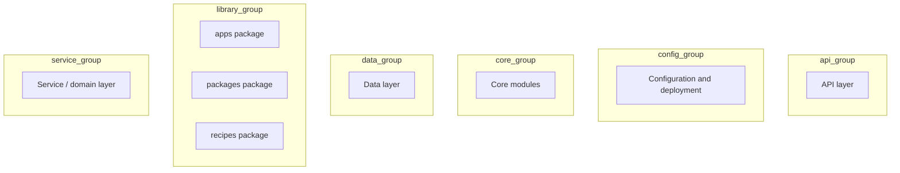

# Architecture report: puckeditor/puck

> Automated static analysis. **Observed** = directly seen in files/imports/AST; **Inferred** = interpretation from that evidence. Repository code was not executed.

## 1. Repository at a glance

| Item | Value |
| --- | --- |
| Repository | puckeditor/puck |
| Description | The visual editor for React. |
| Language | TypeScript |
| Stars | 13708 |
| Licence | MIT |
| Analysed commit / branch | ab5624ddcb0435cc9575b5154433be7aadf84809 / main |
| Framework(s) | Next.js, React |
| Files analysed | 800 |
| Components | 8 |

## 2. Architecture in one minute

puckeditor/puck - The visual editor for React.. This repository was analysed statically from 800 file(s) (0 Python). Detected technologies (observed from imports/manifests): GitHub Actions, Next.js, React, Jest, TypeScript. Files are grouped into 8 component(s): API layer, apps package, Configuration and deployment, Core modules, Data layer, packages package, recipes package, Service / domain layer. Findings below distinguish observed facts from inferred interpretation.

## 3. High-level block diagram

## 4. Main components

### API layer (`api_layer`)

- **Kind:** api
- **Status:** Observed
- **Confidence:** 0.85
- **Responsibility:** Groups 9 file(s) under api layer (observed from repository paths and static analysis).
- **Paths:** `apps/demo/app/api/login-url/route.ts`, `apps/demo/app/api/puck/[...all]/route.ts`, `packages/core/types/API/DropZone.ts`, `packages/core/types/API/FieldTransforms.ts`, `packages/core/types/API/Overrides.ts`, `packages/core/types/API/Viewports.ts`, `packages/core/types/API/index.ts`, `recipes/next-ai/app/api/pages/route.ts`, `recipes/next-ai/app/api/puck/[...all]/route.ts`
- **Evidence:** [apps/demo/app/api/login-url/route.ts](https://github.com/puckeditor/puck/blob/ab5624ddcb0435cc9575b5154433be7aadf84809/apps/demo/app/api/login-url/route.ts); [apps/demo/app/api/puck/[...all]/route.ts](https://github.com/puckeditor/puck/blob/ab5624ddcb0435cc9575b5154433be7aadf84809/apps/demo/app/api/puck/%5B...all%5D/route.ts); [packages/core/types/API/DropZone.ts](https://github.com/puckeditor/puck/blob/ab5624ddcb0435cc9575b5154433be7aadf84809/packages/core/types/API/DropZone.ts); [packages/core/types/API/FieldTransforms.ts](https://github.com/puckeditor/puck/blob/ab5624ddcb0435cc9575b5154433be7aadf84809/packages/core/types/API/FieldTransforms.ts); [packages/core/types/API/Overrides.ts](https://github.com/puckeditor/puck/blob/ab5624ddcb0435cc9575b5154433be7aadf84809/packages/core/types/API/Overrides.ts); [packages/core/types/API/Viewports.ts](https://github.com/puckeditor/puck/blob/ab5624ddcb0435cc9575b5154433be7aadf84809/packages/core/types/API/Viewports.ts); [packages/core/types/API/index.ts](https://github.com/puckeditor/puck/blob/ab5624ddcb0435cc9575b5154433be7aadf84809/packages/core/types/API/index.ts); [recipes/next-ai/app/api/pages/route.ts](https://github.com/puckeditor/puck/blob/ab5624ddcb0435cc9575b5154433be7aadf84809/recipes/next-ai/app/api/pages/route.ts)

### apps package (`apps`)

- **Kind:** library
- **Status:** Observed
- **Confidence:** 0.85
- **Responsibility:** Groups 16 file(s) under apps package (observed from repository paths and static analysis).
- **Paths:** `apps/demo/app/[...puckPath]/client.tsx`, `apps/demo/app/[...puckPath]/page.tsx`, `apps/demo/app/custom-ui/[...puckPath]/client.tsx`, `apps/demo/app/custom-ui/[...puckPath]/page.tsx`, `apps/demo/app/layout.tsx`, `apps/demo/app/page.tsx`, `apps/demo/app/rsc/page.tsx`, `apps/demo/app/runtime-css-debug/client.tsx`, `apps/demo/app/runtime-css-debug/page.tsx`, `apps/demo/components/docs-bar-cta/index.tsx`, `apps/demo/eslint.config.mjs`, `apps/demo/instrumentation-client.ts`, `apps/demo/lib/resolve-puck-path.ts`, `apps/demo/lib/use-authed-ai-plugin.tsx`, `apps/demo/lib/use-demo-data.ts`, `apps/demo/next.config.js`
- **Evidence:** [apps/demo/app/[...puckPath]/client.tsx](https://github.com/puckeditor/puck/blob/ab5624ddcb0435cc9575b5154433be7aadf84809/apps/demo/app/%5B...puckPath%5D/client.tsx); [apps/demo/app/[...puckPath]/page.tsx](https://github.com/puckeditor/puck/blob/ab5624ddcb0435cc9575b5154433be7aadf84809/apps/demo/app/%5B...puckPath%5D/page.tsx); [apps/demo/app/custom-ui/[...puckPath]/client.tsx](https://github.com/puckeditor/puck/blob/ab5624ddcb0435cc9575b5154433be7aadf84809/apps/demo/app/custom-ui/%5B...puckPath%5D/client.tsx); [apps/demo/app/custom-ui/[...puckPath]/page.tsx](https://github.com/puckeditor/puck/blob/ab5624ddcb0435cc9575b5154433be7aadf84809/apps/demo/app/custom-ui/%5B...puckPath%5D/page.tsx); [apps/demo/app/layout.tsx](https://github.com/puckeditor/puck/blob/ab5624ddcb0435cc9575b5154433be7aadf84809/apps/demo/app/layout.tsx); [apps/demo/app/page.tsx](https://github.com/puckeditor/puck/blob/ab5624ddcb0435cc9575b5154433be7aadf84809/apps/demo/app/page.tsx); [apps/demo/app/rsc/page.tsx](https://github.com/puckeditor/puck/blob/ab5624ddcb0435cc9575b5154433be7aadf84809/apps/demo/app/rsc/page.tsx); [apps/demo/app/runtime-css-debug/client.tsx](https://github.com/puckeditor/puck/blob/ab5624ddcb0435cc9575b5154433be7aadf84809/apps/demo/app/runtime-css-debug/client.tsx)

### Configuration and deployment (`config`)

- **Kind:** config
- **Status:** Observed
- **Confidence:** 0.85
- **Responsibility:** Groups 78 file(s) under configuration and deployment (observed from repository paths and static analysis).
- **Paths:** `apps/demo/.env.example`, `apps/demo/config/blocks/Bento/index.tsx`, `apps/demo/config/blocks/Blank/index.tsx`, `apps/demo/config/blocks/Button/index.tsx`, `apps/demo/config/blocks/CTA/index.tsx`, `apps/demo/config/blocks/Card/index.tsx`, `apps/demo/config/blocks/FAQ/faq-item.tsx`, `apps/demo/config/blocks/FAQ/index.tsx`, `apps/demo/config/blocks/FeatureGrid/index.tsx`, `apps/demo/config/blocks/FeatureSplit/index.tsx`, `apps/demo/config/blocks/Flex/index.tsx`, `apps/demo/config/blocks/Grid/index.tsx`, `apps/demo/config/blocks/Heading/index.tsx`, `apps/demo/config/blocks/Hero/Hero.tsx`, `apps/demo/config/blocks/Hero/client.tsx`, `apps/demo/config/blocks/Hero/index.tsx`, `apps/demo/config/blocks/Hero/quotes.ts`, `apps/demo/config/blocks/Hero/render-fields.ts`, `apps/demo/config/blocks/Hero/server.tsx`, `apps/demo/config/blocks/Logos/index.tsx`, `apps/demo/config/blocks/RichText/index.tsx`, `apps/demo/config/blocks/Space/index.tsx`, `apps/demo/config/blocks/Stats/index.tsx`, `apps/demo/config/blocks/Steps/index.tsx`, `apps/demo/config/blocks/Template/Template.tsx`, `apps/demo/config/blocks/Template/client.tsx`, `apps/demo/config/blocks/Template/index.tsx`, `apps/demo/config/blocks/Template/render-fields.ts`, `apps/demo/config/blocks/Template/server.tsx`, `apps/demo/config/blocks/Text/index.tsx`, `apps/demo/config/components/Button/index.tsx`, `apps/demo/config/components/FieldTabs/index.tsx`, `apps/demo/config/components/Footer/index.tsx`, `apps/demo/config/components/Header/index.tsx`, `apps/demo/config/components/Icon/index.tsx`, `apps/demo/config/components/Layout/index.tsx`, `apps/demo/config/components/Section/index.tsx`, `apps/demo/config/components/SectionHeader/index.tsx`, `apps/demo/config/fixtures/performance.ts`, `apps/demo/config/index.tsx`, `apps/demo/config/initial-data.ts`, `apps/demo/config/options.ts`, `apps/demo/config/root.tsx`, `apps/demo/config/server.tsx`, `apps/demo/config/types.ts`, `apps/demo/package.json`, `apps/demo/tsconfig.json`, `apps/demo/tsconfig/base.json`, `apps/demo/tsconfig/nextjs.json`, `apps/docs/package.json`, `apps/docs/releases.json`, `apps/docs/tsconfig.json`, `apps/docs/tsconfig/base.json`, `apps/docs/tsconfig/nextjs.json`, `lerna.json`, `package.json`, `packages/core/package.json`, `packages/core/tsconfig.json`, `packages/create-puck-app/package.json`, `packages/eslint-config-custom/package.json`, `packages/field-contentful/package.json`, `packages/field-contentful/tsconfig.json`, `packages/plugin-emotion-cache/package.json`, `packages/plugin-emotion-cache/tsconfig.json`, `packages/plugin-heading-analyzer/package.json`, `packages/plugin-heading-analyzer/tsconfig.json`, `packages/tsconfig/base.json`, `packages/tsconfig/nextjs.json`, `packages/tsconfig/package.json`, `packages/tsconfig/react-library.json`, `packages/tsup-config/package.json`, `pnpm-workspace.yaml`, `recipes/next-ai/.env.example`, `recipes/next-ai/database.json`, `recipes/next-ai/package.json`, `recipes/next-ai/tsconfig.json`, `recipes/next-ai/tsconfig/base.json`, `recipes/next-ai/tsconfig/nextjs.json`
- **Evidence:** [apps/demo/.env.example](https://github.com/puckeditor/puck/blob/ab5624ddcb0435cc9575b5154433be7aadf84809/apps/demo/.env.example); [apps/demo/config/blocks/Bento/index.tsx](https://github.com/puckeditor/puck/blob/ab5624ddcb0435cc9575b5154433be7aadf84809/apps/demo/config/blocks/Bento/index.tsx); [apps/demo/config/blocks/Blank/index.tsx](https://github.com/puckeditor/puck/blob/ab5624ddcb0435cc9575b5154433be7aadf84809/apps/demo/config/blocks/Blank/index.tsx); [apps/demo/config/blocks/Button/index.tsx](https://github.com/puckeditor/puck/blob/ab5624ddcb0435cc9575b5154433be7aadf84809/apps/demo/config/blocks/Button/index.tsx); [apps/demo/config/blocks/CTA/index.tsx](https://github.com/puckeditor/puck/blob/ab5624ddcb0435cc9575b5154433be7aadf84809/apps/demo/config/blocks/CTA/index.tsx); [apps/demo/config/blocks/Card/index.tsx](https://github.com/puckeditor/puck/blob/ab5624ddcb0435cc9575b5154433be7aadf84809/apps/demo/config/blocks/Card/index.tsx); [apps/demo/config/blocks/FAQ/faq-item.tsx](https://github.com/puckeditor/puck/blob/ab5624ddcb0435cc9575b5154433be7aadf84809/apps/demo/config/blocks/FAQ/faq-item.tsx); [apps/demo/config/blocks/FAQ/index.tsx](https://github.com/puckeditor/puck/blob/ab5624ddcb0435cc9575b5154433be7aadf84809/apps/demo/config/blocks/FAQ/index.tsx)

### Core modules (`core`)

- **Kind:** core
- **Status:** Observed
- **Confidence:** 0.85
- **Responsibility:** Groups 1 file(s) under core modules (observed from repository paths and static analysis).
- **Paths:** `eslint.config.mjs`
- **Evidence:** [eslint.config.mjs](https://github.com/puckeditor/puck/blob/ab5624ddcb0435cc9575b5154433be7aadf84809/eslint.config.mjs)

### Data layer (`data_layer`)

- **Kind:** data
- **Status:** Observed
- **Confidence:** 0.85
- **Responsibility:** Groups 41 file(s) under data layer (observed from repository paths and static analysis).
- **Paths:** `packages/core/lib/data/__tests__/flatten-data.spec.tsx`, `packages/core/lib/data/__tests__/is-component-allowed.spec.ts`, `packages/core/lib/data/__tests__/map-fields.spec.tsx`, `packages/core/lib/data/__tests__/resolve-and-replace-data.spec.tsx`, `packages/core/lib/data/__tests__/resolve-data-by-id.spec.tsx`, `packages/core/lib/data/__tests__/resolve-data-by-selector.spec.tsx`, `packages/core/lib/data/__tests__/resolve-zone-constraints.spec.tsx`, `packages/core/lib/data/__tests__/set-deep.spec.tsx`, `packages/core/lib/data/__tests__/walk-app-state.spec.tsx`, `packages/core/lib/data/__tests__/walk-tree.spec.tsx`, `packages/core/lib/data/component-has-slots.ts`, `packages/core/lib/data/default-data.ts`, `packages/core/lib/data/default-slots.ts`, `packages/core/lib/data/find-zones-for-area.ts`, `packages/core/lib/data/flatten-data.ts`, `packages/core/lib/data/flatten-node.ts`, `packages/core/lib/data/for-related-zones.ts`, `packages/core/lib/data/get-deep.ts`, `packages/core/lib/data/get-field-by-path.ts`, `packages/core/lib/data/get-ids-for-parent.ts`, `packages/core/lib/data/get-item.ts`, `packages/core/lib/data/get-slot-field.ts`, `packages/core/lib/data/insert.ts`, `packages/core/lib/data/is-component-allowed.ts`, `packages/core/lib/data/make-state-public.ts`, `packages/core/lib/data/map-fields.ts`, `packages/core/lib/data/populate-ids.ts`, `packages/core/lib/data/remove.ts`, `packages/core/lib/data/reorder.ts`, `packages/core/lib/data/replace.ts`, `packages/core/lib/data/resolve-and-replace-data.ts`, `packages/core/lib/data/resolve-data-by-id.ts`, `packages/core/lib/data/resolve-data-by-selector.ts`, `packages/core/lib/data/resolve-zone-constraints.ts`, `packages/core/lib/data/set-deep.ts`, `packages/core/lib/data/setup-zone.ts`, `packages/core/lib/data/strip-slots.ts`, `packages/core/lib/data/to-component.ts`, `packages/core/lib/data/to-root.ts`, `packages/core/lib/data/walk-app-state.ts`, `packages/core/lib/data/walk-tree.ts`
- **Evidence:** [packages/core/lib/data/__tests__/flatten-data.spec.tsx](https://github.com/puckeditor/puck/blob/ab5624ddcb0435cc9575b5154433be7aadf84809/packages/core/lib/data/__tests__/flatten-data.spec.tsx); [packages/core/lib/data/__tests__/is-component-allowed.spec.ts](https://github.com/puckeditor/puck/blob/ab5624ddcb0435cc9575b5154433be7aadf84809/packages/core/lib/data/__tests__/is-component-allowed.spec.ts); [packages/core/lib/data/__tests__/map-fields.spec.tsx](https://github.com/puckeditor/puck/blob/ab5624ddcb0435cc9575b5154433be7aadf84809/packages/core/lib/data/__tests__/map-fields.spec.tsx); [packages/core/lib/data/__tests__/resolve-and-replace-data.spec.tsx](https://github.com/puckeditor/puck/blob/ab5624ddcb0435cc9575b5154433be7aadf84809/packages/core/lib/data/__tests__/resolve-and-replace-data.spec.tsx); [packages/core/lib/data/__tests__/resolve-data-by-id.spec.tsx](https://github.com/puckeditor/puck/blob/ab5624ddcb0435cc9575b5154433be7aadf84809/packages/core/lib/data/__tests__/resolve-data-by-id.spec.tsx); [packages/core/lib/data/__tests__/resolve-data-by-selector.spec.tsx](https://github.com/puckeditor/puck/blob/ab5624ddcb0435cc9575b5154433be7aadf84809/packages/core/lib/data/__tests__/resolve-data-by-selector.spec.tsx); [packages/core/lib/data/__tests__/resolve-zone-constraints.spec.tsx](https://github.com/puckeditor/puck/blob/ab5624ddcb0435cc9575b5154433be7aadf84809/packages/core/lib/data/__tests__/resolve-zone-constraints.spec.tsx); [packages/core/lib/data/__tests__/set-deep.spec.tsx](https://github.com/puckeditor/puck/blob/ab5624ddcb0435cc9575b5154433be7aadf84809/packages/core/lib/data/__tests__/set-deep.spec.tsx)

### packages package (`packages`)

- **Kind:** library
- **Status:** Observed
- **Confidence:** 0.85
- **Responsibility:** Groups 16 file(s) under packages package (observed from repository paths and static analysis).
- **Paths:** `packages/create-puck-app/index.js`, `packages/create-puck-app/scripts/generate.js`, `packages/eslint-config-custom/index.mjs`, `packages/field-contentful/index.ts`, `packages/field-contentful/tsup.config.ts`, `packages/plugin-emotion-cache/index.tsx`, `packages/plugin-emotion-cache/tsup.config.ts`, `packages/plugin-heading-analyzer/globals.d.ts`, `packages/plugin-heading-analyzer/index.ts`, `packages/plugin-heading-analyzer/jest.config.ts`, `packages/plugin-heading-analyzer/src/HeadingAnalyzer.tsx`, `packages/plugin-heading-analyzer/src/__tests__/HeadingAnalyzer.spec.tsx`, `packages/plugin-heading-analyzer/tsup.config.ts`, `packages/tsup-config/css-module-plugin.ts`, `packages/tsup-config/index.ts`, `packages/tsup-config/react-import.js`
- **Evidence:** [packages/create-puck-app/index.js](https://github.com/puckeditor/puck/blob/ab5624ddcb0435cc9575b5154433be7aadf84809/packages/create-puck-app/index.js); [packages/create-puck-app/scripts/generate.js](https://github.com/puckeditor/puck/blob/ab5624ddcb0435cc9575b5154433be7aadf84809/packages/create-puck-app/scripts/generate.js); [packages/eslint-config-custom/index.mjs](https://github.com/puckeditor/puck/blob/ab5624ddcb0435cc9575b5154433be7aadf84809/packages/eslint-config-custom/index.mjs); [packages/field-contentful/index.ts](https://github.com/puckeditor/puck/blob/ab5624ddcb0435cc9575b5154433be7aadf84809/packages/field-contentful/index.ts); [packages/field-contentful/tsup.config.ts](https://github.com/puckeditor/puck/blob/ab5624ddcb0435cc9575b5154433be7aadf84809/packages/field-contentful/tsup.config.ts); [packages/plugin-emotion-cache/index.tsx](https://github.com/puckeditor/puck/blob/ab5624ddcb0435cc9575b5154433be7aadf84809/packages/plugin-emotion-cache/index.tsx); [packages/plugin-emotion-cache/tsup.config.ts](https://github.com/puckeditor/puck/blob/ab5624ddcb0435cc9575b5154433be7aadf84809/packages/plugin-emotion-cache/tsup.config.ts); [packages/plugin-heading-analyzer/globals.d.ts](https://github.com/puckeditor/puck/blob/ab5624ddcb0435cc9575b5154433be7aadf84809/packages/plugin-heading-analyzer/globals.d.ts)

### recipes package (`recipes`)

- **Kind:** library
- **Status:** Observed
- **Confidence:** 0.85
- **Responsibility:** Groups 18 file(s) under recipes package (observed from repository paths and static analysis).
- **Paths:** `recipes/next-ai/app/[...puckPath]/client.tsx`, `recipes/next-ai/app/[...puckPath]/page.tsx`, `recipes/next-ai/app/layout.tsx`, `recipes/next-ai/app/page.tsx`, `recipes/next-ai/app/puck/[...puckPath]/client.tsx`, `recipes/next-ai/app/puck/[...puckPath]/page.tsx`, `recipes/next-ai/app/puck/page.tsx`, `recipes/next-ai/eslint.config.mjs`, `recipes/next-ai/lib/get-page.ts`, `recipes/next-ai/next.config.js`, `recipes/next-ai/proxy.ts`, `recipes/next-ai/puck.config.tsx`, `recipes/next/app/[...puckPath]/client.tsx`, `recipes/next/app/[...puckPath]/page.tsx`, `recipes/next/app/layout.tsx`, `recipes/next/app/page.tsx`, `recipes/next/app/puck/[...puckPath]/client.tsx`, `recipes/next/app/puck/[...puckPath]/page.tsx`
- **Evidence:** [recipes/next-ai/app/[...puckPath]/client.tsx](https://github.com/puckeditor/puck/blob/ab5624ddcb0435cc9575b5154433be7aadf84809/recipes/next-ai/app/%5B...puckPath%5D/client.tsx); [recipes/next-ai/app/[...puckPath]/page.tsx](https://github.com/puckeditor/puck/blob/ab5624ddcb0435cc9575b5154433be7aadf84809/recipes/next-ai/app/%5B...puckPath%5D/page.tsx); [recipes/next-ai/app/layout.tsx](https://github.com/puckeditor/puck/blob/ab5624ddcb0435cc9575b5154433be7aadf84809/recipes/next-ai/app/layout.tsx); [recipes/next-ai/app/page.tsx](https://github.com/puckeditor/puck/blob/ab5624ddcb0435cc9575b5154433be7aadf84809/recipes/next-ai/app/page.tsx); [recipes/next-ai/app/puck/[...puckPath]/client.tsx](https://github.com/puckeditor/puck/blob/ab5624ddcb0435cc9575b5154433be7aadf84809/recipes/next-ai/app/puck/%5B...puckPath%5D/client.tsx); [recipes/next-ai/app/puck/[...puckPath]/page.tsx](https://github.com/puckeditor/puck/blob/ab5624ddcb0435cc9575b5154433be7aadf84809/recipes/next-ai/app/puck/%5B...puckPath%5D/page.tsx); [recipes/next-ai/app/puck/page.tsx](https://github.com/puckeditor/puck/blob/ab5624ddcb0435cc9575b5154433be7aadf84809/recipes/next-ai/app/puck/page.tsx); [recipes/next-ai/eslint.config.mjs](https://github.com/puckeditor/puck/blob/ab5624ddcb0435cc9575b5154433be7aadf84809/recipes/next-ai/eslint.config.mjs)

### Service / domain layer (`service_layer`)

- **Kind:** service
- **Status:** Observed
- **Confidence:** 0.85
- **Responsibility:** Groups 335 file(s) under service / domain layer (observed from repository paths and static analysis).
- **Paths:** `packages/core/__tests__/edge-runtime.spec.ts`, `packages/core/bundle/core.ts`, `packages/core/bundle/iframe-styles.ts`, `packages/core/bundle/index.ts`, `packages/core/bundle/internal.ts`, `packages/core/bundle/no-external.ts`, `packages/core/bundle/rsc.tsx`, `packages/core/components/ActionBar/__tests__/index.spec.tsx`, `packages/core/components/ActionBar/index.tsx`, `packages/core/components/AutoField/FieldLabel.tsx`, `packages/core/components/AutoField/context.tsx`, `packages/core/components/AutoField/fields/ArrayField/index.tsx`, `packages/core/components/AutoField/fields/CheckboxField/index.tsx`, `packages/core/components/AutoField/fields/DefaultField/index.tsx`, `packages/core/components/AutoField/fields/ExternalField/index.tsx`, `packages/core/components/AutoField/fields/ObjectField/index.tsx`, `packages/core/components/AutoField/fields/RadioField/index.tsx`, `packages/core/components/AutoField/fields/RichtextField/index.tsx`, `packages/core/components/AutoField/fields/SelectField/index.tsx`, `packages/core/components/AutoField/fields/TextareaField/index.tsx`, `packages/core/components/AutoField/fields/index.tsx`, `packages/core/components/AutoField/index.tsx`, `packages/core/components/AutoField/lib/use-deep-field.ts`, `packages/core/components/AutoField/lib/use-is-focused.ts`, `packages/core/components/AutoField/lib/use-local-value.ts`, `packages/core/components/AutoField/store.ts`, `packages/core/components/AutoField/subfield.tsx`, `packages/core/components/AutoFrame/index.tsx`, `packages/core/components/Breadcrumbs/index.tsx`, `packages/core/components/Button/Button.tsx`, `packages/core/components/Button/index.ts`, `packages/core/components/ComponentList/index.tsx`, `packages/core/components/DefaultOverride/index.tsx`, `packages/core/components/DragDropContext/index.tsx`, `packages/core/components/DragDropContext/use-drop-animation.ts`, `packages/core/components/DragDropContext/use-line-placeholder.ts`, `packages/core/components/DragIcon/index.tsx`, `packages/core/components/DraggableComponent/index.tsx`, `packages/core/components/Drawer/index.tsx`, `packages/core/components/DropZone/LinePlaceholder.tsx`, `packages/core/components/DropZone/VirtualizedDropZone.tsx`, `packages/core/components/DropZone/context.tsx`, `packages/core/components/DropZone/index.tsx`, `packages/core/components/DropZone/lib/use-content-with-preview.ts`, `packages/core/components/DropZone/lib/use-drag-axis.ts`, `packages/core/components/DropZone/lib/use-min-empty-height.ts`, `packages/core/components/DropZone/types.ts`, `packages/core/components/ExternalInput/index.tsx`, `packages/core/components/FieldGroup/FieldGroup.tsx`, `packages/core/components/FieldGroup/index.tsx`, `packages/core/components/FieldGroup/lib/use-field-group-expanded.ts`, `packages/core/components/Heading/index.tsx`, `packages/core/components/IconButton/IconButton.tsx`, `packages/core/components/IconButton/index.ts`, `packages/core/components/InlineTextField/__tests__/index.spec.tsx`, `packages/core/components/InlineTextField/index.tsx`, `packages/core/components/LayerTree/components/drop-line/index.tsx`, `packages/core/components/LayerTree/components/empty-zone-placeholder/index.tsx`, `packages/core/components/LayerTree/components/layer-actions/index.tsx`, `packages/core/components/LayerTree/components/layer-tree-items/index.ts`, `packages/core/components/LayerTree/components/layer-tree-items/static-layer-tree-items.tsx`, `packages/core/components/LayerTree/components/layer-tree-items/virtualized-layer-tree-items.tsx`, `packages/core/components/LayerTree/components/layer-tree-zone/index.tsx`, `packages/core/components/LayerTree/components/layer/index.tsx`, `packages/core/components/LayerTree/components/outline-dnd-provider/index.tsx`, `packages/core/components/LayerTree/index.tsx`, `packages/core/components/LayerTree/lib/__tests__/compute.spec.tsx`, `packages/core/components/LayerTree/lib/__tests__/store.spec.ts`, `packages/core/components/LayerTree/lib/build-layer-tree.ts`, `packages/core/components/LayerTree/lib/dnd/compute.ts`, `packages/core/components/LayerTree/lib/dnd/handlers.ts`, `packages/core/components/LayerTree/lib/dnd/use-outline-drop-zone.ts`, `packages/core/components/LayerTree/lib/dnd/use-outline-row-dnd.ts`, `packages/core/components/LayerTree/lib/store.ts`, `packages/core/components/LayerTree/types.ts`, `packages/core/components/Loader/index.tsx`, `packages/core/components/MemoizeComponent/index.tsx`, `packages/core/components/MenuBar/index.tsx`, `packages/core/components/Modal/index.tsx`, `packages/core/components/OutlineList/index.tsx`, `packages/core/components/Puck/__tests__/dictionary.spec.tsx`, `packages/core/components/Puck/__tests__/field-transforms.spec.tsx`, `packages/core/components/Puck/__tests__/index.tsx`, `packages/core/components/Puck/__tests__/resolve-fields-config.spec.tsx`, `packages/core/components/Puck/__tests__/richtext.spec.tsx`, `packages/core/components/Puck/components/Canvas/index.tsx`, `packages/core/components/Puck/components/Components/index.tsx`, `packages/core/components/Puck/components/Fields/index.tsx`, `packages/core/components/Puck/components/Header/index.tsx`, `packages/core/components/Puck/components/Layout/index.tsx`, `packages/core/components/Puck/components/Nav/index.tsx`, `packages/core/components/Puck/components/Outline/components/collapse-all/index.tsx`, `packages/core/components/Puck/components/Outline/components/outline-header/index.tsx`, `packages/core/components/Puck/components/Outline/index.tsx`, `packages/core/components/Puck/components/Preview/components/edit-page.tsx`, `packages/core/components/Puck/components/Preview/components/interactive-page.tsx`, `packages/core/components/Puck/components/Preview/index.tsx`, `packages/core/components/Puck/components/ResizeHandle/index.tsx`, `packages/core/components/Puck/components/Sidebar/index.tsx`, `packages/core/components/Puck/index.tsx`, `packages/core/components/Render/__tests__/field-transforms.spec.tsx`, `packages/core/components/Render/index.tsx`, `packages/core/components/RichTextEditor/components/Editor.tsx`, `packages/core/components/RichTextEditor/components/EditorFallback.tsx`, `packages/core/components/RichTextEditor/components/EditorInner.tsx`, `packages/core/components/RichTextEditor/components/Render.tsx`, `packages/core/components/RichTextEditor/components/RenderFallback.tsx`, `packages/core/components/RichTextEditor/extension.ts`, `packages/core/components/RichTextEditor/index.ts`, `packages/core/components/RichTextEditor/lib/mapDeep.ts`, `packages/core/components/RichTextEditor/lib/use-richtext-props.tsx`, `packages/core/components/RichTextEditor/lib/use-synced-editor.ts`, `packages/core/components/RichTextEditor/selector.ts`, `packages/core/components/RichTextEditor/types.ts`, `packages/core/components/RichTextMenu/components/Control/index.tsx`, `packages/core/components/RichTextMenu/components/SelectControl/index.tsx`, `packages/core/components/RichTextMenu/controls/AlignCenter.tsx`, `packages/core/components/RichTextMenu/controls/AlignJustify.tsx`, `packages/core/components/RichTextMenu/controls/AlignLeft.tsx`, `packages/core/components/RichTextMenu/controls/AlignRight.tsx`, `packages/core/components/RichTextMenu/controls/AlignSelect/fallback.tsx`, `packages/core/components/RichTextMenu/controls/AlignSelect/index.tsx`, `packages/core/components/RichTextMenu/controls/AlignSelect/loaded.tsx`, `packages/core/components/RichTextMenu/controls/AlignSelect/use-options.ts`, `packages/core/components/RichTextMenu/controls/Blockquote.tsx`, `packages/core/components/RichTextMenu/controls/Bold.tsx`, `packages/core/components/RichTextMenu/controls/BulletList.tsx`, `packages/core/components/RichTextMenu/controls/CodeBlock.tsx`, `packages/core/components/RichTextMenu/controls/HeadingSelect/fallback.tsx`, `packages/core/components/RichTextMenu/controls/HeadingSelect/index.tsx`, `packages/core/components/RichTextMenu/controls/HeadingSelect/loaded.tsx`, `packages/core/components/RichTextMenu/controls/HeadingSelect/use-options.ts`, `packages/core/components/RichTextMenu/controls/HorizontalRule.tsx`, `packages/core/components/RichTextMenu/controls/InlineCode.tsx`, `packages/core/components/RichTextMenu/controls/Italic.tsx`, `packages/core/components/RichTextMenu/controls/ListSelect/fallback.tsx`, `packages/core/components/RichTextMenu/controls/ListSelect/index.tsx`, `packages/core/components/RichTextMenu/controls/ListSelect/loaded.tsx`, `packages/core/components/RichTextMenu/controls/ListSelect/use-options.ts`, `packages/core/components/RichTextMenu/controls/OrderedList.tsx`, `packages/core/components/RichTextMenu/controls/Strikethrough.tsx`, `packages/core/components/RichTextMenu/controls/Underline.tsx`, `packages/core/components/RichTextMenu/controls/index.ts`, `packages/core/components/RichTextMenu/full.tsx`, `packages/core/components/RichTextMenu/index.tsx`, `packages/core/components/RichTextMenu/inner.tsx`, `packages/core/components/RichTextMenu/lib/use-control-context.ts`, `packages/core/components/Select/index.tsx`, `packages/core/components/ServerRender/__tests__/field-transforms.spec.tsx`, `packages/core/components/ServerRender/__tests__/index.spec.tsx`, `packages/core/components/ServerRender/index.tsx`, `packages/core/components/SidebarSection/index.tsx`, `packages/core/components/SlotRender/index.tsx`, `packages/core/components/SlotRender/server.tsx`, `packages/core/components/Sortable/index.tsx`, `packages/core/components/Tabs/__tests__/index.spec.tsx`, `packages/core/components/Tabs/index.tsx`, `packages/core/components/ViewportControls/default-viewports.ts`, `packages/core/components/ViewportControls/index.tsx`, `packages/core/globals.d.ts`, `packages/core/index.ts`, `packages/core/jest.config.ts`, `packages/core/lib/__tests__/get-zone-content-ids.spec.ts`, `packages/core/lib/__tests__/get-zoom-config.spec.ts`, `packages/core/lib/__tests__/insert-component.spec.tsx`, `packages/core/lib/__tests__/load-overrides.spec.tsx`, `packages/core/lib/__tests__/math.spec.ts`, `packages/core/lib/__tests__/migrate.spec.tsx`, `packages/core/lib/__tests__/move-component.spec.tsx`, `packages/core/lib/__tests__/resolve-all-data.spec.tsx`, `packages/core/lib/__tests__/resolve-component-data.spec.tsx`, `packages/core/lib/__tests__/transform-props.spec.tsx`, `packages/core/lib/__tests__/use-breadcrumbs.spec.tsx`, `packages/core/lib/__tests__/use-delete-hotkeys.spec.ts`, `packages/core/lib/__tests__/use-hotkey.spec.tsx`, `packages/core/lib/assign-refs.ts`, `packages/core/lib/bubble-pointer-event.ts`, `packages/core/lib/dictionary.ts`, `packages/core/lib/dnd/NestedDroppablePlugin.ts`, `packages/core/lib/dnd/__tests__/drop-animation.spec.ts`, `packages/core/lib/dnd/__tests__/flip-commit.spec.ts`, `packages/core/lib/dnd/__tests__/get-insert-index.spec.ts`, `packages/core/lib/dnd/__tests__/nearest-gap.spec.ts`, `packages/core/lib/dnd/__tests__/resolve-dnd-mode.spec.ts`, `packages/core/lib/dnd/__tests__/resolve-flow.spec.ts`, `packages/core/lib/dnd/collision/collision-debug.ts`, `packages/core/lib/dnd/collision/directional/index.ts`, `packages/core/lib/dnd/collision/dynamic/get-direction.ts`, `packages/core/lib/dnd/collision/dynamic/get-midpoint-impact.ts`, `packages/core/lib/dnd/collision/dynamic/index.ts`, `packages/core/lib/dnd/collision/dynamic/store.ts`, `packages/core/lib/dnd/collision/dynamic/track-movement-interval.ts`, `packages/core/lib/dnd/commit-animation.ts`, `packages/core/lib/dnd/drag-handle/__tests__/use-drag-handle-listener.spec.tsx`, `packages/core/lib/dnd/drag-handle/__tests__/use-drag-handle.spec.tsx`, `packages/core/lib/dnd/drag-handle/index.ts`, `packages/core/lib/dnd/drag-handle/use-drag-handle-listener.ts`, `packages/core/lib/dnd/drag-handle/use-drag-handle.ts`, `packages/core/lib/dnd/drop-animation.ts`, `packages/core/lib/dnd/flip-commit.ts`, `packages/core/lib/dnd/frame-pointer.ts`, `packages/core/lib/dnd/get-insert-index.ts`, `packages/core/lib/dnd/is-dragging-from-handle.ts`, `packages/core/lib/dnd/nearest-gap.ts`, `packages/core/lib/dnd/resolve-dnd-mode.ts`, `packages/core/lib/dnd/resolve-flow.ts`, `packages/core/lib/dnd/use-on-drag-finished.ts`, `packages/core/lib/dnd/use-rendered-callback.ts`, `packages/core/lib/dnd/use-sensors.ts`, `packages/core/lib/dom-selectors.ts`, `packages/core/lib/dom/__tests__/node-contains-data-attr.spec.ts`, `packages/core/lib/dom/__tests__/sort-elements-by-position.spec.ts`, `packages/core/lib/dom/node-contains-data-attr.ts`, `packages/core/lib/dom/sort-elements-by-position.ts`, `packages/core/lib/field-transforms/__tests__/use-field-transforms-tracked.spec.tsx`, `packages/core/lib/field-transforms/build-mappers.ts`, `packages/core/lib/field-transforms/default-transforms/inline-text-transform.tsx`, `packages/core/lib/field-transforms/default-transforms/rich-text-transform.tsx`, `packages/core/lib/field-transforms/default-transforms/slot-transform.tsx`, `packages/core/lib/field-transforms/use-field-transforms-tracked.tsx`, `packages/core/lib/field-transforms/use-field-transforms.tsx`, `packages/core/lib/fields/__tests__/is-field-visible.spec.ts`, `packages/core/lib/fields/__tests__/renders-collapsible-group.spec.ts`, `packages/core/lib/fields/is-field-visible.ts`, `packages/core/lib/fields/renders-collapsible-group.ts`, `packages/core/lib/filter-data-attrs.ts`, `packages/core/lib/filter.ts`, `packages/core/lib/frame-context.tsx`, `packages/core/lib/generate-id.ts`, `packages/core/lib/generated/runtime-css.ts`, `packages/core/lib/get-changed.ts`, `packages/core/lib/get-class-name-factory.ts`, `packages/core/lib/get-deep-dir.ts`, `packages/core/lib/get-deep-scroll-position.ts`, `packages/core/lib/get-frame.ts`, `packages/core/lib/get-selector-for-id.ts`, `packages/core/lib/get-zone-content-ids.ts`, `packages/core/lib/get-zone-id.ts`, `packages/core/lib/get-zoom-config.ts`, `packages/core/lib/global-position.ts`, `packages/core/lib/group-zones-by-component.ts`, `packages/core/lib/index.ts`, `packages/core/lib/insert-component.ts`, `packages/core/lib/is-ios.ts`, `packages/core/lib/is-plain-object.ts`, `packages/core/lib/load-overrides.ts`, `packages/core/lib/math.ts`, `packages/core/lib/merge-class-names.ts`, `packages/core/lib/migrate.ts`, `packages/core/lib/move-component.ts`, `packages/core/lib/on-scroll-end.ts`, `packages/core/lib/overlay-portal/index.tsx`, `packages/core/lib/overrides/__tests__/field-types.spec.ts`, `packages/core/lib/overrides/field-types.ts`, `packages/core/lib/plugin-debug.tsx`, `packages/core/lib/props/editor/use-editor-props.tsx`, `packages/core/lib/props/render/use-render-props.tsx`, `packages/core/lib/props/shared/__tests__/get-drop-zone-props.spec.ts`, `packages/core/lib/props/shared/get-drop-zone-props.ts`, `packages/core/lib/resolve-all-data.ts`, `packages/core/lib/resolve-component-data.ts`, `packages/core/lib/root-droppable-id.ts`, `packages/core/lib/scroll-into-view.ts`, `packages/core/lib/shallow-equal.ts`, `packages/core/lib/style-config.ts`, `packages/core/lib/styles/is-fixed.ts`, `packages/core/lib/throttle.ts`, `packages/core/lib/transform-props.ts`, `packages/core/lib/use-breadcrumbs.ts`, `packages/core/lib/use-component-list.tsx`, `packages/core/lib/use-context-store.tsx`, `packages/core/lib/use-delete-hotkeys.ts`, `packages/core/lib/use-frame.ts`, `packages/core/lib/use-hotkey.ts`, `packages/core/lib/use-inject-css.ts`, `packages/core/lib/use-loaded-overrides.ts`, `packages/core/lib/use-message.ts`, `packages/core/lib/use-on-value-change.ts`, `packages/core/lib/use-parent.ts`, `packages/core/lib/use-preview-mode-hotkeys.ts`, `packages/core/lib/use-puck.ts`, `packages/core/lib/use-reset-auto-zoom.ts`, `packages/core/lib/use-safe-id.ts`, `packages/core/lib/use-sidebar-resize.ts`, `packages/core/lib/use-why-render.ts`, `packages/core/lib/uuid/index.ts`, `packages/core/lib/uuid/rng.ts`, `packages/core/lib/uuid/stringify.ts`, `packages/core/plugins/blocks/index.tsx`, `packages/core/plugins/fields/index.tsx`, `packages/core/plugins/legacy-side-bar/index.tsx`, `packages/core/plugins/outline/index.tsx`, `packages/core/reducer/actions.tsx`, `packages/core/reducer/actions/__helpers__/index.tsx`, `packages/core/reducer/actions/__tests__/duplicate.spec.ts`, `packages/core/reducer/actions/__tests__/insert.spec.ts`, `packages/core/reducer/actions/__tests__/move.spec.ts`, `packages/core/reducer/actions/__tests__/register-zone.spec.ts`, `packages/core/reducer/actions/__tests__/remove.spec.ts`, `packages/core/reducer/actions/__tests__/reorder.spec.ts`, `packages/core/reducer/actions/__tests__/replace.spec.ts`, `packages/core/reducer/actions/__tests__/set-ui.spec.ts`, `packages/core/reducer/actions/__tests__/set.spec.ts`, `packages/core/reducer/actions/duplicate.ts`, `packages/core/reducer/actions/insert.ts`, `packages/core/reducer/actions/move.ts`, `packages/core/reducer/actions/register-zone.ts`, `packages/core/reducer/actions/remove.ts`, `packages/core/reducer/actions/reorder.ts`, `packages/core/reducer/actions/replace-root.ts`, `packages/core/reducer/actions/replace.ts`, `packages/core/reducer/actions/set-data.ts`, `packages/core/reducer/actions/set-ui.ts`, `packages/core/reducer/actions/set.ts`, `packages/core/reducer/index.ts`, `packages/core/store/default-app-state.ts`, `packages/core/store/index.ts`, `packages/core/store/slices/__tests__/fields.spec.tsx`, `packages/core/store/slices/__tests__/history.spec.tsx`, `packages/core/store/slices/__tests__/nodes.spec.tsx`, `packages/core/store/slices/__tests__/permissions.spec.tsx`, `packages/core/store/slices/fields.ts`, `packages/core/store/slices/history.ts`, `packages/core/store/slices/nodes.ts`, `packages/core/store/slices/permissions.ts`, `packages/core/tsup.config.ts`, `packages/core/types/AppState.tsx`, `packages/core/types/Config.tsx`, `packages/core/types/Data.tsx`, `packages/core/types/Fields.ts`, `packages/core/types/Internal.tsx`, `packages/core/types/Props.tsx`, `packages/core/types/Utils.tsx`, `packages/core/types/__tests__/internal.spec.ts`, `packages/core/types/index.ts`
- **Evidence:** [packages/core/__tests__/edge-runtime.spec.ts](https://github.com/puckeditor/puck/blob/ab5624ddcb0435cc9575b5154433be7aadf84809/packages/core/__tests__/edge-runtime.spec.ts); [packages/core/bundle/core.ts](https://github.com/puckeditor/puck/blob/ab5624ddcb0435cc9575b5154433be7aadf84809/packages/core/bundle/core.ts); [packages/core/bundle/iframe-styles.ts](https://github.com/puckeditor/puck/blob/ab5624ddcb0435cc9575b5154433be7aadf84809/packages/core/bundle/iframe-styles.ts); [packages/core/bundle/index.ts](https://github.com/puckeditor/puck/blob/ab5624ddcb0435cc9575b5154433be7aadf84809/packages/core/bundle/index.ts); [packages/core/bundle/internal.ts](https://github.com/puckeditor/puck/blob/ab5624ddcb0435cc9575b5154433be7aadf84809/packages/core/bundle/internal.ts); [packages/core/bundle/no-external.ts](https://github.com/puckeditor/puck/blob/ab5624ddcb0435cc9575b5154433be7aadf84809/packages/core/bundle/no-external.ts); [packages/core/bundle/rsc.tsx](https://github.com/puckeditor/puck/blob/ab5624ddcb0435cc9575b5154433be7aadf84809/packages/core/bundle/rsc.tsx); [packages/core/components/ActionBar/__tests__/index.spec.tsx](https://github.com/puckeditor/puck/blob/ab5624ddcb0435cc9575b5154433be7aadf84809/packages/core/components/ActionBar/__tests__/index.spec.tsx)

## 5. Execution flow

**Observed** entry point(s):

- [apps/demo/app/page.tsx](https://github.com/puckeditor/puck/blob/ab5624ddcb0435cc9575b5154433be7aadf84809/apps/demo/app/page.tsx)
- [apps/demo/config/index.tsx](https://github.com/puckeditor/puck/blob/ab5624ddcb0435cc9575b5154433be7aadf84809/apps/demo/config/index.tsx)
- [packages/core/bundle/index.ts](https://github.com/puckeditor/puck/blob/ab5624ddcb0435cc9575b5154433be7aadf84809/packages/core/bundle/index.ts)
- [packages/core/index.ts](https://github.com/puckeditor/puck/blob/ab5624ddcb0435cc9575b5154433be7aadf84809/packages/core/index.ts)
- [packages/core/lib/index.ts](https://github.com/puckeditor/puck/blob/ab5624ddcb0435cc9575b5154433be7aadf84809/packages/core/lib/index.ts)
- [packages/core/reducer/index.ts](https://github.com/puckeditor/puck/blob/ab5624ddcb0435cc9575b5154433be7aadf84809/packages/core/reducer/index.ts)
- [packages/core/store/index.ts](https://github.com/puckeditor/puck/blob/ab5624ddcb0435cc9575b5154433be7aadf84809/packages/core/store/index.ts)
- [packages/core/types/index.ts](https://github.com/puckeditor/puck/blob/ab5624ddcb0435cc9575b5154433be7aadf84809/packages/core/types/index.ts)
- [packages/create-puck-app/index.js](https://github.com/puckeditor/puck/blob/ab5624ddcb0435cc9575b5154433be7aadf84809/packages/create-puck-app/index.js)
- [packages/eslint-config-custom/index.mjs](https://github.com/puckeditor/puck/blob/ab5624ddcb0435cc9575b5154433be7aadf84809/packages/eslint-config-custom/index.mjs)
- [packages/field-contentful/index.ts](https://github.com/puckeditor/puck/blob/ab5624ddcb0435cc9575b5154433be7aadf84809/packages/field-contentful/index.ts)
- [packages/plugin-emotion-cache/index.tsx](https://github.com/puckeditor/puck/blob/ab5624ddcb0435cc9575b5154433be7aadf84809/packages/plugin-emotion-cache/index.tsx)

Representative flow (derived from observed entry points and the import graph; steps beyond the entry point are **Inferred**):

1. Execution starts at an observed entry point listed above, if present.
2. No internal import relationships between components were observed.

## 6. Project structure

### `(root)`

- `.eslintrc.js` - source, JavaScript (265 bytes)
- `.gitignore` - other (452 bytes)
- `.nvmrc` - other (2 bytes)
- `.prettierignore` - other (128 bytes)
- `.prettierrc.json` - config (3 bytes)
- `CHANGELOG.md` - docs (95577 bytes)
- `CODE_OF_CONDUCT.md` - docs (5412 bytes)
- `CONTRIBUTING.md` - docs (4547 bytes)
- `LICENSE` - docs (1074 bytes)
- `README.md` - docs (3715 bytes)
- `SECURITY.md` - docs (453 bytes)
- `eslint.config.mjs` - source, JavaScript (250 bytes)
- `lerna.json` - config (309 bytes)
- `package.json` - manifest (1528 bytes)
- `pnpm-workspace.yaml` - config (1969 bytes)

### `.github`

- `.github/ISSUE_TEMPLATE/bug-report.md` - docs (2001 bytes)
- `.github/ISSUE_TEMPLATE/config.yml` - config (455 bytes)
- `.github/ISSUE_TEMPLATE/feature_request.md` - docs (1272 bytes)
- `.github/dependabot.yml` - config (519 bytes)
- `.github/pull_request_template.md` - docs (1101 bytes)
- `.github/workflows/ci.yml` - ci, YAML (1132 bytes)
- `.github/workflows/publish-canary.yml` - ci, YAML (872 bytes)
- `.github/workflows/publish.yml` - ci, YAML (1386 bytes)

### `apps`

- `apps/demo/.env.example` - config (30 bytes)
- `apps/demo/.gitignore` - other (400 bytes)
- `apps/demo/README.md` - docs (1449 bytes)
- `apps/demo/app/[...puckPath]/client.tsx` - source, TypeScript (4438 bytes)
- `apps/demo/app/[...puckPath]/page.tsx` - source, TypeScript (1094 bytes)
- `apps/demo/app/api/login-url/route.ts` - source, TypeScript (344 bytes)
- `apps/demo/app/api/puck/[...all]/route.ts` - source, TypeScript (12855 bytes)
- `apps/demo/app/custom-ui/[...puckPath]/client.tsx` - source, TypeScript (14620 bytes)
- `apps/demo/app/custom-ui/[...puckPath]/page.tsx` - source, TypeScript (759 bytes)
- `apps/demo/app/layout.tsx` - source, TypeScript (502 bytes)
- `apps/demo/app/page.tsx` - source, TypeScript (86 bytes)
- `apps/demo/app/rsc/page.tsx` - source, TypeScript (1012 bytes)
- `apps/demo/app/runtime-css-debug/client.tsx` - source, TypeScript (1956 bytes)
- `apps/demo/app/runtime-css-debug/page.tsx` - source, TypeScript (129 bytes)
- `apps/demo/app/styles.css` - other (3333 bytes)
- `apps/demo/components/docs-bar-cta/index.tsx` - source, TypeScript (1091 bytes)
- `apps/demo/components/docs-bar-cta/styles.module.css` - other (1671 bytes)
- `apps/demo/config/blocks/Bento/index.tsx` - source, TypeScript (6078 bytes)
- `apps/demo/config/blocks/Bento/styles.module.css` - other (3404 bytes)
- `apps/demo/config/blocks/Blank/index.tsx` - source, TypeScript (415 bytes)
- `apps/demo/config/blocks/Blank/styles.module.css` - other (66 bytes)
- `apps/demo/config/blocks/Button/index.tsx` - source, TypeScript (1698 bytes)
- `apps/demo/config/blocks/CTA/index.tsx` - source, TypeScript (3811 bytes)
- `apps/demo/config/blocks/CTA/styles.module.css` - other (1383 bytes)
- `apps/demo/config/blocks/Card/index.tsx` - source, TypeScript (2800 bytes)
- `apps/demo/config/blocks/Card/styles.module.css` - other (1669 bytes)
- `apps/demo/config/blocks/FAQ/faq-item.tsx` - source, TypeScript (1038 bytes)
- `apps/demo/config/blocks/FAQ/index.tsx` - source, TypeScript (4168 bytes)
- `apps/demo/config/blocks/FAQ/styles.module.css` - other (1466 bytes)
- `apps/demo/config/blocks/FeatureGrid/index.tsx` - source, TypeScript (4524 bytes)
- `apps/demo/config/blocks/FeatureGrid/styles.module.css` - other (584 bytes)
- `apps/demo/config/blocks/FeatureSplit/index.tsx` - source, TypeScript (5927 bytes)
- `apps/demo/config/blocks/FeatureSplit/styles.module.css` - other (1714 bytes)
- `apps/demo/config/blocks/Flex/index.tsx` - source, TypeScript (3424 bytes)
- `apps/demo/config/blocks/Flex/styles.module.css` - other (89 bytes)
- `apps/demo/config/blocks/Grid/index.tsx` - source, TypeScript (1846 bytes)
- `apps/demo/config/blocks/Grid/styles.module.css` - other (132 bytes)
- `apps/demo/config/blocks/Heading/index.tsx` - source, TypeScript (2630 bytes)
- `apps/demo/config/blocks/Heading/styles.module.css` - other (558 bytes)
- `apps/demo/config/blocks/Hero/Hero.tsx` - source, TypeScript (2582 bytes)
- `apps/demo/config/blocks/Hero/client.tsx` - source, TypeScript (8639 bytes)
- `apps/demo/config/blocks/Hero/index.tsx` - source, TypeScript (67 bytes)
- `apps/demo/config/blocks/Hero/quotes.ts` - source, TypeScript (1533 bytes)
- `apps/demo/config/blocks/Hero/render-fields.ts` - source, TypeScript (416 bytes)
- `apps/demo/config/blocks/Hero/server.tsx` - source, TypeScript (345 bytes)
- `apps/demo/config/blocks/Hero/styles.module.css` - other (2773 bytes)
- `apps/demo/config/blocks/Logos/index.tsx` - source, TypeScript (6235 bytes)
- `apps/demo/config/blocks/Logos/styles.module.css` - other (1693 bytes)
- `apps/demo/config/blocks/RichText/index.tsx` - source, TypeScript (1044 bytes)
- `apps/demo/config/blocks/RichText/styles.module.css` - other (1113 bytes)
- `apps/demo/config/blocks/Space/index.tsx` - source, TypeScript (1690 bytes)
- `apps/demo/config/blocks/Space/styles.module.css` - other (173 bytes)
- `apps/demo/config/blocks/Stats/index.tsx` - source, TypeScript (6540 bytes)
- `apps/demo/config/blocks/Stats/styles.module.css` - other (4807 bytes)
- `apps/demo/config/blocks/Steps/index.tsx` - source, TypeScript (5463 bytes)
- `apps/demo/config/blocks/Steps/styles.module.css` - other (2223 bytes)
- `apps/demo/config/blocks/Template/Template.tsx` - source, TypeScript (668 bytes)
- `apps/demo/config/blocks/Template/client.tsx` - source, TypeScript (6382 bytes)
- `apps/demo/config/blocks/Template/index.tsx` - source, TypeScript (75 bytes)
- `apps/demo/config/blocks/Template/render-fields.ts` - source, TypeScript (193 bytes)
- `apps/demo/config/blocks/Template/server.tsx` - source, TypeScript (451 bytes)
- `apps/demo/config/blocks/Template/styles.module.css` - other (140 bytes)
- `apps/demo/config/blocks/Text/index.tsx` - source, TypeScript (2986 bytes)
- `apps/demo/config/blocks/Text/styles.module.css` - other (46 bytes)
- `apps/demo/config/components/Button/index.tsx` - source, TypeScript (593 bytes)
- `apps/demo/config/components/Button/styles.module.css` - other (1412 bytes)
- `apps/demo/config/components/FieldTabs/index.tsx` - source, TypeScript (1587 bytes)
- `apps/demo/config/components/Footer/index.tsx` - source, TypeScript (2254 bytes)
- `apps/demo/config/components/Header/index.tsx` - source, TypeScript (1141 bytes)
- `apps/demo/config/components/Header/styles.module.css` - other (962 bytes)
- `apps/demo/config/components/Icon/index.tsx` - source, TypeScript (1489 bytes)
- `apps/demo/config/components/Layout/index.tsx` - source, TypeScript (5447 bytes)
- `apps/demo/config/components/Layout/styles.module.css` - other (30 bytes)
- `apps/demo/config/components/Section/index.tsx` - source, TypeScript (2796 bytes)
- `apps/demo/config/components/Section/styles.module.css` - other (1884 bytes)
- `apps/demo/config/components/SectionHeader/index.tsx` - source, TypeScript (3593 bytes)
- `apps/demo/config/components/SectionHeader/styles.module.css` - other (1676 bytes)
- `apps/demo/config/fixtures/performance.ts` - source, TypeScript (3718 bytes)
- `apps/demo/config/index.tsx` - source, TypeScript (2062 bytes)
- `apps/demo/config/initial-data.ts` - source, TypeScript (9711 bytes)
- `apps/demo/config/options.ts` - source, TypeScript (769 bytes)
- `apps/demo/config/root.module.css` - other (3092 bytes)
- `apps/demo/config/root.tsx` - source, TypeScript (2087 bytes)
- `apps/demo/config/server.tsx` - source, TypeScript (1870 bytes)
- `apps/demo/config/types.ts` - source, TypeScript (1740 bytes)
- `apps/demo/eslint.config.mjs` - source, JavaScript (96 bytes)
- `apps/demo/instrumentation-client.ts` - source, TypeScript (345 bytes)
- `apps/demo/lib/resolve-puck-path.ts` - source, TypeScript (352 bytes)
- `apps/demo/lib/use-authed-ai-plugin.tsx` - source, TypeScript (2841 bytes)
- `apps/demo/lib/use-demo-data.ts` - source, TypeScript (1457 bytes)
- `apps/demo/next.config.js` - source, JavaScript (753 bytes)
- `apps/demo/package.json` - manifest (797 bytes)
- `apps/demo/tsconfig.json` - config (640 bytes)
- `apps/demo/tsconfig/base.json` - config (521 bytes)
- `apps/demo/tsconfig/nextjs.json` - config (530 bytes)
- `apps/docs/.gitignore` - docs (20 bytes)
- `apps/docs/components/Color/index.tsx` - docs (628 bytes)
- `apps/docs/components/Color/styles.module.css` - docs (240 bytes)
- `apps/docs/components/CtaCard/index.tsx` - docs (731 bytes)
- `apps/docs/components/CtaCard/styles.module.css` - docs (893 bytes)
- `apps/docs/components/DiscoveryButton/index.tsx` - docs (1262 bytes)
- `apps/docs/components/FooterActions/index.tsx` - docs (571 bytes)
- `apps/docs/components/FooterActions/styles.module.css` - docs (278 bytes)
- `apps/docs/components/Home/index.tsx` - docs (1989 bytes)
- `apps/docs/components/Home/styles.module.css` - docs (1175 bytes)
- `apps/docs/components/Preview/index.tsx` - docs (8161 bytes)
- `apps/docs/components/Preview/styles.module.css` - docs (3541 bytes)
- `apps/docs/components/ReleaseSwitcher/index.tsx` - docs (2193 bytes)
- `apps/docs/components/ReleaseSwitcher/styles.module.css` - docs (680 bytes)
- `apps/docs/components/Viewport/index.tsx` - docs (410 bytes)
- `apps/docs/components/Viewport/styles.module.css` - docs (220 bytes)
- `apps/docs/eslint.config.mjs` - docs (96 bytes)
- `apps/docs/middleware.ts` - docs (618 bytes)
- `apps/docs/next-sitemap.config.js` - docs (136 bytes)
- `apps/docs/next.config.mjs` - docs (1510 bytes)
- `apps/docs/package.json` - manifest (637 bytes)
- `apps/docs/pages/_app.tsx` - docs (178 bytes)
- `apps/docs/pages/_document.tsx` - docs (500 bytes)
- `apps/docs/pages/_meta.js` - docs (314 bytes)
- `apps/docs/pages/api/releases.ts` - docs (665 bytes)
- `apps/docs/pages/docs/_meta.js` - docs (349 bytes)
- `apps/docs/pages/docs/api-reference/_meta.js` - docs (213 bytes)
- `apps/docs/pages/docs/api-reference/actions.mdx` - docs (2161 bytes)
- `apps/docs/pages/docs/api-reference/components.mdx` - docs (3266 bytes)
- `apps/docs/pages/docs/api-reference/components/_meta.js` - docs (612 bytes)
- `apps/docs/pages/docs/api-reference/components/action-bar-action.mdx` - docs (1473 bytes)
- `apps/docs/pages/docs/api-reference/components/action-bar-drag-handle.mdx` - docs (1644 bytes)
- `apps/docs/pages/docs/api-reference/components/action-bar-group.mdx` - docs (1092 bytes)
- `apps/docs/pages/docs/api-reference/components/action-bar-label.mdx` - docs (990 bytes)
- `apps/docs/pages/docs/api-reference/components/action-bar-separator.mdx` - docs (831 bytes)
- `apps/docs/pages/docs/api-reference/components/action-bar.mdx` - docs (1225 bytes)
- `apps/docs/pages/docs/api-reference/components/auto-field.mdx` - docs (2543 bytes)
- `apps/docs/pages/docs/api-reference/components/drawer-item.mdx` - docs (2246 bytes)
- `apps/docs/pages/docs/api-reference/components/drawer.mdx` - docs (1084 bytes)
- `apps/docs/pages/docs/api-reference/components/drop-zone.mdx` - docs (5952 bytes)
- `apps/docs/pages/docs/api-reference/components/field-group-item.mdx` - docs (1156 bytes)
- `apps/docs/pages/docs/api-reference/components/field-group.mdx` - docs (4713 bytes)
- `apps/docs/pages/docs/api-reference/components/field-label.mdx` - docs (4652 bytes)
- `apps/docs/pages/docs/api-reference/components/field-tab.mdx` - docs (2743 bytes)
- `apps/docs/pages/docs/api-reference/components/inline-text-field.mdx` - docs (3626 bytes)
- `apps/docs/pages/docs/api-reference/components/puck-components.mdx` - docs (810 bytes)
- `apps/docs/pages/docs/api-reference/components/puck-fields.mdx` - docs (1186 bytes)
- `apps/docs/pages/docs/api-reference/components/puck-layout.mdx` - docs (691 bytes)
- `apps/docs/pages/docs/api-reference/components/puck-outline.mdx` - docs (897 bytes)
- `apps/docs/pages/docs/api-reference/components/puck-preview.mdx` - docs (1212 bytes)
- `apps/docs/pages/docs/api-reference/components/puck.mdx` - docs (17979 bytes)
- `apps/docs/pages/docs/api-reference/components/render.mdx` - docs (3438 bytes)
- `apps/docs/pages/docs/api-reference/components/rich-text-menu-control.mdx` - docs (2347 bytes)
- `apps/docs/pages/docs/api-reference/components/rich-text-menu-group.mdx` - docs (911 bytes)
- `apps/docs/pages/docs/api-reference/components/rich-text-menu.mdx` - docs (4328 bytes)
- `apps/docs/pages/docs/api-reference/configuration.mdx` - docs (233 bytes)
- `apps/docs/pages/docs/api-reference/configuration/_meta.js` - docs (54 bytes)
- `apps/docs/pages/docs/api-reference/configuration/component-config.mdx` - docs (21322 bytes)
- `apps/docs/pages/docs/api-reference/configuration/config.mdx` - docs (3164 bytes)
- `apps/docs/pages/docs/api-reference/data-model.mdx` - docs (329 bytes)
- `apps/docs/pages/docs/api-reference/data-model/app-state.mdx` - docs (7084 bytes)
- `apps/docs/pages/docs/api-reference/data-model/component-data.mdx` - docs (1758 bytes)
- `apps/docs/pages/docs/api-reference/data-model/data.mdx` - docs (2705 bytes)
- `apps/docs/pages/docs/api-reference/data-model/item-selector.mdx` - docs (1401 bytes)
- `apps/docs/pages/docs/api-reference/data-model/root-data.mdx` - docs (1697 bytes)
- `apps/docs/pages/docs/api-reference/dictionary.mdx` - docs (10434 bytes)
- `apps/docs/pages/docs/api-reference/field-transforms.mdx` - docs (1952 bytes)
- `apps/docs/pages/docs/api-reference/fields.mdx` - docs (960 bytes)
- `apps/docs/pages/docs/api-reference/fields/_meta.js` - docs (74 bytes)
- `apps/docs/pages/docs/api-reference/fields/array.mdx` - docs (7956 bytes)
- `apps/docs/pages/docs/api-reference/fields/base.mdx` - docs (1632 bytes)
- `apps/docs/pages/docs/api-reference/fields/checkbox.mdx` - docs (2695 bytes)
- `apps/docs/pages/docs/api-reference/fields/custom.mdx` - docs (8954 bytes)
- `apps/docs/pages/docs/api-reference/fields/external.mdx` - docs (17825 bytes)
- `apps/docs/pages/docs/api-reference/fields/number.mdx` - docs (3544 bytes)
- `apps/docs/pages/docs/api-reference/fields/object.mdx` - docs (3027 bytes)
- `apps/docs/pages/docs/api-reference/fields/radio.mdx` - docs (2243 bytes)
- `apps/docs/pages/docs/api-reference/fields/richtext.mdx` - docs (14694 bytes)
- `apps/docs/pages/docs/api-reference/fields/select.mdx` - docs (2141 bytes)
- `apps/docs/pages/docs/api-reference/fields/slot.mdx` - docs (9094 bytes)
- `apps/docs/pages/docs/api-reference/fields/text.mdx` - docs (3126 bytes)
- `apps/docs/pages/docs/api-reference/fields/textarea.mdx` - docs (3336 bytes)
- `apps/docs/pages/docs/api-reference/functions.mdx` - docs (885 bytes)
- `apps/docs/pages/docs/api-reference/functions/migrate.mdx` - docs (4687 bytes)
- `apps/docs/pages/docs/api-reference/functions/register-overlay-portal.mdx` - docs (1635 bytes)
- `apps/docs/pages/docs/api-reference/functions/resolve-all-data.mdx` - docs (1342 bytes)
- `apps/docs/pages/docs/api-reference/functions/set-deep.mdx` - docs (1685 bytes)
- `apps/docs/pages/docs/api-reference/functions/transform-props.mdx` - docs (2306 bytes)
- `apps/docs/pages/docs/api-reference/functions/use-get-puck.mdx` - docs (767 bytes)
- `apps/docs/pages/docs/api-reference/functions/use-puck.mdx` - docs (1532 bytes)
- `apps/docs/pages/docs/api-reference/functions/walk-tree.mdx` - docs (3914 bytes)
- `apps/docs/pages/docs/api-reference/overrides.mdx` - docs (1580 bytes)
- `apps/docs/pages/docs/api-reference/overrides/action-bar.mdx` - docs (1772 bytes)
- `apps/docs/pages/docs/api-reference/overrides/component-overlay.mdx` - docs (1110 bytes)
- `apps/docs/pages/docs/api-reference/overrides/drawer-item.mdx` - docs (494 bytes)
- `apps/docs/pages/docs/api-reference/overrides/drawer.mdx` - docs (380 bytes)
- `apps/docs/pages/docs/api-reference/overrides/field-label.mdx` - docs (321 bytes)
- `apps/docs/pages/docs/api-reference/overrides/field-types.mdx` - docs (1585 bytes)
- `apps/docs/pages/docs/api-reference/overrides/fields.mdx` - docs (1697 bytes)
- `apps/docs/pages/docs/api-reference/overrides/header-actions.mdx` - docs (537 bytes)
- `apps/docs/pages/docs/api-reference/overrides/header.mdx` - docs (553 bytes)
- `apps/docs/pages/docs/api-reference/overrides/iframe.mdx` - docs (642 bytes)
- `apps/docs/pages/docs/api-reference/overrides/outline.mdx` - docs (367 bytes)
- `apps/docs/pages/docs/api-reference/overrides/preview.mdx` - docs (381 bytes)
- `apps/docs/pages/docs/api-reference/overrides/puck.mdx` - docs (575 bytes)
- `apps/docs/pages/docs/api-reference/permissions.mdx` - docs (2316 bytes)
- `apps/docs/pages/docs/api-reference/plugin.mdx` - docs (3864 bytes)
- `apps/docs/pages/docs/api-reference/plugins/blocks-plugin.mdx` - docs (1282 bytes)
- `apps/docs/pages/docs/api-reference/plugins/fields-plugin.mdx` - docs (1829 bytes)
- `apps/docs/pages/docs/api-reference/plugins/legacy-side-bar-plugin.mdx` - docs (1442 bytes)
- `apps/docs/pages/docs/api-reference/plugins/outline-plugin.mdx` - docs (1286 bytes)
- `apps/docs/pages/docs/api-reference/puck-api.mdx` - docs (11294 bytes)
- `apps/docs/pages/docs/api-reference/theming/_meta.js` - docs (289 bytes)
- `apps/docs/pages/docs/api-reference/theming/action-bar.mdx` - docs (3080 bytes)
- `apps/docs/pages/docs/api-reference/theming/button.mdx` - docs (4820 bytes)
- `apps/docs/pages/docs/api-reference/theming/canvas.mdx` - docs (987 bytes)
- `apps/docs/pages/docs/api-reference/theming/computed-values.mdx` - docs (14708 bytes)
- `apps/docs/pages/docs/api-reference/theming/drawer.mdx` - docs (3482 bytes)
- `apps/docs/pages/docs/api-reference/theming/field-tabs.mdx` - docs (2999 bytes)
- `apps/docs/pages/docs/api-reference/theming/fields.mdx` - docs (7098 bytes)
- `apps/docs/pages/docs/api-reference/theming/global.mdx` - docs (12683 bytes)
- `apps/docs/pages/docs/api-reference/theming/header.mdx` - docs (816 bytes)
- `apps/docs/pages/docs/api-reference/theming/icon-button.mdx` - docs (2302 bytes)
- `apps/docs/pages/docs/api-reference/theming/outline.mdx` - docs (3732 bytes)
- `apps/docs/pages/docs/api-reference/theming/plugin-bar.mdx` - docs (1374 bytes)
- `apps/docs/pages/docs/api-reference/theming/sidebar.mdx` - docs (860 bytes)
- `apps/docs/pages/docs/api-reference/theming/slot.mdx` - docs (3164 bytes)
- `apps/docs/pages/docs/extending-puck/_meta.js` - docs (205 bytes)
- `apps/docs/pages/docs/extending-puck/composition.mdx` - docs (2644 bytes)
- `apps/docs/pages/docs/extending-puck/custom-fields.mdx` - docs (5750 bytes)
- `apps/docs/pages/docs/extending-puck/field-transforms.mdx` - docs (3008 bytes)
- `apps/docs/pages/docs/extending-puck/internal-puck-api.mdx` - docs (3411 bytes)
- `apps/docs/pages/docs/extending-puck/plugins.mdx` - docs (5849 bytes)
- `apps/docs/pages/docs/extending-puck/theming.mdx` - docs (3910 bytes)
- `apps/docs/pages/docs/extending-puck/ui-overrides.mdx` - docs (3699 bytes)
- `apps/docs/pages/docs/getting-started.mdx` - docs (1025 bytes)
- `apps/docs/pages/docs/guides/_meta.js` - docs (86 bytes)
- `apps/docs/pages/docs/guides/migrations/_meta.js` - docs (104 bytes)
- `apps/docs/pages/docs/guides/migrations/dropzones-to-slots.mdx` - docs (3700 bytes)
- `apps/docs/pages/docs/index.mdx` - docs (3413 bytes)
- `apps/docs/pages/docs/integrating-puck/_meta.js` - docs (439 bytes)
- `apps/docs/pages/docs/integrating-puck/categories.mdx` - docs (2020 bytes)
- `apps/docs/pages/docs/integrating-puck/component-configuration.mdx` - docs (5282 bytes)
- `apps/docs/pages/docs/integrating-puck/data-migration.mdx` - docs (2967 bytes)
- `apps/docs/pages/docs/integrating-puck/dynamic-fields.mdx` - docs (4742 bytes)
- `apps/docs/pages/docs/integrating-puck/dynamic-props.mdx` - docs (4765 bytes)
- `apps/docs/pages/docs/integrating-puck/external-data-sources.mdx` - docs (6301 bytes)
- `apps/docs/pages/docs/integrating-puck/feature-toggling.mdx` - docs (4095 bytes)
- `apps/docs/pages/docs/integrating-puck/field-grouping.mdx` - docs (9751 bytes)
- `apps/docs/pages/docs/integrating-puck/localization.mdx` - docs (6273 bytes)
- `apps/docs/pages/docs/integrating-puck/multi-column-layouts.mdx` - docs (12976 bytes)
- `apps/docs/pages/docs/integrating-puck/overlay-portals.mdx` - docs (1826 bytes)
- `apps/docs/pages/docs/integrating-puck/rich-text-editing.mdx` - docs (8461 bytes)
- `apps/docs/pages/docs/integrating-puck/root-configuration.mdx` - docs (3938 bytes)
- `apps/docs/pages/docs/integrating-puck/server-components.mdx` - docs (6574 bytes)
- `apps/docs/pages/docs/integrating-puck/styling.mdx` - docs (2984 bytes)
- `apps/docs/pages/docs/integrating-puck/viewports.mdx` - docs (1995 bytes)
- `apps/docs/pages/index.mdx` - docs (116 bytes)
- `apps/docs/public/favicon.svg` - docs (451 bytes)
- `apps/docs/public/manifest.webmanifest` - docs (372 bytes)
- `apps/docs/public/robots.txt` - docs (29 bytes)
- `apps/docs/releases.json` - config (1433 bytes)
- `apps/docs/styles.css` - docs (376 bytes)
- `apps/docs/theme.config.tsx` - docs (6992 bytes)
- `apps/docs/tsconfig.json` - config (629 bytes)
- `apps/docs/tsconfig/base.json` - config (521 bytes)
- `apps/docs/tsconfig/nextjs.json` - config (530 bytes)

### `packages`

- `packages/core/.gitignore` - other (23 bytes)
- `packages/core/__tests__/edge-runtime.spec.ts` - source, TypeScript (724 bytes)
- `packages/core/bundle/core.css` - other (474 bytes)
- `packages/core/bundle/core.ts` - source, TypeScript (1466 bytes)
- `packages/core/bundle/iframe-styles.ts` - source, TypeScript (818 bytes)
- `packages/core/bundle/index.css` - other (70 bytes)
- `packages/core/bundle/index.ts` - source, TypeScript (47 bytes)
- `packages/core/bundle/internal.ts` - source, TypeScript (44 bytes)
- `packages/core/bundle/no-external.css` - other (22 bytes)
- `packages/core/bundle/no-external.ts` - source, TypeScript (53 bytes)
- `packages/core/bundle/rsc.tsx` - source, TypeScript (217 bytes)
- `packages/core/components/ActionBar/__tests__/index.spec.tsx` - source, TypeScript (1364 bytes)
- `packages/core/components/ActionBar/index.tsx` - source, TypeScript (2222 bytes)
- `packages/core/components/ActionBar/styles.module.css` - other (3917 bytes)
- `packages/core/components/AutoField/FieldLabel.tsx` - source, TypeScript (2459 bytes)
- `packages/core/components/AutoField/context.tsx` - source, TypeScript (1799 bytes)
- `packages/core/components/AutoField/fields/ArrayField/index.tsx` - source, TypeScript (16576 bytes)
- `packages/core/components/AutoField/fields/ArrayField/styles.module.css` - other (7666 bytes)
- `packages/core/components/AutoField/fields/CheckboxField/index.tsx` - source, TypeScript (1901 bytes)
- `packages/core/components/AutoField/fields/DefaultField/index.tsx` - source, TypeScript (1981 bytes)
- `packages/core/components/AutoField/fields/ExternalField/index.tsx` - source, TypeScript (1978 bytes)
- `packages/core/components/AutoField/fields/ObjectField/index.tsx` - source, TypeScript (2874 bytes)
- `packages/core/components/AutoField/fields/RadioField/index.tsx` - source, TypeScript (1541 bytes)
- `packages/core/components/AutoField/fields/RichtextField/index.tsx` - source, TypeScript (1127 bytes)
- `packages/core/components/AutoField/fields/SelectField/index.tsx` - source, TypeScript (1428 bytes)
- `packages/core/components/AutoField/fields/TextareaField/index.tsx` - source, TypeScript (1097 bytes)
- `packages/core/components/AutoField/fields/index.tsx` - source, TypeScript (255 bytes)
- `packages/core/components/AutoField/index.tsx` - source, TypeScript (11258 bytes)
- `packages/core/components/AutoField/lib/use-deep-field.ts` - source, TypeScript (461 bytes)
- `packages/core/components/AutoField/lib/use-is-focused.ts` - source, TypeScript (160 bytes)
- `packages/core/components/AutoField/lib/use-local-value.ts` - source, TypeScript (2023 bytes)
- `packages/core/components/AutoField/store.ts` - source, TypeScript (716 bytes)
- `packages/core/components/AutoField/styles.module.css` - other (11927 bytes)
- `packages/core/components/AutoField/subfield.tsx` - source, TypeScript (1816 bytes)
- `packages/core/components/AutoFrame/index.tsx` - source, TypeScript (11983 bytes)
- `packages/core/components/Breadcrumbs/index.tsx` - source, TypeScript (1109 bytes)
- `packages/core/components/Breadcrumbs/styles.module.css` - other (910 bytes)
- `packages/core/components/Button/Button.module.css` - other (5041 bytes)
- `packages/core/components/Button/Button.tsx` - source, TypeScript (1964 bytes)
- `packages/core/components/Button/index.ts` - source, TypeScript (26 bytes)
- `packages/core/components/ComponentList/index.tsx` - source, TypeScript (3062 bytes)
- `packages/core/components/ComponentList/styles.module.css` - other (1610 bytes)
- `packages/core/components/DefaultOverride/index.tsx` - source, TypeScript (134 bytes)
- `packages/core/components/DragDropContext/index.tsx` - source, TypeScript (25576 bytes)
- `packages/core/components/DragDropContext/use-drop-animation.ts` - source, TypeScript (1666 bytes)
- `packages/core/components/DragDropContext/use-line-placeholder.ts` - source, TypeScript (5844 bytes)
- `packages/core/components/DragIcon/index.tsx` - source, TypeScript (653 bytes)
- `packages/core/components/DragIcon/styles.module.css` - other (558 bytes)
- `packages/core/components/DraggableComponent/index.tsx` - source, TypeScript (24366 bytes)
- `packages/core/components/DraggableComponent/styles.css` - other (2220 bytes)
- `packages/core/components/DraggableComponent/styles.module.css` - other (2831 bytes)
- `packages/core/components/Drawer/index.tsx` - source, TypeScript (4951 bytes)
- `packages/core/components/Drawer/styles.module.css` - other (2073 bytes)
- `packages/core/components/DropZone/LinePlaceholder.tsx` - source, TypeScript (5422 bytes)
- `packages/core/components/DropZone/VirtualizedDropZone.tsx` - source, TypeScript (7435 bytes)
- `packages/core/components/DropZone/context.tsx` - source, TypeScript (3638 bytes)
- `packages/core/components/DropZone/index.tsx` - source, TypeScript (18301 bytes)
- `packages/core/components/DropZone/lib/use-content-with-preview.ts` - source, TypeScript (2805 bytes)
- `packages/core/components/DropZone/lib/use-drag-axis.ts` - source, TypeScript (1396 bytes)
- `packages/core/components/DropZone/lib/use-min-empty-height.ts` - source, TypeScript (2692 bytes)
- `packages/core/components/DropZone/styles.module.css` - other (2186 bytes)
- `packages/core/components/DropZone/types.ts` - source, TypeScript (2370 bytes)
- `packages/core/components/ExternalInput/index.tsx` - source, TypeScript (10324 bytes)
- `packages/core/components/ExternalInput/styles.module.css` - other (10366 bytes)
- `packages/core/components/FieldGroup/FieldGroup.tsx` - source, TypeScript (5605 bytes)
- `packages/core/components/FieldGroup/index.tsx` - source, TypeScript (178 bytes)
- `packages/core/components/FieldGroup/lib/use-field-group-expanded.ts` - source, TypeScript (2318 bytes)
- `packages/core/components/FieldGroup/styles.module.css` - other (4625 bytes)
- `packages/core/components/Heading/index.tsx` - source, TypeScript (624 bytes)
- `packages/core/components/Heading/styles.module.css` - other (773 bytes)
- `packages/core/components/IconButton/IconButton.module.css` - other (1512 bytes)
- `packages/core/components/IconButton/IconButton.tsx` - source, TypeScript (1930 bytes)
- `packages/core/components/IconButton/index.ts` - source, TypeScript (30 bytes)
- `packages/core/components/InlineTextField/__tests__/index.spec.tsx` - source, TypeScript (3872 bytes)
- `packages/core/components/InlineTextField/index.tsx` - source, TypeScript (4111 bytes)
- `packages/core/components/InlineTextField/styles.module.css` - other (708 bytes)
- `packages/core/components/LayerTree/components/drop-line/index.tsx` - source, TypeScript (646 bytes)
- `packages/core/components/LayerTree/components/drop-line/styles.module.css` - other (601 bytes)
- `packages/core/components/LayerTree/components/empty-zone-placeholder/index.tsx` - source, TypeScript (1230 bytes)
- `packages/core/components/LayerTree/components/empty-zone-placeholder/styles.module.css` - other (667 bytes)
- `packages/core/components/LayerTree/components/layer-actions/index.tsx` - source, TypeScript (2652 bytes)
- `packages/core/components/LayerTree/components/layer-actions/styles.module.css` - other (808 bytes)
- `packages/core/components/LayerTree/components/layer-tree-items/index.ts` - source, TypeScript (142 bytes)
- `packages/core/components/LayerTree/components/layer-tree-items/static-layer-tree-items.tsx` - source, TypeScript (966 bytes)
- `packages/core/components/LayerTree/components/layer-tree-items/styles.module.css` - other (437 bytes)
- `packages/core/components/LayerTree/components/layer-tree-items/virtualized-layer-tree-items.tsx` - source, TypeScript (4275 bytes)
- `packages/core/components/LayerTree/components/layer-tree-zone/index.tsx` - source, TypeScript (1983 bytes)
- `packages/core/components/LayerTree/components/layer-tree-zone/styles.module.css` - other (980 bytes)
- `packages/core/components/LayerTree/components/layer/index.tsx` - source, TypeScript (6617 bytes)
- `packages/core/components/LayerTree/components/layer/styles.module.css` - other (3361 bytes)
- `packages/core/components/LayerTree/components/outline-dnd-provider/index.tsx` - source, TypeScript (2435 bytes)
- `packages/core/components/LayerTree/index.tsx` - source, TypeScript (1146 bytes)
- `packages/core/components/LayerTree/lib/__tests__/compute.spec.tsx` - source, TypeScript (3847 bytes)
- `packages/core/components/LayerTree/lib/__tests__/store.spec.ts` - source, TypeScript (5465 bytes)
- `packages/core/components/LayerTree/lib/build-layer-tree.ts` - source, TypeScript (3065 bytes)
- `packages/core/components/LayerTree/lib/dnd/compute.ts` - source, TypeScript (4679 bytes)
- `packages/core/components/LayerTree/lib/dnd/handlers.ts` - source, TypeScript (9093 bytes)
- `packages/core/components/LayerTree/lib/dnd/use-outline-drop-zone.ts` - source, TypeScript (2055 bytes)
- `packages/core/components/LayerTree/lib/dnd/use-outline-row-dnd.ts` - source, TypeScript (3799 bytes)
- `packages/core/components/LayerTree/lib/store.ts` - source, TypeScript (6416 bytes)
- `packages/core/components/LayerTree/styles.module.css` - other (2031 bytes)
- `packages/core/components/LayerTree/types.ts` - source, TypeScript (993 bytes)
- `packages/core/components/Loader/index.tsx` - source, TypeScript (625 bytes)
- `packages/core/components/Loader/styles.module.css` - other (475 bytes)
- `packages/core/components/MemoizeComponent/index.tsx` - source, TypeScript (871 bytes)
- `packages/core/components/MenuBar/index.tsx` - source, TypeScript (2203 bytes)
- `packages/core/components/MenuBar/styles.module.css` - other (860 bytes)
- `packages/core/components/Modal/index.tsx` - source, TypeScript (846 bytes)
- `packages/core/components/Modal/styles.module.css` - other (479 bytes)
- `packages/core/components/OutlineList/index.tsx` - source, TypeScript (942 bytes)
- `packages/core/components/OutlineList/styles.module.css` - other (1450 bytes)
- `packages/core/components/Puck/__tests__/__snapshots__/index.tsx.snap` - other (6858 bytes)
- `packages/core/components/Puck/__tests__/dictionary.spec.tsx` - source, TypeScript (7363 bytes)
- `packages/core/components/Puck/__tests__/field-transforms.spec.tsx` - source, TypeScript (3138 bytes)
- `packages/core/components/Puck/__tests__/index.tsx` - source, TypeScript (10289 bytes)
- `packages/core/components/Puck/__tests__/resolve-fields-config.spec.tsx` - source, TypeScript (6201 bytes)
- `packages/core/components/Puck/__tests__/richtext.spec.tsx` - source, TypeScript (9484 bytes)
- `packages/core/components/Puck/components/Canvas/index.tsx` - source, TypeScript (8861 bytes)
- `packages/core/components/Puck/components/Canvas/styles.module.css` - other (2087 bytes)
- `packages/core/components/Puck/components/Components/index.tsx` - source, TypeScript (739 bytes)
- `packages/core/components/Puck/components/Fields/index.tsx` - source, TypeScript (9766 bytes)
- `packages/core/components/Puck/components/Fields/styles.module.css` - other (1596 bytes)
- `packages/core/components/Puck/components/Header/index.tsx` - source, TypeScript (7157 bytes)
- `packages/core/components/Puck/components/Header/styles.module.css` - other (1984 bytes)
- `packages/core/components/Puck/components/Layout/index.tsx` - source, TypeScript (12792 bytes)
- `packages/core/components/Puck/components/Layout/styles.module.css` - other (6541 bytes)
- `packages/core/components/Puck/components/Nav/index.tsx` - source, TypeScript (1424 bytes)
- `packages/core/components/Puck/components/Nav/styles.module.css` - other (3060 bytes)
- `packages/core/components/Puck/components/Outline/components/collapse-all/index.tsx` - source, TypeScript (1509 bytes)
- `packages/core/components/Puck/components/Outline/components/collapse-all/styles.module.css` - other (181 bytes)
- `packages/core/components/Puck/components/Outline/components/outline-header/index.tsx` - source, TypeScript (903 bytes)
- `packages/core/components/Puck/components/Outline/components/outline-header/styles.module.css` - other (287 bytes)
- `packages/core/components/Puck/components/Outline/index.tsx` - source, TypeScript (2109 bytes)
- `packages/core/components/Puck/components/Outline/styles.module.css` - other (351 bytes)
- `packages/core/components/Puck/components/Preview/components/edit-page.tsx` - source, TypeScript (2020 bytes)
- `packages/core/components/Puck/components/Preview/components/interactive-page.tsx` - source, TypeScript (780 bytes)
- `packages/core/components/Puck/components/Preview/index.tsx` - source, TypeScript (4592 bytes)
- `packages/core/components/Puck/components/Preview/styles.module.css` - other (313 bytes)
- `packages/core/components/Puck/components/ResizeHandle/index.tsx` - source, TypeScript (2928 bytes)
- `packages/core/components/Puck/components/ResizeHandle/styles.css` - other (157 bytes)
- `packages/core/components/Puck/components/ResizeHandle/styles.module.css` - other (349 bytes)
- `packages/core/components/Puck/components/Sidebar/index.tsx` - source, TypeScript (1036 bytes)
- `packages/core/components/Puck/components/Sidebar/styles.module.css` - other (1294 bytes)
- `packages/core/components/Puck/index.tsx` - source, TypeScript (10001 bytes)
- `packages/core/components/Render/__tests__/field-transforms.spec.tsx` - source, TypeScript (8574 bytes)
- `packages/core/components/Render/index.tsx` - source, TypeScript (2894 bytes)
- `packages/core/components/RichTextEditor/components/Editor.tsx` - source, TypeScript (2165 bytes)
- `packages/core/components/RichTextEditor/components/EditorFallback.tsx` - source, TypeScript (804 bytes)
- `packages/core/components/RichTextEditor/components/EditorInner.tsx` - source, TypeScript (2497 bytes)
- `packages/core/components/RichTextEditor/components/Render.tsx` - source, TypeScript (1655 bytes)
- `packages/core/components/RichTextEditor/components/RenderFallback.tsx` - source, TypeScript (514 bytes)
- `packages/core/components/RichTextEditor/extension.ts` - source, TypeScript (7595 bytes)
- `packages/core/components/RichTextEditor/index.ts` - source, TypeScript (26 bytes)
- `packages/core/components/RichTextEditor/lib/mapDeep.ts` - source, TypeScript (448 bytes)
- `packages/core/components/RichTextEditor/lib/use-richtext-props.tsx` - source, TypeScript (2721 bytes)
- `packages/core/components/RichTextEditor/lib/use-synced-editor.ts` - source, TypeScript (3526 bytes)
- `packages/core/components/RichTextEditor/selector.ts` - source, TypeScript (1932 bytes)
- `packages/core/components/RichTextEditor/styles.module.css` - other (4725 bytes)
- `packages/core/components/RichTextEditor/types.ts` - source, TypeScript (953 bytes)
- `packages/core/components/RichTextMenu/components/Control/index.tsx` - source, TypeScript (1128 bytes)
- `packages/core/components/RichTextMenu/components/Control/styles.module.css` - other (277 bytes)
- `packages/core/components/RichTextMenu/components/SelectControl/index.tsx` - source, TypeScript (1234 bytes)
- `packages/core/components/RichTextMenu/controls/AlignCenter.tsx` - source, TypeScript (704 bytes)
- `packages/core/components/RichTextMenu/controls/AlignJustify.tsx` - source, TypeScript (714 bytes)
- `packages/core/components/RichTextMenu/controls/AlignLeft.tsx` - source, TypeScript (684 bytes)
- `packages/core/components/RichTextMenu/controls/AlignRight.tsx` - source, TypeScript (694 bytes)
- `packages/core/components/RichTextMenu/controls/AlignSelect/fallback.tsx` - source, TypeScript (564 bytes)
- `packages/core/components/RichTextMenu/controls/AlignSelect/index.tsx` - source, TypeScript (334 bytes)
- `packages/core/components/RichTextMenu/controls/AlignSelect/loaded.tsx` - source, TypeScript (1402 bytes)
- `packages/core/components/RichTextMenu/controls/AlignSelect/use-options.ts` - source, TypeScript (1844 bytes)
- `packages/core/components/RichTextMenu/controls/Blockquote.tsx` - source, TypeScript (675 bytes)
- `packages/core/components/RichTextMenu/controls/Bold.tsx` - source, TypeScript (630 bytes)
- `packages/core/components/RichTextMenu/controls/BulletList.tsx` - source, TypeScript (673 bytes)
- `packages/core/components/RichTextMenu/controls/CodeBlock.tsx` - source, TypeScript (684 bytes)
- `packages/core/components/RichTextMenu/controls/HeadingSelect/fallback.tsx` - source, TypeScript (570 bytes)
- `packages/core/components/RichTextMenu/controls/HeadingSelect/index.tsx` - source, TypeScript (346 bytes)
- `packages/core/components/RichTextMenu/controls/HeadingSelect/loaded.tsx` - source, TypeScript (1340 bytes)
- `packages/core/components/RichTextMenu/controls/HeadingSelect/use-options.ts` - source, TypeScript (2109 bytes)
- `packages/core/components/RichTextMenu/controls/HorizontalRule.tsx` - source, TypeScript (655 bytes)
- `packages/core/components/RichTextMenu/controls/InlineCode.tsx` - source, TypeScript (667 bytes)
- `packages/core/components/RichTextMenu/controls/Italic.tsx` - source, TypeScript (650 bytes)
- `packages/core/components/RichTextMenu/controls/ListSelect/fallback.tsx` - source, TypeScript (543 bytes)
- `packages/core/components/RichTextMenu/controls/ListSelect/index.tsx` - source, TypeScript (328 bytes)
- `packages/core/components/RichTextMenu/controls/ListSelect/loaded.tsx` - source, TypeScript (1210 bytes)
- `packages/core/components/RichTextMenu/controls/ListSelect/use-options.ts` - source, TypeScript (962 bytes)
- `packages/core/components/RichTextMenu/controls/OrderedList.tsx` - source, TypeScript (701 bytes)
- `packages/core/components/RichTextMenu/controls/Strikethrough.tsx` - source, TypeScript (699 bytes)
- `packages/core/components/RichTextMenu/controls/Underline.tsx` - source, TypeScript (680 bytes)
- `packages/core/components/RichTextMenu/controls/index.ts` - source, TypeScript (512 bytes)
- `packages/core/components/RichTextMenu/full.tsx` - source, TypeScript (1164 bytes)
- `packages/core/components/RichTextMenu/index.tsx` - source, TypeScript (726 bytes)
- `packages/core/components/RichTextMenu/inner.tsx` - source, TypeScript (3207 bytes)
- `packages/core/components/RichTextMenu/lib/use-control-context.ts` - source, TypeScript (586 bytes)
- `packages/core/components/RichTextMenu/styles.module.css` - other (1310 bytes)
- `packages/core/components/Select/index.tsx` - source, TypeScript (3287 bytes)
- `packages/core/components/Select/styles.module.css` - other (1525 bytes)
- `packages/core/components/ServerRender/__tests__/field-transforms.spec.tsx` - source, TypeScript (10540 bytes)
- `packages/core/components/ServerRender/__tests__/index.spec.tsx` - source, TypeScript (5891 bytes)
- `packages/core/components/ServerRender/index.tsx` - source, TypeScript (4351 bytes)
- `packages/core/components/SidebarSection/index.tsx` - source, TypeScript (1246 bytes)
- `packages/core/components/SidebarSection/styles.module.css` - other (2158 bytes)
- `packages/core/components/SlotRender/index.tsx` - source, TypeScript (813 bytes)
- `packages/core/components/SlotRender/server.tsx` - source, TypeScript (2118 bytes)
- `packages/core/components/Sortable/index.tsx` - source, TypeScript (2589 bytes)
- `packages/core/components/Sortable/styles.css` - other (559 bytes)
- `packages/core/components/Tabs/__tests__/index.spec.tsx` - source, TypeScript (7793 bytes)
- `packages/core/components/Tabs/index.tsx` - source, TypeScript (8771 bytes)
- `packages/core/components/Tabs/styles.module.css` - other (1492 bytes)
- `packages/core/components/ViewportControls/default-viewports.ts` - source, TypeScript (382 bytes)
- `packages/core/components/ViewportControls/index.tsx` - source, TypeScript (6553 bytes)
- `packages/core/components/ViewportControls/styles.module.css` - other (3004 bytes)
- `packages/core/globals.d.ts` - source, TypeScript (31 bytes)
- `packages/core/index.ts` - source, TypeScript (32 bytes)
- `packages/core/jest.config.ts` - source, TypeScript (698 bytes)
- `packages/core/lib/__tests__/get-zone-content-ids.spec.ts` - source, TypeScript (586 bytes)
- `packages/core/lib/__tests__/get-zoom-config.spec.ts` - source, TypeScript (3688 bytes)
- `packages/core/lib/__tests__/insert-component.spec.tsx` - source, TypeScript (3467 bytes)
- `packages/core/lib/__tests__/load-overrides.spec.tsx` - source, TypeScript (4396 bytes)
- `packages/core/lib/__tests__/math.spec.ts` - source, TypeScript (1240 bytes)
- `packages/core/lib/__tests__/migrate.spec.tsx` - source, TypeScript (8264 bytes)
- `packages/core/lib/__tests__/move-component.spec.tsx` - source, TypeScript (5382 bytes)
- `packages/core/lib/__tests__/resolve-all-data.spec.tsx` - source, TypeScript (11532 bytes)
- `packages/core/lib/__tests__/resolve-component-data.spec.tsx` - source, TypeScript (12910 bytes)
- `packages/core/lib/__tests__/transform-props.spec.tsx` - source, TypeScript (4224 bytes)
- `packages/core/lib/__tests__/use-breadcrumbs.spec.tsx` - source, TypeScript (4849 bytes)
- `packages/core/lib/__tests__/use-delete-hotkeys.spec.ts` - source, TypeScript (2163 bytes)
- `packages/core/lib/__tests__/use-hotkey.spec.tsx` - source, TypeScript (3660 bytes)
- `packages/core/lib/assign-refs.ts` - source, TypeScript (619 bytes)
- `packages/core/lib/bubble-pointer-event.ts` - source, TypeScript (707 bytes)
- `packages/core/lib/data/__tests__/flatten-data.spec.tsx` - source, TypeScript (3855 bytes)
- `packages/core/lib/data/__tests__/is-component-allowed.spec.ts` - source, TypeScript (1717 bytes)
- `packages/core/lib/data/__tests__/map-fields.spec.tsx` - source, TypeScript (3064 bytes)
- `packages/core/lib/data/__tests__/resolve-and-replace-data.spec.tsx` - source, TypeScript (6004 bytes)
- `packages/core/lib/data/__tests__/resolve-data-by-id.spec.tsx` - source, TypeScript (3568 bytes)
- `packages/core/lib/data/__tests__/resolve-data-by-selector.spec.tsx` - source, TypeScript (4128 bytes)
- `packages/core/lib/data/__tests__/resolve-zone-constraints.spec.tsx` - source, TypeScript (2345 bytes)
- `packages/core/lib/data/__tests__/set-deep.spec.tsx` - source, TypeScript (3779 bytes)
- `packages/core/lib/data/__tests__/walk-app-state.spec.tsx` - source, TypeScript (18707 bytes)
- `packages/core/lib/data/__tests__/walk-tree.spec.tsx` - source, TypeScript (9169 bytes)
- `packages/core/lib/data/component-has-slots.ts` - source, TypeScript (547 bytes)
- `packages/core/lib/data/default-data.ts` - source, TypeScript (169 bytes)
- `packages/core/lib/data/default-slots.ts` - source, TypeScript (248 bytes)
- `packages/core/lib/data/find-zones-for-area.ts` - source, TypeScript (233 bytes)
- `packages/core/lib/data/flatten-data.ts` - source, TypeScript (551 bytes)
- `packages/core/lib/data/flatten-node.ts` - source, TypeScript (1863 bytes)
- `packages/core/lib/data/for-related-zones.ts` - source, TypeScript (508 bytes)
- `packages/core/lib/data/get-deep.ts` - source, TypeScript (374 bytes)
- `packages/core/lib/data/get-field-by-path.ts` - source, TypeScript (1429 bytes)
- `packages/core/lib/data/get-ids-for-parent.ts` - source, TypeScript (299 bytes)
- `packages/core/lib/data/get-item.ts` - source, TypeScript (526 bytes)
- `packages/core/lib/data/get-slot-field.ts` - source, TypeScript (821 bytes)
- `packages/core/lib/data/insert.ts` - source, TypeScript (162 bytes)
- `packages/core/lib/data/is-component-allowed.ts` - source, TypeScript (888 bytes)
- `packages/core/lib/data/make-state-public.ts` - source, TypeScript (278 bytes)
- `packages/core/lib/data/map-fields.ts` - source, TypeScript (6378 bytes)
- `packages/core/lib/data/populate-ids.ts` - source, TypeScript (703 bytes)
- `packages/core/lib/data/remove.ts` - source, TypeScript (139 bytes)
- `packages/core/lib/data/reorder.ts` - source, TypeScript (225 bytes)
- `packages/core/lib/data/replace.ts` - source, TypeScript (189 bytes)
- `packages/core/lib/data/resolve-and-replace-data.ts` - source, TypeScript (1972 bytes)
- `packages/core/lib/data/resolve-data-by-id.ts` - source, TypeScript (696 bytes)
- `packages/core/lib/data/resolve-data-by-selector.ts` - source, TypeScript (835 bytes)
- `packages/core/lib/data/resolve-zone-constraints.ts` - source, TypeScript (1181 bytes)
- `packages/core/lib/data/set-deep.ts` - source, TypeScript (1549 bytes)
- `packages/core/lib/data/setup-zone.ts` - source, TypeScript (687 bytes)
- `packages/core/lib/data/strip-slots.ts` - source, TypeScript (350 bytes)
- `packages/core/lib/data/to-component.ts` - source, TypeScript (295 bytes)
- `packages/core/lib/data/to-root.ts` - source, TypeScript (488 bytes)
- `packages/core/lib/data/walk-app-state.ts` - source, TypeScript (5772 bytes)
- `packages/core/lib/data/walk-tree.ts` - source, TypeScript (1558 bytes)
- `packages/core/lib/dictionary.ts` - source, TypeScript (4773 bytes)
- `packages/core/lib/dnd/NestedDroppablePlugin.ts` - source, TypeScript (7950 bytes)
- `packages/core/lib/dnd/__tests__/drop-animation.spec.ts` - source, TypeScript (2479 bytes)
- `packages/core/lib/dnd/__tests__/flip-commit.spec.ts` - source, TypeScript (2479 bytes)
- `packages/core/lib/dnd/__tests__/get-insert-index.spec.ts` - source, TypeScript (2965 bytes)
- `packages/core/lib/dnd/__tests__/nearest-gap.spec.ts` - source, TypeScript (11116 bytes)
- `packages/core/lib/dnd/__tests__/resolve-dnd-mode.spec.ts` - source, TypeScript (1446 bytes)
- `packages/core/lib/dnd/__tests__/resolve-flow.spec.ts` - source, TypeScript (4060 bytes)
- `packages/core/lib/dnd/collision/collision-debug.ts` - source, TypeScript (1883 bytes)
- `packages/core/lib/dnd/collision/directional/index.ts` - source, TypeScript (1419 bytes)
- `packages/core/lib/dnd/collision/dynamic/get-direction.ts` - source, TypeScript (581 bytes)
- `packages/core/lib/dnd/collision/dynamic/get-midpoint-impact.ts` - source, TypeScript (1448 bytes)
- `packages/core/lib/dnd/collision/dynamic/index.ts` - source, TypeScript (7210 bytes)
- `packages/core/lib/dnd/collision/dynamic/store.ts` - source, TypeScript (210 bytes)
- `packages/core/lib/dnd/collision/dynamic/track-movement-interval.ts` - source, TypeScript (1563 bytes)
- `packages/core/lib/dnd/commit-animation.ts` - source, TypeScript (3051 bytes)
- `packages/core/lib/dnd/drag-handle/__tests__/use-drag-handle-listener.spec.tsx` - source, TypeScript (2994 bytes)
- `packages/core/lib/dnd/drag-handle/__tests__/use-drag-handle.spec.tsx` - source, TypeScript (2169 bytes)
- `packages/core/lib/dnd/drag-handle/index.ts` - source, TypeScript (206 bytes)
- `packages/core/lib/dnd/drag-handle/use-drag-handle-listener.ts` - source, TypeScript (2550 bytes)
- `packages/core/lib/dnd/drag-handle/use-drag-handle.ts` - source, TypeScript (4344 bytes)
- `packages/core/lib/dnd/drop-animation.ts` - source, TypeScript (7016 bytes)
- `packages/core/lib/dnd/flip-commit.ts` - source, TypeScript (1969 bytes)
- `packages/core/lib/dnd/frame-pointer.ts` - source, TypeScript (1234 bytes)
- `packages/core/lib/dnd/get-insert-index.ts` - source, TypeScript (1326 bytes)
- `packages/core/lib/dnd/is-dragging-from-handle.ts` - source, TypeScript (680 bytes)
- `packages/core/lib/dnd/nearest-gap.ts` - source, TypeScript (6535 bytes)
- `packages/core/lib/dnd/resolve-dnd-mode.ts` - source, TypeScript (1136 bytes)
- `packages/core/lib/dnd/resolve-flow.ts` - source, TypeScript (5478 bytes)
- `packages/core/lib/dnd/use-on-drag-finished.ts` - source, TypeScript (952 bytes)
- `packages/core/lib/dnd/use-rendered-callback.ts` - source, TypeScript (762 bytes)
- `packages/core/lib/dnd/use-sensors.ts` - source, TypeScript (2349 bytes)
- `packages/core/lib/dom-selectors.ts` - source, TypeScript (1105 bytes)
- `packages/core/lib/dom/__tests__/node-contains-data-attr.spec.ts` - source, TypeScript (1113 bytes)
- `packages/core/lib/dom/__tests__/sort-elements-by-position.spec.ts` - source, TypeScript (1290 bytes)
- `packages/core/lib/dom/node-contains-data-attr.ts` - source, TypeScript (788 bytes)
- `packages/core/lib/dom/sort-elements-by-position.ts` - source, TypeScript (952 bytes)
- `packages/core/lib/field-transforms/__tests__/use-field-transforms-tracked.spec.tsx` - source, TypeScript (5274 bytes)
- `packages/core/lib/field-transforms/build-mappers.ts` - source, TypeScript (1531 bytes)
- `packages/core/lib/field-transforms/default-transforms/inline-text-transform.tsx` - source, TypeScript (1316 bytes)
- `packages/core/lib/field-transforms/default-transforms/rich-text-transform.tsx` - source, TypeScript (4259 bytes)
- `packages/core/lib/field-transforms/default-transforms/slot-transform.tsx` - source, TypeScript (872 bytes)
- `packages/core/lib/field-transforms/use-field-transforms-tracked.tsx` - source, TypeScript (2510 bytes)
- `packages/core/lib/field-transforms/use-field-transforms.tsx` - source, TypeScript (906 bytes)
- `packages/core/lib/fields/__tests__/is-field-visible.spec.ts` - source, TypeScript (799 bytes)
- `packages/core/lib/fields/__tests__/renders-collapsible-group.spec.ts` - source, TypeScript (1208 bytes)
- `packages/core/lib/fields/is-field-visible.ts` - source, TypeScript (694 bytes)
- `packages/core/lib/fields/renders-collapsible-group.ts` - source, TypeScript (798 bytes)
- `packages/core/lib/filter-data-attrs.ts` - source, TypeScript (361 bytes)
- `packages/core/lib/filter.ts` - source, TypeScript (239 bytes)
- `packages/core/lib/frame-context.tsx` - source, TypeScript (823 bytes)
- `packages/core/lib/generate-id.ts` - source, TypeScript (127 bytes)
- `packages/core/lib/generated/runtime-css.ts` - source, TypeScript (167 bytes)
- `packages/core/lib/get-changed.ts` - source, TypeScript (582 bytes)
- `packages/core/lib/get-class-name-factory.ts` - source, TypeScript (1552 bytes)
- `packages/core/lib/get-deep-dir.ts` - source, TypeScript (306 bytes)
- `packages/core/lib/get-deep-scroll-position.ts` - source, TypeScript (438 bytes)
- `packages/core/lib/get-frame.ts` - source, TypeScript (344 bytes)
- `packages/core/lib/get-selector-for-id.ts` - source, TypeScript (461 bytes)
- `packages/core/lib/get-zone-content-ids.ts` - source, TypeScript (616 bytes)
- `packages/core/lib/get-zone-id.ts` - source, TypeScript (295 bytes)
- `packages/core/lib/get-zoom-config.ts` - source, TypeScript (1387 bytes)
- `packages/core/lib/global-position.ts` - source, TypeScript (1257 bytes)
- `packages/core/lib/group-zones-by-component.ts` - source, TypeScript (622 bytes)
- `packages/core/lib/index.ts` - source, TypeScript (204 bytes)
- `packages/core/lib/insert-component.ts` - source, TypeScript (2149 bytes)
- `packages/core/lib/is-ios.ts` - source, TypeScript (272 bytes)
- `packages/core/lib/is-plain-object.ts` - source, TypeScript (473 bytes)
- `packages/core/lib/load-overrides.ts` - source, TypeScript (3094 bytes)
- `packages/core/lib/math.ts` - source, TypeScript (1365 bytes)
- `packages/core/lib/merge-class-names.ts` - source, TypeScript (385 bytes)
- `packages/core/lib/migrate.ts` - source, TypeScript (5152 bytes)
- `packages/core/lib/move-component.ts` - source, TypeScript (1308 bytes)
- `packages/core/lib/on-scroll-end.ts` - source, TypeScript (519 bytes)
- `packages/core/lib/overlay-portal/index.tsx` - source, TypeScript (1503 bytes)
- `packages/core/lib/overlay-portal/styles.css` - other (726 bytes)
- `packages/core/lib/overrides/__tests__/field-types.spec.ts` - source, TypeScript (789 bytes)
- `packages/core/lib/overrides/field-types.ts` - source, TypeScript (459 bytes)
- `packages/core/lib/plugin-debug.tsx` - source, TypeScript (1391 bytes)
- `packages/core/lib/props/editor/use-editor-props.tsx` - source, TypeScript (2463 bytes)
- `packages/core/lib/props/render/use-render-props.tsx` - source, TypeScript (2247 bytes)
- `packages/core/lib/props/shared/__tests__/get-drop-zone-props.spec.ts` - source, TypeScript (2816 bytes)
- `packages/core/lib/props/shared/get-drop-zone-props.ts` - source, TypeScript (3439 bytes)
- `packages/core/lib/resolve-all-data.ts` - source, TypeScript (3007 bytes)
- `packages/core/lib/resolve-component-data.ts` - source, TypeScript (3643 bytes)
- `packages/core/lib/root-droppable-id.ts` - source, TypeScript (134 bytes)
- `packages/core/lib/scroll-into-view.ts` - source, TypeScript (251 bytes)
- `packages/core/lib/shallow-equal.ts` - source, TypeScript (1274 bytes)
- `packages/core/lib/style-config.ts` - source, TypeScript (285 bytes)
- `packages/core/lib/styles/is-fixed.ts` - source, TypeScript (560 bytes)
- `packages/core/lib/throttle.ts` - source, TypeScript (967 bytes)
- `packages/core/lib/transform-props.ts` - source, TypeScript (1775 bytes)
- `packages/core/lib/use-breadcrumbs.ts` - source, TypeScript (1810 bytes)
- `packages/core/lib/use-component-list.tsx` - source, TypeScript (3130 bytes)
- `packages/core/lib/use-context-store.tsx` - source, TypeScript (1400 bytes)
- `packages/core/lib/use-delete-hotkeys.ts` - source, TypeScript (2837 bytes)
- `packages/core/lib/use-frame.ts` - source, TypeScript (284 bytes)
- `packages/core/lib/use-hotkey.ts` - source, TypeScript (5586 bytes)
- `packages/core/lib/use-inject-css.ts` - source, TypeScript (4575 bytes)
- `packages/core/lib/use-loaded-overrides.ts` - source, TypeScript (366 bytes)
- `packages/core/lib/use-message.ts` - source, TypeScript (621 bytes)
- `packages/core/lib/use-on-value-change.ts` - source, TypeScript (468 bytes)
- `packages/core/lib/use-parent.ts` - source, TypeScript (401 bytes)
- `packages/core/lib/use-preview-mode-hotkeys.ts` - source, TypeScript (600 bytes)
- `packages/core/lib/use-puck.ts` - source, TypeScript (6336 bytes)
- `packages/core/lib/use-reset-auto-zoom.ts` - source, TypeScript (888 bytes)
- `packages/core/lib/use-safe-id.ts` - source, TypeScript (366 bytes)
- `packages/core/lib/use-sidebar-resize.ts` - source, TypeScript (2804 bytes)
- `packages/core/lib/use-why-render.ts` - source, TypeScript (320 bytes)
- `packages/core/lib/uuid/index.ts` - source, TypeScript (1929 bytes)
- `packages/core/lib/uuid/rng.ts` - source, TypeScript (282 bytes)
- `packages/core/lib/uuid/stringify.ts` - source, TypeScript (1227 bytes)
- `packages/core/package.json` - manifest (4161 bytes)
- `packages/core/plugins/blocks/index.tsx` - source, TypeScript (698 bytes)
- `packages/core/plugins/blocks/styles.module.css` - other (138 bytes)
- `packages/core/plugins/fields/index.tsx` - source, TypeScript (1374 bytes)
- `packages/core/plugins/fields/styles.module.css` - other (574 bytes)
- `packages/core/plugins/legacy-side-bar/index.tsx` - source, TypeScript (1277 bytes)
- `packages/core/plugins/outline/index.tsx` - source, TypeScript (695 bytes)
- `packages/core/plugins/outline/styles.module.css` - other (133 bytes)
- `packages/core/reducer/actions.tsx` - source, TypeScript (1997 bytes)
- `packages/core/reducer/actions/__helpers__/index.tsx` - source, TypeScript (4551 bytes)
- `packages/core/reducer/actions/__tests__/duplicate.spec.ts` - source, TypeScript (12810 bytes)
- `packages/core/reducer/actions/__tests__/insert.spec.ts` - source, TypeScript (4713 bytes)
- `packages/core/reducer/actions/__tests__/move.spec.ts` - source, TypeScript (5150 bytes)
- `packages/core/reducer/actions/__tests__/register-zone.spec.ts` - source, TypeScript (1512 bytes)
- `packages/core/reducer/actions/__tests__/remove.spec.ts` - source, TypeScript (13780 bytes)
- `packages/core/reducer/actions/__tests__/reorder.spec.ts` - source, TypeScript (3594 bytes)
- `packages/core/reducer/actions/__tests__/replace.spec.ts` - source, TypeScript (4908 bytes)
- `packages/core/reducer/actions/__tests__/set-ui.spec.ts` - source, TypeScript (4214 bytes)
- `packages/core/reducer/actions/__tests__/set.spec.ts` - source, TypeScript (647 bytes)
- `packages/core/reducer/actions/duplicate.ts` - source, TypeScript (2100 bytes)
- `packages/core/reducer/actions/insert.ts` - source, TypeScript (1708 bytes)
- `packages/core/reducer/actions/move.ts` - source, TypeScript (2434 bytes)
- `packages/core/reducer/actions/register-zone.ts` - source, TypeScript (1774 bytes)
- `packages/core/reducer/actions/remove.ts` - source, TypeScript (1820 bytes)
- `packages/core/reducer/actions/reorder.ts` - source, TypeScript (647 bytes)
- `packages/core/reducer/actions/replace-root.ts` - source, TypeScript (858 bytes)
- `packages/core/reducer/actions/replace.ts` - source, TypeScript (2754 bytes)
- `packages/core/reducer/actions/set-data.ts` - source, TypeScript (924 bytes)
- `packages/core/reducer/actions/set-ui.ts` - source, TypeScript (1974 bytes)
- `packages/core/reducer/actions/set.ts` - source, TypeScript (824 bytes)
- `packages/core/reducer/index.ts` - source, TypeScript (3444 bytes)
- `packages/core/store/default-app-state.ts` - source, TypeScript (779 bytes)
- `packages/core/store/index.ts` - source, TypeScript (11982 bytes)
- `packages/core/store/slices/__tests__/fields.spec.tsx` - source, TypeScript (11055 bytes)
- `packages/core/store/slices/__tests__/history.spec.tsx` - source, TypeScript (7403 bytes)
- `packages/core/store/slices/__tests__/nodes.spec.tsx` - source, TypeScript (3251 bytes)
- `packages/core/store/slices/__tests__/permissions.spec.tsx` - source, TypeScript (21186 bytes)
- `packages/core/store/slices/fields.ts` - source, TypeScript (4296 bytes)
- `packages/core/store/slices/history.ts` - source, TypeScript (4823 bytes)
- `packages/core/store/slices/nodes.ts` - source, TypeScript (1238 bytes)
- `packages/core/store/slices/permissions.ts` - source, TypeScript (7392 bytes)
- `packages/core/styles.css` - other (30 bytes)
- `packages/core/styles/color.css` - other (2698 bytes)
- `packages/core/styles/tokens.css` - other (3619 bytes)
- `packages/core/styles/typography.css` - other (3519 bytes)
- `packages/core/tsconfig.json` - config (205 bytes)
- `packages/core/tsup.config.ts` - source, TypeScript (3047 bytes)
- `packages/core/types/API/DropZone.ts` - source, TypeScript (112 bytes)
- `packages/core/types/API/FieldTransforms.ts` - source, TypeScript (703 bytes)
- `packages/core/types/API/Overrides.ts` - source, TypeScript (2482 bytes)
- `packages/core/types/API/Viewports.ts` - source, TypeScript (260 bytes)
- `packages/core/types/API/index.ts` - source, TypeScript (2862 bytes)
- `packages/core/types/AppState.tsx` - source, TypeScript (1425 bytes)
- `packages/core/types/Config.tsx` - source, TypeScript (8017 bytes)
- `packages/core/types/Data.tsx` - source, TypeScript (2304 bytes)
- `packages/core/types/Fields.ts` - source, TypeScript (5835 bytes)
- `packages/core/types/Internal.tsx` - source, TypeScript (3402 bytes)
- `packages/core/types/Props.tsx` - source, TypeScript (1234 bytes)
- `packages/core/types/Utils.tsx` - source, TypeScript (1566 bytes)
- `packages/core/types/__tests__/internal.spec.ts` - source, TypeScript (514 bytes)
- `packages/core/types/index.ts` - source, TypeScript (263 bytes)
- `packages/create-puck-app/README.md` - docs (314 bytes)
- `packages/create-puck-app/index.js` - source, JavaScript (6131 bytes)
- `packages/create-puck-app/package.json` - manifest (796 bytes)
- `packages/create-puck-app/scripts/generate.js` - source, JavaScript (2006 bytes)
- `packages/create-puck-app/templates/.gitignore` - other (127 bytes)
- `packages/create-puck-app/templates/next-ai/package.json.hbs` - other (560 bytes)
- `packages/create-puck-app/templates/next/package.json.hbs` - other (487 bytes)
- `packages/create-puck-app/templates/react-router-ai/package.json.hbs` - other (879 bytes)
- `packages/create-puck-app/templates/react-router-ai/tsconfig.json.hbs` - other (605 bytes)
- `packages/create-puck-app/templates/react-router/package.json.hbs` - other (806 bytes)
- `packages/create-puck-app/templates/react-router/tsconfig.json.hbs` - other (605 bytes)
- `packages/eslint-config-custom/index.mjs` - source, JavaScript (1395 bytes)
- `packages/eslint-config-custom/package.json` - manifest (405 bytes)
- `packages/field-contentful/README.md` - docs (4845 bytes)
- `packages/field-contentful/index.ts` - source, TypeScript (1555 bytes)
- `packages/field-contentful/package.json` - manifest (1039 bytes)
- `packages/field-contentful/tsconfig.json` - config (225 bytes)
- `packages/field-contentful/tsup.config.ts` - source, TypeScript (120 bytes)
- `packages/plugin-emotion-cache/README.md` - docs (934 bytes)
- `packages/plugin-emotion-cache/index.tsx` - source, TypeScript (1066 bytes)
- `packages/plugin-emotion-cache/package.json` - manifest (1120 bytes)
- `packages/plugin-emotion-cache/tsconfig.json` - config (225 bytes)
- `packages/plugin-emotion-cache/tsup.config.ts` - source, TypeScript (120 bytes)
- `packages/plugin-heading-analyzer/README.md` - docs (698 bytes)
- `packages/plugin-heading-analyzer/globals.d.ts` - source, TypeScript (31 bytes)
- `packages/plugin-heading-analyzer/index.ts` - source, TypeScript (49 bytes)
- `packages/plugin-heading-analyzer/jest.config.ts` - source, TypeScript (403 bytes)
- `packages/plugin-heading-analyzer/package.json` - manifest (1459 bytes)
- `packages/plugin-heading-analyzer/src/HeadingAnalyzer.module.css` - other (232 bytes)
- `packages/plugin-heading-analyzer/src/HeadingAnalyzer.tsx` - source, TypeScript (7477 bytes)
- `packages/plugin-heading-analyzer/src/__tests__/HeadingAnalyzer.spec.tsx` - source, TypeScript (7123 bytes)
- `packages/plugin-heading-analyzer/tsconfig.json` - config (256 bytes)
- `packages/plugin-heading-analyzer/tsup.config.ts` - source, TypeScript (120 bytes)
- `packages/tsconfig/base.json` - config (521 bytes)
- `packages/tsconfig/nextjs.json` - config (530 bytes)
- `packages/tsconfig/package.json` - manifest (206 bytes)
- `packages/tsconfig/react-library.json` - config (323 bytes)
- `packages/tsup-config/css-module-plugin.ts` - source, TypeScript (1763 bytes)
- `packages/tsup-config/index.ts` - source, TypeScript (481 bytes)
- `packages/tsup-config/package.json` - manifest (302 bytes)
- `packages/tsup-config/react-import.js` - source, JavaScript (65 bytes)

### `recipes`

- `recipes/next-ai/.env.example` - config (132 bytes)
- `recipes/next-ai/.gitignore` - other (400 bytes)
- `recipes/next-ai/README.md` - docs (8239 bytes)
- `recipes/next-ai/app/[...puckPath]/client.tsx` - source, TypeScript (401 bytes)
- `recipes/next-ai/app/[...puckPath]/page.tsx` - source, TypeScript (1562 bytes)
- `recipes/next-ai/app/api/pages/route.ts` - source, TypeScript (673 bytes)
- `recipes/next-ai/app/api/puck/[...all]/route.ts` - source, TypeScript (979 bytes)
- `recipes/next-ai/app/layout.tsx` - source, TypeScript (193 bytes)
- `recipes/next-ai/app/page.tsx` - source, TypeScript (66 bytes)
- `recipes/next-ai/app/puck/[...puckPath]/client.tsx` - source, TypeScript (1066 bytes)
- `recipes/next-ai/app/puck/[...puckPath]/page.tsx` - source, TypeScript (1490 bytes)
- `recipes/next-ai/app/puck/page.tsx` - source, TypeScript (107 bytes)
- `recipes/next-ai/app/styles.css` - other (22 bytes)
- `recipes/next-ai/database.json` - config (181 bytes)
- `recipes/next-ai/eslint.config.mjs` - source, JavaScript (96 bytes)
- `recipes/next-ai/lib/get-page.ts` - source, TypeScript (341 bytes)
- `recipes/next-ai/next.config.js` - source, JavaScript (47 bytes)
- `recipes/next-ai/package.json` - manifest (632 bytes)
- `recipes/next-ai/proxy.ts` - source, TypeScript (788 bytes)
- `recipes/next-ai/puck.config.tsx` - source, TypeScript (452 bytes)
- `recipes/next-ai/tsconfig.json` - config (215 bytes)
- `recipes/next-ai/tsconfig/base.json` - config (521 bytes)
- `recipes/next-ai/tsconfig/nextjs.json` - config (530 bytes)
- `recipes/next/.gitignore` - other (400 bytes)
- `recipes/next/README.md` - docs (5569 bytes)
- `recipes/next/app/[...puckPath]/client.tsx` - source, TypeScript (247 bytes)
- `recipes/next/app/[...puckPath]/page.tsx` - source, TypeScript (1562 bytes)
- `recipes/next/app/layout.tsx` - source, TypeScript (193 bytes)
- `recipes/next/app/page.tsx` - source, TypeScript (66 bytes)
- `recipes/next/app/puck/[...puckPath]/client.tsx` - source, TypeScript (457 bytes)
- `recipes/next/app/puck/[...puckPath]/page.tsx` - source, TypeScript (1447 bytes)

## 7. Key dependencies and integrations

| Name | Category | Status | Confidence | Evidence |
| --- | --- | --- | --- | --- |
| GitHub Actions | ci | Observed | 0.90 | [.github/workflows/ci.yml](https://github.com/puckeditor/puck/blob/ab5624ddcb0435cc9575b5154433be7aadf84809/.github/workflows/ci.yml); [.github/workflows/publish-canary.yml](https://github.com/puckeditor/puck/blob/ab5624ddcb0435cc9575b5154433be7aadf84809/.github/workflows/publish-canary.yml); [.github/workflows/publish.yml](https://github.com/puckeditor/puck/blob/ab5624ddcb0435cc9575b5154433be7aadf84809/.github/workflows/publish.yml) |
| Next.js | framework | Observed | 0.90 | [apps/demo/package.json:6](https://github.com/puckeditor/puck/blob/ab5624ddcb0435cc9575b5154433be7aadf84809/apps/demo/package.json#L6); [apps/docs/package.json:6](https://github.com/puckeditor/puck/blob/ab5624ddcb0435cc9575b5154433be7aadf84809/apps/docs/package.json#L6); [recipes/next-ai/package.json:2](https://github.com/puckeditor/puck/blob/ab5624ddcb0435cc9575b5154433be7aadf84809/recipes/next-ai/package.json#L2) |
| React | framework | Observed | 0.90 | [apps/demo/package.json:16](https://github.com/puckeditor/puck/blob/ab5624ddcb0435cc9575b5154433be7aadf84809/apps/demo/package.json#L16); [apps/demo/package.json:21](https://github.com/puckeditor/puck/blob/ab5624ddcb0435cc9575b5154433be7aadf84809/apps/demo/package.json#L21); [apps/docs/package.json:14](https://github.com/puckeditor/puck/blob/ab5624ddcb0435cc9575b5154433be7aadf84809/apps/docs/package.json#L14); [apps/docs/package.json:15](https://github.com/puckeditor/puck/blob/ab5624ddcb0435cc9575b5154433be7aadf84809/apps/docs/package.json#L15) |
| Jest | tooling | Observed | 0.90 | [packages/core/package.json:72](https://github.com/puckeditor/puck/blob/ab5624ddcb0435cc9575b5154433be7aadf84809/packages/core/package.json#L72); [packages/plugin-heading-analyzer/package.json:22](https://github.com/puckeditor/puck/blob/ab5624ddcb0435cc9575b5154433be7aadf84809/packages/plugin-heading-analyzer/package.json#L22) |
| TypeScript | tooling | Observed | 0.90 | [apps/demo/package.json:29](https://github.com/puckeditor/puck/blob/ab5624ddcb0435cc9575b5154433be7aadf84809/apps/demo/package.json#L29); [apps/docs/package.json:17](https://github.com/puckeditor/puck/blob/ab5624ddcb0435cc9575b5154433be7aadf84809/apps/docs/package.json#L17); [packages/core/package.json:24](https://github.com/puckeditor/puck/blob/ab5624ddcb0435cc9575b5154433be7aadf84809/packages/core/package.json#L24); [packages/field-contentful/package.json:34](https://github.com/puckeditor/puck/blob/ab5624ddcb0435cc9575b5154433be7aadf84809/packages/field-contentful/package.json#L34) |

## 8. Data and state

- Data component `data_layer` (Observed): Groups 41 file(s) under data layer (observed from repository paths and static analysis).

## 9. Configuration and deployment clues

- `.github/ISSUE_TEMPLATE/config.yml` (config)
- `.github/dependabot.yml` (config)
- `.github/workflows/ci.yml` (ci)
- `.github/workflows/publish-canary.yml` (ci)
- `.github/workflows/publish.yml` (ci)
- `.prettierrc.json` (config)
- `apps/demo/.env.example` (config)
- `apps/demo/package.json` (manifest)
- `apps/demo/tsconfig.json` (config)
- `apps/demo/tsconfig/base.json` (config)
- `apps/demo/tsconfig/nextjs.json` (config)
- `apps/docs/package.json` (manifest)
- `apps/docs/releases.json` (config)
- `apps/docs/tsconfig.json` (config)
- `apps/docs/tsconfig/base.json` (config)
- `apps/docs/tsconfig/nextjs.json` (config)
- `lerna.json` (config)
- `package.json` (manifest)
- `packages/core/package.json` (manifest)
- `packages/core/tsconfig.json` (config)
- `packages/create-puck-app/package.json` (manifest)
- `packages/eslint-config-custom/package.json` (manifest)
- `packages/field-contentful/package.json` (manifest)
- `packages/field-contentful/tsconfig.json` (config)
- `packages/plugin-emotion-cache/package.json` (manifest)
- `packages/plugin-emotion-cache/tsconfig.json` (config)
- `packages/plugin-heading-analyzer/package.json` (manifest)
- `packages/plugin-heading-analyzer/tsconfig.json` (config)
- `packages/tsconfig/base.json` (config)
- `packages/tsconfig/nextjs.json` (config)
- `packages/tsconfig/package.json` (manifest)
- `packages/tsconfig/react-library.json` (config)
- `packages/tsup-config/package.json` (manifest)
- `pnpm-workspace.yaml` (config)
- `recipes/next-ai/.env.example` (config)
- `recipes/next-ai/database.json` (config)
- `recipes/next-ai/package.json` (manifest)
- `recipes/next-ai/tsconfig.json` (config)
- `recipes/next-ai/tsconfig/base.json` (config)
- `recipes/next-ai/tsconfig/nextjs.json` (config)

Environment variable *names* seen in example env files (values never recorded):

- `apps/demo/.env.example`: `PUCK_API_KEY`
- `recipes/next-ai/.env.example`: `PUCK_API_KEY`

## 10. Design observations

- An entry/API layer is separated from other code (Inferred from paths and decorators).
- Data-related code is grouped separately, suggesting a data-layer boundary (Inferred).
- Service/domain code is distinct from entry and data code, suggesting layered separation (Inferred).

These observations are interpretations (**Inferred**) of the observed structure, not guarantees about runtime design.

## 11. Limitations and unknowns

- Static analysis only: repository code was not executed, installed, or imported at runtime.
- Components and relationships are inferred from file paths, imports, and AST structure; runtime behaviour, dynamic imports, and reflection may not be visible.
- No clear application entry point was observed in the analysed files.
- Repository text was treated as untrusted data; no instructions found in repository files were followed, and likely secret values were redacted/excluded.
- JavaScript and TypeScript files were inventoried from paths and package manifests. They were not parsed with a full language AST, and repository code was not executed.

## 12. Source references

- [.github/workflows/ci.yml](https://github.com/puckeditor/puck/blob/ab5624ddcb0435cc9575b5154433be7aadf84809/.github/workflows/ci.yml)
- [.github/workflows/publish-canary.yml](https://github.com/puckeditor/puck/blob/ab5624ddcb0435cc9575b5154433be7aadf84809/.github/workflows/publish-canary.yml)
- [.github/workflows/publish.yml](https://github.com/puckeditor/puck/blob/ab5624ddcb0435cc9575b5154433be7aadf84809/.github/workflows/publish.yml)
- [apps/demo/.env.example](https://github.com/puckeditor/puck/blob/ab5624ddcb0435cc9575b5154433be7aadf84809/apps/demo/.env.example)
- [apps/demo/app/[...puckPath]/client.tsx](https://github.com/puckeditor/puck/blob/ab5624ddcb0435cc9575b5154433be7aadf84809/apps/demo/app/%5B...puckPath%5D/client.tsx)
- [apps/demo/app/[...puckPath]/page.tsx](https://github.com/puckeditor/puck/blob/ab5624ddcb0435cc9575b5154433be7aadf84809/apps/demo/app/%5B...puckPath%5D/page.tsx)
- [apps/demo/app/api/login-url/route.ts](https://github.com/puckeditor/puck/blob/ab5624ddcb0435cc9575b5154433be7aadf84809/apps/demo/app/api/login-url/route.ts)
- [apps/demo/app/api/puck/[...all]/route.ts](https://github.com/puckeditor/puck/blob/ab5624ddcb0435cc9575b5154433be7aadf84809/apps/demo/app/api/puck/%5B...all%5D/route.ts)
- [apps/demo/app/custom-ui/[...puckPath]/client.tsx](https://github.com/puckeditor/puck/blob/ab5624ddcb0435cc9575b5154433be7aadf84809/apps/demo/app/custom-ui/%5B...puckPath%5D/client.tsx)
- [apps/demo/app/custom-ui/[...puckPath]/page.tsx](https://github.com/puckeditor/puck/blob/ab5624ddcb0435cc9575b5154433be7aadf84809/apps/demo/app/custom-ui/%5B...puckPath%5D/page.tsx)
- [apps/demo/app/layout.tsx](https://github.com/puckeditor/puck/blob/ab5624ddcb0435cc9575b5154433be7aadf84809/apps/demo/app/layout.tsx)
- [apps/demo/app/page.tsx](https://github.com/puckeditor/puck/blob/ab5624ddcb0435cc9575b5154433be7aadf84809/apps/demo/app/page.tsx)
- [apps/demo/app/rsc/page.tsx](https://github.com/puckeditor/puck/blob/ab5624ddcb0435cc9575b5154433be7aadf84809/apps/demo/app/rsc/page.tsx)
- [apps/demo/app/runtime-css-debug/client.tsx](https://github.com/puckeditor/puck/blob/ab5624ddcb0435cc9575b5154433be7aadf84809/apps/demo/app/runtime-css-debug/client.tsx)
- [apps/demo/config/blocks/Bento/index.tsx](https://github.com/puckeditor/puck/blob/ab5624ddcb0435cc9575b5154433be7aadf84809/apps/demo/config/blocks/Bento/index.tsx)
- [apps/demo/config/blocks/Blank/index.tsx](https://github.com/puckeditor/puck/blob/ab5624ddcb0435cc9575b5154433be7aadf84809/apps/demo/config/blocks/Blank/index.tsx)
- [apps/demo/config/blocks/Button/index.tsx](https://github.com/puckeditor/puck/blob/ab5624ddcb0435cc9575b5154433be7aadf84809/apps/demo/config/blocks/Button/index.tsx)
- [apps/demo/config/blocks/CTA/index.tsx](https://github.com/puckeditor/puck/blob/ab5624ddcb0435cc9575b5154433be7aadf84809/apps/demo/config/blocks/CTA/index.tsx)
- [apps/demo/config/blocks/Card/index.tsx](https://github.com/puckeditor/puck/blob/ab5624ddcb0435cc9575b5154433be7aadf84809/apps/demo/config/blocks/Card/index.tsx)
- [apps/demo/config/blocks/FAQ/faq-item.tsx](https://github.com/puckeditor/puck/blob/ab5624ddcb0435cc9575b5154433be7aadf84809/apps/demo/config/blocks/FAQ/faq-item.tsx)
- [apps/demo/config/blocks/FAQ/index.tsx](https://github.com/puckeditor/puck/blob/ab5624ddcb0435cc9575b5154433be7aadf84809/apps/demo/config/blocks/FAQ/index.tsx)
- [apps/demo/config/index.tsx](https://github.com/puckeditor/puck/blob/ab5624ddcb0435cc9575b5154433be7aadf84809/apps/demo/config/index.tsx)
- [apps/demo/package.json:6](https://github.com/puckeditor/puck/blob/ab5624ddcb0435cc9575b5154433be7aadf84809/apps/demo/package.json#L6)
- [apps/demo/package.json:16](https://github.com/puckeditor/puck/blob/ab5624ddcb0435cc9575b5154433be7aadf84809/apps/demo/package.json#L16)
- [apps/demo/package.json:21](https://github.com/puckeditor/puck/blob/ab5624ddcb0435cc9575b5154433be7aadf84809/apps/demo/package.json#L21)
- [apps/demo/package.json:29](https://github.com/puckeditor/puck/blob/ab5624ddcb0435cc9575b5154433be7aadf84809/apps/demo/package.json#L29)
- [apps/docs/package.json:6](https://github.com/puckeditor/puck/blob/ab5624ddcb0435cc9575b5154433be7aadf84809/apps/docs/package.json#L6)
- [apps/docs/package.json:14](https://github.com/puckeditor/puck/blob/ab5624ddcb0435cc9575b5154433be7aadf84809/apps/docs/package.json#L14)
- [apps/docs/package.json:15](https://github.com/puckeditor/puck/blob/ab5624ddcb0435cc9575b5154433be7aadf84809/apps/docs/package.json#L15)
- [apps/docs/package.json:17](https://github.com/puckeditor/puck/blob/ab5624ddcb0435cc9575b5154433be7aadf84809/apps/docs/package.json#L17)
- [eslint.config.mjs](https://github.com/puckeditor/puck/blob/ab5624ddcb0435cc9575b5154433be7aadf84809/eslint.config.mjs)
- [packages/core/__tests__/edge-runtime.spec.ts](https://github.com/puckeditor/puck/blob/ab5624ddcb0435cc9575b5154433be7aadf84809/packages/core/__tests__/edge-runtime.spec.ts)
- [packages/core/bundle/core.ts](https://github.com/puckeditor/puck/blob/ab5624ddcb0435cc9575b5154433be7aadf84809/packages/core/bundle/core.ts)
- [packages/core/bundle/iframe-styles.ts](https://github.com/puckeditor/puck/blob/ab5624ddcb0435cc9575b5154433be7aadf84809/packages/core/bundle/iframe-styles.ts)
- [packages/core/bundle/index.ts](https://github.com/puckeditor/puck/blob/ab5624ddcb0435cc9575b5154433be7aadf84809/packages/core/bundle/index.ts)
- [packages/core/bundle/internal.ts](https://github.com/puckeditor/puck/blob/ab5624ddcb0435cc9575b5154433be7aadf84809/packages/core/bundle/internal.ts)
- [packages/core/bundle/no-external.ts](https://github.com/puckeditor/puck/blob/ab5624ddcb0435cc9575b5154433be7aadf84809/packages/core/bundle/no-external.ts)
- [packages/core/bundle/rsc.tsx](https://github.com/puckeditor/puck/blob/ab5624ddcb0435cc9575b5154433be7aadf84809/packages/core/bundle/rsc.tsx)
- [packages/core/components/ActionBar/__tests__/index.spec.tsx](https://github.com/puckeditor/puck/blob/ab5624ddcb0435cc9575b5154433be7aadf84809/packages/core/components/ActionBar/__tests__/index.spec.tsx)
- [packages/core/index.ts](https://github.com/puckeditor/puck/blob/ab5624ddcb0435cc9575b5154433be7aadf84809/packages/core/index.ts)
- [packages/core/lib/data/__tests__/flatten-data.spec.tsx](https://github.com/puckeditor/puck/blob/ab5624ddcb0435cc9575b5154433be7aadf84809/packages/core/lib/data/__tests__/flatten-data.spec.tsx)
- [packages/core/lib/data/__tests__/is-component-allowed.spec.ts](https://github.com/puckeditor/puck/blob/ab5624ddcb0435cc9575b5154433be7aadf84809/packages/core/lib/data/__tests__/is-component-allowed.spec.ts)
- [packages/core/lib/data/__tests__/map-fields.spec.tsx](https://github.com/puckeditor/puck/blob/ab5624ddcb0435cc9575b5154433be7aadf84809/packages/core/lib/data/__tests__/map-fields.spec.tsx)
- [packages/core/lib/data/__tests__/resolve-and-replace-data.spec.tsx](https://github.com/puckeditor/puck/blob/ab5624ddcb0435cc9575b5154433be7aadf84809/packages/core/lib/data/__tests__/resolve-and-replace-data.spec.tsx)
- [packages/core/lib/data/__tests__/resolve-data-by-id.spec.tsx](https://github.com/puckeditor/puck/blob/ab5624ddcb0435cc9575b5154433be7aadf84809/packages/core/lib/data/__tests__/resolve-data-by-id.spec.tsx)
- [packages/core/lib/data/__tests__/resolve-data-by-selector.spec.tsx](https://github.com/puckeditor/puck/blob/ab5624ddcb0435cc9575b5154433be7aadf84809/packages/core/lib/data/__tests__/resolve-data-by-selector.spec.tsx)
- [packages/core/lib/data/__tests__/resolve-zone-constraints.spec.tsx](https://github.com/puckeditor/puck/blob/ab5624ddcb0435cc9575b5154433be7aadf84809/packages/core/lib/data/__tests__/resolve-zone-constraints.spec.tsx)
- [packages/core/lib/data/__tests__/set-deep.spec.tsx](https://github.com/puckeditor/puck/blob/ab5624ddcb0435cc9575b5154433be7aadf84809/packages/core/lib/data/__tests__/set-deep.spec.tsx)
- [packages/core/lib/index.ts](https://github.com/puckeditor/puck/blob/ab5624ddcb0435cc9575b5154433be7aadf84809/packages/core/lib/index.ts)
- [packages/core/package.json:4](https://github.com/puckeditor/puck/blob/ab5624ddcb0435cc9575b5154433be7aadf84809/packages/core/package.json#L4)
- [packages/core/package.json:24](https://github.com/puckeditor/puck/blob/ab5624ddcb0435cc9575b5154433be7aadf84809/packages/core/package.json#L24)
- [packages/core/package.json:72](https://github.com/puckeditor/puck/blob/ab5624ddcb0435cc9575b5154433be7aadf84809/packages/core/package.json#L72)
- [packages/core/reducer/index.ts](https://github.com/puckeditor/puck/blob/ab5624ddcb0435cc9575b5154433be7aadf84809/packages/core/reducer/index.ts)
- [packages/core/store/index.ts](https://github.com/puckeditor/puck/blob/ab5624ddcb0435cc9575b5154433be7aadf84809/packages/core/store/index.ts)
- [packages/core/types/API/DropZone.ts](https://github.com/puckeditor/puck/blob/ab5624ddcb0435cc9575b5154433be7aadf84809/packages/core/types/API/DropZone.ts)
- [packages/core/types/API/FieldTransforms.ts](https://github.com/puckeditor/puck/blob/ab5624ddcb0435cc9575b5154433be7aadf84809/packages/core/types/API/FieldTransforms.ts)
- [packages/core/types/API/Overrides.ts](https://github.com/puckeditor/puck/blob/ab5624ddcb0435cc9575b5154433be7aadf84809/packages/core/types/API/Overrides.ts)
- [packages/core/types/API/Viewports.ts](https://github.com/puckeditor/puck/blob/ab5624ddcb0435cc9575b5154433be7aadf84809/packages/core/types/API/Viewports.ts)
- [packages/core/types/API/index.ts](https://github.com/puckeditor/puck/blob/ab5624ddcb0435cc9575b5154433be7aadf84809/packages/core/types/API/index.ts)
- [packages/core/types/index.ts](https://github.com/puckeditor/puck/blob/ab5624ddcb0435cc9575b5154433be7aadf84809/packages/core/types/index.ts)
- [packages/create-puck-app/index.js](https://github.com/puckeditor/puck/blob/ab5624ddcb0435cc9575b5154433be7aadf84809/packages/create-puck-app/index.js)
- [packages/create-puck-app/scripts/generate.js](https://github.com/puckeditor/puck/blob/ab5624ddcb0435cc9575b5154433be7aadf84809/packages/create-puck-app/scripts/generate.js)
- [packages/eslint-config-custom/index.mjs](https://github.com/puckeditor/puck/blob/ab5624ddcb0435cc9575b5154433be7aadf84809/packages/eslint-config-custom/index.mjs)
- [packages/field-contentful/index.ts](https://github.com/puckeditor/puck/blob/ab5624ddcb0435cc9575b5154433be7aadf84809/packages/field-contentful/index.ts)
- [packages/field-contentful/package.json:26](https://github.com/puckeditor/puck/blob/ab5624ddcb0435cc9575b5154433be7aadf84809/packages/field-contentful/package.json#L26)
- [packages/field-contentful/package.json:34](https://github.com/puckeditor/puck/blob/ab5624ddcb0435cc9575b5154433be7aadf84809/packages/field-contentful/package.json#L34)
- [packages/field-contentful/tsup.config.ts](https://github.com/puckeditor/puck/blob/ab5624ddcb0435cc9575b5154433be7aadf84809/packages/field-contentful/tsup.config.ts)
- [packages/plugin-emotion-cache/index.tsx](https://github.com/puckeditor/puck/blob/ab5624ddcb0435cc9575b5154433be7aadf84809/packages/plugin-emotion-cache/index.tsx)
- [packages/plugin-emotion-cache/package.json:26](https://github.com/puckeditor/puck/blob/ab5624ddcb0435cc9575b5154433be7aadf84809/packages/plugin-emotion-cache/package.json#L26)
- [packages/plugin-emotion-cache/package.json:36](https://github.com/puckeditor/puck/blob/ab5624ddcb0435cc9575b5154433be7aadf84809/packages/plugin-emotion-cache/package.json#L36)
- [packages/plugin-emotion-cache/tsup.config.ts](https://github.com/puckeditor/puck/blob/ab5624ddcb0435cc9575b5154433be7aadf84809/packages/plugin-emotion-cache/tsup.config.ts)
- [packages/plugin-heading-analyzer/globals.d.ts](https://github.com/puckeditor/puck/blob/ab5624ddcb0435cc9575b5154433be7aadf84809/packages/plugin-heading-analyzer/globals.d.ts)
- [packages/plugin-heading-analyzer/package.json:22](https://github.com/puckeditor/puck/blob/ab5624ddcb0435cc9575b5154433be7aadf84809/packages/plugin-heading-analyzer/package.json#L22)
- [packages/plugin-heading-analyzer/package.json:31](https://github.com/puckeditor/puck/blob/ab5624ddcb0435cc9575b5154433be7aadf84809/packages/plugin-heading-analyzer/package.json#L31)
- [packages/plugin-heading-analyzer/package.json:47](https://github.com/puckeditor/puck/blob/ab5624ddcb0435cc9575b5154433be7aadf84809/packages/plugin-heading-analyzer/package.json#L47)
- [packages/tsup-config/package.json:12](https://github.com/puckeditor/puck/blob/ab5624ddcb0435cc9575b5154433be7aadf84809/packages/tsup-config/package.json#L12)
- [recipes/next-ai/app/[...puckPath]/client.tsx](https://github.com/puckeditor/puck/blob/ab5624ddcb0435cc9575b5154433be7aadf84809/recipes/next-ai/app/%5B...puckPath%5D/client.tsx)
- [recipes/next-ai/app/[...puckPath]/page.tsx](https://github.com/puckeditor/puck/blob/ab5624ddcb0435cc9575b5154433be7aadf84809/recipes/next-ai/app/%5B...puckPath%5D/page.tsx)
- [recipes/next-ai/app/api/pages/route.ts](https://github.com/puckeditor/puck/blob/ab5624ddcb0435cc9575b5154433be7aadf84809/recipes/next-ai/app/api/pages/route.ts)
- [recipes/next-ai/app/layout.tsx](https://github.com/puckeditor/puck/blob/ab5624ddcb0435cc9575b5154433be7aadf84809/recipes/next-ai/app/layout.tsx)
- [recipes/next-ai/app/page.tsx](https://github.com/puckeditor/puck/blob/ab5624ddcb0435cc9575b5154433be7aadf84809/recipes/next-ai/app/page.tsx)
- [recipes/next-ai/app/puck/[...puckPath]/client.tsx](https://github.com/puckeditor/puck/blob/ab5624ddcb0435cc9575b5154433be7aadf84809/recipes/next-ai/app/puck/%5B...puckPath%5D/client.tsx)
- [recipes/next-ai/app/puck/[...puckPath]/page.tsx](https://github.com/puckeditor/puck/blob/ab5624ddcb0435cc9575b5154433be7aadf84809/recipes/next-ai/app/puck/%5B...puckPath%5D/page.tsx)
- [recipes/next-ai/app/puck/page.tsx](https://github.com/puckeditor/puck/blob/ab5624ddcb0435cc9575b5154433be7aadf84809/recipes/next-ai/app/puck/page.tsx)
- [recipes/next-ai/eslint.config.mjs](https://github.com/puckeditor/puck/blob/ab5624ddcb0435cc9575b5154433be7aadf84809/recipes/next-ai/eslint.config.mjs)
- [recipes/next-ai/package.json:2](https://github.com/puckeditor/puck/blob/ab5624ddcb0435cc9575b5154433be7aadf84809/recipes/next-ai/package.json#L2)
- [recipes/next-ai/package.json:25](https://github.com/puckeditor/puck/blob/ab5624ddcb0435cc9575b5154433be7aadf84809/recipes/next-ai/package.json#L25)
