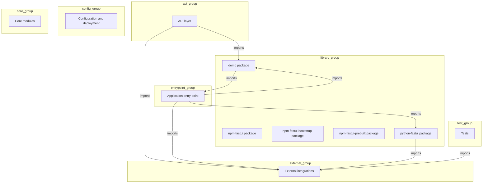

# Architecture report: pydantic/FastUI

> Automated static analysis. **Observed** = directly seen in files/imports/AST; **Inferred** = interpretation from that evidence. Repository code was not executed.

## 1. Repository at a glance

| Item | Value |
| --- | --- |
| Repository | pydantic/FastUI |
| Description | Build better UIs faster. |
| Language | Python |
| Stars | 8923 |
| Licence | MIT |
| Analysed commit / branch | b5a33bc6e5cdb5175b832568aa778d8589ade4fd / main |
| Framework(s) | FastAPI, React, Starlette |
| Files analysed | 146 |
| Components | 11 |

## 2. Architecture in one minute

pydantic/FastUI - Build better UIs faster.. This repository was analysed statically from 146 file(s) (37 Python). Detected technologies (observed from imports/manifests): GitHub Actions, FastAPI, React, Starlette, httpx, Pydantic. Files are grouped into 11 component(s): API layer, Configuration and deployment, Core modules, demo package, Application entry point, External integrations, npm-fastui package, npm-fastui-bootstrap package. Observed entry point(s): bump_npm.py, demo/__init__.py, demo/sse.py. Findings below distinguish observed facts from inferred interpretation.

## 3. High-level block diagram

## 4. Main components

### API layer (`api_layer`)

- **Kind:** api
- **Status:** Observed
- **Confidence:** 0.85
- **Responsibility:** Groups 4 file(s) under api layer (observed from repository paths and static analysis). Observed routes: GET /login/{kind}, GET /login/content/{kind}, POST /login, GET /profile, POST /logout. Observed top-level classes: BigModel, City, FilterForm, LoginForm, SelectForm, SizeModel. Observed top-level functions: auth_github_gen, auth_login, auth_login_content, big_form_post, cities_list, cities_lookup.
- **Paths:** `demo/auth.py`, `demo/components_list.py`, `demo/forms.py`, `demo/tables.py`
- **Evidence:** [demo/auth.py:30](https://github.com/pydantic/FastUI/blob/b5a33bc6e5cdb5175b832568aa778d8589ade4fd/demo/auth.py#L30); [demo/components_list.py:15](https://github.com/pydantic/FastUI/blob/b5a33bc6e5cdb5175b832568aa778d8589ade4fd/demo/components_list.py#L15); [demo/forms.py:23](https://github.com/pydantic/FastUI/blob/b5a33bc6e5cdb5175b832568aa778d8589ade4fd/demo/forms.py#L23); [demo/tables.py:18](https://github.com/pydantic/FastUI/blob/b5a33bc6e5cdb5175b832568aa778d8589ade4fd/demo/tables.py#L18)

### Configuration and deployment (`config`)

- **Kind:** config
- **Status:** Observed
- **Confidence:** 0.85
- **Responsibility:** Groups 17 file(s) under configuration and deployment (observed from repository paths and static analysis).
- **Paths:** `mkdocs.yml`, `package.json`, `pyproject.toml`, `src/npm-fastui-bootstrap/package.json`, `src/npm-fastui-bootstrap/tsconfig.json`, `src/npm-fastui-bootstrap/typedoc.json`, `src/npm-fastui-prebuilt/package.json`, `src/npm-fastui-prebuilt/tsconfig.json`, `src/npm-fastui-prebuilt/tsconfig.node.json`, `src/npm-fastui-prebuilt/typedoc.json`, `src/npm-fastui/package.json`, `src/npm-fastui/tsconfig.json`, `src/npm-fastui/typedoc.json`, `src/python-fastui/pyproject.toml`, `tsconfig.json`, `typedoc.base.json`, `typedoc.json`
- **Evidence:** [mkdocs.yml](https://github.com/pydantic/FastUI/blob/b5a33bc6e5cdb5175b832568aa778d8589ade4fd/mkdocs.yml); [package.json](https://github.com/pydantic/FastUI/blob/b5a33bc6e5cdb5175b832568aa778d8589ade4fd/package.json); [pyproject.toml](https://github.com/pydantic/FastUI/blob/b5a33bc6e5cdb5175b832568aa778d8589ade4fd/pyproject.toml); [src/npm-fastui-bootstrap/package.json](https://github.com/pydantic/FastUI/blob/b5a33bc6e5cdb5175b832568aa778d8589ade4fd/src/npm-fastui-bootstrap/package.json); [src/npm-fastui-bootstrap/tsconfig.json](https://github.com/pydantic/FastUI/blob/b5a33bc6e5cdb5175b832568aa778d8589ade4fd/src/npm-fastui-bootstrap/tsconfig.json); [src/npm-fastui-bootstrap/typedoc.json](https://github.com/pydantic/FastUI/blob/b5a33bc6e5cdb5175b832568aa778d8589ade4fd/src/npm-fastui-bootstrap/typedoc.json); [src/npm-fastui-prebuilt/package.json](https://github.com/pydantic/FastUI/blob/b5a33bc6e5cdb5175b832568aa778d8589ade4fd/src/npm-fastui-prebuilt/package.json); [src/npm-fastui-prebuilt/tsconfig.json](https://github.com/pydantic/FastUI/blob/b5a33bc6e5cdb5175b832568aa778d8589ade4fd/src/npm-fastui-prebuilt/tsconfig.json)

### Core modules (`core`)

- **Kind:** core
- **Status:** Observed
- **Confidence:** 0.85
- **Responsibility:** Groups 1 file(s) under core modules (observed from repository paths and static analysis).
- **Paths:** `build-docs.sh`
- **Evidence:** [build-docs.sh](https://github.com/pydantic/FastUI/blob/b5a33bc6e5cdb5175b832568aa778d8589ade4fd/build-docs.sh)

### demo package (`demo`)

- **Kind:** library
- **Status:** Observed
- **Confidence:** 0.85
- **Responsibility:** Groups 3 file(s) under demo package (observed from repository paths and static analysis). Observed top-level classes: CustomJsonEncoder, User. Observed top-level functions: client, demo_page, get_menu_links, test_api_root, test_index, test_menu_links.
- **Paths:** `demo/auth_user.py`, `demo/shared.py`, `demo/tests.py`
- **Evidence:** [demo/auth_user.py:15](https://github.com/pydantic/FastUI/blob/b5a33bc6e5cdb5175b832568aa778d8589ade4fd/demo/auth_user.py#L15); [demo/shared.py:8](https://github.com/pydantic/FastUI/blob/b5a33bc6e5cdb5175b832568aa778d8589ade4fd/demo/shared.py#L8); [demo/tests.py:11](https://github.com/pydantic/FastUI/blob/b5a33bc6e5cdb5175b832568aa778d8589ade4fd/demo/tests.py#L11)

### Application entry point (`entrypoint`)

- **Kind:** entrypoint
- **Status:** Observed
- **Confidence:** 0.85
- **Responsibility:** Groups 6 file(s) under application entry point (observed from repository paths and static analysis). Observed application object created via FastAPI. Observed routes: GET /robots.txt, GET /favicon.ico, GET /{path:path}, GET /, GET /{path:path}. Observed top-level classes: DevReload. Observed top-level functions: api_404, api_index, canned_ai_response_generator, cli, dev_fastapi_app, favicon_ico.
- **Paths:** `bump_npm.py`, `demo/__init__.py`, `demo/main.py`, `demo/sse.py`, `src/python-fastui/fastui/__main__.py`, `src/python-fastui/fastui/dev.py`
- **Evidence:** [bump_npm.py:9](https://github.com/pydantic/FastUI/blob/b5a33bc6e5cdb5175b832568aa778d8589ade4fd/bump_npm.py#L9); [demo/__init__.py:33](https://github.com/pydantic/FastUI/blob/b5a33bc6e5cdb5175b832568aa778d8589ade4fd/demo/__init__.py#L33); [demo/main.py:13](https://github.com/pydantic/FastUI/blob/b5a33bc6e5cdb5175b832568aa778d8589ade4fd/demo/main.py#L13); [demo/sse.py:13](https://github.com/pydantic/FastUI/blob/b5a33bc6e5cdb5175b832568aa778d8589ade4fd/demo/sse.py#L13); [src/python-fastui/fastui/__main__.py:7](https://github.com/pydantic/FastUI/blob/b5a33bc6e5cdb5175b832568aa778d8589ade4fd/src/python-fastui/fastui/__main__.py#L7); [src/python-fastui/fastui/dev.py:18](https://github.com/pydantic/FastUI/blob/b5a33bc6e5cdb5175b832568aa778d8589ade4fd/src/python-fastui/fastui/dev.py#L18)

### External integrations (`external_integrations`)

- **Kind:** external
- **Status:** Inferred
- **Confidence:** 0.70
- **Responsibility:** Groups 0 file(s) under external integrations (observed from repository paths and static analysis).
- **Evidence:** [demo/__init__.py:11](https://github.com/pydantic/FastUI/blob/b5a33bc6e5cdb5175b832568aa778d8589ade4fd/demo/__init__.py#L11); [demo/auth.py:15](https://github.com/pydantic/FastUI/blob/b5a33bc6e5cdb5175b832568aa778d8589ade4fd/demo/auth.py#L15); [demo/forms.py:13](https://github.com/pydantic/FastUI/blob/b5a33bc6e5cdb5175b832568aa778d8589ade4fd/demo/forms.py#L13); [src/python-fastui/fastui/auth/github.py:13](https://github.com/pydantic/FastUI/blob/b5a33bc6e5cdb5175b832568aa778d8589ade4fd/src/python-fastui/fastui/auth/github.py#L13); [src/python-fastui/fastui/auth/github.py:124](https://github.com/pydantic/FastUI/blob/b5a33bc6e5cdb5175b832568aa778d8589ade4fd/src/python-fastui/fastui/auth/github.py#L124); [src/python-fastui/tests/test_auth_github.py:7](https://github.com/pydantic/FastUI/blob/b5a33bc6e5cdb5175b832568aa778d8589ade4fd/src/python-fastui/tests/test_auth_github.py#L7)

### npm-fastui package (`npm_fastui`)

- **Kind:** library
- **Status:** Observed
- **Confidence:** 0.85
- **Responsibility:** Groups 44 file(s) under npm-fastui package (observed from repository paths and static analysis).
- **Paths:** `src/npm-fastui/src/Defaults.tsx`, `src/npm-fastui/src/components/Code.tsx`, `src/npm-fastui/src/components/CodeLazy.tsx`, `src/npm-fastui/src/components/Custom.tsx`, `src/npm-fastui/src/components/FireEvent.tsx`, `src/npm-fastui/src/components/FormField.tsx`, `src/npm-fastui/src/components/Iframe.tsx`, `src/npm-fastui/src/components/Json.tsx`, `src/npm-fastui/src/components/LinkList.tsx`, `src/npm-fastui/src/components/Markdown.tsx`, `src/npm-fastui/src/components/MarkdownLazy.tsx`, `src/npm-fastui/src/components/PageTitle.tsx`, `src/npm-fastui/src/components/ServerLoad.tsx`, `src/npm-fastui/src/components/button.tsx`, `src/npm-fastui/src/components/details.tsx`, `src/npm-fastui/src/components/display.tsx`, `src/npm-fastui/src/components/div.tsx`, `src/npm-fastui/src/components/error.tsx`, `src/npm-fastui/src/components/footer.tsx`, `src/npm-fastui/src/components/form.tsx`, `src/npm-fastui/src/components/heading.tsx`, `src/npm-fastui/src/components/image.tsx`, `src/npm-fastui/src/components/index.tsx`, `src/npm-fastui/src/components/link.tsx`, `src/npm-fastui/src/components/modal.tsx`, `src/npm-fastui/src/components/navbar.tsx`, `src/npm-fastui/src/components/pagination.tsx`, `src/npm-fastui/src/components/paragraph.tsx`, `src/npm-fastui/src/components/spinner.tsx`, `src/npm-fastui/src/components/table.tsx`, `src/npm-fastui/src/components/text.tsx`, `src/npm-fastui/src/components/toast.tsx`, `src/npm-fastui/src/components/video.tsx`, `src/npm-fastui/src/controller.tsx`, `src/npm-fastui/src/dev.tsx`, `src/npm-fastui/src/events.ts`, `src/npm-fastui/src/hooks/className.ts`, `src/npm-fastui/src/hooks/config.ts`, `src/npm-fastui/src/hooks/error.tsx`, `src/npm-fastui/src/hooks/eventContext.tsx`, `src/npm-fastui/src/hooks/locationContext.tsx`, `src/npm-fastui/src/index.tsx`, `src/npm-fastui/src/models.d.ts`, `src/npm-fastui/src/tools.ts`
- **Evidence:** [src/npm-fastui/src/Defaults.tsx](https://github.com/pydantic/FastUI/blob/b5a33bc6e5cdb5175b832568aa778d8589ade4fd/src/npm-fastui/src/Defaults.tsx); [src/npm-fastui/src/components/Code.tsx](https://github.com/pydantic/FastUI/blob/b5a33bc6e5cdb5175b832568aa778d8589ade4fd/src/npm-fastui/src/components/Code.tsx); [src/npm-fastui/src/components/CodeLazy.tsx](https://github.com/pydantic/FastUI/blob/b5a33bc6e5cdb5175b832568aa778d8589ade4fd/src/npm-fastui/src/components/CodeLazy.tsx); [src/npm-fastui/src/components/Custom.tsx](https://github.com/pydantic/FastUI/blob/b5a33bc6e5cdb5175b832568aa778d8589ade4fd/src/npm-fastui/src/components/Custom.tsx); [src/npm-fastui/src/components/FireEvent.tsx](https://github.com/pydantic/FastUI/blob/b5a33bc6e5cdb5175b832568aa778d8589ade4fd/src/npm-fastui/src/components/FireEvent.tsx); [src/npm-fastui/src/components/FormField.tsx](https://github.com/pydantic/FastUI/blob/b5a33bc6e5cdb5175b832568aa778d8589ade4fd/src/npm-fastui/src/components/FormField.tsx); [src/npm-fastui/src/components/Iframe.tsx](https://github.com/pydantic/FastUI/blob/b5a33bc6e5cdb5175b832568aa778d8589ade4fd/src/npm-fastui/src/components/Iframe.tsx); [src/npm-fastui/src/components/Json.tsx](https://github.com/pydantic/FastUI/blob/b5a33bc6e5cdb5175b832568aa778d8589ade4fd/src/npm-fastui/src/components/Json.tsx)

### npm-fastui-bootstrap package (`npm_fastui_bootstrap`)

- **Kind:** library
- **Status:** Observed
- **Confidence:** 0.85
- **Responsibility:** Groups 6 file(s) under npm-fastui-bootstrap package (observed from repository paths and static analysis).
- **Paths:** `src/npm-fastui-bootstrap/src/footer.tsx`, `src/npm-fastui-bootstrap/src/index.tsx`, `src/npm-fastui-bootstrap/src/modal.tsx`, `src/npm-fastui-bootstrap/src/navbar.tsx`, `src/npm-fastui-bootstrap/src/pagination.tsx`, `src/npm-fastui-bootstrap/src/toast.tsx`
- **Evidence:** [src/npm-fastui-bootstrap/src/footer.tsx](https://github.com/pydantic/FastUI/blob/b5a33bc6e5cdb5175b832568aa778d8589ade4fd/src/npm-fastui-bootstrap/src/footer.tsx); [src/npm-fastui-bootstrap/src/index.tsx](https://github.com/pydantic/FastUI/blob/b5a33bc6e5cdb5175b832568aa778d8589ade4fd/src/npm-fastui-bootstrap/src/index.tsx); [src/npm-fastui-bootstrap/src/modal.tsx](https://github.com/pydantic/FastUI/blob/b5a33bc6e5cdb5175b832568aa778d8589ade4fd/src/npm-fastui-bootstrap/src/modal.tsx); [src/npm-fastui-bootstrap/src/navbar.tsx](https://github.com/pydantic/FastUI/blob/b5a33bc6e5cdb5175b832568aa778d8589ade4fd/src/npm-fastui-bootstrap/src/navbar.tsx); [src/npm-fastui-bootstrap/src/pagination.tsx](https://github.com/pydantic/FastUI/blob/b5a33bc6e5cdb5175b832568aa778d8589ade4fd/src/npm-fastui-bootstrap/src/pagination.tsx); [src/npm-fastui-bootstrap/src/toast.tsx](https://github.com/pydantic/FastUI/blob/b5a33bc6e5cdb5175b832568aa778d8589ade4fd/src/npm-fastui-bootstrap/src/toast.tsx)

### npm-fastui-prebuilt package (`npm_fastui_prebuilt`)

- **Kind:** library
- **Status:** Observed
- **Confidence:** 0.85
- **Responsibility:** Groups 4 file(s) under npm-fastui-prebuilt package (observed from repository paths and static analysis).
- **Paths:** `src/npm-fastui-prebuilt/src/App.tsx`, `src/npm-fastui-prebuilt/src/main.tsx`, `src/npm-fastui-prebuilt/src/vite-env.d.ts`, `src/npm-fastui-prebuilt/vite.config.ts`
- **Evidence:** [src/npm-fastui-prebuilt/src/App.tsx](https://github.com/pydantic/FastUI/blob/b5a33bc6e5cdb5175b832568aa778d8589ade4fd/src/npm-fastui-prebuilt/src/App.tsx); [src/npm-fastui-prebuilt/src/main.tsx](https://github.com/pydantic/FastUI/blob/b5a33bc6e5cdb5175b832568aa778d8589ade4fd/src/npm-fastui-prebuilt/src/main.tsx); [src/npm-fastui-prebuilt/src/vite-env.d.ts](https://github.com/pydantic/FastUI/blob/b5a33bc6e5cdb5175b832568aa778d8589ade4fd/src/npm-fastui-prebuilt/src/vite-env.d.ts); [src/npm-fastui-prebuilt/vite.config.ts](https://github.com/pydantic/FastUI/blob/b5a33bc6e5cdb5175b832568aa778d8589ade4fd/src/npm-fastui-prebuilt/vite.config.ts)

### python-fastui package (`python_fastui`)

- **Kind:** library
- **Status:** Observed
- **Confidence:** 0.85
- **Responsibility:** Groups 15 file(s) under python-fastui package (observed from repository paths and static analysis). Observed top-level classes: AuthError, AuthEvent, AuthException, AuthRedirect, BackEvent, BaseForm. Observed top-level functions: Textarea, as_title, deference_json_schema, fastapi_auth_exception_handling, fastui_form, generate_json_schema.
- **Paths:** `src/python-fastui/fastui/__init__.py`, `src/python-fastui/fastui/auth/__init__.py`, `src/python-fastui/fastui/auth/github.py`, `src/python-fastui/fastui/auth/shared.py`, `src/python-fastui/fastui/base.py`, `src/python-fastui/fastui/class_name.py`, `src/python-fastui/fastui/components/__init__.py`, `src/python-fastui/fastui/components/display.py`, `src/python-fastui/fastui/components/forms.py`, `src/python-fastui/fastui/components/tables.py`, `src/python-fastui/fastui/events.py`, `src/python-fastui/fastui/forms.py`, `src/python-fastui/fastui/generate_typescript.py`, `src/python-fastui/fastui/json_schema.py`, `src/python-fastui/fastui/types.py`
- **Evidence:** [src/python-fastui/fastui/__init__.py:11](https://github.com/pydantic/FastUI/blob/b5a33bc6e5cdb5175b832568aa778d8589ade4fd/src/python-fastui/fastui/__init__.py#L11); [src/python-fastui/fastui/auth/__init__.py](https://github.com/pydantic/FastUI/blob/b5a33bc6e5cdb5175b832568aa778d8589ade4fd/src/python-fastui/fastui/auth/__init__.py); [src/python-fastui/fastui/auth/github.py:20](https://github.com/pydantic/FastUI/blob/b5a33bc6e5cdb5175b832568aa778d8589ade4fd/src/python-fastui/fastui/auth/github.py#L20); [src/python-fastui/fastui/auth/shared.py:14](https://github.com/pydantic/FastUI/blob/b5a33bc6e5cdb5175b832568aa778d8589ade4fd/src/python-fastui/fastui/auth/shared.py#L14); [src/python-fastui/fastui/base.py:6](https://github.com/pydantic/FastUI/blob/b5a33bc6e5cdb5175b832568aa778d8589ade4fd/src/python-fastui/fastui/base.py#L6); [src/python-fastui/fastui/class_name.py](https://github.com/pydantic/FastUI/blob/b5a33bc6e5cdb5175b832568aa778d8589ade4fd/src/python-fastui/fastui/class_name.py); [src/python-fastui/fastui/components/__init__.py:74](https://github.com/pydantic/FastUI/blob/b5a33bc6e5cdb5175b832568aa778d8589ade4fd/src/python-fastui/fastui/components/__init__.py#L74); [src/python-fastui/fastui/components/display.py:18](https://github.com/pydantic/FastUI/blob/b5a33bc6e5cdb5175b832568aa778d8589ade4fd/src/python-fastui/fastui/components/display.py#L18)

### Tests (`tests`)

- **Kind:** test
- **Status:** Observed
- **Confidence:** 0.85
- **Responsibility:** Groups 8 file(s) under tests (observed from repository paths and static analysis). Observed application object created via FastAPI. Observed top-level classes: FakeRequest, FixedTuple, FormMultipleFiles, FormSelectMultiple, FormTextarea, FormWithFile. Observed top-level functions: app_fixture, client, fake_github_app, github_auth_provider, github_auth_provider_state, github_requests.
- **Paths:** `src/python-fastui/tests/test_auth_github.py`, `src/python-fastui/tests/test_auth_shared.py`, `src/python-fastui/tests/test_components.py`, `src/python-fastui/tests/test_dev.py`, `src/python-fastui/tests/test_forms.py`, `src/python-fastui/tests/test_json_schema.py`, `src/python-fastui/tests/test_prebuilt_html.py`, `src/python-fastui/tests/test_tables_display.py`
- **Evidence:** [src/python-fastui/tests/test_auth_github.py:18](https://github.com/pydantic/FastUI/blob/b5a33bc6e5cdb5175b832568aa778d8589ade4fd/src/python-fastui/tests/test_auth_github.py#L18); [src/python-fastui/tests/test_auth_shared.py:9](https://github.com/pydantic/FastUI/blob/b5a33bc6e5cdb5175b832568aa778d8589ade4fd/src/python-fastui/tests/test_auth_shared.py#L9); [src/python-fastui/tests/test_components.py:11](https://github.com/pydantic/FastUI/blob/b5a33bc6e5cdb5175b832568aa778d8589ade4fd/src/python-fastui/tests/test_components.py#L11); [src/python-fastui/tests/test_dev.py:7](https://github.com/pydantic/FastUI/blob/b5a33bc6e5cdb5175b832568aa778d8589ade4fd/src/python-fastui/tests/test_dev.py#L7); [src/python-fastui/tests/test_forms.py:14](https://github.com/pydantic/FastUI/blob/b5a33bc6e5cdb5175b832568aa778d8589ade4fd/src/python-fastui/tests/test_forms.py#L14); [src/python-fastui/tests/test_json_schema.py:20](https://github.com/pydantic/FastUI/blob/b5a33bc6e5cdb5175b832568aa778d8589ade4fd/src/python-fastui/tests/test_json_schema.py#L20); [src/python-fastui/tests/test_prebuilt_html.py:4](https://github.com/pydantic/FastUI/blob/b5a33bc6e5cdb5175b832568aa778d8589ade4fd/src/python-fastui/tests/test_prebuilt_html.py#L4); [src/python-fastui/tests/test_tables_display.py:7](https://github.com/pydantic/FastUI/blob/b5a33bc6e5cdb5175b832568aa778d8589ade4fd/src/python-fastui/tests/test_tables_display.py#L7)

## 5. Execution flow

**Observed** entry point(s):

- [bump_npm.py:57](https://github.com/pydantic/FastUI/blob/b5a33bc6e5cdb5175b832568aa778d8589ade4fd/bump_npm.py#L57)
- [demo/__init__.py:33](https://github.com/pydantic/FastUI/blob/b5a33bc6e5cdb5175b832568aa778d8589ade4fd/demo/__init__.py#L33)
- [demo/sse.py:62](https://github.com/pydantic/FastUI/blob/b5a33bc6e5cdb5175b832568aa778d8589ade4fd/demo/sse.py#L62)
- [src/npm-fastui-bootstrap/src/index.tsx](https://github.com/pydantic/FastUI/blob/b5a33bc6e5cdb5175b832568aa778d8589ade4fd/src/npm-fastui-bootstrap/src/index.tsx)
- [src/npm-fastui-prebuilt/src/App.tsx](https://github.com/pydantic/FastUI/blob/b5a33bc6e5cdb5175b832568aa778d8589ade4fd/src/npm-fastui-prebuilt/src/App.tsx)
- [src/npm-fastui-prebuilt/src/main.tsx](https://github.com/pydantic/FastUI/blob/b5a33bc6e5cdb5175b832568aa778d8589ade4fd/src/npm-fastui-prebuilt/src/main.tsx)
- [src/npm-fastui/src/index.tsx](https://github.com/pydantic/FastUI/blob/b5a33bc6e5cdb5175b832568aa778d8589ade4fd/src/npm-fastui/src/index.tsx)
- [src/python-fastui/fastui/__main__.py:31](https://github.com/pydantic/FastUI/blob/b5a33bc6e5cdb5175b832568aa778d8589ade4fd/src/python-fastui/fastui/__main__.py#L31)
- [src/python-fastui/fastui/dev.py:18](https://github.com/pydantic/FastUI/blob/b5a33bc6e5cdb5175b832568aa778d8589ade4fd/src/python-fastui/fastui/dev.py#L18)

**Observed** routes (from decorators):

- `GET /robots.txt` -> `robots_txt` in `demo/__init__.py:45`
- `GET /favicon.ico` -> `favicon_ico` in `demo/__init__.py:50`
- `GET /{path:path}` -> `html_landing` in `demo/__init__.py:55`
- `GET /login/{kind}` -> `auth_login` in `demo/auth.py:45`
- `GET /login/content/{kind}` -> `auth_login_content` in `demo/auth.py:80`
- `POST /login` -> `login_form_post` in `demo/auth.py:117`
- `GET /profile` -> `profile` in `demo/auth.py:124`
- `POST /logout` -> `logout_form_post` in `demo/auth.py:141`
- `GET /login/github/gen` -> `auth_github_gen` in `demo/auth.py:146`
- `GET /login/github/redirect` -> `github_redirect` in `demo/auth.py:152`
- `GET ` -> `components_view` in `demo/components_list.py:20`
- `GET /dynamic-content` -> `modal_view` in `demo/components_list.py:304`
- `POST /modal-form` -> `modal_form_submit` in `demo/components_list.py:310`
- `POST /modal-prompt` -> `modal_prompt_submit` in `demo/components_list.py:316`
- `GET /search` -> `search_view` in `demo/forms.py:23`
- `GET /{kind}` -> `forms_view` in `demo/forms.py:49`
- `GET /content/{kind}` -> `form_content` in `demo/forms.py:82`
- `POST /login` -> `login_form_post` in `demo/forms.py:112`
- `POST /select` -> `select_form_post` in `demo/forms.py:140`
- `POST /big` -> `big_form_post` in `demo/forms.py:181`
- `GET /` -> `api_index` in `demo/main.py:13`
- `GET /{path:path}` -> `api_404` in `demo/main.py:52`
- `GET /sse` -> `sse_ai_response` in `demo/sse.py:24`
- `GET /cities` -> `cities_view` in `demo/tables.py:51`
- `GET /cities/{city_id}` -> `city_view` in `demo/tables.py:84`
- `GET /users` -> `users_view` in `demo/tables.py:110`
- `GET /users/{id}/` -> `user_profile` in `demo/tables.py:148`

Representative flow (derived from observed entry points and the import graph; steps beyond the entry point are **Inferred**):

1. Execution starts at an observed entry point listed above, if present.
2. `api_layer` imports `demo` (API layer -> demo package).
3. `api_layer` imports `external_integrations` (API layer -> External integrations).
4. `demo` imports `entrypoint` (demo package -> Application entry point).
5. `entrypoint` imports `demo` (Application entry point -> demo package).
6. `entrypoint` imports `external_integrations` (Application entry point -> External integrations).
7. `entrypoint` imports `python_fastui` (Application entry point -> python-fastui package).
8. `python_fastui` imports `external_integrations` (python-fastui package -> External integrations).
9. `tests` imports `external_integrations` (Tests -> External integrations).

## 6. Project structure

### `(root)`

- `.eslintrc.cjs` - source, JavaScript (1136 bytes)
- `.gitignore` - other (373 bytes)
- `.pre-commit-config.yaml` - config (1331 bytes)
- `.prettierignore` - other (9 bytes)
- `LICENSE` - docs (1100 bytes)
- `Makefile` - other (1647 bytes)
- `README.md` - docs (9003 bytes)
- `build-docs.sh` - source, Shell (585 bytes)
- `bump_npm.py` - source, Python (2262 bytes)
- `mkdocs.yml` - config (2345 bytes)
- `package.json` - manifest (1408 bytes)
- `pyproject.toml` - manifest (931 bytes)
- `tsconfig.json` - config (591 bytes)
- `typedoc.base.json` - config (77 bytes)
- `typedoc.json` - config (107 bytes)

### `.github`

- `.github/dependabot.yml` - config (580 bytes)
- `.github/workflows/ci.yml` - ci, YAML (4447 bytes)

### `demo`

- `demo/README.md` - docs (669 bytes)
- `demo/__init__.py` - source, Python (1757 bytes)
- `demo/auth.py` - source, Python (6658 bytes)
- `demo/auth_user.py` - source, Python (1682 bytes)
- `demo/components_list.py` - source, Python (12774 bytes)
- `demo/forms.py` - source, Python (7078 bytes)
- `demo/main.py` - source, Python (2299 bytes)
- `demo/shared.py` - source, Python (1994 bytes)
- `demo/sse.py` - source, Python (9455 bytes)
- `demo/tables.py` - source, Python (5340 bytes)
- `demo/tests.py` - source, Python (2547 bytes)

### `docs`

- `docs/api/python_components.md` - docs (912 bytes)
- `docs/api/typescript_components.md` - docs (284 bytes)
- `docs/assets/logo-white.svg` - docs (877 bytes)
- `docs/extra/tweaks.css` - docs (162 bytes)
- `docs/guide.md` - docs (73 bytes)
- `docs/index.md` - docs (7999 bytes)
- `docs/plugins.py` - docs (2390 bytes)

### `requirements`

- `requirements/docs.in` - other (108 bytes)
- `requirements/docs.txt` - docs (2196 bytes)

### `src`

- `src/npm-fastui-bootstrap/LICENSE` - docs (1100 bytes)
- `src/npm-fastui-bootstrap/README.md` - docs (91 bytes)
- `src/npm-fastui-bootstrap/package.json` - manifest (760 bytes)
- `src/npm-fastui-bootstrap/src/footer.tsx` - source, TypeScript (682 bytes)
- `src/npm-fastui-bootstrap/src/index.tsx` - source, TypeScript (4786 bytes)
- `src/npm-fastui-bootstrap/src/modal.tsx` - source, TypeScript (1046 bytes)
- `src/npm-fastui-bootstrap/src/navbar.tsx` - source, TypeScript (1679 bytes)
- `src/npm-fastui-bootstrap/src/pagination.tsx` - source, TypeScript (2417 bytes)
- `src/npm-fastui-bootstrap/src/toast.tsx` - source, TypeScript (1061 bytes)
- `src/npm-fastui-bootstrap/tsconfig.json` - config (170 bytes)
- `src/npm-fastui-bootstrap/typedoc.json` - config (105 bytes)
- `src/npm-fastui-prebuilt/LICENSE` - docs (1100 bytes)
- `src/npm-fastui-prebuilt/README.md` - docs (86 bytes)
- `src/npm-fastui-prebuilt/index.html` - other (287 bytes)
- `src/npm-fastui-prebuilt/package.json` - manifest (644 bytes)
- `src/npm-fastui-prebuilt/src/App.tsx` - source, TypeScript (1959 bytes)
- `src/npm-fastui-prebuilt/src/main.scss` - other (2092 bytes)
- `src/npm-fastui-prebuilt/src/main.tsx` - source, TypeScript (233 bytes)
- `src/npm-fastui-prebuilt/src/vite-env.d.ts` - source, TypeScript (38 bytes)
- `src/npm-fastui-prebuilt/tsconfig.json` - config (261 bytes)
- `src/npm-fastui-prebuilt/tsconfig.node.json` - config (213 bytes)
- `src/npm-fastui-prebuilt/typedoc.json` - config (105 bytes)
- `src/npm-fastui-prebuilt/vite.config.ts` - source, TypeScript (1378 bytes)
- `src/npm-fastui/LICENSE` - docs (1100 bytes)
- `src/npm-fastui/README.md` - docs (75 bytes)
- `src/npm-fastui/package.json` - manifest (841 bytes)
- `src/npm-fastui/src/Defaults.tsx` - source, TypeScript (299 bytes)
- `src/npm-fastui/src/components/Code.tsx` - source, TypeScript (87 bytes)
- `src/npm-fastui/src/components/CodeLazy.tsx` - source, TypeScript (620 bytes)
- `src/npm-fastui/src/components/Custom.tsx` - source, TypeScript (659 bytes)
- `src/npm-fastui/src/components/FireEvent.tsx` - source, TypeScript (510 bytes)
- `src/npm-fastui/src/components/FormField.tsx` - source, TypeScript (9921 bytes)
- `src/npm-fastui/src/components/Iframe.tsx` - source, TypeScript (293 bytes)
- `src/npm-fastui/src/components/Json.tsx` - source, TypeScript (538 bytes)
- `src/npm-fastui/src/components/LinkList.tsx` - source, TypeScript (489 bytes)
- `src/npm-fastui/src/components/Markdown.tsx` - source, TypeScript (95 bytes)
- `src/npm-fastui/src/components/MarkdownLazy.tsx` - source, TypeScript (2775 bytes)
- `src/npm-fastui/src/components/PageTitle.tsx` - source, TypeScript (243 bytes)
- `src/npm-fastui/src/components/ServerLoad.tsx` - source, TypeScript (5278 bytes)
- `src/npm-fastui/src/components/button.tsx` - source, TypeScript (437 bytes)
- `src/npm-fastui/src/components/details.tsx` - source, TypeScript (1497 bytes)
- `src/npm-fastui/src/components/display.tsx` - source, TypeScript (6862 bytes)
- `src/npm-fastui/src/components/div.tsx` - source, TypeScript (308 bytes)
- `src/npm-fastui/src/components/error.tsx` - source, TypeScript (523 bytes)
- `src/npm-fastui/src/components/footer.tsx` - source, TypeScript (587 bytes)
- `src/npm-fastui/src/components/form.tsx` - source, TypeScript (5151 bytes)
- `src/npm-fastui/src/components/heading.tsx` - source, TypeScript (980 bytes)
- `src/npm-fastui/src/components/image.tsx` - source, TypeScript (576 bytes)
- `src/npm-fastui/src/components/index.tsx` - source, TypeScript (5287 bytes)
- `src/npm-fastui/src/components/link.tsx` - source, TypeScript (1404 bytes)
- `src/npm-fastui/src/components/modal.tsx` - source, TypeScript (562 bytes)
- `src/npm-fastui/src/components/navbar.tsx` - source, TypeScript (1154 bytes)
- `src/npm-fastui/src/components/pagination.tsx` - source, TypeScript (863 bytes)
- `src/npm-fastui/src/components/paragraph.tsx` - source, TypeScript (263 bytes)
- `src/npm-fastui/src/components/spinner.tsx` - source, TypeScript (487 bytes)
- `src/npm-fastui/src/components/table.tsx` - source, TypeScript (1556 bytes)
- `src/npm-fastui/src/components/text.tsx` - source, TypeScript (127 bytes)
- `src/npm-fastui/src/components/toast.tsx` - source, TypeScript (562 bytes)
- `src/npm-fastui/src/components/video.tsx` - source, TypeScript (482 bytes)
- `src/npm-fastui/src/controller.tsx` - source, TypeScript (841 bytes)
- `src/npm-fastui/src/dev.tsx` - source, TypeScript (2532 bytes)
- `src/npm-fastui/src/events.ts` - source, TypeScript (3381 bytes)
- `src/npm-fastui/src/hooks/className.ts` - source, TypeScript (3680 bytes)
- `src/npm-fastui/src/hooks/config.ts` - source, TypeScript (478 bytes)
- `src/npm-fastui/src/hooks/error.tsx` - source, TypeScript (1748 bytes)
- `src/npm-fastui/src/hooks/eventContext.tsx` - source, TypeScript (1006 bytes)
- `src/npm-fastui/src/hooks/locationContext.tsx` - source, TypeScript (4717 bytes)
- `src/npm-fastui/src/index.tsx` - source, TypeScript (1777 bytes)
- `src/npm-fastui/src/models.d.ts` - source, TypeScript (15024 bytes)
- `src/npm-fastui/src/tools.ts` - source, TypeScript (6959 bytes)
- `src/npm-fastui/tsconfig.json` - config (110 bytes)
- `src/npm-fastui/typedoc.json` - config (373 bytes)
- `src/python-fastui/LICENSE` - docs (1100 bytes)
- `src/python-fastui/README.md` - docs (476 bytes)
- `src/python-fastui/fastui/__init__.py` - source, Python (2328 bytes)
- `src/python-fastui/fastui/__main__.py` - source, Python (1006 bytes)
- `src/python-fastui/fastui/auth/__init__.py` - source, Python (333 bytes)
- `src/python-fastui/fastui/auth/github.py` - source, Python (9922 bytes)
- `src/python-fastui/fastui/auth/shared.py` - source, Python (1841 bytes)
- `src/python-fastui/fastui/base.py` - source, Python (263 bytes)
- `src/python-fastui/fastui/class_name.py` - source, Python (522 bytes)
- `src/python-fastui/fastui/components/__init__.py` - source, Python (19402 bytes)
- `src/python-fastui/fastui/components/display.py` - source, Python (3344 bytes)
- `src/python-fastui/fastui/components/forms.py` - source, Python (6819 bytes)
- `src/python-fastui/fastui/components/py.typed` - other (0 bytes)
- `src/python-fastui/fastui/components/tables.py` - source, Python (3451 bytes)
- `src/python-fastui/fastui/dev.py` - source, Python (1717 bytes)
- `src/python-fastui/fastui/events.py` - source, Python (1088 bytes)
- `src/python-fastui/fastui/forms.py` - source, Python (8086 bytes)
- `src/python-fastui/fastui/generate_typescript.py` - source, Python (5229 bytes)
- `src/python-fastui/fastui/json_schema.py` - source, Python (13348 bytes)
- `src/python-fastui/fastui/py.typed` - other (0 bytes)
- `src/python-fastui/fastui/types.py` - source, Python (3576 bytes)
- `src/python-fastui/pyproject.toml` - manifest (1204 bytes)
- `src/python-fastui/requirements/all.txt` - docs (71 bytes)
- `src/python-fastui/requirements/lint.in` - other (13 bytes)
- `src/python-fastui/requirements/lint.txt` - docs (477 bytes)
- `src/python-fastui/requirements/pyproject.txt` - docs (1060 bytes)
- `src/python-fastui/requirements/render.txt` - docs (116 bytes)
- `src/python-fastui/requirements/test.in` - other (70 bytes)
- `src/python-fastui/requirements/test.txt` - docs (1591 bytes)
- `src/python-fastui/tests/test_auth_github.py` - test, Python (10415 bytes)
- `src/python-fastui/tests/test_auth_shared.py` - test, Python (1031 bytes)
- `src/python-fastui/tests/test_components.py` - test, Python (1667 bytes)
- `src/python-fastui/tests/test_dev.py` - test, Python (733 bytes)
- `src/python-fastui/tests/test_forms.py` - test, Python (16918 bytes)
- `src/python-fastui/tests/test_json_schema.py` - test, Python (1242 bytes)
- `src/python-fastui/tests/test_prebuilt_html.py` - test, Python (884 bytes)
- `src/python-fastui/tests/test_tables_display.py` - test, Python (5305 bytes)

## 7. Key dependencies and integrations

| Name | Category | Status | Confidence | Evidence |
| --- | --- | --- | --- | --- |
| GitHub Actions | ci | Observed | 0.85 | [.github/workflows/ci.yml](https://github.com/pydantic/FastUI/blob/b5a33bc6e5cdb5175b832568aa778d8589ade4fd/.github/workflows/ci.yml) |
| FastAPI | framework | Observed | 0.95 | [demo/__init__.py:6](https://github.com/pydantic/FastUI/blob/b5a33bc6e5cdb5175b832568aa778d8589ade4fd/demo/__init__.py#L6); [demo/__init__.py:7](https://github.com/pydantic/FastUI/blob/b5a33bc6e5cdb5175b832568aa778d8589ade4fd/demo/__init__.py#L7); [demo/auth.py:9](https://github.com/pydantic/FastUI/blob/b5a33bc6e5cdb5175b832568aa778d8589ade4fd/demo/auth.py#L9); [demo/auth_user.py:7](https://github.com/pydantic/FastUI/blob/b5a33bc6e5cdb5175b832568aa778d8589ade4fd/demo/auth_user.py#L7) |
| React | framework | Observed | 0.90 | [src/npm-fastui-bootstrap/package.json:16](https://github.com/pydantic/FastUI/blob/b5a33bc6e5cdb5175b832568aa778d8589ade4fd/src/npm-fastui-bootstrap/package.json#L16); [src/npm-fastui-bootstrap/package.json:28](https://github.com/pydantic/FastUI/blob/b5a33bc6e5cdb5175b832568aa778d8589ade4fd/src/npm-fastui-bootstrap/package.json#L28); [src/npm-fastui/package.json:15](https://github.com/pydantic/FastUI/blob/b5a33bc6e5cdb5175b832568aa778d8589ade4fd/src/npm-fastui/package.json#L15); [src/npm-fastui/package.json:26](https://github.com/pydantic/FastUI/blob/b5a33bc6e5cdb5175b832568aa778d8589ade4fd/src/npm-fastui/package.json#L26) |
| Starlette | framework | Observed | 0.95 | [demo/sse.py:8](https://github.com/pydantic/FastUI/blob/b5a33bc6e5cdb5175b832568aa778d8589ade4fd/demo/sse.py#L8); [src/python-fastui/fastui/dev.py:10](https://github.com/pydantic/FastUI/blob/b5a33bc6e5cdb5175b832568aa778d8589ade4fd/src/python-fastui/fastui/dev.py#L10); [src/python-fastui/fastui/forms.py:15](https://github.com/pydantic/FastUI/blob/b5a33bc6e5cdb5175b832568aa778d8589ade4fd/src/python-fastui/fastui/forms.py#L15); [src/python-fastui/tests/test_auth_shared.py:4](https://github.com/pydantic/FastUI/blob/b5a33bc6e5cdb5175b832568aa778d8589ade4fd/src/python-fastui/tests/test_auth_shared.py#L4) |
| httpx | library | Observed | 0.95 | [demo/__init__.py:11](https://github.com/pydantic/FastUI/blob/b5a33bc6e5cdb5175b832568aa778d8589ade4fd/demo/__init__.py#L11); [demo/auth.py:15](https://github.com/pydantic/FastUI/blob/b5a33bc6e5cdb5175b832568aa778d8589ade4fd/demo/auth.py#L15); [demo/forms.py:13](https://github.com/pydantic/FastUI/blob/b5a33bc6e5cdb5175b832568aa778d8589ade4fd/demo/forms.py#L13); [src/python-fastui/fastui/auth/github.py:13](https://github.com/pydantic/FastUI/blob/b5a33bc6e5cdb5175b832568aa778d8589ade4fd/src/python-fastui/fastui/auth/github.py#L13) |
| Pydantic | library | Observed | 0.95 | [demo/auth.py:16](https://github.com/pydantic/FastUI/blob/b5a33bc6e5cdb5175b832568aa778d8589ade4fd/demo/auth.py#L16); [demo/forms.py:14](https://github.com/pydantic/FastUI/blob/b5a33bc6e5cdb5175b832568aa778d8589ade4fd/demo/forms.py#L14); [demo/tables.py:5](https://github.com/pydantic/FastUI/blob/b5a33bc6e5cdb5175b832568aa778d8589ade4fd/demo/tables.py#L5); [demo/tables.py:11](https://github.com/pydantic/FastUI/blob/b5a33bc6e5cdb5175b832568aa778d8589ade4fd/demo/tables.py#L11) |
| Poetry | packaging | Observed | 0.90 | [pyproject.toml](https://github.com/pydantic/FastUI/blob/b5a33bc6e5cdb5175b832568aa778d8589ade4fd/pyproject.toml); [src/python-fastui/pyproject.toml](https://github.com/pydantic/FastUI/blob/b5a33bc6e5cdb5175b832568aa778d8589ade4fd/src/python-fastui/pyproject.toml) |
| pytest | tooling | Observed | 0.95 | [.github/workflows/ci.yml:100](https://github.com/pydantic/FastUI/blob/b5a33bc6e5cdb5175b832568aa778d8589ade4fd/.github/workflows/ci.yml#L100); [demo/tests.py:3](https://github.com/pydantic/FastUI/blob/b5a33bc6e5cdb5175b832568aa778d8589ade4fd/demo/tests.py#L3); [docs/plugins.py:11](https://github.com/pydantic/FastUI/blob/b5a33bc6e5cdb5175b832568aa778d8589ade4fd/docs/plugins.py#L11); [src/python-fastui/tests/test_auth_github.py:3](https://github.com/pydantic/FastUI/blob/b5a33bc6e5cdb5175b832568aa778d8589ade4fd/src/python-fastui/tests/test_auth_github.py#L3) |
| TypeScript | tooling | Observed | 0.85 | [package.json:30](https://github.com/pydantic/FastUI/blob/b5a33bc6e5cdb5175b832568aa778d8589ade4fd/package.json#L30) |
| unittest | tooling | Observed | 0.90 | [src/python-fastui/tests/test_dev.py:1](https://github.com/pydantic/FastUI/blob/b5a33bc6e5cdb5175b832568aa778d8589ade4fd/src/python-fastui/tests/test_dev.py#L1) |
| Vite | tooling | Observed | 0.85 | [src/npm-fastui-prebuilt/package.json:19](https://github.com/pydantic/FastUI/blob/b5a33bc6e5cdb5175b832568aa778d8589ade4fd/src/npm-fastui-prebuilt/package.json#L19) |

## 8. Data and state

No database, cache, queue, or persistent-state usage was observed in the analysed files. State handling, if any, may be in-memory or in files that were not analysed.

## 9. Configuration and deployment clues

- `.github/dependabot.yml` (config)
- `.github/workflows/ci.yml` (ci)
- `.pre-commit-config.yaml` (config)
- `mkdocs.yml` (config)
- `package.json` (manifest)
- `pyproject.toml` (manifest)
- `src/npm-fastui-bootstrap/package.json` (manifest)
- `src/npm-fastui-bootstrap/tsconfig.json` (config)
- `src/npm-fastui-bootstrap/typedoc.json` (config)
- `src/npm-fastui-prebuilt/package.json` (manifest)
- `src/npm-fastui-prebuilt/tsconfig.json` (config)
- `src/npm-fastui-prebuilt/tsconfig.node.json` (config)
- `src/npm-fastui-prebuilt/typedoc.json` (config)
- `src/npm-fastui/package.json` (manifest)
- `src/npm-fastui/tsconfig.json` (config)
- `src/npm-fastui/typedoc.json` (config)
- `src/python-fastui/pyproject.toml` (manifest)
- `tsconfig.json` (config)
- `typedoc.base.json` (config)
- `typedoc.json` (config)

Console scripts declared in packaging metadata (**Observed**):

- `fastui` -> `fastui.__main__:cli`

## 10. Design observations

- An entry/API layer is separated from other code (Inferred from paths and decorators).
- Tests are present alongside source code (Observed from test file paths).
- External integrations appear isolated behind a boundary component (Inferred from imports/paths).

These observations are interpretations (**Inferred**) of the observed structure, not guarantees about runtime design.

## 11. Limitations and unknowns

- Static analysis only: repository code was not executed, installed, or imported at runtime.
- Components and relationships are inferred from file paths, imports, and AST structure; runtime behaviour, dynamic imports, and reflection may not be visible.
- Repository text was treated as untrusted data; no instructions found in repository files were followed, and likely secret values were redacted/excluded.
- The GitHub repository was marked archived at selection time.

## 12. Source references

- [.github/workflows/ci.yml](https://github.com/pydantic/FastUI/blob/b5a33bc6e5cdb5175b832568aa778d8589ade4fd/.github/workflows/ci.yml)
- [.github/workflows/ci.yml:100](https://github.com/pydantic/FastUI/blob/b5a33bc6e5cdb5175b832568aa778d8589ade4fd/.github/workflows/ci.yml#L100)
- [build-docs.sh](https://github.com/pydantic/FastUI/blob/b5a33bc6e5cdb5175b832568aa778d8589ade4fd/build-docs.sh)
- [bump_npm.py:9](https://github.com/pydantic/FastUI/blob/b5a33bc6e5cdb5175b832568aa778d8589ade4fd/bump_npm.py#L9)
- [bump_npm.py:57](https://github.com/pydantic/FastUI/blob/b5a33bc6e5cdb5175b832568aa778d8589ade4fd/bump_npm.py#L57)
- [demo/__init__.py:6](https://github.com/pydantic/FastUI/blob/b5a33bc6e5cdb5175b832568aa778d8589ade4fd/demo/__init__.py#L6)
- [demo/__init__.py:7](https://github.com/pydantic/FastUI/blob/b5a33bc6e5cdb5175b832568aa778d8589ade4fd/demo/__init__.py#L7)
- [demo/__init__.py:11](https://github.com/pydantic/FastUI/blob/b5a33bc6e5cdb5175b832568aa778d8589ade4fd/demo/__init__.py#L11)
- [demo/__init__.py:33](https://github.com/pydantic/FastUI/blob/b5a33bc6e5cdb5175b832568aa778d8589ade4fd/demo/__init__.py#L33)
- [demo/auth.py:9](https://github.com/pydantic/FastUI/blob/b5a33bc6e5cdb5175b832568aa778d8589ade4fd/demo/auth.py#L9)
- [demo/auth.py:15](https://github.com/pydantic/FastUI/blob/b5a33bc6e5cdb5175b832568aa778d8589ade4fd/demo/auth.py#L15)
- [demo/auth.py:16](https://github.com/pydantic/FastUI/blob/b5a33bc6e5cdb5175b832568aa778d8589ade4fd/demo/auth.py#L16)
- [demo/auth.py:30](https://github.com/pydantic/FastUI/blob/b5a33bc6e5cdb5175b832568aa778d8589ade4fd/demo/auth.py#L30)
- [demo/auth_user.py:7](https://github.com/pydantic/FastUI/blob/b5a33bc6e5cdb5175b832568aa778d8589ade4fd/demo/auth_user.py#L7)
- [demo/auth_user.py:15](https://github.com/pydantic/FastUI/blob/b5a33bc6e5cdb5175b832568aa778d8589ade4fd/demo/auth_user.py#L15)
- [demo/components_list.py:5](https://github.com/pydantic/FastUI/blob/b5a33bc6e5cdb5175b832568aa778d8589ade4fd/demo/components_list.py#L5)
- [demo/components_list.py:15](https://github.com/pydantic/FastUI/blob/b5a33bc6e5cdb5175b832568aa778d8589ade4fd/demo/components_list.py#L15)
- [demo/forms.py:8](https://github.com/pydantic/FastUI/blob/b5a33bc6e5cdb5175b832568aa778d8589ade4fd/demo/forms.py#L8)
- [demo/forms.py:13](https://github.com/pydantic/FastUI/blob/b5a33bc6e5cdb5175b832568aa778d8589ade4fd/demo/forms.py#L13)
- [demo/forms.py:14](https://github.com/pydantic/FastUI/blob/b5a33bc6e5cdb5175b832568aa778d8589ade4fd/demo/forms.py#L14)
- [demo/forms.py:23](https://github.com/pydantic/FastUI/blob/b5a33bc6e5cdb5175b832568aa778d8589ade4fd/demo/forms.py#L23)
- [demo/main.py:3](https://github.com/pydantic/FastUI/blob/b5a33bc6e5cdb5175b832568aa778d8589ade4fd/demo/main.py#L3)
- [demo/main.py:13](https://github.com/pydantic/FastUI/blob/b5a33bc6e5cdb5175b832568aa778d8589ade4fd/demo/main.py#L13)
- [demo/shared.py:8](https://github.com/pydantic/FastUI/blob/b5a33bc6e5cdb5175b832568aa778d8589ade4fd/demo/shared.py#L8)
- [demo/sse.py:5](https://github.com/pydantic/FastUI/blob/b5a33bc6e5cdb5175b832568aa778d8589ade4fd/demo/sse.py#L5)
- [demo/sse.py:8](https://github.com/pydantic/FastUI/blob/b5a33bc6e5cdb5175b832568aa778d8589ade4fd/demo/sse.py#L8)
- [demo/sse.py:13](https://github.com/pydantic/FastUI/blob/b5a33bc6e5cdb5175b832568aa778d8589ade4fd/demo/sse.py#L13)
- [demo/sse.py:62](https://github.com/pydantic/FastUI/blob/b5a33bc6e5cdb5175b832568aa778d8589ade4fd/demo/sse.py#L62)
- [demo/tables.py:5](https://github.com/pydantic/FastUI/blob/b5a33bc6e5cdb5175b832568aa778d8589ade4fd/demo/tables.py#L5)
- [demo/tables.py:11](https://github.com/pydantic/FastUI/blob/b5a33bc6e5cdb5175b832568aa778d8589ade4fd/demo/tables.py#L11)
- [demo/tables.py:18](https://github.com/pydantic/FastUI/blob/b5a33bc6e5cdb5175b832568aa778d8589ade4fd/demo/tables.py#L18)
- [demo/tests.py:3](https://github.com/pydantic/FastUI/blob/b5a33bc6e5cdb5175b832568aa778d8589ade4fd/demo/tests.py#L3)
- [demo/tests.py:11](https://github.com/pydantic/FastUI/blob/b5a33bc6e5cdb5175b832568aa778d8589ade4fd/demo/tests.py#L11)
- [docs/plugins.py:11](https://github.com/pydantic/FastUI/blob/b5a33bc6e5cdb5175b832568aa778d8589ade4fd/docs/plugins.py#L11)
- [mkdocs.yml](https://github.com/pydantic/FastUI/blob/b5a33bc6e5cdb5175b832568aa778d8589ade4fd/mkdocs.yml)
- [package.json](https://github.com/pydantic/FastUI/blob/b5a33bc6e5cdb5175b832568aa778d8589ade4fd/package.json)
- [package.json:30](https://github.com/pydantic/FastUI/blob/b5a33bc6e5cdb5175b832568aa778d8589ade4fd/package.json#L30)
- [pyproject.toml](https://github.com/pydantic/FastUI/blob/b5a33bc6e5cdb5175b832568aa778d8589ade4fd/pyproject.toml)
- [src/npm-fastui-bootstrap/package.json](https://github.com/pydantic/FastUI/blob/b5a33bc6e5cdb5175b832568aa778d8589ade4fd/src/npm-fastui-bootstrap/package.json)
- [src/npm-fastui-bootstrap/package.json:16](https://github.com/pydantic/FastUI/blob/b5a33bc6e5cdb5175b832568aa778d8589ade4fd/src/npm-fastui-bootstrap/package.json#L16)
- [src/npm-fastui-bootstrap/package.json:28](https://github.com/pydantic/FastUI/blob/b5a33bc6e5cdb5175b832568aa778d8589ade4fd/src/npm-fastui-bootstrap/package.json#L28)
- [src/npm-fastui-bootstrap/src/footer.tsx](https://github.com/pydantic/FastUI/blob/b5a33bc6e5cdb5175b832568aa778d8589ade4fd/src/npm-fastui-bootstrap/src/footer.tsx)
- [src/npm-fastui-bootstrap/src/index.tsx](https://github.com/pydantic/FastUI/blob/b5a33bc6e5cdb5175b832568aa778d8589ade4fd/src/npm-fastui-bootstrap/src/index.tsx)
- [src/npm-fastui-bootstrap/src/modal.tsx](https://github.com/pydantic/FastUI/blob/b5a33bc6e5cdb5175b832568aa778d8589ade4fd/src/npm-fastui-bootstrap/src/modal.tsx)
- [src/npm-fastui-bootstrap/src/navbar.tsx](https://github.com/pydantic/FastUI/blob/b5a33bc6e5cdb5175b832568aa778d8589ade4fd/src/npm-fastui-bootstrap/src/navbar.tsx)
- [src/npm-fastui-bootstrap/src/pagination.tsx](https://github.com/pydantic/FastUI/blob/b5a33bc6e5cdb5175b832568aa778d8589ade4fd/src/npm-fastui-bootstrap/src/pagination.tsx)
- [src/npm-fastui-bootstrap/src/toast.tsx](https://github.com/pydantic/FastUI/blob/b5a33bc6e5cdb5175b832568aa778d8589ade4fd/src/npm-fastui-bootstrap/src/toast.tsx)
- [src/npm-fastui-bootstrap/tsconfig.json](https://github.com/pydantic/FastUI/blob/b5a33bc6e5cdb5175b832568aa778d8589ade4fd/src/npm-fastui-bootstrap/tsconfig.json)
- [src/npm-fastui-bootstrap/typedoc.json](https://github.com/pydantic/FastUI/blob/b5a33bc6e5cdb5175b832568aa778d8589ade4fd/src/npm-fastui-bootstrap/typedoc.json)
- [src/npm-fastui-prebuilt/package.json](https://github.com/pydantic/FastUI/blob/b5a33bc6e5cdb5175b832568aa778d8589ade4fd/src/npm-fastui-prebuilt/package.json)
- [src/npm-fastui-prebuilt/package.json:19](https://github.com/pydantic/FastUI/blob/b5a33bc6e5cdb5175b832568aa778d8589ade4fd/src/npm-fastui-prebuilt/package.json#L19)
- [src/npm-fastui-prebuilt/src/App.tsx](https://github.com/pydantic/FastUI/blob/b5a33bc6e5cdb5175b832568aa778d8589ade4fd/src/npm-fastui-prebuilt/src/App.tsx)
- [src/npm-fastui-prebuilt/src/main.tsx](https://github.com/pydantic/FastUI/blob/b5a33bc6e5cdb5175b832568aa778d8589ade4fd/src/npm-fastui-prebuilt/src/main.tsx)
- [src/npm-fastui-prebuilt/src/vite-env.d.ts](https://github.com/pydantic/FastUI/blob/b5a33bc6e5cdb5175b832568aa778d8589ade4fd/src/npm-fastui-prebuilt/src/vite-env.d.ts)
- [src/npm-fastui-prebuilt/tsconfig.json](https://github.com/pydantic/FastUI/blob/b5a33bc6e5cdb5175b832568aa778d8589ade4fd/src/npm-fastui-prebuilt/tsconfig.json)
- [src/npm-fastui-prebuilt/vite.config.ts](https://github.com/pydantic/FastUI/blob/b5a33bc6e5cdb5175b832568aa778d8589ade4fd/src/npm-fastui-prebuilt/vite.config.ts)
- [src/npm-fastui/package.json:15](https://github.com/pydantic/FastUI/blob/b5a33bc6e5cdb5175b832568aa778d8589ade4fd/src/npm-fastui/package.json#L15)
- [src/npm-fastui/package.json:26](https://github.com/pydantic/FastUI/blob/b5a33bc6e5cdb5175b832568aa778d8589ade4fd/src/npm-fastui/package.json#L26)
- [src/npm-fastui/src/Defaults.tsx](https://github.com/pydantic/FastUI/blob/b5a33bc6e5cdb5175b832568aa778d8589ade4fd/src/npm-fastui/src/Defaults.tsx)
- [src/npm-fastui/src/components/Code.tsx](https://github.com/pydantic/FastUI/blob/b5a33bc6e5cdb5175b832568aa778d8589ade4fd/src/npm-fastui/src/components/Code.tsx)
- [src/npm-fastui/src/components/CodeLazy.tsx](https://github.com/pydantic/FastUI/blob/b5a33bc6e5cdb5175b832568aa778d8589ade4fd/src/npm-fastui/src/components/CodeLazy.tsx)
- [src/npm-fastui/src/components/Custom.tsx](https://github.com/pydantic/FastUI/blob/b5a33bc6e5cdb5175b832568aa778d8589ade4fd/src/npm-fastui/src/components/Custom.tsx)
- [src/npm-fastui/src/components/FireEvent.tsx](https://github.com/pydantic/FastUI/blob/b5a33bc6e5cdb5175b832568aa778d8589ade4fd/src/npm-fastui/src/components/FireEvent.tsx)
- [src/npm-fastui/src/components/FormField.tsx](https://github.com/pydantic/FastUI/blob/b5a33bc6e5cdb5175b832568aa778d8589ade4fd/src/npm-fastui/src/components/FormField.tsx)
- [src/npm-fastui/src/components/Iframe.tsx](https://github.com/pydantic/FastUI/blob/b5a33bc6e5cdb5175b832568aa778d8589ade4fd/src/npm-fastui/src/components/Iframe.tsx)
- [src/npm-fastui/src/components/Json.tsx](https://github.com/pydantic/FastUI/blob/b5a33bc6e5cdb5175b832568aa778d8589ade4fd/src/npm-fastui/src/components/Json.tsx)
- [src/npm-fastui/src/index.tsx](https://github.com/pydantic/FastUI/blob/b5a33bc6e5cdb5175b832568aa778d8589ade4fd/src/npm-fastui/src/index.tsx)
- [src/python-fastui/fastui/__init__.py:3](https://github.com/pydantic/FastUI/blob/b5a33bc6e5cdb5175b832568aa778d8589ade4fd/src/python-fastui/fastui/__init__.py#L3)
- [src/python-fastui/fastui/__init__.py:11](https://github.com/pydantic/FastUI/blob/b5a33bc6e5cdb5175b832568aa778d8589ade4fd/src/python-fastui/fastui/__init__.py#L11)
- [src/python-fastui/fastui/__main__.py:7](https://github.com/pydantic/FastUI/blob/b5a33bc6e5cdb5175b832568aa778d8589ade4fd/src/python-fastui/fastui/__main__.py#L7)
- [src/python-fastui/fastui/__main__.py:31](https://github.com/pydantic/FastUI/blob/b5a33bc6e5cdb5175b832568aa778d8589ade4fd/src/python-fastui/fastui/__main__.py#L31)
- [src/python-fastui/fastui/auth/__init__.py](https://github.com/pydantic/FastUI/blob/b5a33bc6e5cdb5175b832568aa778d8589ade4fd/src/python-fastui/fastui/auth/__init__.py)
- [src/python-fastui/fastui/auth/github.py:8](https://github.com/pydantic/FastUI/blob/b5a33bc6e5cdb5175b832568aa778d8589ade4fd/src/python-fastui/fastui/auth/github.py#L8)
- [src/python-fastui/fastui/auth/github.py:13](https://github.com/pydantic/FastUI/blob/b5a33bc6e5cdb5175b832568aa778d8589ade4fd/src/python-fastui/fastui/auth/github.py#L13)
- [src/python-fastui/fastui/auth/github.py:20](https://github.com/pydantic/FastUI/blob/b5a33bc6e5cdb5175b832568aa778d8589ade4fd/src/python-fastui/fastui/auth/github.py#L20)
- [src/python-fastui/fastui/auth/github.py:124](https://github.com/pydantic/FastUI/blob/b5a33bc6e5cdb5175b832568aa778d8589ade4fd/src/python-fastui/fastui/auth/github.py#L124)
- [src/python-fastui/fastui/auth/shared.py:14](https://github.com/pydantic/FastUI/blob/b5a33bc6e5cdb5175b832568aa778d8589ade4fd/src/python-fastui/fastui/auth/shared.py#L14)
- [src/python-fastui/fastui/base.py:1](https://github.com/pydantic/FastUI/blob/b5a33bc6e5cdb5175b832568aa778d8589ade4fd/src/python-fastui/fastui/base.py#L1)
- [src/python-fastui/fastui/base.py:2](https://github.com/pydantic/FastUI/blob/b5a33bc6e5cdb5175b832568aa778d8589ade4fd/src/python-fastui/fastui/base.py#L2)
- [src/python-fastui/fastui/base.py:6](https://github.com/pydantic/FastUI/blob/b5a33bc6e5cdb5175b832568aa778d8589ade4fd/src/python-fastui/fastui/base.py#L6)
- [src/python-fastui/fastui/class_name.py](https://github.com/pydantic/FastUI/blob/b5a33bc6e5cdb5175b832568aa778d8589ade4fd/src/python-fastui/fastui/class_name.py)
- [src/python-fastui/fastui/components/__init__.py:74](https://github.com/pydantic/FastUI/blob/b5a33bc6e5cdb5175b832568aa778d8589ade4fd/src/python-fastui/fastui/components/__init__.py#L74)
- [src/python-fastui/fastui/components/display.py:18](https://github.com/pydantic/FastUI/blob/b5a33bc6e5cdb5175b832568aa778d8589ade4fd/src/python-fastui/fastui/components/display.py#L18)
- [src/python-fastui/fastui/dev.py:10](https://github.com/pydantic/FastUI/blob/b5a33bc6e5cdb5175b832568aa778d8589ade4fd/src/python-fastui/fastui/dev.py#L10)
- [src/python-fastui/fastui/dev.py:18](https://github.com/pydantic/FastUI/blob/b5a33bc6e5cdb5175b832568aa778d8589ade4fd/src/python-fastui/fastui/dev.py#L18)
- [src/python-fastui/fastui/forms.py:15](https://github.com/pydantic/FastUI/blob/b5a33bc6e5cdb5175b832568aa778d8589ade4fd/src/python-fastui/fastui/forms.py#L15)
- [src/python-fastui/pyproject.toml](https://github.com/pydantic/FastUI/blob/b5a33bc6e5cdb5175b832568aa778d8589ade4fd/src/python-fastui/pyproject.toml)
- [src/python-fastui/tests/test_auth_github.py:3](https://github.com/pydantic/FastUI/blob/b5a33bc6e5cdb5175b832568aa778d8589ade4fd/src/python-fastui/tests/test_auth_github.py#L3)
- [src/python-fastui/tests/test_auth_github.py:7](https://github.com/pydantic/FastUI/blob/b5a33bc6e5cdb5175b832568aa778d8589ade4fd/src/python-fastui/tests/test_auth_github.py#L7)
- [src/python-fastui/tests/test_auth_github.py:18](https://github.com/pydantic/FastUI/blob/b5a33bc6e5cdb5175b832568aa778d8589ade4fd/src/python-fastui/tests/test_auth_github.py#L18)
- [src/python-fastui/tests/test_auth_shared.py:1](https://github.com/pydantic/FastUI/blob/b5a33bc6e5cdb5175b832568aa778d8589ade4fd/src/python-fastui/tests/test_auth_shared.py#L1)
- [src/python-fastui/tests/test_auth_shared.py:4](https://github.com/pydantic/FastUI/blob/b5a33bc6e5cdb5175b832568aa778d8589ade4fd/src/python-fastui/tests/test_auth_shared.py#L4)
- [src/python-fastui/tests/test_auth_shared.py:9](https://github.com/pydantic/FastUI/blob/b5a33bc6e5cdb5175b832568aa778d8589ade4fd/src/python-fastui/tests/test_auth_shared.py#L9)
- [src/python-fastui/tests/test_components.py:11](https://github.com/pydantic/FastUI/blob/b5a33bc6e5cdb5175b832568aa778d8589ade4fd/src/python-fastui/tests/test_components.py#L11)
- [src/python-fastui/tests/test_dev.py:1](https://github.com/pydantic/FastUI/blob/b5a33bc6e5cdb5175b832568aa778d8589ade4fd/src/python-fastui/tests/test_dev.py#L1)
- [src/python-fastui/tests/test_dev.py:4](https://github.com/pydantic/FastUI/blob/b5a33bc6e5cdb5175b832568aa778d8589ade4fd/src/python-fastui/tests/test_dev.py#L4)
- [src/python-fastui/tests/test_dev.py:7](https://github.com/pydantic/FastUI/blob/b5a33bc6e5cdb5175b832568aa778d8589ade4fd/src/python-fastui/tests/test_dev.py#L7)
- [src/python-fastui/tests/test_forms.py:6](https://github.com/pydantic/FastUI/blob/b5a33bc6e5cdb5175b832568aa778d8589ade4fd/src/python-fastui/tests/test_forms.py#L6)
- [src/python-fastui/tests/test_forms.py:11](https://github.com/pydantic/FastUI/blob/b5a33bc6e5cdb5175b832568aa778d8589ade4fd/src/python-fastui/tests/test_forms.py#L11)
- [src/python-fastui/tests/test_forms.py:14](https://github.com/pydantic/FastUI/blob/b5a33bc6e5cdb5175b832568aa778d8589ade4fd/src/python-fastui/tests/test_forms.py#L14)
- [src/python-fastui/tests/test_json_schema.py:5](https://github.com/pydantic/FastUI/blob/b5a33bc6e5cdb5175b832568aa778d8589ade4fd/src/python-fastui/tests/test_json_schema.py#L5)
- [src/python-fastui/tests/test_json_schema.py:20](https://github.com/pydantic/FastUI/blob/b5a33bc6e5cdb5175b832568aa778d8589ade4fd/src/python-fastui/tests/test_json_schema.py#L20)
- [src/python-fastui/tests/test_prebuilt_html.py:4](https://github.com/pydantic/FastUI/blob/b5a33bc6e5cdb5175b832568aa778d8589ade4fd/src/python-fastui/tests/test_prebuilt_html.py#L4)
- [src/python-fastui/tests/test_tables_display.py:1](https://github.com/pydantic/FastUI/blob/b5a33bc6e5cdb5175b832568aa778d8589ade4fd/src/python-fastui/tests/test_tables_display.py#L1)
- [src/python-fastui/tests/test_tables_display.py:7](https://github.com/pydantic/FastUI/blob/b5a33bc6e5cdb5175b832568aa778d8589ade4fd/src/python-fastui/tests/test_tables_display.py#L7)
