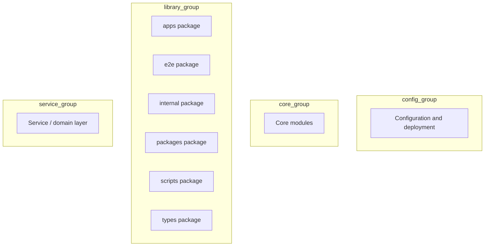

# Architecture report: radix-ui/primitives

> Automated static analysis. **Observed** = directly seen in files/imports/AST; **Inferred** = interpretation from that evidence. Repository code was not executed.

## 1. Repository at a glance

| Item | Value |
| --- | --- |
| Repository | radix-ui/primitives |
| Description | Radix Primitives is an open-source UI component library for building high-quality, accessible design systems and web apps. Maintained by @workos. |
| Language | TypeScript |
| Stars | 19498 |
| Licence | MIT |
| Analysed commit / branch | eb3a2b7091293e27df8f9ba906632d8daa3d81a3 / main |
| Framework(s) | Next.js, React |
| Files analysed | 699 |
| Components | 9 |

## 2. Architecture in one minute

radix-ui/primitives - Radix Primitives is an open-source UI component library for building high-quality, accessible design systems and web apps. Maintained by @workos.. This repository was analysed statically from 699 file(s) (0 Python). Detected technologies (observed from imports/manifests): GitHub Actions, Next.js, React, TypeScript, Vite, Vitest. Files are grouped into 9 component(s): apps package, Configuration and deployment, Core modules, e2e package, internal package, packages package, scripts package, Service / domain layer. Findings below distinguish observed facts from inferred interpretation.

## 3. High-level block diagram

## 4. Main components

### apps package (`apps`)

- **Kind:** library
- **Status:** Observed
- **Confidence:** 0.85
- **Responsibility:** Groups 94 file(s) under apps package (observed from repository paths and static analysis).
- **Paths:** `apps/ssr-testing/app/accessible-icon/page.tsx`, `apps/ssr-testing/app/accordion/page.tsx`, `apps/ssr-testing/app/alert-dialog/page.tsx`, `apps/ssr-testing/app/avatar/page.tsx`, `apps/ssr-testing/app/checkbox/page.tsx`, `apps/ssr-testing/app/collapsible/page.tsx`, `apps/ssr-testing/app/context-menu/page.tsx`, `apps/ssr-testing/app/dialog/page.tsx`, `apps/ssr-testing/app/dropdown-menu/page.tsx`, `apps/ssr-testing/app/form/page.tsx`, `apps/ssr-testing/app/hover-card/page.tsx`, `apps/ssr-testing/app/label/page.tsx`, `apps/ssr-testing/app/layout.tsx`, `apps/ssr-testing/app/menubar/page.tsx`, `apps/ssr-testing/app/navigation-menu/page.tsx`, `apps/ssr-testing/app/one-time-password-field/page.tsx`, `apps/ssr-testing/app/page.tsx`, `apps/ssr-testing/app/password-toggle-field/page.tsx`, `apps/ssr-testing/app/popover/page.tsx`, `apps/ssr-testing/app/portal/conditional-portal.tsx`, `apps/ssr-testing/app/portal/custom-portal-container.tsx`, `apps/ssr-testing/app/portal/page.tsx`, `apps/ssr-testing/app/primitive-merge/nodes.mjs`, `apps/ssr-testing/app/primitive-merge/page.tsx`, `apps/ssr-testing/app/primitive-merge/primitive-node.tsx`, `apps/ssr-testing/app/primitive-merge/providers.tsx`, `apps/ssr-testing/app/progress/page.tsx`, `apps/ssr-testing/app/radio-group/page.tsx`, `apps/ssr-testing/app/roving-focus-group/page.tsx`, `apps/ssr-testing/app/roving-focus-group/roving-focus.client.tsx`, `apps/ssr-testing/app/rsc/page.tsx`, `apps/ssr-testing/app/scroll-area/page.tsx`, `apps/ssr-testing/app/select/page.tsx`, `apps/ssr-testing/app/separator/page.tsx`, `apps/ssr-testing/app/slider/page.tsx`, `apps/ssr-testing/app/slot/client.tsx`, `apps/ssr-testing/app/slot/page.tsx`, `apps/ssr-testing/app/slot/server.tsx`, `apps/ssr-testing/app/switch/page.tsx`, `apps/ssr-testing/app/tabs/page.tsx`, `apps/ssr-testing/app/toast/page.tsx`, `apps/ssr-testing/app/toggle-group/page.tsx`, `apps/ssr-testing/app/toolbar/page.tsx`, `apps/ssr-testing/app/tooltip/page.tsx`, `apps/ssr-testing/app/visually-hidden/page.tsx`, `apps/ssr-testing/next.config.js`, `apps/ssr-testing/scripts/assert-primitive-merge.mjs`, `apps/storybook/.storybook/main.ts`, `apps/storybook/.storybook/manager.ts`, `apps/storybook/.storybook/preview.ts`, `apps/storybook/index.d.ts`, `apps/storybook/stories/accessible-icon.stories.tsx`, `apps/storybook/stories/accordion.stories.tsx`, `apps/storybook/stories/alert-dialog.stories.tsx`, `apps/storybook/stories/arrow.stories.tsx`, `apps/storybook/stories/aspect-ratio.stories.tsx`, `apps/storybook/stories/avatar.stories.tsx`, `apps/storybook/stories/checkbox.stories.tsx`, `apps/storybook/stories/collapsible.stories.tsx`, `apps/storybook/stories/collection.stories.tsx`, `apps/storybook/stories/context-menu.stories.tsx`, `apps/storybook/stories/dialog.stories.tsx`, `apps/storybook/stories/dismissable-layer.stories.tsx`, `apps/storybook/stories/dropdown-menu.stories.tsx`, `apps/storybook/stories/external-overlay.tsx`, `apps/storybook/stories/focus-scope.stories.tsx`, `apps/storybook/stories/form.stories.tsx`, `apps/storybook/stories/hover-card.stories.tsx`, `apps/storybook/stories/label.stories.tsx`, `apps/storybook/stories/menu.stories.tsx`, `apps/storybook/stories/menubar.stories.tsx`, `apps/storybook/stories/navigation-menu.stories.tsx`, `apps/storybook/stories/one-time-password-field.stories.tsx`, `apps/storybook/stories/password-toggle-field.stories.tsx`, `apps/storybook/stories/popover.stories.tsx`, `apps/storybook/stories/popper.stories.tsx`, `apps/storybook/stories/portal.stories.tsx`, `apps/storybook/stories/presence.stories.tsx`, `apps/storybook/stories/progress.stories.tsx`, `apps/storybook/stories/radio-group.stories.tsx`, `apps/storybook/stories/roving-focus-group.stories.tsx`, `apps/storybook/stories/scroll-area.stories.tsx`, `apps/storybook/stories/select.stories.tsx`, `apps/storybook/stories/separator.stories.tsx`, `apps/storybook/stories/slider.stories.tsx`, `apps/storybook/stories/slot.stories.tsx`, `apps/storybook/stories/switch.stories.tsx`, `apps/storybook/stories/tabs.stories.tsx`, `apps/storybook/stories/toast.stories.tsx`, `apps/storybook/stories/toggle-group.stories.tsx`, `apps/storybook/stories/toggle.stories.tsx`, `apps/storybook/stories/toolbar.stories.tsx`, `apps/storybook/stories/tooltip.stories.tsx`, `apps/storybook/stories/visually-hidden.stories.tsx`
- **Evidence:** [apps/ssr-testing/app/accessible-icon/page.tsx](https://github.com/radix-ui/primitives/blob/eb3a2b7091293e27df8f9ba906632d8daa3d81a3/apps/ssr-testing/app/accessible-icon/page.tsx); [apps/ssr-testing/app/accordion/page.tsx](https://github.com/radix-ui/primitives/blob/eb3a2b7091293e27df8f9ba906632d8daa3d81a3/apps/ssr-testing/app/accordion/page.tsx); [apps/ssr-testing/app/alert-dialog/page.tsx](https://github.com/radix-ui/primitives/blob/eb3a2b7091293e27df8f9ba906632d8daa3d81a3/apps/ssr-testing/app/alert-dialog/page.tsx); [apps/ssr-testing/app/avatar/page.tsx](https://github.com/radix-ui/primitives/blob/eb3a2b7091293e27df8f9ba906632d8daa3d81a3/apps/ssr-testing/app/avatar/page.tsx); [apps/ssr-testing/app/checkbox/page.tsx](https://github.com/radix-ui/primitives/blob/eb3a2b7091293e27df8f9ba906632d8daa3d81a3/apps/ssr-testing/app/checkbox/page.tsx); [apps/ssr-testing/app/collapsible/page.tsx](https://github.com/radix-ui/primitives/blob/eb3a2b7091293e27df8f9ba906632d8daa3d81a3/apps/ssr-testing/app/collapsible/page.tsx); [apps/ssr-testing/app/context-menu/page.tsx](https://github.com/radix-ui/primitives/blob/eb3a2b7091293e27df8f9ba906632d8daa3d81a3/apps/ssr-testing/app/context-menu/page.tsx); [apps/ssr-testing/app/dialog/page.tsx](https://github.com/radix-ui/primitives/blob/eb3a2b7091293e27df8f9ba906632d8daa3d81a3/apps/ssr-testing/app/dialog/page.tsx)

### Configuration and deployment (`config`)

- **Kind:** config
- **Status:** Observed
- **Confidence:** 0.85
- **Responsibility:** Groups 146 file(s) under configuration and deployment (observed from repository paths and static analysis).
- **Paths:** `apps/ssr-testing/package.json`, `apps/ssr-testing/tsconfig.json`, `apps/storybook/package.json`, `apps/storybook/tsconfig.json`, `context7.json`, `e2e/tsconfig.json`, `internal/builder/package.json`, `internal/builder/tsconfig.json`, `internal/test-data/package.json`, `internal/test-data/tsconfig.json`, `internal/test-utils/package.json`, `internal/test-utils/tsconfig.json`, `internal/typescript-config/base.json`, `internal/typescript-config/nextjs.json`, `internal/typescript-config/package.json`, `internal/typescript-config/react-library.json`, `internal/typescript-config/vite-app.json`, `internal/typescript-config/vite-node.json`, `package.json`, `packages/core/env-check/package.json`, `packages/core/env-check/tsconfig.json`, `packages/core/number/package.json`, `packages/core/number/tsconfig.json`, `packages/core/primitive/package.json`, `packages/core/primitive/tsconfig.json`, `packages/core/rect/package.json`, `packages/core/rect/tsconfig.json`, `packages/react/accessible-icon/package.json`, `packages/react/accessible-icon/tsconfig.json`, `packages/react/accordion/package.json`, `packages/react/accordion/tsconfig.json`, `packages/react/alert-dialog/package.json`, `packages/react/alert-dialog/tsconfig.json`, `packages/react/announce/package.json`, `packages/react/announce/tsconfig.json`, `packages/react/arrow/package.json`, `packages/react/arrow/tsconfig.json`, `packages/react/aspect-ratio/package.json`, `packages/react/aspect-ratio/tsconfig.json`, `packages/react/avatar/package.json`, `packages/react/avatar/tsconfig.json`, `packages/react/checkbox/package.json`, `packages/react/checkbox/tsconfig.json`, `packages/react/collapsible/package.json`, `packages/react/collapsible/tsconfig.json`, `packages/react/collection/package.json`, `packages/react/collection/tsconfig.json`, `packages/react/compose-refs/package.json`, `packages/react/compose-refs/tsconfig.json`, `packages/react/context-menu/package.json`, `packages/react/context-menu/tsconfig.json`, `packages/react/context/package.json`, `packages/react/context/tsconfig.json`, `packages/react/dialog/package.json`, `packages/react/dialog/tsconfig.json`, `packages/react/direction/package.json`, `packages/react/direction/tsconfig.json`, `packages/react/dismissable-layer/package.json`, `packages/react/dismissable-layer/tsconfig.json`, `packages/react/dropdown-menu/package.json`, `packages/react/dropdown-menu/tsconfig.json`, `packages/react/focus-guards/package.json`, `packages/react/focus-guards/tsconfig.json`, `packages/react/focus-scope/package.json`, `packages/react/focus-scope/tsconfig.json`, `packages/react/form/package.json`, `packages/react/form/tsconfig.json`, `packages/react/hover-card/package.json`, `packages/react/hover-card/tsconfig.json`, `packages/react/id/package.json`, `packages/react/id/tsconfig.json`, `packages/react/label/package.json`, `packages/react/label/tsconfig.json`, `packages/react/menu/package.json`, `packages/react/menu/tsconfig.json`, `packages/react/menubar/package.json`, `packages/react/menubar/tsconfig.json`, `packages/react/navigation-menu/package.json`, `packages/react/navigation-menu/tsconfig.json`, `packages/react/one-time-password-field/package.json`, `packages/react/one-time-password-field/tsconfig.json`, `packages/react/password-toggle-field/package.json`, `packages/react/password-toggle-field/tsconfig.json`, `packages/react/popover/package.json`, `packages/react/popover/tsconfig.json`, `packages/react/popper/package.json`, `packages/react/popper/tsconfig.json`, `packages/react/portal/package.json`, `packages/react/portal/tsconfig.json`, `packages/react/presence/package.json`, `packages/react/presence/tsconfig.json`, `packages/react/primitive/package.json`, `packages/react/primitive/tsconfig.json`, `packages/react/progress/package.json`, `packages/react/progress/tsconfig.json`, `packages/react/radio-group/package.json`, `packages/react/radio-group/tsconfig.json`, `packages/react/radix-ui/package.json`, `packages/react/radix-ui/tsconfig.json`, `packages/react/roving-focus/package.json`, `packages/react/roving-focus/tsconfig.json`, `packages/react/scroll-area/package.json`, `packages/react/scroll-area/tsconfig.json`, `packages/react/select/package.json`, `packages/react/select/tsconfig.json`, `packages/react/separator/package.json`, `packages/react/separator/tsconfig.json`, `packages/react/slider/package.json`, `packages/react/slider/tsconfig.json`, `packages/react/slot/package.json`, `packages/react/slot/tsconfig.json`, `packages/react/switch/package.json`, `packages/react/switch/tsconfig.json`, `packages/react/tabs/package.json`, `packages/react/tabs/tsconfig.json`, `packages/react/toast/package.json`, `packages/react/toast/tsconfig.json`, `packages/react/toggle-group/package.json`, `packages/react/toggle-group/tsconfig.json`, `packages/react/toggle/package.json`, `packages/react/toggle/tsconfig.json`, `packages/react/toolbar/package.json`, `packages/react/toolbar/tsconfig.json`, `packages/react/tooltip/package.json`, `packages/react/tooltip/tsconfig.json`, `packages/react/use-callback-ref/package.json`, `packages/react/use-callback-ref/tsconfig.json`, `packages/react/use-controllable-state/package.json`, `packages/react/use-controllable-state/tsconfig.json`, `packages/react/use-effect-event/package.json`, `packages/react/use-effect-event/tsconfig.json`, `packages/react/use-escape-keydown/package.json`, `packages/react/use-escape-keydown/tsconfig.json`, `packages/react/use-is-hydrated/package.json`, `packages/react/use-is-hydrated/tsconfig.json`, `packages/react/use-layout-effect/package.json`, `packages/react/use-layout-effect/tsconfig.json`, `packages/react/use-previous/package.json`, `packages/react/use-previous/tsconfig.json`, `packages/react/use-rect/package.json`, `packages/react/use-rect/tsconfig.json`, `packages/react/use-size/package.json`, `packages/react/use-size/tsconfig.json`, `packages/react/visually-hidden/package.json`, `packages/react/visually-hidden/tsconfig.json`, `pnpm-workspace.yaml`
- **Evidence:** [apps/ssr-testing/package.json](https://github.com/radix-ui/primitives/blob/eb3a2b7091293e27df8f9ba906632d8daa3d81a3/apps/ssr-testing/package.json); [apps/ssr-testing/tsconfig.json](https://github.com/radix-ui/primitives/blob/eb3a2b7091293e27df8f9ba906632d8daa3d81a3/apps/ssr-testing/tsconfig.json); [apps/storybook/package.json](https://github.com/radix-ui/primitives/blob/eb3a2b7091293e27df8f9ba906632d8daa3d81a3/apps/storybook/package.json); [apps/storybook/tsconfig.json](https://github.com/radix-ui/primitives/blob/eb3a2b7091293e27df8f9ba906632d8daa3d81a3/apps/storybook/tsconfig.json); [context7.json](https://github.com/radix-ui/primitives/blob/eb3a2b7091293e27df8f9ba906632d8daa3d81a3/context7.json); [e2e/tsconfig.json](https://github.com/radix-ui/primitives/blob/eb3a2b7091293e27df8f9ba906632d8daa3d81a3/e2e/tsconfig.json); [internal/builder/package.json](https://github.com/radix-ui/primitives/blob/eb3a2b7091293e27df8f9ba906632d8daa3d81a3/internal/builder/package.json); [internal/builder/tsconfig.json](https://github.com/radix-ui/primitives/blob/eb3a2b7091293e27df8f9ba906632d8daa3d81a3/internal/builder/tsconfig.json)

### Core modules (`core`)

- **Kind:** core
- **Status:** Observed
- **Confidence:** 0.85
- **Responsibility:** Groups 1 file(s) under core modules (observed from repository paths and static analysis).
- **Paths:** `playwright.config.ts`
- **Evidence:** [playwright.config.ts](https://github.com/radix-ui/primitives/blob/eb3a2b7091293e27df8f9ba906632d8daa3d81a3/playwright.config.ts)

### e2e package (`e2e`)

- **Kind:** library
- **Status:** Observed
- **Confidence:** 0.85
- **Responsibility:** Groups 13 file(s) under e2e package (observed from repository paths and static analysis).
- **Paths:** `e2e/collection.spec.ts`, `e2e/context-menu.spec.ts`, `e2e/dialog.spec.ts`, `e2e/dropdown-menu.spec.ts`, `e2e/form.spec.ts`, `e2e/helpers.ts`, `e2e/menubar.spec.ts`, `e2e/popover.spec.ts`, `e2e/popper.spec.ts`, `e2e/scroll-area.spec.ts`, `e2e/select.spec.ts`, `e2e/toast.spec.ts`, `e2e/toggle-group.spec.ts`
- **Evidence:** [e2e/collection.spec.ts](https://github.com/radix-ui/primitives/blob/eb3a2b7091293e27df8f9ba906632d8daa3d81a3/e2e/collection.spec.ts); [e2e/context-menu.spec.ts](https://github.com/radix-ui/primitives/blob/eb3a2b7091293e27df8f9ba906632d8daa3d81a3/e2e/context-menu.spec.ts); [e2e/dialog.spec.ts](https://github.com/radix-ui/primitives/blob/eb3a2b7091293e27df8f9ba906632d8daa3d81a3/e2e/dialog.spec.ts); [e2e/dropdown-menu.spec.ts](https://github.com/radix-ui/primitives/blob/eb3a2b7091293e27df8f9ba906632d8daa3d81a3/e2e/dropdown-menu.spec.ts); [e2e/form.spec.ts](https://github.com/radix-ui/primitives/blob/eb3a2b7091293e27df8f9ba906632d8daa3d81a3/e2e/form.spec.ts); [e2e/helpers.ts](https://github.com/radix-ui/primitives/blob/eb3a2b7091293e27df8f9ba906632d8daa3d81a3/e2e/helpers.ts); [e2e/menubar.spec.ts](https://github.com/radix-ui/primitives/blob/eb3a2b7091293e27df8f9ba906632d8daa3d81a3/e2e/menubar.spec.ts); [e2e/popover.spec.ts](https://github.com/radix-ui/primitives/blob/eb3a2b7091293e27df8f9ba906632d8daa3d81a3/e2e/popover.spec.ts)

### internal package (`internal`)

- **Kind:** library
- **Status:** Observed
- **Confidence:** 0.85
- **Responsibility:** Groups 5 file(s) under internal package (observed from repository paths and static analysis).
- **Paths:** `internal/builder/builder.js`, `internal/builder/radix-build.js`, `internal/test-data/foods.ts`, `internal/test-utils/ref-stability.tsx`, `internal/typescript-config/react-library/index.d.ts`
- **Evidence:** [internal/builder/builder.js](https://github.com/radix-ui/primitives/blob/eb3a2b7091293e27df8f9ba906632d8daa3d81a3/internal/builder/builder.js); [internal/builder/radix-build.js](https://github.com/radix-ui/primitives/blob/eb3a2b7091293e27df8f9ba906632d8daa3d81a3/internal/builder/radix-build.js); [internal/test-data/foods.ts](https://github.com/radix-ui/primitives/blob/eb3a2b7091293e27df8f9ba906632d8daa3d81a3/internal/test-data/foods.ts); [internal/test-utils/ref-stability.tsx](https://github.com/radix-ui/primitives/blob/eb3a2b7091293e27df8f9ba906632d8daa3d81a3/internal/test-utils/ref-stability.tsx); [internal/typescript-config/react-library/index.d.ts](https://github.com/radix-ui/primitives/blob/eb3a2b7091293e27df8f9ba906632d8daa3d81a3/internal/typescript-config/react-library/index.d.ts)

### packages package (`packages`)

- **Kind:** library
- **Status:** Observed
- **Confidence:** 0.85
- **Responsibility:** Groups 206 file(s) under packages package (observed from repository paths and static analysis).
- **Paths:** `packages/react/accessible-icon/src/accesible-icon.test.tsx`, `packages/react/accessible-icon/src/accessible-icon.tsx`, `packages/react/accessible-icon/src/index.ts`, `packages/react/accordion/src/accordion.test.tsx`, `packages/react/accordion/src/accordion.tsx`, `packages/react/accordion/src/index.ts`, `packages/react/alert-dialog/src/alert-dialog.test.tsx`, `packages/react/alert-dialog/src/alert-dialog.tsx`, `packages/react/alert-dialog/src/index.ts`, `packages/react/announce/src/announce.test.tsx`, `packages/react/announce/src/announce.tsx`, `packages/react/announce/src/index.ts`, `packages/react/arrow/src/arrow.test.tsx`, `packages/react/arrow/src/arrow.tsx`, `packages/react/arrow/src/index.ts`, `packages/react/aspect-ratio/src/aspect-ratio.test.tsx`, `packages/react/aspect-ratio/src/aspect-ratio.tsx`, `packages/react/aspect-ratio/src/index.ts`, `packages/react/avatar/src/avatar.test.tsx`, `packages/react/avatar/src/avatar.tsx`, `packages/react/avatar/src/index.ts`, `packages/react/checkbox/src/checkbox.test.tsx`, `packages/react/checkbox/src/checkbox.tsx`, `packages/react/checkbox/src/index.ts`, `packages/react/collapsible/src/collapsible.test.tsx`, `packages/react/collapsible/src/collapsible.tsx`, `packages/react/collapsible/src/index.ts`, `packages/react/collection/src/collection-legacy.tsx`, `packages/react/collection/src/collection.test.tsx`, `packages/react/collection/src/collection.tsx`, `packages/react/collection/src/index.ts`, `packages/react/collection/src/ordered-dictionary.test.ts`, `packages/react/collection/src/ordered-dictionary.ts`, `packages/react/compose-refs/src/compose-refs.tsx`, `packages/react/compose-refs/src/index.ts`, `packages/react/context-menu/src/context-menu.test.tsx`, `packages/react/context-menu/src/context-menu.tsx`, `packages/react/context-menu/src/index.ts`, `packages/react/context/src/create-context.tsx`, `packages/react/context/src/index.ts`, `packages/react/dialog/src/dialog.test.tsx`, `packages/react/dialog/src/dialog.tsx`, `packages/react/dialog/src/index.ts`, `packages/react/direction/src/direction.tsx`, `packages/react/direction/src/index.ts`, `packages/react/dismissable-layer/src/dismissable-layer.test.tsx`, `packages/react/dismissable-layer/src/dismissable-layer.tsx`, `packages/react/dismissable-layer/src/index.ts`, `packages/react/dropdown-menu/src/dropdown-menu.test.tsx`, `packages/react/dropdown-menu/src/dropdown-menu.tsx`, `packages/react/dropdown-menu/src/index.ts`, `packages/react/focus-guards/src/focus-guards.test.tsx`, `packages/react/focus-guards/src/focus-guards.tsx`, `packages/react/focus-guards/src/index.ts`, `packages/react/focus-scope/src/focus-scope.test.tsx`, `packages/react/focus-scope/src/focus-scope.tsx`, `packages/react/focus-scope/src/index.ts`, `packages/react/form/src/form.test.tsx`, `packages/react/form/src/form.tsx`, `packages/react/form/src/index.ts`, `packages/react/hover-card/src/hover-card.test.tsx`, `packages/react/hover-card/src/hover-card.tsx`, `packages/react/hover-card/src/index.ts`, `packages/react/id/src/id.tsx`, `packages/react/id/src/index.ts`, `packages/react/label/src/index.ts`, `packages/react/label/src/label.test.tsx`, `packages/react/label/src/label.tsx`, `packages/react/menu/src/index.ts`, `packages/react/menu/src/menu.tsx`, `packages/react/menubar/src/index.ts`, `packages/react/menubar/src/menubar.test.tsx`, `packages/react/menubar/src/menubar.tsx`, `packages/react/navigation-menu/src/index.ts`, `packages/react/navigation-menu/src/navigation-menu.test.tsx`, `packages/react/navigation-menu/src/navigation-menu.tsx`, `packages/react/one-time-password-field/src/index.ts`, `packages/react/one-time-password-field/src/one-time-password-field.test.tsx`, `packages/react/one-time-password-field/src/one-time-password-field.tsx`, `packages/react/password-toggle-field/src/index.ts`, `packages/react/password-toggle-field/src/password-toggle-field.test.tsx`, `packages/react/password-toggle-field/src/password-toggle-field.tsx`, `packages/react/popover/src/index.ts`, `packages/react/popover/src/popover.test.tsx`, `packages/react/popover/src/popover.tsx`, `packages/react/popper/src/index.ts`, `packages/react/popper/src/popper.test.tsx`, `packages/react/popper/src/popper.tsx`, `packages/react/portal/src/index.ts`, `packages/react/portal/src/portal.test.tsx`, `packages/react/portal/src/portal.tsx`, `packages/react/presence/src/index.ts`, `packages/react/presence/src/presence.test.tsx`, `packages/react/presence/src/presence.tsx`, `packages/react/presence/src/use-state-machine.tsx`, `packages/react/primitive/src/index.ts`, `packages/react/primitive/src/primitive.test.tsx`, `packages/react/primitive/src/primitive.tsx`, `packages/react/progress/src/index.ts`, `packages/react/progress/src/progress.test.tsx`, `packages/react/progress/src/progress.tsx`, `packages/react/radio-group/src/index.ts`, `packages/react/radio-group/src/radio-group.test.tsx`, `packages/react/radio-group/src/radio-group.tsx`, `packages/react/radio-group/src/radio.tsx`, `packages/react/radix-ui/src/accessible-icon.ts`, `packages/react/radix-ui/src/accordion.ts`, `packages/react/radix-ui/src/alert-dialog.ts`, `packages/react/radix-ui/src/aspect-ratio.ts`, `packages/react/radix-ui/src/avatar.ts`, `packages/react/radix-ui/src/checkbox.ts`, `packages/react/radix-ui/src/collapsible.ts`, `packages/react/radix-ui/src/context-menu.ts`, `packages/react/radix-ui/src/dialog.ts`, `packages/react/radix-ui/src/direction.ts`, `packages/react/radix-ui/src/dropdown-menu.ts`, `packages/react/radix-ui/src/form.ts`, `packages/react/radix-ui/src/hover-card.ts`, `packages/react/radix-ui/src/index.ts`, `packages/react/radix-ui/src/internal.ts`, `packages/react/radix-ui/src/label.ts`, `packages/react/radix-ui/src/menubar.ts`, `packages/react/radix-ui/src/navigation-menu.ts`, `packages/react/radix-ui/src/popover.ts`, `packages/react/radix-ui/src/portal.ts`, `packages/react/radix-ui/src/progress.ts`, `packages/react/radix-ui/src/radio-group.ts`, `packages/react/radix-ui/src/scroll-area.ts`, `packages/react/radix-ui/src/select.ts`, `packages/react/radix-ui/src/separator.ts`, `packages/react/radix-ui/src/slider.ts`, `packages/react/radix-ui/src/slot.ts`, `packages/react/radix-ui/src/switch.ts`, `packages/react/radix-ui/src/tabs.ts`, `packages/react/radix-ui/src/toast.ts`, `packages/react/radix-ui/src/toggle-group.ts`, `packages/react/radix-ui/src/toggle.ts`, `packages/react/radix-ui/src/toolbar.ts`, `packages/react/radix-ui/src/tooltip.ts`, `packages/react/radix-ui/src/unstable/one-time-password-field.ts`, `packages/react/radix-ui/src/unstable/password-toggle-field.ts`, `packages/react/radix-ui/src/visually-hidden.ts`, `packages/react/roving-focus/src/index.ts`, `packages/react/roving-focus/src/roving-focus-group.tsx`, `packages/react/scroll-area/src/index.ts`, `packages/react/scroll-area/src/scroll-area.test.tsx`, `packages/react/scroll-area/src/scroll-area.tsx`, `packages/react/scroll-area/src/use-state-machine.ts`, `packages/react/select/src/index.ts`, `packages/react/select/src/select.test.tsx`, `packages/react/select/src/select.tsx`, `packages/react/separator/src/index.ts`, `packages/react/separator/src/separator.test.tsx`, `packages/react/separator/src/separator.tsx`, `packages/react/slider/src/index.ts`, `packages/react/slider/src/slider.test.tsx`, `packages/react/slider/src/slider.tsx`, `packages/react/slot/src/index.ts`, `packages/react/slot/src/slot.test.tsx`, `packages/react/slot/src/slot.tsx`, `packages/react/switch/src/index.ts`, `packages/react/switch/src/switch.test.tsx`, `packages/react/switch/src/switch.tsx`, `packages/react/tabs/src/index.ts`, `packages/react/tabs/src/tabs.test.tsx`, `packages/react/tabs/src/tabs.tsx`, `packages/react/toast/src/index.ts`, `packages/react/toast/src/toast.test.tsx`, `packages/react/toast/src/toast.tsx`, `packages/react/toggle-group/src/index.ts`, `packages/react/toggle-group/src/toggle-group.test.tsx`, `packages/react/toggle-group/src/toggle-group.tsx`, `packages/react/toggle/src/index.ts`, `packages/react/toggle/src/toggle.test.tsx`, `packages/react/toggle/src/toggle.tsx`, `packages/react/toolbar/src/index.ts`, `packages/react/toolbar/src/toolbar.test.tsx`, `packages/react/toolbar/src/toolbar.tsx`, `packages/react/tooltip/src/index.ts`, `packages/react/tooltip/src/tooltip.test.tsx`, `packages/react/tooltip/src/tooltip.tsx`, `packages/react/use-callback-ref/src/index.ts`, `packages/react/use-callback-ref/src/use-callback-ref.tsx`, `packages/react/use-controllable-state/src/index.ts`, `packages/react/use-controllable-state/src/use-controllable-state-reducer.tsx`, `packages/react/use-controllable-state/src/use-controllable-state.test.tsx`, `packages/react/use-controllable-state/src/use-controllable-state.tsx`, `packages/react/use-effect-event/src/index.ts`, `packages/react/use-effect-event/src/use-effect-event.tsx`, `packages/react/use-escape-keydown/src/index.ts`, `packages/react/use-escape-keydown/src/use-escape-keydown.tsx`, `packages/react/use-is-hydrated/src/index.ts`, `packages/react/use-is-hydrated/src/use-is-hydrated-legacy.ts`, `packages/react/use-is-hydrated/src/use-is-hydrated.tsx`, `packages/react/use-layout-effect/src/index.ts`, `packages/react/use-layout-effect/src/use-layout-effect.tsx`, `packages/react/use-previous/src/index.ts`, `packages/react/use-previous/src/use-previous.tsx`, `packages/react/use-rect/src/index.ts`, `packages/react/use-rect/src/use-rect.tsx`, `packages/react/use-size/src/index.ts`, `packages/react/use-size/src/use-size.test.tsx`, `packages/react/use-size/src/use-size.tsx`, `packages/react/visually-hidden/src/index.ts`, `packages/react/visually-hidden/src/visually-hidden.test.tsx`, `packages/react/visually-hidden/src/visually-hidden.tsx`
- **Evidence:** [packages/react/accessible-icon/src/accesible-icon.test.tsx](https://github.com/radix-ui/primitives/blob/eb3a2b7091293e27df8f9ba906632d8daa3d81a3/packages/react/accessible-icon/src/accesible-icon.test.tsx); [packages/react/accessible-icon/src/accessible-icon.tsx](https://github.com/radix-ui/primitives/blob/eb3a2b7091293e27df8f9ba906632d8daa3d81a3/packages/react/accessible-icon/src/accessible-icon.tsx); [packages/react/accessible-icon/src/index.ts](https://github.com/radix-ui/primitives/blob/eb3a2b7091293e27df8f9ba906632d8daa3d81a3/packages/react/accessible-icon/src/index.ts); [packages/react/accordion/src/accordion.test.tsx](https://github.com/radix-ui/primitives/blob/eb3a2b7091293e27df8f9ba906632d8daa3d81a3/packages/react/accordion/src/accordion.test.tsx); [packages/react/accordion/src/accordion.tsx](https://github.com/radix-ui/primitives/blob/eb3a2b7091293e27df8f9ba906632d8daa3d81a3/packages/react/accordion/src/accordion.tsx); [packages/react/accordion/src/index.ts](https://github.com/radix-ui/primitives/blob/eb3a2b7091293e27df8f9ba906632d8daa3d81a3/packages/react/accordion/src/index.ts); [packages/react/alert-dialog/src/alert-dialog.test.tsx](https://github.com/radix-ui/primitives/blob/eb3a2b7091293e27df8f9ba906632d8daa3d81a3/packages/react/alert-dialog/src/alert-dialog.test.tsx); [packages/react/alert-dialog/src/alert-dialog.tsx](https://github.com/radix-ui/primitives/blob/eb3a2b7091293e27df8f9ba906632d8daa3d81a3/packages/react/alert-dialog/src/alert-dialog.tsx)

### scripts package (`scripts`)

- **Kind:** library
- **Status:** Observed
- **Confidence:** 0.85
- **Responsibility:** Groups 3 file(s) under scripts package (observed from repository paths and static analysis).
- **Paths:** `scripts/check-composed-refs.mjs`, `scripts/rsc-compatibility.rsc.test.ts`, `scripts/setup-tests.ts`
- **Evidence:** [scripts/check-composed-refs.mjs](https://github.com/radix-ui/primitives/blob/eb3a2b7091293e27df8f9ba906632d8daa3d81a3/scripts/check-composed-refs.mjs); [scripts/rsc-compatibility.rsc.test.ts](https://github.com/radix-ui/primitives/blob/eb3a2b7091293e27df8f9ba906632d8daa3d81a3/scripts/rsc-compatibility.rsc.test.ts); [scripts/setup-tests.ts](https://github.com/radix-ui/primitives/blob/eb3a2b7091293e27df8f9ba906632d8daa3d81a3/scripts/setup-tests.ts)

### Service / domain layer (`service_layer`)

- **Kind:** service
- **Status:** Observed
- **Confidence:** 0.85
- **Responsibility:** Groups 14 file(s) under service / domain layer (observed from repository paths and static analysis).
- **Paths:** `packages/core/env-check/src/index.ts`, `packages/core/env-check/src/internal/is-development.false.ts`, `packages/core/env-check/src/internal/is-development.true.ts`, `packages/core/number/src/index.ts`, `packages/core/number/src/number.ts`, `packages/core/primitive/bench/aria-hidden.page.ts`, `packages/core/primitive/src/aria-hidden.test.tsx`, `packages/core/primitive/src/aria-hidden.ts`, `packages/core/primitive/src/can-use-dom.ts`, `packages/core/primitive/src/index.ts`, `packages/core/primitive/src/primitive.tsx`, `packages/core/primitive/src/types.ts`, `packages/core/rect/src/index.ts`, `packages/core/rect/src/observe-element-rect.ts`
- **Evidence:** [packages/core/env-check/src/index.ts](https://github.com/radix-ui/primitives/blob/eb3a2b7091293e27df8f9ba906632d8daa3d81a3/packages/core/env-check/src/index.ts); [packages/core/env-check/src/internal/is-development.false.ts](https://github.com/radix-ui/primitives/blob/eb3a2b7091293e27df8f9ba906632d8daa3d81a3/packages/core/env-check/src/internal/is-development.false.ts); [packages/core/env-check/src/internal/is-development.true.ts](https://github.com/radix-ui/primitives/blob/eb3a2b7091293e27df8f9ba906632d8daa3d81a3/packages/core/env-check/src/internal/is-development.true.ts); [packages/core/number/src/index.ts](https://github.com/radix-ui/primitives/blob/eb3a2b7091293e27df8f9ba906632d8daa3d81a3/packages/core/number/src/index.ts); [packages/core/number/src/number.ts](https://github.com/radix-ui/primitives/blob/eb3a2b7091293e27df8f9ba906632d8daa3d81a3/packages/core/number/src/number.ts); [packages/core/primitive/bench/aria-hidden.page.ts](https://github.com/radix-ui/primitives/blob/eb3a2b7091293e27df8f9ba906632d8daa3d81a3/packages/core/primitive/bench/aria-hidden.page.ts); [packages/core/primitive/src/aria-hidden.test.tsx](https://github.com/radix-ui/primitives/blob/eb3a2b7091293e27df8f9ba906632d8daa3d81a3/packages/core/primitive/src/aria-hidden.test.tsx); [packages/core/primitive/src/aria-hidden.ts](https://github.com/radix-ui/primitives/blob/eb3a2b7091293e27df8f9ba906632d8daa3d81a3/packages/core/primitive/src/aria-hidden.ts)

### types package (`types`)

- **Kind:** library
- **Status:** Observed
- **Confidence:** 0.85
- **Responsibility:** Groups 2 file(s) under types package (observed from repository paths and static analysis).
- **Paths:** `types/global.d.ts`, `types/index.d.ts`
- **Evidence:** [types/global.d.ts](https://github.com/radix-ui/primitives/blob/eb3a2b7091293e27df8f9ba906632d8daa3d81a3/types/global.d.ts); [types/index.d.ts](https://github.com/radix-ui/primitives/blob/eb3a2b7091293e27df8f9ba906632d8daa3d81a3/types/index.d.ts)

## 5. Execution flow

**Observed** entry point(s):

- [internal/builder/builder.js](https://github.com/radix-ui/primitives/blob/eb3a2b7091293e27df8f9ba906632d8daa3d81a3/internal/builder/builder.js)
- [internal/builder/radix-build.js](https://github.com/radix-ui/primitives/blob/eb3a2b7091293e27df8f9ba906632d8daa3d81a3/internal/builder/radix-build.js)
- [packages/core/number/src/index.ts](https://github.com/radix-ui/primitives/blob/eb3a2b7091293e27df8f9ba906632d8daa3d81a3/packages/core/number/src/index.ts)
- [packages/core/primitive/src/index.ts](https://github.com/radix-ui/primitives/blob/eb3a2b7091293e27df8f9ba906632d8daa3d81a3/packages/core/primitive/src/index.ts)
- [packages/core/rect/src/index.ts](https://github.com/radix-ui/primitives/blob/eb3a2b7091293e27df8f9ba906632d8daa3d81a3/packages/core/rect/src/index.ts)
- [packages/react/accessible-icon/src/index.ts](https://github.com/radix-ui/primitives/blob/eb3a2b7091293e27df8f9ba906632d8daa3d81a3/packages/react/accessible-icon/src/index.ts)
- [packages/react/accordion/src/index.ts](https://github.com/radix-ui/primitives/blob/eb3a2b7091293e27df8f9ba906632d8daa3d81a3/packages/react/accordion/src/index.ts)
- [packages/react/alert-dialog/src/index.ts](https://github.com/radix-ui/primitives/blob/eb3a2b7091293e27df8f9ba906632d8daa3d81a3/packages/react/alert-dialog/src/index.ts)
- [packages/react/announce/src/index.ts](https://github.com/radix-ui/primitives/blob/eb3a2b7091293e27df8f9ba906632d8daa3d81a3/packages/react/announce/src/index.ts)
- [packages/react/arrow/src/index.ts](https://github.com/radix-ui/primitives/blob/eb3a2b7091293e27df8f9ba906632d8daa3d81a3/packages/react/arrow/src/index.ts)
- [packages/react/aspect-ratio/src/index.ts](https://github.com/radix-ui/primitives/blob/eb3a2b7091293e27df8f9ba906632d8daa3d81a3/packages/react/aspect-ratio/src/index.ts)
- [packages/react/avatar/src/index.ts](https://github.com/radix-ui/primitives/blob/eb3a2b7091293e27df8f9ba906632d8daa3d81a3/packages/react/avatar/src/index.ts)

Representative flow (derived from observed entry points and the import graph; steps beyond the entry point are **Inferred**):

1. Execution starts at an observed entry point listed above, if present.
2. No internal import relationships between components were observed.

## 6. Project structure

### `(root)`

- `.editorconfig` - config (276 bytes)
- `.gitignore` - other (286 bytes)
- `.nvmrc` - other (3 bytes)
- `.oxfmtrc.json` - config (420 bytes)
- `.oxlintrc.json` - config (6707 bytes)
- `AGENTS.md` - docs (3199 bytes)
- `CODE_OF_CONDUCT.md` - docs (3350 bytes)
- `LICENSE` - docs (1063 bytes)
- `README.md` - docs (1704 bytes)
- `context7.json` - config (100 bytes)
- `package.json` - manifest (2403 bytes)
- `philosophy.md` - docs (6099 bytes)
- `playwright.config.ts` - source, TypeScript (1156 bytes)
- `pnpm-workspace.yaml` - config (586 bytes)
- `release-process.md` - docs (3046 bytes)
- `vitest.config.mts` - other (1429 bytes)

### `.changeset`

- `.changeset/README.md` - docs (510 bytes)
- `.changeset/calm-taps-close.md` - docs (183 bytes)
- `.changeset/changelog.cjs` - source, JavaScript (2360 bytes)
- `.changeset/closing-menu-pointer-focus.md` - docs (191 bytes)
- `.changeset/config.json` - config (508 bytes)
- `.changeset/deep-breads-push.md` - docs (448 bytes)
- `.changeset/five-zoos-smash.md` - docs (150 bytes)
- `.changeset/fix-nested-context-menu-long-press.md` - docs (196 bytes)
- `.changeset/hot-areas-teach.md` - docs (113 bytes)
- `.changeset/lazy-scripts-skip.md` - docs (535 bytes)
- `.changeset/lemon-experts-vanish.md` - docs (122 bytes)
- `.changeset/ninety-roses-remain.md` - docs (297 bytes)
- `.changeset/quiet-bats-defer.md` - docs (185 bytes)
- `.changeset/quiet-kanji-wait.md` - docs (313 bytes)
- `.changeset/slick-breads-tap.md` - docs (194 bytes)
- `.changeset/smart-games-stick.md` - docs (139 bytes)
- `.changeset/sweet-tigers-wink.md` - docs (283 bytes)
- `.changeset/tame-bears-call.md` - docs (184 bytes)
- `.changeset/warm-menus-stay.md` - docs (248 bytes)

### `.github`

- `.github/CODEOWNERS` - other (96 bytes)
- `.github/CONTRIBUTING.md` - docs (4648 bytes)
- `.github/ISSUE_TEMPLATE/Bug_report.md` - docs (1008 bytes)
- `.github/ISSUE_TEMPLATE/Documentation.md` - docs (300 bytes)
- `.github/ISSUE_TEMPLATE/Feature_request.md` - docs (569 bytes)
- `.github/ISSUE_TEMPLATE/Question.md` - docs (434 bytes)
- `.github/PULL_REQUEST_TEMPLATE.md` - docs (489 bytes)
- `.github/actions/ci-setup/action.yml` - config (1788 bytes)
- `.github/actions/detect-snapshot-changes/action.yml` - config (4548 bytes)
- `.github/actions/publish-snapshot/action.yml` - config (494 bytes)
- `.github/actions/publish-stable/action.yml` - config (1030 bytes)
- `.github/workflows/build.yml` - ci, YAML (1809 bytes)
- `.github/workflows/chromatic.yml` - ci, YAML (867 bytes)
- `.github/workflows/publish.yml` - ci, YAML (4152 bytes)
- `.github/workflows/ssr.yml` - ci, YAML (946 bytes)

### `apps`

- `apps/ssr-testing/.gitignore` - other (494 bytes)
- `apps/ssr-testing/README.md` - docs (234 bytes)
- `apps/ssr-testing/app/accessible-icon/page.tsx` - source, TypeScript (262 bytes)
- `apps/ssr-testing/app/accordion/page.tsx` - source, TypeScript (1853 bytes)
- `apps/ssr-testing/app/alert-dialog/page.tsx` - source, TypeScript (712 bytes)
- `apps/ssr-testing/app/avatar/page.tsx` - source, TypeScript (272 bytes)
- `apps/ssr-testing/app/checkbox/page.tsx` - source, TypeScript (217 bytes)
- `apps/ssr-testing/app/collapsible/page.tsx` - source, TypeScript (285 bytes)
- `apps/ssr-testing/app/context-menu/page.tsx` - source, TypeScript (675 bytes)
- `apps/ssr-testing/app/dialog/page.tsx` - source, TypeScript (488 bytes)
- `apps/ssr-testing/app/dropdown-menu/page.tsx` - source, TypeScript (714 bytes)
- `apps/ssr-testing/app/form/page.tsx` - source, TypeScript (438 bytes)
- `apps/ssr-testing/app/hover-card/page.tsx` - source, TypeScript (403 bytes)
- `apps/ssr-testing/app/label/page.tsx` - source, TypeScript (143 bytes)
- `apps/ssr-testing/app/layout.tsx` - source, TypeScript (2657 bytes)
- `apps/ssr-testing/app/menubar/page.tsx` - source, TypeScript (580 bytes)
- `apps/ssr-testing/app/navigation-menu/page.tsx` - source, TypeScript (653 bytes)
- `apps/ssr-testing/app/one-time-password-field/page.tsx` - source, TypeScript (1013 bytes)
- `apps/ssr-testing/app/page.tsx` - source, TypeScript (50 bytes)
- `apps/ssr-testing/app/password-toggle-field/page.tsx` - source, TypeScript (3174 bytes)
- `apps/ssr-testing/app/popover/page.tsx` - source, TypeScript (418 bytes)
- `apps/ssr-testing/app/portal/conditional-portal.tsx` - source, TypeScript (567 bytes)
- `apps/ssr-testing/app/portal/custom-portal-container.tsx` - source, TypeScript (405 bytes)
- `apps/ssr-testing/app/portal/page.tsx` - source, TypeScript (1204 bytes)
- `apps/ssr-testing/app/primitive-merge/nodes.mjs` - source, JavaScript (330 bytes)
- `apps/ssr-testing/app/primitive-merge/page.tsx` - source, TypeScript (782 bytes)
- `apps/ssr-testing/app/primitive-merge/primitive-node.tsx` - source, TypeScript (453 bytes)
- `apps/ssr-testing/app/primitive-merge/providers.tsx` - source, TypeScript (149 bytes)
- `apps/ssr-testing/app/progress/page.tsx` - source, TypeScript (229 bytes)
- `apps/ssr-testing/app/radio-group/page.tsx` - source, TypeScript (862 bytes)
- `apps/ssr-testing/app/roving-focus-group/page.tsx` - source, TypeScript (3025 bytes)
- `apps/ssr-testing/app/roving-focus-group/roving-focus.client.tsx` - source, TypeScript (2874 bytes)
- `apps/ssr-testing/app/rsc/page.tsx` - source, TypeScript (1143 bytes)
- `apps/ssr-testing/app/scroll-area/page.tsx` - source, TypeScript (3737 bytes)
- `apps/ssr-testing/app/select/page.tsx` - source, TypeScript (2310 bytes)
- `apps/ssr-testing/app/separator/page.tsx` - source, TypeScript (153 bytes)
- `apps/ssr-testing/app/slider/page.tsx` - source, TypeScript (1050 bytes)
- `apps/ssr-testing/app/slot/client.tsx` - source, TypeScript (2914 bytes)
- `apps/ssr-testing/app/slot/page.tsx` - source, TypeScript (4101 bytes)
- `apps/ssr-testing/app/slot/server.tsx` - source, TypeScript (2949 bytes)
- `apps/ssr-testing/app/switch/page.tsx` - source, TypeScript (198 bytes)
- `apps/ssr-testing/app/tabs/page.tsx` - source, TypeScript (969 bytes)
- `apps/ssr-testing/app/toast/page.tsx` - source, TypeScript (453 bytes)
- `apps/ssr-testing/app/toggle-group/page.tsx` - source, TypeScript (322 bytes)
- `apps/ssr-testing/app/toolbar/page.tsx` - source, TypeScript (326 bytes)
- `apps/ssr-testing/app/tooltip/page.tsx` - source, TypeScript (449 bytes)
- `apps/ssr-testing/app/visually-hidden/page.tsx` - source, TypeScript (228 bytes)
- `apps/ssr-testing/next.config.js` - source, JavaScript (118 bytes)
- `apps/ssr-testing/package.json` - manifest (629 bytes)
- `apps/ssr-testing/scripts/assert-primitive-merge.mjs` - source, JavaScript (1996 bytes)
- `apps/ssr-testing/tsconfig.json` - config (216 bytes)
- `apps/storybook/.gitignore` - other (269 bytes)
- `apps/storybook/.storybook/main.ts` - source, TypeScript (792 bytes)
- `apps/storybook/.storybook/manager-head.html` - other (141 bytes)
- `apps/storybook/.storybook/manager.ts` - source, TypeScript (165 bytes)
- `apps/storybook/.storybook/preview.css` - other (842 bytes)
- `apps/storybook/.storybook/preview.ts` - source, TypeScript (399 bytes)
- `apps/storybook/index.d.ts` - source, TypeScript (183 bytes)
- `apps/storybook/package.json` - manifest (1007 bytes)
- `apps/storybook/public/favicon-white.svg` - other (259 bytes)
- `apps/storybook/stories/accessible-icon.stories.tsx` - source, TypeScript (667 bytes)
- `apps/storybook/stories/accordion.stories.module.css` - other (2691 bytes)
- `apps/storybook/stories/accordion.stories.tsx` - source, TypeScript (34253 bytes)
- `apps/storybook/stories/alert-dialog.stories.module.css` - other (1226 bytes)
- `apps/storybook/stories/alert-dialog.stories.tsx` - source, TypeScript (11605 bytes)
- `apps/storybook/stories/arrow.stories.tsx` - source, TypeScript (898 bytes)
- `apps/storybook/stories/aspect-ratio.stories.module.css` - other (135 bytes)
- `apps/storybook/stories/aspect-ratio.stories.tsx` - source, TypeScript (1942 bytes)
- `apps/storybook/stories/avatar.stories.module.css` - other (711 bytes)
- `apps/storybook/stories/avatar.stories.tsx` - source, TypeScript (3843 bytes)
- `apps/storybook/stories/checkbox.stories.module.css` - other (1510 bytes)
- `apps/storybook/stories/checkbox.stories.tsx` - source, TypeScript (15214 bytes)
- `apps/storybook/stories/collapsible.stories.module.css` - other (2177 bytes)
- `apps/storybook/stories/collapsible.stories.tsx` - source, TypeScript (4423 bytes)
- `apps/storybook/stories/collection.stories.tsx` - source, TypeScript (5935 bytes)
- `apps/storybook/stories/context-menu.stories.module.css` - other (1885 bytes)
- `apps/storybook/stories/context-menu.stories.tsx` - source, TypeScript (36112 bytes)
- `apps/storybook/stories/dialog.stories.module.css` - other (2036 bytes)
- `apps/storybook/stories/dialog.stories.tsx` - source, TypeScript (29229 bytes)
- `apps/storybook/stories/dismissable-layer.stories.tsx` - source, TypeScript (23012 bytes)
- `apps/storybook/stories/dropdown-menu.stories.module.css` - other (3212 bytes)
- `apps/storybook/stories/dropdown-menu.stories.tsx` - source, TypeScript (72962 bytes)
- `apps/storybook/stories/external-overlay.tsx` - source, TypeScript (2337 bytes)
- `apps/storybook/stories/focus-scope.stories.tsx` - source, TypeScript (8110 bytes)
- `apps/storybook/stories/form.stories.module.css` - other (176 bytes)
- `apps/storybook/stories/form.stories.tsx` - source, TypeScript (7390 bytes)
- `apps/storybook/stories/hover-card.stories.module.css` - other (1441 bytes)
- `apps/storybook/stories/hover-card.stories.tsx` - source, TypeScript (27476 bytes)
- `apps/storybook/stories/label.stories.module.css` - other (484 bytes)
- `apps/storybook/stories/label.stories.tsx` - source, TypeScript (905 bytes)
- `apps/storybook/stories/menu.stories.module.css` - other (1823 bytes)
- `apps/storybook/stories/menu.stories.tsx` - source, TypeScript (14227 bytes)
- `apps/storybook/stories/menubar.stories.module.css` - other (2225 bytes)
- `apps/storybook/stories/menubar.stories.tsx` - source, TypeScript (38166 bytes)
- `apps/storybook/stories/navigation-menu.stories.module.css` - other (6791 bytes)
- `apps/storybook/stories/navigation-menu.stories.tsx` - source, TypeScript (20552 bytes)
- `apps/storybook/stories/one-time-password-field.stories.module.css` - other (1654 bytes)
- `apps/storybook/stories/one-time-password-field.stories.tsx` - source, TypeScript (9729 bytes)
- `apps/storybook/stories/password-toggle-field.stories.module.css` - other (1116 bytes)
- `apps/storybook/stories/password-toggle-field.stories.tsx` - source, TypeScript (6164 bytes)
- `apps/storybook/stories/popover.stories.module.css` - other (1414 bytes)
- `apps/storybook/stories/popover.stories.tsx` - source, TypeScript (26409 bytes)
- `apps/storybook/stories/popper.stories.module.css` - other (2184 bytes)
- `apps/storybook/stories/popper.stories.tsx` - source, TypeScript (21141 bytes)
- `apps/storybook/stories/portal.stories.tsx` - source, TypeScript (4464 bytes)
- `apps/storybook/stories/presence.stories.module.css` - other (1269 bytes)
- `apps/storybook/stories/presence.stories.tsx` - source, TypeScript (3062 bytes)
- `apps/storybook/stories/progress.stories.module.css` - other (958 bytes)
- `apps/storybook/stories/progress.stories.tsx` - source, TypeScript (3764 bytes)
- `apps/storybook/stories/radio-group.stories.module.css` - other (1558 bytes)
- `apps/storybook/stories/radio-group.stories.tsx` - source, TypeScript (22330 bytes)
- `apps/storybook/stories/roving-focus-group.stories.tsx` - source, TypeScript (6466 bytes)
- `apps/storybook/stories/scroll-area.stories.module.css` - other (1982 bytes)
- `apps/storybook/stories/scroll-area.stories.tsx` - source, TypeScript (15624 bytes)
- `apps/storybook/stories/select.stories.module.css` - other (2841 bytes)
- `apps/storybook/stories/select.stories.tsx` - source, TypeScript (71522 bytes)
- `apps/storybook/stories/separator.stories.module.css` - other (255 bytes)
- `apps/storybook/stories/separator.stories.tsx` - source, TypeScript (1051 bytes)
- `apps/storybook/stories/slider.stories.module.css` - other (1965 bytes)
- `apps/storybook/stories/slider.stories.tsx` - source, TypeScript (25877 bytes)
- `apps/storybook/stories/slot.stories.tsx` - source, TypeScript (9878 bytes)
- `apps/storybook/stories/switch.stories.module.css` - other (1870 bytes)
- `apps/storybook/stories/switch.stories.tsx` - source, TypeScript (10207 bytes)
- `apps/storybook/stories/tabs.stories.module.css` - other (2220 bytes)
- `apps/storybook/stories/tabs.stories.tsx` - source, TypeScript (14567 bytes)
- `apps/storybook/stories/toast.stories.module.css` - other (3627 bytes)
- `apps/storybook/stories/toast.stories.tsx` - source, TypeScript (18779 bytes)
- `apps/storybook/stories/toggle-group.stories.module.css` - other (826 bytes)
- `apps/storybook/stories/toggle-group.stories.tsx` - source, TypeScript (10360 bytes)
- `apps/storybook/stories/toggle.stories.module.css` - other (624 bytes)
- `apps/storybook/stories/toggle.stories.tsx` - source, TypeScript (1339 bytes)
- `apps/storybook/stories/toolbar.stories.module.css` - other (3186 bytes)
- `apps/storybook/stories/toolbar.stories.tsx` - source, TypeScript (3254 bytes)
- `apps/storybook/stories/tooltip.stories.module.css` - other (1638 bytes)
- `apps/storybook/stories/tooltip.stories.tsx` - source, TypeScript (38557 bytes)
- `apps/storybook/stories/visually-hidden.stories.tsx` - source, TypeScript (249 bytes)
- `apps/storybook/tsconfig.json` - config (102 bytes)

### `e2e`

- `e2e/collection.spec.ts` - source, TypeScript (3187 bytes)
- `e2e/context-menu.spec.ts` - source, TypeScript (15121 bytes)
- `e2e/dialog.spec.ts` - source, TypeScript (12916 bytes)
- `e2e/dropdown-menu.spec.ts` - source, TypeScript (14563 bytes)
- `e2e/form.spec.ts` - source, TypeScript (9505 bytes)
- `e2e/helpers.ts` - source, TypeScript (6497 bytes)
- `e2e/menubar.spec.ts` - source, TypeScript (14385 bytes)
- `e2e/popover.spec.ts` - source, TypeScript (2975 bytes)
- `e2e/popper.spec.ts` - source, TypeScript (2178 bytes)
- `e2e/scroll-area.spec.ts` - source, TypeScript (1757 bytes)
- `e2e/select.spec.ts` - source, TypeScript (7909 bytes)
- `e2e/toast.spec.ts` - source, TypeScript (6306 bytes)
- `e2e/toggle-group.spec.ts` - source, TypeScript (980 bytes)
- `e2e/tsconfig.json` - config (303 bytes)

### `internal`

- `internal/builder/builder.js` - source, JavaScript (8436 bytes)
- `internal/builder/package.json` - manifest (381 bytes)
- `internal/builder/radix-build.js` - source, JavaScript (386 bytes)
- `internal/builder/tsconfig.json` - config (203 bytes)
- `internal/test-data/foods.ts` - source, TypeScript (1116 bytes)
- `internal/test-data/package.json` - manifest (349 bytes)
- `internal/test-data/tsconfig.json` - config (184 bytes)
- `internal/test-utils/package.json` - manifest (569 bytes)
- `internal/test-utils/ref-stability.tsx` - source, TypeScript (2278 bytes)
- `internal/test-utils/tsconfig.json` - config (193 bytes)
- `internal/typescript-config/base.json` - config (500 bytes)
- `internal/typescript-config/nextjs.json` - config (272 bytes)
- `internal/typescript-config/package.json` - manifest (101 bytes)
- `internal/typescript-config/react-library.json` - config (195 bytes)
- `internal/typescript-config/react-library/index.d.ts` - source, TypeScript (293 bytes)
- `internal/typescript-config/vite-app.json` - config (292 bytes)
- `internal/typescript-config/vite-node.json` - config (254 bytes)

### `packages`

- `packages/core/env-check/CHANGELOG.md` - docs (49 bytes)
- `packages/core/env-check/README.md` - docs (75 bytes)
- `packages/core/env-check/package.json` - manifest (2028 bytes)
- `packages/core/env-check/src/index.ts` - source, TypeScript (11 bytes)
- `packages/core/env-check/src/internal/is-development.false.ts` - source, TypeScript (37 bytes)
- `packages/core/env-check/src/internal/is-development.true.ts` - source, TypeScript (36 bytes)
- `packages/core/env-check/tsconfig.json` - config (250 bytes)
- `packages/core/number/CHANGELOG.md` - docs (377 bytes)
- `packages/core/number/README.md` - docs (72 bytes)
- `packages/core/number/package.json` - manifest (1221 bytes)
- `packages/core/number/src/index.ts` - source, TypeScript (34 bytes)
- `packages/core/number/src/number.ts` - source, TypeScript (137 bytes)
- `packages/core/number/tsconfig.json` - config (228 bytes)
- `packages/core/primitive/CHANGELOG.md` - docs (743 bytes)
- `packages/core/primitive/README.md` - docs (75 bytes)
- `packages/core/primitive/bench/aria-hidden.bench.mts` - other (3620 bytes)
- `packages/core/primitive/bench/aria-hidden.page.ts` - source, TypeScript (4943 bytes)
- `packages/core/primitive/package.json` - manifest (1399 bytes)
- `packages/core/primitive/src/aria-hidden.test.tsx` - source, TypeScript (21342 bytes)
- `packages/core/primitive/src/aria-hidden.ts` - source, TypeScript (6613 bytes)
- `packages/core/primitive/src/can-use-dom.ts` - source, TypeScript (163 bytes)
- `packages/core/primitive/src/index.ts` - source, TypeScript (121 bytes)
- `packages/core/primitive/src/primitive.tsx` - source, TypeScript (2144 bytes)
- `packages/core/primitive/src/types.ts` - source, TypeScript (165 bytes)
- `packages/core/primitive/tsconfig.json` - config (228 bytes)
- `packages/core/rect/CHANGELOG.md` - docs (375 bytes)
- `packages/core/rect/README.md` - docs (70 bytes)
- `packages/core/rect/package.json` - manifest (1217 bytes)
- `packages/core/rect/src/index.ts` - source, TypeScript (119 bytes)
- `packages/core/rect/src/observe-element-rect.ts` - source, TypeScript (3367 bytes)
- `packages/core/rect/tsconfig.json` - config (228 bytes)
- `packages/react/accessible-icon/CHANGELOG.md` - docs (1912 bytes)
- `packages/react/accessible-icon/README.md` - docs (109 bytes)
- `packages/react/accessible-icon/package.json` - manifest (1794 bytes)
- `packages/react/accessible-icon/src/accesible-icon.test.tsx` - source, TypeScript (2007 bytes)
- `packages/react/accessible-icon/src/accessible-icon.tsx` - source, TypeScript (978 bytes)
- `packages/react/accessible-icon/src/index.ts` - source, TypeScript (144 bytes)
- `packages/react/accessible-icon/tsconfig.json` - config (228 bytes)
- `packages/react/accordion/CHANGELOG.md` - docs (5106 bytes)
- `packages/react/accordion/README.md` - docs (98 bytes)
- `packages/react/accordion/package.json` - manifest (2164 bytes)
- `packages/react/accordion/src/accordion.test.tsx` - source, TypeScript (46677 bytes)
- `packages/react/accordion/src/accordion.tsx` - source, TypeScript (19475 bytes)
- `packages/react/accordion/src/index.ts` - source, TypeScript (398 bytes)
- `packages/react/accordion/tsconfig.json` - config (228 bytes)
- `packages/react/alert-dialog/CHANGELOG.md` - docs (3479 bytes)
- `packages/react/alert-dialog/README.md` - docs (104 bytes)
- `packages/react/alert-dialog/package.json` - manifest (1960 bytes)
- `packages/react/alert-dialog/src/alert-dialog.test.tsx` - source, TypeScript (16736 bytes)
- `packages/react/alert-dialog/src/alert-dialog.tsx` - source, TypeScript (10257 bytes)
- `packages/react/alert-dialog/src/index.ts` - source, TypeScript (643 bytes)
- `packages/react/alert-dialog/tsconfig.json` - config (228 bytes)
- `packages/react/announce/CHANGELOG.md` - docs (2205 bytes)
- `packages/react/announce/README.md` - docs (95 bytes)
- `packages/react/announce/package.json` - manifest (1881 bytes)
- `packages/react/announce/src/announce.test.tsx` - source, TypeScript (1727 bytes)
- `packages/react/announce/src/announce.tsx` - source, TypeScript (9989 bytes)
- `packages/react/announce/src/index.ts` - source, TypeScript (118 bytes)
- `packages/react/announce/tsconfig.json` - config (228 bytes)
- `packages/react/arrow/CHANGELOG.md` - docs (1756 bytes)
- `packages/react/arrow/README.md` - docs (77 bytes)
- `packages/react/arrow/package.json` - manifest (1769 bytes)
- `packages/react/arrow/src/arrow.test.tsx` - source, TypeScript (2514 bytes)
- `packages/react/arrow/src/arrow.tsx` - source, TypeScript (1247 bytes)
- `packages/react/arrow/src/index.ts` - source, TypeScript (106 bytes)
- `packages/react/arrow/tsconfig.json` - config (228 bytes)
- `packages/react/aspect-ratio/CHANGELOG.md` - docs (1885 bytes)
- `packages/react/aspect-ratio/README.md` - docs (104 bytes)
- `packages/react/aspect-ratio/package.json` - manifest (1782 bytes)
- `packages/react/aspect-ratio/src/aspect-ratio.test.tsx` - source, TypeScript (2568 bytes)
- `packages/react/aspect-ratio/src/aspect-ratio.tsx` - source, TypeScript (1587 bytes)
- `packages/react/aspect-ratio/src/index.ts` - source, TypeScript (132 bytes)
- `packages/react/aspect-ratio/tsconfig.json` - config (228 bytes)
- `packages/react/avatar/CHANGELOG.md` - docs (3751 bytes)
- `packages/react/avatar/README.md` - docs (92 bytes)
- `packages/react/avatar/package.json` - manifest (2065 bytes)
- `packages/react/avatar/src/avatar.test.tsx` - source, TypeScript (19112 bytes)
- `packages/react/avatar/src/avatar.tsx` - source, TypeScript (8665 bytes)
- `packages/react/avatar/src/index.ts` - source, TypeScript (229 bytes)
- `packages/react/avatar/tsconfig.json` - config (228 bytes)
- `packages/react/checkbox/CHANGELOG.md` - docs (4549 bytes)
- `packages/react/checkbox/README.md` - docs (96 bytes)
- `packages/react/checkbox/package.json` - manifest (2068 bytes)
- `packages/react/checkbox/src/checkbox.test.tsx` - source, TypeScript (33368 bytes)
- `packages/react/checkbox/src/checkbox.tsx` - source, TypeScript (16930 bytes)
- `packages/react/checkbox/src/index.ts` - source, TypeScript (660 bytes)
- `packages/react/checkbox/tsconfig.json` - config (228 bytes)
- `packages/react/collapsible/CHANGELOG.md` - docs (4071 bytes)
- `packages/react/collapsible/README.md` - docs (102 bytes)
- `packages/react/collapsible/package.json` - manifest (2124 bytes)
- `packages/react/collapsible/src/collapsible.test.tsx` - source, TypeScript (9851 bytes)
- `packages/react/collapsible/src/collapsible.tsx` - source, TypeScript (8962 bytes)
- `packages/react/collapsible/src/index.ts` - source, TypeScript (284 bytes)
- `packages/react/collapsible/tsconfig.json` - config (228 bytes)
- `packages/react/collection/CHANGELOG.md` - docs (2767 bytes)
- `packages/react/collection/README.md` - docs (82 bytes)
- `packages/react/collection/package.json` - manifest (1974 bytes)
- `packages/react/collection/src/collection-legacy.tsx` - source, TypeScript (5264 bytes)
- `packages/react/collection/src/collection.test.tsx` - source, TypeScript (47712 bytes)
- `packages/react/collection/src/collection.tsx` - source, TypeScript (13934 bytes)
- `packages/react/collection/src/index.ts` - source, TypeScript (346 bytes)
- `packages/react/collection/src/ordered-dictionary.test.ts` - source, TypeScript (37040 bytes)
- `packages/react/collection/src/ordered-dictionary.ts` - source, TypeScript (13180 bytes)
- `packages/react/collection/tsconfig.json` - config (228 bytes)
- `packages/react/compose-refs/CHANGELOG.md` - docs (491 bytes)
- `packages/react/compose-refs/README.md` - docs (84 bytes)
- `packages/react/compose-refs/package.json` - manifest (1558 bytes)
- `packages/react/compose-refs/src/compose-refs.tsx` - source, TypeScript (1758 bytes)
- `packages/react/compose-refs/src/index.ts` - source, TypeScript (63 bytes)
- `packages/react/compose-refs/tsconfig.json` - config (228 bytes)
- `packages/react/context-menu/CHANGELOG.md` - docs (4683 bytes)
- `packages/react/context-menu/README.md` - docs (104 bytes)
- `packages/react/context-menu/package.json` - manifest (2054 bytes)
- `packages/react/context-menu/src/context-menu.test.tsx` - source, TypeScript (55965 bytes)
- `packages/react/context-menu/src/context-menu.tsx` - source, TypeScript (24676 bytes)
- `packages/react/context-menu/src/index.ts` - source, TypeScript (1096 bytes)
- `packages/react/context-menu/tsconfig.json` - config (228 bytes)
- `packages/react/context/CHANGELOG.md` - docs (1343 bytes)
- `packages/react/context/README.md` - docs (79 bytes)
- `packages/react/context/package.json` - manifest (1548 bytes)
- `packages/react/context/src/create-context.tsx` - source, TypeScript (8762 bytes)
- `packages/react/context/src/index.ts` - source, TypeScript (219 bytes)
- `packages/react/context/tsconfig.json` - config (228 bytes)
- `packages/react/dialog/CHANGELOG.md` - docs (7202 bytes)
- `packages/react/dialog/README.md` - docs (92 bytes)
- `packages/react/dialog/package.json` - manifest (2438 bytes)
- `packages/react/dialog/src/dialog.test.tsx` - source, TypeScript (40705 bytes)
- `packages/react/dialog/src/dialog.tsx` - source, TypeScript (25262 bytes)
- `packages/react/dialog/src/index.ts` - source, TypeScript (568 bytes)
- `packages/react/dialog/tsconfig.json` - config (228 bytes)
- `packages/react/direction/CHANGELOG.md` - docs (744 bytes)
- `packages/react/direction/README.md` - docs (106 bytes)
- `packages/react/direction/package.json` - manifest (1552 bytes)
- `packages/react/direction/src/direction.tsx` - source, TypeScript (1098 bytes)
- `packages/react/direction/src/index.ts` - source, TypeScript (104 bytes)
- `packages/react/direction/tsconfig.json` - config (228 bytes)
- `packages/react/dismissable-layer/CHANGELOG.md` - docs (3712 bytes)
- `packages/react/dismissable-layer/README.md` - docs (89 bytes)
- `packages/react/dismissable-layer/package.json` - manifest (2071 bytes)
- `packages/react/dismissable-layer/src/dismissable-layer.test.tsx` - source, TypeScript (25719 bytes)
- `packages/react/dismissable-layer/src/dismissable-layer.tsx` - source, TypeScript (23386 bytes)
- `packages/react/dismissable-layer/src/index.ts` - source, TypeScript (237 bytes)
- `packages/react/dismissable-layer/tsconfig.json` - config (228 bytes)
- `packages/react/dropdown-menu/CHANGELOG.md` - docs (4399 bytes)
- `packages/react/dropdown-menu/README.md` - docs (106 bytes)
- `packages/react/dropdown-menu/package.json` - manifest (2145 bytes)
- `packages/react/dropdown-menu/src/dropdown-menu.test.tsx` - source, TypeScript (43357 bytes)
- `packages/react/dropdown-menu/src/dropdown-menu.tsx` - source, TypeScript (22226 bytes)
- `packages/react/dropdown-menu/src/index.ts` - source, TypeScript (1131 bytes)
- `packages/react/dropdown-menu/tsconfig.json` - config (228 bytes)
- `packages/react/focus-guards/CHANGELOG.md` - docs (932 bytes)
- `packages/react/focus-guards/README.md` - docs (84 bytes)
- `packages/react/focus-guards/package.json` - manifest (1558 bytes)
- `packages/react/focus-guards/src/focus-guards.test.tsx` - source, TypeScript (3315 bytes)
- `packages/react/focus-guards/src/focus-guards.tsx` - source, TypeScript (2320 bytes)
- `packages/react/focus-guards/src/index.ts` - source, TypeScript (99 bytes)
- `packages/react/focus-guards/tsconfig.json` - config (228 bytes)
- `packages/react/focus-scope/CHANGELOG.md` - docs (3041 bytes)
- `packages/react/focus-scope/README.md` - docs (83 bytes)
- `packages/react/focus-scope/package.json` - manifest (1925 bytes)
- `packages/react/focus-scope/src/focus-scope.test.tsx` - source, TypeScript (14213 bytes)
- `packages/react/focus-scope/src/focus-scope.tsx` - source, TypeScript (19731 bytes)
- `packages/react/focus-scope/src/index.ts` - source, TypeScript (274 bytes)
- `packages/react/focus-scope/tsconfig.json` - config (228 bytes)
- `packages/react/form/CHANGELOG.md` - docs (3743 bytes)
- `packages/react/form/README.md` - docs (88 bytes)
- `packages/react/form/package.json` - manifest (1990 bytes)
- `packages/react/form/src/form.test.tsx` - source, TypeScript (23330 bytes)
- `packages/react/form/src/form.tsx` - source, TypeScript (31155 bytes)
- `packages/react/form/src/index.ts` - source, TypeScript (409 bytes)
- `packages/react/form/tsconfig.json` - config (228 bytes)
- `packages/react/hover-card/CHANGELOG.md` - docs (5648 bytes)
- `packages/react/hover-card/README.md` - docs (100 bytes)
- `packages/react/hover-card/package.json` - manifest (2221 bytes)
- `packages/react/hover-card/src/hover-card.test.tsx` - source, TypeScript (9754 bytes)
- `packages/react/hover-card/src/hover-card.tsx` - source, TypeScript (16412 bytes)
- `packages/react/hover-card/src/index.ts` - source, TypeScript (371 bytes)
- `packages/react/hover-card/tsconfig.json` - config (228 bytes)
- `packages/react/id/CHANGELOG.md` - docs (679 bytes)
- `packages/react/id/README.md` - docs (92 bytes)
- `packages/react/id/package.json` - manifest (1618 bytes)
- `packages/react/id/src/id.tsx` - source, TypeScript (700 bytes)
- `packages/react/id/src/index.ts` - source, TypeScript (30 bytes)
- `packages/react/id/tsconfig.json` - config (228 bytes)
- `packages/react/label/CHANGELOG.md` - docs (1756 bytes)
- `packages/react/label/README.md` - docs (90 bytes)
- `packages/react/label/package.json` - manifest (1769 bytes)
- `packages/react/label/src/index.ts` - source, TypeScript (106 bytes)
- `packages/react/label/src/label.test.tsx` - source, TypeScript (1652 bytes)
- `packages/react/label/src/label.tsx` - source, TypeScript (1328 bytes)
- `packages/react/label/tsconfig.json` - config (228 bytes)
- `packages/react/menu/CHANGELOG.md` - docs (8808 bytes)
- `packages/react/menu/README.md` - docs (76 bytes)
- `packages/react/menu/package.json` - manifest (2561 bytes)
- `packages/react/menu/src/index.ts` - source, TypeScript (846 bytes)
- `packages/react/menu/src/menu.tsx` - source, TypeScript (58741 bytes)
- `packages/react/menu/tsconfig.json` - config (228 bytes)
- `packages/react/menubar/CHANGELOG.md` - docs (5767 bytes)
- `packages/react/menubar/README.md` - docs (94 bytes)
- `packages/react/menubar/package.json` - manifest (2242 bytes)
- `packages/react/menubar/src/index.ts` - source, TypeScript (997 bytes)
- `packages/react/menubar/src/menubar.test.tsx` - source, TypeScript (35261 bytes)
- `packages/react/menubar/src/menubar.tsx` - source, TypeScript (29316 bytes)
- `packages/react/menubar/tsconfig.json` - config (228 bytes)
- `packages/react/navigation-menu/CHANGELOG.md` - docs (8150 bytes)
- `packages/react/navigation-menu/README.md` - docs (110 bytes)
- `packages/react/navigation-menu/package.json` - manifest (2527 bytes)
- `packages/react/navigation-menu/src/index.ts` - source, TypeScript (679 bytes)
- `packages/react/navigation-menu/src/navigation-menu.test.tsx` - source, TypeScript (35462 bytes)
- `packages/react/navigation-menu/src/navigation-menu.tsx` - source, TypeScript (54719 bytes)
- `packages/react/navigation-menu/tsconfig.json` - config (228 bytes)
- `packages/react/one-time-password-field/CHANGELOG.md` - docs (6670 bytes)
- `packages/react/one-time-password-field/README.md` - docs (212 bytes)
- `packages/react/one-time-password-field/package.json` - manifest (2367 bytes)
- `packages/react/one-time-password-field/src/index.ts` - source, TypeScript (360 bytes)
- `packages/react/one-time-password-field/src/one-time-password-field.test.tsx` - source, TypeScript (9122 bytes)
- `packages/react/one-time-password-field/src/one-time-password-field.tsx` - source, TypeScript (36891 bytes)
- `packages/react/one-time-password-field/tsconfig.json` - config (228 bytes)
- `packages/react/password-toggle-field/CHANGELOG.md` - docs (4788 bytes)
- `packages/react/password-toggle-field/README.md` - docs (208 bytes)
- `packages/react/password-toggle-field/package.json` - manifest (2203 bytes)
- `packages/react/password-toggle-field/src/index.ts` - source, TypeScript (446 bytes)
- `packages/react/password-toggle-field/src/password-toggle-field.test.tsx` - source, TypeScript (13951 bytes)
- `packages/react/password-toggle-field/src/password-toggle-field.tsx` - source, TypeScript (17275 bytes)
- `packages/react/password-toggle-field/tsconfig.json` - config (228 bytes)
- `packages/react/popover/CHANGELOG.md` - docs (7510 bytes)
- `packages/react/popover/README.md` - docs (94 bytes)
- `packages/react/popover/package.json` - manifest (2443 bytes)
- `packages/react/popover/src/index.ts` - source, TypeScript (548 bytes)
- `packages/react/popover/src/popover.test.tsx` - source, TypeScript (23598 bytes)
- `packages/react/popover/src/popover.tsx` - source, TypeScript (25177 bytes)
- `packages/react/popover/tsconfig.json` - config (228 bytes)
- `packages/react/popper/CHANGELOG.md` - docs (4665 bytes)
- `packages/react/popper/README.md` - docs (78 bytes)
- `packages/react/popper/package.json` - manifest (2232 bytes)
- `packages/react/popper/src/index.ts` - source, TypeScript (318 bytes)
- `packages/react/popper/src/popper.test.tsx` - source, TypeScript (8488 bytes)
- `packages/react/popper/src/popper.tsx` - source, TypeScript (18192 bytes)
- `packages/react/popper/tsconfig.json` - config (228 bytes)
- `packages/react/portal/CHANGELOG.md` - docs (2053 bytes)
- `packages/react/portal/README.md` - docs (91 bytes)
- `packages/react/portal/package.json` - manifest (1826 bytes)
- `packages/react/portal/src/index.ts` - source, TypeScript (110 bytes)
- `packages/react/portal/src/portal.test.tsx` - source, TypeScript (2713 bytes)
- `packages/react/portal/src/portal.tsx` - source, TypeScript (1435 bytes)
- `packages/react/portal/tsconfig.json` - config (228 bytes)
- `packages/react/presence/CHANGELOG.md` - docs (1497 bytes)
- `packages/react/presence/README.md` - docs (80 bytes)
- `packages/react/presence/package.json` - manifest (1783 bytes)
- `packages/react/presence/src/index.ts` - source, TypeScript (108 bytes)
- `packages/react/presence/src/presence.test.tsx` - source, TypeScript (4105 bytes)
- `packages/react/presence/src/presence.tsx` - source, TypeScript (11261 bytes)
- `packages/react/presence/src/use-state-machine.tsx` - source, TypeScript (679 bytes)
- `packages/react/presence/tsconfig.json` - config (228 bytes)
- `packages/react/primitive/CHANGELOG.md` - docs (1702 bytes)
- `packages/react/primitive/README.md` - docs (81 bytes)
- `packages/react/primitive/package.json` - manifest (1771 bytes)
- `packages/react/primitive/src/index.ts` - source, TypeScript (165 bytes)
- `packages/react/primitive/src/primitive.test.tsx` - source, TypeScript (9206 bytes)
- `packages/react/primitive/src/primitive.tsx` - source, TypeScript (4165 bytes)
- `packages/react/primitive/tsconfig.json` - config (228 bytes)
- `packages/react/progress/CHANGELOG.md` - docs (2309 bytes)
- `packages/react/progress/README.md` - docs (96 bytes)
- `packages/react/progress/package.json` - manifest (1820 bytes)
- `packages/react/progress/src/index.ts` - source, TypeScript (204 bytes)
- `packages/react/progress/src/progress.test.tsx` - source, TypeScript (3695 bytes)
- `packages/react/progress/src/progress.tsx` - source, TypeScript (5408 bytes)
- `packages/react/progress/tsconfig.json` - config (228 bytes)
- `packages/react/radio-group/CHANGELOG.md` - docs (5847 bytes)
- `packages/react/radio-group/README.md` - docs (102 bytes)
- `packages/react/radio-group/package.json` - manifest (2173 bytes)
- `packages/react/radio-group/src/index.ts` - source, TypeScript (805 bytes)
- `packages/react/radio-group/src/radio-group.test.tsx` - source, TypeScript (40642 bytes)
- `packages/react/radio-group/src/radio-group.tsx` - source, TypeScript (12668 bytes)
- `packages/react/radio-group/src/radio.tsx` - source, TypeScript (13846 bytes)
- `packages/react/radio-group/tsconfig.json` - config (228 bytes)
- `packages/react/radix-ui/CHANGELOG.md` - docs (33743 bytes)
- `packages/react/radix-ui/README.md` - docs (1483 bytes)
- `packages/react/radix-ui/package.json` - manifest (4928 bytes)
- `packages/react/radix-ui/src/accessible-icon.ts` - source, TypeScript (49 bytes)
- `packages/react/radix-ui/src/accordion.ts` - source, TypeScript (43 bytes)
- `packages/react/radix-ui/src/alert-dialog.ts` - source, TypeScript (46 bytes)
- `packages/react/radix-ui/src/aspect-ratio.ts` - source, TypeScript (46 bytes)
- `packages/react/radix-ui/src/avatar.ts` - source, TypeScript (40 bytes)
- `packages/react/radix-ui/src/checkbox.ts` - source, TypeScript (42 bytes)
- `packages/react/radix-ui/src/collapsible.ts` - source, TypeScript (45 bytes)
- `packages/react/radix-ui/src/context-menu.ts` - source, TypeScript (46 bytes)
- `packages/react/radix-ui/src/dialog.ts` - source, TypeScript (40 bytes)
- `packages/react/radix-ui/src/direction.ts` - source, TypeScript (43 bytes)
- `packages/react/radix-ui/src/dropdown-menu.ts` - source, TypeScript (47 bytes)
- `packages/react/radix-ui/src/form.ts` - source, TypeScript (38 bytes)
- `packages/react/radix-ui/src/hover-card.ts` - source, TypeScript (44 bytes)
- `packages/react/radix-ui/src/index.ts` - source, TypeScript (1988 bytes)
- `packages/react/radix-ui/src/internal.ts` - source, TypeScript (1658 bytes)
- `packages/react/radix-ui/src/label.ts` - source, TypeScript (39 bytes)
- `packages/react/radix-ui/src/menubar.ts` - source, TypeScript (41 bytes)
- `packages/react/radix-ui/src/navigation-menu.ts` - source, TypeScript (49 bytes)
- `packages/react/radix-ui/src/popover.ts` - source, TypeScript (41 bytes)
- `packages/react/radix-ui/src/portal.ts` - source, TypeScript (40 bytes)
- `packages/react/radix-ui/src/progress.ts` - source, TypeScript (42 bytes)
- `packages/react/radix-ui/src/radio-group.ts` - source, TypeScript (45 bytes)
- `packages/react/radix-ui/src/scroll-area.ts` - source, TypeScript (45 bytes)
- `packages/react/radix-ui/src/select.ts` - source, TypeScript (40 bytes)
- `packages/react/radix-ui/src/separator.ts` - source, TypeScript (43 bytes)
- `packages/react/radix-ui/src/slider.ts` - source, TypeScript (40 bytes)
- `packages/react/radix-ui/src/slot.ts` - source, TypeScript (38 bytes)
- `packages/react/radix-ui/src/switch.ts` - source, TypeScript (40 bytes)
- `packages/react/radix-ui/src/tabs.ts` - source, TypeScript (38 bytes)
- `packages/react/radix-ui/src/toast.ts` - source, TypeScript (39 bytes)
- `packages/react/radix-ui/src/toggle-group.ts` - source, TypeScript (46 bytes)
- `packages/react/radix-ui/src/toggle.ts` - source, TypeScript (40 bytes)
- `packages/react/radix-ui/src/toolbar.ts` - source, TypeScript (41 bytes)
- `packages/react/radix-ui/src/tooltip.ts` - source, TypeScript (41 bytes)
- `packages/react/radix-ui/src/unstable/one-time-password-field.ts` - source, TypeScript (57 bytes)
- `packages/react/radix-ui/src/unstable/password-toggle-field.ts` - source, TypeScript (55 bytes)
- `packages/react/radix-ui/src/visually-hidden.ts` - source, TypeScript (49 bytes)
- `packages/react/radix-ui/tsconfig.json` - config (228 bytes)
- `packages/react/roving-focus/CHANGELOG.md` - docs (4735 bytes)
- `packages/react/roving-focus/README.md` - docs (84 bytes)
- `packages/react/roving-focus/package.json` - manifest (2285 bytes)
- `packages/react/roving-focus/src/index.ts` - source, TypeScript (244 bytes)
- `packages/react/roving-focus/src/roving-focus-group.tsx` - source, TypeScript (15358 bytes)
- `packages/react/roving-focus/tsconfig.json` - config (228 bytes)
- `packages/react/scroll-area/CHANGELOG.md` - docs (5010 bytes)
- `packages/react/scroll-area/README.md` - docs (102 bytes)
- `packages/react/scroll-area/package.json` - manifest (2288 bytes)
- `packages/react/scroll-area/src/index.ts` - source, TypeScript (451 bytes)
- `packages/react/scroll-area/src/scroll-area.test.tsx` - source, TypeScript (18205 bytes)
- `packages/react/scroll-area/src/scroll-area.tsx` - source, TypeScript (46482 bytes)
- `packages/react/scroll-area/src/use-state-machine.ts` - source, TypeScript (679 bytes)
- `packages/react/scroll-area/tsconfig.json` - config (228 bytes)
- `packages/react/select/CHANGELOG.md` - docs (11175 bytes)
- `packages/react/select/README.md` - docs (92 bytes)
- `packages/react/select/package.json` - manifest (2763 bytes)
- `packages/react/select/src/index.ts` - source, TypeScript (1227 bytes)
- `packages/react/select/src/select.test.tsx` - source, TypeScript (68506 bytes)
- `packages/react/select/src/select.tsx` - source, TypeScript (84309 bytes)
- `packages/react/select/tsconfig.json` - config (228 bytes)
- `packages/react/separator/CHANGELOG.md` - docs (1882 bytes)
- `packages/react/separator/README.md` - docs (98 bytes)
- `packages/react/separator/package.json` - manifest (1776 bytes)
- `packages/react/separator/src/index.ts` - source, TypeScript (122 bytes)
- `packages/react/separator/src/separator.test.tsx` - source, TypeScript (2942 bytes)
- `packages/react/separator/src/separator.tsx` - source, TypeScript (2250 bytes)
- `packages/react/separator/tsconfig.json` - config (228 bytes)
- `packages/react/slider/CHANGELOG.md` - docs (6782 bytes)
- `packages/react/slider/README.md` - docs (92 bytes)
- `packages/react/slider/package.json` - manifest (2248 bytes)
- `packages/react/slider/src/index.ts` - source, TypeScript (742 bytes)
- `packages/react/slider/src/slider.test.tsx` - source, TypeScript (36826 bytes)
- `packages/react/slider/src/slider.tsx` - source, TypeScript (39398 bytes)
- `packages/react/slider/tsconfig.json` - config (228 bytes)
- `packages/react/slot/CHANGELOG.md` - docs (2134 bytes)
- `packages/react/slot/README.md` - docs (87 bytes)
- `packages/react/slot/package.json` - manifest (1617 bytes)
- `packages/react/slot/src/__snapshots__/slot.test.tsx.snap` - other (2162 bytes)
- `packages/react/slot/src/index.ts` - source, TypeScript (134 bytes)
- `packages/react/slot/src/slot.test.tsx` - source, TypeScript (24671 bytes)
- `packages/react/slot/src/slot.tsx` - source, TypeScript (10587 bytes)
- `packages/react/slot/tsconfig.json` - config (228 bytes)
- `packages/react/switch/CHANGELOG.md` - docs (4542 bytes)
- `packages/react/switch/README.md` - docs (92 bytes)
- `packages/react/switch/package.json` - manifest (2017 bytes)
- `packages/react/switch/src/index.ts` - source, TypeScript (594 bytes)
- `packages/react/switch/src/switch.test.tsx` - source, TypeScript (18435 bytes)
- `packages/react/switch/src/switch.tsx` - source, TypeScript (15038 bytes)
- `packages/react/switch/tsconfig.json` - config (228 bytes)
- `packages/react/tabs/CHANGELOG.md` - docs (5057 bytes)
- `packages/react/tabs/README.md` - docs (88 bytes)
- `packages/react/tabs/package.json` - manifest (2102 bytes)
- `packages/react/tabs/src/index.ts` - source, TypeScript (249 bytes)
- `packages/react/tabs/src/tabs.test.tsx` - source, TypeScript (12521 bytes)
- `packages/react/tabs/src/tabs.tsx` - source, TypeScript (11192 bytes)
- `packages/react/tabs/tsconfig.json` - config (228 bytes)
- `packages/react/toast/CHANGELOG.md` - docs (7106 bytes)
- `packages/react/toast/README.md` - docs (90 bytes)
- `packages/react/toast/package.json` - manifest (2369 bytes)
- `packages/react/toast/src/index.ts` - source, TypeScript (425 bytes)
- `packages/react/toast/src/toast.test.tsx` - source, TypeScript (20322 bytes)
- `packages/react/toast/src/toast.tsx` - source, TypeScript (41906 bytes)
- `packages/react/toast/tsconfig.json` - config (228 bytes)
- `packages/react/toggle-group/CHANGELOG.md` - docs (4781 bytes)
- `packages/react/toggle-group/README.md` - docs (104 bytes)
- `packages/react/toggle-group/package.json` - manifest (2075 bytes)
- `packages/react/toggle-group/src/index.ts` - source, TypeScript (251 bytes)
- `packages/react/toggle-group/src/toggle-group.test.tsx` - source, TypeScript (7832 bytes)
- `packages/react/toggle-group/src/toggle-group.tsx` - source, TypeScript (11522 bytes)
- `packages/react/toggle-group/tsconfig.json` - config (228 bytes)
- `packages/react/toggle/CHANGELOG.md` - docs (2843 bytes)
- `packages/react/toggle/README.md` - docs (92 bytes)
- `packages/react/toggle/package.json` - manifest (1873 bytes)
- `packages/react/toggle/src/index.ts` - source, TypeScript (110 bytes)
- `packages/react/toggle/src/toggle.test.tsx` - source, TypeScript (5803 bytes)
- `packages/react/toggle/src/toggle.tsx` - source, TypeScript (2137 bytes)
- `packages/react/toggle/tsconfig.json` - config (228 bytes)
- `packages/react/toolbar/CHANGELOG.md` - docs (4775 bytes)
- `packages/react/toolbar/README.md` - docs (94 bytes)
- `packages/react/toolbar/package.json` - manifest (2058 bytes)
- `packages/react/toolbar/src/index.ts` - source, TypeScript (460 bytes)
- `packages/react/toolbar/src/toolbar.test.tsx` - source, TypeScript (13221 bytes)
- `packages/react/toolbar/src/toolbar.tsx` - source, TypeScript (9614 bytes)
- `packages/react/toolbar/tsconfig.json` - config (228 bytes)
- `packages/react/tooltip/CHANGELOG.md` - docs (6957 bytes)
- `packages/react/tooltip/README.md` - docs (94 bytes)
- `packages/react/tooltip/package.json` - manifest (2409 bytes)
- `packages/react/tooltip/src/index.ts` - source, TypeScript (398 bytes)
- `packages/react/tooltip/src/tooltip.test.tsx` - source, TypeScript (20295 bytes)
- `packages/react/tooltip/src/tooltip.tsx` - source, TypeScript (29444 bytes)
- `packages/react/tooltip/tsconfig.json` - config (228 bytes)
- `packages/react/use-callback-ref/CHANGELOG.md` - docs (547 bytes)
- `packages/react/use-callback-ref/README.md` - docs (88 bytes)
- `packages/react/use-callback-ref/package.json` - manifest (1646 bytes)
- `packages/react/use-callback-ref/src/index.ts` - source, TypeScript (53 bytes)
- `packages/react/use-callback-ref/src/use-callback-ref.tsx` - source, TypeScript (1098 bytes)
- `packages/react/use-callback-ref/tsconfig.json` - config (228 bytes)
- `packages/react/use-controllable-state/CHANGELOG.md` - docs (1582 bytes)
- `packages/react/use-controllable-state/README.md` - docs (94 bytes)
- `packages/react/use-controllable-state/package.json` - manifest (1797 bytes)
- `packages/react/use-controllable-state/src/index.ts` - source, TypeScript (145 bytes)
- `packages/react/use-controllable-state/src/use-controllable-state-reducer.tsx` - source, TypeScript (4201 bytes)
- `packages/react/use-controllable-state/src/use-controllable-state.test.tsx` - source, TypeScript (4788 bytes)
- `packages/react/use-controllable-state/src/use-controllable-state.tsx` - source, TypeScript (3228 bytes)
- `packages/react/use-controllable-state/tsconfig.json` - config (228 bytes)
- `packages/react/use-effect-event/CHANGELOG.md` - docs (913 bytes)
- `packages/react/use-effect-event/README.md` - docs (97 bytes)
- `packages/react/use-effect-event/package.json` - manifest (1705 bytes)
- `packages/react/use-effect-event/src/index.ts` - source, TypeScript (53 bytes)
- `packages/react/use-effect-event/src/use-effect-event.tsx` - source, TypeScript (1298 bytes)
- `packages/react/use-effect-event/tsconfig.json` - config (228 bytes)
- `packages/react/use-escape-keydown/CHANGELOG.md` - docs (1038 bytes)
- `packages/react/use-escape-keydown/README.md` - docs (90 bytes)
- `packages/react/use-escape-keydown/package.json` - manifest (1649 bytes)
- `packages/react/use-escape-keydown/src/index.ts` - source, TypeScript (57 bytes)
- `packages/react/use-escape-keydown/src/use-escape-keydown.tsx` - source, TypeScript (1062 bytes)
- `packages/react/use-escape-keydown/tsconfig.json` - config (228 bytes)
- `packages/react/use-is-hydrated/CHANGELOG.md` - docs (915 bytes)
- `packages/react/use-is-hydrated/README.md` - docs (97 bytes)
- `packages/react/use-is-hydrated/package.json` - manifest (1575 bytes)
- `packages/react/use-is-hydrated/src/index.ts` - source, TypeScript (51 bytes)
- `packages/react/use-is-hydrated/src/use-is-hydrated-legacy.ts` - source, TypeScript (302 bytes)
- `packages/react/use-is-hydrated/src/use-is-hydrated.tsx` - source, TypeScript (630 bytes)
- `packages/react/use-is-hydrated/tsconfig.json` - config (228 bytes)
- `packages/react/use-layout-effect/CHANGELOG.md` - docs (496 bytes)
- `packages/react/use-layout-effect/README.md` - docs (89 bytes)
- `packages/react/use-layout-effect/package.json` - manifest (1568 bytes)
- `packages/react/use-layout-effect/src/index.ts` - source, TypeScript (55 bytes)
- `packages/react/use-layout-effect/src/use-layout-effect.tsx` - source, TypeScript (476 bytes)
- `packages/react/use-layout-effect/tsconfig.json` - config (228 bytes)
- `packages/react/use-previous/CHANGELOG.md` - docs (491 bytes)
- `packages/react/use-previous/README.md` - docs (84 bytes)
- `packages/react/use-previous/package.json` - manifest (1558 bytes)
- `packages/react/use-previous/src/index.ts` - source, TypeScript (46 bytes)
- `packages/react/use-previous/src/use-previous.tsx` - source, TypeScript (526 bytes)
- `packages/react/use-previous/tsconfig.json` - config (228 bytes)
- `packages/react/use-rect/CHANGELOG.md` - docs (581 bytes)
- `packages/react/use-rect/README.md` - docs (80 bytes)
- `packages/react/use-rect/package.json` - manifest (1611 bytes)
- `packages/react/use-rect/src/index.ts` - source, TypeScript (38 bytes)
- `packages/react/use-rect/src/use-rect.tsx` - source, TypeScript (629 bytes)
- `packages/react/use-rect/tsconfig.json` - config (228 bytes)
- `packages/react/use-size/CHANGELOG.md` - docs (884 bytes)
- `packages/react/use-size/README.md` - docs (80 bytes)
- `packages/react/use-size/package.json` - manifest (1630 bytes)
- `packages/react/use-size/src/index.ts` - source, TypeScript (38 bytes)
- `packages/react/use-size/src/use-size.test.tsx` - source, TypeScript (9357 bytes)
- `packages/react/use-size/src/use-size.tsx` - source, TypeScript (2545 bytes)
- `packages/react/use-size/tsconfig.json` - config (228 bytes)
- `packages/react/visually-hidden/CHANGELOG.md` - docs (1974 bytes)
- `packages/react/visually-hidden/README.md` - docs (109 bytes)
- `packages/react/visually-hidden/package.json` - manifest (1789 bytes)
- `packages/react/visually-hidden/src/index.ts` - source, TypeScript (175 bytes)
- `packages/react/visually-hidden/src/visually-hidden.test.tsx` - source, TypeScript (2099 bytes)
- `packages/react/visually-hidden/src/visually-hidden.tsx` - source, TypeScript (1428 bytes)
- `packages/react/visually-hidden/tsconfig.json` - config (228 bytes)

### `patches`

- `patches/@changesets__apply-release-plan.patch` - other (2184 bytes)

### `scripts`

- `scripts/check-composed-refs.mjs` - source, JavaScript (4134 bytes)
- `scripts/rsc-client-boundary-stub.mts` - other (4066 bytes)
- `scripts/rsc-compatibility.rsc.test.ts` - source, TypeScript (3203 bytes)
- `scripts/setup-tests.ts` - source, TypeScript (622 bytes)

### `types`

- `types/global.d.ts` - source, TypeScript (316 bytes)
- `types/index.d.ts` - source, TypeScript (104 bytes)

## 7. Key dependencies and integrations

| Name | Category | Status | Confidence | Evidence |
| --- | --- | --- | --- | --- |
| GitHub Actions | ci | Observed | 0.90 | [.github/workflows/build.yml](https://github.com/radix-ui/primitives/blob/eb3a2b7091293e27df8f9ba906632d8daa3d81a3/.github/workflows/build.yml); [.github/workflows/chromatic.yml](https://github.com/radix-ui/primitives/blob/eb3a2b7091293e27df8f9ba906632d8daa3d81a3/.github/workflows/chromatic.yml); [.github/workflows/publish.yml](https://github.com/radix-ui/primitives/blob/eb3a2b7091293e27df8f9ba906632d8daa3d81a3/.github/workflows/publish.yml); [.github/workflows/ssr.yml](https://github.com/radix-ui/primitives/blob/eb3a2b7091293e27df8f9ba906632d8daa3d81a3/.github/workflows/ssr.yml) |
| Next.js | framework | Observed | 0.85 | [apps/ssr-testing/package.json:6](https://github.com/radix-ui/primitives/blob/eb3a2b7091293e27df8f9ba906632d8daa3d81a3/apps/ssr-testing/package.json#L6) |
| React | framework | Observed | 0.90 | [apps/ssr-testing/package.json:15](https://github.com/radix-ui/primitives/blob/eb3a2b7091293e27df8f9ba906632d8daa3d81a3/apps/ssr-testing/package.json#L15); [apps/ssr-testing/package.json:16](https://github.com/radix-ui/primitives/blob/eb3a2b7091293e27df8f9ba906632d8daa3d81a3/apps/ssr-testing/package.json#L16); [apps/storybook/package.json:18](https://github.com/radix-ui/primitives/blob/eb3a2b7091293e27df8f9ba906632d8daa3d81a3/apps/storybook/package.json#L18); [apps/storybook/package.json:19](https://github.com/radix-ui/primitives/blob/eb3a2b7091293e27df8f9ba906632d8daa3d81a3/apps/storybook/package.json#L19) |
| TypeScript | tooling | Observed | 0.90 | [apps/ssr-testing/package.json:19](https://github.com/radix-ui/primitives/blob/eb3a2b7091293e27df8f9ba906632d8daa3d81a3/apps/ssr-testing/package.json#L19); [apps/storybook/package.json:24](https://github.com/radix-ui/primitives/blob/eb3a2b7091293e27df8f9ba906632d8daa3d81a3/apps/storybook/package.json#L24); [internal/test-data/package.json:8](https://github.com/radix-ui/primitives/blob/eb3a2b7091293e27df8f9ba906632d8daa3d81a3/internal/test-data/package.json#L8); [internal/test-utils/package.json:15](https://github.com/radix-ui/primitives/blob/eb3a2b7091293e27df8f9ba906632d8daa3d81a3/internal/test-utils/package.json#L15) |
| Vite | tooling | Observed | 0.85 | [package.json:9](https://github.com/radix-ui/primitives/blob/eb3a2b7091293e27df8f9ba906632d8daa3d81a3/package.json#L9) |
| Vitest | tooling | Observed | 0.90 | [internal/test-utils/package.json:20](https://github.com/radix-ui/primitives/blob/eb3a2b7091293e27df8f9ba906632d8daa3d81a3/internal/test-utils/package.json#L20); [package.json:9](https://github.com/radix-ui/primitives/blob/eb3a2b7091293e27df8f9ba906632d8daa3d81a3/package.json#L9) |

## 8. Data and state

No database, cache, queue, or persistent-state usage was observed in the analysed files. State handling, if any, may be in-memory or in files that were not analysed.

## 9. Configuration and deployment clues

- `.changeset/config.json` (config)
- `.editorconfig` (config)
- `.github/actions/ci-setup/action.yml` (config)
- `.github/actions/detect-snapshot-changes/action.yml` (config)
- `.github/actions/publish-snapshot/action.yml` (config)
- `.github/actions/publish-stable/action.yml` (config)
- `.github/workflows/build.yml` (ci)
- `.github/workflows/chromatic.yml` (ci)
- `.github/workflows/publish.yml` (ci)
- `.github/workflows/ssr.yml` (ci)
- `.oxfmtrc.json` (config)
- `.oxlintrc.json` (config)
- `apps/ssr-testing/package.json` (manifest)
- `apps/ssr-testing/tsconfig.json` (config)
- `apps/storybook/package.json` (manifest)
- `apps/storybook/tsconfig.json` (config)
- `context7.json` (config)
- `e2e/tsconfig.json` (config)
- `internal/builder/package.json` (manifest)
- `internal/builder/tsconfig.json` (config)
- `internal/test-data/package.json` (manifest)
- `internal/test-data/tsconfig.json` (config)
- `internal/test-utils/package.json` (manifest)
- `internal/test-utils/tsconfig.json` (config)
- `internal/typescript-config/base.json` (config)
- `internal/typescript-config/nextjs.json` (config)
- `internal/typescript-config/package.json` (manifest)
- `internal/typescript-config/react-library.json` (config)
- `internal/typescript-config/vite-app.json` (config)
- `internal/typescript-config/vite-node.json` (config)
- `package.json` (manifest)
- `packages/core/env-check/package.json` (manifest)
- `packages/core/env-check/tsconfig.json` (config)
- `packages/core/number/package.json` (manifest)
- `packages/core/number/tsconfig.json` (config)
- `packages/core/primitive/package.json` (manifest)
- `packages/core/primitive/tsconfig.json` (config)
- `packages/core/rect/package.json` (manifest)
- `packages/core/rect/tsconfig.json` (config)
- `packages/react/accessible-icon/package.json` (manifest)
- `packages/react/accessible-icon/tsconfig.json` (config)
- `packages/react/accordion/package.json` (manifest)
- `packages/react/accordion/tsconfig.json` (config)
- `packages/react/alert-dialog/package.json` (manifest)
- `packages/react/alert-dialog/tsconfig.json` (config)
- `packages/react/announce/package.json` (manifest)
- `packages/react/announce/tsconfig.json` (config)
- `packages/react/arrow/package.json` (manifest)
- `packages/react/arrow/tsconfig.json` (config)
- `packages/react/aspect-ratio/package.json` (manifest)
- `packages/react/aspect-ratio/tsconfig.json` (config)
- `packages/react/avatar/package.json` (manifest)
- `packages/react/avatar/tsconfig.json` (config)
- `packages/react/checkbox/package.json` (manifest)
- `packages/react/checkbox/tsconfig.json` (config)
- `packages/react/collapsible/package.json` (manifest)
- `packages/react/collapsible/tsconfig.json` (config)
- `packages/react/collection/package.json` (manifest)
- `packages/react/collection/tsconfig.json` (config)
- `packages/react/compose-refs/package.json` (manifest)
- `packages/react/compose-refs/tsconfig.json` (config)
- `packages/react/context-menu/package.json` (manifest)
- `packages/react/context-menu/tsconfig.json` (config)
- `packages/react/context/package.json` (manifest)
- `packages/react/context/tsconfig.json` (config)
- `packages/react/dialog/package.json` (manifest)
- `packages/react/dialog/tsconfig.json` (config)
- `packages/react/direction/package.json` (manifest)
- `packages/react/direction/tsconfig.json` (config)
- `packages/react/dismissable-layer/package.json` (manifest)
- `packages/react/dismissable-layer/tsconfig.json` (config)
- `packages/react/dropdown-menu/package.json` (manifest)
- `packages/react/dropdown-menu/tsconfig.json` (config)
- `packages/react/focus-guards/package.json` (manifest)
- `packages/react/focus-guards/tsconfig.json` (config)
- `packages/react/focus-scope/package.json` (manifest)
- `packages/react/focus-scope/tsconfig.json` (config)
- `packages/react/form/package.json` (manifest)
- `packages/react/form/tsconfig.json` (config)
- `packages/react/hover-card/package.json` (manifest)
- `packages/react/hover-card/tsconfig.json` (config)
- `packages/react/id/package.json` (manifest)
- `packages/react/id/tsconfig.json` (config)
- `packages/react/label/package.json` (manifest)
- `packages/react/label/tsconfig.json` (config)
- `packages/react/menu/package.json` (manifest)
- `packages/react/menu/tsconfig.json` (config)
- `packages/react/menubar/package.json` (manifest)
- `packages/react/menubar/tsconfig.json` (config)
- `packages/react/navigation-menu/package.json` (manifest)
- `packages/react/navigation-menu/tsconfig.json` (config)
- `packages/react/one-time-password-field/package.json` (manifest)
- `packages/react/one-time-password-field/tsconfig.json` (config)
- `packages/react/password-toggle-field/package.json` (manifest)
- `packages/react/password-toggle-field/tsconfig.json` (config)
- `packages/react/popover/package.json` (manifest)
- `packages/react/popover/tsconfig.json` (config)
- `packages/react/popper/package.json` (manifest)
- `packages/react/popper/tsconfig.json` (config)
- `packages/react/portal/package.json` (manifest)
- `packages/react/portal/tsconfig.json` (config)
- `packages/react/presence/package.json` (manifest)
- `packages/react/presence/tsconfig.json` (config)
- `packages/react/primitive/package.json` (manifest)
- `packages/react/primitive/tsconfig.json` (config)
- `packages/react/progress/package.json` (manifest)
- `packages/react/progress/tsconfig.json` (config)
- `packages/react/radio-group/package.json` (manifest)
- `packages/react/radio-group/tsconfig.json` (config)
- `packages/react/radix-ui/package.json` (manifest)
- `packages/react/radix-ui/tsconfig.json` (config)
- `packages/react/roving-focus/package.json` (manifest)
- `packages/react/roving-focus/tsconfig.json` (config)
- `packages/react/scroll-area/package.json` (manifest)
- `packages/react/scroll-area/tsconfig.json` (config)
- `packages/react/select/package.json` (manifest)
- `packages/react/select/tsconfig.json` (config)
- `packages/react/separator/package.json` (manifest)
- `packages/react/separator/tsconfig.json` (config)
- `packages/react/slider/package.json` (manifest)
- `packages/react/slider/tsconfig.json` (config)
- `packages/react/slot/package.json` (manifest)
- `packages/react/slot/tsconfig.json` (config)
- `packages/react/switch/package.json` (manifest)
- `packages/react/switch/tsconfig.json` (config)
- `packages/react/tabs/package.json` (manifest)
- `packages/react/tabs/tsconfig.json` (config)
- `packages/react/toast/package.json` (manifest)
- `packages/react/toast/tsconfig.json` (config)
- `packages/react/toggle-group/package.json` (manifest)
- `packages/react/toggle-group/tsconfig.json` (config)
- `packages/react/toggle/package.json` (manifest)
- `packages/react/toggle/tsconfig.json` (config)
- `packages/react/toolbar/package.json` (manifest)
- `packages/react/toolbar/tsconfig.json` (config)
- `packages/react/tooltip/package.json` (manifest)
- `packages/react/tooltip/tsconfig.json` (config)
- `packages/react/use-callback-ref/package.json` (manifest)
- `packages/react/use-callback-ref/tsconfig.json` (config)
- `packages/react/use-controllable-state/package.json` (manifest)
- `packages/react/use-controllable-state/tsconfig.json` (config)
- `packages/react/use-effect-event/package.json` (manifest)
- `packages/react/use-effect-event/tsconfig.json` (config)
- `packages/react/use-escape-keydown/package.json` (manifest)
- `packages/react/use-escape-keydown/tsconfig.json` (config)
- `packages/react/use-is-hydrated/package.json` (manifest)
- `packages/react/use-is-hydrated/tsconfig.json` (config)
- `packages/react/use-layout-effect/package.json` (manifest)
- `packages/react/use-layout-effect/tsconfig.json` (config)
- `packages/react/use-previous/package.json` (manifest)
- `packages/react/use-previous/tsconfig.json` (config)
- `packages/react/use-rect/package.json` (manifest)
- `packages/react/use-rect/tsconfig.json` (config)
- `packages/react/use-size/package.json` (manifest)
- `packages/react/use-size/tsconfig.json` (config)
- `packages/react/visually-hidden/package.json` (manifest)
- `packages/react/visually-hidden/tsconfig.json` (config)
- `pnpm-workspace.yaml` (config)

## 10. Design observations

- Service/domain code is distinct from entry and data code, suggesting layered separation (Inferred).

These observations are interpretations (**Inferred**) of the observed structure, not guarantees about runtime design.

## 11. Limitations and unknowns

- Static analysis only: repository code was not executed, installed, or imported at runtime.
- Components and relationships are inferred from file paths, imports, and AST structure; runtime behaviour, dynamic imports, and reflection may not be visible.
- No clear application entry point was observed in the analysed files.
- Repository text was treated as untrusted data; no instructions found in repository files were followed, and likely secret values were redacted/excluded.
- JavaScript and TypeScript files were inventoried from paths and package manifests. They were not parsed with a full language AST, and repository code was not executed.

## 12. Source references

- [.github/workflows/build.yml](https://github.com/radix-ui/primitives/blob/eb3a2b7091293e27df8f9ba906632d8daa3d81a3/.github/workflows/build.yml)
- [.github/workflows/chromatic.yml](https://github.com/radix-ui/primitives/blob/eb3a2b7091293e27df8f9ba906632d8daa3d81a3/.github/workflows/chromatic.yml)
- [.github/workflows/publish.yml](https://github.com/radix-ui/primitives/blob/eb3a2b7091293e27df8f9ba906632d8daa3d81a3/.github/workflows/publish.yml)
- [.github/workflows/ssr.yml](https://github.com/radix-ui/primitives/blob/eb3a2b7091293e27df8f9ba906632d8daa3d81a3/.github/workflows/ssr.yml)
- [apps/ssr-testing/app/accessible-icon/page.tsx](https://github.com/radix-ui/primitives/blob/eb3a2b7091293e27df8f9ba906632d8daa3d81a3/apps/ssr-testing/app/accessible-icon/page.tsx)
- [apps/ssr-testing/app/accordion/page.tsx](https://github.com/radix-ui/primitives/blob/eb3a2b7091293e27df8f9ba906632d8daa3d81a3/apps/ssr-testing/app/accordion/page.tsx)
- [apps/ssr-testing/app/alert-dialog/page.tsx](https://github.com/radix-ui/primitives/blob/eb3a2b7091293e27df8f9ba906632d8daa3d81a3/apps/ssr-testing/app/alert-dialog/page.tsx)
- [apps/ssr-testing/app/avatar/page.tsx](https://github.com/radix-ui/primitives/blob/eb3a2b7091293e27df8f9ba906632d8daa3d81a3/apps/ssr-testing/app/avatar/page.tsx)
- [apps/ssr-testing/app/checkbox/page.tsx](https://github.com/radix-ui/primitives/blob/eb3a2b7091293e27df8f9ba906632d8daa3d81a3/apps/ssr-testing/app/checkbox/page.tsx)
- [apps/ssr-testing/app/collapsible/page.tsx](https://github.com/radix-ui/primitives/blob/eb3a2b7091293e27df8f9ba906632d8daa3d81a3/apps/ssr-testing/app/collapsible/page.tsx)
- [apps/ssr-testing/app/context-menu/page.tsx](https://github.com/radix-ui/primitives/blob/eb3a2b7091293e27df8f9ba906632d8daa3d81a3/apps/ssr-testing/app/context-menu/page.tsx)
- [apps/ssr-testing/app/dialog/page.tsx](https://github.com/radix-ui/primitives/blob/eb3a2b7091293e27df8f9ba906632d8daa3d81a3/apps/ssr-testing/app/dialog/page.tsx)
- [apps/ssr-testing/package.json](https://github.com/radix-ui/primitives/blob/eb3a2b7091293e27df8f9ba906632d8daa3d81a3/apps/ssr-testing/package.json)
- [apps/ssr-testing/package.json:6](https://github.com/radix-ui/primitives/blob/eb3a2b7091293e27df8f9ba906632d8daa3d81a3/apps/ssr-testing/package.json#L6)
- [apps/ssr-testing/package.json:15](https://github.com/radix-ui/primitives/blob/eb3a2b7091293e27df8f9ba906632d8daa3d81a3/apps/ssr-testing/package.json#L15)
- [apps/ssr-testing/package.json:16](https://github.com/radix-ui/primitives/blob/eb3a2b7091293e27df8f9ba906632d8daa3d81a3/apps/ssr-testing/package.json#L16)
- [apps/ssr-testing/package.json:19](https://github.com/radix-ui/primitives/blob/eb3a2b7091293e27df8f9ba906632d8daa3d81a3/apps/ssr-testing/package.json#L19)
- [apps/ssr-testing/tsconfig.json](https://github.com/radix-ui/primitives/blob/eb3a2b7091293e27df8f9ba906632d8daa3d81a3/apps/ssr-testing/tsconfig.json)
- [apps/storybook/package.json](https://github.com/radix-ui/primitives/blob/eb3a2b7091293e27df8f9ba906632d8daa3d81a3/apps/storybook/package.json)
- [apps/storybook/package.json:18](https://github.com/radix-ui/primitives/blob/eb3a2b7091293e27df8f9ba906632d8daa3d81a3/apps/storybook/package.json#L18)
- [apps/storybook/package.json:19](https://github.com/radix-ui/primitives/blob/eb3a2b7091293e27df8f9ba906632d8daa3d81a3/apps/storybook/package.json#L19)
- [apps/storybook/package.json:24](https://github.com/radix-ui/primitives/blob/eb3a2b7091293e27df8f9ba906632d8daa3d81a3/apps/storybook/package.json#L24)
- [apps/storybook/tsconfig.json](https://github.com/radix-ui/primitives/blob/eb3a2b7091293e27df8f9ba906632d8daa3d81a3/apps/storybook/tsconfig.json)
- [context7.json](https://github.com/radix-ui/primitives/blob/eb3a2b7091293e27df8f9ba906632d8daa3d81a3/context7.json)
- [e2e/collection.spec.ts](https://github.com/radix-ui/primitives/blob/eb3a2b7091293e27df8f9ba906632d8daa3d81a3/e2e/collection.spec.ts)
- [e2e/context-menu.spec.ts](https://github.com/radix-ui/primitives/blob/eb3a2b7091293e27df8f9ba906632d8daa3d81a3/e2e/context-menu.spec.ts)
- [e2e/dialog.spec.ts](https://github.com/radix-ui/primitives/blob/eb3a2b7091293e27df8f9ba906632d8daa3d81a3/e2e/dialog.spec.ts)
- [e2e/dropdown-menu.spec.ts](https://github.com/radix-ui/primitives/blob/eb3a2b7091293e27df8f9ba906632d8daa3d81a3/e2e/dropdown-menu.spec.ts)
- [e2e/form.spec.ts](https://github.com/radix-ui/primitives/blob/eb3a2b7091293e27df8f9ba906632d8daa3d81a3/e2e/form.spec.ts)
- [e2e/helpers.ts](https://github.com/radix-ui/primitives/blob/eb3a2b7091293e27df8f9ba906632d8daa3d81a3/e2e/helpers.ts)
- [e2e/menubar.spec.ts](https://github.com/radix-ui/primitives/blob/eb3a2b7091293e27df8f9ba906632d8daa3d81a3/e2e/menubar.spec.ts)
- [e2e/popover.spec.ts](https://github.com/radix-ui/primitives/blob/eb3a2b7091293e27df8f9ba906632d8daa3d81a3/e2e/popover.spec.ts)
- [e2e/tsconfig.json](https://github.com/radix-ui/primitives/blob/eb3a2b7091293e27df8f9ba906632d8daa3d81a3/e2e/tsconfig.json)
- [internal/builder/builder.js](https://github.com/radix-ui/primitives/blob/eb3a2b7091293e27df8f9ba906632d8daa3d81a3/internal/builder/builder.js)
- [internal/builder/package.json](https://github.com/radix-ui/primitives/blob/eb3a2b7091293e27df8f9ba906632d8daa3d81a3/internal/builder/package.json)
- [internal/builder/radix-build.js](https://github.com/radix-ui/primitives/blob/eb3a2b7091293e27df8f9ba906632d8daa3d81a3/internal/builder/radix-build.js)
- [internal/builder/tsconfig.json](https://github.com/radix-ui/primitives/blob/eb3a2b7091293e27df8f9ba906632d8daa3d81a3/internal/builder/tsconfig.json)
- [internal/test-data/foods.ts](https://github.com/radix-ui/primitives/blob/eb3a2b7091293e27df8f9ba906632d8daa3d81a3/internal/test-data/foods.ts)
- [internal/test-data/package.json:8](https://github.com/radix-ui/primitives/blob/eb3a2b7091293e27df8f9ba906632d8daa3d81a3/internal/test-data/package.json#L8)
- [internal/test-utils/package.json:15](https://github.com/radix-ui/primitives/blob/eb3a2b7091293e27df8f9ba906632d8daa3d81a3/internal/test-utils/package.json#L15)
- [internal/test-utils/package.json:16](https://github.com/radix-ui/primitives/blob/eb3a2b7091293e27df8f9ba906632d8daa3d81a3/internal/test-utils/package.json#L16)
- [internal/test-utils/package.json:20](https://github.com/radix-ui/primitives/blob/eb3a2b7091293e27df8f9ba906632d8daa3d81a3/internal/test-utils/package.json#L20)
- [internal/test-utils/ref-stability.tsx](https://github.com/radix-ui/primitives/blob/eb3a2b7091293e27df8f9ba906632d8daa3d81a3/internal/test-utils/ref-stability.tsx)
- [internal/typescript-config/react-library/index.d.ts](https://github.com/radix-ui/primitives/blob/eb3a2b7091293e27df8f9ba906632d8daa3d81a3/internal/typescript-config/react-library/index.d.ts)
- [package.json:9](https://github.com/radix-ui/primitives/blob/eb3a2b7091293e27df8f9ba906632d8daa3d81a3/package.json#L9)
- [package.json:39](https://github.com/radix-ui/primitives/blob/eb3a2b7091293e27df8f9ba906632d8daa3d81a3/package.json#L39)
- [package.json:44](https://github.com/radix-ui/primitives/blob/eb3a2b7091293e27df8f9ba906632d8daa3d81a3/package.json#L44)
- [package.json:59](https://github.com/radix-ui/primitives/blob/eb3a2b7091293e27df8f9ba906632d8daa3d81a3/package.json#L59)
- [packages/core/env-check/package.json:59](https://github.com/radix-ui/primitives/blob/eb3a2b7091293e27df8f9ba906632d8daa3d81a3/packages/core/env-check/package.json#L59)
- [packages/core/env-check/src/index.ts](https://github.com/radix-ui/primitives/blob/eb3a2b7091293e27df8f9ba906632d8daa3d81a3/packages/core/env-check/src/index.ts)
- [packages/core/env-check/src/internal/is-development.false.ts](https://github.com/radix-ui/primitives/blob/eb3a2b7091293e27df8f9ba906632d8daa3d81a3/packages/core/env-check/src/internal/is-development.false.ts)
- [packages/core/env-check/src/internal/is-development.true.ts](https://github.com/radix-ui/primitives/blob/eb3a2b7091293e27df8f9ba906632d8daa3d81a3/packages/core/env-check/src/internal/is-development.true.ts)
- [packages/core/number/package.json:39](https://github.com/radix-ui/primitives/blob/eb3a2b7091293e27df8f9ba906632d8daa3d81a3/packages/core/number/package.json#L39)
- [packages/core/number/src/index.ts](https://github.com/radix-ui/primitives/blob/eb3a2b7091293e27df8f9ba906632d8daa3d81a3/packages/core/number/src/index.ts)
- [packages/core/number/src/number.ts](https://github.com/radix-ui/primitives/blob/eb3a2b7091293e27df8f9ba906632d8daa3d81a3/packages/core/number/src/number.ts)
- [packages/core/primitive/bench/aria-hidden.page.ts](https://github.com/radix-ui/primitives/blob/eb3a2b7091293e27df8f9ba906632d8daa3d81a3/packages/core/primitive/bench/aria-hidden.page.ts)
- [packages/core/primitive/package.json:47](https://github.com/radix-ui/primitives/blob/eb3a2b7091293e27df8f9ba906632d8daa3d81a3/packages/core/primitive/package.json#L47)
- [packages/core/primitive/src/aria-hidden.test.tsx](https://github.com/radix-ui/primitives/blob/eb3a2b7091293e27df8f9ba906632d8daa3d81a3/packages/core/primitive/src/aria-hidden.test.tsx)
- [packages/core/primitive/src/aria-hidden.ts](https://github.com/radix-ui/primitives/blob/eb3a2b7091293e27df8f9ba906632d8daa3d81a3/packages/core/primitive/src/aria-hidden.ts)
- [packages/core/primitive/src/index.ts](https://github.com/radix-ui/primitives/blob/eb3a2b7091293e27df8f9ba906632d8daa3d81a3/packages/core/primitive/src/index.ts)
- [packages/core/rect/src/index.ts](https://github.com/radix-ui/primitives/blob/eb3a2b7091293e27df8f9ba906632d8daa3d81a3/packages/core/rect/src/index.ts)
- [packages/react/accessible-icon/package.json:2](https://github.com/radix-ui/primitives/blob/eb3a2b7091293e27df8f9ba906632d8daa3d81a3/packages/react/accessible-icon/package.json#L2)
- [packages/react/accessible-icon/src/accesible-icon.test.tsx](https://github.com/radix-ui/primitives/blob/eb3a2b7091293e27df8f9ba906632d8daa3d81a3/packages/react/accessible-icon/src/accesible-icon.test.tsx)
- [packages/react/accessible-icon/src/accessible-icon.tsx](https://github.com/radix-ui/primitives/blob/eb3a2b7091293e27df8f9ba906632d8daa3d81a3/packages/react/accessible-icon/src/accessible-icon.tsx)
- [packages/react/accessible-icon/src/index.ts](https://github.com/radix-ui/primitives/blob/eb3a2b7091293e27df8f9ba906632d8daa3d81a3/packages/react/accessible-icon/src/index.ts)
- [packages/react/accordion/src/accordion.test.tsx](https://github.com/radix-ui/primitives/blob/eb3a2b7091293e27df8f9ba906632d8daa3d81a3/packages/react/accordion/src/accordion.test.tsx)
- [packages/react/accordion/src/accordion.tsx](https://github.com/radix-ui/primitives/blob/eb3a2b7091293e27df8f9ba906632d8daa3d81a3/packages/react/accordion/src/accordion.tsx)
- [packages/react/accordion/src/index.ts](https://github.com/radix-ui/primitives/blob/eb3a2b7091293e27df8f9ba906632d8daa3d81a3/packages/react/accordion/src/index.ts)
- [packages/react/alert-dialog/src/alert-dialog.test.tsx](https://github.com/radix-ui/primitives/blob/eb3a2b7091293e27df8f9ba906632d8daa3d81a3/packages/react/alert-dialog/src/alert-dialog.test.tsx)
- [packages/react/alert-dialog/src/alert-dialog.tsx](https://github.com/radix-ui/primitives/blob/eb3a2b7091293e27df8f9ba906632d8daa3d81a3/packages/react/alert-dialog/src/alert-dialog.tsx)
- [packages/react/alert-dialog/src/index.ts](https://github.com/radix-ui/primitives/blob/eb3a2b7091293e27df8f9ba906632d8daa3d81a3/packages/react/alert-dialog/src/index.ts)
- [packages/react/announce/src/index.ts](https://github.com/radix-ui/primitives/blob/eb3a2b7091293e27df8f9ba906632d8daa3d81a3/packages/react/announce/src/index.ts)
- [packages/react/arrow/src/index.ts](https://github.com/radix-ui/primitives/blob/eb3a2b7091293e27df8f9ba906632d8daa3d81a3/packages/react/arrow/src/index.ts)
- [packages/react/aspect-ratio/src/index.ts](https://github.com/radix-ui/primitives/blob/eb3a2b7091293e27df8f9ba906632d8daa3d81a3/packages/react/aspect-ratio/src/index.ts)
- [packages/react/avatar/src/index.ts](https://github.com/radix-ui/primitives/blob/eb3a2b7091293e27df8f9ba906632d8daa3d81a3/packages/react/avatar/src/index.ts)
- [playwright.config.ts](https://github.com/radix-ui/primitives/blob/eb3a2b7091293e27df8f9ba906632d8daa3d81a3/playwright.config.ts)
- [scripts/check-composed-refs.mjs](https://github.com/radix-ui/primitives/blob/eb3a2b7091293e27df8f9ba906632d8daa3d81a3/scripts/check-composed-refs.mjs)
- [scripts/rsc-compatibility.rsc.test.ts](https://github.com/radix-ui/primitives/blob/eb3a2b7091293e27df8f9ba906632d8daa3d81a3/scripts/rsc-compatibility.rsc.test.ts)
- [scripts/setup-tests.ts](https://github.com/radix-ui/primitives/blob/eb3a2b7091293e27df8f9ba906632d8daa3d81a3/scripts/setup-tests.ts)
- [types/global.d.ts](https://github.com/radix-ui/primitives/blob/eb3a2b7091293e27df8f9ba906632d8daa3d81a3/types/global.d.ts)
- [types/index.d.ts](https://github.com/radix-ui/primitives/blob/eb3a2b7091293e27df8f9ba906632d8daa3d81a3/types/index.d.ts)
