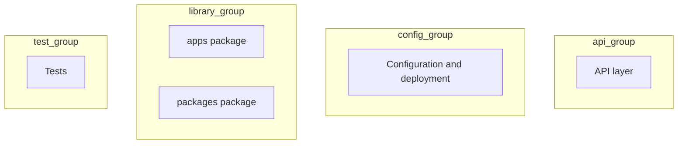

# Architecture report: radix-ui/themes

> Automated static analysis. **Observed** = directly seen in files/imports/AST; **Inferred** = interpretation from that evidence. Repository code was not executed.

## 1. Repository at a glance

| Item | Value |
| --- | --- |
| Repository | radix-ui/themes |
| Description | Radix Themes is an open-source component library optimized for fast development, easy maintenance, and accessibility. Maintained by @workos. |
| Language | TypeScript |
| Stars | 8851 |
| Licence | MIT |
| Analysed commit / branch | 1faff10ac26ae17f09944d418c6949b93fc6b566 / main |
| Framework(s) | Next.js, React |
| Files analysed | 446 |
| Components | 5 |

## 2. Architecture in one minute

radix-ui/themes - Radix Themes is an open-source component library optimized for fast development, easy maintenance, and accessibility. Maintained by @workos.. This repository was analysed statically from 446 file(s) (0 Python). Detected technologies (observed from imports/manifests): GitHub Actions, Next.js, React, TypeScript. Files are grouped into 5 component(s): API layer, apps package, Configuration and deployment, packages package, Tests. Findings below distinguish observed facts from inferred interpretation.

## 3. High-level block diagram

## 4. Main components

### API layer (`api_layer`)

- **Kind:** api
- **Status:** Observed
- **Confidence:** 0.85
- **Responsibility:** Groups 1 file(s) under api layer (observed from repository paths and static analysis).
- **Paths:** `apps/playground/app/api/avatar/route.ts`
- **Evidence:** [apps/playground/app/api/avatar/route.ts](https://github.com/radix-ui/themes/blob/1faff10ac26ae17f09944d418c6949b93fc6b566/apps/playground/app/api/avatar/route.ts)

### apps package (`apps`)

- **Kind:** library
- **Status:** Observed
- **Confidence:** 0.85
- **Responsibility:** Groups 75 file(s) under apps package (observed from repository paths and static analysis).
- **Paths:** `apps/playground/app/(static-theme)/layout.tsx`, `apps/playground/app/(static-theme)/theme.tsx`, `apps/playground/app/(themeable)/demo/page.tsx`, `apps/playground/app/(themeable)/demo/users.ts`, `apps/playground/app/(themeable)/ghost-balance/page.tsx`, `apps/playground/app/(themeable)/layout.tsx`, `apps/playground/app/(themeable)/sink/_components.tsx`, `apps/playground/app/(themeable)/sink/_utils.tsx`, `apps/playground/app/(themeable)/sink/alert-dialog/page.tsx`, `apps/playground/app/(themeable)/sink/aspect-ratio/page.tsx`, `apps/playground/app/(themeable)/sink/avatar/page.tsx`, `apps/playground/app/(themeable)/sink/badge/page.tsx`, `apps/playground/app/(themeable)/sink/blockquote/page.tsx`, `apps/playground/app/(themeable)/sink/button/page.tsx`, `apps/playground/app/(themeable)/sink/callout/page.tsx`, `apps/playground/app/(themeable)/sink/card/page.tsx`, `apps/playground/app/(themeable)/sink/checkbox-cards/page.tsx`, `apps/playground/app/(themeable)/sink/checkbox-group/page.tsx`, `apps/playground/app/(themeable)/sink/checkbox/page.tsx`, `apps/playground/app/(themeable)/sink/code/page.tsx`, `apps/playground/app/(themeable)/sink/container/page.tsx`, `apps/playground/app/(themeable)/sink/context-menu/page.tsx`, `apps/playground/app/(themeable)/sink/cursors/page.tsx`, `apps/playground/app/(themeable)/sink/data-list/page.tsx`, `apps/playground/app/(themeable)/sink/dialog/page.tsx`, `apps/playground/app/(themeable)/sink/docs-section.tsx`, `apps/playground/app/(themeable)/sink/dropdown-menu/page.tsx`, `apps/playground/app/(themeable)/sink/grid/page.tsx`, `apps/playground/app/(themeable)/sink/heading/page.tsx`, `apps/playground/app/(themeable)/sink/hide-cursor.tsx`, `apps/playground/app/(themeable)/sink/hover-card/page.tsx`, `apps/playground/app/(themeable)/sink/icon-button/page.tsx`, `apps/playground/app/(themeable)/sink/kbd/page.tsx`, `apps/playground/app/(themeable)/sink/layout.tsx`, `apps/playground/app/(themeable)/sink/link/page.tsx`, `apps/playground/app/(themeable)/sink/mixed-nested-themes-test/page.tsx`, `apps/playground/app/(themeable)/sink/nested-appearances-test/page.tsx`, `apps/playground/app/(themeable)/sink/nested-colors-test/page.tsx`, `apps/playground/app/(themeable)/sink/page.tsx`, `apps/playground/app/(themeable)/sink/playground/page.tsx`, `apps/playground/app/(themeable)/sink/pointer-cursors-checkbox.tsx`, `apps/playground/app/(themeable)/sink/popover/page.tsx`, `apps/playground/app/(themeable)/sink/progress/page.tsx`, `apps/playground/app/(themeable)/sink/radio-cards/page.tsx`, `apps/playground/app/(themeable)/sink/radio-group/page.tsx`, `apps/playground/app/(themeable)/sink/radio/page.tsx`, `apps/playground/app/(themeable)/sink/radix-logo.tsx`, `apps/playground/app/(themeable)/sink/scroll-area/page.tsx`, `apps/playground/app/(themeable)/sink/segmented-control/page.tsx`, `apps/playground/app/(themeable)/sink/select/page.tsx`, `apps/playground/app/(themeable)/sink/separator/page.tsx`, `apps/playground/app/(themeable)/sink/shadow-tokens/page.tsx`, `apps/playground/app/(themeable)/sink/sink-layout.navigation.tsx`, `apps/playground/app/(themeable)/sink/skeleton/page.tsx`, `apps/playground/app/(themeable)/sink/slider/page.tsx`, `apps/playground/app/(themeable)/sink/spinner/page.tsx`, `apps/playground/app/(themeable)/sink/switch/page.tsx`, `apps/playground/app/(themeable)/sink/tab-nav-demo.tsx`, `apps/playground/app/(themeable)/sink/tab-nav/page.tsx`, `apps/playground/app/(themeable)/sink/table/page.tsx`, `apps/playground/app/(themeable)/sink/tabs/page.tsx`, `apps/playground/app/(themeable)/sink/text-area/page.tsx`, `apps/playground/app/(themeable)/sink/text-field/page.tsx`, `apps/playground/app/(themeable)/sink/text/page.tsx`, `apps/playground/app/(themeable)/sink/tooltip/page.tsx`, `apps/playground/app/(themeable)/sink/typography/page.tsx`, `apps/playground/app/(themeable)/snapshot/image-card.tsx`, `apps/playground/app/(themeable)/snapshot/page.tsx`, `apps/playground/app/layout.tsx`, `apps/playground/app/next-theme-provider.tsx`, `apps/playground/components/loading-buttons.tsx`, `apps/playground/components/snapshot-logo.tsx`, `apps/playground/eslint.config.mjs`, `apps/playground/playwright.config.ts`, `apps/playground/postcss.config.mjs`
- **Evidence:** [apps/playground/app/(static-theme)/layout.tsx](https://github.com/radix-ui/themes/blob/1faff10ac26ae17f09944d418c6949b93fc6b566/apps/playground/app/%28static-theme%29/layout.tsx); [apps/playground/app/(static-theme)/theme.tsx](https://github.com/radix-ui/themes/blob/1faff10ac26ae17f09944d418c6949b93fc6b566/apps/playground/app/%28static-theme%29/theme.tsx); [apps/playground/app/(themeable)/demo/page.tsx](https://github.com/radix-ui/themes/blob/1faff10ac26ae17f09944d418c6949b93fc6b566/apps/playground/app/%28themeable%29/demo/page.tsx); [apps/playground/app/(themeable)/demo/users.ts](https://github.com/radix-ui/themes/blob/1faff10ac26ae17f09944d418c6949b93fc6b566/apps/playground/app/%28themeable%29/demo/users.ts); [apps/playground/app/(themeable)/ghost-balance/page.tsx](https://github.com/radix-ui/themes/blob/1faff10ac26ae17f09944d418c6949b93fc6b566/apps/playground/app/%28themeable%29/ghost-balance/page.tsx); [apps/playground/app/(themeable)/layout.tsx](https://github.com/radix-ui/themes/blob/1faff10ac26ae17f09944d418c6949b93fc6b566/apps/playground/app/%28themeable%29/layout.tsx); [apps/playground/app/(themeable)/sink/_components.tsx](https://github.com/radix-ui/themes/blob/1faff10ac26ae17f09944d418c6949b93fc6b566/apps/playground/app/%28themeable%29/sink/_components.tsx); [apps/playground/app/(themeable)/sink/_utils.tsx](https://github.com/radix-ui/themes/blob/1faff10ac26ae17f09944d418c6949b93fc6b566/apps/playground/app/%28themeable%29/sink/_utils.tsx)

### Configuration and deployment (`config`)

- **Kind:** config
- **Status:** Observed
- **Confidence:** 0.85
- **Responsibility:** Groups 8 file(s) under configuration and deployment (observed from repository paths and static analysis).
- **Paths:** `apps/playground/package.json`, `apps/playground/tsconfig.json`, `context7.json`, `package.json`, `packages/radix-ui-themes/package.json`, `packages/radix-ui-themes/tsconfig.json`, `pnpm-workspace.yaml`, `turbo.json`
- **Evidence:** [apps/playground/package.json](https://github.com/radix-ui/themes/blob/1faff10ac26ae17f09944d418c6949b93fc6b566/apps/playground/package.json); [apps/playground/tsconfig.json](https://github.com/radix-ui/themes/blob/1faff10ac26ae17f09944d418c6949b93fc6b566/apps/playground/tsconfig.json); [context7.json](https://github.com/radix-ui/themes/blob/1faff10ac26ae17f09944d418c6949b93fc6b566/context7.json); [package.json](https://github.com/radix-ui/themes/blob/1faff10ac26ae17f09944d418c6949b93fc6b566/package.json); [packages/radix-ui-themes/package.json](https://github.com/radix-ui/themes/blob/1faff10ac26ae17f09944d418c6949b93fc6b566/packages/radix-ui-themes/package.json); [packages/radix-ui-themes/tsconfig.json](https://github.com/radix-ui/themes/blob/1faff10ac26ae17f09944d418c6949b93fc6b566/packages/radix-ui-themes/tsconfig.json); [pnpm-workspace.yaml](https://github.com/radix-ui/themes/blob/1faff10ac26ae17f09944d418c6949b93fc6b566/pnpm-workspace.yaml); [turbo.json](https://github.com/radix-ui/themes/blob/1faff10ac26ae17f09944d418c6949b93fc6b566/turbo.json)

### packages package (`packages`)

- **Kind:** library
- **Status:** Observed
- **Confidence:** 0.85
- **Responsibility:** Groups 159 file(s) under packages package (observed from repository paths and static analysis).
- **Paths:** `packages/radix-ui-themes/.stylelintrc.cjs`, `packages/radix-ui-themes/eslint.config.js`, `packages/radix-ui-themes/postcss-breakpoints.cjs`, `packages/radix-ui-themes/postcss-breakpoints.js`, `packages/radix-ui-themes/postcss-whitespace.cjs`, `packages/radix-ui-themes/postcss-whitespace.js`, `packages/radix-ui-themes/postcss.config.js`, `packages/radix-ui-themes/scripts/build-css.js`, `packages/radix-ui-themes/scripts/esbuild-cjs.js`, `packages/radix-ui-themes/scripts/esbuild-esm.js`, `packages/radix-ui-themes/src/components/_internal/base-button.props.ts`, `packages/radix-ui-themes/src/components/_internal/base-button.tsx`, `packages/radix-ui-themes/src/components/_internal/base-checkbox.props.ts`, `packages/radix-ui-themes/src/components/_internal/base-menu.props.ts`, `packages/radix-ui-themes/src/components/_internal/base-radio.props.ts`, `packages/radix-ui-themes/src/components/_internal/base-tab-list.props.ts`, `packages/radix-ui-themes/src/components/accessible-icon.tsx`, `packages/radix-ui-themes/src/components/alert-dialog.props.tsx`, `packages/radix-ui-themes/src/components/alert-dialog.tsx`, `packages/radix-ui-themes/src/components/aspect-ratio.tsx`, `packages/radix-ui-themes/src/components/avatar.props.tsx`, `packages/radix-ui-themes/src/components/avatar.tsx`, `packages/radix-ui-themes/src/components/badge.props.tsx`, `packages/radix-ui-themes/src/components/badge.tsx`, `packages/radix-ui-themes/src/components/blockquote.props.tsx`, `packages/radix-ui-themes/src/components/blockquote.tsx`, `packages/radix-ui-themes/src/components/box.props.tsx`, `packages/radix-ui-themes/src/components/box.tsx`, `packages/radix-ui-themes/src/components/button.props.tsx`, `packages/radix-ui-themes/src/components/button.tsx`, `packages/radix-ui-themes/src/components/callout.props.tsx`, `packages/radix-ui-themes/src/components/callout.tsx`, `packages/radix-ui-themes/src/components/card.props.tsx`, `packages/radix-ui-themes/src/components/card.tsx`, `packages/radix-ui-themes/src/components/checkbox-cards.props.tsx`, `packages/radix-ui-themes/src/components/checkbox-cards.tsx`, `packages/radix-ui-themes/src/components/checkbox-group.primitive.tsx`, `packages/radix-ui-themes/src/components/checkbox-group.props.tsx`, `packages/radix-ui-themes/src/components/checkbox-group.tsx`, `packages/radix-ui-themes/src/components/checkbox.props.tsx`, `packages/radix-ui-themes/src/components/checkbox.tsx`, `packages/radix-ui-themes/src/components/code.props.tsx`, `packages/radix-ui-themes/src/components/code.tsx`, `packages/radix-ui-themes/src/components/container.props.tsx`, `packages/radix-ui-themes/src/components/container.tsx`, `packages/radix-ui-themes/src/components/context-menu.props.tsx`, `packages/radix-ui-themes/src/components/context-menu.tsx`, `packages/radix-ui-themes/src/components/data-list.props.tsx`, `packages/radix-ui-themes/src/components/data-list.tsx`, `packages/radix-ui-themes/src/components/dialog.props.tsx`, `packages/radix-ui-themes/src/components/dialog.tsx`, `packages/radix-ui-themes/src/components/dropdown-menu.props.tsx`, `packages/radix-ui-themes/src/components/dropdown-menu.tsx`, `packages/radix-ui-themes/src/components/em.props.tsx`, `packages/radix-ui-themes/src/components/em.tsx`, `packages/radix-ui-themes/src/components/flex.props.tsx`, `packages/radix-ui-themes/src/components/flex.tsx`, `packages/radix-ui-themes/src/components/grid.props.tsx`, `packages/radix-ui-themes/src/components/grid.tsx`, `packages/radix-ui-themes/src/components/heading.props.tsx`, `packages/radix-ui-themes/src/components/heading.tsx`, `packages/radix-ui-themes/src/components/hover-card.props.tsx`, `packages/radix-ui-themes/src/components/hover-card.tsx`, `packages/radix-ui-themes/src/components/icon-button.props.tsx`, `packages/radix-ui-themes/src/components/icon-button.tsx`, `packages/radix-ui-themes/src/components/icons.tsx`, `packages/radix-ui-themes/src/components/index.tsx`, `packages/radix-ui-themes/src/components/inset.props.tsx`, `packages/radix-ui-themes/src/components/inset.tsx`, `packages/radix-ui-themes/src/components/kbd.props.tsx`, `packages/radix-ui-themes/src/components/kbd.tsx`, `packages/radix-ui-themes/src/components/link.props.tsx`, `packages/radix-ui-themes/src/components/link.tsx`, `packages/radix-ui-themes/src/components/popover.props.tsx`, `packages/radix-ui-themes/src/components/popover.tsx`, `packages/radix-ui-themes/src/components/portal.tsx`, `packages/radix-ui-themes/src/components/progress.props.tsx`, `packages/radix-ui-themes/src/components/progress.tsx`, `packages/radix-ui-themes/src/components/quote.props.tsx`, `packages/radix-ui-themes/src/components/quote.tsx`, `packages/radix-ui-themes/src/components/radio-cards.props.tsx`, `packages/radix-ui-themes/src/components/radio-cards.tsx`, `packages/radix-ui-themes/src/components/radio-group.props.tsx`, `packages/radix-ui-themes/src/components/radio-group.tsx`, `packages/radix-ui-themes/src/components/radio.props.tsx`, `packages/radix-ui-themes/src/components/radio.tsx`, `packages/radix-ui-themes/src/components/reset.tsx`, `packages/radix-ui-themes/src/components/scroll-area.props.tsx`, `packages/radix-ui-themes/src/components/scroll-area.tsx`, `packages/radix-ui-themes/src/components/section.props.tsx`, `packages/radix-ui-themes/src/components/section.tsx`, `packages/radix-ui-themes/src/components/segmented-control.props.tsx`, `packages/radix-ui-themes/src/components/segmented-control.tsx`, `packages/radix-ui-themes/src/components/select.props.tsx`, `packages/radix-ui-themes/src/components/select.tsx`, `packages/radix-ui-themes/src/components/separator.props.tsx`, `packages/radix-ui-themes/src/components/separator.tsx`, `packages/radix-ui-themes/src/components/skeleton.props.tsx`, `packages/radix-ui-themes/src/components/skeleton.tsx`, `packages/radix-ui-themes/src/components/slider.props.tsx`, `packages/radix-ui-themes/src/components/slider.tsx`, `packages/radix-ui-themes/src/components/slot.tsx`, `packages/radix-ui-themes/src/components/spinner.props.tsx`, `packages/radix-ui-themes/src/components/spinner.tsx`, `packages/radix-ui-themes/src/components/strong.props.tsx`, `packages/radix-ui-themes/src/components/strong.tsx`, `packages/radix-ui-themes/src/components/switch.props.tsx`, `packages/radix-ui-themes/src/components/switch.tsx`, `packages/radix-ui-themes/src/components/tab-nav.props.tsx`, `packages/radix-ui-themes/src/components/tab-nav.tsx`, `packages/radix-ui-themes/src/components/table.props.tsx`, `packages/radix-ui-themes/src/components/table.tsx`, `packages/radix-ui-themes/src/components/tabs.props.tsx`, `packages/radix-ui-themes/src/components/tabs.tsx`, `packages/radix-ui-themes/src/components/text-area.props.tsx`, `packages/radix-ui-themes/src/components/text-area.tsx`, `packages/radix-ui-themes/src/components/text-field.props.tsx`, `packages/radix-ui-themes/src/components/text-field.tsx`, `packages/radix-ui-themes/src/components/text.props.tsx`, `packages/radix-ui-themes/src/components/text.tsx`, `packages/radix-ui-themes/src/components/theme-panel.tsx`, `packages/radix-ui-themes/src/components/theme.props.tsx`, `packages/radix-ui-themes/src/components/theme.tsx`, `packages/radix-ui-themes/src/components/tooltip.props.tsx`, `packages/radix-ui-themes/src/components/tooltip.tsx`, `packages/radix-ui-themes/src/components/visually-hidden.tsx`, `packages/radix-ui-themes/src/helpers/component-props.ts`, `packages/radix-ui-themes/src/helpers/extract-margin-props.ts`, `packages/radix-ui-themes/src/helpers/extract-props.ts`, `packages/radix-ui-themes/src/helpers/get-margin-styles.ts`, `packages/radix-ui-themes/src/helpers/get-matching-gray-color.ts`, `packages/radix-ui-themes/src/helpers/get-responsive-styles.ts`, `packages/radix-ui-themes/src/helpers/get-subtree.ts`, `packages/radix-ui-themes/src/helpers/has-own-property.ts`, `packages/radix-ui-themes/src/helpers/index.ts`, `packages/radix-ui-themes/src/helpers/inert.ts`, `packages/radix-ui-themes/src/helpers/input-attributes.ts`, `packages/radix-ui-themes/src/helpers/is-responsive-object.ts`, `packages/radix-ui-themes/src/helpers/map-prop-values.ts`, `packages/radix-ui-themes/src/helpers/merge-styles.ts`, `packages/radix-ui-themes/src/helpers/require-react-element.ts`, `packages/radix-ui-themes/src/index.ts`, `packages/radix-ui-themes/src/props/as-child.prop.ts`, `packages/radix-ui-themes/src/props/color.prop.ts`, `packages/radix-ui-themes/src/props/gap.props.ts`, `packages/radix-ui-themes/src/props/height.props.ts`, `packages/radix-ui-themes/src/props/high-contrast.prop.ts`, `packages/radix-ui-themes/src/props/index.ts`, `packages/radix-ui-themes/src/props/layout.props.ts`, `packages/radix-ui-themes/src/props/leading-trim.prop.ts`, `packages/radix-ui-themes/src/props/margin.props.ts`, `packages/radix-ui-themes/src/props/padding.props.ts`, `packages/radix-ui-themes/src/props/prop-def.ts`, `packages/radix-ui-themes/src/props/radius.prop.ts`, `packages/radix-ui-themes/src/props/text-align.prop.ts`, `packages/radix-ui-themes/src/props/text-wrap.prop.ts`, `packages/radix-ui-themes/src/props/truncate.prop.ts`, `packages/radix-ui-themes/src/props/weight.prop.ts`, `packages/radix-ui-themes/src/props/width.props.ts`
- **Evidence:** [packages/radix-ui-themes/.stylelintrc.cjs](https://github.com/radix-ui/themes/blob/1faff10ac26ae17f09944d418c6949b93fc6b566/packages/radix-ui-themes/.stylelintrc.cjs); [packages/radix-ui-themes/eslint.config.js](https://github.com/radix-ui/themes/blob/1faff10ac26ae17f09944d418c6949b93fc6b566/packages/radix-ui-themes/eslint.config.js); [packages/radix-ui-themes/postcss-breakpoints.cjs](https://github.com/radix-ui/themes/blob/1faff10ac26ae17f09944d418c6949b93fc6b566/packages/radix-ui-themes/postcss-breakpoints.cjs); [packages/radix-ui-themes/postcss-breakpoints.js](https://github.com/radix-ui/themes/blob/1faff10ac26ae17f09944d418c6949b93fc6b566/packages/radix-ui-themes/postcss-breakpoints.js); [packages/radix-ui-themes/postcss-whitespace.cjs](https://github.com/radix-ui/themes/blob/1faff10ac26ae17f09944d418c6949b93fc6b566/packages/radix-ui-themes/postcss-whitespace.cjs); [packages/radix-ui-themes/postcss-whitespace.js](https://github.com/radix-ui/themes/blob/1faff10ac26ae17f09944d418c6949b93fc6b566/packages/radix-ui-themes/postcss-whitespace.js); [packages/radix-ui-themes/postcss.config.js](https://github.com/radix-ui/themes/blob/1faff10ac26ae17f09944d418c6949b93fc6b566/packages/radix-ui-themes/postcss.config.js); [packages/radix-ui-themes/scripts/build-css.js](https://github.com/radix-ui/themes/blob/1faff10ac26ae17f09944d418c6949b93fc6b566/packages/radix-ui-themes/scripts/build-css.js)

### Tests (`tests`)

- **Kind:** test
- **Status:** Observed
- **Confidence:** 0.85
- **Responsibility:** Groups 27 file(s) under tests (observed from repository paths and static analysis).
- **Paths:** `apps/playground/app/(themeable)/test/appearance/page.tsx`, `apps/playground/app/(themeable)/test/as-child/page.tsx`, `apps/playground/app/(themeable)/test/avatar/page.tsx`, `apps/playground/app/(themeable)/test/checkbox-card/page.tsx`, `apps/playground/app/(themeable)/test/classic-button/page.tsx`, `apps/playground/app/(themeable)/test/data-list/page.tsx`, `apps/playground/app/(themeable)/test/dialog/page.tsx`, `apps/playground/app/(themeable)/test/grid-align-content/page.tsx`, `apps/playground/app/(themeable)/test/grid-align-self/page.tsx`, `apps/playground/app/(themeable)/test/grid-area/page.tsx`, `apps/playground/app/(themeable)/test/grid-justify-items/page.tsx`, `apps/playground/app/(themeable)/test/grid-justify-self/page.tsx`, `apps/playground/app/(themeable)/test/high-contrast/page.tsx`, `apps/playground/app/(themeable)/test/inset/page.tsx`, `apps/playground/app/(themeable)/test/radio-card/page.tsx`, `apps/playground/app/(themeable)/test/reset/page.tsx`, `apps/playground/app/(themeable)/test/responsive/page.tsx`, `apps/playground/app/(themeable)/test/skeleton/page.tsx`, `apps/playground/app/(themeable)/test/tabnav/(accounts)/page.tsx`, `apps/playground/app/(themeable)/test/tabnav/documents/page.tsx`, `apps/playground/app/(themeable)/test/tabnav/layout.tsx`, `apps/playground/app/(themeable)/test/tabnav/nav.tsx`, `apps/playground/app/(themeable)/test/tabnav/settings/page.tsx`, `apps/playground/app/(themeable)/test/text-wrap/page.tsx`, `apps/playground/app/(themeable)/test/textfield/page.tsx`, `apps/playground/app/(themeable)/test/webkit-tap-highlight-color/page.tsx`, `apps/playground/tests/visual-regression.spec.ts`
- **Evidence:** [apps/playground/app/(themeable)/test/appearance/page.tsx](https://github.com/radix-ui/themes/blob/1faff10ac26ae17f09944d418c6949b93fc6b566/apps/playground/app/%28themeable%29/test/appearance/page.tsx); [apps/playground/app/(themeable)/test/as-child/page.tsx](https://github.com/radix-ui/themes/blob/1faff10ac26ae17f09944d418c6949b93fc6b566/apps/playground/app/%28themeable%29/test/as-child/page.tsx); [apps/playground/app/(themeable)/test/avatar/page.tsx](https://github.com/radix-ui/themes/blob/1faff10ac26ae17f09944d418c6949b93fc6b566/apps/playground/app/%28themeable%29/test/avatar/page.tsx); [apps/playground/app/(themeable)/test/checkbox-card/page.tsx](https://github.com/radix-ui/themes/blob/1faff10ac26ae17f09944d418c6949b93fc6b566/apps/playground/app/%28themeable%29/test/checkbox-card/page.tsx); [apps/playground/app/(themeable)/test/classic-button/page.tsx](https://github.com/radix-ui/themes/blob/1faff10ac26ae17f09944d418c6949b93fc6b566/apps/playground/app/%28themeable%29/test/classic-button/page.tsx); [apps/playground/app/(themeable)/test/data-list/page.tsx](https://github.com/radix-ui/themes/blob/1faff10ac26ae17f09944d418c6949b93fc6b566/apps/playground/app/%28themeable%29/test/data-list/page.tsx); [apps/playground/app/(themeable)/test/dialog/page.tsx](https://github.com/radix-ui/themes/blob/1faff10ac26ae17f09944d418c6949b93fc6b566/apps/playground/app/%28themeable%29/test/dialog/page.tsx); [apps/playground/app/(themeable)/test/grid-align-content/page.tsx](https://github.com/radix-ui/themes/blob/1faff10ac26ae17f09944d418c6949b93fc6b566/apps/playground/app/%28themeable%29/test/grid-align-content/page.tsx)

## 5. Execution flow

**Observed** entry point(s):

- [packages/radix-ui-themes/src/index.ts](https://github.com/radix-ui/themes/blob/1faff10ac26ae17f09944d418c6949b93fc6b566/packages/radix-ui-themes/src/index.ts)

Representative flow (derived from observed entry points and the import graph; steps beyond the entry point are **Inferred**):

1. Execution starts at an observed entry point listed above, if present.
2. No internal import relationships between components were observed.

## 6. Project structure

### `(root)`

- `.gitignore` - other (195 bytes)
- `.nvmrc` - other (3 bytes)
- `.prettierignore` - other (374 bytes)
- `.prettierrc` - other (158 bytes)
- `AGENTS.md` - docs (9170 bytes)
- `CLAUDE.md` - docs (9170 bytes)
- `CODE_OF_CONDUCT.md` - docs (3350 bytes)
- `LICENSE` - docs (1063 bytes)
- `README.md` - docs (1400 bytes)
- `context7.json` - config (96 bytes)
- `package.json` - manifest (710 bytes)
- `pnpm-workspace.yaml` - config (40 bytes)
- `release-process.md` - docs (2161 bytes)
- `turbo.json` - config (461 bytes)

### `.github`

- `.github/CONTRIBUTING.md` - docs (4728 bytes)
- `.github/PULL_REQUEST_TEMPLATE.md` - docs (609 bytes)
- `.github/actions/ci-setup/action.yml` - config (366 bytes)
- `.github/workflows/ci.yml` - ci, YAML (1988 bytes)
- `.github/workflows/publish.yml` - ci, YAML (917 bytes)

### `.vscode`

- `.vscode/extensions.json` - config (56 bytes)
- `.vscode/settings.json` - config (31 bytes)

### `apps`

- `apps/playground/.gitignore` - other (480 bytes)
- `apps/playground/README.md` - docs (1450 bytes)
- `apps/playground/app/(static-theme)/layout.tsx` - source, TypeScript (137 bytes)
- `apps/playground/app/(static-theme)/theme.tsx` - source, TypeScript (2345 bytes)
- `apps/playground/app/(themeable)/demo/page.tsx` - source, TypeScript (3817 bytes)
- `apps/playground/app/(themeable)/demo/users.ts` - source, TypeScript (1645 bytes)
- `apps/playground/app/(themeable)/ghost-balance/page.tsx` - source, TypeScript (5142 bytes)
- `apps/playground/app/(themeable)/layout.tsx` - source, TypeScript (260 bytes)
- `apps/playground/app/(themeable)/sink/_components.tsx` - source, TypeScript (9967 bytes)
- `apps/playground/app/(themeable)/sink/_utils.tsx` - source, TypeScript (708 bytes)
- `apps/playground/app/(themeable)/sink/alert-dialog/page.tsx` - source, TypeScript (1396 bytes)
- `apps/playground/app/(themeable)/sink/aspect-ratio/page.tsx` - source, TypeScript (1354 bytes)
- `apps/playground/app/(themeable)/sink/avatar/page.tsx` - source, TypeScript (6030 bytes)
- `apps/playground/app/(themeable)/sink/badge/page.tsx` - source, TypeScript (4864 bytes)
- `apps/playground/app/(themeable)/sink/blockquote/page.tsx` - source, TypeScript (1591 bytes)
- `apps/playground/app/(themeable)/sink/button/page.tsx` - source, TypeScript (5755 bytes)
- `apps/playground/app/(themeable)/sink/callout/page.tsx` - source, TypeScript (9258 bytes)
- `apps/playground/app/(themeable)/sink/card/page.tsx` - source, TypeScript (5440 bytes)
- `apps/playground/app/(themeable)/sink/checkbox-cards/page.tsx` - source, TypeScript (5549 bytes)
- `apps/playground/app/(themeable)/sink/checkbox-group/page.tsx` - source, TypeScript (11042 bytes)
- `apps/playground/app/(themeable)/sink/checkbox/page.tsx` - source, TypeScript (7606 bytes)
- `apps/playground/app/(themeable)/sink/code/page.tsx` - source, TypeScript (5231 bytes)
- `apps/playground/app/(themeable)/sink/container/page.tsx` - source, TypeScript (1224 bytes)
- `apps/playground/app/(themeable)/sink/context-menu/page.tsx` - source, TypeScript (1480 bytes)
- `apps/playground/app/(themeable)/sink/cursors/page.tsx` - source, TypeScript (1764 bytes)
- `apps/playground/app/(themeable)/sink/data-list/page.tsx` - source, TypeScript (8554 bytes)
- `apps/playground/app/(themeable)/sink/dialog/page.tsx` - source, TypeScript (1540 bytes)
- `apps/playground/app/(themeable)/sink/docs-section.tsx` - source, TypeScript (521 bytes)
- `apps/playground/app/(themeable)/sink/dropdown-menu/page.tsx` - source, TypeScript (5834 bytes)
- `apps/playground/app/(themeable)/sink/grid/page.tsx` - source, TypeScript (2691 bytes)
- `apps/playground/app/(themeable)/sink/heading/page.tsx` - source, TypeScript (2836 bytes)
- `apps/playground/app/(themeable)/sink/hide-cursor.tsx` - source, TypeScript (434 bytes)
- `apps/playground/app/(themeable)/sink/hover-card/page.tsx` - source, TypeScript (814 bytes)
- `apps/playground/app/(themeable)/sink/icon-button/page.tsx` - source, TypeScript (5728 bytes)
- `apps/playground/app/(themeable)/sink/kbd/page.tsx` - source, TypeScript (1972 bytes)
- `apps/playground/app/(themeable)/sink/layout.tsx` - source, TypeScript (1155 bytes)
- `apps/playground/app/(themeable)/sink/link/page.tsx` - source, TypeScript (7907 bytes)
- `apps/playground/app/(themeable)/sink/mixed-nested-themes-test/page.tsx` - source, TypeScript (1235 bytes)
- `apps/playground/app/(themeable)/sink/nested-appearances-test/page.tsx` - source, TypeScript (918 bytes)
- `apps/playground/app/(themeable)/sink/nested-colors-test/page.tsx` - source, TypeScript (910 bytes)
- `apps/playground/app/(themeable)/sink/page.module.css` - other (735 bytes)
- `apps/playground/app/(themeable)/sink/page.tsx` - source, TypeScript (6579 bytes)
- `apps/playground/app/(themeable)/sink/playground/page.tsx` - source, TypeScript (953 bytes)
- `apps/playground/app/(themeable)/sink/pointer-cursors-checkbox.tsx` - source, TypeScript (941 bytes)
- `apps/playground/app/(themeable)/sink/popover/page.tsx` - source, TypeScript (975 bytes)
- `apps/playground/app/(themeable)/sink/progress/page.tsx` - source, TypeScript (6487 bytes)
- `apps/playground/app/(themeable)/sink/radio-cards/page.tsx` - source, TypeScript (5417 bytes)
- `apps/playground/app/(themeable)/sink/radio-group/page.tsx` - source, TypeScript (10765 bytes)
- `apps/playground/app/(themeable)/sink/radio/page.tsx` - source, TypeScript (10685 bytes)
- `apps/playground/app/(themeable)/sink/radix-logo.tsx` - source, TypeScript (559 bytes)
- `apps/playground/app/(themeable)/sink/scroll-area/page.tsx` - source, TypeScript (4658 bytes)
- `apps/playground/app/(themeable)/sink/segmented-control/page.tsx` - source, TypeScript (8944 bytes)
- `apps/playground/app/(themeable)/sink/select/page.tsx` - source, TypeScript (9051 bytes)
- `apps/playground/app/(themeable)/sink/separator/page.tsx` - source, TypeScript (810 bytes)
- `apps/playground/app/(themeable)/sink/shadow-tokens/page.tsx` - source, TypeScript (1552 bytes)
- `apps/playground/app/(themeable)/sink/sink-layout.navigation.tsx` - source, TypeScript (6168 bytes)
- `apps/playground/app/(themeable)/sink/skeleton/page.tsx` - source, TypeScript (7806 bytes)
- `apps/playground/app/(themeable)/sink/slider/page.tsx` - source, TypeScript (7467 bytes)
- `apps/playground/app/(themeable)/sink/spinner/page.tsx` - source, TypeScript (1456 bytes)
- `apps/playground/app/(themeable)/sink/switch/page.tsx` - source, TypeScript (8346 bytes)
- `apps/playground/app/(themeable)/sink/tab-nav-demo.tsx` - source, TypeScript (1623 bytes)
- `apps/playground/app/(themeable)/sink/tab-nav/page.tsx` - source, TypeScript (1631 bytes)
- `apps/playground/app/(themeable)/sink/table/page.tsx` - source, TypeScript (1217 bytes)
- `apps/playground/app/(themeable)/sink/tabs/page.tsx` - source, TypeScript (5266 bytes)
- `apps/playground/app/(themeable)/sink/text-area/page.tsx` - source, TypeScript (6646 bytes)
- `apps/playground/app/(themeable)/sink/text-field/page.tsx` - source, TypeScript (12119 bytes)
- `apps/playground/app/(themeable)/sink/text/page.tsx` - source, TypeScript (1568 bytes)
- `apps/playground/app/(themeable)/sink/tooltip/page.tsx` - source, TypeScript (852 bytes)
- `apps/playground/app/(themeable)/sink/typography/page.tsx` - source, TypeScript (13086 bytes)
- `apps/playground/app/(themeable)/snapshot/image-card.tsx` - source, TypeScript (3355 bytes)
- `apps/playground/app/(themeable)/snapshot/page.module.css` - other (973 bytes)
- `apps/playground/app/(themeable)/snapshot/page.tsx` - source, TypeScript (10488 bytes)
- `apps/playground/app/(themeable)/test/appearance/page.tsx` - test, TypeScript (3952 bytes)
- `apps/playground/app/(themeable)/test/as-child/page.tsx` - test, TypeScript (6497 bytes)
- `apps/playground/app/(themeable)/test/avatar/page.tsx` - test, TypeScript (849 bytes)
- `apps/playground/app/(themeable)/test/checkbox-card/page.tsx` - test, TypeScript (2743 bytes)
- `apps/playground/app/(themeable)/test/classic-button/page.tsx` - test, TypeScript (1357 bytes)
- `apps/playground/app/(themeable)/test/data-list/page.tsx` - test, TypeScript (15908 bytes)
- `apps/playground/app/(themeable)/test/dialog/page.tsx` - test, TypeScript (7828 bytes)
- `apps/playground/app/(themeable)/test/grid-align-content/page.tsx` - test, TypeScript (2274 bytes)
- `apps/playground/app/(themeable)/test/grid-align-self/page.tsx` - test, TypeScript (723 bytes)
- `apps/playground/app/(themeable)/test/grid-area/page.tsx` - test, TypeScript (2661 bytes)
- `apps/playground/app/(themeable)/test/grid-justify-items/page.tsx` - test, TypeScript (1634 bytes)
- `apps/playground/app/(themeable)/test/grid-justify-self/page.tsx` - test, TypeScript (732 bytes)
- `apps/playground/app/(themeable)/test/high-contrast/page.tsx` - test, TypeScript (32336 bytes)
- `apps/playground/app/(themeable)/test/inset/page.tsx` - test, TypeScript (9268 bytes)
- `apps/playground/app/(themeable)/test/radio-card/page.tsx` - test, TypeScript (1975 bytes)
- `apps/playground/app/(themeable)/test/reset/page.tsx` - test, TypeScript (9777 bytes)
- `apps/playground/app/(themeable)/test/responsive/page.tsx` - test, TypeScript (2676 bytes)
- `apps/playground/app/(themeable)/test/skeleton/page.tsx` - test, TypeScript (2839 bytes)
- `apps/playground/app/(themeable)/test/tabnav/(accounts)/page.tsx` - test, TypeScript (122 bytes)
- `apps/playground/app/(themeable)/test/tabnav/documents/page.tsx` - test, TypeScript (124 bytes)
- `apps/playground/app/(themeable)/test/tabnav/layout.tsx` - test, TypeScript (335 bytes)
- `apps/playground/app/(themeable)/test/tabnav/nav.tsx` - test, TypeScript (1545 bytes)
- `apps/playground/app/(themeable)/test/tabnav/settings/page.tsx` - test, TypeScript (122 bytes)
- `apps/playground/app/(themeable)/test/text-wrap/page.tsx` - test, TypeScript (2693 bytes)
- `apps/playground/app/(themeable)/test/textfield/page.tsx` - test, TypeScript (22558 bytes)
- `apps/playground/app/(themeable)/test/webkit-tap-highlight-color/page.tsx` - test, TypeScript (4766 bytes)
- `apps/playground/app/api/avatar/route.ts` - source, TypeScript (323 bytes)
- `apps/playground/app/globals.css` - other (130 bytes)
- `apps/playground/app/layout.tsx` - source, TypeScript (430 bytes)
- `apps/playground/app/next-theme-provider.tsx` - source, TypeScript (213 bytes)
- `apps/playground/components/loading-buttons.tsx` - source, TypeScript (3635 bytes)
- `apps/playground/components/snapshot-logo.tsx` - source, TypeScript (9330 bytes)
- `apps/playground/eslint.config.mjs` - source, JavaScript (853 bytes)
- `apps/playground/next.config.mts` - other (441 bytes)
- `apps/playground/package.json` - manifest (948 bytes)
- `apps/playground/playwright.config.ts` - source, TypeScript (1299 bytes)
- `apps/playground/postcss.config.mjs` - source, JavaScript (82 bytes)
- `apps/playground/tests/visual-regression.spec.ts` - test, TypeScript (19707 bytes)
- `apps/playground/tsconfig.json` - config (816 bytes)

### `packages`

- `packages/radix-ui-themes/.browserslistrc` - other (30 bytes)
- `packages/radix-ui-themes/.stylelintrc.cjs` - source, JavaScript (506 bytes)
- `packages/radix-ui-themes/CHANGELOG.md` - docs (60700 bytes)
- `packages/radix-ui-themes/README.md` - docs (1404 bytes)
- `packages/radix-ui-themes/eslint.config.js` - source, JavaScript (1861 bytes)
- `packages/radix-ui-themes/package.json` - manifest (4576 bytes)
- `packages/radix-ui-themes/postcss-breakpoints.cjs` - source, JavaScript (4152 bytes)
- `packages/radix-ui-themes/postcss-breakpoints.js` - source, JavaScript (4204 bytes)
- `packages/radix-ui-themes/postcss-whitespace.cjs` - source, JavaScript (860 bytes)
- `packages/radix-ui-themes/postcss-whitespace.js` - source, JavaScript (976 bytes)
- `packages/radix-ui-themes/postcss.config.js` - source, JavaScript (793 bytes)
- `packages/radix-ui-themes/scripts/build-css.js` - source, JavaScript (4968 bytes)
- `packages/radix-ui-themes/scripts/esbuild-cjs.js` - source, JavaScript (875 bytes)
- `packages/radix-ui-themes/scripts/esbuild-esm.js` - source, JavaScript (957 bytes)
- `packages/radix-ui-themes/src/components/_internal/base-button.css` - other (13592 bytes)
- `packages/radix-ui-themes/src/components/_internal/base-button.props.ts` - source, TypeScript (1031 bytes)
- `packages/radix-ui-themes/src/components/_internal/base-button.tsx` - source, TypeScript (3675 bytes)
- `packages/radix-ui-themes/src/components/_internal/base-card.css` - other (8029 bytes)
- `packages/radix-ui-themes/src/components/_internal/base-checkbox.css` - other (5200 bytes)
- `packages/radix-ui-themes/src/components/_internal/base-checkbox.props.ts` - source, TypeScript (692 bytes)
- `packages/radix-ui-themes/src/components/_internal/base-dialog.css` - other (3532 bytes)
- `packages/radix-ui-themes/src/components/_internal/base-menu.css` - other (7372 bytes)
- `packages/radix-ui-themes/src/components/_internal/base-menu.props.ts` - source, TypeScript (1259 bytes)
- `packages/radix-ui-themes/src/components/_internal/base-radio.css` - other (4971 bytes)
- `packages/radix-ui-themes/src/components/_internal/base-radio.props.ts` - source, TypeScript (686 bytes)
- `packages/radix-ui-themes/src/components/_internal/base-tab-list.css` - other (4478 bytes)
- `packages/radix-ui-themes/src/components/_internal/base-tab-list.props.ts` - source, TypeScript (925 bytes)
- `packages/radix-ui-themes/src/components/accessible-icon.tsx` - source, TypeScript (209 bytes)
- `packages/radix-ui-themes/src/components/alert-dialog.css` - other (39 bytes)
- `packages/radix-ui-themes/src/components/alert-dialog.props.tsx` - source, TypeScript (183 bytes)
- `packages/radix-ui-themes/src/components/alert-dialog.tsx` - source, TypeScript (5755 bytes)
- `packages/radix-ui-themes/src/components/animations.css` - other (2400 bytes)
- `packages/radix-ui-themes/src/components/aspect-ratio.tsx` - source, TypeScript (188 bytes)
- `packages/radix-ui-themes/src/components/avatar.css` - other (4975 bytes)
- `packages/radix-ui-themes/src/components/avatar.props.tsx` - source, TypeScript (944 bytes)
- `packages/radix-ui-themes/src/components/avatar.tsx` - source, TypeScript (2894 bytes)
- `packages/radix-ui-themes/src/components/badge.css` - other (3450 bytes)
- `packages/radix-ui-themes/src/components/badge.props.tsx` - source, TypeScript (845 bytes)
- `packages/radix-ui-themes/src/components/badge.tsx` - source, TypeScript (1242 bytes)
- `packages/radix-ui-themes/src/components/blockquote.css` - other (177 bytes)
- `packages/radix-ui-themes/src/components/blockquote.props.tsx` - source, TypeScript (842 bytes)
- `packages/radix-ui-themes/src/components/blockquote.tsx` - source, TypeScript (1182 bytes)
- `packages/radix-ui-themes/src/components/box.css` - other (56 bytes)
- `packages/radix-ui-themes/src/components/box.props.tsx` - source, TypeScript (1184 bytes)
- `packages/radix-ui-themes/src/components/box.tsx` - source, TypeScript (1366 bytes)
- `packages/radix-ui-themes/src/components/button.css` - other (4493 bytes)
- `packages/radix-ui-themes/src/components/button.props.tsx` - source, TypeScript (89 bytes)
- `packages/radix-ui-themes/src/components/button.tsx` - source, TypeScript (561 bytes)
- `packages/radix-ui-themes/src/components/callout.css` - other (2570 bytes)
- `packages/radix-ui-themes/src/components/callout.props.tsx` - source, TypeScript (771 bytes)
- `packages/radix-ui-themes/src/components/callout.tsx` - source, TypeScript (2990 bytes)
- `packages/radix-ui-themes/src/components/card.css` - other (6279 bytes)
- `packages/radix-ui-themes/src/components/card.props.tsx` - source, TypeScript (589 bytes)
- `packages/radix-ui-themes/src/components/card.tsx` - source, TypeScript (1143 bytes)
- `packages/radix-ui-themes/src/components/checkbox-cards.css` - other (6114 bytes)
- `packages/radix-ui-themes/src/components/checkbox-cards.props.tsx` - source, TypeScript (1073 bytes)
- `packages/radix-ui-themes/src/components/checkbox-cards.tsx` - source, TypeScript (4569 bytes)
- `packages/radix-ui-themes/src/components/checkbox-group.css` - other (627 bytes)
- `packages/radix-ui-themes/src/components/checkbox-group.primitive.tsx` - source, TypeScript (7238 bytes)
- `packages/radix-ui-themes/src/components/checkbox-group.props.tsx` - source, TypeScript (262 bytes)
- `packages/radix-ui-themes/src/components/checkbox-group.tsx` - source, TypeScript (5679 bytes)
- `packages/radix-ui-themes/src/components/checkbox.css` - other (312 bytes)
- `packages/radix-ui-themes/src/components/checkbox.props.tsx` - source, TypeScript (95 bytes)
- `packages/radix-ui-themes/src/components/checkbox.tsx` - source, TypeScript (2166 bytes)
- `packages/radix-ui-themes/src/components/code.css` - other (5979 bytes)
- `packages/radix-ui-themes/src/components/code.props.tsx` - source, TypeScript (1043 bytes)
- `packages/radix-ui-themes/src/components/code.tsx` - source, TypeScript (1341 bytes)
- `packages/radix-ui-themes/src/components/container.css` - other (1199 bytes)
- `packages/radix-ui-themes/src/components/container.props.tsx` - source, TypeScript (2252 bytes)
- `packages/radix-ui-themes/src/components/container.tsx` - source, TypeScript (2007 bytes)
- `packages/radix-ui-themes/src/components/context-menu.css` - other (203 bytes)
- `packages/radix-ui-themes/src/components/context-menu.props.tsx` - source, TypeScript (286 bytes)
- `packages/radix-ui-themes/src/components/context-menu.tsx` - source, TypeScript (14577 bytes)
- `packages/radix-ui-themes/src/components/data-list.css` - other (7966 bytes)
- `packages/radix-ui-themes/src/components/data-list.props.tsx` - source, TypeScript (1453 bytes)
- `packages/radix-ui-themes/src/components/data-list.tsx` - source, TypeScript (3259 bytes)
- `packages/radix-ui-themes/src/components/dialog.css` - other (39 bytes)
- `packages/radix-ui-themes/src/components/dialog.props.tsx` - source, TypeScript (1259 bytes)
- `packages/radix-ui-themes/src/components/dialog.tsx` - source, TypeScript (4683 bytes)
- `packages/radix-ui-themes/src/components/dropdown-menu.css` - other (206 bytes)
- `packages/radix-ui-themes/src/components/dropdown-menu.props.tsx` - source, TypeScript (290 bytes)
- `packages/radix-ui-themes/src/components/dropdown-menu.tsx` - source, TypeScript (14866 bytes)
- `packages/radix-ui-themes/src/components/em.css` - other (391 bytes)
- `packages/radix-ui-themes/src/components/em.props.tsx` - source, TypeScript (297 bytes)
- `packages/radix-ui-themes/src/components/em.tsx` - source, TypeScript (896 bytes)
- `packages/radix-ui-themes/src/components/flex.css` - other (204 bytes)
- `packages/radix-ui-themes/src/components/flex.props.tsx` - source, TypeScript (3515 bytes)
- `packages/radix-ui-themes/src/components/flex.tsx` - source, TypeScript (1390 bytes)
- `packages/radix-ui-themes/src/components/grid.css` - other (294 bytes)
- `packages/radix-ui-themes/src/components/grid.props.tsx` - source, TypeScript (6619 bytes)
- `packages/radix-ui-themes/src/components/grid.tsx` - source, TypeScript (1390 bytes)
- `packages/radix-ui-themes/src/components/heading.css` - other (3320 bytes)
- `packages/radix-ui-themes/src/components/heading.props.tsx` - source, TypeScript (1179 bytes)
- `packages/radix-ui-themes/src/components/heading.tsx` - source, TypeScript (1290 bytes)
- `packages/radix-ui-themes/src/components/hover-card.css` - other (1450 bytes)
- `packages/radix-ui-themes/src/components/hover-card.props.tsx` - source, TypeScript (1026 bytes)
- `packages/radix-ui-themes/src/components/hover-card.tsx` - source, TypeScript (2799 bytes)
- `packages/radix-ui-themes/src/components/icon-button.css` - other (2274 bytes)
- `packages/radix-ui-themes/src/components/icon-button.props.tsx` - source, TypeScript (93 bytes)
- `packages/radix-ui-themes/src/components/icon-button.tsx` - source, TypeScript (601 bytes)
- `packages/radix-ui-themes/src/components/icons.tsx` - source, TypeScript (3336 bytes)
- `packages/radix-ui-themes/src/components/index.css` - other (1763 bytes)
- `packages/radix-ui-themes/src/components/index.tsx` - source, TypeScript (3378 bytes)
- `packages/radix-ui-themes/src/components/inset.css` - other (5401 bytes)
- `packages/radix-ui-themes/src/components/inset.props.tsx` - source, TypeScript (2140 bytes)
- `packages/radix-ui-themes/src/components/inset.tsx` - source, TypeScript (1105 bytes)
- `packages/radix-ui-themes/src/components/kbd.css` - other (5241 bytes)
- `packages/radix-ui-themes/src/components/kbd.props.tsx` - source, TypeScript (619 bytes)
- `packages/radix-ui-themes/src/components/kbd.tsx` - source, TypeScript (1110 bytes)
- `packages/radix-ui-themes/src/components/layout.css` - other (117 bytes)
- `packages/radix-ui-themes/src/components/link.css` - other (2979 bytes)
- `packages/radix-ui-themes/src/components/link.props.tsx` - source, TypeScript (1143 bytes)
- `packages/radix-ui-themes/src/components/link.tsx` - source, TypeScript (1224 bytes)
- `packages/radix-ui-themes/src/components/popover.css` - other (1603 bytes)
- `packages/radix-ui-themes/src/components/popover.props.tsx` - source, TypeScript (1021 bytes)
- `packages/radix-ui-themes/src/components/popover.tsx` - source, TypeScript (3652 bytes)
- `packages/radix-ui-themes/src/components/portal.tsx` - source, TypeScript (195 bytes)
- `packages/radix-ui-themes/src/components/progress.css` - other (6887 bytes)
- `packages/radix-ui-themes/src/components/progress.props.tsx` - source, TypeScript (813 bytes)
- `packages/radix-ui-themes/src/components/progress.tsx` - source, TypeScript (1917 bytes)
- `packages/radix-ui-themes/src/components/quote.css` - other (409 bytes)
- `packages/radix-ui-themes/src/components/quote.props.tsx` - source, TypeScript (303 bytes)
- `packages/radix-ui-themes/src/components/quote.tsx` - source, TypeScript (947 bytes)
- `packages/radix-ui-themes/src/components/radio-cards.css` - other (5572 bytes)
- `packages/radix-ui-themes/src/components/radio-cards.props.tsx` - source, TypeScript (1067 bytes)
- `packages/radix-ui-themes/src/components/radio-cards.tsx` - source, TypeScript (2194 bytes)
- `packages/radix-ui-themes/src/components/radio-group.css` - other (334 bytes)
- `packages/radix-ui-themes/src/components/radio-group.props.tsx` - source, TypeScript (768 bytes)
- `packages/radix-ui-themes/src/components/radio-group.tsx` - source, TypeScript (4963 bytes)
- `packages/radix-ui-themes/src/components/radio.css` - other (38 bytes)
- `packages/radix-ui-themes/src/components/radio.props.tsx` - source, TypeScript (86 bytes)
- `packages/radix-ui-themes/src/components/radio.tsx` - source, TypeScript (1607 bytes)
- `packages/radix-ui-themes/src/components/reset.css` - other (5468 bytes)
- `packages/radix-ui-themes/src/components/reset.tsx` - source, TypeScript (727 bytes)
- `packages/radix-ui-themes/src/components/scroll-area.css` - other (4764 bytes)
- `packages/radix-ui-themes/src/components/scroll-area.props.tsx` - source, TypeScript (673 bytes)
- `packages/radix-ui-themes/src/components/scroll-area.tsx` - source, TypeScript (3837 bytes)
- `packages/radix-ui-themes/src/components/section.css` - other (552 bytes)
- `packages/radix-ui-themes/src/components/section.props.tsx` - source, TypeScript (1616 bytes)
- `packages/radix-ui-themes/src/components/section.tsx` - source, TypeScript (1258 bytes)
- `packages/radix-ui-themes/src/components/segmented-control.css` - other (8782 bytes)
- `packages/radix-ui-themes/src/components/segmented-control.props.tsx` - source, TypeScript (701 bytes)
- `packages/radix-ui-themes/src/components/segmented-control.tsx` - source, TypeScript (3348 bytes)
- `packages/radix-ui-themes/src/components/select.css` - other (15008 bytes)
- `packages/radix-ui-themes/src/components/select.props.tsx` - source, TypeScript (1251 bytes)
- `packages/radix-ui-themes/src/components/select.tsx` - source, TypeScript (8174 bytes)
- `packages/radix-ui-themes/src/components/separator.css` - other (1662 bytes)
- `packages/radix-ui-themes/src/components/separator.props.tsx` - source, TypeScript (819 bytes)
- `packages/radix-ui-themes/src/components/separator.tsx` - source, TypeScript (1242 bytes)
- `packages/radix-ui-themes/src/components/skeleton.css` - other (1478 bytes)
- `packages/radix-ui-themes/src/components/skeleton.props.tsx` - source, TypeScript (362 bytes)
- `packages/radix-ui-themes/src/components/skeleton.tsx` - source, TypeScript (1486 bytes)
- `packages/radix-ui-themes/src/components/slider.css` - other (7312 bytes)
- `packages/radix-ui-themes/src/components/slider.props.tsx` - source, TypeScript (748 bytes)
- `packages/radix-ui-themes/src/components/slider.tsx` - source, TypeScript (1943 bytes)
- `packages/radix-ui-themes/src/components/slot.tsx` - source, TypeScript (180 bytes)
- `packages/radix-ui-themes/src/components/spinner.css` - other (2546 bytes)
- `packages/radix-ui-themes/src/components/spinner.props.tsx` - source, TypeScript (381 bytes)
- `packages/radix-ui-themes/src/components/spinner.tsx` - source, TypeScript (2146 bytes)
- `packages/radix-ui-themes/src/components/strong.css` - other (350 bytes)
- `packages/radix-ui-themes/src/components/strong.props.tsx` - source, TypeScript (305 bytes)
- `packages/radix-ui-themes/src/components/strong.tsx` - source, TypeScript (990 bytes)
- `packages/radix-ui-themes/src/components/switch.css` - other (11744 bytes)
- `packages/radix-ui-themes/src/components/switch.props.tsx` - source, TypeScript (748 bytes)
- `packages/radix-ui-themes/src/components/switch.tsx` - source, TypeScript (1522 bytes)
- `packages/radix-ui-themes/src/components/tab-nav.css` - other (78 bytes)
- `packages/radix-ui-themes/src/components/tab-nav.props.tsx` - source, TypeScript (385 bytes)
- `packages/radix-ui-themes/src/components/tab-nav.tsx` - source, TypeScript (2933 bytes)
- `packages/radix-ui-themes/src/components/table.css` - other (4141 bytes)
- `packages/radix-ui-themes/src/components/table.props.tsx` - source, TypeScript (1822 bytes)
- `packages/radix-ui-themes/src/components/table.tsx` - source, TypeScript (5228 bytes)
- `packages/radix-ui-themes/src/components/tabs.css` - other (178 bytes)
- `packages/radix-ui-themes/src/components/tabs.props.tsx` - source, TypeScript (312 bytes)
- `packages/radix-ui-themes/src/components/tabs.tsx` - source, TypeScript (3799 bytes)
- `packages/radix-ui-themes/src/components/text-area.css` - other (7289 bytes)
- `packages/radix-ui-themes/src/components/text-area.props.tsx` - source, TypeScript (898 bytes)
- `packages/radix-ui-themes/src/components/text-area.tsx` - source, TypeScript (1371 bytes)
- `packages/radix-ui-themes/src/components/text-field.css` - other (12769 bytes)
- `packages/radix-ui-themes/src/components/text-field.props.tsx` - source, TypeScript (1226 bytes)
- `packages/radix-ui-themes/src/components/text-field.tsx` - source, TypeScript (3943 bytes)
- `packages/radix-ui-themes/src/components/text.css` - other (2707 bytes)
- `packages/radix-ui-themes/src/components/text.props.tsx` - source, TypeScript (1150 bytes)
- `packages/radix-ui-themes/src/components/text.tsx` - source, TypeScript (1622 bytes)
- `packages/radix-ui-themes/src/components/theme-panel.css` - other (1231 bytes)
- `packages/radix-ui-themes/src/components/theme-panel.tsx` - source, TypeScript (36464 bytes)
- `packages/radix-ui-themes/src/components/theme.props.tsx` - source, TypeScript (2725 bytes)
- `packages/radix-ui-themes/src/components/theme.tsx` - source, TypeScript (7804 bytes)
- `packages/radix-ui-themes/src/components/tooltip.css` - other (959 bytes)
- `packages/radix-ui-themes/src/components/tooltip.props.tsx` - source, TypeScript (620 bytes)
- `packages/radix-ui-themes/src/components/tooltip.tsx` - source, TypeScript (2251 bytes)
- `packages/radix-ui-themes/src/components/visually-hidden.tsx` - source, TypeScript (259 bytes)
- `packages/radix-ui-themes/src/helpers/component-props.ts` - source, TypeScript (791 bytes)
- `packages/radix-ui-themes/src/helpers/extract-margin-props.ts` - source, TypeScript (236 bytes)
- `packages/radix-ui-themes/src/helpers/extract-props.ts` - source, TypeScript (4248 bytes)
- `packages/radix-ui-themes/src/helpers/get-margin-styles.ts` - source, TypeScript (2143 bytes)
- `packages/radix-ui-themes/src/helpers/get-matching-gray-color.ts` - source, TypeScript (808 bytes)
- `packages/radix-ui-themes/src/helpers/get-responsive-styles.ts` - source, TypeScript (4545 bytes)
- `packages/radix-ui-themes/src/helpers/get-subtree.ts` - source, TypeScript (905 bytes)
- `packages/radix-ui-themes/src/helpers/has-own-property.ts` - source, TypeScript (312 bytes)
- `packages/radix-ui-themes/src/helpers/index.ts` - source, TypeScript (519 bytes)
- `packages/radix-ui-themes/src/helpers/inert.ts` - source, TypeScript (246 bytes)
- `packages/radix-ui-themes/src/helpers/input-attributes.ts` - source, TypeScript (1475 bytes)
- `packages/radix-ui-themes/src/helpers/is-responsive-object.ts` - source, TypeScript (434 bytes)
- `packages/radix-ui-themes/src/helpers/map-prop-values.ts` - source, TypeScript (1311 bytes)
- `packages/radix-ui-themes/src/helpers/merge-styles.ts` - source, TypeScript (439 bytes)
- `packages/radix-ui-themes/src/helpers/require-react-element.ts` - source, TypeScript (649 bytes)
- `packages/radix-ui-themes/src/index.ts` - source, TypeScript (39 bytes)
- `packages/radix-ui-themes/src/props/as-child.prop.ts` - source, TypeScript (353 bytes)
- `packages/radix-ui-themes/src/props/color.prop.ts` - source, TypeScript (1112 bytes)
- `packages/radix-ui-themes/src/props/gap.props.ts` - source, TypeScript (1627 bytes)
- `packages/radix-ui-themes/src/props/height.props.ts` - source, TypeScript (1500 bytes)
- `packages/radix-ui-themes/src/props/high-contrast.prop.ts` - source, TypeScript (264 bytes)
- `packages/radix-ui-themes/src/props/index.ts` - source, TypeScript (3316 bytes)
- `packages/radix-ui-themes/src/props/layout.props.ts` - source, TypeScript (11124 bytes)
- `packages/radix-ui-themes/src/props/leading-trim.prop.ts` - source, TypeScript (362 bytes)
- `packages/radix-ui-themes/src/props/margin.props.ts` - source, TypeScript (3915 bytes)
- `packages/radix-ui-themes/src/props/padding.props.ts` - source, TypeScript (3880 bytes)
- `packages/radix-ui-themes/src/props/prop-def.ts` - source, TypeScript (2754 bytes)
- `packages/radix-ui-themes/src/props/radius.prop.ts` - source, TypeScript (313 bytes)
- `packages/radix-ui-themes/src/props/text-align.prop.ts` - source, TypeScript (347 bytes)
- `packages/radix-ui-themes/src/props/text-wrap.prop.ts` - source, TypeScript (352 bytes)
- `packages/radix-ui-themes/src/props/truncate.prop.ts` - source, TypeScript (219 bytes)
- `packages/radix-ui-themes/src/props/weight.prop.ts` - source, TypeScript (334 bytes)
- `packages/radix-ui-themes/src/props/width.props.ts` - source, TypeScript (1477 bytes)
- `packages/radix-ui-themes/src/styles/breakpoints.css` - other (198 bytes)
- `packages/radix-ui-themes/src/styles/index.css` - other (127 bytes)
- `packages/radix-ui-themes/src/styles/layout.css` - other (101 bytes)
- `packages/radix-ui-themes/src/styles/tokens/base.css` - other (147 bytes)
- `packages/radix-ui-themes/src/styles/tokens/color.css` - other (34125 bytes)
- `packages/radix-ui-themes/src/styles/tokens/colors/amber.css` - other (946 bytes)
- `packages/radix-ui-themes/src/styles/tokens/colors/blue.css` - other (766 bytes)
- `packages/radix-ui-themes/src/styles/tokens/colors/bronze.css` - other (800 bytes)
- `packages/radix-ui-themes/src/styles/tokens/colors/brown.css` - other (782 bytes)
- `packages/radix-ui-themes/src/styles/tokens/colors/crimson.css` - other (817 bytes)
- `packages/radix-ui-themes/src/styles/tokens/colors/cyan.css` - other (766 bytes)
- `packages/radix-ui-themes/src/styles/tokens/colors/gold.css` - other (766 bytes)
- `packages/radix-ui-themes/src/styles/tokens/colors/grass.css` - other (781 bytes)
- `packages/radix-ui-themes/src/styles/tokens/colors/gray.css` - other (751 bytes)
- `packages/radix-ui-themes/src/styles/tokens/colors/green.css` - other (783 bytes)
- `packages/radix-ui-themes/src/styles/tokens/colors/indigo.css` - other (800 bytes)
- `packages/radix-ui-themes/src/styles/tokens/colors/iris.css` - other (765 bytes)
- `packages/radix-ui-themes/src/styles/tokens/colors/jade.css` - other (765 bytes)
- `packages/radix-ui-themes/src/styles/tokens/colors/lime.css` - other (928 bytes)
- `packages/radix-ui-themes/src/styles/tokens/colors/mauve.css` - other (768 bytes)
- `packages/radix-ui-themes/src/styles/tokens/colors/mint.css` - other (926 bytes)
- `packages/radix-ui-themes/src/styles/tokens/colors/olive.css` - other (768 bytes)
- `packages/radix-ui-themes/src/styles/tokens/colors/orange.css` - other (800 bytes)
- `packages/radix-ui-themes/src/styles/tokens/colors/pink.css` - other (765 bytes)
- `packages/radix-ui-themes/src/styles/tokens/colors/plum.css` - other (766 bytes)
- `packages/radix-ui-themes/src/styles/tokens/colors/purple.css` - other (799 bytes)
- `packages/radix-ui-themes/src/styles/tokens/colors/red.css` - other (749 bytes)
- `packages/radix-ui-themes/src/styles/tokens/colors/ruby.css` - other (766 bytes)
- `packages/radix-ui-themes/src/styles/tokens/colors/sage.css` - other (751 bytes)
- `packages/radix-ui-themes/src/styles/tokens/colors/sand.css` - other (751 bytes)
- `packages/radix-ui-themes/src/styles/tokens/colors/sky.css` - other (908 bytes)
- `packages/radix-ui-themes/src/styles/tokens/colors/slate.css` - other (768 bytes)
- `packages/radix-ui-themes/src/styles/tokens/colors/teal.css` - other (765 bytes)
- `packages/radix-ui-themes/src/styles/tokens/colors/tomato.css` - other (800 bytes)
- `packages/radix-ui-themes/src/styles/tokens/colors/violet.css` - other (799 bytes)
- `packages/radix-ui-themes/src/styles/tokens/colors/yellow.css` - other (968 bytes)
- `packages/radix-ui-themes/src/styles/tokens/cursor.css` - other (297 bytes)
- `packages/radix-ui-themes/src/styles/tokens/index.css` - other (945 bytes)
- `packages/radix-ui-themes/src/styles/tokens/layout.css` - other (48 bytes)
- `packages/radix-ui-themes/src/styles/tokens/radius.css` - other (902 bytes)
- `packages/radix-ui-themes/src/styles/tokens/scaling.css` - other (311 bytes)
- `packages/radix-ui-themes/src/styles/tokens/shadow.css` - other (4433 bytes)
- `packages/radix-ui-themes/src/styles/tokens/space.css` - other (394 bytes)
- `packages/radix-ui-themes/src/styles/tokens/typography.css` - other (7880 bytes)
- `packages/radix-ui-themes/src/styles/utilities/align-content.css` - other (468 bytes)
- `packages/radix-ui-themes/src/styles/utilities/align-items.css` - other (274 bytes)
- `packages/radix-ui-themes/src/styles/utilities/align-self.css` - other (259 bytes)
- `packages/radix-ui-themes/src/styles/utilities/display.css` - other (497 bytes)
- `packages/radix-ui-themes/src/styles/utilities/flex-basis.css` - other (431 bytes)
- `packages/radix-ui-themes/src/styles/utilities/flex-direction.css` - other (248 bytes)
- `packages/radix-ui-themes/src/styles/utilities/flex-grow.css` - other (591 bytes)
- `packages/radix-ui-themes/src/styles/utilities/flex-shrink.css` - other (619 bytes)
- `packages/radix-ui-themes/src/styles/utilities/flex-wrap.css` - other (168 bytes)
- `packages/radix-ui-themes/src/styles/utilities/font-weight.css` - other (304 bytes)
- `packages/radix-ui-themes/src/styles/utilities/gap.css` - other (2659 bytes)
- `packages/radix-ui-themes/src/styles/utilities/grid-area.css` - other (424 bytes)
- `packages/radix-ui-themes/src/styles/utilities/grid-auto-flow.css` - other (296 bytes)
- `packages/radix-ui-themes/src/styles/utilities/grid-column-end.css` - other (992 bytes)
- `packages/radix-ui-themes/src/styles/utilities/grid-column-start.css` - other (1034 bytes)
- `packages/radix-ui-themes/src/styles/utilities/grid-column.css` - other (892 bytes)
- `packages/radix-ui-themes/src/styles/utilities/grid-row-end.css` - other (929 bytes)
- `packages/radix-ui-themes/src/styles/utilities/grid-row-start.css` - other (971 bytes)
- `packages/radix-ui-themes/src/styles/utilities/grid-row.css` - other (829 bytes)
- `packages/radix-ui-themes/src/styles/utilities/grid-template-areas.css` - other (545 bytes)
- `packages/radix-ui-themes/src/styles/utilities/grid-template-columns.css` - other (1323 bytes)
- `packages/radix-ui-themes/src/styles/utilities/grid-template-rows.css` - other (1260 bytes)
- `packages/radix-ui-themes/src/styles/utilities/height.css` - other (377 bytes)
- `packages/radix-ui-themes/src/styles/utilities/index.css` - other (251 bytes)
- `packages/radix-ui-themes/src/styles/utilities/inset.css` - other (5816 bytes)
- `packages/radix-ui-themes/src/styles/utilities/justify-content.css` - other (248 bytes)
- `packages/radix-ui-themes/src/styles/utilities/justify-items.css` - other (274 bytes)
- `packages/radix-ui-themes/src/styles/utilities/justify-self.css` - other (269 bytes)
- `packages/radix-ui-themes/src/styles/utilities/layout.css` - other (1039 bytes)
- `packages/radix-ui-themes/src/styles/utilities/leading-trim.css` - other (731 bytes)
- `packages/radix-ui-themes/src/styles/utilities/margin.css` - other (20495 bytes)
- `packages/radix-ui-themes/src/styles/utilities/max-height.css` - other (449 bytes)
- `packages/radix-ui-themes/src/styles/utilities/max-width.css` - other (437 bytes)
- `packages/radix-ui-themes/src/styles/utilities/min-height.css` - other (449 bytes)
- `packages/radix-ui-themes/src/styles/utilities/min-width.css` - other (437 bytes)
- `packages/radix-ui-themes/src/styles/utilities/overflow.css` - other (741 bytes)
- `packages/radix-ui-themes/src/styles/utilities/padding.css` - other (10254 bytes)
- `packages/radix-ui-themes/src/styles/utilities/position.css` - other (287 bytes)
- `packages/radix-ui-themes/src/styles/utilities/resize.css` - other (213 bytes)
- `packages/radix-ui-themes/src/styles/utilities/table-layout.css` - other (111 bytes)
- `packages/radix-ui-themes/src/styles/utilities/text-align.css` - other (157 bytes)
- `packages/radix-ui-themes/src/styles/utilities/text-wrap.css` - other (386 bytes)
- `packages/radix-ui-themes/src/styles/utilities/truncate.css` - other (87 bytes)
- `packages/radix-ui-themes/src/styles/utilities/vertical-align.css` - other (226 bytes)
- `packages/radix-ui-themes/src/styles/utilities/width.css` - other (365 bytes)
- `packages/radix-ui-themes/tsconfig.json` - config (394 bytes)

## 7. Key dependencies and integrations

| Name | Category | Status | Confidence | Evidence |
| --- | --- | --- | --- | --- |
| GitHub Actions | ci | Observed | 0.90 | [.github/workflows/ci.yml](https://github.com/radix-ui/themes/blob/1faff10ac26ae17f09944d418c6949b93fc6b566/.github/workflows/ci.yml); [.github/workflows/publish.yml](https://github.com/radix-ui/themes/blob/1faff10ac26ae17f09944d418c6949b93fc6b566/.github/workflows/publish.yml) |
| Next.js | framework | Observed | 0.85 | [apps/playground/package.json:6](https://github.com/radix-ui/themes/blob/1faff10ac26ae17f09944d418c6949b93fc6b566/apps/playground/package.json#L6) |
| React | framework | Observed | 0.90 | [apps/playground/package.json:16](https://github.com/radix-ui/themes/blob/1faff10ac26ae17f09944d418c6949b93fc6b566/apps/playground/package.json#L16); [apps/playground/package.json:22](https://github.com/radix-ui/themes/blob/1faff10ac26ae17f09944d418c6949b93fc6b566/apps/playground/package.json#L22); [packages/radix-ui-themes/package.json:105](https://github.com/radix-ui/themes/blob/1faff10ac26ae17f09944d418c6949b93fc6b566/packages/radix-ui-themes/package.json#L105); [packages/radix-ui-themes/package.json:109](https://github.com/radix-ui/themes/blob/1faff10ac26ae17f09944d418c6949b93fc6b566/packages/radix-ui-themes/package.json#L109) |
| TypeScript | tooling | Observed | 0.90 | [apps/playground/package.json:33](https://github.com/radix-ui/themes/blob/1faff10ac26ae17f09944d418c6949b93fc6b566/apps/playground/package.json#L33); [package.json:21](https://github.com/radix-ui/themes/blob/1faff10ac26ae17f09944d418c6949b93fc6b566/package.json#L21); [packages/radix-ui-themes/package.json:143](https://github.com/radix-ui/themes/blob/1faff10ac26ae17f09944d418c6949b93fc6b566/packages/radix-ui-themes/package.json#L143) |

## 8. Data and state

No database, cache, queue, or persistent-state usage was observed in the analysed files. State handling, if any, may be in-memory or in files that were not analysed.

## 9. Configuration and deployment clues

- `.github/actions/ci-setup/action.yml` (config)
- `.github/workflows/ci.yml` (ci)
- `.github/workflows/publish.yml` (ci)
- `.vscode/extensions.json` (config)
- `.vscode/settings.json` (config)
- `apps/playground/package.json` (manifest)
- `apps/playground/tsconfig.json` (config)
- `context7.json` (config)
- `package.json` (manifest)
- `packages/radix-ui-themes/package.json` (manifest)
- `packages/radix-ui-themes/tsconfig.json` (config)
- `pnpm-workspace.yaml` (config)
- `turbo.json` (config)

## 10. Design observations

- An entry/API layer is separated from other code (Inferred from paths and decorators).
- Tests are present alongside source code (Observed from test file paths).

These observations are interpretations (**Inferred**) of the observed structure, not guarantees about runtime design.

## 11. Limitations and unknowns

- Static analysis only: repository code was not executed, installed, or imported at runtime.
- Components and relationships are inferred from file paths, imports, and AST structure; runtime behaviour, dynamic imports, and reflection may not be visible.
- 1 file(s) were skipped during inventory (1 x likely secret file excluded).
- No clear application entry point was observed in the analysed files.
- Repository text was treated as untrusted data; no instructions found in repository files were followed, and likely secret values were redacted/excluded.
- JavaScript and TypeScript files were inventoried from paths and package manifests. They were not parsed with a full language AST, and repository code was not executed.

## 12. Source references

- [.github/workflows/ci.yml](https://github.com/radix-ui/themes/blob/1faff10ac26ae17f09944d418c6949b93fc6b566/.github/workflows/ci.yml)
- [.github/workflows/publish.yml](https://github.com/radix-ui/themes/blob/1faff10ac26ae17f09944d418c6949b93fc6b566/.github/workflows/publish.yml)
- [apps/playground/app/(static-theme)/layout.tsx](https://github.com/radix-ui/themes/blob/1faff10ac26ae17f09944d418c6949b93fc6b566/apps/playground/app/%28static-theme%29/layout.tsx)
- [apps/playground/app/(static-theme)/theme.tsx](https://github.com/radix-ui/themes/blob/1faff10ac26ae17f09944d418c6949b93fc6b566/apps/playground/app/%28static-theme%29/theme.tsx)
- [apps/playground/app/(themeable)/demo/page.tsx](https://github.com/radix-ui/themes/blob/1faff10ac26ae17f09944d418c6949b93fc6b566/apps/playground/app/%28themeable%29/demo/page.tsx)
- [apps/playground/app/(themeable)/demo/users.ts](https://github.com/radix-ui/themes/blob/1faff10ac26ae17f09944d418c6949b93fc6b566/apps/playground/app/%28themeable%29/demo/users.ts)
- [apps/playground/app/(themeable)/ghost-balance/page.tsx](https://github.com/radix-ui/themes/blob/1faff10ac26ae17f09944d418c6949b93fc6b566/apps/playground/app/%28themeable%29/ghost-balance/page.tsx)
- [apps/playground/app/(themeable)/layout.tsx](https://github.com/radix-ui/themes/blob/1faff10ac26ae17f09944d418c6949b93fc6b566/apps/playground/app/%28themeable%29/layout.tsx)
- [apps/playground/app/(themeable)/sink/_components.tsx](https://github.com/radix-ui/themes/blob/1faff10ac26ae17f09944d418c6949b93fc6b566/apps/playground/app/%28themeable%29/sink/_components.tsx)
- [apps/playground/app/(themeable)/sink/_utils.tsx](https://github.com/radix-ui/themes/blob/1faff10ac26ae17f09944d418c6949b93fc6b566/apps/playground/app/%28themeable%29/sink/_utils.tsx)
- [apps/playground/app/(themeable)/test/appearance/page.tsx](https://github.com/radix-ui/themes/blob/1faff10ac26ae17f09944d418c6949b93fc6b566/apps/playground/app/%28themeable%29/test/appearance/page.tsx)
- [apps/playground/app/(themeable)/test/as-child/page.tsx](https://github.com/radix-ui/themes/blob/1faff10ac26ae17f09944d418c6949b93fc6b566/apps/playground/app/%28themeable%29/test/as-child/page.tsx)
- [apps/playground/app/(themeable)/test/avatar/page.tsx](https://github.com/radix-ui/themes/blob/1faff10ac26ae17f09944d418c6949b93fc6b566/apps/playground/app/%28themeable%29/test/avatar/page.tsx)
- [apps/playground/app/(themeable)/test/checkbox-card/page.tsx](https://github.com/radix-ui/themes/blob/1faff10ac26ae17f09944d418c6949b93fc6b566/apps/playground/app/%28themeable%29/test/checkbox-card/page.tsx)
- [apps/playground/app/(themeable)/test/classic-button/page.tsx](https://github.com/radix-ui/themes/blob/1faff10ac26ae17f09944d418c6949b93fc6b566/apps/playground/app/%28themeable%29/test/classic-button/page.tsx)
- [apps/playground/app/(themeable)/test/data-list/page.tsx](https://github.com/radix-ui/themes/blob/1faff10ac26ae17f09944d418c6949b93fc6b566/apps/playground/app/%28themeable%29/test/data-list/page.tsx)
- [apps/playground/app/(themeable)/test/dialog/page.tsx](https://github.com/radix-ui/themes/blob/1faff10ac26ae17f09944d418c6949b93fc6b566/apps/playground/app/%28themeable%29/test/dialog/page.tsx)
- [apps/playground/app/(themeable)/test/grid-align-content/page.tsx](https://github.com/radix-ui/themes/blob/1faff10ac26ae17f09944d418c6949b93fc6b566/apps/playground/app/%28themeable%29/test/grid-align-content/page.tsx)
- [apps/playground/app/api/avatar/route.ts](https://github.com/radix-ui/themes/blob/1faff10ac26ae17f09944d418c6949b93fc6b566/apps/playground/app/api/avatar/route.ts)
- [apps/playground/package.json](https://github.com/radix-ui/themes/blob/1faff10ac26ae17f09944d418c6949b93fc6b566/apps/playground/package.json)
- [apps/playground/package.json:6](https://github.com/radix-ui/themes/blob/1faff10ac26ae17f09944d418c6949b93fc6b566/apps/playground/package.json#L6)
- [apps/playground/package.json:16](https://github.com/radix-ui/themes/blob/1faff10ac26ae17f09944d418c6949b93fc6b566/apps/playground/package.json#L16)
- [apps/playground/package.json:22](https://github.com/radix-ui/themes/blob/1faff10ac26ae17f09944d418c6949b93fc6b566/apps/playground/package.json#L22)
- [apps/playground/package.json:33](https://github.com/radix-ui/themes/blob/1faff10ac26ae17f09944d418c6949b93fc6b566/apps/playground/package.json#L33)
- [apps/playground/tsconfig.json](https://github.com/radix-ui/themes/blob/1faff10ac26ae17f09944d418c6949b93fc6b566/apps/playground/tsconfig.json)
- [context7.json](https://github.com/radix-ui/themes/blob/1faff10ac26ae17f09944d418c6949b93fc6b566/context7.json)
- [package.json](https://github.com/radix-ui/themes/blob/1faff10ac26ae17f09944d418c6949b93fc6b566/package.json)
- [package.json:21](https://github.com/radix-ui/themes/blob/1faff10ac26ae17f09944d418c6949b93fc6b566/package.json#L21)
- [packages/radix-ui-themes/.stylelintrc.cjs](https://github.com/radix-ui/themes/blob/1faff10ac26ae17f09944d418c6949b93fc6b566/packages/radix-ui-themes/.stylelintrc.cjs)
- [packages/radix-ui-themes/eslint.config.js](https://github.com/radix-ui/themes/blob/1faff10ac26ae17f09944d418c6949b93fc6b566/packages/radix-ui-themes/eslint.config.js)
- [packages/radix-ui-themes/package.json](https://github.com/radix-ui/themes/blob/1faff10ac26ae17f09944d418c6949b93fc6b566/packages/radix-ui-themes/package.json)
- [packages/radix-ui-themes/package.json:105](https://github.com/radix-ui/themes/blob/1faff10ac26ae17f09944d418c6949b93fc6b566/packages/radix-ui-themes/package.json#L105)
- [packages/radix-ui-themes/package.json:109](https://github.com/radix-ui/themes/blob/1faff10ac26ae17f09944d418c6949b93fc6b566/packages/radix-ui-themes/package.json#L109)
- [packages/radix-ui-themes/package.json:143](https://github.com/radix-ui/themes/blob/1faff10ac26ae17f09944d418c6949b93fc6b566/packages/radix-ui-themes/package.json#L143)
- [packages/radix-ui-themes/postcss-breakpoints.cjs](https://github.com/radix-ui/themes/blob/1faff10ac26ae17f09944d418c6949b93fc6b566/packages/radix-ui-themes/postcss-breakpoints.cjs)
- [packages/radix-ui-themes/postcss-breakpoints.js](https://github.com/radix-ui/themes/blob/1faff10ac26ae17f09944d418c6949b93fc6b566/packages/radix-ui-themes/postcss-breakpoints.js)
- [packages/radix-ui-themes/postcss-whitespace.cjs](https://github.com/radix-ui/themes/blob/1faff10ac26ae17f09944d418c6949b93fc6b566/packages/radix-ui-themes/postcss-whitespace.cjs)
- [packages/radix-ui-themes/postcss-whitespace.js](https://github.com/radix-ui/themes/blob/1faff10ac26ae17f09944d418c6949b93fc6b566/packages/radix-ui-themes/postcss-whitespace.js)
- [packages/radix-ui-themes/postcss.config.js](https://github.com/radix-ui/themes/blob/1faff10ac26ae17f09944d418c6949b93fc6b566/packages/radix-ui-themes/postcss.config.js)
- [packages/radix-ui-themes/scripts/build-css.js](https://github.com/radix-ui/themes/blob/1faff10ac26ae17f09944d418c6949b93fc6b566/packages/radix-ui-themes/scripts/build-css.js)
- [packages/radix-ui-themes/src/index.ts](https://github.com/radix-ui/themes/blob/1faff10ac26ae17f09944d418c6949b93fc6b566/packages/radix-ui-themes/src/index.ts)
- [packages/radix-ui-themes/tsconfig.json](https://github.com/radix-ui/themes/blob/1faff10ac26ae17f09944d418c6949b93fc6b566/packages/radix-ui-themes/tsconfig.json)
- [pnpm-workspace.yaml](https://github.com/radix-ui/themes/blob/1faff10ac26ae17f09944d418c6949b93fc6b566/pnpm-workspace.yaml)
- [turbo.json](https://github.com/radix-ui/themes/blob/1faff10ac26ae17f09944d418c6949b93fc6b566/turbo.json)
