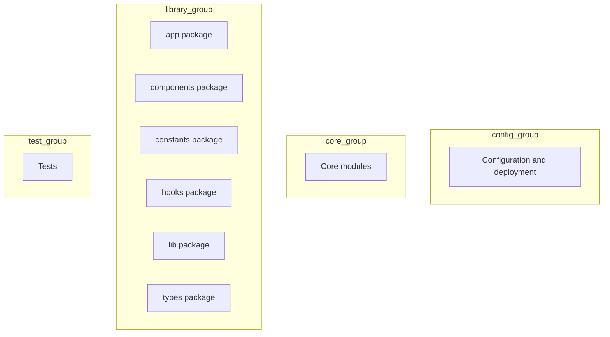

# Architecture report: rahuldkjain/github-profile-readme-generator

> Automated static analysis. **Observed** = directly seen in files/imports/AST; **Inferred** = interpretation from that evidence. Repository code was not executed.

## 1. Repository at a glance

| Item | Value |
| --- | --- |
| Repository | rahuldkjain/github-profile-readme-generator |
| Description | 🚀 Generate GitHub profile README easily with the latest add-ons like visitors count, GitHub stats, etc using minimal UI. |
| Language | TypeScript |
| Stars | 24481 |
| Licence | Apache-2.0 |
| Analysed commit / branch | 5ae90bfcbd7ab2f69809b094601f7975c32ae077 / main |
| Framework(s) | Next.js, React |
| Files analysed | 284 |
| Components | 9 |

## 2. Architecture in one minute

rahuldkjain/github-profile-readme-generator - 🚀 Generate GitHub profile README easily with the latest add-ons like visitors count, GitHub stats, etc using minimal UI.. This repository was analysed statically from 284 file(s) (0 Python). Detected technologies (observed from imports/manifests): GitHub Actions, Next.js, React, Tailwind CSS, TypeScript, Vitest. Files are grouped into 9 component(s): app package, components package, Configuration and deployment, constants package, Core modules, hooks package, lib package, Tests. Findings below distinguish observed facts from inferred interpretation.

## 3. High-level block diagram

## 4. Main components

### app package (`app`)

- **Kind:** library
- **Status:** Observed
- **Confidence:** 0.85
- **Responsibility:** Groups 7 file(s) under app package (observed from repository paths and static analysis).
- **Paths:** `src/app/about/page.tsx`, `src/app/addons/page.tsx`, `src/app/layout.tsx`, `src/app/page.tsx`, `src/app/robots.ts`, `src/app/sitemap.ts`, `src/app/support/page.tsx`
- **Evidence:** [src/app/about/page.tsx](https://github.com/rahuldkjain/github-profile-readme-generator/blob/5ae90bfcbd7ab2f69809b094601f7975c32ae077/src/app/about/page.tsx); [src/app/addons/page.tsx](https://github.com/rahuldkjain/github-profile-readme-generator/blob/5ae90bfcbd7ab2f69809b094601f7975c32ae077/src/app/addons/page.tsx); [src/app/layout.tsx](https://github.com/rahuldkjain/github-profile-readme-generator/blob/5ae90bfcbd7ab2f69809b094601f7975c32ae077/src/app/layout.tsx); [src/app/page.tsx](https://github.com/rahuldkjain/github-profile-readme-generator/blob/5ae90bfcbd7ab2f69809b094601f7975c32ae077/src/app/page.tsx); [src/app/robots.ts](https://github.com/rahuldkjain/github-profile-readme-generator/blob/5ae90bfcbd7ab2f69809b094601f7975c32ae077/src/app/robots.ts); [src/app/sitemap.ts](https://github.com/rahuldkjain/github-profile-readme-generator/blob/5ae90bfcbd7ab2f69809b094601f7975c32ae077/src/app/sitemap.ts); [src/app/support/page.tsx](https://github.com/rahuldkjain/github-profile-readme-generator/blob/5ae90bfcbd7ab2f69809b094601f7975c32ae077/src/app/support/page.tsx)

### components package (`components`)

- **Kind:** library
- **Status:** Observed
- **Confidence:** 0.85
- **Responsibility:** Groups 24 file(s) under components package (observed from repository paths and static analysis).
- **Paths:** `src/components/analytics/conditional-analytics.tsx`, `src/components/forms/__tests__/form-input.test.tsx`, `src/components/forms/form-checkbox.tsx`, `src/components/forms/form-input.tsx`, `src/components/forms/form-select.tsx`, `src/components/forms/form-textarea.tsx`, `src/components/forms/github-username-input.tsx`, `src/components/layout/footer.tsx`, `src/components/layout/header.tsx`, `src/components/layout/theme-provider.tsx`, `src/components/sections/basic-info-section.tsx`, `src/components/sections/links-section.tsx`, `src/components/sections/skills-section.tsx`, `src/components/sections/social-section.tsx`, `src/components/ui/accessibility-menu.tsx`, `src/components/ui/buy-me-coffee.tsx`, `src/components/ui/collapsible-section.tsx`, `src/components/ui/confirm-dialog.tsx`, `src/components/ui/cookie-consent.tsx`, `src/components/ui/github-stats.tsx`, `src/components/ui/markdown-preview.tsx`, `src/components/ui/select.tsx`, `src/components/ui/theme-toggle.tsx`, `src/components/ui/toast.tsx`
- **Evidence:** [src/components/analytics/conditional-analytics.tsx](https://github.com/rahuldkjain/github-profile-readme-generator/blob/5ae90bfcbd7ab2f69809b094601f7975c32ae077/src/components/analytics/conditional-analytics.tsx); [src/components/forms/__tests__/form-input.test.tsx](https://github.com/rahuldkjain/github-profile-readme-generator/blob/5ae90bfcbd7ab2f69809b094601f7975c32ae077/src/components/forms/__tests__/form-input.test.tsx); [src/components/forms/form-checkbox.tsx](https://github.com/rahuldkjain/github-profile-readme-generator/blob/5ae90bfcbd7ab2f69809b094601f7975c32ae077/src/components/forms/form-checkbox.tsx); [src/components/forms/form-input.tsx](https://github.com/rahuldkjain/github-profile-readme-generator/blob/5ae90bfcbd7ab2f69809b094601f7975c32ae077/src/components/forms/form-input.tsx); [src/components/forms/form-select.tsx](https://github.com/rahuldkjain/github-profile-readme-generator/blob/5ae90bfcbd7ab2f69809b094601f7975c32ae077/src/components/forms/form-select.tsx); [src/components/forms/form-textarea.tsx](https://github.com/rahuldkjain/github-profile-readme-generator/blob/5ae90bfcbd7ab2f69809b094601f7975c32ae077/src/components/forms/form-textarea.tsx); [src/components/forms/github-username-input.tsx](https://github.com/rahuldkjain/github-profile-readme-generator/blob/5ae90bfcbd7ab2f69809b094601f7975c32ae077/src/components/forms/github-username-input.tsx); [src/components/layout/footer.tsx](https://github.com/rahuldkjain/github-profile-readme-generator/blob/5ae90bfcbd7ab2f69809b094601f7975c32ae077/src/components/layout/footer.tsx)

### Configuration and deployment (`config`)

- **Kind:** config
- **Status:** Observed
- **Confidence:** 0.85
- **Responsibility:** Groups 3 file(s) under configuration and deployment (observed from repository paths and static analysis).
- **Paths:** `package.json`, `public/manifest.json`, `tsconfig.json`
- **Evidence:** [package.json](https://github.com/rahuldkjain/github-profile-readme-generator/blob/5ae90bfcbd7ab2f69809b094601f7975c32ae077/package.json); [public/manifest.json](https://github.com/rahuldkjain/github-profile-readme-generator/blob/5ae90bfcbd7ab2f69809b094601f7975c32ae077/public/manifest.json); [tsconfig.json](https://github.com/rahuldkjain/github-profile-readme-generator/blob/5ae90bfcbd7ab2f69809b094601f7975c32ae077/tsconfig.json)

### constants package (`constants`)

- **Kind:** library
- **Status:** Observed
- **Confidence:** 0.85
- **Responsibility:** Groups 2 file(s) under constants package (observed from repository paths and static analysis).
- **Paths:** `src/constants/defaults.ts`, `src/constants/skills.ts`
- **Evidence:** [src/constants/defaults.ts](https://github.com/rahuldkjain/github-profile-readme-generator/blob/5ae90bfcbd7ab2f69809b094601f7975c32ae077/src/constants/defaults.ts); [src/constants/skills.ts](https://github.com/rahuldkjain/github-profile-readme-generator/blob/5ae90bfcbd7ab2f69809b094601f7975c32ae077/src/constants/skills.ts)

### Core modules (`core`)

- **Kind:** core
- **Status:** Observed
- **Confidence:** 0.85
- **Responsibility:** Groups 7 file(s) under core modules (observed from repository paths and static analysis).
- **Paths:** `eslint.config.mjs`, `next.config.ts`, `postcss.config.mjs`, `setupTests.js`, `tailwind.config.js`, `tailwind.config.ts`, `vitest.config.ts`
- **Evidence:** [eslint.config.mjs](https://github.com/rahuldkjain/github-profile-readme-generator/blob/5ae90bfcbd7ab2f69809b094601f7975c32ae077/eslint.config.mjs); [next.config.ts](https://github.com/rahuldkjain/github-profile-readme-generator/blob/5ae90bfcbd7ab2f69809b094601f7975c32ae077/next.config.ts); [postcss.config.mjs](https://github.com/rahuldkjain/github-profile-readme-generator/blob/5ae90bfcbd7ab2f69809b094601f7975c32ae077/postcss.config.mjs); [setupTests.js](https://github.com/rahuldkjain/github-profile-readme-generator/blob/5ae90bfcbd7ab2f69809b094601f7975c32ae077/setupTests.js); [tailwind.config.js](https://github.com/rahuldkjain/github-profile-readme-generator/blob/5ae90bfcbd7ab2f69809b094601f7975c32ae077/tailwind.config.js); [tailwind.config.ts](https://github.com/rahuldkjain/github-profile-readme-generator/blob/5ae90bfcbd7ab2f69809b094601f7975c32ae077/tailwind.config.ts); [vitest.config.ts](https://github.com/rahuldkjain/github-profile-readme-generator/blob/5ae90bfcbd7ab2f69809b094601f7975c32ae077/vitest.config.ts)

### hooks package (`hooks`)

- **Kind:** library
- **Status:** Observed
- **Confidence:** 0.85
- **Responsibility:** Groups 3 file(s) under hooks package (observed from repository paths and static analysis).
- **Paths:** `src/hooks/use-consent.ts`, `src/hooks/use-local-storage.ts`, `src/hooks/use-theme.ts`
- **Evidence:** [src/hooks/use-consent.ts](https://github.com/rahuldkjain/github-profile-readme-generator/blob/5ae90bfcbd7ab2f69809b094601f7975c32ae077/src/hooks/use-consent.ts); [src/hooks/use-local-storage.ts](https://github.com/rahuldkjain/github-profile-readme-generator/blob/5ae90bfcbd7ab2f69809b094601f7975c32ae077/src/hooks/use-local-storage.ts); [src/hooks/use-theme.ts](https://github.com/rahuldkjain/github-profile-readme-generator/blob/5ae90bfcbd7ab2f69809b094601f7975c32ae077/src/hooks/use-theme.ts)

### lib package (`lib`)

- **Kind:** library
- **Status:** Observed
- **Confidence:** 0.85
- **Responsibility:** Groups 7 file(s) under lib package (observed from repository paths and static analysis).
- **Paths:** `src/lib/analytics.ts`, `src/lib/asset-path.ts`, `src/lib/github-api.ts`, `src/lib/markdown-generator.ts`, `src/lib/storage.ts`, `src/lib/store.ts`, `src/lib/validations.ts`
- **Evidence:** [src/lib/analytics.ts](https://github.com/rahuldkjain/github-profile-readme-generator/blob/5ae90bfcbd7ab2f69809b094601f7975c32ae077/src/lib/analytics.ts); [src/lib/asset-path.ts](https://github.com/rahuldkjain/github-profile-readme-generator/blob/5ae90bfcbd7ab2f69809b094601f7975c32ae077/src/lib/asset-path.ts); [src/lib/github-api.ts](https://github.com/rahuldkjain/github-profile-readme-generator/blob/5ae90bfcbd7ab2f69809b094601f7975c32ae077/src/lib/github-api.ts); [src/lib/markdown-generator.ts](https://github.com/rahuldkjain/github-profile-readme-generator/blob/5ae90bfcbd7ab2f69809b094601f7975c32ae077/src/lib/markdown-generator.ts); [src/lib/storage.ts](https://github.com/rahuldkjain/github-profile-readme-generator/blob/5ae90bfcbd7ab2f69809b094601f7975c32ae077/src/lib/storage.ts); [src/lib/store.ts](https://github.com/rahuldkjain/github-profile-readme-generator/blob/5ae90bfcbd7ab2f69809b094601f7975c32ae077/src/lib/store.ts); [src/lib/validations.ts](https://github.com/rahuldkjain/github-profile-readme-generator/blob/5ae90bfcbd7ab2f69809b094601f7975c32ae077/src/lib/validations.ts)

### Tests (`tests`)

- **Kind:** test
- **Status:** Observed
- **Confidence:** 0.85
- **Responsibility:** Groups 1 file(s) under tests (observed from repository paths and static analysis).
- **Paths:** `src/test/setup.ts`
- **Evidence:** [src/test/setup.ts](https://github.com/rahuldkjain/github-profile-readme-generator/blob/5ae90bfcbd7ab2f69809b094601f7975c32ae077/src/test/setup.ts)

### types package (`types`)

- **Kind:** library
- **Status:** Observed
- **Confidence:** 0.85
- **Responsibility:** Groups 3 file(s) under types package (observed from repository paths and static analysis).
- **Paths:** `src/types/profile.ts`, `src/types/skills.ts`, `src/types/theme.ts`
- **Evidence:** [src/types/profile.ts](https://github.com/rahuldkjain/github-profile-readme-generator/blob/5ae90bfcbd7ab2f69809b094601f7975c32ae077/src/types/profile.ts); [src/types/skills.ts](https://github.com/rahuldkjain/github-profile-readme-generator/blob/5ae90bfcbd7ab2f69809b094601f7975c32ae077/src/types/skills.ts); [src/types/theme.ts](https://github.com/rahuldkjain/github-profile-readme-generator/blob/5ae90bfcbd7ab2f69809b094601f7975c32ae077/src/types/theme.ts)

## 5. Execution flow

**Observed** entry point(s):

- [src/app/about/page.tsx](https://github.com/rahuldkjain/github-profile-readme-generator/blob/5ae90bfcbd7ab2f69809b094601f7975c32ae077/src/app/about/page.tsx)
- [src/app/addons/page.tsx](https://github.com/rahuldkjain/github-profile-readme-generator/blob/5ae90bfcbd7ab2f69809b094601f7975c32ae077/src/app/addons/page.tsx)
- [src/app/page.tsx](https://github.com/rahuldkjain/github-profile-readme-generator/blob/5ae90bfcbd7ab2f69809b094601f7975c32ae077/src/app/page.tsx)
- [src/app/support/page.tsx](https://github.com/rahuldkjain/github-profile-readme-generator/blob/5ae90bfcbd7ab2f69809b094601f7975c32ae077/src/app/support/page.tsx)

Representative flow (derived from observed entry points and the import graph; steps beyond the entry point are **Inferred**):

1. Execution starts at an observed entry point listed above, if present.
2. No internal import relationships between components were observed.

## 6. Project structure

### `(root)`

- `.all-contributorsrc` - other (2376 bytes)
- `.eslintignore` - other (15 bytes)
- `.eslintrc.json` - config (360 bytes)
- `.gitignore` - other (508 bytes)
- `.prettierignore` - other (45 bytes)
- `.prettierrc` - other (227 bytes)
- `CHANGELOG.md` - docs (2847 bytes)
- `CHEATSHEET.md` - docs (10169 bytes)
- `CODE_OF_CONDUCT.md` - docs (3356 bytes)
- `CODE_STYLE_GUIDE.md` - docs (7541 bytes)
- `COMMIT_CONVENTION.md` - docs (3848 bytes)
- `CONTRIBUTING.md` - docs (8579 bytes)
- `DEPLOYMENT.md` - docs (4151 bytes)
- `LICENSE` - docs (11357 bytes)
- `README.md` - docs (9281 bytes)
- `env.example` - other (952 bytes)
- `eslint.config.mjs` - source, JavaScript (977 bytes)
- `next.config.ts` - source, TypeScript (3335 bytes)
- `package.json` - manifest (1896 bytes)
- `postcss.config.mjs` - source, JavaScript (81 bytes)
- `setupTests.js` - source, JavaScript (123 bytes)
- `tailwind.config.js` - source, JavaScript (508 bytes)
- `tailwind.config.ts` - source, TypeScript (2589 bytes)
- `tsconfig.json` - config (602 bytes)
- `vitest.config.ts` - source, TypeScript (607 bytes)

### `.github`

- `.github/FUNDING.yml` - config (607 bytes)
- `.github/ISSUE_TEMPLATE/bug_report.md` - docs (1293 bytes)
- `.github/ISSUE_TEMPLATE/feature-enhancement-request.md` - docs (891 bytes)
- `.github/ISSUE_TEMPLATE/feature_request.md` - docs (1405 bytes)
- `.github/PULL_REQUEST_TEMPLATE.md` - docs (6265 bytes)
- `.github/config.yml` - config (911 bytes)
- `.github/workflows/deploy.yml` - ci, YAML (6505 bytes)

### `.husky`

- `.husky/pre-commit` - other (71 bytes)

### `public`

- `public/manifest.json` - config (766 bytes)
- `public/robots.txt` - docs (201 bytes)

### `src`

- `src/app/about/page.tsx` - source, TypeScript (7341 bytes)
- `src/app/addons/page.tsx` - source, TypeScript (9595 bytes)
- `src/app/globals.css` - other (8060 bytes)
- `src/app/layout.tsx` - source, TypeScript (5044 bytes)
- `src/app/page.tsx` - source, TypeScript (23485 bytes)
- `src/app/robots.ts` - source, TypeScript (376 bytes)
- `src/app/sitemap.ts` - source, TypeScript (751 bytes)
- `src/app/support/page.tsx` - source, TypeScript (5132 bytes)
- `src/components/analytics/conditional-analytics.tsx` - source, TypeScript (903 bytes)
- `src/components/forms/__tests__/form-input.test.tsx` - source, TypeScript (4457 bytes)
- `src/components/forms/form-checkbox.tsx` - source, TypeScript (1254 bytes)
- `src/components/forms/form-input.tsx` - source, TypeScript (1385 bytes)
- `src/components/forms/form-select.tsx` - source, TypeScript (582 bytes)
- `src/components/forms/form-textarea.tsx` - source, TypeScript (1415 bytes)
- `src/components/forms/github-username-input.tsx` - source, TypeScript (4531 bytes)
- `src/components/layout/footer.tsx` - source, TypeScript (5791 bytes)
- `src/components/layout/header.tsx` - source, TypeScript (4165 bytes)
- `src/components/layout/theme-provider.tsx` - source, TypeScript (1380 bytes)
- `src/components/sections/basic-info-section.tsx` - source, TypeScript (10940 bytes)
- `src/components/sections/links-section.tsx` - source, TypeScript (1498 bytes)
- `src/components/sections/skills-section.tsx` - source, TypeScript (9558 bytes)
- `src/components/sections/social-section.tsx` - source, TypeScript (5952 bytes)
- `src/components/ui/accessibility-menu.tsx` - source, TypeScript (3188 bytes)
- `src/components/ui/buy-me-coffee.tsx` - source, TypeScript (1156 bytes)
- `src/components/ui/collapsible-section.tsx` - source, TypeScript (1896 bytes)
- `src/components/ui/confirm-dialog.tsx` - source, TypeScript (5075 bytes)
- `src/components/ui/cookie-consent.tsx` - source, TypeScript (4988 bytes)
- `src/components/ui/github-stats.tsx` - source, TypeScript (5705 bytes)
- `src/components/ui/markdown-preview.tsx` - source, TypeScript (7246 bytes)
- `src/components/ui/select.tsx` - source, TypeScript (4107 bytes)
- `src/components/ui/theme-toggle.tsx` - source, TypeScript (1708 bytes)
- `src/components/ui/toast.tsx` - source, TypeScript (7472 bytes)
- `src/constants/defaults.ts` - source, TypeScript (2139 bytes)
- `src/constants/skills.ts` - source, TypeScript (4205 bytes)
- `src/hooks/use-consent.ts` - source, TypeScript (2800 bytes)
- `src/hooks/use-local-storage.ts` - source, TypeScript (1553 bytes)
- `src/hooks/use-theme.ts` - source, TypeScript (1768 bytes)
- `src/images/icons/AIML/opencv.svg` - other (682 bytes)
- `src/images/icons/AIML/pytorch.svg` - other (770 bytes)
- `src/images/icons/AIML/scikit.svg` - other (2795 bytes)
- `src/images/icons/AIML/tensorflow.svg` - other (996 bytes)
- `src/images/icons/Automation/ifttt.svg` - other (839 bytes)
- `src/images/icons/Automation/zapier.svg` - other (1082 bytes)
- `src/images/icons/BaaS/amplify.svg` - other (951 bytes)
- `src/images/icons/BaaS/firebase.svg` - other (833 bytes)
- `src/images/icons/BaaS/heroku.svg` - other (795 bytes)
- `src/images/icons/BackendDevelopment/express.svg` - other (915 bytes)
- `src/images/icons/BackendDevelopment/graphql.svg` - other (1589 bytes)
- `src/images/icons/BackendDevelopment/hadoop.svg` - other (12521 bytes)
- `src/images/icons/BackendDevelopment/kafka.svg` - other (20251 bytes)
- `src/images/icons/BackendDevelopment/nestjs.svg` - other (3933 bytes)
- `src/images/icons/BackendDevelopment/nginx.svg` - other (1076 bytes)
- `src/images/icons/BackendDevelopment/nodejs.svg` - other (1485 bytes)
- `src/images/icons/BackendDevelopment/openresty.svg` - other (2439 bytes)
- `src/images/icons/BackendDevelopment/rabbitmq.svg` - other (887 bytes)
- `src/images/icons/BackendDevelopment/solr.svg` - other (941 bytes)
- `src/images/icons/BackendDevelopment/spring.svg` - other (1086 bytes)
- `src/images/icons/DataVisualization/canvasjs.svg` - other (7880 bytes)
- `src/images/icons/DataVisualization/chartjs.svg` - other (1097 bytes)
- `src/images/icons/DataVisualization/d3js.svg` - other (2232 bytes)
- `src/images/icons/DataVisualization/grafana.svg` - other (5353 bytes)
- `src/images/icons/DataVisualization/kibana.svg` - other (833 bytes)
- `src/images/icons/Database/cassandra.svg` - other (10527 bytes)
- `src/images/icons/Database/cockroachdb.svg` - other (1601 bytes)
- `src/images/icons/Database/couchdb.svg` - other (984 bytes)
- `src/images/icons/Database/elasticsearch.svg` - other (1782 bytes)
- `src/images/icons/Database/hive.svg` - other (9625 bytes)
- `src/images/icons/Database/mariadb.svg` - other (2248 bytes)
- `src/images/icons/Database/mongodb.svg` - other (5059 bytes)
- `src/images/icons/Database/mysql.svg` - other (2436 bytes)
- `src/images/icons/Database/oracle.svg` - other (649 bytes)
- `src/images/icons/Database/postgresql.svg` - other (4949 bytes)
- `src/images/icons/Database/realm.svg` - other (2827 bytes)
- `src/images/icons/Database/redis.svg` - other (2205 bytes)
- `src/images/icons/Database/sqlite.svg` - other (1331 bytes)
- `src/images/icons/Devops/aws.svg` - other (3371 bytes)
- `src/images/icons/Devops/azure.svg` - other (577 bytes)
- `src/images/icons/Devops/bash.svg` - other (1732 bytes)
- `src/images/icons/Devops/circleci.svg` - other (910 bytes)
- `src/images/icons/Devops/docker.svg` - other (1800 bytes)
- `src/images/icons/Devops/gcp.svg` - other (1264 bytes)
- `src/images/icons/Devops/jenkins.svg` - other (12956 bytes)
- `src/images/icons/Devops/kubernetes.svg` - other (3734 bytes)
- `src/images/icons/Devops/travisci.svg` - other (20251 bytes)
- `src/images/icons/Devops/vagrant.svg` - other (767 bytes)
- `src/images/icons/Framework/codeigniter.svg` - other (1080 bytes)
- `src/images/icons/Framework/django.svg` - other (2225 bytes)
- `src/images/icons/Framework/dotnet.svg` - other (5030 bytes)
- `src/images/icons/Framework/electron.svg` - other (2856 bytes)
- `src/images/icons/Framework/flask.svg` - other (9556 bytes)
- `src/images/icons/Framework/laravel.svg` - other (1998 bytes)
- `src/images/icons/Framework/quasar.svg` - other (2589 bytes)
- `src/images/icons/Framework/rails.svg` - other (2478 bytes)
- `src/images/icons/Framework/symfony.svg` - other (1621 bytes)
- `src/images/icons/FrontendDevelopment/angularjs.svg` - other (797 bytes)
- `src/images/icons/FrontendDevelopment/babel.svg` - other (8012 bytes)
- `src/images/icons/FrontendDevelopment/backbonejs.svg` - other (780 bytes)
- `src/images/icons/FrontendDevelopment/bootstrap.svg` - other (1083 bytes)
- `src/images/icons/FrontendDevelopment/bulma.svg` - other (510 bytes)
- `src/images/icons/FrontendDevelopment/css.svg` - other (863 bytes)
- `src/images/icons/FrontendDevelopment/ember.svg` - other (52179 bytes)
- `src/images/icons/FrontendDevelopment/gtk.svg` - other (1273 bytes)
- `src/images/icons/FrontendDevelopment/gulp.svg` - other (7045 bytes)
- `src/images/icons/FrontendDevelopment/html.svg` - other (873 bytes)
- `src/images/icons/FrontendDevelopment/materialize.svg` - other (5017 bytes)
- `src/images/icons/FrontendDevelopment/meteor.svg` - other (1270 bytes)
- `src/images/icons/FrontendDevelopment/pug.svg` - other (5964 bytes)
- `src/images/icons/FrontendDevelopment/qt.svg` - other (1550 bytes)
- `src/images/icons/FrontendDevelopment/reactjs.svg` - other (2087 bytes)
- `src/images/icons/FrontendDevelopment/redux.svg` - other (1483 bytes)
- `src/images/icons/FrontendDevelopment/sass.svg` - other (3080 bytes)
- `src/images/icons/FrontendDevelopment/svelte.svg` - other (1635 bytes)
- `src/images/icons/FrontendDevelopment/tailwind.svg` - other (1056 bytes)
- `src/images/icons/FrontendDevelopment/vuejs.svg` - other (696 bytes)
- `src/images/icons/FrontendDevelopment/vuetify.svg` - other (688 bytes)
- `src/images/icons/FrontendDevelopment/webpack.svg` - other (1051 bytes)
- `src/images/icons/FrontendDevelopment/wxwidgets.svg` - other (5291 bytes)
- `src/images/icons/GameEngines/unity.svg` - other (679 bytes)
- `src/images/icons/GameEngines/unreal.svg` - other (893 bytes)
- `src/images/icons/MobileAppDevelopment/android.svg` - other (1003 bytes)
- `src/images/icons/MobileAppDevelopment/apachecordova.svg` - other (5097 bytes)
- `src/images/icons/MobileAppDevelopment/dart.svg` - other (1379 bytes)
- `src/images/icons/MobileAppDevelopment/flutter.svg` - other (3459 bytes)
- `src/images/icons/MobileAppDevelopment/ionic.svg` - other (911 bytes)
- `src/images/icons/MobileAppDevelopment/kotlin.svg` - other (1937 bytes)
- `src/images/icons/MobileAppDevelopment/nativescript.svg` - other (1077 bytes)
- `src/images/icons/MobileAppDevelopment/reactnative.svg` - other (2087 bytes)
- `src/images/icons/MobileAppDevelopment/xamarin.svg` - other (1041 bytes)
- `src/images/icons/Other/arduino.svg` - other (3221 bytes)
- `src/images/icons/Other/git.svg` - other (1017 bytes)
- `src/images/icons/Other/linux.svg` - other (162526 bytes)
- `src/images/icons/ProgrammingLanguages/c.svg` - other (1424 bytes)
- `src/images/icons/ProgrammingLanguages/clojure.svg` - other (1331 bytes)
- `src/images/icons/ProgrammingLanguages/coffeescript.svg` - other (1679 bytes)
- `src/images/icons/ProgrammingLanguages/cpp.svg` - other (1584 bytes)
- `src/images/icons/ProgrammingLanguages/csharp.svg` - other (1591 bytes)
- `src/images/icons/ProgrammingLanguages/elixir.svg` - other (5474 bytes)
- `src/images/icons/ProgrammingLanguages/erlang.svg` - other (1699 bytes)
- `src/images/icons/ProgrammingLanguages/go.svg` - other (2085 bytes)
- `src/images/icons/ProgrammingLanguages/haskell.svg` - other (812 bytes)
- `src/images/icons/ProgrammingLanguages/java.svg` - other (1491 bytes)
- `src/images/icons/ProgrammingLanguages/javascript.svg` - other (926 bytes)
- `src/images/icons/ProgrammingLanguages/objectivec.svg` - other (1811 bytes)
- `src/images/icons/ProgrammingLanguages/perl.svg` - other (2771 bytes)
- `src/images/icons/ProgrammingLanguages/php.svg` - other (1362 bytes)
- `src/images/icons/ProgrammingLanguages/python.svg` - other (1188 bytes)
- `src/images/icons/ProgrammingLanguages/ruby.svg` - other (9920 bytes)
- `src/images/icons/ProgrammingLanguages/rust.svg` - other (4634 bytes)
- `src/images/icons/ProgrammingLanguages/scala.svg` - other (2565 bytes)
- `src/images/icons/ProgrammingLanguages/swift.svg` - other (993 bytes)
- `src/images/icons/ProgrammingLanguages/typescript.svg` - other (796 bytes)
- `src/images/icons/Social/behance.svg` - other (1107 bytes)
- `src/images/icons/Social/blogger.svg` - other (1304 bytes)
- `src/images/icons/Social/codeforces.svg` - other (8402 bytes)
- `src/images/icons/Social/codepen.svg` - other (838 bytes)
- `src/images/icons/Social/codesandbox.svg` - other (6991 bytes)
- `src/images/icons/Social/devto.svg` - other (2342 bytes)
- `src/images/icons/Social/discord.svg` - other (1106 bytes)
- `src/images/icons/Social/dribbble.svg` - other (1831 bytes)
- `src/images/icons/Social/dropbox.svg` - other (1131 bytes)
- `src/images/icons/Social/envato.svg` - other (936 bytes)
- `src/images/icons/Social/facebook-alt.svg` - other (685 bytes)
- `src/images/icons/Social/facebook.svg` - other (846 bytes)
- `src/images/icons/Social/geeks-for-geeks.svg` - other (2004 bytes)
- `src/images/icons/Social/github.svg` - other (1550 bytes)
- `src/images/icons/Social/google.svg` - other (791 bytes)
- `src/images/icons/Social/hackerearth.svg` - other (629 bytes)
- `src/images/icons/Social/hackerrank.svg` - other (906 bytes)
- `src/images/icons/Social/hashnode.svg` - other (661 bytes)
- `src/images/icons/Social/instagram.svg` - other (2192 bytes)
- `src/images/icons/Social/kaggle.svg` - other (739 bytes)
- `src/images/icons/Social/leet-code.svg` - other (2615 bytes)
- `src/images/icons/Social/linked-in-alt.svg` - other (1010 bytes)
- `src/images/icons/Social/linked-in.svg` - other (516 bytes)
- `src/images/icons/Social/medium.svg` - other (725 bytes)
- `src/images/icons/Social/messenger.svg` - other (895 bytes)
- `src/images/icons/Social/myspace-alt.svg` - other (1208 bytes)
- `src/images/icons/Social/myspace.svg` - other (982 bytes)
- `src/images/icons/Social/path.svg` - other (1193 bytes)
- `src/images/icons/Social/photo.svg` - other (1134 bytes)
- `src/images/icons/Social/picasa.svg` - other (1198 bytes)
- `src/images/icons/Social/pinterest.svg` - other (1424 bytes)
- `src/images/icons/Social/reddit.svg` - other (1917 bytes)
- `src/images/icons/Social/rss.svg` - other (859 bytes)
- `src/images/icons/Social/skype.svg` - other (2787 bytes)
- `src/images/icons/Social/snapchat.svg` - other (3061 bytes)
- `src/images/icons/Social/soundcloud.svg` - other (1372 bytes)
- `src/images/icons/Social/spotify.svg` - other (1589 bytes)
- `src/images/icons/Social/stack-overflow.svg` - other (593 bytes)
- `src/images/icons/Social/team.svg` - other (727 bytes)
- `src/images/icons/Social/topcoder.svg` - other (8495 bytes)
- `src/images/icons/Social/tumblr.svg` - other (1174 bytes)
- `src/images/icons/Social/twitch.svg` - other (834 bytes)
- `src/images/icons/Social/twitter-alt.svg` - other (788 bytes)
- `src/images/icons/Social/twitter.svg` - other (1386 bytes)
- `src/images/icons/Social/viddler.svg` - other (1244 bytes)
- `src/images/icons/Social/vimeo.svg` - other (1015 bytes)
- `src/images/icons/Social/vine.svg` - other (1267 bytes)
- `src/images/icons/Social/vk.svg` - other (1754 bytes)
- `src/images/icons/Social/whatsapp.svg` - other (1625 bytes)
- `src/images/icons/Social/wordpress.svg` - other (1959 bytes)
- `src/images/icons/Social/yahoo.svg` - other (1500 bytes)
- `src/images/icons/Social/youtube.svg` - other (1238 bytes)
- `src/images/icons/Software/blender.svg` - other (2100 bytes)
- `src/images/icons/Software/figma.svg` - other (917 bytes)
- `src/images/icons/Software/framer.svg` - other (724 bytes)
- `src/images/icons/Software/illustrator.svg` - other (1701 bytes)
- `src/images/icons/Software/invision.svg` - other (1245 bytes)
- `src/images/icons/Software/matlab.svg` - other (70094 bytes)
- `src/images/icons/Software/photoshop.svg` - other (2433 bytes)
- `src/images/icons/Software/postman.svg` - other (5003 bytes)
- `src/images/icons/Software/sketch.svg` - other (1298 bytes)
- `src/images/icons/Software/solidworks.svg` - other (1690 bytes)
- `src/images/icons/Software/xd.svg` - other (2294 bytes)
- `src/images/icons/StaticSiteGenerators/11ty.svg` - other (2195 bytes)
- `src/images/icons/StaticSiteGenerators/gatsby.svg` - other (1109 bytes)
- `src/images/icons/StaticSiteGenerators/gridsome.svg` - other (1480 bytes)
- `src/images/icons/StaticSiteGenerators/hexo.svg` - other (590 bytes)
- `src/images/icons/StaticSiteGenerators/hugo.svg` - other (154725 bytes)
- `src/images/icons/StaticSiteGenerators/jekyll.svg` - other (2278 bytes)
- `src/images/icons/StaticSiteGenerators/middleman.svg` - other (1586 bytes)
- `src/images/icons/StaticSiteGenerators/nextjs.svg` - other (1516 bytes)
- `src/images/icons/StaticSiteGenerators/nuxtjs.svg` - other (1334 bytes)
- `src/images/icons/StaticSiteGenerators/sapper.svg` - other (1627 bytes)
- `src/images/icons/StaticSiteGenerators/scully.svg` - other (1982 bytes)
- `src/images/icons/StaticSiteGenerators/vuepress.svg` - other (5731 bytes)
- `src/images/icons/Testing/cypress.svg` - other (1074 bytes)
- `src/images/icons/Testing/jasmine.svg` - other (1238 bytes)
- `src/images/icons/Testing/jest.svg` - other (2641 bytes)
- `src/images/icons/Testing/karma.svg` - other (688 bytes)
- `src/images/icons/Testing/mocha.svg` - other (3798 bytes)
- `src/images/icons/Testing/puppeteer.svg` - other (5373 bytes)
- `src/images/icons/Testing/selenium.svg` - other (3182 bytes)
- `src/images/icons/mysqlworkbench.svg` - other (4635 bytes)
- `src/lib/analytics.ts` - source, TypeScript (3323 bytes)
- `src/lib/asset-path.ts` - source, TypeScript (455 bytes)
- `src/lib/github-api.ts` - source, TypeScript (5579 bytes)
- `src/lib/markdown-generator.ts` - source, TypeScript (15126 bytes)
- `src/lib/storage.ts` - source, TypeScript (2069 bytes)
- `src/lib/store.ts` - source, TypeScript (1090 bytes)
- `src/lib/validations.ts` - source, TypeScript (3610 bytes)
- `src/markdown-pages/about.md` - docs (3634 bytes)
- `src/markdown-pages/addons.md` - docs (3807 bytes)
- `src/markdown-pages/support.md` - docs (9725 bytes)
- `src/styles/tailwind.css` - other (1835 bytes)
- `src/test/setup.ts` - test, TypeScript (86 bytes)
- `src/types/profile.ts` - source, TypeScript (2181 bytes)
- `src/types/skills.ts` - source, TypeScript (314 bytes)
- `src/types/theme.ts` - source, TypeScript (236 bytes)

## 7. Key dependencies and integrations

| Name | Category | Status | Confidence | Evidence |
| --- | --- | --- | --- | --- |
| GitHub Actions | ci | Observed | 0.85 | [.github/workflows/deploy.yml](https://github.com/rahuldkjain/github-profile-readme-generator/blob/5ae90bfcbd7ab2f69809b094601f7975c32ae077/.github/workflows/deploy.yml) |
| Next.js | framework | Observed | 0.85 | [package.json:8](https://github.com/rahuldkjain/github-profile-readme-generator/blob/5ae90bfcbd7ab2f69809b094601f7975c32ae077/package.json#L8) |
| React | framework | Observed | 0.90 | [package.json:21](https://github.com/rahuldkjain/github-profile-readme-generator/blob/5ae90bfcbd7ab2f69809b094601f7975c32ae077/package.json#L21); [package.json:30](https://github.com/rahuldkjain/github-profile-readme-generator/blob/5ae90bfcbd7ab2f69809b094601f7975c32ae077/package.json#L30) |
| Tailwind CSS | library | Observed | 0.85 | [package.json:24](https://github.com/rahuldkjain/github-profile-readme-generator/blob/5ae90bfcbd7ab2f69809b094601f7975c32ae077/package.json#L24) |
| TypeScript | tooling | Observed | 0.85 | [package.json:56](https://github.com/rahuldkjain/github-profile-readme-generator/blob/5ae90bfcbd7ab2f69809b094601f7975c32ae077/package.json#L56) |
| Vitest | tooling | Observed | 0.85 | [package.json:16](https://github.com/rahuldkjain/github-profile-readme-generator/blob/5ae90bfcbd7ab2f69809b094601f7975c32ae077/package.json#L16) |

## 8. Data and state

No database, cache, queue, or persistent-state usage was observed in the analysed files. State handling, if any, may be in-memory or in files that were not analysed.

## 9. Configuration and deployment clues

- `.eslintrc.json` (config)
- `.github/FUNDING.yml` (config)
- `.github/config.yml` (config)
- `.github/workflows/deploy.yml` (ci)
- `package.json` (manifest)
- `public/manifest.json` (config)
- `tsconfig.json` (config)

## 10. Design observations

- Tests are present alongside source code (Observed from test file paths).

These observations are interpretations (**Inferred**) of the observed structure, not guarantees about runtime design.

## 11. Limitations and unknowns

- Static analysis only: repository code was not executed, installed, or imported at runtime.
- Components and relationships are inferred from file paths, imports, and AST structure; runtime behaviour, dynamic imports, and reflection may not be visible.
- No clear application entry point was observed in the analysed files.
- Repository text was treated as untrusted data; no instructions found in repository files were followed, and likely secret values were redacted/excluded.
- JavaScript and TypeScript files were inventoried from paths and package manifests. They were not parsed with a full language AST, and repository code was not executed.

## 12. Source references

- [.github/workflows/deploy.yml](https://github.com/rahuldkjain/github-profile-readme-generator/blob/5ae90bfcbd7ab2f69809b094601f7975c32ae077/.github/workflows/deploy.yml)
- [eslint.config.mjs](https://github.com/rahuldkjain/github-profile-readme-generator/blob/5ae90bfcbd7ab2f69809b094601f7975c32ae077/eslint.config.mjs)
- [next.config.ts](https://github.com/rahuldkjain/github-profile-readme-generator/blob/5ae90bfcbd7ab2f69809b094601f7975c32ae077/next.config.ts)
- [package.json](https://github.com/rahuldkjain/github-profile-readme-generator/blob/5ae90bfcbd7ab2f69809b094601f7975c32ae077/package.json)
- [package.json:8](https://github.com/rahuldkjain/github-profile-readme-generator/blob/5ae90bfcbd7ab2f69809b094601f7975c32ae077/package.json#L8)
- [package.json:16](https://github.com/rahuldkjain/github-profile-readme-generator/blob/5ae90bfcbd7ab2f69809b094601f7975c32ae077/package.json#L16)
- [package.json:21](https://github.com/rahuldkjain/github-profile-readme-generator/blob/5ae90bfcbd7ab2f69809b094601f7975c32ae077/package.json#L21)
- [package.json:24](https://github.com/rahuldkjain/github-profile-readme-generator/blob/5ae90bfcbd7ab2f69809b094601f7975c32ae077/package.json#L24)
- [package.json:30](https://github.com/rahuldkjain/github-profile-readme-generator/blob/5ae90bfcbd7ab2f69809b094601f7975c32ae077/package.json#L30)
- [package.json:56](https://github.com/rahuldkjain/github-profile-readme-generator/blob/5ae90bfcbd7ab2f69809b094601f7975c32ae077/package.json#L56)
- [postcss.config.mjs](https://github.com/rahuldkjain/github-profile-readme-generator/blob/5ae90bfcbd7ab2f69809b094601f7975c32ae077/postcss.config.mjs)
- [public/manifest.json](https://github.com/rahuldkjain/github-profile-readme-generator/blob/5ae90bfcbd7ab2f69809b094601f7975c32ae077/public/manifest.json)
- [setupTests.js](https://github.com/rahuldkjain/github-profile-readme-generator/blob/5ae90bfcbd7ab2f69809b094601f7975c32ae077/setupTests.js)
- [src/app/about/page.tsx](https://github.com/rahuldkjain/github-profile-readme-generator/blob/5ae90bfcbd7ab2f69809b094601f7975c32ae077/src/app/about/page.tsx)
- [src/app/addons/page.tsx](https://github.com/rahuldkjain/github-profile-readme-generator/blob/5ae90bfcbd7ab2f69809b094601f7975c32ae077/src/app/addons/page.tsx)
- [src/app/layout.tsx](https://github.com/rahuldkjain/github-profile-readme-generator/blob/5ae90bfcbd7ab2f69809b094601f7975c32ae077/src/app/layout.tsx)
- [src/app/page.tsx](https://github.com/rahuldkjain/github-profile-readme-generator/blob/5ae90bfcbd7ab2f69809b094601f7975c32ae077/src/app/page.tsx)
- [src/app/robots.ts](https://github.com/rahuldkjain/github-profile-readme-generator/blob/5ae90bfcbd7ab2f69809b094601f7975c32ae077/src/app/robots.ts)
- [src/app/sitemap.ts](https://github.com/rahuldkjain/github-profile-readme-generator/blob/5ae90bfcbd7ab2f69809b094601f7975c32ae077/src/app/sitemap.ts)
- [src/app/support/page.tsx](https://github.com/rahuldkjain/github-profile-readme-generator/blob/5ae90bfcbd7ab2f69809b094601f7975c32ae077/src/app/support/page.tsx)
- [src/components/analytics/conditional-analytics.tsx](https://github.com/rahuldkjain/github-profile-readme-generator/blob/5ae90bfcbd7ab2f69809b094601f7975c32ae077/src/components/analytics/conditional-analytics.tsx)
- [src/components/forms/__tests__/form-input.test.tsx](https://github.com/rahuldkjain/github-profile-readme-generator/blob/5ae90bfcbd7ab2f69809b094601f7975c32ae077/src/components/forms/__tests__/form-input.test.tsx)
- [src/components/forms/form-checkbox.tsx](https://github.com/rahuldkjain/github-profile-readme-generator/blob/5ae90bfcbd7ab2f69809b094601f7975c32ae077/src/components/forms/form-checkbox.tsx)
- [src/components/forms/form-input.tsx](https://github.com/rahuldkjain/github-profile-readme-generator/blob/5ae90bfcbd7ab2f69809b094601f7975c32ae077/src/components/forms/form-input.tsx)
- [src/components/forms/form-select.tsx](https://github.com/rahuldkjain/github-profile-readme-generator/blob/5ae90bfcbd7ab2f69809b094601f7975c32ae077/src/components/forms/form-select.tsx)
- [src/components/forms/form-textarea.tsx](https://github.com/rahuldkjain/github-profile-readme-generator/blob/5ae90bfcbd7ab2f69809b094601f7975c32ae077/src/components/forms/form-textarea.tsx)
- [src/components/forms/github-username-input.tsx](https://github.com/rahuldkjain/github-profile-readme-generator/blob/5ae90bfcbd7ab2f69809b094601f7975c32ae077/src/components/forms/github-username-input.tsx)
- [src/components/layout/footer.tsx](https://github.com/rahuldkjain/github-profile-readme-generator/blob/5ae90bfcbd7ab2f69809b094601f7975c32ae077/src/components/layout/footer.tsx)
- [src/constants/defaults.ts](https://github.com/rahuldkjain/github-profile-readme-generator/blob/5ae90bfcbd7ab2f69809b094601f7975c32ae077/src/constants/defaults.ts)
- [src/constants/skills.ts](https://github.com/rahuldkjain/github-profile-readme-generator/blob/5ae90bfcbd7ab2f69809b094601f7975c32ae077/src/constants/skills.ts)
- [src/hooks/use-consent.ts](https://github.com/rahuldkjain/github-profile-readme-generator/blob/5ae90bfcbd7ab2f69809b094601f7975c32ae077/src/hooks/use-consent.ts)
- [src/hooks/use-local-storage.ts](https://github.com/rahuldkjain/github-profile-readme-generator/blob/5ae90bfcbd7ab2f69809b094601f7975c32ae077/src/hooks/use-local-storage.ts)
- [src/hooks/use-theme.ts](https://github.com/rahuldkjain/github-profile-readme-generator/blob/5ae90bfcbd7ab2f69809b094601f7975c32ae077/src/hooks/use-theme.ts)
- [src/lib/analytics.ts](https://github.com/rahuldkjain/github-profile-readme-generator/blob/5ae90bfcbd7ab2f69809b094601f7975c32ae077/src/lib/analytics.ts)
- [src/lib/asset-path.ts](https://github.com/rahuldkjain/github-profile-readme-generator/blob/5ae90bfcbd7ab2f69809b094601f7975c32ae077/src/lib/asset-path.ts)
- [src/lib/github-api.ts](https://github.com/rahuldkjain/github-profile-readme-generator/blob/5ae90bfcbd7ab2f69809b094601f7975c32ae077/src/lib/github-api.ts)
- [src/lib/markdown-generator.ts](https://github.com/rahuldkjain/github-profile-readme-generator/blob/5ae90bfcbd7ab2f69809b094601f7975c32ae077/src/lib/markdown-generator.ts)
- [src/lib/storage.ts](https://github.com/rahuldkjain/github-profile-readme-generator/blob/5ae90bfcbd7ab2f69809b094601f7975c32ae077/src/lib/storage.ts)
- [src/lib/store.ts](https://github.com/rahuldkjain/github-profile-readme-generator/blob/5ae90bfcbd7ab2f69809b094601f7975c32ae077/src/lib/store.ts)
- [src/lib/validations.ts](https://github.com/rahuldkjain/github-profile-readme-generator/blob/5ae90bfcbd7ab2f69809b094601f7975c32ae077/src/lib/validations.ts)
- [src/test/setup.ts](https://github.com/rahuldkjain/github-profile-readme-generator/blob/5ae90bfcbd7ab2f69809b094601f7975c32ae077/src/test/setup.ts)
- [src/types/profile.ts](https://github.com/rahuldkjain/github-profile-readme-generator/blob/5ae90bfcbd7ab2f69809b094601f7975c32ae077/src/types/profile.ts)
- [src/types/skills.ts](https://github.com/rahuldkjain/github-profile-readme-generator/blob/5ae90bfcbd7ab2f69809b094601f7975c32ae077/src/types/skills.ts)
- [src/types/theme.ts](https://github.com/rahuldkjain/github-profile-readme-generator/blob/5ae90bfcbd7ab2f69809b094601f7975c32ae077/src/types/theme.ts)
- [tailwind.config.js](https://github.com/rahuldkjain/github-profile-readme-generator/blob/5ae90bfcbd7ab2f69809b094601f7975c32ae077/tailwind.config.js)
- [tailwind.config.ts](https://github.com/rahuldkjain/github-profile-readme-generator/blob/5ae90bfcbd7ab2f69809b094601f7975c32ae077/tailwind.config.ts)
- [tsconfig.json](https://github.com/rahuldkjain/github-profile-readme-generator/blob/5ae90bfcbd7ab2f69809b094601f7975c32ae077/tsconfig.json)
- [vitest.config.ts](https://github.com/rahuldkjain/github-profile-readme-generator/blob/5ae90bfcbd7ab2f69809b094601f7975c32ae077/vitest.config.ts)
