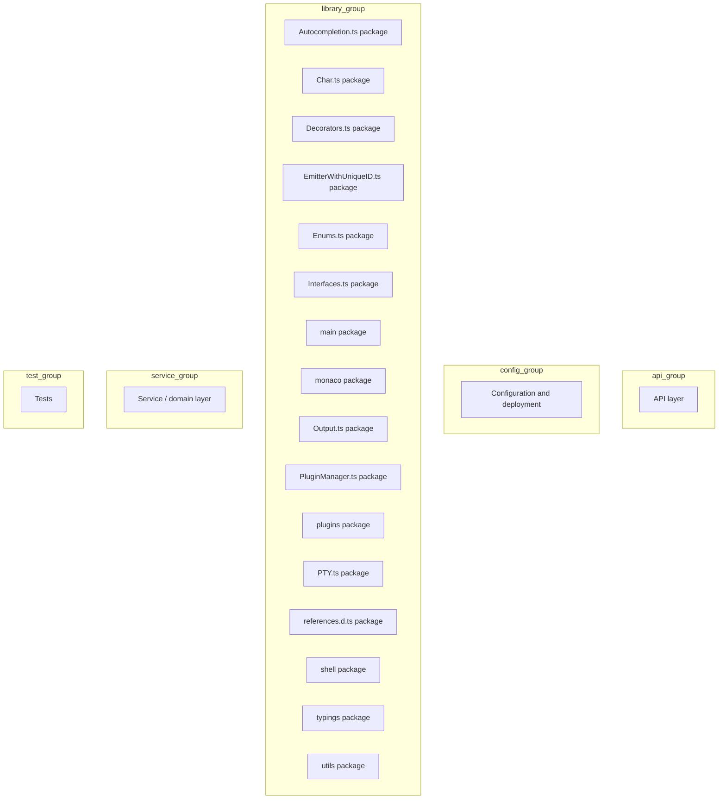

# Architecture report: railsware/upterm

> Automated static analysis. **Observed** = directly seen in files/imports/AST; **Inferred** = interpretation from that evidence. Repository code was not executed.

## 1. Repository at a glance

| Item | Value |
| --- | --- |
| Repository | railsware/upterm |
| Description | A terminal emulator for the 21st century. |
| Language | TypeScript |
| Stars | 19045 |
| Licence | MIT |
| Analysed commit / branch | 6db8d5b89625fca9a3058e1e5956084867225e9c / master |
| Framework(s) | Electron, React |
| Files analysed | 157 |
| Components | 20 |

## 2. Architecture in one minute

railsware/upterm - A terminal emulator for the 21st century.. This repository was analysed statically from 157 file(s) (0 Python). Detected technologies (observed from imports/manifests): Electron, React, Docker, TypeScript. Files are grouped into 20 component(s): API layer, Autocompletion.ts package, Char.ts package, Configuration and deployment, Decorators.ts package, EmitterWithUniqueID.ts package, Enums.ts package, Interfaces.ts package. Findings below distinguish observed facts from inferred interpretation.

## 3. High-level block diagram

## 4. Main components

### API layer (`api_layer`)

- **Kind:** api
- **Status:** Observed
- **Confidence:** 0.85
- **Responsibility:** Groups 19 file(s) under api layer (observed from repository paths and static analysis).
- **Paths:** `src/views/ApplicationComponent.tsx`, `src/views/JobComponent.tsx`, `src/views/JobHeaderComponent.tsx`, `src/views/Main.tsx`, `src/views/OutputComponent.tsx`, `src/views/PrettifyToggleComponent.tsx`, `src/views/PromptComponent.tsx`, `src/views/SearchComponent.tsx`, `src/views/SessionComponent.tsx`, `src/views/TabComponent.tsx`, `src/views/TabHeaderComponent.tsx`, `src/views/ViewUtils.ts`, `src/views/css/FontAwesome.ts`, `src/views/css/colors.ts`, `src/views/css/functions.ts`, `src/views/css/styles.ts`, `src/views/keyevents/Keybindings.ts`, `src/views/menu/Menu.ts`, `src/views/mouseevents/MouseEvents.ts`
- **Evidence:** [src/views/ApplicationComponent.tsx](https://github.com/railsware/upterm/blob/6db8d5b89625fca9a3058e1e5956084867225e9c/src/views/ApplicationComponent.tsx); [src/views/JobComponent.tsx](https://github.com/railsware/upterm/blob/6db8d5b89625fca9a3058e1e5956084867225e9c/src/views/JobComponent.tsx); [src/views/JobHeaderComponent.tsx](https://github.com/railsware/upterm/blob/6db8d5b89625fca9a3058e1e5956084867225e9c/src/views/JobHeaderComponent.tsx); [src/views/Main.tsx](https://github.com/railsware/upterm/blob/6db8d5b89625fca9a3058e1e5956084867225e9c/src/views/Main.tsx); [src/views/OutputComponent.tsx](https://github.com/railsware/upterm/blob/6db8d5b89625fca9a3058e1e5956084867225e9c/src/views/OutputComponent.tsx); [src/views/PrettifyToggleComponent.tsx](https://github.com/railsware/upterm/blob/6db8d5b89625fca9a3058e1e5956084867225e9c/src/views/PrettifyToggleComponent.tsx); [src/views/PromptComponent.tsx](https://github.com/railsware/upterm/blob/6db8d5b89625fca9a3058e1e5956084867225e9c/src/views/PromptComponent.tsx); [src/views/SearchComponent.tsx](https://github.com/railsware/upterm/blob/6db8d5b89625fca9a3058e1e5956084867225e9c/src/views/SearchComponent.tsx)

### Autocompletion.ts package (`autocompletion_ts`)

- **Kind:** library
- **Status:** Observed
- **Confidence:** 0.85
- **Responsibility:** Groups 1 file(s) under autocompletion.ts package (observed from repository paths and static analysis).
- **Paths:** `src/Autocompletion.ts`
- **Evidence:** [src/Autocompletion.ts](https://github.com/railsware/upterm/blob/6db8d5b89625fca9a3058e1e5956084867225e9c/src/Autocompletion.ts)

### Char.ts package (`char_ts`)

- **Kind:** library
- **Status:** Observed
- **Confidence:** 0.85
- **Responsibility:** Groups 1 file(s) under char.ts package (observed from repository paths and static analysis).
- **Paths:** `src/Char.ts`
- **Evidence:** [src/Char.ts](https://github.com/railsware/upterm/blob/6db8d5b89625fca9a3058e1e5956084867225e9c/src/Char.ts)

### Configuration and deployment (`config`)

- **Kind:** config
- **Status:** Observed
- **Confidence:** 0.85
- **Responsibility:** Groups 4 file(s) under configuration and deployment (observed from repository paths and static analysis).
- **Paths:** `Dockerfile`, `package.json`, `tsconfig.json`, `tslint.json`
- **Evidence:** [Dockerfile](https://github.com/railsware/upterm/blob/6db8d5b89625fca9a3058e1e5956084867225e9c/Dockerfile); [package.json](https://github.com/railsware/upterm/blob/6db8d5b89625fca9a3058e1e5956084867225e9c/package.json); [tsconfig.json](https://github.com/railsware/upterm/blob/6db8d5b89625fca9a3058e1e5956084867225e9c/tsconfig.json); [tslint.json](https://github.com/railsware/upterm/blob/6db8d5b89625fca9a3058e1e5956084867225e9c/tslint.json)

### Decorators.ts package (`decorators_ts`)

- **Kind:** library
- **Status:** Observed
- **Confidence:** 0.85
- **Responsibility:** Groups 1 file(s) under decorators.ts package (observed from repository paths and static analysis).
- **Paths:** `src/Decorators.ts`
- **Evidence:** [src/Decorators.ts](https://github.com/railsware/upterm/blob/6db8d5b89625fca9a3058e1e5956084867225e9c/src/Decorators.ts)

### EmitterWithUniqueID.ts package (`emitterwithuniqueid_ts`)

- **Kind:** library
- **Status:** Observed
- **Confidence:** 0.85
- **Responsibility:** Groups 1 file(s) under emitterwithuniqueid.ts package (observed from repository paths and static analysis).
- **Paths:** `src/EmitterWithUniqueID.ts`
- **Evidence:** [src/EmitterWithUniqueID.ts](https://github.com/railsware/upterm/blob/6db8d5b89625fca9a3058e1e5956084867225e9c/src/EmitterWithUniqueID.ts)

### Enums.ts package (`enums_ts`)

- **Kind:** library
- **Status:** Observed
- **Confidence:** 0.85
- **Responsibility:** Groups 1 file(s) under enums.ts package (observed from repository paths and static analysis).
- **Paths:** `src/Enums.ts`
- **Evidence:** [src/Enums.ts](https://github.com/railsware/upterm/blob/6db8d5b89625fca9a3058e1e5956084867225e9c/src/Enums.ts)

### Interfaces.ts package (`interfaces_ts`)

- **Kind:** library
- **Status:** Observed
- **Confidence:** 0.85
- **Responsibility:** Groups 1 file(s) under interfaces.ts package (observed from repository paths and static analysis).
- **Paths:** `src/Interfaces.ts`
- **Evidence:** [src/Interfaces.ts](https://github.com/railsware/upterm/blob/6db8d5b89625fca9a3058e1e5956084867225e9c/src/Interfaces.ts)

### main package (`main`)

- **Kind:** library
- **Status:** Observed
- **Confidence:** 0.85
- **Responsibility:** Groups 1 file(s) under main package (observed from repository paths and static analysis).
- **Paths:** `src/main/Main.ts`
- **Evidence:** [src/main/Main.ts](https://github.com/railsware/upterm/blob/6db8d5b89625fca9a3058e1e5956084867225e9c/src/main/Main.ts)

### monaco package (`monaco`)

- **Kind:** library
- **Status:** Observed
- **Confidence:** 0.85
- **Responsibility:** Groups 4 file(s) under monaco package (observed from repository paths and static analysis).
- **Paths:** `src/monaco/Loader.ts`, `src/monaco/PromptTheme.ts`, `src/monaco/ShellHistoryLanguage.ts`, `src/monaco/ShellLanguage.ts`
- **Evidence:** [src/monaco/Loader.ts](https://github.com/railsware/upterm/blob/6db8d5b89625fca9a3058e1e5956084867225e9c/src/monaco/Loader.ts); [src/monaco/PromptTheme.ts](https://github.com/railsware/upterm/blob/6db8d5b89625fca9a3058e1e5956084867225e9c/src/monaco/PromptTheme.ts); [src/monaco/ShellHistoryLanguage.ts](https://github.com/railsware/upterm/blob/6db8d5b89625fca9a3058e1e5956084867225e9c/src/monaco/ShellHistoryLanguage.ts); [src/monaco/ShellLanguage.ts](https://github.com/railsware/upterm/blob/6db8d5b89625fca9a3058e1e5956084867225e9c/src/monaco/ShellLanguage.ts)

### Output.ts package (`output_ts`)

- **Kind:** library
- **Status:** Observed
- **Confidence:** 0.85
- **Responsibility:** Groups 1 file(s) under output.ts package (observed from repository paths and static analysis).
- **Paths:** `src/Output.ts`
- **Evidence:** [src/Output.ts](https://github.com/railsware/upterm/blob/6db8d5b89625fca9a3058e1e5956084867225e9c/src/Output.ts)

### PluginManager.ts package (`pluginmanager_ts`)

- **Kind:** library
- **Status:** Observed
- **Confidence:** 0.85
- **Responsibility:** Groups 1 file(s) under pluginmanager.ts package (observed from repository paths and static analysis).
- **Paths:** `src/PluginManager.ts`
- **Evidence:** [src/PluginManager.ts](https://github.com/railsware/upterm/blob/6db8d5b89625fca9a3058e1e5956084867225e9c/src/PluginManager.ts)

### plugins package (`plugins`)

- **Kind:** library
- **Status:** Observed
- **Confidence:** 0.85
- **Responsibility:** Groups 42 file(s) under plugins package (observed from repository paths and static analysis).
- **Paths:** `src/plugins/AliasSuggestions.ts`, `src/plugins/DotEnvLoader.ts`, `src/plugins/GitGrep.tsx`, `src/plugins/JSON.tsx`, `src/plugins/JobFinishedNotifications.ts`, `src/plugins/NVM.ts`, `src/plugins/PWDOperatingSystemIntegrator.ts`, `src/plugins/RVM.ts`, `src/plugins/SaveHistory.ts`, `src/plugins/SaveWindowBounds.ts`, `src/plugins/Show.tsx`, `src/plugins/UpdateLastPresentWorkingDirectory.ts`, `src/plugins/completion/Brew.ts`, `src/plugins/completion/Cat.ts`, `src/plugins/completion/Cd.ts`, `src/plugins/completion/Cp.ts`, `src/plugins/completion/Df.ts`, `src/plugins/completion/Executable.ts`, `src/plugins/completion/Find.ts`, `src/plugins/completion/Git.ts`, `src/plugins/completion/Grep.ts`, `src/plugins/completion/History.ts`, `src/plugins/completion/Ln.ts`, `src/plugins/completion/Locate.ts`, `src/plugins/completion/Ls.ts`, `src/plugins/completion/Mkdir.ts`, `src/plugins/completion/Mv.ts`, `src/plugins/completion/NPM.ts`, `src/plugins/completion/Ps.ts`, `src/plugins/completion/Pwd.ts`, `src/plugins/completion/Rails.ts`, `src/plugins/completion/Rake.ts`, `src/plugins/completion/Rm.ts`, `src/plugins/completion/Scp.ts`, `src/plugins/completion/Shutdown.ts`, `src/plugins/completion/Tail.ts`, `src/plugins/completion/Top.ts`, `src/plugins/completion/Vagrant.ts`, `src/plugins/completion_utils/Button.tsx`, `src/plugins/completion_utils/Combine.ts`, `src/plugins/completion_utils/Common.ts`, `src/plugins/completion_utils/Descriptions.ts`
- **Evidence:** [src/plugins/AliasSuggestions.ts](https://github.com/railsware/upterm/blob/6db8d5b89625fca9a3058e1e5956084867225e9c/src/plugins/AliasSuggestions.ts); [src/plugins/DotEnvLoader.ts](https://github.com/railsware/upterm/blob/6db8d5b89625fca9a3058e1e5956084867225e9c/src/plugins/DotEnvLoader.ts); [src/plugins/GitGrep.tsx](https://github.com/railsware/upterm/blob/6db8d5b89625fca9a3058e1e5956084867225e9c/src/plugins/GitGrep.tsx); [src/plugins/JSON.tsx](https://github.com/railsware/upterm/blob/6db8d5b89625fca9a3058e1e5956084867225e9c/src/plugins/JSON.tsx); [src/plugins/JobFinishedNotifications.ts](https://github.com/railsware/upterm/blob/6db8d5b89625fca9a3058e1e5956084867225e9c/src/plugins/JobFinishedNotifications.ts); [src/plugins/NVM.ts](https://github.com/railsware/upterm/blob/6db8d5b89625fca9a3058e1e5956084867225e9c/src/plugins/NVM.ts); [src/plugins/PWDOperatingSystemIntegrator.ts](https://github.com/railsware/upterm/blob/6db8d5b89625fca9a3058e1e5956084867225e9c/src/plugins/PWDOperatingSystemIntegrator.ts); [src/plugins/RVM.ts](https://github.com/railsware/upterm/blob/6db8d5b89625fca9a3058e1e5956084867225e9c/src/plugins/RVM.ts)

### PTY.ts package (`pty_ts`)

- **Kind:** library
- **Status:** Observed
- **Confidence:** 0.85
- **Responsibility:** Groups 1 file(s) under pty.ts package (observed from repository paths and static analysis).
- **Paths:** `src/PTY.ts`
- **Evidence:** [src/PTY.ts](https://github.com/railsware/upterm/blob/6db8d5b89625fca9a3058e1e5956084867225e9c/src/PTY.ts)

### references.d.ts package (`references_d_ts`)

- **Kind:** library
- **Status:** Observed
- **Confidence:** 0.85
- **Responsibility:** Groups 1 file(s) under references.d.ts package (observed from repository paths and static analysis).
- **Paths:** `src/references.d.ts`
- **Evidence:** [src/references.d.ts](https://github.com/railsware/upterm/blob/6db8d5b89625fca9a3058e1e5956084867225e9c/src/references.d.ts)

### Service / domain layer (`service_layer`)

- **Kind:** service
- **Status:** Observed
- **Confidence:** 0.85
- **Responsibility:** Groups 8 file(s) under service / domain layer (observed from repository paths and static analysis).
- **Paths:** `src/services/FontService.ts`, `src/services/GitService.ts`, `src/services/HistoryService.ts`, `src/services/JobsService.ts`, `src/services/SessionsService.ts`, `src/services/UpdatesService.ts`, `src/services/WindowService.ts`, `src/services/index.ts`
- **Evidence:** [src/services/FontService.ts](https://github.com/railsware/upterm/blob/6db8d5b89625fca9a3058e1e5956084867225e9c/src/services/FontService.ts); [src/services/GitService.ts](https://github.com/railsware/upterm/blob/6db8d5b89625fca9a3058e1e5956084867225e9c/src/services/GitService.ts); [src/services/HistoryService.ts](https://github.com/railsware/upterm/blob/6db8d5b89625fca9a3058e1e5956084867225e9c/src/services/HistoryService.ts); [src/services/JobsService.ts](https://github.com/railsware/upterm/blob/6db8d5b89625fca9a3058e1e5956084867225e9c/src/services/JobsService.ts); [src/services/SessionsService.ts](https://github.com/railsware/upterm/blob/6db8d5b89625fca9a3058e1e5956084867225e9c/src/services/SessionsService.ts); [src/services/UpdatesService.ts](https://github.com/railsware/upterm/blob/6db8d5b89625fca9a3058e1e5956084867225e9c/src/services/UpdatesService.ts); [src/services/WindowService.ts](https://github.com/railsware/upterm/blob/6db8d5b89625fca9a3058e1e5956084867225e9c/src/services/WindowService.ts); [src/services/index.ts](https://github.com/railsware/upterm/blob/6db8d5b89625fca9a3058e1e5956084867225e9c/src/services/index.ts)

### shell package (`shell`)

- **Kind:** library
- **Status:** Observed
- **Confidence:** 0.85
- **Responsibility:** Groups 9 file(s) under shell package (observed from repository paths and static analysis).
- **Paths:** `src/shell/Aliases.ts`, `src/shell/BuiltInCommands.ts`, `src/shell/CommandExecutor.ts`, `src/shell/Environment.ts`, `src/shell/Job.ts`, `src/shell/Parser.ts`, `src/shell/Prompt.ts`, `src/shell/Scanner.ts`, `src/shell/Session.ts`
- **Evidence:** [src/shell/Aliases.ts](https://github.com/railsware/upterm/blob/6db8d5b89625fca9a3058e1e5956084867225e9c/src/shell/Aliases.ts); [src/shell/BuiltInCommands.ts](https://github.com/railsware/upterm/blob/6db8d5b89625fca9a3058e1e5956084867225e9c/src/shell/BuiltInCommands.ts); [src/shell/CommandExecutor.ts](https://github.com/railsware/upterm/blob/6db8d5b89625fca9a3058e1e5956084867225e9c/src/shell/CommandExecutor.ts); [src/shell/Environment.ts](https://github.com/railsware/upterm/blob/6db8d5b89625fca9a3058e1e5956084867225e9c/src/shell/Environment.ts); [src/shell/Job.ts](https://github.com/railsware/upterm/blob/6db8d5b89625fca9a3058e1e5956084867225e9c/src/shell/Job.ts); [src/shell/Parser.ts](https://github.com/railsware/upterm/blob/6db8d5b89625fca9a3058e1e5956084867225e9c/src/shell/Parser.ts); [src/shell/Prompt.ts](https://github.com/railsware/upterm/blob/6db8d5b89625fca9a3058e1e5956084867225e9c/src/shell/Prompt.ts); [src/shell/Scanner.ts](https://github.com/railsware/upterm/blob/6db8d5b89625fca9a3058e1e5956084867225e9c/src/shell/Scanner.ts)

### Tests (`tests`)

- **Kind:** test
- **Status:** Observed
- **Confidence:** 0.85
- **Responsibility:** Groups 32 file(s) under tests (observed from repository paths and static analysis).
- **Paths:** `test/e2e.ts`, `test/environment_spec.ts`, `test/output_spec.ts`, `test/pty_spec.ts`, `test/references.d.ts`, `test/shell/scanner_spec.ts`, `test/test_files/file_names_test/file with brackets()`, `test/test_files/vttest/1-1`, `test/test_files/vttest/1-2`, `test/test_files/vttest/1-3`, `test/test_files/vttest/1-4`, `test/test_files/vttest/1-5`, `test/test_files/vttest/1-6`, `test/test_files/vttest/2-1`, `test/test_files/vttest/2-10`, `test/test_files/vttest/2-11`, `test/test_files/vttest/2-12`, `test/test_files/vttest/2-13`, `test/test_files/vttest/2-14`, `test/test_files/vttest/2-15`, `test/test_files/vttest/2-2`, `test/test_files/vttest/2-3`, `test/test_files/vttest/2-4`, `test/test_files/vttest/2-5`, `test/test_files/vttest/2-6`, `test/test_files/vttest/2-7`, `test/test_files/vttest/2-8`, `test/test_files/vttest/2-9`, `test/utils/ManPages_spec.ts`, `test/utils/common_spec.ts`, `test/utils/history_trie_spec.ts`, `test/utils/ordered_set_spec.ts`
- **Evidence:** [test/e2e.ts](https://github.com/railsware/upterm/blob/6db8d5b89625fca9a3058e1e5956084867225e9c/test/e2e.ts); [test/environment_spec.ts](https://github.com/railsware/upterm/blob/6db8d5b89625fca9a3058e1e5956084867225e9c/test/environment_spec.ts); [test/output_spec.ts](https://github.com/railsware/upterm/blob/6db8d5b89625fca9a3058e1e5956084867225e9c/test/output_spec.ts); [test/pty_spec.ts](https://github.com/railsware/upterm/blob/6db8d5b89625fca9a3058e1e5956084867225e9c/test/pty_spec.ts); [test/references.d.ts](https://github.com/railsware/upterm/blob/6db8d5b89625fca9a3058e1e5956084867225e9c/test/references.d.ts); [test/shell/scanner_spec.ts](https://github.com/railsware/upterm/blob/6db8d5b89625fca9a3058e1e5956084867225e9c/test/shell/scanner_spec.ts); [test/test_files/file_names_test/file with brackets()](https://github.com/railsware/upterm/blob/6db8d5b89625fca9a3058e1e5956084867225e9c/test/test_files/file_names_test/file%20with%20brackets%28%29); [test/test_files/vttest/1-1](https://github.com/railsware/upterm/blob/6db8d5b89625fca9a3058e1e5956084867225e9c/test/test_files/vttest/1-1)

### typings package (`typings`)

- **Kind:** library
- **Status:** Observed
- **Confidence:** 0.85
- **Responsibility:** Groups 6 file(s) under typings package (observed from repository paths and static analysis).
- **Paths:** `typings/Interfaces.d.ts`, `typings/Overrides.d.ts`, `typings/child-process-promise.d.ts`, `typings/dirStat.d.ts`, `typings/mode-to-permissions.d.ts`, `typings/uuid.d.ts`
- **Evidence:** [typings/Interfaces.d.ts](https://github.com/railsware/upterm/blob/6db8d5b89625fca9a3058e1e5956084867225e9c/typings/Interfaces.d.ts); [typings/Overrides.d.ts](https://github.com/railsware/upterm/blob/6db8d5b89625fca9a3058e1e5956084867225e9c/typings/Overrides.d.ts); [typings/child-process-promise.d.ts](https://github.com/railsware/upterm/blob/6db8d5b89625fca9a3058e1e5956084867225e9c/typings/child-process-promise.d.ts); [typings/dirStat.d.ts](https://github.com/railsware/upterm/blob/6db8d5b89625fca9a3058e1e5956084867225e9c/typings/dirStat.d.ts); [typings/mode-to-permissions.d.ts](https://github.com/railsware/upterm/blob/6db8d5b89625fca9a3058e1e5956084867225e9c/typings/mode-to-permissions.d.ts); [typings/uuid.d.ts](https://github.com/railsware/upterm/blob/6db8d5b89625fca9a3058e1e5956084867225e9c/typings/uuid.d.ts)

### utils package (`utils`)

- **Kind:** library
- **Status:** Observed
- **Confidence:** 0.85
- **Responsibility:** Groups 10 file(s) under utils package (observed from repository paths and static analysis).
- **Paths:** `src/utils/Common.ts`, `src/utils/Git.ts`, `src/utils/HistoryTrie.ts`, `src/utils/JSONTree.tsx`, `src/utils/Link.tsx`, `src/utils/ManPageParsingUtils.ts`, `src/utils/ManPages.ts`, `src/utils/OrderedSet.ts`, `src/utils/Process.ts`, `src/utils/Shell.ts`
- **Evidence:** [src/utils/Common.ts](https://github.com/railsware/upterm/blob/6db8d5b89625fca9a3058e1e5956084867225e9c/src/utils/Common.ts); [src/utils/Git.ts](https://github.com/railsware/upterm/blob/6db8d5b89625fca9a3058e1e5956084867225e9c/src/utils/Git.ts); [src/utils/HistoryTrie.ts](https://github.com/railsware/upterm/blob/6db8d5b89625fca9a3058e1e5956084867225e9c/src/utils/HistoryTrie.ts); [src/utils/JSONTree.tsx](https://github.com/railsware/upterm/blob/6db8d5b89625fca9a3058e1e5956084867225e9c/src/utils/JSONTree.tsx); [src/utils/Link.tsx](https://github.com/railsware/upterm/blob/6db8d5b89625fca9a3058e1e5956084867225e9c/src/utils/Link.tsx); [src/utils/ManPageParsingUtils.ts](https://github.com/railsware/upterm/blob/6db8d5b89625fca9a3058e1e5956084867225e9c/src/utils/ManPageParsingUtils.ts); [src/utils/ManPages.ts](https://github.com/railsware/upterm/blob/6db8d5b89625fca9a3058e1e5956084867225e9c/src/utils/ManPages.ts); [src/utils/OrderedSet.ts](https://github.com/railsware/upterm/blob/6db8d5b89625fca9a3058e1e5956084867225e9c/src/utils/OrderedSet.ts)

## 5. Execution flow

**Observed** entry point(s):

- [src/main/Main.ts](https://github.com/railsware/upterm/blob/6db8d5b89625fca9a3058e1e5956084867225e9c/src/main/Main.ts)
- [src/services/index.ts](https://github.com/railsware/upterm/blob/6db8d5b89625fca9a3058e1e5956084867225e9c/src/services/index.ts)
- [src/views/Main.tsx](https://github.com/railsware/upterm/blob/6db8d5b89625fca9a3058e1e5956084867225e9c/src/views/Main.tsx)

Representative flow (derived from observed entry points and the import graph; steps beyond the entry point are **Inferred**):

1. Execution starts at an observed entry point listed above, if present.
2. No internal import relationships between components were observed.

## 6. Project structure

### `(root)`

- `.dockerignore` - container (36 bytes)
- `.gitignore` - other (562 bytes)
- `.node-version` - other (7 bytes)
- `.nvmrc` - other (8 bytes)
- `.travis.yml` - ci, YAML (1118 bytes)
- `CONTRIBUTING.md` - docs (1544 bytes)
- `Dockerfile` - container (187 bytes)
- `LICENSE` - docs (1085 bytes)
- `README.md` - docs (3023 bytes)
- `package.json` - manifest (3222 bytes)
- `tsconfig.json` - config (514 bytes)
- `tslint.json` - config (2458 bytes)

### `docs`

- `docs/vscodedebugging.md` - docs (5490 bytes)

### `images`

- `images/prompt-decoration.svg` - other (171 bytes)
- `images/prompt-history-mode-decoration.svg` - other (310 bytes)

### `src`

- `src/Autocompletion.ts` - source, TypeScript (1203 bytes)
- `src/Char.ts` - source, TypeScript (729 bytes)
- `src/Decorators.ts` - source, TypeScript (1106 bytes)
- `src/EmitterWithUniqueID.ts` - source, TypeScript (197 bytes)
- `src/Enums.ts` - source, TypeScript (2301 bytes)
- `src/Interfaces.ts` - source, TypeScript (1849 bytes)
- `src/Output.ts` - source, TypeScript (40741 bytes)
- `src/PTY.ts` - source, TypeScript (3454 bytes)
- `src/PluginManager.ts` - source, TypeScript (1630 bytes)
- `src/main/Main.ts` - source, TypeScript (1661 bytes)
- `src/monaco/Loader.ts` - source, TypeScript (1384 bytes)
- `src/monaco/PromptTheme.ts` - source, TypeScript (1462 bytes)
- `src/monaco/ShellHistoryLanguage.ts` - source, TypeScript (934 bytes)
- `src/monaco/ShellLanguage.ts` - source, TypeScript (7343 bytes)
- `src/plugins/AliasSuggestions.ts` - source, TypeScript (394 bytes)
- `src/plugins/DotEnvLoader.ts` - source, TypeScript (520 bytes)
- `src/plugins/GitGrep.tsx` - source, TypeScript (1349 bytes)
- `src/plugins/JSON.tsx` - source, TypeScript (594 bytes)
- `src/plugins/JobFinishedNotifications.ts` - source, TypeScript (755 bytes)
- `src/plugins/NVM.ts` - source, TypeScript (885 bytes)
- `src/plugins/PWDOperatingSystemIntegrator.ts` - source, TypeScript (378 bytes)
- `src/plugins/RVM.ts` - source, TypeScript (2959 bytes)
- `src/plugins/SaveHistory.ts` - source, TypeScript (617 bytes)
- `src/plugins/SaveWindowBounds.ts` - source, TypeScript (230 bytes)
- `src/plugins/Show.tsx` - source, TypeScript (494 bytes)
- `src/plugins/UpdateLastPresentWorkingDirectory.ts` - source, TypeScript (262 bytes)
- `src/plugins/completion/Brew.ts` - source, TypeScript (9827 bytes)
- `src/plugins/completion/Cat.ts` - source, TypeScript (346 bytes)
- `src/plugins/completion/Cd.ts` - source, TypeScript (885 bytes)
- `src/plugins/completion/Cp.ts` - source, TypeScript (344 bytes)
- `src/plugins/completion/Df.ts` - source, TypeScript (179 bytes)
- `src/plugins/completion/Executable.ts` - source, TypeScript (6964 bytes)
- `src/plugins/completion/Find.ts` - source, TypeScript (388 bytes)
- `src/plugins/completion/Git.ts` - source, TypeScript (18733 bytes)
- `src/plugins/completion/Grep.ts` - source, TypeScript (14631 bytes)
- `src/plugins/completion/History.ts` - source, TypeScript (1597 bytes)
- `src/plugins/completion/Ln.ts` - source, TypeScript (456 bytes)
- `src/plugins/completion/Locate.ts` - source, TypeScript (187 bytes)
- `src/plugins/completion/Ls.ts` - source, TypeScript (380 bytes)
- `src/plugins/completion/Mkdir.ts` - source, TypeScript (356 bytes)
- `src/plugins/completion/Mv.ts` - source, TypeScript (344 bytes)
- `src/plugins/completion/NPM.ts` - source, TypeScript (5036 bytes)
- `src/plugins/completion/Ps.ts` - source, TypeScript (6308 bytes)
- `src/plugins/completion/Pwd.ts` - source, TypeScript (181 bytes)
- `src/plugins/completion/Rails.ts` - source, TypeScript (995 bytes)
- `src/plugins/completion/Rake.ts` - source, TypeScript (399 bytes)
- `src/plugins/completion/Rm.ts` - source, TypeScript (344 bytes)
- `src/plugins/completion/Scp.ts` - source, TypeScript (384 bytes)
- `src/plugins/completion/Shutdown.ts` - source, TypeScript (191 bytes)
- `src/plugins/completion/Tail.ts` - source, TypeScript (388 bytes)
- `src/plugins/completion/Top.ts` - source, TypeScript (4892 bytes)
- `src/plugins/completion/Vagrant.ts` - source, TypeScript (1156 bytes)
- `src/plugins/completion_utils/Button.tsx` - source, TypeScript (584 bytes)
- `src/plugins/completion_utils/Combine.ts` - source, TypeScript (415 bytes)
- `src/plugins/completion_utils/Common.ts` - source, TypeScript (7670 bytes)
- `src/plugins/completion_utils/Descriptions.ts` - source, TypeScript (15548 bytes)
- `src/references.d.ts` - source, TypeScript (395 bytes)
- `src/services/FontService.ts` - source, TypeScript (1444 bytes)
- `src/services/GitService.ts` - source, TypeScript (1894 bytes)
- `src/services/HistoryService.ts` - source, TypeScript (1951 bytes)
- `src/services/JobsService.ts` - source, TypeScript (230 bytes)
- `src/services/SessionsService.ts` - source, TypeScript (1384 bytes)
- `src/services/UpdatesService.ts` - source, TypeScript (1161 bytes)
- `src/services/WindowService.ts` - source, TypeScript (1565 bytes)
- `src/services/index.ts` - source, TypeScript (851 bytes)
- `src/shell/Aliases.ts` - source, TypeScript (1572 bytes)
- `src/shell/BuiltInCommands.ts` - source, TypeScript (4871 bytes)
- `src/shell/CommandExecutor.ts` - source, TypeScript (4103 bytes)
- `src/shell/Environment.ts` - source, TypeScript (3518 bytes)
- `src/shell/Job.ts` - source, TypeScript (3817 bytes)
- `src/shell/Parser.ts` - source, TypeScript (13509 bytes)
- `src/shell/Prompt.ts` - source, TypeScript (1156 bytes)
- `src/shell/Scanner.ts` - source, TypeScript (7833 bytes)
- `src/shell/Session.ts` - source, TypeScript (2991 bytes)
- `src/utils/Common.ts` - source, TypeScript (10388 bytes)
- `src/utils/Git.ts` - source, TypeScript (7055 bytes)
- `src/utils/HistoryTrie.ts` - source, TypeScript (3596 bytes)
- `src/utils/JSONTree.tsx` - source, TypeScript (10273 bytes)
- `src/utils/Link.tsx` - source, TypeScript (338 bytes)
- `src/utils/ManPageParsingUtils.ts` - source, TypeScript (3182 bytes)
- `src/utils/ManPages.ts` - source, TypeScript (1829 bytes)
- `src/utils/OrderedSet.ts` - source, TypeScript (1035 bytes)
- `src/utils/Process.ts` - source, TypeScript (2556 bytes)
- `src/utils/Shell.ts` - source, TypeScript (4485 bytes)
- `src/views/ApplicationComponent.tsx` - source, TypeScript (7314 bytes)
- `src/views/JobComponent.tsx` - source, TypeScript (2093 bytes)
- `src/views/JobHeaderComponent.tsx` - source, TypeScript (813 bytes)
- `src/views/Main.tsx` - source, TypeScript (2553 bytes)
- `src/views/OutputComponent.tsx` - source, TypeScript (2422 bytes)
- `src/views/PrettifyToggleComponent.tsx` - source, TypeScript (364 bytes)
- `src/views/PromptComponent.tsx` - source, TypeScript (8965 bytes)
- `src/views/SearchComponent.tsx` - source, TypeScript (1614 bytes)
- `src/views/SessionComponent.tsx` - source, TypeScript (5016 bytes)
- `src/views/TabComponent.tsx` - source, TypeScript (1772 bytes)
- `src/views/TabHeaderComponent.tsx` - source, TypeScript (793 bytes)
- `src/views/ViewUtils.ts` - source, TypeScript (1154 bytes)
- `src/views/css/FontAwesome.ts` - source, TypeScript (17822 bytes)
- `src/views/css/colors.ts` - source, TypeScript (1992 bytes)
- `src/views/css/functions.ts` - source, TypeScript (398 bytes)
- `src/views/css/styles.ts` - source, TypeScript (2110 bytes)
- `src/views/index.html` - other (15614 bytes)
- `src/views/keyevents/Keybindings.ts` - source, TypeScript (9707 bytes)
- `src/views/menu/Menu.ts` - source, TypeScript (6201 bytes)
- `src/views/mouseevents/MouseEvents.ts` - source, TypeScript (1143 bytes)

### `test`

- `test/e2e.ts` - test, TypeScript (2738 bytes)
- `test/environment_spec.ts` - test, TypeScript (1009 bytes)
- `test/output_spec.ts` - test, TypeScript (30569 bytes)
- `test/pty_spec.ts` - test, TypeScript (706 bytes)
- `test/references.d.ts` - test, TypeScript (52 bytes)
- `test/shell/scanner_spec.ts` - test, TypeScript (6931 bytes)
- `test/test_files/file_names_test/file with brackets()` - test (0 bytes)
- `test/test_files/vttest/1-1` - test (5798 bytes)
- `test/test_files/vttest/1-2` - test (13228 bytes)
- `test/test_files/vttest/1-3` - test (777 bytes)
- `test/test_files/vttest/1-4` - test (811 bytes)
- `test/test_files/vttest/1-5` - test (338 bytes)
- `test/test_files/vttest/1-6` - test (814 bytes)
- `test/test_files/vttest/2-1` - test (537 bytes)
- `test/test_files/vttest/2-10` - test (17694 bytes)
- `test/test_files/vttest/2-11` - test (17853 bytes)
- `test/test_files/vttest/2-12` - test (18000 bytes)
- `test/test_files/vttest/2-13` - test (18581 bytes)
- `test/test_files/vttest/2-14` - test (18628 bytes)
- `test/test_files/vttest/2-15` - test (1347 bytes)
- `test/test_files/vttest/2-2` - test (502 bytes)
- `test/test_files/vttest/2-3` - test (2933 bytes)
- `test/test_files/vttest/2-4` - test (3908 bytes)
- `test/test_files/vttest/2-5` - test (5052 bytes)
- `test/test_files/vttest/2-6` - test (6009 bytes)
- `test/test_files/vttest/2-7` - test (8940 bytes)
- `test/test_files/vttest/2-8` - test (2918 bytes)
- `test/test_files/vttest/2-9` - test (14778 bytes)
- `test/utils/ManPages_spec.ts` - test, TypeScript (3382 bytes)
- `test/utils/common_spec.ts` - test, TypeScript (1484 bytes)
- `test/utils/history_trie_spec.ts` - test, TypeScript (3311 bytes)
- `test/utils/ordered_set_spec.ts` - test, TypeScript (695 bytes)

### `typings`

- `typings/Interfaces.d.ts` - source, TypeScript (831 bytes)
- `typings/Overrides.d.ts` - source, TypeScript (1652 bytes)
- `typings/child-process-promise.d.ts` - source, TypeScript (149 bytes)
- `typings/dirStat.d.ts` - source, TypeScript (106 bytes)
- `typings/mode-to-permissions.d.ts` - source, TypeScript (371 bytes)
- `typings/uuid.d.ts` - source, TypeScript (50 bytes)

## 7. Key dependencies and integrations

| Name | Category | Status | Confidence | Evidence |
| --- | --- | --- | --- | --- |
| Electron | framework | Observed | 0.85 | [package.json:64](https://github.com/railsware/upterm/blob/6db8d5b89625fca9a3058e1e5956084867225e9c/package.json#L64) |
| React | framework | Observed | 0.90 | [package.json:40](https://github.com/railsware/upterm/blob/6db8d5b89625fca9a3058e1e5956084867225e9c/package.json#L40); [package.json:41](https://github.com/railsware/upterm/blob/6db8d5b89625fca9a3058e1e5956084867225e9c/package.json#L41) |
| Docker | tooling | Observed | 0.85 | [Dockerfile](https://github.com/railsware/upterm/blob/6db8d5b89625fca9a3058e1e5956084867225e9c/Dockerfile) |
| TypeScript | tooling | Observed | 0.85 | [package.json:76](https://github.com/railsware/upterm/blob/6db8d5b89625fca9a3058e1e5956084867225e9c/package.json#L76) |

## 8. Data and state

No database, cache, queue, or persistent-state usage was observed in the analysed files. State handling, if any, may be in-memory or in files that were not analysed.

## 9. Configuration and deployment clues

- `.dockerignore` (container)
- `.travis.yml` (ci)
- `Dockerfile` (container)
- `package.json` (manifest)
- `tsconfig.json` (config)
- `tslint.json` (config)

## 10. Design observations

- An entry/API layer is separated from other code (Inferred from paths and decorators).
- Service/domain code is distinct from entry and data code, suggesting layered separation (Inferred).
- Tests are present alongside source code (Observed from test file paths).

These observations are interpretations (**Inferred**) of the observed structure, not guarantees about runtime design.

## 11. Limitations and unknowns

- Static analysis only: repository code was not executed, installed, or imported at runtime.
- Components and relationships are inferred from file paths, imports, and AST structure; runtime behaviour, dynamic imports, and reflection may not be visible.
- 1 file(s) were skipped during inventory (1 x likely secret file excluded).
- No clear application entry point was observed in the analysed files.
- Repository text was treated as untrusted data; no instructions found in repository files were followed, and likely secret values were redacted/excluded.
- JavaScript and TypeScript files were inventoried from paths and package manifests. They were not parsed with a full language AST, and repository code was not executed.
- The GitHub repository was marked archived at selection time.

## 12. Source references

- [Dockerfile](https://github.com/railsware/upterm/blob/6db8d5b89625fca9a3058e1e5956084867225e9c/Dockerfile)
- [package.json](https://github.com/railsware/upterm/blob/6db8d5b89625fca9a3058e1e5956084867225e9c/package.json)
- [package.json:40](https://github.com/railsware/upterm/blob/6db8d5b89625fca9a3058e1e5956084867225e9c/package.json#L40)
- [package.json:41](https://github.com/railsware/upterm/blob/6db8d5b89625fca9a3058e1e5956084867225e9c/package.json#L41)
- [package.json:64](https://github.com/railsware/upterm/blob/6db8d5b89625fca9a3058e1e5956084867225e9c/package.json#L64)
- [package.json:76](https://github.com/railsware/upterm/blob/6db8d5b89625fca9a3058e1e5956084867225e9c/package.json#L76)
- [src/Autocompletion.ts](https://github.com/railsware/upterm/blob/6db8d5b89625fca9a3058e1e5956084867225e9c/src/Autocompletion.ts)
- [src/Char.ts](https://github.com/railsware/upterm/blob/6db8d5b89625fca9a3058e1e5956084867225e9c/src/Char.ts)
- [src/Decorators.ts](https://github.com/railsware/upterm/blob/6db8d5b89625fca9a3058e1e5956084867225e9c/src/Decorators.ts)
- [src/EmitterWithUniqueID.ts](https://github.com/railsware/upterm/blob/6db8d5b89625fca9a3058e1e5956084867225e9c/src/EmitterWithUniqueID.ts)
- [src/Enums.ts](https://github.com/railsware/upterm/blob/6db8d5b89625fca9a3058e1e5956084867225e9c/src/Enums.ts)
- [src/Interfaces.ts](https://github.com/railsware/upterm/blob/6db8d5b89625fca9a3058e1e5956084867225e9c/src/Interfaces.ts)
- [src/Output.ts](https://github.com/railsware/upterm/blob/6db8d5b89625fca9a3058e1e5956084867225e9c/src/Output.ts)
- [src/PTY.ts](https://github.com/railsware/upterm/blob/6db8d5b89625fca9a3058e1e5956084867225e9c/src/PTY.ts)
- [src/PluginManager.ts](https://github.com/railsware/upterm/blob/6db8d5b89625fca9a3058e1e5956084867225e9c/src/PluginManager.ts)
- [src/main/Main.ts](https://github.com/railsware/upterm/blob/6db8d5b89625fca9a3058e1e5956084867225e9c/src/main/Main.ts)
- [src/monaco/Loader.ts](https://github.com/railsware/upterm/blob/6db8d5b89625fca9a3058e1e5956084867225e9c/src/monaco/Loader.ts)
- [src/monaco/PromptTheme.ts](https://github.com/railsware/upterm/blob/6db8d5b89625fca9a3058e1e5956084867225e9c/src/monaco/PromptTheme.ts)
- [src/monaco/ShellHistoryLanguage.ts](https://github.com/railsware/upterm/blob/6db8d5b89625fca9a3058e1e5956084867225e9c/src/monaco/ShellHistoryLanguage.ts)
- [src/monaco/ShellLanguage.ts](https://github.com/railsware/upterm/blob/6db8d5b89625fca9a3058e1e5956084867225e9c/src/monaco/ShellLanguage.ts)
- [src/plugins/AliasSuggestions.ts](https://github.com/railsware/upterm/blob/6db8d5b89625fca9a3058e1e5956084867225e9c/src/plugins/AliasSuggestions.ts)
- [src/plugins/DotEnvLoader.ts](https://github.com/railsware/upterm/blob/6db8d5b89625fca9a3058e1e5956084867225e9c/src/plugins/DotEnvLoader.ts)
- [src/plugins/GitGrep.tsx](https://github.com/railsware/upterm/blob/6db8d5b89625fca9a3058e1e5956084867225e9c/src/plugins/GitGrep.tsx)
- [src/plugins/JSON.tsx](https://github.com/railsware/upterm/blob/6db8d5b89625fca9a3058e1e5956084867225e9c/src/plugins/JSON.tsx)
- [src/plugins/JobFinishedNotifications.ts](https://github.com/railsware/upterm/blob/6db8d5b89625fca9a3058e1e5956084867225e9c/src/plugins/JobFinishedNotifications.ts)
- [src/plugins/NVM.ts](https://github.com/railsware/upterm/blob/6db8d5b89625fca9a3058e1e5956084867225e9c/src/plugins/NVM.ts)
- [src/plugins/PWDOperatingSystemIntegrator.ts](https://github.com/railsware/upterm/blob/6db8d5b89625fca9a3058e1e5956084867225e9c/src/plugins/PWDOperatingSystemIntegrator.ts)
- [src/plugins/RVM.ts](https://github.com/railsware/upterm/blob/6db8d5b89625fca9a3058e1e5956084867225e9c/src/plugins/RVM.ts)
- [src/references.d.ts](https://github.com/railsware/upterm/blob/6db8d5b89625fca9a3058e1e5956084867225e9c/src/references.d.ts)
- [src/services/FontService.ts](https://github.com/railsware/upterm/blob/6db8d5b89625fca9a3058e1e5956084867225e9c/src/services/FontService.ts)
- [src/services/GitService.ts](https://github.com/railsware/upterm/blob/6db8d5b89625fca9a3058e1e5956084867225e9c/src/services/GitService.ts)
- [src/services/HistoryService.ts](https://github.com/railsware/upterm/blob/6db8d5b89625fca9a3058e1e5956084867225e9c/src/services/HistoryService.ts)
- [src/services/JobsService.ts](https://github.com/railsware/upterm/blob/6db8d5b89625fca9a3058e1e5956084867225e9c/src/services/JobsService.ts)
- [src/services/SessionsService.ts](https://github.com/railsware/upterm/blob/6db8d5b89625fca9a3058e1e5956084867225e9c/src/services/SessionsService.ts)
- [src/services/UpdatesService.ts](https://github.com/railsware/upterm/blob/6db8d5b89625fca9a3058e1e5956084867225e9c/src/services/UpdatesService.ts)
- [src/services/WindowService.ts](https://github.com/railsware/upterm/blob/6db8d5b89625fca9a3058e1e5956084867225e9c/src/services/WindowService.ts)
- [src/services/index.ts](https://github.com/railsware/upterm/blob/6db8d5b89625fca9a3058e1e5956084867225e9c/src/services/index.ts)
- [src/shell/Aliases.ts](https://github.com/railsware/upterm/blob/6db8d5b89625fca9a3058e1e5956084867225e9c/src/shell/Aliases.ts)
- [src/shell/BuiltInCommands.ts](https://github.com/railsware/upterm/blob/6db8d5b89625fca9a3058e1e5956084867225e9c/src/shell/BuiltInCommands.ts)
- [src/shell/CommandExecutor.ts](https://github.com/railsware/upterm/blob/6db8d5b89625fca9a3058e1e5956084867225e9c/src/shell/CommandExecutor.ts)
- [src/shell/Environment.ts](https://github.com/railsware/upterm/blob/6db8d5b89625fca9a3058e1e5956084867225e9c/src/shell/Environment.ts)
- [src/shell/Job.ts](https://github.com/railsware/upterm/blob/6db8d5b89625fca9a3058e1e5956084867225e9c/src/shell/Job.ts)
- [src/shell/Parser.ts](https://github.com/railsware/upterm/blob/6db8d5b89625fca9a3058e1e5956084867225e9c/src/shell/Parser.ts)
- [src/shell/Prompt.ts](https://github.com/railsware/upterm/blob/6db8d5b89625fca9a3058e1e5956084867225e9c/src/shell/Prompt.ts)
- [src/shell/Scanner.ts](https://github.com/railsware/upterm/blob/6db8d5b89625fca9a3058e1e5956084867225e9c/src/shell/Scanner.ts)
- [src/utils/Common.ts](https://github.com/railsware/upterm/blob/6db8d5b89625fca9a3058e1e5956084867225e9c/src/utils/Common.ts)
- [src/utils/Git.ts](https://github.com/railsware/upterm/blob/6db8d5b89625fca9a3058e1e5956084867225e9c/src/utils/Git.ts)
- [src/utils/HistoryTrie.ts](https://github.com/railsware/upterm/blob/6db8d5b89625fca9a3058e1e5956084867225e9c/src/utils/HistoryTrie.ts)
- [src/utils/JSONTree.tsx](https://github.com/railsware/upterm/blob/6db8d5b89625fca9a3058e1e5956084867225e9c/src/utils/JSONTree.tsx)
- [src/utils/Link.tsx](https://github.com/railsware/upterm/blob/6db8d5b89625fca9a3058e1e5956084867225e9c/src/utils/Link.tsx)
- [src/utils/ManPageParsingUtils.ts](https://github.com/railsware/upterm/blob/6db8d5b89625fca9a3058e1e5956084867225e9c/src/utils/ManPageParsingUtils.ts)
- [src/utils/ManPages.ts](https://github.com/railsware/upterm/blob/6db8d5b89625fca9a3058e1e5956084867225e9c/src/utils/ManPages.ts)
- [src/utils/OrderedSet.ts](https://github.com/railsware/upterm/blob/6db8d5b89625fca9a3058e1e5956084867225e9c/src/utils/OrderedSet.ts)
- [src/views/ApplicationComponent.tsx](https://github.com/railsware/upterm/blob/6db8d5b89625fca9a3058e1e5956084867225e9c/src/views/ApplicationComponent.tsx)
- [src/views/JobComponent.tsx](https://github.com/railsware/upterm/blob/6db8d5b89625fca9a3058e1e5956084867225e9c/src/views/JobComponent.tsx)
- [src/views/JobHeaderComponent.tsx](https://github.com/railsware/upterm/blob/6db8d5b89625fca9a3058e1e5956084867225e9c/src/views/JobHeaderComponent.tsx)
- [src/views/Main.tsx](https://github.com/railsware/upterm/blob/6db8d5b89625fca9a3058e1e5956084867225e9c/src/views/Main.tsx)
- [src/views/OutputComponent.tsx](https://github.com/railsware/upterm/blob/6db8d5b89625fca9a3058e1e5956084867225e9c/src/views/OutputComponent.tsx)
- [src/views/PrettifyToggleComponent.tsx](https://github.com/railsware/upterm/blob/6db8d5b89625fca9a3058e1e5956084867225e9c/src/views/PrettifyToggleComponent.tsx)
- [src/views/PromptComponent.tsx](https://github.com/railsware/upterm/blob/6db8d5b89625fca9a3058e1e5956084867225e9c/src/views/PromptComponent.tsx)
- [src/views/SearchComponent.tsx](https://github.com/railsware/upterm/blob/6db8d5b89625fca9a3058e1e5956084867225e9c/src/views/SearchComponent.tsx)
- [test/e2e.ts](https://github.com/railsware/upterm/blob/6db8d5b89625fca9a3058e1e5956084867225e9c/test/e2e.ts)
- [test/environment_spec.ts](https://github.com/railsware/upterm/blob/6db8d5b89625fca9a3058e1e5956084867225e9c/test/environment_spec.ts)
- [test/output_spec.ts](https://github.com/railsware/upterm/blob/6db8d5b89625fca9a3058e1e5956084867225e9c/test/output_spec.ts)
- [test/pty_spec.ts](https://github.com/railsware/upterm/blob/6db8d5b89625fca9a3058e1e5956084867225e9c/test/pty_spec.ts)
- [test/references.d.ts](https://github.com/railsware/upterm/blob/6db8d5b89625fca9a3058e1e5956084867225e9c/test/references.d.ts)
- [test/shell/scanner_spec.ts](https://github.com/railsware/upterm/blob/6db8d5b89625fca9a3058e1e5956084867225e9c/test/shell/scanner_spec.ts)
- [test/test_files/file_names_test/file with brackets()](https://github.com/railsware/upterm/blob/6db8d5b89625fca9a3058e1e5956084867225e9c/test/test_files/file_names_test/file%20with%20brackets%28%29)
- [test/test_files/vttest/1-1](https://github.com/railsware/upterm/blob/6db8d5b89625fca9a3058e1e5956084867225e9c/test/test_files/vttest/1-1)
- [tsconfig.json](https://github.com/railsware/upterm/blob/6db8d5b89625fca9a3058e1e5956084867225e9c/tsconfig.json)
- [tslint.json](https://github.com/railsware/upterm/blob/6db8d5b89625fca9a3058e1e5956084867225e9c/tslint.json)
- [typings/Interfaces.d.ts](https://github.com/railsware/upterm/blob/6db8d5b89625fca9a3058e1e5956084867225e9c/typings/Interfaces.d.ts)
- [typings/Overrides.d.ts](https://github.com/railsware/upterm/blob/6db8d5b89625fca9a3058e1e5956084867225e9c/typings/Overrides.d.ts)
- [typings/child-process-promise.d.ts](https://github.com/railsware/upterm/blob/6db8d5b89625fca9a3058e1e5956084867225e9c/typings/child-process-promise.d.ts)
- [typings/dirStat.d.ts](https://github.com/railsware/upterm/blob/6db8d5b89625fca9a3058e1e5956084867225e9c/typings/dirStat.d.ts)
- [typings/mode-to-permissions.d.ts](https://github.com/railsware/upterm/blob/6db8d5b89625fca9a3058e1e5956084867225e9c/typings/mode-to-permissions.d.ts)
- [typings/uuid.d.ts](https://github.com/railsware/upterm/blob/6db8d5b89625fca9a3058e1e5956084867225e9c/typings/uuid.d.ts)
