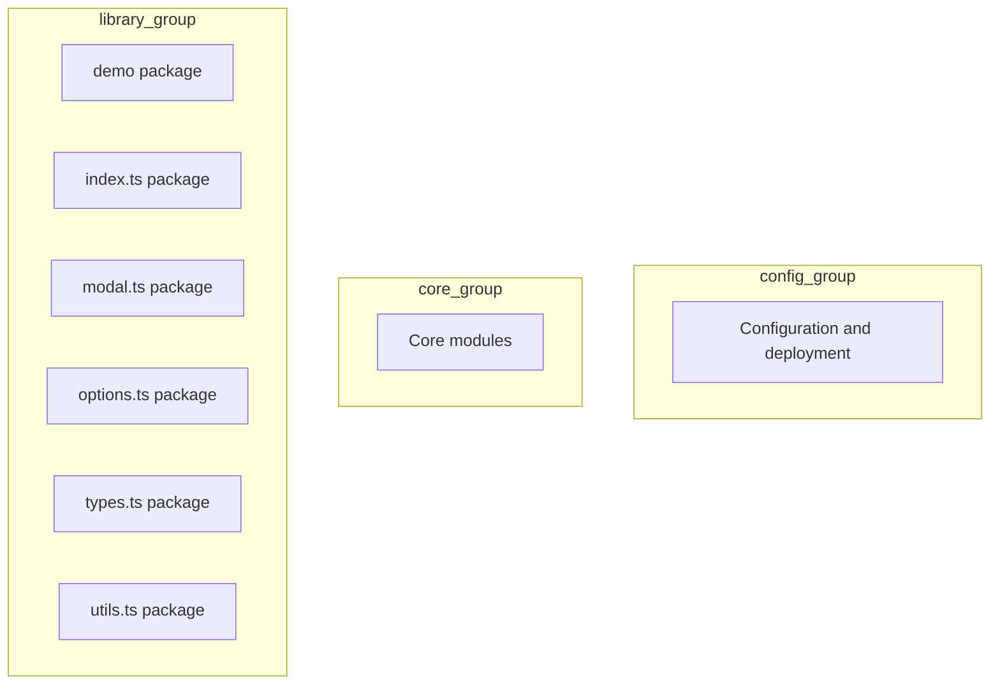

# Architecture report: ramonszo/zuck.js

> Automated static analysis. **Observed** = directly seen in files/imports/AST; **Inferred** = interpretation from that evidence. Repository code was not executed.

## 1. Repository at a glance

| Item | Value |
| --- | --- |
| Repository | ramonszo/zuck.js |
| Description | A javascript library that lets you add stories EVERYWHERE. |
| Language | TypeScript |
| Stars | 3733 |
| Licence | MIT |
| Analysed commit / branch | 97f39369d2023466426d2d210df50291a0706fab / master |
| Framework(s) | None detected |
| Files analysed | 27 |
| Components | 8 |

## 2. Architecture in one minute

ramonszo/zuck.js - A javascript library that lets you add stories EVERYWHERE.. This repository was analysed statically from 27 file(s) (0 Python). Detected technologies (observed from imports/manifests): TypeScript, webpack. Files are grouped into 8 component(s): Configuration and deployment, Core modules, demo package, index.ts package, modal.ts package, options.ts package, types.ts package, utils.ts package. Findings below distinguish observed facts from inferred interpretation.

## 3. High-level block diagram

## 4. Main components

### Configuration and deployment (`config`)

- **Kind:** config
- **Status:** Observed
- **Confidence:** 0.85
- **Responsibility:** Groups 3 file(s) under configuration and deployment (observed from repository paths and static analysis).
- **Paths:** `FUNDING.yml`, `package.json`, `tsconfig.json`
- **Evidence:** [FUNDING.yml](https://github.com/ramonszo/zuck.js/blob/97f39369d2023466426d2d210df50291a0706fab/FUNDING.yml); [package.json](https://github.com/ramonszo/zuck.js/blob/97f39369d2023466426d2d210df50291a0706fab/package.json); [tsconfig.json](https://github.com/ramonszo/zuck.js/blob/97f39369d2023466426d2d210df50291a0706fab/tsconfig.json)

### Core modules (`core`)

- **Kind:** core
- **Status:** Observed
- **Confidence:** 0.85
- **Responsibility:** Groups 1 file(s) under core modules (observed from repository paths and static analysis).
- **Paths:** `webpack.config.js`
- **Evidence:** [webpack.config.js](https://github.com/ramonszo/zuck.js/blob/97f39369d2023466426d2d210df50291a0706fab/webpack.config.js)

### demo package (`demo`)

- **Kind:** library
- **Status:** Observed
- **Confidence:** 0.85
- **Responsibility:** Groups 1 file(s) under demo package (observed from repository paths and static analysis).
- **Paths:** `demo/script.js`
- **Evidence:** [demo/script.js](https://github.com/ramonszo/zuck.js/blob/97f39369d2023466426d2d210df50291a0706fab/demo/script.js)

### index.ts package (`index_ts`)

- **Kind:** library
- **Status:** Observed
- **Confidence:** 0.85
- **Responsibility:** Groups 1 file(s) under index.ts package (observed from repository paths and static analysis).
- **Paths:** `src/index.ts`
- **Evidence:** [src/index.ts](https://github.com/ramonszo/zuck.js/blob/97f39369d2023466426d2d210df50291a0706fab/src/index.ts)

### modal.ts package (`modal_ts`)

- **Kind:** library
- **Status:** Observed
- **Confidence:** 0.85
- **Responsibility:** Groups 1 file(s) under modal.ts package (observed from repository paths and static analysis).
- **Paths:** `src/modal.ts`
- **Evidence:** [src/modal.ts](https://github.com/ramonszo/zuck.js/blob/97f39369d2023466426d2d210df50291a0706fab/src/modal.ts)

### options.ts package (`options_ts`)

- **Kind:** library
- **Status:** Observed
- **Confidence:** 0.85
- **Responsibility:** Groups 1 file(s) under options.ts package (observed from repository paths and static analysis).
- **Paths:** `src/options.ts`
- **Evidence:** [src/options.ts](https://github.com/ramonszo/zuck.js/blob/97f39369d2023466426d2d210df50291a0706fab/src/options.ts)

### types.ts package (`types_ts`)

- **Kind:** library
- **Status:** Observed
- **Confidence:** 0.85
- **Responsibility:** Groups 1 file(s) under types.ts package (observed from repository paths and static analysis).
- **Paths:** `src/types.ts`
- **Evidence:** [src/types.ts](https://github.com/ramonszo/zuck.js/blob/97f39369d2023466426d2d210df50291a0706fab/src/types.ts)

### utils.ts package (`utils_ts`)

- **Kind:** library
- **Status:** Observed
- **Confidence:** 0.85
- **Responsibility:** Groups 1 file(s) under utils.ts package (observed from repository paths and static analysis).
- **Paths:** `src/utils.ts`
- **Evidence:** [src/utils.ts](https://github.com/ramonszo/zuck.js/blob/97f39369d2023466426d2d210df50291a0706fab/src/utils.ts)

## 5. Execution flow

**Observed** entry point(s):

- [src/index.ts](https://github.com/ramonszo/zuck.js/blob/97f39369d2023466426d2d210df50291a0706fab/src/index.ts)

Representative flow (derived from observed entry points and the import graph; steps beyond the entry point are **Inferred**):

1. Execution starts at an observed entry point listed above, if present.
2. No internal import relationships between components were observed.

## 6. Project structure

### `(root)`

- `.babelrc` - other (235 bytes)
- `.editorconfig` - config (165 bytes)
- `.eslintignore` - other (29 bytes)
- `.eslintrc.json` - config (856 bytes)
- `.gitignore` - other (484 bytes)
- `.prettierignore` - other (19 bytes)
- `.prettierrc` - other (234 bytes)
- `FUNDING.yml` - config (82 bytes)
- `LICENSE` - docs (1078 bytes)
- `README.md` - docs (3836 bytes)
- `index.html` - other (7593 bytes)
- `markup.sample.html` - other (1382 bytes)
- `package.json` - manifest (2316 bytes)
- `react-components.sample.html` - other (12444 bytes)
- `react.sample.html` - other (9247 bytes)
- `tsconfig.json` - config (627 bytes)
- `webpack.config.js` - source, JavaScript (1642 bytes)

### `demo`

- `demo/script.js` - source, JavaScript (1561 bytes)
- `demo/style.css` - other (1713 bytes)

### `src`

- `src/index.ts` - source, TypeScript (14845 bytes)
- `src/modal.ts` - source, TypeScript (24162 bytes)
- `src/options.ts` - source, TypeScript (9268 bytes)
- `src/styles/index.css` - other (49 bytes)
- `src/styles/modal.css` - other (11539 bytes)
- `src/styles/timeline.css` - other (2882 bytes)
- `src/types.ts` - source, TypeScript (4803 bytes)
- `src/utils.ts` - source, TypeScript (3098 bytes)

## 7. Key dependencies and integrations

| Name | Category | Status | Confidence | Evidence |
| --- | --- | --- | --- | --- |
| TypeScript | tooling | Observed | 0.85 | [package.json:23](https://github.com/ramonszo/zuck.js/blob/97f39369d2023466426d2d210df50291a0706fab/package.json#L23) |
| webpack | tooling | Observed | 0.85 | [package.json:52](https://github.com/ramonszo/zuck.js/blob/97f39369d2023466426d2d210df50291a0706fab/package.json#L52) |

## 8. Data and state

No database, cache, queue, or persistent-state usage was observed in the analysed files. State handling, if any, may be in-memory or in files that were not analysed.

## 9. Configuration and deployment clues

- `.editorconfig` (config)
- `.eslintrc.json` (config)
- `FUNDING.yml` (config)
- `package.json` (manifest)
- `tsconfig.json` (config)

## 10. Design observations

- No strong design patterns could be established from the available evidence.

These observations are interpretations (**Inferred**) of the observed structure, not guarantees about runtime design.

## 11. Limitations and unknowns

- Static analysis only: repository code was not executed, installed, or imported at runtime.
- Components and relationships are inferred from file paths, imports, and AST structure; runtime behaviour, dynamic imports, and reflection may not be visible.
- 17 file(s) were skipped during inventory (17 x vendored/generated directory excluded).
- No clear application entry point was observed in the analysed files.
- Repository text was treated as untrusted data; no instructions found in repository files were followed, and likely secret values were redacted/excluded.
- JavaScript and TypeScript files were inventoried from paths and package manifests. They were not parsed with a full language AST, and repository code was not executed.

## 12. Source references

- [FUNDING.yml](https://github.com/ramonszo/zuck.js/blob/97f39369d2023466426d2d210df50291a0706fab/FUNDING.yml)
- [demo/script.js](https://github.com/ramonszo/zuck.js/blob/97f39369d2023466426d2d210df50291a0706fab/demo/script.js)
- [package.json](https://github.com/ramonszo/zuck.js/blob/97f39369d2023466426d2d210df50291a0706fab/package.json)
- [package.json:23](https://github.com/ramonszo/zuck.js/blob/97f39369d2023466426d2d210df50291a0706fab/package.json#L23)
- [package.json:52](https://github.com/ramonszo/zuck.js/blob/97f39369d2023466426d2d210df50291a0706fab/package.json#L52)
- [src/index.ts](https://github.com/ramonszo/zuck.js/blob/97f39369d2023466426d2d210df50291a0706fab/src/index.ts)
- [src/modal.ts](https://github.com/ramonszo/zuck.js/blob/97f39369d2023466426d2d210df50291a0706fab/src/modal.ts)
- [src/options.ts](https://github.com/ramonszo/zuck.js/blob/97f39369d2023466426d2d210df50291a0706fab/src/options.ts)
- [src/types.ts](https://github.com/ramonszo/zuck.js/blob/97f39369d2023466426d2d210df50291a0706fab/src/types.ts)
- [src/utils.ts](https://github.com/ramonszo/zuck.js/blob/97f39369d2023466426d2d210df50291a0706fab/src/utils.ts)
- [tsconfig.json](https://github.com/ramonszo/zuck.js/blob/97f39369d2023466426d2d210df50291a0706fab/tsconfig.json)
- [webpack.config.js](https://github.com/ramonszo/zuck.js/blob/97f39369d2023466426d2d210df50291a0706fab/webpack.config.js)
