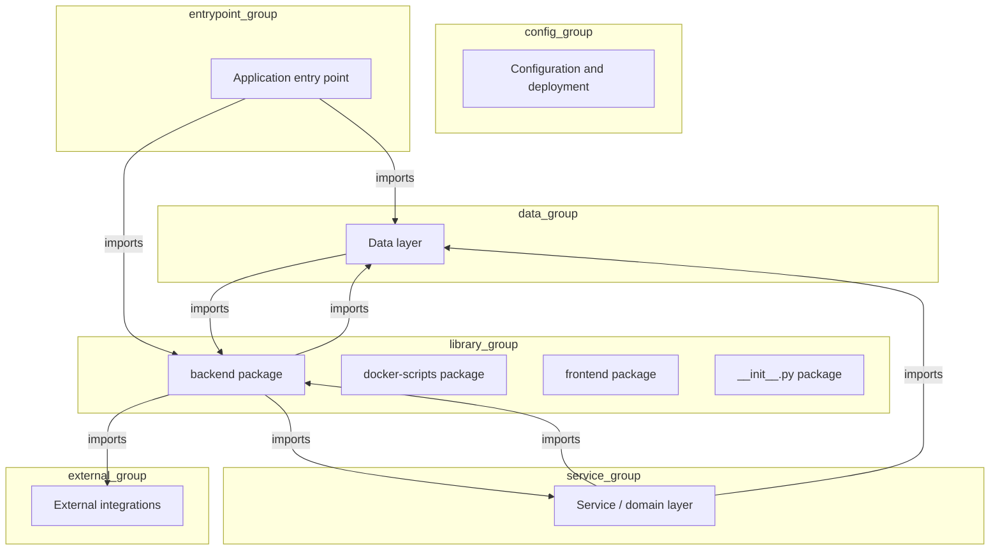

# Architecture report: rashadphz/farfalle

> Automated static analysis. **Observed** = directly seen in files/imports/AST; **Inferred** = interpretation from that evidence. Repository code was not executed.

## 1. Repository at a glance

| Item | Value |
| --- | --- |
| Repository | rashadphz/farfalle |
| Description | 🔍 AI search engine - self-host with local or cloud LLMs |
| Language | TypeScript |
| Stars | 3541 |
| Licence | Apache-2.0 |
| Analysed commit / branch | a9dd4939d21f4da6bb3ef7de138caba0f2ffab13 / main |
| Framework(s) | FastAPI, Next.js, React, Starlette |
| Files analysed | 143 |
| Components | 9 |

## 2. Architecture in one minute

rashadphz/farfalle - 🔍 AI search engine - self-host with local or cloud LLMs. This repository was analysed statically from 143 file(s) (27 Python). Detected technologies (observed from imports/manifests): GitHub Actions, Redis, FastAPI, Next.js, React, Starlette. Files are grouped into 9 component(s): backend package, Configuration and deployment, Data layer, docker-scripts package, Application entry point, External integrations, frontend package, __init__.py package. Observed entry point(s): src/backend/main.py. Findings below distinguish observed facts from inferred interpretation.

## 3. High-level block diagram

## 4. Main components

### backend package (`backend`)

- **Kind:** library
- **Status:** Observed
- **Confidence:** 0.85
- **Responsibility:** Groups 20 file(s) under backend package (observed from repository paths and static analysis). Observed top-level classes: BaseLLM, BingSearchProvider, ChatModel, EveryLLM, QueryPlan, QueryPlanStep. Observed top-level functions: build_context_from_search_results, downgrade, format_context, format_context_with_steps, format_step_context, generate_related_queries.
- **Paths:** `src/backend/__init__.py`, `src/backend/agent_search.py`, `src/backend/alembic/env.py`, `src/backend/alembic/versions/17892ab566d1_initial_models.py`, `src/backend/alembic/versions/64dfe5ff288e_jsonb.py`, `src/backend/alembic/versions/91d5d7402c69_agent_response.py`, `src/backend/chat.py`, `src/backend/constants.py`, `src/backend/llm/base.py`, `src/backend/prompts.py`, `src/backend/related_queries.py`, `src/backend/search/__init__.py`, `src/backend/search/providers/__init__.py`, `src/backend/search/providers/base.py`, `src/backend/search/providers/bing.py`, `src/backend/search/providers/searxng.py`, `src/backend/search/providers/serper.py`, `src/backend/search/providers/tavily.py`, `src/backend/utils.py`, `src/backend/validators.py`
- **Evidence:** [src/backend/__init__.py](https://github.com/rashadphz/farfalle/blob/a9dd4939d21f4da6bb3ef7de138caba0f2ffab13/src/backend/__init__.py); [src/backend/agent_search.py:39](https://github.com/rashadphz/farfalle/blob/a9dd4939d21f4da6bb3ef7de138caba0f2ffab13/src/backend/agent_search.py#L39); [src/backend/alembic/env.py:32](https://github.com/rashadphz/farfalle/blob/a9dd4939d21f4da6bb3ef7de138caba0f2ffab13/src/backend/alembic/env.py#L32); [src/backend/alembic/versions/17892ab566d1_initial_models.py:21](https://github.com/rashadphz/farfalle/blob/a9dd4939d21f4da6bb3ef7de138caba0f2ffab13/src/backend/alembic/versions/17892ab566d1_initial_models.py#L21); [src/backend/alembic/versions/64dfe5ff288e_jsonb.py:22](https://github.com/rashadphz/farfalle/blob/a9dd4939d21f4da6bb3ef7de138caba0f2ffab13/src/backend/alembic/versions/64dfe5ff288e_jsonb.py#L22); [src/backend/alembic/versions/91d5d7402c69_agent_response.py:21](https://github.com/rashadphz/farfalle/blob/a9dd4939d21f4da6bb3ef7de138caba0f2ffab13/src/backend/alembic/versions/91d5d7402c69_agent_response.py#L21); [src/backend/chat.py:29](https://github.com/rashadphz/farfalle/blob/a9dd4939d21f4da6bb3ef7de138caba0f2ffab13/src/backend/chat.py#L29); [src/backend/constants.py:9](https://github.com/rashadphz/farfalle/blob/a9dd4939d21f4da6bb3ef7de138caba0f2ffab13/src/backend/constants.py#L9)

### Configuration and deployment (`config`)

- **Kind:** config
- **Status:** Observed
- **Confidence:** 0.85
- **Responsibility:** Groups 13 file(s) under configuration and deployment (observed from repository paths and static analysis).
- **Paths:** `docker-compose.dev.yaml`, `pyproject.toml`, `render.yaml`, `searxng/limiter.toml`, `searxng/settings.yml`, `searxng/uwsgi.ini`, `src/backend/Dockerfile`, `src/backend/alembic.ini`, `src/frontend/.eslintrc.json`, `src/frontend/Dockerfile`, `src/frontend/components.json`, `src/frontend/package.json`, `src/frontend/tsconfig.json`
- **Evidence:** [docker-compose.dev.yaml](https://github.com/rashadphz/farfalle/blob/a9dd4939d21f4da6bb3ef7de138caba0f2ffab13/docker-compose.dev.yaml); [pyproject.toml](https://github.com/rashadphz/farfalle/blob/a9dd4939d21f4da6bb3ef7de138caba0f2ffab13/pyproject.toml); [render.yaml](https://github.com/rashadphz/farfalle/blob/a9dd4939d21f4da6bb3ef7de138caba0f2ffab13/render.yaml); [searxng/limiter.toml](https://github.com/rashadphz/farfalle/blob/a9dd4939d21f4da6bb3ef7de138caba0f2ffab13/searxng/limiter.toml); [searxng/settings.yml](https://github.com/rashadphz/farfalle/blob/a9dd4939d21f4da6bb3ef7de138caba0f2ffab13/searxng/settings.yml); [searxng/uwsgi.ini](https://github.com/rashadphz/farfalle/blob/a9dd4939d21f4da6bb3ef7de138caba0f2ffab13/searxng/uwsgi.ini); [src/backend/Dockerfile](https://github.com/rashadphz/farfalle/blob/a9dd4939d21f4da6bb3ef7de138caba0f2ffab13/src/backend/Dockerfile); [src/backend/alembic.ini](https://github.com/rashadphz/farfalle/blob/a9dd4939d21f4da6bb3ef7de138caba0f2ffab13/src/backend/alembic.ini)

### Data layer (`data_layer`)

- **Kind:** data
- **Status:** Observed
- **Confidence:** 0.85
- **Responsibility:** Groups 18 file(s) under data layer (observed from repository paths and static analysis). Observed top-level classes: AgentFinishStream, AgentQueryPlanStream, AgentReadResultsStream, AgentSearchFullResponse, AgentSearchFullResponseStream, AgentSearchQueriesStream. Observed top-level functions: append_message, create_chat_thread, create_connection_string, create_message, create_search_results, get_chat_history.
- **Paths:** `src/backend/db/chat.py`, `src/backend/db/engine.py`, `src/backend/db/models.py`, `src/backend/schemas.py`, `src/frontend/generated/models/ChatRequest.ts`, `src/frontend/generated/models/ChatResponseEvent.ts`, `src/frontend/generated/models/FinalResponseStream.ts`, `src/frontend/generated/models/HTTPValidationError.ts`, `src/frontend/generated/models/Message.ts`, `src/frontend/generated/models/MessageRole.ts`, `src/frontend/generated/models/RelatedQueriesStream.ts`, `src/frontend/generated/models/SearchQueryStream.ts`, `src/frontend/generated/models/SearchResult.ts`, `src/frontend/generated/models/SearchResultStream.ts`, `src/frontend/generated/models/StreamEndStream.ts`, `src/frontend/generated/models/StreamEvent.ts`, `src/frontend/generated/models/TextChunkStream.ts`, `src/frontend/generated/models/ValidationError.ts`
- **Evidence:** [src/backend/db/chat.py:21](https://github.com/rashadphz/farfalle/blob/a9dd4939d21f4da6bb3ef7de138caba0f2ffab13/src/backend/db/chat.py#L21); [src/backend/db/engine.py:21](https://github.com/rashadphz/farfalle/blob/a9dd4939d21f4da6bb3ef7de138caba0f2ffab13/src/backend/db/engine.py#L21); [src/backend/db/models.py:12](https://github.com/rashadphz/farfalle/blob/a9dd4939d21f4da6bb3ef7de138caba0f2ffab13/src/backend/db/models.py#L12); [src/backend/schemas.py:21](https://github.com/rashadphz/farfalle/blob/a9dd4939d21f4da6bb3ef7de138caba0f2ffab13/src/backend/schemas.py#L21); [src/frontend/generated/models/ChatRequest.ts](https://github.com/rashadphz/farfalle/blob/a9dd4939d21f4da6bb3ef7de138caba0f2ffab13/src/frontend/generated/models/ChatRequest.ts); [src/frontend/generated/models/ChatResponseEvent.ts](https://github.com/rashadphz/farfalle/blob/a9dd4939d21f4da6bb3ef7de138caba0f2ffab13/src/frontend/generated/models/ChatResponseEvent.ts); [src/frontend/generated/models/FinalResponseStream.ts](https://github.com/rashadphz/farfalle/blob/a9dd4939d21f4da6bb3ef7de138caba0f2ffab13/src/frontend/generated/models/FinalResponseStream.ts); [src/frontend/generated/models/HTTPValidationError.ts](https://github.com/rashadphz/farfalle/blob/a9dd4939d21f4da6bb3ef7de138caba0f2ffab13/src/frontend/generated/models/HTTPValidationError.ts)

### docker-scripts package (`docker_scripts`)

- **Kind:** library
- **Status:** Observed
- **Confidence:** 0.85
- **Responsibility:** Groups 1 file(s) under docker-scripts package (observed from repository paths and static analysis).
- **Paths:** `docker-scripts/entrypoint.sh`
- **Evidence:** [docker-scripts/entrypoint.sh](https://github.com/rashadphz/farfalle/blob/a9dd4939d21f4da6bb3ef7de138caba0f2ffab13/docker-scripts/entrypoint.sh)

### Application entry point (`entrypoint`)

- **Kind:** entrypoint
- **Status:** Observed
- **Confidence:** 0.85
- **Responsibility:** Groups 1 file(s) under application entry point (observed from repository paths and static analysis). Observed application object created via FastAPI. Observed routes: POST /chat, GET /history, GET /thread/{thread_id}. Observed top-level functions: chat, configure_logging, configure_middleware, configure_rate_limiting, create_app, create_error_event.
- **Paths:** `src/backend/main.py`
- **Evidence:** [src/backend/main.py:86](https://github.com/rashadphz/farfalle/blob/a9dd4939d21f4da6bb3ef7de138caba0f2ffab13/src/backend/main.py#L86)

### External integrations (`external_integrations`)

- **Kind:** external
- **Status:** Inferred
- **Confidence:** 0.70
- **Responsibility:** Groups 0 file(s) under external integrations (observed from repository paths and static analysis).
- **Evidence:** [src/backend/agent_search.py:7](https://github.com/rashadphz/farfalle/blob/a9dd4939d21f4da6bb3ef7de138caba0f2ffab13/src/backend/agent_search.py#L7); [src/backend/alembic/env.py:4](https://github.com/rashadphz/farfalle/blob/a9dd4939d21f4da6bb3ef7de138caba0f2ffab13/src/backend/alembic/env.py#L4); [src/backend/alembic/versions/17892ab566d1_initial_models.py:11](https://github.com/rashadphz/farfalle/blob/a9dd4939d21f4da6bb3ef7de138caba0f2ffab13/src/backend/alembic/versions/17892ab566d1_initial_models.py#L11); [src/backend/alembic/versions/64dfe5ff288e_jsonb.py:11](https://github.com/rashadphz/farfalle/blob/a9dd4939d21f4da6bb3ef7de138caba0f2ffab13/src/backend/alembic/versions/64dfe5ff288e_jsonb.py#L11); [src/backend/alembic/versions/64dfe5ff288e_jsonb.py:13](https://github.com/rashadphz/farfalle/blob/a9dd4939d21f4da6bb3ef7de138caba0f2ffab13/src/backend/alembic/versions/64dfe5ff288e_jsonb.py#L13); [src/backend/alembic/versions/91d5d7402c69_agent_response.py:11](https://github.com/rashadphz/farfalle/blob/a9dd4939d21f4da6bb3ef7de138caba0f2ffab13/src/backend/alembic/versions/91d5d7402c69_agent_response.py#L11)

### frontend package (`frontend`)

- **Kind:** library
- **Status:** Observed
- **Confidence:** 0.85
- **Responsibility:** Groups 63 file(s) under frontend package (observed from repository paths and static analysis).
- **Paths:** `src/frontend/generated/index.ts`, `src/frontend/generated/schemas.gen.ts`, `src/frontend/generated/types.gen.ts`, `src/frontend/next-env.d.ts`, `src/frontend/next.config.mjs`, `src/frontend/openapi-ts.config.ts`, `src/frontend/postcss.config.mjs`, `src/frontend/src/app/history/page.tsx`, `src/frontend/src/app/layout.tsx`, `src/frontend/src/app/page.tsx`, `src/frontend/src/app/search/[slug]/page.tsx`, `src/frontend/src/components/ask-input.tsx`, `src/frontend/src/components/assistant-message.tsx`, `src/frontend/src/components/chat-panel.tsx`, `src/frontend/src/components/footer.tsx`, `src/frontend/src/components/image-section.tsx`, `src/frontend/src/components/local-toggle.tsx`, `src/frontend/src/components/markdown.tsx`, `src/frontend/src/components/message.tsx`, `src/frontend/src/components/messages-list.tsx`, `src/frontend/src/components/mode-toggle.tsx`, `src/frontend/src/components/model-selection.tsx`, `src/frontend/src/components/nav.tsx`, `src/frontend/src/components/pro-search-render.tsx`, `src/frontend/src/components/pro-toggle.tsx`, `src/frontend/src/components/recent-chat.tsx`, `src/frontend/src/components/related-questions.tsx`, `src/frontend/src/components/search-results.tsx`, `src/frontend/src/components/section.tsx`, `src/frontend/src/components/starter-questions.tsx`, `src/frontend/src/components/theme-provider.tsx`, `src/frontend/src/components/ui/accordion.tsx`, `src/frontend/src/components/ui/alert.tsx`, `src/frontend/src/components/ui/badge.tsx`, `src/frontend/src/components/ui/button.tsx`, `src/frontend/src/components/ui/card.tsx`, `src/frontend/src/components/ui/dropdown-menu.tsx`, `src/frontend/src/components/ui/hover-card.tsx`, `src/frontend/src/components/ui/input.tsx`, `src/frontend/src/components/ui/label.tsx`, `src/frontend/src/components/ui/select.tsx`, `src/frontend/src/components/ui/separator.tsx`, `src/frontend/src/components/ui/skeleton.tsx`, `src/frontend/src/components/ui/switch.tsx`, `src/frontend/src/components/ui/tabs.tsx`, `src/frontend/src/components/ui/textarea.tsx`, `src/frontend/src/components/ui/timeline.tsx`, `src/frontend/src/components/ui/toast.tsx`, `src/frontend/src/components/ui/toaster.tsx`, `src/frontend/src/components/ui/toggle.tsx`, `src/frontend/src/components/ui/tooltip.tsx`, `src/frontend/src/components/ui/use-toast.ts`, `src/frontend/src/components/user-message.tsx`, `src/frontend/src/env.mjs`, `src/frontend/src/hooks/chat.ts`, `src/frontend/src/hooks/history.ts`, `src/frontend/src/hooks/threads.ts`, `src/frontend/src/lib/utils.ts`, `src/frontend/src/providers.tsx`, `src/frontend/src/stores/index.ts`, `src/frontend/src/stores/slices/configSlice.ts`, `src/frontend/src/stores/slices/messageSlice.ts`, `src/frontend/tailwind.config.ts`
- **Evidence:** [src/frontend/generated/index.ts](https://github.com/rashadphz/farfalle/blob/a9dd4939d21f4da6bb3ef7de138caba0f2ffab13/src/frontend/generated/index.ts); [src/frontend/generated/schemas.gen.ts](https://github.com/rashadphz/farfalle/blob/a9dd4939d21f4da6bb3ef7de138caba0f2ffab13/src/frontend/generated/schemas.gen.ts); [src/frontend/generated/types.gen.ts](https://github.com/rashadphz/farfalle/blob/a9dd4939d21f4da6bb3ef7de138caba0f2ffab13/src/frontend/generated/types.gen.ts); [src/frontend/next-env.d.ts](https://github.com/rashadphz/farfalle/blob/a9dd4939d21f4da6bb3ef7de138caba0f2ffab13/src/frontend/next-env.d.ts); [src/frontend/next.config.mjs](https://github.com/rashadphz/farfalle/blob/a9dd4939d21f4da6bb3ef7de138caba0f2ffab13/src/frontend/next.config.mjs); [src/frontend/openapi-ts.config.ts](https://github.com/rashadphz/farfalle/blob/a9dd4939d21f4da6bb3ef7de138caba0f2ffab13/src/frontend/openapi-ts.config.ts); [src/frontend/postcss.config.mjs](https://github.com/rashadphz/farfalle/blob/a9dd4939d21f4da6bb3ef7de138caba0f2ffab13/src/frontend/postcss.config.mjs); [src/frontend/src/app/history/page.tsx](https://github.com/rashadphz/farfalle/blob/a9dd4939d21f4da6bb3ef7de138caba0f2ffab13/src/frontend/src/app/history/page.tsx)

### __init__.py package (`init_py`)

- **Kind:** library
- **Status:** Observed
- **Confidence:** 0.85
- **Responsibility:** Groups 1 file(s) under __init__.py package (observed from repository paths and static analysis).
- **Paths:** `src/__init__.py`
- **Evidence:** [src/__init__.py](https://github.com/rashadphz/farfalle/blob/a9dd4939d21f4da6bb3ef7de138caba0f2ffab13/src/__init__.py)

### Service / domain layer (`service_layer`)

- **Kind:** service
- **Status:** Observed
- **Confidence:** 0.85
- **Responsibility:** Groups 8 file(s) under service / domain layer (observed from repository paths and static analysis). Observed top-level functions: get_bing_api_key, get_search_provider, get_searxng_base_url, get_serper_api_key, get_tavily_api_key, perform_search.
- **Paths:** `src/backend/search/search_service.py`, `src/frontend/generated/core/ApiError.ts`, `src/frontend/generated/core/ApiRequestOptions.ts`, `src/frontend/generated/core/ApiResult.ts`, `src/frontend/generated/core/CancelablePromise.ts`, `src/frontend/generated/core/OpenAPI.ts`, `src/frontend/generated/core/request.ts`, `src/frontend/generated/services/DefaultService.ts`
- **Evidence:** [src/backend/search/search_service.py:22](https://github.com/rashadphz/farfalle/blob/a9dd4939d21f4da6bb3ef7de138caba0f2ffab13/src/backend/search/search_service.py#L22); [src/frontend/generated/core/ApiError.ts](https://github.com/rashadphz/farfalle/blob/a9dd4939d21f4da6bb3ef7de138caba0f2ffab13/src/frontend/generated/core/ApiError.ts); [src/frontend/generated/core/ApiRequestOptions.ts](https://github.com/rashadphz/farfalle/blob/a9dd4939d21f4da6bb3ef7de138caba0f2ffab13/src/frontend/generated/core/ApiRequestOptions.ts); [src/frontend/generated/core/ApiResult.ts](https://github.com/rashadphz/farfalle/blob/a9dd4939d21f4da6bb3ef7de138caba0f2ffab13/src/frontend/generated/core/ApiResult.ts); [src/frontend/generated/core/CancelablePromise.ts](https://github.com/rashadphz/farfalle/blob/a9dd4939d21f4da6bb3ef7de138caba0f2ffab13/src/frontend/generated/core/CancelablePromise.ts); [src/frontend/generated/core/OpenAPI.ts](https://github.com/rashadphz/farfalle/blob/a9dd4939d21f4da6bb3ef7de138caba0f2ffab13/src/frontend/generated/core/OpenAPI.ts); [src/frontend/generated/core/request.ts](https://github.com/rashadphz/farfalle/blob/a9dd4939d21f4da6bb3ef7de138caba0f2ffab13/src/frontend/generated/core/request.ts); [src/frontend/generated/services/DefaultService.ts](https://github.com/rashadphz/farfalle/blob/a9dd4939d21f4da6bb3ef7de138caba0f2ffab13/src/frontend/generated/services/DefaultService.ts)

## 5. Execution flow

**Observed** entry point(s):

- [src/backend/main.py:86](https://github.com/rashadphz/farfalle/blob/a9dd4939d21f4da6bb3ef7de138caba0f2ffab13/src/backend/main.py#L86)
- [src/frontend/generated/index.ts](https://github.com/rashadphz/farfalle/blob/a9dd4939d21f4da6bb3ef7de138caba0f2ffab13/src/frontend/generated/index.ts)

**Observed** routes (from decorators):

- `POST /chat` -> `chat` in `src/backend/main.py:102`
- `GET /history` -> `recents` in `src/backend/main.py:126`
- `GET /thread/{thread_id}` -> `thread` in `src/backend/main.py:142`

Representative flow (derived from observed entry points and the import graph; steps beyond the entry point are **Inferred**):

1. Execution starts at an observed entry point listed above, if present.
2. `backend` imports `data_layer` (backend package -> Data layer).
3. `backend` imports `external_integrations` (backend package -> External integrations).
4. `backend` imports `service_layer` (backend package -> Service / domain layer).
5. `data_layer` imports `backend` (Data layer -> backend package).
6. `entrypoint` imports `backend` (Application entry point -> backend package).
7. `entrypoint` imports `data_layer` (Application entry point -> Data layer).
8. `service_layer` imports `backend` (Service / domain layer -> backend package).
9. `service_layer` imports `data_layer` (Service / domain layer -> Data layer).

## 6. Project structure

### `(root)`

- `.env-template` - other (872 bytes)
- `.gitignore` - other (3273 bytes)
- `.pre-commit-config.yaml` - config (562 bytes)
- `.prettierignore` - other (23 bytes)
- `LICENSE` - docs (11357 bytes)
- `README.md` - docs (4175 bytes)
- `custom-setup-instructions.md` - docs (368 bytes)
- `docker-compose.dev.yaml` - config (2804 bytes)
- `pyproject.toml` - manifest (1069 bytes)
- `render.yaml` - config (434 bytes)
- `standalone.Dockerfile` - other (2320 bytes)

### `.github`

- `.github/workflows/build_and_push_docker.yml` - ci, YAML (1100 bytes)
- `.github/workflows/farfalle-backend-AutoDeployTrigger-3e5a49cd-d51c-45b9-93a5-6170d843a4cc.yml` - ci, YAML (1699 bytes)

### `docker-scripts`

- `docker-scripts/entrypoint.sh` - source, Shell (517 bytes)
- `docker-scripts/env-defaults` - other (719 bytes)

### `searxng`

- `searxng/limiter.toml` - config (245 bytes)
- `searxng/settings.yml` - config (409 bytes)
- `searxng/uwsgi.ini` - config (1197 bytes)

### `src`

- `src/__init__.py` - source, Python (0 bytes)
- `src/backend/Dockerfile` - container (614 bytes)
- `src/backend/__init__.py` - source, Python (0 bytes)
- `src/backend/agent_search.py` - source, Python (11042 bytes)
- `src/backend/alembic.ini` - config (3375 bytes)
- `src/backend/alembic/README` - other (38 bytes)
- `src/backend/alembic/env.py` - source, Python (2214 bytes)
- `src/backend/alembic/script.py.mako` - other (635 bytes)
- `src/backend/alembic/versions/17892ab566d1_initial_models.py` - source, Python (2624 bytes)
- `src/backend/alembic/versions/64dfe5ff288e_jsonb.py` - source, Python (1187 bytes)
- `src/backend/alembic/versions/91d5d7402c69_agent_response.py` - source, Python (866 bytes)
- `src/backend/chat.py` - source, Python (4193 bytes)
- `src/backend/constants.py` - source, Python (1416 bytes)
- `src/backend/db/chat.py` - source, Python (6533 bytes)
- `src/backend/db/engine.py` - source, Python (801 bytes)
- `src/backend/db/models.py` - source, Python (2311 bytes)
- `src/backend/llm/base.py` - source, Python (1799 bytes)
- `src/backend/main.py` - source, Python (4382 bytes)
- `src/backend/prompts.py` - source, Python (4986 bytes)
- `src/backend/related_queries.py` - source, Python (583 bytes)
- `src/backend/schemas.py` - source, Python (5473 bytes)
- `src/backend/search/__init__.py` - source, Python (0 bytes)
- `src/backend/search/providers/__init__.py` - source, Python (0 bytes)
- `src/backend/search/providers/base.py` - source, Python (200 bytes)
- `src/backend/search/providers/bing.py` - source, Python (1805 bytes)
- `src/backend/search/providers/searxng.py` - source, Python (1570 bytes)
- `src/backend/search/providers/serper.py` - source, Python (1721 bytes)
- `src/backend/search/providers/tavily.py` - source, Python (940 bytes)
- `src/backend/search/search_service.py` - source, Python (3598 bytes)
- `src/backend/utils.py` - source, Python (556 bytes)
- `src/backend/validators.py` - source, Python (1204 bytes)
- `src/frontend/.eslintrc.json` - config (40 bytes)
- `src/frontend/.gitignore` - other (8 bytes)
- `src/frontend/Dockerfile` - container (522 bytes)
- `src/frontend/README.md` - docs (1383 bytes)
- `src/frontend/components.json` - config (346 bytes)
- `src/frontend/generated/core/ApiError.ts` - source, TypeScript (650 bytes)
- `src/frontend/generated/core/ApiRequestOptions.ts` - source, TypeScript (536 bytes)
- `src/frontend/generated/core/ApiResult.ts` - source, TypeScript (172 bytes)
- `src/frontend/generated/core/CancelablePromise.ts` - source, TypeScript (3505 bytes)
- `src/frontend/generated/core/OpenAPI.ts` - source, TypeScript (1417 bytes)
- `src/frontend/generated/core/request.ts` - source, TypeScript (10485 bytes)
- `src/frontend/generated/index.ts` - source, TypeScript (295 bytes)
- `src/frontend/generated/models/ChatRequest.ts` - source, TypeScript (251 bytes)
- `src/frontend/generated/models/ChatResponseEvent.ts` - source, TypeScript (773 bytes)
- `src/frontend/generated/models/FinalResponseStream.ts` - source, TypeScript (269 bytes)
- `src/frontend/generated/models/HTTPValidationError.ts` - source, TypeScript (265 bytes)
- `src/frontend/generated/models/Message.ts` - source, TypeScript (250 bytes)
- `src/frontend/generated/models/MessageRole.ts` - source, TypeScript (205 bytes)
- `src/frontend/generated/models/RelatedQueriesStream.ts` - source, TypeScript (286 bytes)
- `src/frontend/generated/models/SearchQueryStream.ts` - source, TypeScript (265 bytes)
- `src/frontend/generated/models/SearchResult.ts` - source, TypeScript (216 bytes)
- `src/frontend/generated/models/SearchResultStream.ts` - source, TypeScript (334 bytes)
- `src/frontend/generated/models/StreamEndStream.ts` - source, TypeScript (246 bytes)
- `src/frontend/generated/models/StreamEvent.ts` - source, TypeScript (365 bytes)
- `src/frontend/generated/models/TextChunkStream.ts` - source, TypeScript (262 bytes)
- `src/frontend/generated/models/ValidationError.ts` - source, TypeScript (230 bytes)
- `src/frontend/generated/schemas.gen.ts` - source, TypeScript (12681 bytes)
- `src/frontend/generated/services/DefaultService.ts` - source, TypeScript (1112 bytes)
- `src/frontend/generated/types.gen.ts` - source, TypeScript (3770 bytes)
- `src/frontend/next-env.d.ts` - source, TypeScript (201 bytes)
- `src/frontend/next.config.mjs` - source, JavaScript (274 bytes)
- `src/frontend/openapi-ts.config.ts` - source, TypeScript (217 bytes)
- `src/frontend/package.json` - manifest (2115 bytes)
- `src/frontend/postcss.config.mjs` - source, JavaScript (135 bytes)
- `src/frontend/public/next.svg` - other (1375 bytes)
- `src/frontend/public/vercel.svg` - other (629 bytes)
- `src/frontend/src/app/globals.css` - other (1550 bytes)
- `src/frontend/src/app/history/page.tsx` - source, TypeScript (1225 bytes)
- `src/frontend/src/app/layout.tsx` - source, TypeScript (1670 bytes)
- `src/frontend/src/app/page.tsx` - source, TypeScript (335 bytes)
- `src/frontend/src/app/search/[slug]/page.tsx` - source, TypeScript (630 bytes)
- `src/frontend/src/components/ask-input.tsx` - source, TypeScript (3150 bytes)
- `src/frontend/src/components/assistant-message.tsx` - source, TypeScript (2737 bytes)
- `src/frontend/src/components/chat-panel.tsx` - source, TypeScript (4075 bytes)
- `src/frontend/src/components/footer.tsx` - source, TypeScript (1054 bytes)
- `src/frontend/src/components/image-section.tsx` - source, TypeScript (1220 bytes)
- `src/frontend/src/components/local-toggle.tsx` - source, TypeScript (2720 bytes)
- `src/frontend/src/components/markdown.tsx` - source, TypeScript (294 bytes)
- `src/frontend/src/components/message.tsx` - source, TypeScript (4657 bytes)
- `src/frontend/src/components/messages-list.tsx` - source, TypeScript (1898 bytes)
- `src/frontend/src/components/mode-toggle.tsx` - source, TypeScript (1435 bytes)
- `src/frontend/src/components/model-selection.tsx` - source, TypeScript (5821 bytes)
- `src/frontend/src/components/nav.tsx` - source, TypeScript (1807 bytes)
- `src/frontend/src/components/pro-search-render.tsx` - source, TypeScript (5850 bytes)
- `src/frontend/src/components/pro-toggle.tsx` - source, TypeScript (2242 bytes)
- `src/frontend/src/components/recent-chat.tsx` - source, TypeScript (1452 bytes)
- `src/frontend/src/components/related-questions.tsx` - source, TypeScript (627 bytes)
- `src/frontend/src/components/search-results.tsx` - source, TypeScript (4768 bytes)
- `src/frontend/src/components/section.tsx` - source, TypeScript (1261 bytes)
- `src/frontend/src/components/starter-questions.tsx` - source, TypeScript (873 bytes)
- `src/frontend/src/components/theme-provider.tsx` - source, TypeScript (332 bytes)
- `src/frontend/src/components/ui/accordion.tsx` - source, TypeScript (2036 bytes)
- `src/frontend/src/components/ui/alert.tsx` - source, TypeScript (1610 bytes)
- `src/frontend/src/components/ui/badge.tsx` - source, TypeScript (1147 bytes)
- `src/frontend/src/components/ui/button.tsx` - source, TypeScript (1849 bytes)
- `src/frontend/src/components/ui/card.tsx` - source, TypeScript (1876 bytes)
- `src/frontend/src/components/ui/dropdown-menu.tsx` - source, TypeScript (7407 bytes)
- `src/frontend/src/components/ui/hover-card.tsx` - source, TypeScript (1486 bytes)
- `src/frontend/src/components/ui/input.tsx` - source, TypeScript (809 bytes)
- `src/frontend/src/components/ui/label.tsx` - source, TypeScript (734 bytes)
- `src/frontend/src/components/ui/select.tsx` - source, TypeScript (5680 bytes)
- `src/frontend/src/components/ui/separator.tsx` - source, TypeScript (780 bytes)
- `src/frontend/src/components/ui/skeleton.tsx` - source, TypeScript (269 bytes)
- `src/frontend/src/components/ui/switch.tsx` - source, TypeScript (1143 bytes)
- `src/frontend/src/components/ui/tabs.tsx` - source, TypeScript (1906 bytes)
- `src/frontend/src/components/ui/textarea.tsx` - source, TypeScript (740 bytes)
- `src/frontend/src/components/ui/timeline.tsx` - source, TypeScript (5688 bytes)
- `src/frontend/src/components/ui/toast.tsx` - source, TypeScript (4887 bytes)
- `src/frontend/src/components/ui/toaster.tsx` - source, TypeScript (800 bytes)
- `src/frontend/src/components/ui/toggle.tsx` - source, TypeScript (1415 bytes)
- `src/frontend/src/components/ui/tooltip.tsx` - source, TypeScript (1153 bytes)
- `src/frontend/src/components/ui/use-toast.ts` - source, TypeScript (4007 bytes)
- `src/frontend/src/components/user-message.tsx` - source, TypeScript (242 bytes)
- `src/frontend/src/env.mjs` - source, JavaScript (633 bytes)
- `src/frontend/src/hooks/chat.ts` - source, TypeScript (6993 bytes)
- `src/frontend/src/hooks/history.ts` - source, TypeScript (682 bytes)
- `src/frontend/src/hooks/threads.ts` - source, TypeScript (698 bytes)
- `src/frontend/src/lib/utils.ts` - source, TypeScript (457 bytes)
- `src/frontend/src/providers.tsx` - source, TypeScript (374 bytes)
- `src/frontend/src/stores/index.ts` - source, TypeScript (1091 bytes)
- `src/frontend/src/stores/slices/configSlice.ts` - source, TypeScript (1252 bytes)
- `src/frontend/src/stores/slices/messageSlice.ts` - source, TypeScript (772 bytes)
- `src/frontend/tailwind.config.ts` - source, TypeScript (2576 bytes)
- `src/frontend/tsconfig.json` - config (578 bytes)

## 7. Key dependencies and integrations

| Name | Category | Status | Confidence | Evidence |
| --- | --- | --- | --- | --- |
| GitHub Actions | ci | Observed | 0.90 | [.github/workflows/build_and_push_docker.yml](https://github.com/rashadphz/farfalle/blob/a9dd4939d21f4da6bb3ef7de138caba0f2ffab13/.github/workflows/build_and_push_docker.yml); [.github/workflows/farfalle-backend-AutoDeployTrigger-3e5a49cd-d51c-45b9-93a5-6170d843a4cc.yml](https://github.com/rashadphz/farfalle/blob/a9dd4939d21f4da6bb3ef7de138caba0f2ffab13/.github/workflows/farfalle-backend-AutoDeployTrigger-3e5a49cd-d51c-45b9-93a5-6170d843a4cc.yml) |
| Redis | database | Observed | 0.90 | [pyproject.toml:28](https://github.com/rashadphz/farfalle/blob/a9dd4939d21f4da6bb3ef7de138caba0f2ffab13/pyproject.toml#L28); [src/backend/search/search_service.py:4](https://github.com/rashadphz/farfalle/blob/a9dd4939d21f4da6bb3ef7de138caba0f2ffab13/src/backend/search/search_service.py#L4) |
| FastAPI | framework | Observed | 0.95 | [pyproject.toml:10](https://github.com/rashadphz/farfalle/blob/a9dd4939d21f4da6bb3ef7de138caba0f2ffab13/pyproject.toml#L10); [src/backend/agent_search.py:5](https://github.com/rashadphz/farfalle/blob/a9dd4939d21f4da6bb3ef7de138caba0f2ffab13/src/backend/agent_search.py#L5); [src/backend/chat.py:4](https://github.com/rashadphz/farfalle/blob/a9dd4939d21f4da6bb3ef7de138caba0f2ffab13/src/backend/chat.py#L4); [src/backend/main.py:9](https://github.com/rashadphz/farfalle/blob/a9dd4939d21f4da6bb3ef7de138caba0f2ffab13/src/backend/main.py#L9) |
| Next.js | framework | Observed | 0.85 | [src/frontend/package.json:6](https://github.com/rashadphz/farfalle/blob/a9dd4939d21f4da6bb3ef7de138caba0f2ffab13/src/frontend/package.json#L6) |
| React | framework | Observed | 0.90 | [src/frontend/package.json:16](https://github.com/rashadphz/farfalle/blob/a9dd4939d21f4da6bb3ef7de138caba0f2ffab13/src/frontend/package.json#L16); [src/frontend/package.json:43](https://github.com/rashadphz/farfalle/blob/a9dd4939d21f4da6bb3ef7de138caba0f2ffab13/src/frontend/package.json#L43) |
| Starlette | framework | Observed | 0.85 | [pyproject.toml:14](https://github.com/rashadphz/farfalle/blob/a9dd4939d21f4da6bb3ef7de138caba0f2ffab13/pyproject.toml#L14) |
| Click | library | Observed | 0.85 | [pyproject.toml:33](https://github.com/rashadphz/farfalle/blob/a9dd4939d21f4da6bb3ef7de138caba0f2ffab13/pyproject.toml#L33) |
| httpx | library | Observed | 0.95 | [pyproject.toml:13](https://github.com/rashadphz/farfalle/blob/a9dd4939d21f4da6bb3ef7de138caba0f2ffab13/pyproject.toml#L13); [src/backend/search/providers/bing.py:3](https://github.com/rashadphz/farfalle/blob/a9dd4939d21f4da6bb3ef7de138caba0f2ffab13/src/backend/search/providers/bing.py#L3); [src/backend/search/providers/searxng.py:3](https://github.com/rashadphz/farfalle/blob/a9dd4939d21f4da6bb3ef7de138caba0f2ffab13/src/backend/search/providers/searxng.py#L3); [src/backend/search/providers/serper.py:3](https://github.com/rashadphz/farfalle/blob/a9dd4939d21f4da6bb3ef7de138caba0f2ffab13/src/backend/search/providers/serper.py#L3) |
| Pydantic | library | Observed | 0.95 | [pyproject.toml:11](https://github.com/rashadphz/farfalle/blob/a9dd4939d21f4da6bb3ef7de138caba0f2ffab13/pyproject.toml#L11); [src/backend/agent_search.py:6](https://github.com/rashadphz/farfalle/blob/a9dd4939d21f4da6bb3ef7de138caba0f2ffab13/src/backend/agent_search.py#L6); [src/backend/schemas.py:10](https://github.com/rashadphz/farfalle/blob/a9dd4939d21f4da6bb3ef7de138caba0f2ffab13/src/backend/schemas.py#L10) |
| requests | library | Observed | 0.85 | [pyproject.toml:12](https://github.com/rashadphz/farfalle/blob/a9dd4939d21f4da6bb3ef7de138caba0f2ffab13/pyproject.toml#L12) |
| SQLAlchemy | library | Observed | 0.95 | [src/backend/agent_search.py:7](https://github.com/rashadphz/farfalle/blob/a9dd4939d21f4da6bb3ef7de138caba0f2ffab13/src/backend/agent_search.py#L7); [src/backend/alembic/env.py:4](https://github.com/rashadphz/farfalle/blob/a9dd4939d21f4da6bb3ef7de138caba0f2ffab13/src/backend/alembic/env.py#L4); [src/backend/alembic/versions/17892ab566d1_initial_models.py:11](https://github.com/rashadphz/farfalle/blob/a9dd4939d21f4da6bb3ef7de138caba0f2ffab13/src/backend/alembic/versions/17892ab566d1_initial_models.py#L11); [src/backend/alembic/versions/64dfe5ff288e_jsonb.py:11](https://github.com/rashadphz/farfalle/blob/a9dd4939d21f4da6bb3ef7de138caba0f2ffab13/src/backend/alembic/versions/64dfe5ff288e_jsonb.py#L11) |
| Tailwind CSS | library | Observed | 0.85 | [src/frontend/package.json:49](https://github.com/rashadphz/farfalle/blob/a9dd4939d21f4da6bb3ef7de138caba0f2ffab13/src/frontend/package.json#L49) |
| Uvicorn | library | Observed | 0.85 | [pyproject.toml:22](https://github.com/rashadphz/farfalle/blob/a9dd4939d21f4da6bb3ef7de138caba0f2ffab13/pyproject.toml#L22) |
| Poetry | packaging | Observed | 0.85 | [pyproject.toml:1](https://github.com/rashadphz/farfalle/blob/a9dd4939d21f4da6bb3ef7de138caba0f2ffab13/pyproject.toml#L1) |
| Alembic | tooling | Observed | 0.95 | [pyproject.toml:31](https://github.com/rashadphz/farfalle/blob/a9dd4939d21f4da6bb3ef7de138caba0f2ffab13/pyproject.toml#L31); [src/backend/alembic/env.py:3](https://github.com/rashadphz/farfalle/blob/a9dd4939d21f4da6bb3ef7de138caba0f2ffab13/src/backend/alembic/env.py#L3); [src/backend/alembic/versions/17892ab566d1_initial_models.py:12](https://github.com/rashadphz/farfalle/blob/a9dd4939d21f4da6bb3ef7de138caba0f2ffab13/src/backend/alembic/versions/17892ab566d1_initial_models.py#L12); [src/backend/alembic/versions/64dfe5ff288e_jsonb.py:12](https://github.com/rashadphz/farfalle/blob/a9dd4939d21f4da6bb3ef7de138caba0f2ffab13/src/backend/alembic/versions/64dfe5ff288e_jsonb.py#L12) |
| Docker | tooling | Observed | 0.90 | [.github/workflows/build_and_push_docker.yml:1](https://github.com/rashadphz/farfalle/blob/a9dd4939d21f4da6bb3ef7de138caba0f2ffab13/.github/workflows/build_and_push_docker.yml#L1); [.github/workflows/farfalle-backend-AutoDeployTrigger-3e5a49cd-d51c-45b9-93a5-6170d843a4cc.yml:38](https://github.com/rashadphz/farfalle/blob/a9dd4939d21f4da6bb3ef7de138caba0f2ffab13/.github/workflows/farfalle-backend-AutoDeployTrigger-3e5a49cd-d51c-45b9-93a5-6170d843a4cc.yml#L38); [src/backend/Dockerfile](https://github.com/rashadphz/farfalle/blob/a9dd4939d21f4da6bb3ef7de138caba0f2ffab13/src/backend/Dockerfile); [src/frontend/Dockerfile](https://github.com/rashadphz/farfalle/blob/a9dd4939d21f4da6bb3ef7de138caba0f2ffab13/src/frontend/Dockerfile) |
| TypeScript | tooling | Observed | 0.85 | [src/frontend/package.json:63](https://github.com/rashadphz/farfalle/blob/a9dd4939d21f4da6bb3ef7de138caba0f2ffab13/src/frontend/package.json#L63) |

## 8. Data and state

- **Redis** (Observed, confidence 0.90) - evidence: [pyproject.toml:28](https://github.com/rashadphz/farfalle/blob/a9dd4939d21f4da6bb3ef7de138caba0f2ffab13/pyproject.toml#L28); [src/backend/search/search_service.py:4](https://github.com/rashadphz/farfalle/blob/a9dd4939d21f4da6bb3ef7de138caba0f2ffab13/src/backend/search/search_service.py#L4)
- Data component `data_layer` (Observed): Groups 18 file(s) under data layer (observed from repository paths and static analysis). Observed top-level classes: AgentFinishStream, AgentQueryPlanStream, AgentReadResultsStream, AgentSearchFullResponse, AgentSearchFullResponseStream, AgentSearchQueriesStream. Observed top-level functions: appen…

## 9. Configuration and deployment clues

- `.github/workflows/build_and_push_docker.yml` (ci)
- `.github/workflows/farfalle-backend-AutoDeployTrigger-3e5a49cd-d51c-45b9-93a5-6170d843a4cc.yml` (ci)
- `.pre-commit-config.yaml` (config)
- `docker-compose.dev.yaml` (config)
- `pyproject.toml` (manifest)
- `render.yaml` (config)
- `searxng/limiter.toml` (config)
- `searxng/settings.yml` (config)
- `searxng/uwsgi.ini` (config)
- `src/backend/Dockerfile` (container)
- `src/backend/alembic.ini` (config)
- `src/frontend/.eslintrc.json` (config)
- `src/frontend/Dockerfile` (container)
- `src/frontend/components.json` (config)
- `src/frontend/package.json` (manifest)
- `src/frontend/tsconfig.json` (config)

## 10. Design observations

- An entry/API layer is separated from other code (Inferred from paths and decorators).
- Data-related code is grouped separately, suggesting a data-layer boundary (Inferred).
- Service/domain code is distinct from entry and data code, suggesting layered separation (Inferred).
- External integrations appear isolated behind a boundary component (Inferred from imports/paths).

These observations are interpretations (**Inferred**) of the observed structure, not guarantees about runtime design.

## 11. Limitations and unknowns

- Static analysis only: repository code was not executed, installed, or imported at runtime.
- Components and relationships are inferred from file paths, imports, and AST structure; runtime behaviour, dynamic imports, and reflection may not be visible.
- 3 file(s) were skipped during inventory (2 x likely secret file excluded; 1 x lockfile excluded).
- Repository text was treated as untrusted data; no instructions found in repository files were followed, and likely secret values were redacted/excluded.

## 12. Source references

- [.github/workflows/build_and_push_docker.yml](https://github.com/rashadphz/farfalle/blob/a9dd4939d21f4da6bb3ef7de138caba0f2ffab13/.github/workflows/build_and_push_docker.yml)
- [.github/workflows/build_and_push_docker.yml:1](https://github.com/rashadphz/farfalle/blob/a9dd4939d21f4da6bb3ef7de138caba0f2ffab13/.github/workflows/build_and_push_docker.yml#L1)
- [.github/workflows/farfalle-backend-AutoDeployTrigger-3e5a49cd-d51c-45b9-93a5-6170d843a4cc.yml](https://github.com/rashadphz/farfalle/blob/a9dd4939d21f4da6bb3ef7de138caba0f2ffab13/.github/workflows/farfalle-backend-AutoDeployTrigger-3e5a49cd-d51c-45b9-93a5-6170d843a4cc.yml)
- [.github/workflows/farfalle-backend-AutoDeployTrigger-3e5a49cd-d51c-45b9-93a5-6170d843a4cc.yml:38](https://github.com/rashadphz/farfalle/blob/a9dd4939d21f4da6bb3ef7de138caba0f2ffab13/.github/workflows/farfalle-backend-AutoDeployTrigger-3e5a49cd-d51c-45b9-93a5-6170d843a4cc.yml#L38)
- [docker-compose.dev.yaml](https://github.com/rashadphz/farfalle/blob/a9dd4939d21f4da6bb3ef7de138caba0f2ffab13/docker-compose.dev.yaml)
- [docker-scripts/entrypoint.sh](https://github.com/rashadphz/farfalle/blob/a9dd4939d21f4da6bb3ef7de138caba0f2ffab13/docker-scripts/entrypoint.sh)
- [pyproject.toml](https://github.com/rashadphz/farfalle/blob/a9dd4939d21f4da6bb3ef7de138caba0f2ffab13/pyproject.toml)
- [pyproject.toml:1](https://github.com/rashadphz/farfalle/blob/a9dd4939d21f4da6bb3ef7de138caba0f2ffab13/pyproject.toml#L1)
- [pyproject.toml:10](https://github.com/rashadphz/farfalle/blob/a9dd4939d21f4da6bb3ef7de138caba0f2ffab13/pyproject.toml#L10)
- [pyproject.toml:11](https://github.com/rashadphz/farfalle/blob/a9dd4939d21f4da6bb3ef7de138caba0f2ffab13/pyproject.toml#L11)
- [pyproject.toml:12](https://github.com/rashadphz/farfalle/blob/a9dd4939d21f4da6bb3ef7de138caba0f2ffab13/pyproject.toml#L12)
- [pyproject.toml:13](https://github.com/rashadphz/farfalle/blob/a9dd4939d21f4da6bb3ef7de138caba0f2ffab13/pyproject.toml#L13)
- [pyproject.toml:14](https://github.com/rashadphz/farfalle/blob/a9dd4939d21f4da6bb3ef7de138caba0f2ffab13/pyproject.toml#L14)
- [pyproject.toml:22](https://github.com/rashadphz/farfalle/blob/a9dd4939d21f4da6bb3ef7de138caba0f2ffab13/pyproject.toml#L22)
- [pyproject.toml:28](https://github.com/rashadphz/farfalle/blob/a9dd4939d21f4da6bb3ef7de138caba0f2ffab13/pyproject.toml#L28)
- [pyproject.toml:31](https://github.com/rashadphz/farfalle/blob/a9dd4939d21f4da6bb3ef7de138caba0f2ffab13/pyproject.toml#L31)
- [pyproject.toml:33](https://github.com/rashadphz/farfalle/blob/a9dd4939d21f4da6bb3ef7de138caba0f2ffab13/pyproject.toml#L33)
- [render.yaml](https://github.com/rashadphz/farfalle/blob/a9dd4939d21f4da6bb3ef7de138caba0f2ffab13/render.yaml)
- [searxng/limiter.toml](https://github.com/rashadphz/farfalle/blob/a9dd4939d21f4da6bb3ef7de138caba0f2ffab13/searxng/limiter.toml)
- [searxng/settings.yml](https://github.com/rashadphz/farfalle/blob/a9dd4939d21f4da6bb3ef7de138caba0f2ffab13/searxng/settings.yml)
- [searxng/uwsgi.ini](https://github.com/rashadphz/farfalle/blob/a9dd4939d21f4da6bb3ef7de138caba0f2ffab13/searxng/uwsgi.ini)
- [src/__init__.py](https://github.com/rashadphz/farfalle/blob/a9dd4939d21f4da6bb3ef7de138caba0f2ffab13/src/__init__.py)
- [src/backend/Dockerfile](https://github.com/rashadphz/farfalle/blob/a9dd4939d21f4da6bb3ef7de138caba0f2ffab13/src/backend/Dockerfile)
- [src/backend/__init__.py](https://github.com/rashadphz/farfalle/blob/a9dd4939d21f4da6bb3ef7de138caba0f2ffab13/src/backend/__init__.py)
- [src/backend/agent_search.py:5](https://github.com/rashadphz/farfalle/blob/a9dd4939d21f4da6bb3ef7de138caba0f2ffab13/src/backend/agent_search.py#L5)
- [src/backend/agent_search.py:6](https://github.com/rashadphz/farfalle/blob/a9dd4939d21f4da6bb3ef7de138caba0f2ffab13/src/backend/agent_search.py#L6)
- [src/backend/agent_search.py:7](https://github.com/rashadphz/farfalle/blob/a9dd4939d21f4da6bb3ef7de138caba0f2ffab13/src/backend/agent_search.py#L7)
- [src/backend/agent_search.py:39](https://github.com/rashadphz/farfalle/blob/a9dd4939d21f4da6bb3ef7de138caba0f2ffab13/src/backend/agent_search.py#L39)
- [src/backend/alembic.ini](https://github.com/rashadphz/farfalle/blob/a9dd4939d21f4da6bb3ef7de138caba0f2ffab13/src/backend/alembic.ini)
- [src/backend/alembic/env.py:3](https://github.com/rashadphz/farfalle/blob/a9dd4939d21f4da6bb3ef7de138caba0f2ffab13/src/backend/alembic/env.py#L3)
- [src/backend/alembic/env.py:4](https://github.com/rashadphz/farfalle/blob/a9dd4939d21f4da6bb3ef7de138caba0f2ffab13/src/backend/alembic/env.py#L4)
- [src/backend/alembic/env.py:32](https://github.com/rashadphz/farfalle/blob/a9dd4939d21f4da6bb3ef7de138caba0f2ffab13/src/backend/alembic/env.py#L32)
- [src/backend/alembic/versions/17892ab566d1_initial_models.py:11](https://github.com/rashadphz/farfalle/blob/a9dd4939d21f4da6bb3ef7de138caba0f2ffab13/src/backend/alembic/versions/17892ab566d1_initial_models.py#L11)
- [src/backend/alembic/versions/17892ab566d1_initial_models.py:12](https://github.com/rashadphz/farfalle/blob/a9dd4939d21f4da6bb3ef7de138caba0f2ffab13/src/backend/alembic/versions/17892ab566d1_initial_models.py#L12)
- [src/backend/alembic/versions/17892ab566d1_initial_models.py:21](https://github.com/rashadphz/farfalle/blob/a9dd4939d21f4da6bb3ef7de138caba0f2ffab13/src/backend/alembic/versions/17892ab566d1_initial_models.py#L21)
- [src/backend/alembic/versions/64dfe5ff288e_jsonb.py:11](https://github.com/rashadphz/farfalle/blob/a9dd4939d21f4da6bb3ef7de138caba0f2ffab13/src/backend/alembic/versions/64dfe5ff288e_jsonb.py#L11)
- [src/backend/alembic/versions/64dfe5ff288e_jsonb.py:12](https://github.com/rashadphz/farfalle/blob/a9dd4939d21f4da6bb3ef7de138caba0f2ffab13/src/backend/alembic/versions/64dfe5ff288e_jsonb.py#L12)
- [src/backend/alembic/versions/64dfe5ff288e_jsonb.py:13](https://github.com/rashadphz/farfalle/blob/a9dd4939d21f4da6bb3ef7de138caba0f2ffab13/src/backend/alembic/versions/64dfe5ff288e_jsonb.py#L13)
- [src/backend/alembic/versions/64dfe5ff288e_jsonb.py:22](https://github.com/rashadphz/farfalle/blob/a9dd4939d21f4da6bb3ef7de138caba0f2ffab13/src/backend/alembic/versions/64dfe5ff288e_jsonb.py#L22)
- [src/backend/alembic/versions/91d5d7402c69_agent_response.py:11](https://github.com/rashadphz/farfalle/blob/a9dd4939d21f4da6bb3ef7de138caba0f2ffab13/src/backend/alembic/versions/91d5d7402c69_agent_response.py#L11)
- [src/backend/alembic/versions/91d5d7402c69_agent_response.py:12](https://github.com/rashadphz/farfalle/blob/a9dd4939d21f4da6bb3ef7de138caba0f2ffab13/src/backend/alembic/versions/91d5d7402c69_agent_response.py#L12)
- [src/backend/alembic/versions/91d5d7402c69_agent_response.py:21](https://github.com/rashadphz/farfalle/blob/a9dd4939d21f4da6bb3ef7de138caba0f2ffab13/src/backend/alembic/versions/91d5d7402c69_agent_response.py#L21)
- [src/backend/chat.py:4](https://github.com/rashadphz/farfalle/blob/a9dd4939d21f4da6bb3ef7de138caba0f2ffab13/src/backend/chat.py#L4)
- [src/backend/chat.py:5](https://github.com/rashadphz/farfalle/blob/a9dd4939d21f4da6bb3ef7de138caba0f2ffab13/src/backend/chat.py#L5)
- [src/backend/chat.py:29](https://github.com/rashadphz/farfalle/blob/a9dd4939d21f4da6bb3ef7de138caba0f2ffab13/src/backend/chat.py#L29)
- [src/backend/constants.py:9](https://github.com/rashadphz/farfalle/blob/a9dd4939d21f4da6bb3ef7de138caba0f2ffab13/src/backend/constants.py#L9)
- [src/backend/db/chat.py:4](https://github.com/rashadphz/farfalle/blob/a9dd4939d21f4da6bb3ef7de138caba0f2ffab13/src/backend/db/chat.py#L4)
- [src/backend/db/chat.py:21](https://github.com/rashadphz/farfalle/blob/a9dd4939d21f4da6bb3ef7de138caba0f2ffab13/src/backend/db/chat.py#L21)
- [src/backend/db/engine.py:21](https://github.com/rashadphz/farfalle/blob/a9dd4939d21f4da6bb3ef7de138caba0f2ffab13/src/backend/db/engine.py#L21)
- [src/backend/db/models.py:12](https://github.com/rashadphz/farfalle/blob/a9dd4939d21f4da6bb3ef7de138caba0f2ffab13/src/backend/db/models.py#L12)
- [src/backend/main.py:9](https://github.com/rashadphz/farfalle/blob/a9dd4939d21f4da6bb3ef7de138caba0f2ffab13/src/backend/main.py#L9)
- [src/backend/main.py:10](https://github.com/rashadphz/farfalle/blob/a9dd4939d21f4da6bb3ef7de138caba0f2ffab13/src/backend/main.py#L10)
- [src/backend/main.py:11](https://github.com/rashadphz/farfalle/blob/a9dd4939d21f4da6bb3ef7de138caba0f2ffab13/src/backend/main.py#L11)
- [src/backend/main.py:86](https://github.com/rashadphz/farfalle/blob/a9dd4939d21f4da6bb3ef7de138caba0f2ffab13/src/backend/main.py#L86)
- [src/backend/schemas.py:10](https://github.com/rashadphz/farfalle/blob/a9dd4939d21f4da6bb3ef7de138caba0f2ffab13/src/backend/schemas.py#L10)
- [src/backend/schemas.py:21](https://github.com/rashadphz/farfalle/blob/a9dd4939d21f4da6bb3ef7de138caba0f2ffab13/src/backend/schemas.py#L21)
- [src/backend/search/providers/bing.py:3](https://github.com/rashadphz/farfalle/blob/a9dd4939d21f4da6bb3ef7de138caba0f2ffab13/src/backend/search/providers/bing.py#L3)
- [src/backend/search/providers/searxng.py:3](https://github.com/rashadphz/farfalle/blob/a9dd4939d21f4da6bb3ef7de138caba0f2ffab13/src/backend/search/providers/searxng.py#L3)
- [src/backend/search/providers/serper.py:3](https://github.com/rashadphz/farfalle/blob/a9dd4939d21f4da6bb3ef7de138caba0f2ffab13/src/backend/search/providers/serper.py#L3)
- [src/backend/search/search_service.py:4](https://github.com/rashadphz/farfalle/blob/a9dd4939d21f4da6bb3ef7de138caba0f2ffab13/src/backend/search/search_service.py#L4)
- [src/backend/search/search_service.py:6](https://github.com/rashadphz/farfalle/blob/a9dd4939d21f4da6bb3ef7de138caba0f2ffab13/src/backend/search/search_service.py#L6)
- [src/backend/search/search_service.py:22](https://github.com/rashadphz/farfalle/blob/a9dd4939d21f4da6bb3ef7de138caba0f2ffab13/src/backend/search/search_service.py#L22)
- [src/frontend/Dockerfile](https://github.com/rashadphz/farfalle/blob/a9dd4939d21f4da6bb3ef7de138caba0f2ffab13/src/frontend/Dockerfile)
- [src/frontend/generated/core/ApiError.ts](https://github.com/rashadphz/farfalle/blob/a9dd4939d21f4da6bb3ef7de138caba0f2ffab13/src/frontend/generated/core/ApiError.ts)
- [src/frontend/generated/core/ApiRequestOptions.ts](https://github.com/rashadphz/farfalle/blob/a9dd4939d21f4da6bb3ef7de138caba0f2ffab13/src/frontend/generated/core/ApiRequestOptions.ts)
- [src/frontend/generated/core/ApiResult.ts](https://github.com/rashadphz/farfalle/blob/a9dd4939d21f4da6bb3ef7de138caba0f2ffab13/src/frontend/generated/core/ApiResult.ts)
- [src/frontend/generated/core/CancelablePromise.ts](https://github.com/rashadphz/farfalle/blob/a9dd4939d21f4da6bb3ef7de138caba0f2ffab13/src/frontend/generated/core/CancelablePromise.ts)
- [src/frontend/generated/core/OpenAPI.ts](https://github.com/rashadphz/farfalle/blob/a9dd4939d21f4da6bb3ef7de138caba0f2ffab13/src/frontend/generated/core/OpenAPI.ts)
- [src/frontend/generated/core/request.ts](https://github.com/rashadphz/farfalle/blob/a9dd4939d21f4da6bb3ef7de138caba0f2ffab13/src/frontend/generated/core/request.ts)
- [src/frontend/generated/index.ts](https://github.com/rashadphz/farfalle/blob/a9dd4939d21f4da6bb3ef7de138caba0f2ffab13/src/frontend/generated/index.ts)
- [src/frontend/generated/models/ChatRequest.ts](https://github.com/rashadphz/farfalle/blob/a9dd4939d21f4da6bb3ef7de138caba0f2ffab13/src/frontend/generated/models/ChatRequest.ts)
- [src/frontend/generated/models/ChatResponseEvent.ts](https://github.com/rashadphz/farfalle/blob/a9dd4939d21f4da6bb3ef7de138caba0f2ffab13/src/frontend/generated/models/ChatResponseEvent.ts)
- [src/frontend/generated/models/FinalResponseStream.ts](https://github.com/rashadphz/farfalle/blob/a9dd4939d21f4da6bb3ef7de138caba0f2ffab13/src/frontend/generated/models/FinalResponseStream.ts)
- [src/frontend/generated/models/HTTPValidationError.ts](https://github.com/rashadphz/farfalle/blob/a9dd4939d21f4da6bb3ef7de138caba0f2ffab13/src/frontend/generated/models/HTTPValidationError.ts)
- [src/frontend/generated/schemas.gen.ts](https://github.com/rashadphz/farfalle/blob/a9dd4939d21f4da6bb3ef7de138caba0f2ffab13/src/frontend/generated/schemas.gen.ts)
- [src/frontend/generated/services/DefaultService.ts](https://github.com/rashadphz/farfalle/blob/a9dd4939d21f4da6bb3ef7de138caba0f2ffab13/src/frontend/generated/services/DefaultService.ts)
- [src/frontend/generated/types.gen.ts](https://github.com/rashadphz/farfalle/blob/a9dd4939d21f4da6bb3ef7de138caba0f2ffab13/src/frontend/generated/types.gen.ts)
- [src/frontend/next-env.d.ts](https://github.com/rashadphz/farfalle/blob/a9dd4939d21f4da6bb3ef7de138caba0f2ffab13/src/frontend/next-env.d.ts)
- [src/frontend/next.config.mjs](https://github.com/rashadphz/farfalle/blob/a9dd4939d21f4da6bb3ef7de138caba0f2ffab13/src/frontend/next.config.mjs)
- [src/frontend/openapi-ts.config.ts](https://github.com/rashadphz/farfalle/blob/a9dd4939d21f4da6bb3ef7de138caba0f2ffab13/src/frontend/openapi-ts.config.ts)
- [src/frontend/package.json:6](https://github.com/rashadphz/farfalle/blob/a9dd4939d21f4da6bb3ef7de138caba0f2ffab13/src/frontend/package.json#L6)
- [src/frontend/package.json:16](https://github.com/rashadphz/farfalle/blob/a9dd4939d21f4da6bb3ef7de138caba0f2ffab13/src/frontend/package.json#L16)
- [src/frontend/package.json:43](https://github.com/rashadphz/farfalle/blob/a9dd4939d21f4da6bb3ef7de138caba0f2ffab13/src/frontend/package.json#L43)
- [src/frontend/package.json:49](https://github.com/rashadphz/farfalle/blob/a9dd4939d21f4da6bb3ef7de138caba0f2ffab13/src/frontend/package.json#L49)
- [src/frontend/package.json:63](https://github.com/rashadphz/farfalle/blob/a9dd4939d21f4da6bb3ef7de138caba0f2ffab13/src/frontend/package.json#L63)
- [src/frontend/postcss.config.mjs](https://github.com/rashadphz/farfalle/blob/a9dd4939d21f4da6bb3ef7de138caba0f2ffab13/src/frontend/postcss.config.mjs)
- [src/frontend/src/app/history/page.tsx](https://github.com/rashadphz/farfalle/blob/a9dd4939d21f4da6bb3ef7de138caba0f2ffab13/src/frontend/src/app/history/page.tsx)
