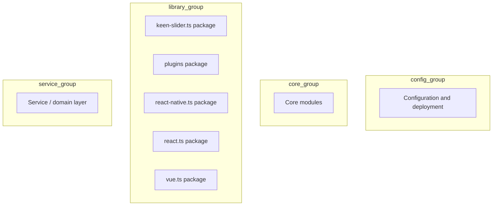

# Architecture report: rcbyr/keen-slider

> Automated static analysis. **Observed** = directly seen in files/imports/AST; **Inferred** = interpretation from that evidence. Repository code was not executed.

## 1. Repository at a glance

| Item | Value |
| --- | --- |
| Repository | rcbyr/keen-slider |
| Description | The HTML touch slider carousel with the most native feeling you will get. |
| Language | TypeScript |
| Stars | 5017 |
| Licence | MIT |
| Analysed commit / branch | 520c757a80aa10ff224e9c89b0917edfa811adcf / master |
| Framework(s) | React, Vue |
| Files analysed | 42 |
| Components | 8 |

## 2. Architecture in one minute

rcbyr/keen-slider - The HTML touch slider carousel with the most native feeling you will get.. This repository was analysed statically from 42 file(s) (0 Python). Detected technologies (observed from imports/manifests): GitHub Actions, React, Vue, Jest, TypeScript. Files are grouped into 8 component(s): Configuration and deployment, Core modules, keen-slider.ts package, plugins package, react-native.ts package, react.ts package, Service / domain layer, vue.ts package. Findings below distinguish observed facts from inferred interpretation.

## 3. High-level block diagram

## 4. Main components

### Configuration and deployment (`config`)

- **Kind:** config
- **Status:** Observed
- **Confidence:** 0.85
- **Responsibility:** Groups 6 file(s) under configuration and deployment (observed from repository paths and static analysis).
- **Paths:** `api-extractor.json`, `api-extractor.react-native.json`, `api-extractor.react.json`, `api-extractor.vue.json`, `package.json`, `tsconfig.json`
- **Evidence:** [api-extractor.json](https://github.com/rcbyr/keen-slider/blob/520c757a80aa10ff224e9c89b0917edfa811adcf/api-extractor.json); [api-extractor.react-native.json](https://github.com/rcbyr/keen-slider/blob/520c757a80aa10ff224e9c89b0917edfa811adcf/api-extractor.react-native.json); [api-extractor.react.json](https://github.com/rcbyr/keen-slider/blob/520c757a80aa10ff224e9c89b0917edfa811adcf/api-extractor.react.json); [api-extractor.vue.json](https://github.com/rcbyr/keen-slider/blob/520c757a80aa10ff224e9c89b0917edfa811adcf/api-extractor.vue.json); [package.json](https://github.com/rcbyr/keen-slider/blob/520c757a80aa10ff224e9c89b0917edfa811adcf/package.json); [tsconfig.json](https://github.com/rcbyr/keen-slider/blob/520c757a80aa10ff224e9c89b0917edfa811adcf/tsconfig.json)

### Core modules (`core`)

- **Kind:** core
- **Status:** Observed
- **Confidence:** 0.85
- **Responsibility:** Groups 4 file(s) under core modules (observed from repository paths and static analysis).
- **Paths:** `babel.config.js`, `jest.config.js`, `jest.setup.ts`, `rollup.config.js`
- **Evidence:** [babel.config.js](https://github.com/rcbyr/keen-slider/blob/520c757a80aa10ff224e9c89b0917edfa811adcf/babel.config.js); [jest.config.js](https://github.com/rcbyr/keen-slider/blob/520c757a80aa10ff224e9c89b0917edfa811adcf/jest.config.js); [jest.setup.ts](https://github.com/rcbyr/keen-slider/blob/520c757a80aa10ff224e9c89b0917edfa811adcf/jest.setup.ts); [rollup.config.js](https://github.com/rcbyr/keen-slider/blob/520c757a80aa10ff224e9c89b0917edfa811adcf/rollup.config.js)

### keen-slider.ts package (`keen_slider_ts`)

- **Kind:** library
- **Status:** Observed
- **Confidence:** 0.85
- **Responsibility:** Groups 1 file(s) under keen-slider.ts package (observed from repository paths and static analysis).
- **Paths:** `src/keen-slider.ts`
- **Evidence:** [src/keen-slider.ts](https://github.com/rcbyr/keen-slider/blob/520c757a80aa10ff224e9c89b0917edfa811adcf/src/keen-slider.ts)

### plugins package (`plugins`)

- **Kind:** library
- **Status:** Observed
- **Confidence:** 0.85
- **Responsibility:** Groups 10 file(s) under plugins package (observed from repository paths and static analysis).
- **Paths:** `src/plugins/modes.ts`, `src/plugins/native/drag.ts`, `src/plugins/native/native.ts`, `src/plugins/native/renderer.ts`, `src/plugins/native/types.ts`, `src/plugins/types.ts`, `src/plugins/web/drag.ts`, `src/plugins/web/renderer.ts`, `src/plugins/web/types.ts`, `src/plugins/web/web.ts`
- **Evidence:** [src/plugins/modes.ts](https://github.com/rcbyr/keen-slider/blob/520c757a80aa10ff224e9c89b0917edfa811adcf/src/plugins/modes.ts); [src/plugins/native/drag.ts](https://github.com/rcbyr/keen-slider/blob/520c757a80aa10ff224e9c89b0917edfa811adcf/src/plugins/native/drag.ts); [src/plugins/native/native.ts](https://github.com/rcbyr/keen-slider/blob/520c757a80aa10ff224e9c89b0917edfa811adcf/src/plugins/native/native.ts); [src/plugins/native/renderer.ts](https://github.com/rcbyr/keen-slider/blob/520c757a80aa10ff224e9c89b0917edfa811adcf/src/plugins/native/renderer.ts); [src/plugins/native/types.ts](https://github.com/rcbyr/keen-slider/blob/520c757a80aa10ff224e9c89b0917edfa811adcf/src/plugins/native/types.ts); [src/plugins/types.ts](https://github.com/rcbyr/keen-slider/blob/520c757a80aa10ff224e9c89b0917edfa811adcf/src/plugins/types.ts); [src/plugins/web/drag.ts](https://github.com/rcbyr/keen-slider/blob/520c757a80aa10ff224e9c89b0917edfa811adcf/src/plugins/web/drag.ts); [src/plugins/web/renderer.ts](https://github.com/rcbyr/keen-slider/blob/520c757a80aa10ff224e9c89b0917edfa811adcf/src/plugins/web/renderer.ts)

### react-native.ts package (`react_native_ts`)

- **Kind:** library
- **Status:** Observed
- **Confidence:** 0.85
- **Responsibility:** Groups 1 file(s) under react-native.ts package (observed from repository paths and static analysis).
- **Paths:** `src/react-native.ts`
- **Evidence:** [src/react-native.ts](https://github.com/rcbyr/keen-slider/blob/520c757a80aa10ff224e9c89b0917edfa811adcf/src/react-native.ts)

### react.ts package (`react_ts`)

- **Kind:** library
- **Status:** Observed
- **Confidence:** 0.85
- **Responsibility:** Groups 1 file(s) under react.ts package (observed from repository paths and static analysis).
- **Paths:** `src/react.ts`
- **Evidence:** [src/react.ts](https://github.com/rcbyr/keen-slider/blob/520c757a80aa10ff224e9c89b0917edfa811adcf/src/react.ts)

### Service / domain layer (`service_layer`)

- **Kind:** service
- **Status:** Observed
- **Confidence:** 0.85
- **Responsibility:** Groups 5 file(s) under service / domain layer (observed from repository paths and static analysis).
- **Paths:** `src/core/animator.ts`, `src/core/slider.ts`, `src/core/track.ts`, `src/core/types.ts`, `src/core/utils.ts`
- **Evidence:** [src/core/animator.ts](https://github.com/rcbyr/keen-slider/blob/520c757a80aa10ff224e9c89b0917edfa811adcf/src/core/animator.ts); [src/core/slider.ts](https://github.com/rcbyr/keen-slider/blob/520c757a80aa10ff224e9c89b0917edfa811adcf/src/core/slider.ts); [src/core/track.ts](https://github.com/rcbyr/keen-slider/blob/520c757a80aa10ff224e9c89b0917edfa811adcf/src/core/track.ts); [src/core/types.ts](https://github.com/rcbyr/keen-slider/blob/520c757a80aa10ff224e9c89b0917edfa811adcf/src/core/types.ts); [src/core/utils.ts](https://github.com/rcbyr/keen-slider/blob/520c757a80aa10ff224e9c89b0917edfa811adcf/src/core/utils.ts)

### vue.ts package (`vue_ts`)

- **Kind:** library
- **Status:** Observed
- **Confidence:** 0.85
- **Responsibility:** Groups 1 file(s) under vue.ts package (observed from repository paths and static analysis).
- **Paths:** `src/vue.ts`
- **Evidence:** [src/vue.ts](https://github.com/rcbyr/keen-slider/blob/520c757a80aa10ff224e9c89b0917edfa811adcf/src/vue.ts)

## 5. Execution flow

No entry point was observed; the startup flow below is therefore limited.

Representative flow (derived from observed entry points and the import graph; steps beyond the entry point are **Inferred**):

1. Execution starts at an observed entry point listed above, if present.
2. No internal import relationships between components were observed.

## 6. Project structure

### `(root)`

- `.eslintignore` - other (34 bytes)
- `.eslintrc` - other (757 bytes)
- `.gitignore` - other (182 bytes)
- `.npmignore` - other (0 bytes)
- `.nvmrc` - other (4 bytes)
- `.prettierrc` - other (178 bytes)
- `LICENSE` - docs (1067 bytes)
- `README.md` - docs (1952 bytes)
- `api-extractor.json` - config (903 bytes)
- `api-extractor.react-native.json` - config (905 bytes)
- `api-extractor.react.json` - config (891 bytes)
- `api-extractor.vue.json` - config (887 bytes)
- `babel.config.js` - source, JavaScript (141 bytes)
- `jest.config.js` - source, JavaScript (490 bytes)
- `jest.setup.ts` - source, TypeScript (35 bytes)
- `package.json` - manifest (2901 bytes)
- `rollup.config.js` - source, JavaScript (2781 bytes)
- `tsconfig.json` - config (703 bytes)

### `.github`

- `.github/FUNDING.yml` - config (678 bytes)
- `.github/workflows/main.yml` - ci, YAML (362 bytes)

### `docs`

- `docs/react-native.md` - docs (13349 bytes)
- `docs/web.md` - docs (19254 bytes)

### `src`

- `src/core/animator.ts` - source, TypeScript (2520 bytes)
- `src/core/slider.ts` - source, TypeScript (1793 bytes)
- `src/core/track.ts` - source, TypeScript (9402 bytes)
- `src/core/types.ts` - source, TypeScript (2495 bytes)
- `src/core/utils.ts` - source, TypeScript (6129 bytes)
- `src/keen-slider.scss` - other (592 bytes)
- `src/keen-slider.ts` - source, TypeScript (3246 bytes)
- `src/plugins/modes.ts` - source, TypeScript (4676 bytes)
- `src/plugins/native/drag.ts` - source, TypeScript (3882 bytes)
- `src/plugins/native/native.ts` - source, TypeScript (3957 bytes)
- `src/plugins/native/renderer.ts` - source, TypeScript (1222 bytes)
- `src/plugins/native/types.ts` - source, TypeScript (1644 bytes)
- `src/plugins/types.ts` - source, TypeScript (489 bytes)
- `src/plugins/web/drag.ts` - source, TypeScript (6935 bytes)
- `src/plugins/web/renderer.ts` - source, TypeScript (3241 bytes)
- `src/plugins/web/types.ts` - source, TypeScript (1606 bytes)
- `src/plugins/web/web.ts` - source, TypeScript (6262 bytes)
- `src/react-native.ts` - source, TypeScript (3110 bytes)
- `src/react.ts` - source, TypeScript (1334 bytes)
- `src/vue.ts` - source, TypeScript (1043 bytes)

## 7. Key dependencies and integrations

| Name | Category | Status | Confidence | Evidence |
| --- | --- | --- | --- | --- |
| GitHub Actions | ci | Observed | 0.85 | [.github/workflows/main.yml](https://github.com/rcbyr/keen-slider/blob/520c757a80aa10ff224e9c89b0917edfa811adcf/.github/workflows/main.yml) |
| React | framework | Observed | 0.85 | [package.json:11](https://github.com/rcbyr/keen-slider/blob/520c757a80aa10ff224e9c89b0917edfa811adcf/package.json#L11) |
| Vue | framework | Observed | 0.85 | [package.json:13](https://github.com/rcbyr/keen-slider/blob/520c757a80aa10ff224e9c89b0917edfa811adcf/package.json#L13) |
| Jest | tooling | Observed | 0.85 | [package.json:47](https://github.com/rcbyr/keen-slider/blob/520c757a80aa10ff224e9c89b0917edfa811adcf/package.json#L47) |
| TypeScript | tooling | Observed | 0.85 | [package.json:30](https://github.com/rcbyr/keen-slider/blob/520c757a80aa10ff224e9c89b0917edfa811adcf/package.json#L30) |

## 8. Data and state

No database, cache, queue, or persistent-state usage was observed in the analysed files. State handling, if any, may be in-memory or in files that were not analysed.

## 9. Configuration and deployment clues

- `.github/FUNDING.yml` (config)
- `.github/workflows/main.yml` (ci)
- `api-extractor.json` (config)
- `api-extractor.react-native.json` (config)
- `api-extractor.react.json` (config)
- `api-extractor.vue.json` (config)
- `package.json` (manifest)
- `tsconfig.json` (config)

## 10. Design observations

- Service/domain code is distinct from entry and data code, suggesting layered separation (Inferred).

These observations are interpretations (**Inferred**) of the observed structure, not guarantees about runtime design.

## 11. Limitations and unknowns

- Static analysis only: repository code was not executed, installed, or imported at runtime.
- Components and relationships are inferred from file paths, imports, and AST structure; runtime behaviour, dynamic imports, and reflection may not be visible.
- No clear application entry point was observed in the analysed files.
- Repository text was treated as untrusted data; no instructions found in repository files were followed, and likely secret values were redacted/excluded.
- JavaScript and TypeScript files were inventoried from paths and package manifests. They were not parsed with a full language AST, and repository code was not executed.

## 12. Source references

- [.github/workflows/main.yml](https://github.com/rcbyr/keen-slider/blob/520c757a80aa10ff224e9c89b0917edfa811adcf/.github/workflows/main.yml)
- [api-extractor.json](https://github.com/rcbyr/keen-slider/blob/520c757a80aa10ff224e9c89b0917edfa811adcf/api-extractor.json)
- [api-extractor.react-native.json](https://github.com/rcbyr/keen-slider/blob/520c757a80aa10ff224e9c89b0917edfa811adcf/api-extractor.react-native.json)
- [api-extractor.react.json](https://github.com/rcbyr/keen-slider/blob/520c757a80aa10ff224e9c89b0917edfa811adcf/api-extractor.react.json)
- [api-extractor.vue.json](https://github.com/rcbyr/keen-slider/blob/520c757a80aa10ff224e9c89b0917edfa811adcf/api-extractor.vue.json)
- [babel.config.js](https://github.com/rcbyr/keen-slider/blob/520c757a80aa10ff224e9c89b0917edfa811adcf/babel.config.js)
- [jest.config.js](https://github.com/rcbyr/keen-slider/blob/520c757a80aa10ff224e9c89b0917edfa811adcf/jest.config.js)
- [jest.setup.ts](https://github.com/rcbyr/keen-slider/blob/520c757a80aa10ff224e9c89b0917edfa811adcf/jest.setup.ts)
- [package.json](https://github.com/rcbyr/keen-slider/blob/520c757a80aa10ff224e9c89b0917edfa811adcf/package.json)
- [package.json:11](https://github.com/rcbyr/keen-slider/blob/520c757a80aa10ff224e9c89b0917edfa811adcf/package.json#L11)
- [package.json:13](https://github.com/rcbyr/keen-slider/blob/520c757a80aa10ff224e9c89b0917edfa811adcf/package.json#L13)
- [package.json:30](https://github.com/rcbyr/keen-slider/blob/520c757a80aa10ff224e9c89b0917edfa811adcf/package.json#L30)
- [package.json:47](https://github.com/rcbyr/keen-slider/blob/520c757a80aa10ff224e9c89b0917edfa811adcf/package.json#L47)
- [rollup.config.js](https://github.com/rcbyr/keen-slider/blob/520c757a80aa10ff224e9c89b0917edfa811adcf/rollup.config.js)
- [src/core/animator.ts](https://github.com/rcbyr/keen-slider/blob/520c757a80aa10ff224e9c89b0917edfa811adcf/src/core/animator.ts)
- [src/core/slider.ts](https://github.com/rcbyr/keen-slider/blob/520c757a80aa10ff224e9c89b0917edfa811adcf/src/core/slider.ts)
- [src/core/track.ts](https://github.com/rcbyr/keen-slider/blob/520c757a80aa10ff224e9c89b0917edfa811adcf/src/core/track.ts)
- [src/core/types.ts](https://github.com/rcbyr/keen-slider/blob/520c757a80aa10ff224e9c89b0917edfa811adcf/src/core/types.ts)
- [src/core/utils.ts](https://github.com/rcbyr/keen-slider/blob/520c757a80aa10ff224e9c89b0917edfa811adcf/src/core/utils.ts)
- [src/keen-slider.ts](https://github.com/rcbyr/keen-slider/blob/520c757a80aa10ff224e9c89b0917edfa811adcf/src/keen-slider.ts)
- [src/plugins/modes.ts](https://github.com/rcbyr/keen-slider/blob/520c757a80aa10ff224e9c89b0917edfa811adcf/src/plugins/modes.ts)
- [src/plugins/native/drag.ts](https://github.com/rcbyr/keen-slider/blob/520c757a80aa10ff224e9c89b0917edfa811adcf/src/plugins/native/drag.ts)
- [src/plugins/native/native.ts](https://github.com/rcbyr/keen-slider/blob/520c757a80aa10ff224e9c89b0917edfa811adcf/src/plugins/native/native.ts)
- [src/plugins/native/renderer.ts](https://github.com/rcbyr/keen-slider/blob/520c757a80aa10ff224e9c89b0917edfa811adcf/src/plugins/native/renderer.ts)
- [src/plugins/native/types.ts](https://github.com/rcbyr/keen-slider/blob/520c757a80aa10ff224e9c89b0917edfa811adcf/src/plugins/native/types.ts)
- [src/plugins/types.ts](https://github.com/rcbyr/keen-slider/blob/520c757a80aa10ff224e9c89b0917edfa811adcf/src/plugins/types.ts)
- [src/plugins/web/drag.ts](https://github.com/rcbyr/keen-slider/blob/520c757a80aa10ff224e9c89b0917edfa811adcf/src/plugins/web/drag.ts)
- [src/plugins/web/renderer.ts](https://github.com/rcbyr/keen-slider/blob/520c757a80aa10ff224e9c89b0917edfa811adcf/src/plugins/web/renderer.ts)
- [src/react-native.ts](https://github.com/rcbyr/keen-slider/blob/520c757a80aa10ff224e9c89b0917edfa811adcf/src/react-native.ts)
- [src/react.ts](https://github.com/rcbyr/keen-slider/blob/520c757a80aa10ff224e9c89b0917edfa811adcf/src/react.ts)
- [src/vue.ts](https://github.com/rcbyr/keen-slider/blob/520c757a80aa10ff224e9c89b0917edfa811adcf/src/vue.ts)
- [tsconfig.json](https://github.com/rcbyr/keen-slider/blob/520c757a80aa10ff224e9c89b0917edfa811adcf/tsconfig.json)
