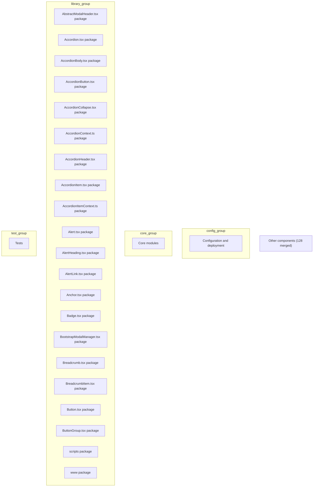

# Architecture report: react-bootstrap/react-bootstrap

> Automated static analysis. **Observed** = directly seen in files/imports/AST; **Inferred** = interpretation from that evidence. Repository code was not executed.

## 1. Repository at a glance

| Item | Value |
| --- | --- |
| Repository | react-bootstrap/react-bootstrap |
| Description | Bootstrap components built with React |
| Language | TypeScript |
| Stars | 22613 |
| Licence | MIT |
| Analysed commit / branch | 3291c5bed8c4ec287e7bc5cf3a980984cfedbb6a / master |
| Framework(s) | React |
| Files analysed | 630 |
| Components | 152 |

## 2. Architecture in one minute

react-bootstrap/react-bootstrap - Bootstrap components built with React. This repository was analysed statically from 630 file(s) (0 Python). Detected technologies (observed from imports/manifests): GitHub Actions, React, TypeScript, Vite, Vitest, webpack. Files are grouped into 152 component(s): AbstractModalHeader.tsx package, Accordion.tsx package, AccordionBody.tsx package, AccordionButton.tsx package, AccordionCollapse.tsx package, AccordionContext.ts package, AccordionHeader.tsx package, AccordionItem.tsx package. Findings below distinguish observed facts from inferred interpretation.

## 3. High-level block diagram

## 4. Main components

### AbstractModalHeader.tsx package (`abstractmodalheader_tsx`)

- **Kind:** library
- **Status:** Observed
- **Confidence:** 0.85
- **Responsibility:** Groups 1 file(s) under abstractmodalheader.tsx package (observed from repository paths and static analysis).
- **Paths:** `src/AbstractModalHeader.tsx`
- **Evidence:** [src/AbstractModalHeader.tsx](https://github.com/react-bootstrap/react-bootstrap/blob/3291c5bed8c4ec287e7bc5cf3a980984cfedbb6a/src/AbstractModalHeader.tsx)

### Accordion.tsx package (`accordion_tsx`)

- **Kind:** library
- **Status:** Observed
- **Confidence:** 0.85
- **Responsibility:** Groups 1 file(s) under accordion.tsx package (observed from repository paths and static analysis).
- **Paths:** `src/Accordion.tsx`
- **Evidence:** [src/Accordion.tsx](https://github.com/react-bootstrap/react-bootstrap/blob/3291c5bed8c4ec287e7bc5cf3a980984cfedbb6a/src/Accordion.tsx)

### AccordionBody.tsx package (`accordionbody_tsx`)

- **Kind:** library
- **Status:** Observed
- **Confidence:** 0.85
- **Responsibility:** Groups 1 file(s) under accordionbody.tsx package (observed from repository paths and static analysis).
- **Paths:** `src/AccordionBody.tsx`
- **Evidence:** [src/AccordionBody.tsx](https://github.com/react-bootstrap/react-bootstrap/blob/3291c5bed8c4ec287e7bc5cf3a980984cfedbb6a/src/AccordionBody.tsx)

### AccordionButton.tsx package (`accordionbutton_tsx`)

- **Kind:** library
- **Status:** Observed
- **Confidence:** 0.85
- **Responsibility:** Groups 1 file(s) under accordionbutton.tsx package (observed from repository paths and static analysis).
- **Paths:** `src/AccordionButton.tsx`
- **Evidence:** [src/AccordionButton.tsx](https://github.com/react-bootstrap/react-bootstrap/blob/3291c5bed8c4ec287e7bc5cf3a980984cfedbb6a/src/AccordionButton.tsx)

### AccordionCollapse.tsx package (`accordioncollapse_tsx`)

- **Kind:** library
- **Status:** Observed
- **Confidence:** 0.85
- **Responsibility:** Groups 1 file(s) under accordioncollapse.tsx package (observed from repository paths and static analysis).
- **Paths:** `src/AccordionCollapse.tsx`
- **Evidence:** [src/AccordionCollapse.tsx](https://github.com/react-bootstrap/react-bootstrap/blob/3291c5bed8c4ec287e7bc5cf3a980984cfedbb6a/src/AccordionCollapse.tsx)

### AccordionContext.ts package (`accordioncontext_ts`)

- **Kind:** library
- **Status:** Observed
- **Confidence:** 0.85
- **Responsibility:** Groups 1 file(s) under accordioncontext.ts package (observed from repository paths and static analysis).
- **Paths:** `src/AccordionContext.ts`
- **Evidence:** [src/AccordionContext.ts](https://github.com/react-bootstrap/react-bootstrap/blob/3291c5bed8c4ec287e7bc5cf3a980984cfedbb6a/src/AccordionContext.ts)

### AccordionHeader.tsx package (`accordionheader_tsx`)

- **Kind:** library
- **Status:** Observed
- **Confidence:** 0.85
- **Responsibility:** Groups 1 file(s) under accordionheader.tsx package (observed from repository paths and static analysis).
- **Paths:** `src/AccordionHeader.tsx`
- **Evidence:** [src/AccordionHeader.tsx](https://github.com/react-bootstrap/react-bootstrap/blob/3291c5bed8c4ec287e7bc5cf3a980984cfedbb6a/src/AccordionHeader.tsx)

### AccordionItem.tsx package (`accordionitem_tsx`)

- **Kind:** library
- **Status:** Observed
- **Confidence:** 0.85
- **Responsibility:** Groups 1 file(s) under accordionitem.tsx package (observed from repository paths and static analysis).
- **Paths:** `src/AccordionItem.tsx`
- **Evidence:** [src/AccordionItem.tsx](https://github.com/react-bootstrap/react-bootstrap/blob/3291c5bed8c4ec287e7bc5cf3a980984cfedbb6a/src/AccordionItem.tsx)

### AccordionItemContext.ts package (`accordionitemcontext_ts`)

- **Kind:** library
- **Status:** Observed
- **Confidence:** 0.85
- **Responsibility:** Groups 1 file(s) under accordionitemcontext.ts package (observed from repository paths and static analysis).
- **Paths:** `src/AccordionItemContext.ts`
- **Evidence:** [src/AccordionItemContext.ts](https://github.com/react-bootstrap/react-bootstrap/blob/3291c5bed8c4ec287e7bc5cf3a980984cfedbb6a/src/AccordionItemContext.ts)

### Alert.tsx package (`alert_tsx`)

- **Kind:** library
- **Status:** Observed
- **Confidence:** 0.85
- **Responsibility:** Groups 1 file(s) under alert.tsx package (observed from repository paths and static analysis).
- **Paths:** `src/Alert.tsx`
- **Evidence:** [src/Alert.tsx](https://github.com/react-bootstrap/react-bootstrap/blob/3291c5bed8c4ec287e7bc5cf3a980984cfedbb6a/src/Alert.tsx)

### AlertHeading.tsx package (`alertheading_tsx`)

- **Kind:** library
- **Status:** Observed
- **Confidence:** 0.85
- **Responsibility:** Groups 1 file(s) under alertheading.tsx package (observed from repository paths and static analysis).
- **Paths:** `src/AlertHeading.tsx`
- **Evidence:** [src/AlertHeading.tsx](https://github.com/react-bootstrap/react-bootstrap/blob/3291c5bed8c4ec287e7bc5cf3a980984cfedbb6a/src/AlertHeading.tsx)

### AlertLink.tsx package (`alertlink_tsx`)

- **Kind:** library
- **Status:** Observed
- **Confidence:** 0.85
- **Responsibility:** Groups 1 file(s) under alertlink.tsx package (observed from repository paths and static analysis).
- **Paths:** `src/AlertLink.tsx`
- **Evidence:** [src/AlertLink.tsx](https://github.com/react-bootstrap/react-bootstrap/blob/3291c5bed8c4ec287e7bc5cf3a980984cfedbb6a/src/AlertLink.tsx)

### Anchor.tsx package (`anchor_tsx`)

- **Kind:** library
- **Status:** Observed
- **Confidence:** 0.85
- **Responsibility:** Groups 1 file(s) under anchor.tsx package (observed from repository paths and static analysis).
- **Paths:** `src/Anchor.tsx`
- **Evidence:** [src/Anchor.tsx](https://github.com/react-bootstrap/react-bootstrap/blob/3291c5bed8c4ec287e7bc5cf3a980984cfedbb6a/src/Anchor.tsx)

### Badge.tsx package (`badge_tsx`)

- **Kind:** library
- **Status:** Observed
- **Confidence:** 0.85
- **Responsibility:** Groups 1 file(s) under badge.tsx package (observed from repository paths and static analysis).
- **Paths:** `src/Badge.tsx`
- **Evidence:** [src/Badge.tsx](https://github.com/react-bootstrap/react-bootstrap/blob/3291c5bed8c4ec287e7bc5cf3a980984cfedbb6a/src/Badge.tsx)

### BootstrapModalManager.tsx package (`bootstrapmodalmanager_tsx`)

- **Kind:** library
- **Status:** Observed
- **Confidence:** 0.85
- **Responsibility:** Groups 1 file(s) under bootstrapmodalmanager.tsx package (observed from repository paths and static analysis).
- **Paths:** `src/BootstrapModalManager.tsx`
- **Evidence:** [src/BootstrapModalManager.tsx](https://github.com/react-bootstrap/react-bootstrap/blob/3291c5bed8c4ec287e7bc5cf3a980984cfedbb6a/src/BootstrapModalManager.tsx)

### Breadcrumb.tsx package (`breadcrumb_tsx`)

- **Kind:** library
- **Status:** Observed
- **Confidence:** 0.85
- **Responsibility:** Groups 1 file(s) under breadcrumb.tsx package (observed from repository paths and static analysis).
- **Paths:** `src/Breadcrumb.tsx`
- **Evidence:** [src/Breadcrumb.tsx](https://github.com/react-bootstrap/react-bootstrap/blob/3291c5bed8c4ec287e7bc5cf3a980984cfedbb6a/src/Breadcrumb.tsx)

### BreadcrumbItem.tsx package (`breadcrumbitem_tsx`)

- **Kind:** library
- **Status:** Observed
- **Confidence:** 0.85
- **Responsibility:** Groups 1 file(s) under breadcrumbitem.tsx package (observed from repository paths and static analysis).
- **Paths:** `src/BreadcrumbItem.tsx`
- **Evidence:** [src/BreadcrumbItem.tsx](https://github.com/react-bootstrap/react-bootstrap/blob/3291c5bed8c4ec287e7bc5cf3a980984cfedbb6a/src/BreadcrumbItem.tsx)

### Button.tsx package (`button_tsx`)

- **Kind:** library
- **Status:** Observed
- **Confidence:** 0.85
- **Responsibility:** Groups 1 file(s) under button.tsx package (observed from repository paths and static analysis).
- **Paths:** `src/Button.tsx`
- **Evidence:** [src/Button.tsx](https://github.com/react-bootstrap/react-bootstrap/blob/3291c5bed8c4ec287e7bc5cf3a980984cfedbb6a/src/Button.tsx)

### ButtonGroup.tsx package (`buttongroup_tsx`)

- **Kind:** library
- **Status:** Observed
- **Confidence:** 0.85
- **Responsibility:** Groups 1 file(s) under buttongroup.tsx package (observed from repository paths and static analysis).
- **Paths:** `src/ButtonGroup.tsx`
- **Evidence:** [src/ButtonGroup.tsx](https://github.com/react-bootstrap/react-bootstrap/blob/3291c5bed8c4ec287e7bc5cf3a980984cfedbb6a/src/ButtonGroup.tsx)

### ButtonToolbar.tsx package (`buttontoolbar_tsx`)

- **Kind:** library
- **Status:** Observed
- **Confidence:** 0.85
- **Responsibility:** Groups 1 file(s) under buttontoolbar.tsx package (observed from repository paths and static analysis).
- **Paths:** `src/ButtonToolbar.tsx`
- **Evidence:** [src/ButtonToolbar.tsx](https://github.com/react-bootstrap/react-bootstrap/blob/3291c5bed8c4ec287e7bc5cf3a980984cfedbb6a/src/ButtonToolbar.tsx)

### Card.tsx package (`card_tsx`)

- **Kind:** library
- **Status:** Observed
- **Confidence:** 0.85
- **Responsibility:** Groups 1 file(s) under card.tsx package (observed from repository paths and static analysis).
- **Paths:** `src/Card.tsx`
- **Evidence:** [src/Card.tsx](https://github.com/react-bootstrap/react-bootstrap/blob/3291c5bed8c4ec287e7bc5cf3a980984cfedbb6a/src/Card.tsx)

### CardBody.tsx package (`cardbody_tsx`)

- **Kind:** library
- **Status:** Observed
- **Confidence:** 0.85
- **Responsibility:** Groups 1 file(s) under cardbody.tsx package (observed from repository paths and static analysis).
- **Paths:** `src/CardBody.tsx`
- **Evidence:** [src/CardBody.tsx](https://github.com/react-bootstrap/react-bootstrap/blob/3291c5bed8c4ec287e7bc5cf3a980984cfedbb6a/src/CardBody.tsx)

### CardFooter.tsx package (`cardfooter_tsx`)

- **Kind:** library
- **Status:** Observed
- **Confidence:** 0.85
- **Responsibility:** Groups 1 file(s) under cardfooter.tsx package (observed from repository paths and static analysis).
- **Paths:** `src/CardFooter.tsx`
- **Evidence:** [src/CardFooter.tsx](https://github.com/react-bootstrap/react-bootstrap/blob/3291c5bed8c4ec287e7bc5cf3a980984cfedbb6a/src/CardFooter.tsx)

### CardGroup.tsx package (`cardgroup_tsx`)

- **Kind:** library
- **Status:** Observed
- **Confidence:** 0.85
- **Responsibility:** Groups 1 file(s) under cardgroup.tsx package (observed from repository paths and static analysis).
- **Paths:** `src/CardGroup.tsx`
- **Evidence:** [src/CardGroup.tsx](https://github.com/react-bootstrap/react-bootstrap/blob/3291c5bed8c4ec287e7bc5cf3a980984cfedbb6a/src/CardGroup.tsx)

### CardHeader.tsx package (`cardheader_tsx`)

- **Kind:** library
- **Status:** Observed
- **Confidence:** 0.85
- **Responsibility:** Groups 1 file(s) under cardheader.tsx package (observed from repository paths and static analysis).
- **Paths:** `src/CardHeader.tsx`
- **Evidence:** [src/CardHeader.tsx](https://github.com/react-bootstrap/react-bootstrap/blob/3291c5bed8c4ec287e7bc5cf3a980984cfedbb6a/src/CardHeader.tsx)

### CardHeaderContext.tsx package (`cardheadercontext_tsx`)

- **Kind:** library
- **Status:** Observed
- **Confidence:** 0.85
- **Responsibility:** Groups 1 file(s) under cardheadercontext.tsx package (observed from repository paths and static analysis).
- **Paths:** `src/CardHeaderContext.tsx`
- **Evidence:** [src/CardHeaderContext.tsx](https://github.com/react-bootstrap/react-bootstrap/blob/3291c5bed8c4ec287e7bc5cf3a980984cfedbb6a/src/CardHeaderContext.tsx)

### CardImg.tsx package (`cardimg_tsx`)

- **Kind:** library
- **Status:** Observed
- **Confidence:** 0.85
- **Responsibility:** Groups 1 file(s) under cardimg.tsx package (observed from repository paths and static analysis).
- **Paths:** `src/CardImg.tsx`
- **Evidence:** [src/CardImg.tsx](https://github.com/react-bootstrap/react-bootstrap/blob/3291c5bed8c4ec287e7bc5cf3a980984cfedbb6a/src/CardImg.tsx)

### CardImgOverlay.tsx package (`cardimgoverlay_tsx`)

- **Kind:** library
- **Status:** Observed
- **Confidence:** 0.85
- **Responsibility:** Groups 1 file(s) under cardimgoverlay.tsx package (observed from repository paths and static analysis).
- **Paths:** `src/CardImgOverlay.tsx`
- **Evidence:** [src/CardImgOverlay.tsx](https://github.com/react-bootstrap/react-bootstrap/blob/3291c5bed8c4ec287e7bc5cf3a980984cfedbb6a/src/CardImgOverlay.tsx)

### CardLink.tsx package (`cardlink_tsx`)

- **Kind:** library
- **Status:** Observed
- **Confidence:** 0.85
- **Responsibility:** Groups 1 file(s) under cardlink.tsx package (observed from repository paths and static analysis).
- **Paths:** `src/CardLink.tsx`
- **Evidence:** [src/CardLink.tsx](https://github.com/react-bootstrap/react-bootstrap/blob/3291c5bed8c4ec287e7bc5cf3a980984cfedbb6a/src/CardLink.tsx)

### CardSubtitle.tsx package (`cardsubtitle_tsx`)

- **Kind:** library
- **Status:** Observed
- **Confidence:** 0.85
- **Responsibility:** Groups 1 file(s) under cardsubtitle.tsx package (observed from repository paths and static analysis).
- **Paths:** `src/CardSubtitle.tsx`
- **Evidence:** [src/CardSubtitle.tsx](https://github.com/react-bootstrap/react-bootstrap/blob/3291c5bed8c4ec287e7bc5cf3a980984cfedbb6a/src/CardSubtitle.tsx)

### CardText.tsx package (`cardtext_tsx`)

- **Kind:** library
- **Status:** Observed
- **Confidence:** 0.85
- **Responsibility:** Groups 1 file(s) under cardtext.tsx package (observed from repository paths and static analysis).
- **Paths:** `src/CardText.tsx`
- **Evidence:** [src/CardText.tsx](https://github.com/react-bootstrap/react-bootstrap/blob/3291c5bed8c4ec287e7bc5cf3a980984cfedbb6a/src/CardText.tsx)

### CardTitle.tsx package (`cardtitle_tsx`)

- **Kind:** library
- **Status:** Observed
- **Confidence:** 0.85
- **Responsibility:** Groups 1 file(s) under cardtitle.tsx package (observed from repository paths and static analysis).
- **Paths:** `src/CardTitle.tsx`
- **Evidence:** [src/CardTitle.tsx](https://github.com/react-bootstrap/react-bootstrap/blob/3291c5bed8c4ec287e7bc5cf3a980984cfedbb6a/src/CardTitle.tsx)

### Carousel.tsx package (`carousel_tsx`)

- **Kind:** library
- **Status:** Observed
- **Confidence:** 0.85
- **Responsibility:** Groups 1 file(s) under carousel.tsx package (observed from repository paths and static analysis).
- **Paths:** `src/Carousel.tsx`
- **Evidence:** [src/Carousel.tsx](https://github.com/react-bootstrap/react-bootstrap/blob/3291c5bed8c4ec287e7bc5cf3a980984cfedbb6a/src/Carousel.tsx)

### CarouselCaption.tsx package (`carouselcaption_tsx`)

- **Kind:** library
- **Status:** Observed
- **Confidence:** 0.85
- **Responsibility:** Groups 1 file(s) under carouselcaption.tsx package (observed from repository paths and static analysis).
- **Paths:** `src/CarouselCaption.tsx`
- **Evidence:** [src/CarouselCaption.tsx](https://github.com/react-bootstrap/react-bootstrap/blob/3291c5bed8c4ec287e7bc5cf3a980984cfedbb6a/src/CarouselCaption.tsx)

### CarouselItem.tsx package (`carouselitem_tsx`)

- **Kind:** library
- **Status:** Observed
- **Confidence:** 0.85
- **Responsibility:** Groups 1 file(s) under carouselitem.tsx package (observed from repository paths and static analysis).
- **Paths:** `src/CarouselItem.tsx`
- **Evidence:** [src/CarouselItem.tsx](https://github.com/react-bootstrap/react-bootstrap/blob/3291c5bed8c4ec287e7bc5cf3a980984cfedbb6a/src/CarouselItem.tsx)

### CloseButton.tsx package (`closebutton_tsx`)

- **Kind:** library
- **Status:** Observed
- **Confidence:** 0.85
- **Responsibility:** Groups 1 file(s) under closebutton.tsx package (observed from repository paths and static analysis).
- **Paths:** `src/CloseButton.tsx`
- **Evidence:** [src/CloseButton.tsx](https://github.com/react-bootstrap/react-bootstrap/blob/3291c5bed8c4ec287e7bc5cf3a980984cfedbb6a/src/CloseButton.tsx)

### Col.tsx package (`col_tsx`)

- **Kind:** library
- **Status:** Observed
- **Confidence:** 0.85
- **Responsibility:** Groups 1 file(s) under col.tsx package (observed from repository paths and static analysis).
- **Paths:** `src/Col.tsx`
- **Evidence:** [src/Col.tsx](https://github.com/react-bootstrap/react-bootstrap/blob/3291c5bed8c4ec287e7bc5cf3a980984cfedbb6a/src/Col.tsx)

### Collapse.tsx package (`collapse_tsx`)

- **Kind:** library
- **Status:** Observed
- **Confidence:** 0.85
- **Responsibility:** Groups 1 file(s) under collapse.tsx package (observed from repository paths and static analysis).
- **Paths:** `src/Collapse.tsx`
- **Evidence:** [src/Collapse.tsx](https://github.com/react-bootstrap/react-bootstrap/blob/3291c5bed8c4ec287e7bc5cf3a980984cfedbb6a/src/Collapse.tsx)

### Configuration and deployment (`config`)

- **Kind:** config
- **Status:** Observed
- **Confidence:** 0.85
- **Responsibility:** Groups 13 file(s) under configuration and deployment (observed from repository paths and static analysis).
- **Paths:** `codecov.yml`, `package.json`, `renovate.json`, `scripts/tsconfig.json`, `tsconfig.json`, `www/docs/components/_category_.json`, `www/docs/forms/_category_.json`, `www/docs/getting-started/_category_.json`, `www/docs/layout/_category_.json`, `www/docs/migrating/_category_.json`, `www/docs/utilities/_category_.json`, `www/package.json`, `www/tsconfig.json`
- **Evidence:** [codecov.yml](https://github.com/react-bootstrap/react-bootstrap/blob/3291c5bed8c4ec287e7bc5cf3a980984cfedbb6a/codecov.yml); [package.json](https://github.com/react-bootstrap/react-bootstrap/blob/3291c5bed8c4ec287e7bc5cf3a980984cfedbb6a/package.json); [renovate.json](https://github.com/react-bootstrap/react-bootstrap/blob/3291c5bed8c4ec287e7bc5cf3a980984cfedbb6a/renovate.json); [scripts/tsconfig.json](https://github.com/react-bootstrap/react-bootstrap/blob/3291c5bed8c4ec287e7bc5cf3a980984cfedbb6a/scripts/tsconfig.json); [tsconfig.json](https://github.com/react-bootstrap/react-bootstrap/blob/3291c5bed8c4ec287e7bc5cf3a980984cfedbb6a/tsconfig.json); [www/docs/components/_category_.json](https://github.com/react-bootstrap/react-bootstrap/blob/3291c5bed8c4ec287e7bc5cf3a980984cfedbb6a/www/docs/components/_category_.json); [www/docs/forms/_category_.json](https://github.com/react-bootstrap/react-bootstrap/blob/3291c5bed8c4ec287e7bc5cf3a980984cfedbb6a/www/docs/forms/_category_.json); [www/docs/getting-started/_category_.json](https://github.com/react-bootstrap/react-bootstrap/blob/3291c5bed8c4ec287e7bc5cf3a980984cfedbb6a/www/docs/getting-started/_category_.json)

### Container.tsx package (`container_tsx`)

- **Kind:** library
- **Status:** Observed
- **Confidence:** 0.85
- **Responsibility:** Groups 1 file(s) under container.tsx package (observed from repository paths and static analysis).
- **Paths:** `src/Container.tsx`
- **Evidence:** [src/Container.tsx](https://github.com/react-bootstrap/react-bootstrap/blob/3291c5bed8c4ec287e7bc5cf3a980984cfedbb6a/src/Container.tsx)

### Core modules (`core`)

- **Kind:** core
- **Status:** Observed
- **Confidence:** 0.85
- **Responsibility:** Groups 3 file(s) under core modules (observed from repository paths and static analysis).
- **Paths:** `eslint.config.mjs`, `vitest.setup.ts`, `vitest.shims.d.ts`
- **Evidence:** [eslint.config.mjs](https://github.com/react-bootstrap/react-bootstrap/blob/3291c5bed8c4ec287e7bc5cf3a980984cfedbb6a/eslint.config.mjs); [vitest.setup.ts](https://github.com/react-bootstrap/react-bootstrap/blob/3291c5bed8c4ec287e7bc5cf3a980984cfedbb6a/vitest.setup.ts); [vitest.shims.d.ts](https://github.com/react-bootstrap/react-bootstrap/blob/3291c5bed8c4ec287e7bc5cf3a980984cfedbb6a/vitest.shims.d.ts)

### createChainedFunction.tsx package (`createchainedfunction_tsx`)

- **Kind:** library
- **Status:** Observed
- **Confidence:** 0.85
- **Responsibility:** Groups 1 file(s) under createchainedfunction.tsx package (observed from repository paths and static analysis).
- **Paths:** `src/createChainedFunction.tsx`
- **Evidence:** [src/createChainedFunction.tsx](https://github.com/react-bootstrap/react-bootstrap/blob/3291c5bed8c4ec287e7bc5cf3a980984cfedbb6a/src/createChainedFunction.tsx)

### createUtilityClasses.ts package (`createutilityclasses_ts`)

- **Kind:** library
- **Status:** Observed
- **Confidence:** 0.85
- **Responsibility:** Groups 1 file(s) under createutilityclasses.ts package (observed from repository paths and static analysis).
- **Paths:** `src/createUtilityClasses.ts`
- **Evidence:** [src/createUtilityClasses.ts](https://github.com/react-bootstrap/react-bootstrap/blob/3291c5bed8c4ec287e7bc5cf3a980984cfedbb6a/src/createUtilityClasses.ts)

### createWithBsPrefix.tsx package (`createwithbsprefix_tsx`)

- **Kind:** library
- **Status:** Observed
- **Confidence:** 0.85
- **Responsibility:** Groups 1 file(s) under createwithbsprefix.tsx package (observed from repository paths and static analysis).
- **Paths:** `src/createWithBsPrefix.tsx`
- **Evidence:** [src/createWithBsPrefix.tsx](https://github.com/react-bootstrap/react-bootstrap/blob/3291c5bed8c4ec287e7bc5cf3a980984cfedbb6a/src/createWithBsPrefix.tsx)

### divWithClassName.tsx package (`divwithclassname_tsx`)

- **Kind:** library
- **Status:** Observed
- **Confidence:** 0.85
- **Responsibility:** Groups 1 file(s) under divwithclassname.tsx package (observed from repository paths and static analysis).
- **Paths:** `src/divWithClassName.tsx`
- **Evidence:** [src/divWithClassName.tsx](https://github.com/react-bootstrap/react-bootstrap/blob/3291c5bed8c4ec287e7bc5cf3a980984cfedbb6a/src/divWithClassName.tsx)

### Dropdown.tsx package (`dropdown_tsx`)

- **Kind:** library
- **Status:** Observed
- **Confidence:** 0.85
- **Responsibility:** Groups 1 file(s) under dropdown.tsx package (observed from repository paths and static analysis).
- **Paths:** `src/Dropdown.tsx`
- **Evidence:** [src/Dropdown.tsx](https://github.com/react-bootstrap/react-bootstrap/blob/3291c5bed8c4ec287e7bc5cf3a980984cfedbb6a/src/Dropdown.tsx)

### DropdownButton.tsx package (`dropdownbutton_tsx`)

- **Kind:** library
- **Status:** Observed
- **Confidence:** 0.85
- **Responsibility:** Groups 1 file(s) under dropdownbutton.tsx package (observed from repository paths and static analysis).
- **Paths:** `src/DropdownButton.tsx`
- **Evidence:** [src/DropdownButton.tsx](https://github.com/react-bootstrap/react-bootstrap/blob/3291c5bed8c4ec287e7bc5cf3a980984cfedbb6a/src/DropdownButton.tsx)

### DropdownContext.ts package (`dropdowncontext_ts`)

- **Kind:** library
- **Status:** Observed
- **Confidence:** 0.85
- **Responsibility:** Groups 1 file(s) under dropdowncontext.ts package (observed from repository paths and static analysis).
- **Paths:** `src/DropdownContext.ts`
- **Evidence:** [src/DropdownContext.ts](https://github.com/react-bootstrap/react-bootstrap/blob/3291c5bed8c4ec287e7bc5cf3a980984cfedbb6a/src/DropdownContext.ts)

### DropdownDivider.tsx package (`dropdowndivider_tsx`)

- **Kind:** library
- **Status:** Observed
- **Confidence:** 0.85
- **Responsibility:** Groups 1 file(s) under dropdowndivider.tsx package (observed from repository paths and static analysis).
- **Paths:** `src/DropdownDivider.tsx`
- **Evidence:** [src/DropdownDivider.tsx](https://github.com/react-bootstrap/react-bootstrap/blob/3291c5bed8c4ec287e7bc5cf3a980984cfedbb6a/src/DropdownDivider.tsx)

### DropdownHeader.tsx package (`dropdownheader_tsx`)

- **Kind:** library
- **Status:** Observed
- **Confidence:** 0.85
- **Responsibility:** Groups 1 file(s) under dropdownheader.tsx package (observed from repository paths and static analysis).
- **Paths:** `src/DropdownHeader.tsx`
- **Evidence:** [src/DropdownHeader.tsx](https://github.com/react-bootstrap/react-bootstrap/blob/3291c5bed8c4ec287e7bc5cf3a980984cfedbb6a/src/DropdownHeader.tsx)

### DropdownItem.tsx package (`dropdownitem_tsx`)

- **Kind:** library
- **Status:** Observed
- **Confidence:** 0.85
- **Responsibility:** Groups 1 file(s) under dropdownitem.tsx package (observed from repository paths and static analysis).
- **Paths:** `src/DropdownItem.tsx`
- **Evidence:** [src/DropdownItem.tsx](https://github.com/react-bootstrap/react-bootstrap/blob/3291c5bed8c4ec287e7bc5cf3a980984cfedbb6a/src/DropdownItem.tsx)

### DropdownItemText.tsx package (`dropdownitemtext_tsx`)

- **Kind:** library
- **Status:** Observed
- **Confidence:** 0.85
- **Responsibility:** Groups 1 file(s) under dropdownitemtext.tsx package (observed from repository paths and static analysis).
- **Paths:** `src/DropdownItemText.tsx`
- **Evidence:** [src/DropdownItemText.tsx](https://github.com/react-bootstrap/react-bootstrap/blob/3291c5bed8c4ec287e7bc5cf3a980984cfedbb6a/src/DropdownItemText.tsx)

### DropdownMenu.tsx package (`dropdownmenu_tsx`)

- **Kind:** library
- **Status:** Observed
- **Confidence:** 0.85
- **Responsibility:** Groups 1 file(s) under dropdownmenu.tsx package (observed from repository paths and static analysis).
- **Paths:** `src/DropdownMenu.tsx`
- **Evidence:** [src/DropdownMenu.tsx](https://github.com/react-bootstrap/react-bootstrap/blob/3291c5bed8c4ec287e7bc5cf3a980984cfedbb6a/src/DropdownMenu.tsx)

### DropdownToggle.tsx package (`dropdowntoggle_tsx`)

- **Kind:** library
- **Status:** Observed
- **Confidence:** 0.85
- **Responsibility:** Groups 1 file(s) under dropdowntoggle.tsx package (observed from repository paths and static analysis).
- **Paths:** `src/DropdownToggle.tsx`
- **Evidence:** [src/DropdownToggle.tsx](https://github.com/react-bootstrap/react-bootstrap/blob/3291c5bed8c4ec287e7bc5cf3a980984cfedbb6a/src/DropdownToggle.tsx)

### ElementChildren.tsx package (`elementchildren_tsx`)

- **Kind:** library
- **Status:** Observed
- **Confidence:** 0.85
- **Responsibility:** Groups 1 file(s) under elementchildren.tsx package (observed from repository paths and static analysis).
- **Paths:** `src/ElementChildren.tsx`
- **Evidence:** [src/ElementChildren.tsx](https://github.com/react-bootstrap/react-bootstrap/blob/3291c5bed8c4ec287e7bc5cf3a980984cfedbb6a/src/ElementChildren.tsx)

### Fade.tsx package (`fade_tsx`)

- **Kind:** library
- **Status:** Observed
- **Confidence:** 0.85
- **Responsibility:** Groups 1 file(s) under fade.tsx package (observed from repository paths and static analysis).
- **Paths:** `src/Fade.tsx`
- **Evidence:** [src/Fade.tsx](https://github.com/react-bootstrap/react-bootstrap/blob/3291c5bed8c4ec287e7bc5cf3a980984cfedbb6a/src/Fade.tsx)

### Feedback.tsx package (`feedback_tsx`)

- **Kind:** library
- **Status:** Observed
- **Confidence:** 0.85
- **Responsibility:** Groups 1 file(s) under feedback.tsx package (observed from repository paths and static analysis).
- **Paths:** `src/Feedback.tsx`
- **Evidence:** [src/Feedback.tsx](https://github.com/react-bootstrap/react-bootstrap/blob/3291c5bed8c4ec287e7bc5cf3a980984cfedbb6a/src/Feedback.tsx)

### Figure.tsx package (`figure_tsx`)

- **Kind:** library
- **Status:** Observed
- **Confidence:** 0.85
- **Responsibility:** Groups 1 file(s) under figure.tsx package (observed from repository paths and static analysis).
- **Paths:** `src/Figure.tsx`
- **Evidence:** [src/Figure.tsx](https://github.com/react-bootstrap/react-bootstrap/blob/3291c5bed8c4ec287e7bc5cf3a980984cfedbb6a/src/Figure.tsx)

### FigureCaption.tsx package (`figurecaption_tsx`)

- **Kind:** library
- **Status:** Observed
- **Confidence:** 0.85
- **Responsibility:** Groups 1 file(s) under figurecaption.tsx package (observed from repository paths and static analysis).
- **Paths:** `src/FigureCaption.tsx`
- **Evidence:** [src/FigureCaption.tsx](https://github.com/react-bootstrap/react-bootstrap/blob/3291c5bed8c4ec287e7bc5cf3a980984cfedbb6a/src/FigureCaption.tsx)

### FigureImage.tsx package (`figureimage_tsx`)

- **Kind:** library
- **Status:** Observed
- **Confidence:** 0.85
- **Responsibility:** Groups 1 file(s) under figureimage.tsx package (observed from repository paths and static analysis).
- **Paths:** `src/FigureImage.tsx`
- **Evidence:** [src/FigureImage.tsx](https://github.com/react-bootstrap/react-bootstrap/blob/3291c5bed8c4ec287e7bc5cf3a980984cfedbb6a/src/FigureImage.tsx)

### FloatingLabel.tsx package (`floatinglabel_tsx`)

- **Kind:** library
- **Status:** Observed
- **Confidence:** 0.85
- **Responsibility:** Groups 1 file(s) under floatinglabel.tsx package (observed from repository paths and static analysis).
- **Paths:** `src/FloatingLabel.tsx`
- **Evidence:** [src/FloatingLabel.tsx](https://github.com/react-bootstrap/react-bootstrap/blob/3291c5bed8c4ec287e7bc5cf3a980984cfedbb6a/src/FloatingLabel.tsx)

### Form.tsx package (`form_tsx`)

- **Kind:** library
- **Status:** Observed
- **Confidence:** 0.85
- **Responsibility:** Groups 1 file(s) under form.tsx package (observed from repository paths and static analysis).
- **Paths:** `src/Form.tsx`
- **Evidence:** [src/Form.tsx](https://github.com/react-bootstrap/react-bootstrap/blob/3291c5bed8c4ec287e7bc5cf3a980984cfedbb6a/src/Form.tsx)

### FormCheck.tsx package (`formcheck_tsx`)

- **Kind:** library
- **Status:** Observed
- **Confidence:** 0.85
- **Responsibility:** Groups 1 file(s) under formcheck.tsx package (observed from repository paths and static analysis).
- **Paths:** `src/FormCheck.tsx`
- **Evidence:** [src/FormCheck.tsx](https://github.com/react-bootstrap/react-bootstrap/blob/3291c5bed8c4ec287e7bc5cf3a980984cfedbb6a/src/FormCheck.tsx)

### FormCheckInput.tsx package (`formcheckinput_tsx`)

- **Kind:** library
- **Status:** Observed
- **Confidence:** 0.85
- **Responsibility:** Groups 1 file(s) under formcheckinput.tsx package (observed from repository paths and static analysis).
- **Paths:** `src/FormCheckInput.tsx`
- **Evidence:** [src/FormCheckInput.tsx](https://github.com/react-bootstrap/react-bootstrap/blob/3291c5bed8c4ec287e7bc5cf3a980984cfedbb6a/src/FormCheckInput.tsx)

### FormCheckLabel.tsx package (`formchecklabel_tsx`)

- **Kind:** library
- **Status:** Observed
- **Confidence:** 0.85
- **Responsibility:** Groups 1 file(s) under formchecklabel.tsx package (observed from repository paths and static analysis).
- **Paths:** `src/FormCheckLabel.tsx`
- **Evidence:** [src/FormCheckLabel.tsx](https://github.com/react-bootstrap/react-bootstrap/blob/3291c5bed8c4ec287e7bc5cf3a980984cfedbb6a/src/FormCheckLabel.tsx)

### FormContext.tsx package (`formcontext_tsx`)

- **Kind:** library
- **Status:** Observed
- **Confidence:** 0.85
- **Responsibility:** Groups 1 file(s) under formcontext.tsx package (observed from repository paths and static analysis).
- **Paths:** `src/FormContext.tsx`
- **Evidence:** [src/FormContext.tsx](https://github.com/react-bootstrap/react-bootstrap/blob/3291c5bed8c4ec287e7bc5cf3a980984cfedbb6a/src/FormContext.tsx)

### FormControl.tsx package (`formcontrol_tsx`)

- **Kind:** library
- **Status:** Observed
- **Confidence:** 0.85
- **Responsibility:** Groups 1 file(s) under formcontrol.tsx package (observed from repository paths and static analysis).
- **Paths:** `src/FormControl.tsx`
- **Evidence:** [src/FormControl.tsx](https://github.com/react-bootstrap/react-bootstrap/blob/3291c5bed8c4ec287e7bc5cf3a980984cfedbb6a/src/FormControl.tsx)

### FormFloating.tsx package (`formfloating_tsx`)

- **Kind:** library
- **Status:** Observed
- **Confidence:** 0.85
- **Responsibility:** Groups 1 file(s) under formfloating.tsx package (observed from repository paths and static analysis).
- **Paths:** `src/FormFloating.tsx`
- **Evidence:** [src/FormFloating.tsx](https://github.com/react-bootstrap/react-bootstrap/blob/3291c5bed8c4ec287e7bc5cf3a980984cfedbb6a/src/FormFloating.tsx)

### FormGroup.tsx package (`formgroup_tsx`)

- **Kind:** library
- **Status:** Observed
- **Confidence:** 0.85
- **Responsibility:** Groups 1 file(s) under formgroup.tsx package (observed from repository paths and static analysis).
- **Paths:** `src/FormGroup.tsx`
- **Evidence:** [src/FormGroup.tsx](https://github.com/react-bootstrap/react-bootstrap/blob/3291c5bed8c4ec287e7bc5cf3a980984cfedbb6a/src/FormGroup.tsx)

### FormLabel.tsx package (`formlabel_tsx`)

- **Kind:** library
- **Status:** Observed
- **Confidence:** 0.85
- **Responsibility:** Groups 1 file(s) under formlabel.tsx package (observed from repository paths and static analysis).
- **Paths:** `src/FormLabel.tsx`
- **Evidence:** [src/FormLabel.tsx](https://github.com/react-bootstrap/react-bootstrap/blob/3291c5bed8c4ec287e7bc5cf3a980984cfedbb6a/src/FormLabel.tsx)

### FormRange.tsx package (`formrange_tsx`)

- **Kind:** library
- **Status:** Observed
- **Confidence:** 0.85
- **Responsibility:** Groups 1 file(s) under formrange.tsx package (observed from repository paths and static analysis).
- **Paths:** `src/FormRange.tsx`
- **Evidence:** [src/FormRange.tsx](https://github.com/react-bootstrap/react-bootstrap/blob/3291c5bed8c4ec287e7bc5cf3a980984cfedbb6a/src/FormRange.tsx)

### FormSelect.tsx package (`formselect_tsx`)

- **Kind:** library
- **Status:** Observed
- **Confidence:** 0.85
- **Responsibility:** Groups 1 file(s) under formselect.tsx package (observed from repository paths and static analysis).
- **Paths:** `src/FormSelect.tsx`
- **Evidence:** [src/FormSelect.tsx](https://github.com/react-bootstrap/react-bootstrap/blob/3291c5bed8c4ec287e7bc5cf3a980984cfedbb6a/src/FormSelect.tsx)

### FormText.tsx package (`formtext_tsx`)

- **Kind:** library
- **Status:** Observed
- **Confidence:** 0.85
- **Responsibility:** Groups 1 file(s) under formtext.tsx package (observed from repository paths and static analysis).
- **Paths:** `src/FormText.tsx`
- **Evidence:** [src/FormText.tsx](https://github.com/react-bootstrap/react-bootstrap/blob/3291c5bed8c4ec287e7bc5cf3a980984cfedbb6a/src/FormText.tsx)

### getInitialPopperStyles.ts package (`getinitialpopperstyles_ts`)

- **Kind:** library
- **Status:** Observed
- **Confidence:** 0.85
- **Responsibility:** Groups 1 file(s) under getinitialpopperstyles.ts package (observed from repository paths and static analysis).
- **Paths:** `src/getInitialPopperStyles.ts`
- **Evidence:** [src/getInitialPopperStyles.ts](https://github.com/react-bootstrap/react-bootstrap/blob/3291c5bed8c4ec287e7bc5cf3a980984cfedbb6a/src/getInitialPopperStyles.ts)

### getTabTransitionComponent.ts package (`gettabtransitioncomponent_ts`)

- **Kind:** library
- **Status:** Observed
- **Confidence:** 0.85
- **Responsibility:** Groups 1 file(s) under gettabtransitioncomponent.ts package (observed from repository paths and static analysis).
- **Paths:** `src/getTabTransitionComponent.ts`
- **Evidence:** [src/getTabTransitionComponent.ts](https://github.com/react-bootstrap/react-bootstrap/blob/3291c5bed8c4ec287e7bc5cf3a980984cfedbb6a/src/getTabTransitionComponent.ts)

### helpers.ts package (`helpers_ts`)

- **Kind:** library
- **Status:** Observed
- **Confidence:** 0.85
- **Responsibility:** Groups 1 file(s) under helpers.ts package (observed from repository paths and static analysis).
- **Paths:** `src/helpers.ts`
- **Evidence:** [src/helpers.ts](https://github.com/react-bootstrap/react-bootstrap/blob/3291c5bed8c4ec287e7bc5cf3a980984cfedbb6a/src/helpers.ts)

### Image.tsx package (`image_tsx`)

- **Kind:** library
- **Status:** Observed
- **Confidence:** 0.85
- **Responsibility:** Groups 1 file(s) under image.tsx package (observed from repository paths and static analysis).
- **Paths:** `src/Image.tsx`
- **Evidence:** [src/Image.tsx](https://github.com/react-bootstrap/react-bootstrap/blob/3291c5bed8c4ec287e7bc5cf3a980984cfedbb6a/src/Image.tsx)

### index.tsx package (`index_tsx`)

- **Kind:** library
- **Status:** Observed
- **Confidence:** 0.85
- **Responsibility:** Groups 1 file(s) under index.tsx package (observed from repository paths and static analysis).
- **Paths:** `src/index.tsx`
- **Evidence:** [src/index.tsx](https://github.com/react-bootstrap/react-bootstrap/blob/3291c5bed8c4ec287e7bc5cf3a980984cfedbb6a/src/index.tsx)

### InputGroup.tsx package (`inputgroup_tsx`)

- **Kind:** library
- **Status:** Observed
- **Confidence:** 0.85
- **Responsibility:** Groups 1 file(s) under inputgroup.tsx package (observed from repository paths and static analysis).
- **Paths:** `src/InputGroup.tsx`
- **Evidence:** [src/InputGroup.tsx](https://github.com/react-bootstrap/react-bootstrap/blob/3291c5bed8c4ec287e7bc5cf3a980984cfedbb6a/src/InputGroup.tsx)

### InputGroupContext.tsx package (`inputgroupcontext_tsx`)

- **Kind:** library
- **Status:** Observed
- **Confidence:** 0.85
- **Responsibility:** Groups 1 file(s) under inputgroupcontext.tsx package (observed from repository paths and static analysis).
- **Paths:** `src/InputGroupContext.tsx`
- **Evidence:** [src/InputGroupContext.tsx](https://github.com/react-bootstrap/react-bootstrap/blob/3291c5bed8c4ec287e7bc5cf3a980984cfedbb6a/src/InputGroupContext.tsx)

### InputGroupText.tsx package (`inputgrouptext_tsx`)

- **Kind:** library
- **Status:** Observed
- **Confidence:** 0.85
- **Responsibility:** Groups 1 file(s) under inputgrouptext.tsx package (observed from repository paths and static analysis).
- **Paths:** `src/InputGroupText.tsx`
- **Evidence:** [src/InputGroupText.tsx](https://github.com/react-bootstrap/react-bootstrap/blob/3291c5bed8c4ec287e7bc5cf3a980984cfedbb6a/src/InputGroupText.tsx)

### internal package (`internal`)

- **Kind:** library
- **Status:** Observed
- **Confidence:** 0.85
- **Responsibility:** Groups 1 file(s) under internal package (observed from repository paths and static analysis).
- **Paths:** `src/internal/warning.ts`
- **Evidence:** [src/internal/warning.ts](https://github.com/react-bootstrap/react-bootstrap/blob/3291c5bed8c4ec287e7bc5cf3a980984cfedbb6a/src/internal/warning.ts)

### ListGroup.tsx package (`listgroup_tsx`)

- **Kind:** library
- **Status:** Observed
- **Confidence:** 0.85
- **Responsibility:** Groups 1 file(s) under listgroup.tsx package (observed from repository paths and static analysis).
- **Paths:** `src/ListGroup.tsx`
- **Evidence:** [src/ListGroup.tsx](https://github.com/react-bootstrap/react-bootstrap/blob/3291c5bed8c4ec287e7bc5cf3a980984cfedbb6a/src/ListGroup.tsx)

### ListGroupItem.tsx package (`listgroupitem_tsx`)

- **Kind:** library
- **Status:** Observed
- **Confidence:** 0.85
- **Responsibility:** Groups 1 file(s) under listgroupitem.tsx package (observed from repository paths and static analysis).
- **Paths:** `src/ListGroupItem.tsx`
- **Evidence:** [src/ListGroupItem.tsx](https://github.com/react-bootstrap/react-bootstrap/blob/3291c5bed8c4ec287e7bc5cf3a980984cfedbb6a/src/ListGroupItem.tsx)

### Modal.tsx package (`modal_tsx`)

- **Kind:** library
- **Status:** Observed
- **Confidence:** 0.85
- **Responsibility:** Groups 1 file(s) under modal.tsx package (observed from repository paths and static analysis).
- **Paths:** `src/Modal.tsx`
- **Evidence:** [src/Modal.tsx](https://github.com/react-bootstrap/react-bootstrap/blob/3291c5bed8c4ec287e7bc5cf3a980984cfedbb6a/src/Modal.tsx)

### ModalBody.tsx package (`modalbody_tsx`)

- **Kind:** library
- **Status:** Observed
- **Confidence:** 0.85
- **Responsibility:** Groups 1 file(s) under modalbody.tsx package (observed from repository paths and static analysis).
- **Paths:** `src/ModalBody.tsx`
- **Evidence:** [src/ModalBody.tsx](https://github.com/react-bootstrap/react-bootstrap/blob/3291c5bed8c4ec287e7bc5cf3a980984cfedbb6a/src/ModalBody.tsx)

### ModalContext.tsx package (`modalcontext_tsx`)

- **Kind:** library
- **Status:** Observed
- **Confidence:** 0.85
- **Responsibility:** Groups 1 file(s) under modalcontext.tsx package (observed from repository paths and static analysis).
- **Paths:** `src/ModalContext.tsx`
- **Evidence:** [src/ModalContext.tsx](https://github.com/react-bootstrap/react-bootstrap/blob/3291c5bed8c4ec287e7bc5cf3a980984cfedbb6a/src/ModalContext.tsx)

### ModalDialog.tsx package (`modaldialog_tsx`)

- **Kind:** library
- **Status:** Observed
- **Confidence:** 0.85
- **Responsibility:** Groups 1 file(s) under modaldialog.tsx package (observed from repository paths and static analysis).
- **Paths:** `src/ModalDialog.tsx`
- **Evidence:** [src/ModalDialog.tsx](https://github.com/react-bootstrap/react-bootstrap/blob/3291c5bed8c4ec287e7bc5cf3a980984cfedbb6a/src/ModalDialog.tsx)

### ModalFooter.tsx package (`modalfooter_tsx`)

- **Kind:** library
- **Status:** Observed
- **Confidence:** 0.85
- **Responsibility:** Groups 1 file(s) under modalfooter.tsx package (observed from repository paths and static analysis).
- **Paths:** `src/ModalFooter.tsx`
- **Evidence:** [src/ModalFooter.tsx](https://github.com/react-bootstrap/react-bootstrap/blob/3291c5bed8c4ec287e7bc5cf3a980984cfedbb6a/src/ModalFooter.tsx)

### ModalHeader.tsx package (`modalheader_tsx`)

- **Kind:** library
- **Status:** Observed
- **Confidence:** 0.85
- **Responsibility:** Groups 1 file(s) under modalheader.tsx package (observed from repository paths and static analysis).
- **Paths:** `src/ModalHeader.tsx`
- **Evidence:** [src/ModalHeader.tsx](https://github.com/react-bootstrap/react-bootstrap/blob/3291c5bed8c4ec287e7bc5cf3a980984cfedbb6a/src/ModalHeader.tsx)

### ModalTitle.tsx package (`modaltitle_tsx`)

- **Kind:** library
- **Status:** Observed
- **Confidence:** 0.85
- **Responsibility:** Groups 1 file(s) under modaltitle.tsx package (observed from repository paths and static analysis).
- **Paths:** `src/ModalTitle.tsx`
- **Evidence:** [src/ModalTitle.tsx](https://github.com/react-bootstrap/react-bootstrap/blob/3291c5bed8c4ec287e7bc5cf3a980984cfedbb6a/src/ModalTitle.tsx)

### Nav.tsx package (`nav_tsx`)

- **Kind:** library
- **Status:** Observed
- **Confidence:** 0.85
- **Responsibility:** Groups 1 file(s) under nav.tsx package (observed from repository paths and static analysis).
- **Paths:** `src/Nav.tsx`
- **Evidence:** [src/Nav.tsx](https://github.com/react-bootstrap/react-bootstrap/blob/3291c5bed8c4ec287e7bc5cf3a980984cfedbb6a/src/Nav.tsx)

### Navbar.tsx package (`navbar_tsx`)

- **Kind:** library
- **Status:** Observed
- **Confidence:** 0.85
- **Responsibility:** Groups 1 file(s) under navbar.tsx package (observed from repository paths and static analysis).
- **Paths:** `src/Navbar.tsx`
- **Evidence:** [src/Navbar.tsx](https://github.com/react-bootstrap/react-bootstrap/blob/3291c5bed8c4ec287e7bc5cf3a980984cfedbb6a/src/Navbar.tsx)

### NavbarBrand.tsx package (`navbarbrand_tsx`)

- **Kind:** library
- **Status:** Observed
- **Confidence:** 0.85
- **Responsibility:** Groups 1 file(s) under navbarbrand.tsx package (observed from repository paths and static analysis).
- **Paths:** `src/NavbarBrand.tsx`
- **Evidence:** [src/NavbarBrand.tsx](https://github.com/react-bootstrap/react-bootstrap/blob/3291c5bed8c4ec287e7bc5cf3a980984cfedbb6a/src/NavbarBrand.tsx)

### NavbarCollapse.tsx package (`navbarcollapse_tsx`)

- **Kind:** library
- **Status:** Observed
- **Confidence:** 0.85
- **Responsibility:** Groups 1 file(s) under navbarcollapse.tsx package (observed from repository paths and static analysis).
- **Paths:** `src/NavbarCollapse.tsx`
- **Evidence:** [src/NavbarCollapse.tsx](https://github.com/react-bootstrap/react-bootstrap/blob/3291c5bed8c4ec287e7bc5cf3a980984cfedbb6a/src/NavbarCollapse.tsx)

### NavbarContext.tsx package (`navbarcontext_tsx`)

- **Kind:** library
- **Status:** Observed
- **Confidence:** 0.85
- **Responsibility:** Groups 1 file(s) under navbarcontext.tsx package (observed from repository paths and static analysis).
- **Paths:** `src/NavbarContext.tsx`
- **Evidence:** [src/NavbarContext.tsx](https://github.com/react-bootstrap/react-bootstrap/blob/3291c5bed8c4ec287e7bc5cf3a980984cfedbb6a/src/NavbarContext.tsx)

### NavbarOffcanvas.tsx package (`navbaroffcanvas_tsx`)

- **Kind:** library
- **Status:** Observed
- **Confidence:** 0.85
- **Responsibility:** Groups 1 file(s) under navbaroffcanvas.tsx package (observed from repository paths and static analysis).
- **Paths:** `src/NavbarOffcanvas.tsx`
- **Evidence:** [src/NavbarOffcanvas.tsx](https://github.com/react-bootstrap/react-bootstrap/blob/3291c5bed8c4ec287e7bc5cf3a980984cfedbb6a/src/NavbarOffcanvas.tsx)

### NavbarText.tsx package (`navbartext_tsx`)

- **Kind:** library
- **Status:** Observed
- **Confidence:** 0.85
- **Responsibility:** Groups 1 file(s) under navbartext.tsx package (observed from repository paths and static analysis).
- **Paths:** `src/NavbarText.tsx`
- **Evidence:** [src/NavbarText.tsx](https://github.com/react-bootstrap/react-bootstrap/blob/3291c5bed8c4ec287e7bc5cf3a980984cfedbb6a/src/NavbarText.tsx)

### NavbarToggle.tsx package (`navbartoggle_tsx`)

- **Kind:** library
- **Status:** Observed
- **Confidence:** 0.85
- **Responsibility:** Groups 1 file(s) under navbartoggle.tsx package (observed from repository paths and static analysis).
- **Paths:** `src/NavbarToggle.tsx`
- **Evidence:** [src/NavbarToggle.tsx](https://github.com/react-bootstrap/react-bootstrap/blob/3291c5bed8c4ec287e7bc5cf3a980984cfedbb6a/src/NavbarToggle.tsx)

### NavContext.tsx package (`navcontext_tsx`)

- **Kind:** library
- **Status:** Observed
- **Confidence:** 0.85
- **Responsibility:** Groups 1 file(s) under navcontext.tsx package (observed from repository paths and static analysis).
- **Paths:** `src/NavContext.tsx`
- **Evidence:** [src/NavContext.tsx](https://github.com/react-bootstrap/react-bootstrap/blob/3291c5bed8c4ec287e7bc5cf3a980984cfedbb6a/src/NavContext.tsx)

### NavDropdown.tsx package (`navdropdown_tsx`)

- **Kind:** library
- **Status:** Observed
- **Confidence:** 0.85
- **Responsibility:** Groups 1 file(s) under navdropdown.tsx package (observed from repository paths and static analysis).
- **Paths:** `src/NavDropdown.tsx`
- **Evidence:** [src/NavDropdown.tsx](https://github.com/react-bootstrap/react-bootstrap/blob/3291c5bed8c4ec287e7bc5cf3a980984cfedbb6a/src/NavDropdown.tsx)

### NavItem.tsx package (`navitem_tsx`)

- **Kind:** library
- **Status:** Observed
- **Confidence:** 0.85
- **Responsibility:** Groups 1 file(s) under navitem.tsx package (observed from repository paths and static analysis).
- **Paths:** `src/NavItem.tsx`
- **Evidence:** [src/NavItem.tsx](https://github.com/react-bootstrap/react-bootstrap/blob/3291c5bed8c4ec287e7bc5cf3a980984cfedbb6a/src/NavItem.tsx)

### NavLink.tsx package (`navlink_tsx`)

- **Kind:** library
- **Status:** Observed
- **Confidence:** 0.85
- **Responsibility:** Groups 1 file(s) under navlink.tsx package (observed from repository paths and static analysis).
- **Paths:** `src/NavLink.tsx`
- **Evidence:** [src/NavLink.tsx](https://github.com/react-bootstrap/react-bootstrap/blob/3291c5bed8c4ec287e7bc5cf3a980984cfedbb6a/src/NavLink.tsx)

### Offcanvas.tsx package (`offcanvas_tsx`)

- **Kind:** library
- **Status:** Observed
- **Confidence:** 0.85
- **Responsibility:** Groups 1 file(s) under offcanvas.tsx package (observed from repository paths and static analysis).
- **Paths:** `src/Offcanvas.tsx`
- **Evidence:** [src/Offcanvas.tsx](https://github.com/react-bootstrap/react-bootstrap/blob/3291c5bed8c4ec287e7bc5cf3a980984cfedbb6a/src/Offcanvas.tsx)

### OffcanvasBody.tsx package (`offcanvasbody_tsx`)

- **Kind:** library
- **Status:** Observed
- **Confidence:** 0.85
- **Responsibility:** Groups 1 file(s) under offcanvasbody.tsx package (observed from repository paths and static analysis).
- **Paths:** `src/OffcanvasBody.tsx`
- **Evidence:** [src/OffcanvasBody.tsx](https://github.com/react-bootstrap/react-bootstrap/blob/3291c5bed8c4ec287e7bc5cf3a980984cfedbb6a/src/OffcanvasBody.tsx)

### OffcanvasHeader.tsx package (`offcanvasheader_tsx`)

- **Kind:** library
- **Status:** Observed
- **Confidence:** 0.85
- **Responsibility:** Groups 1 file(s) under offcanvasheader.tsx package (observed from repository paths and static analysis).
- **Paths:** `src/OffcanvasHeader.tsx`
- **Evidence:** [src/OffcanvasHeader.tsx](https://github.com/react-bootstrap/react-bootstrap/blob/3291c5bed8c4ec287e7bc5cf3a980984cfedbb6a/src/OffcanvasHeader.tsx)

### OffcanvasTitle.tsx package (`offcanvastitle_tsx`)

- **Kind:** library
- **Status:** Observed
- **Confidence:** 0.85
- **Responsibility:** Groups 1 file(s) under offcanvastitle.tsx package (observed from repository paths and static analysis).
- **Paths:** `src/OffcanvasTitle.tsx`
- **Evidence:** [src/OffcanvasTitle.tsx](https://github.com/react-bootstrap/react-bootstrap/blob/3291c5bed8c4ec287e7bc5cf3a980984cfedbb6a/src/OffcanvasTitle.tsx)

### OffcanvasToggling.tsx package (`offcanvastoggling_tsx`)

- **Kind:** library
- **Status:** Observed
- **Confidence:** 0.85
- **Responsibility:** Groups 1 file(s) under offcanvastoggling.tsx package (observed from repository paths and static analysis).
- **Paths:** `src/OffcanvasToggling.tsx`
- **Evidence:** [src/OffcanvasToggling.tsx](https://github.com/react-bootstrap/react-bootstrap/blob/3291c5bed8c4ec287e7bc5cf3a980984cfedbb6a/src/OffcanvasToggling.tsx)

### Overlay.tsx package (`overlay_tsx`)

- **Kind:** library
- **Status:** Observed
- **Confidence:** 0.85
- **Responsibility:** Groups 1 file(s) under overlay.tsx package (observed from repository paths and static analysis).
- **Paths:** `src/Overlay.tsx`
- **Evidence:** [src/Overlay.tsx](https://github.com/react-bootstrap/react-bootstrap/blob/3291c5bed8c4ec287e7bc5cf3a980984cfedbb6a/src/Overlay.tsx)

### OverlayTrigger.tsx package (`overlaytrigger_tsx`)

- **Kind:** library
- **Status:** Observed
- **Confidence:** 0.85
- **Responsibility:** Groups 1 file(s) under overlaytrigger.tsx package (observed from repository paths and static analysis).
- **Paths:** `src/OverlayTrigger.tsx`
- **Evidence:** [src/OverlayTrigger.tsx](https://github.com/react-bootstrap/react-bootstrap/blob/3291c5bed8c4ec287e7bc5cf3a980984cfedbb6a/src/OverlayTrigger.tsx)

### PageItem.tsx package (`pageitem_tsx`)

- **Kind:** library
- **Status:** Observed
- **Confidence:** 0.85
- **Responsibility:** Groups 1 file(s) under pageitem.tsx package (observed from repository paths and static analysis).
- **Paths:** `src/PageItem.tsx`
- **Evidence:** [src/PageItem.tsx](https://github.com/react-bootstrap/react-bootstrap/blob/3291c5bed8c4ec287e7bc5cf3a980984cfedbb6a/src/PageItem.tsx)

### Pagination.tsx package (`pagination_tsx`)

- **Kind:** library
- **Status:** Observed
- **Confidence:** 0.85
- **Responsibility:** Groups 1 file(s) under pagination.tsx package (observed from repository paths and static analysis).
- **Paths:** `src/Pagination.tsx`
- **Evidence:** [src/Pagination.tsx](https://github.com/react-bootstrap/react-bootstrap/blob/3291c5bed8c4ec287e7bc5cf3a980984cfedbb6a/src/Pagination.tsx)

### Placeholder.tsx package (`placeholder_tsx`)

- **Kind:** library
- **Status:** Observed
- **Confidence:** 0.85
- **Responsibility:** Groups 1 file(s) under placeholder.tsx package (observed from repository paths and static analysis).
- **Paths:** `src/Placeholder.tsx`
- **Evidence:** [src/Placeholder.tsx](https://github.com/react-bootstrap/react-bootstrap/blob/3291c5bed8c4ec287e7bc5cf3a980984cfedbb6a/src/Placeholder.tsx)

### PlaceholderButton.tsx package (`placeholderbutton_tsx`)

- **Kind:** library
- **Status:** Observed
- **Confidence:** 0.85
- **Responsibility:** Groups 1 file(s) under placeholderbutton.tsx package (observed from repository paths and static analysis).
- **Paths:** `src/PlaceholderButton.tsx`
- **Evidence:** [src/PlaceholderButton.tsx](https://github.com/react-bootstrap/react-bootstrap/blob/3291c5bed8c4ec287e7bc5cf3a980984cfedbb6a/src/PlaceholderButton.tsx)

### Popover.tsx package (`popover_tsx`)

- **Kind:** library
- **Status:** Observed
- **Confidence:** 0.85
- **Responsibility:** Groups 1 file(s) under popover.tsx package (observed from repository paths and static analysis).
- **Paths:** `src/Popover.tsx`
- **Evidence:** [src/Popover.tsx](https://github.com/react-bootstrap/react-bootstrap/blob/3291c5bed8c4ec287e7bc5cf3a980984cfedbb6a/src/Popover.tsx)

### PopoverBody.tsx package (`popoverbody_tsx`)

- **Kind:** library
- **Status:** Observed
- **Confidence:** 0.85
- **Responsibility:** Groups 1 file(s) under popoverbody.tsx package (observed from repository paths and static analysis).
- **Paths:** `src/PopoverBody.tsx`
- **Evidence:** [src/PopoverBody.tsx](https://github.com/react-bootstrap/react-bootstrap/blob/3291c5bed8c4ec287e7bc5cf3a980984cfedbb6a/src/PopoverBody.tsx)

### PopoverHeader.tsx package (`popoverheader_tsx`)

- **Kind:** library
- **Status:** Observed
- **Confidence:** 0.85
- **Responsibility:** Groups 1 file(s) under popoverheader.tsx package (observed from repository paths and static analysis).
- **Paths:** `src/PopoverHeader.tsx`
- **Evidence:** [src/PopoverHeader.tsx](https://github.com/react-bootstrap/react-bootstrap/blob/3291c5bed8c4ec287e7bc5cf3a980984cfedbb6a/src/PopoverHeader.tsx)

### ProgressBar.tsx package (`progressbar_tsx`)

- **Kind:** library
- **Status:** Observed
- **Confidence:** 0.85
- **Responsibility:** Groups 1 file(s) under progressbar.tsx package (observed from repository paths and static analysis).
- **Paths:** `src/ProgressBar.tsx`
- **Evidence:** [src/ProgressBar.tsx](https://github.com/react-bootstrap/react-bootstrap/blob/3291c5bed8c4ec287e7bc5cf3a980984cfedbb6a/src/ProgressBar.tsx)

### Ratio.tsx package (`ratio_tsx`)

- **Kind:** library
- **Status:** Observed
- **Confidence:** 0.85
- **Responsibility:** Groups 1 file(s) under ratio.tsx package (observed from repository paths and static analysis).
- **Paths:** `src/Ratio.tsx`
- **Evidence:** [src/Ratio.tsx](https://github.com/react-bootstrap/react-bootstrap/blob/3291c5bed8c4ec287e7bc5cf3a980984cfedbb6a/src/Ratio.tsx)

### Row.tsx package (`row_tsx`)

- **Kind:** library
- **Status:** Observed
- **Confidence:** 0.85
- **Responsibility:** Groups 1 file(s) under row.tsx package (observed from repository paths and static analysis).
- **Paths:** `src/Row.tsx`
- **Evidence:** [src/Row.tsx](https://github.com/react-bootstrap/react-bootstrap/blob/3291c5bed8c4ec287e7bc5cf3a980984cfedbb6a/src/Row.tsx)

### scripts package (`scripts`)

- **Kind:** library
- **Status:** Observed
- **Confidence:** 0.85
- **Responsibility:** Groups 2 file(s) under scripts package (observed from repository paths and static analysis).
- **Paths:** `scripts/buildDist.ts`, `scripts/dist.webpack.config.js`
- **Evidence:** [scripts/buildDist.ts](https://github.com/react-bootstrap/react-bootstrap/blob/3291c5bed8c4ec287e7bc5cf3a980984cfedbb6a/scripts/buildDist.ts); [scripts/dist.webpack.config.js](https://github.com/react-bootstrap/react-bootstrap/blob/3291c5bed8c4ec287e7bc5cf3a980984cfedbb6a/scripts/dist.webpack.config.js)

### Spinner.tsx package (`spinner_tsx`)

- **Kind:** library
- **Status:** Observed
- **Confidence:** 0.85
- **Responsibility:** Groups 1 file(s) under spinner.tsx package (observed from repository paths and static analysis).
- **Paths:** `src/Spinner.tsx`
- **Evidence:** [src/Spinner.tsx](https://github.com/react-bootstrap/react-bootstrap/blob/3291c5bed8c4ec287e7bc5cf3a980984cfedbb6a/src/Spinner.tsx)

### SplitButton.tsx package (`splitbutton_tsx`)

- **Kind:** library
- **Status:** Observed
- **Confidence:** 0.85
- **Responsibility:** Groups 1 file(s) under splitbutton.tsx package (observed from repository paths and static analysis).
- **Paths:** `src/SplitButton.tsx`
- **Evidence:** [src/SplitButton.tsx](https://github.com/react-bootstrap/react-bootstrap/blob/3291c5bed8c4ec287e7bc5cf3a980984cfedbb6a/src/SplitButton.tsx)

### Stack.tsx package (`stack_tsx`)

- **Kind:** library
- **Status:** Observed
- **Confidence:** 0.85
- **Responsibility:** Groups 1 file(s) under stack.tsx package (observed from repository paths and static analysis).
- **Paths:** `src/Stack.tsx`
- **Evidence:** [src/Stack.tsx](https://github.com/react-bootstrap/react-bootstrap/blob/3291c5bed8c4ec287e7bc5cf3a980984cfedbb6a/src/Stack.tsx)

### Switch.tsx package (`switch_tsx`)

- **Kind:** library
- **Status:** Observed
- **Confidence:** 0.85
- **Responsibility:** Groups 1 file(s) under switch.tsx package (observed from repository paths and static analysis).
- **Paths:** `src/Switch.tsx`
- **Evidence:** [src/Switch.tsx](https://github.com/react-bootstrap/react-bootstrap/blob/3291c5bed8c4ec287e7bc5cf3a980984cfedbb6a/src/Switch.tsx)

### Tab.tsx package (`tab_tsx`)

- **Kind:** library
- **Status:** Observed
- **Confidence:** 0.85
- **Responsibility:** Groups 1 file(s) under tab.tsx package (observed from repository paths and static analysis).
- **Paths:** `src/Tab.tsx`
- **Evidence:** [src/Tab.tsx](https://github.com/react-bootstrap/react-bootstrap/blob/3291c5bed8c4ec287e7bc5cf3a980984cfedbb6a/src/Tab.tsx)

### TabContainer.tsx package (`tabcontainer_tsx`)

- **Kind:** library
- **Status:** Observed
- **Confidence:** 0.85
- **Responsibility:** Groups 1 file(s) under tabcontainer.tsx package (observed from repository paths and static analysis).
- **Paths:** `src/TabContainer.tsx`
- **Evidence:** [src/TabContainer.tsx](https://github.com/react-bootstrap/react-bootstrap/blob/3291c5bed8c4ec287e7bc5cf3a980984cfedbb6a/src/TabContainer.tsx)

### TabContent.tsx package (`tabcontent_tsx`)

- **Kind:** library
- **Status:** Observed
- **Confidence:** 0.85
- **Responsibility:** Groups 1 file(s) under tabcontent.tsx package (observed from repository paths and static analysis).
- **Paths:** `src/TabContent.tsx`
- **Evidence:** [src/TabContent.tsx](https://github.com/react-bootstrap/react-bootstrap/blob/3291c5bed8c4ec287e7bc5cf3a980984cfedbb6a/src/TabContent.tsx)

### Table.tsx package (`table_tsx`)

- **Kind:** library
- **Status:** Observed
- **Confidence:** 0.85
- **Responsibility:** Groups 1 file(s) under table.tsx package (observed from repository paths and static analysis).
- **Paths:** `src/Table.tsx`
- **Evidence:** [src/Table.tsx](https://github.com/react-bootstrap/react-bootstrap/blob/3291c5bed8c4ec287e7bc5cf3a980984cfedbb6a/src/Table.tsx)

### TabPane.tsx package (`tabpane_tsx`)

- **Kind:** library
- **Status:** Observed
- **Confidence:** 0.85
- **Responsibility:** Groups 1 file(s) under tabpane.tsx package (observed from repository paths and static analysis).
- **Paths:** `src/TabPane.tsx`
- **Evidence:** [src/TabPane.tsx](https://github.com/react-bootstrap/react-bootstrap/blob/3291c5bed8c4ec287e7bc5cf3a980984cfedbb6a/src/TabPane.tsx)

### Tabs.tsx package (`tabs_tsx`)

- **Kind:** library
- **Status:** Observed
- **Confidence:** 0.85
- **Responsibility:** Groups 1 file(s) under tabs.tsx package (observed from repository paths and static analysis).
- **Paths:** `src/Tabs.tsx`
- **Evidence:** [src/Tabs.tsx](https://github.com/react-bootstrap/react-bootstrap/blob/3291c5bed8c4ec287e7bc5cf3a980984cfedbb6a/src/Tabs.tsx)

### Tests (`tests`)

- **Kind:** test
- **Status:** Observed
- **Confidence:** 0.85
- **Responsibility:** Groups 89 file(s) under tests (observed from repository paths and static analysis).
- **Paths:** `test/AccordionButtonSpec.tsx`, `test/AccordionHeaderSpec.tsx`, `test/AccordionSpec.tsx`, `test/AlertSpec.tsx`, `test/BadgeSpec.tsx`, `test/BootstrapModalManagerSpec.ts`, `test/BreadcrumbItemSpec.tsx`, `test/BreadcrumbSpec.tsx`, `test/ButtonGroupSpec.tsx`, `test/ButtonSpec.tsx`, `test/ButtonToolbarSpec.tsx`, `test/CardImgSpec.tsx`, `test/CardSpec.tsx`, `test/CarouselCaptionSpec.tsx`, `test/CarouselSpec.tsx`, `test/CloseButtonSpec.tsx`, `test/ColSpec.tsx`, `test/CollapseSpec.tsx`, `test/ContainerSpec.tsx`, `test/DropdownButtonSpec.tsx`, `test/DropdownItemSpec.tsx`, `test/DropdownMenuSpec.tsx`, `test/DropdownSpec.tsx`, `test/DropdownToggleSpec.tsx`, `test/FadeSpec.tsx`, `test/FeedbackSpec.tsx`, `test/FigureCaptionSpec.tsx`, `test/FigureSpec.tsx`, `test/FloatingLabelSpec.tsx`, `test/FormCheckSpec.tsx`, `test/FormControlFeedbackSpec.tsx`, `test/FormControlSpec.tsx`, `test/FormGroupSpec.tsx`, `test/FormLabelSpec.tsx`, `test/FormRangeSpec.tsx`, `test/FormSelectSpec.tsx`, `test/FormSpec.tsx`, `test/FormTextSpec.tsx`, `test/ImageSpec.tsx`, `test/InputGroupSpec.tsx`, `test/ListGroupItemSpec.tsx`, `test/ListGroupSpec.tsx`, `test/ModalBodySpec.tsx`, `test/ModalFooterSpec.tsx`, `test/ModalHeaderSpec.tsx`, `test/ModalSpec.tsx`, `test/ModalTitleSpec.tsx`, `test/NavDropdownSpec.tsx`, `test/NavItemSpec.tsx`, `test/NavLinkSpec.tsx`, `test/NavSpec.tsx`, `test/NavbarBrandSpec.tsx`, `test/NavbarOffcanvasSpec.tsx`, `test/NavbarSpec.tsx`, `test/NavbarToggleSpec.tsx`, `test/OffcanvasSpec.tsx`, `test/OverlaySpec.tsx`, `test/OverlayTriggerSpec.tsx`, `test/PageItemSpec.tsx`, `test/PaginationSpec.tsx`, `test/PlaceholderButtonSpec.tsx`, `test/PlaceholderSpec.tsx`, `test/PopoverSpec.tsx`, `test/ProgressBarSpec.tsx`, `test/RatioSpec.tsx`, `test/RowSpec.tsx`, `test/SpinnerSpec.tsx`, `test/SplitButtonSpec.tsx`, `test/StackSpec.tsx`, `test/TabContentSpec.tsx`, `test/TableSpec.tsx`, `test/TabsSpec.tsx`, `test/ThemeProviderSpec.tsx`, `test/ToastBodySpec.tsx`, `test/ToastContainerSpec.tsx`, `test/ToastHeaderSpec.tsx`, `test/ToastSpec.tsx`, `test/ToggleButtonGroupSpec.tsx`, `test/ToggleButtonSpec.tsx`, `test/TooltipSpec.tsx`, `test/createChainedFunctionSpec.ts`, `test/createUtilityClassesSpec.ts`, `test/getInitialPopperStylesSpec.ts`, `test/helpers.ts`, `test/helpersSpec.ts`, `test/transitionEndListenerSpec.tsx`, `test/tsconfig.json`, `test/useOverlayOffsetSpec.tsx`, `tests/simple-types-test.tsx`
- **Evidence:** [test/AccordionButtonSpec.tsx](https://github.com/react-bootstrap/react-bootstrap/blob/3291c5bed8c4ec287e7bc5cf3a980984cfedbb6a/test/AccordionButtonSpec.tsx); [test/AccordionHeaderSpec.tsx](https://github.com/react-bootstrap/react-bootstrap/blob/3291c5bed8c4ec287e7bc5cf3a980984cfedbb6a/test/AccordionHeaderSpec.tsx); [test/AccordionSpec.tsx](https://github.com/react-bootstrap/react-bootstrap/blob/3291c5bed8c4ec287e7bc5cf3a980984cfedbb6a/test/AccordionSpec.tsx); [test/AlertSpec.tsx](https://github.com/react-bootstrap/react-bootstrap/blob/3291c5bed8c4ec287e7bc5cf3a980984cfedbb6a/test/AlertSpec.tsx); [test/BadgeSpec.tsx](https://github.com/react-bootstrap/react-bootstrap/blob/3291c5bed8c4ec287e7bc5cf3a980984cfedbb6a/test/BadgeSpec.tsx); [test/BootstrapModalManagerSpec.ts](https://github.com/react-bootstrap/react-bootstrap/blob/3291c5bed8c4ec287e7bc5cf3a980984cfedbb6a/test/BootstrapModalManagerSpec.ts); [test/BreadcrumbItemSpec.tsx](https://github.com/react-bootstrap/react-bootstrap/blob/3291c5bed8c4ec287e7bc5cf3a980984cfedbb6a/test/BreadcrumbItemSpec.tsx); [test/BreadcrumbSpec.tsx](https://github.com/react-bootstrap/react-bootstrap/blob/3291c5bed8c4ec287e7bc5cf3a980984cfedbb6a/test/BreadcrumbSpec.tsx)

### ThemeProvider.tsx package (`themeprovider_tsx`)

- **Kind:** library
- **Status:** Observed
- **Confidence:** 0.85
- **Responsibility:** Groups 1 file(s) under themeprovider.tsx package (observed from repository paths and static analysis).
- **Paths:** `src/ThemeProvider.tsx`
- **Evidence:** [src/ThemeProvider.tsx](https://github.com/react-bootstrap/react-bootstrap/blob/3291c5bed8c4ec287e7bc5cf3a980984cfedbb6a/src/ThemeProvider.tsx)

### Toast.tsx package (`toast_tsx`)

- **Kind:** library
- **Status:** Observed
- **Confidence:** 0.85
- **Responsibility:** Groups 1 file(s) under toast.tsx package (observed from repository paths and static analysis).
- **Paths:** `src/Toast.tsx`
- **Evidence:** [src/Toast.tsx](https://github.com/react-bootstrap/react-bootstrap/blob/3291c5bed8c4ec287e7bc5cf3a980984cfedbb6a/src/Toast.tsx)

### ToastBody.tsx package (`toastbody_tsx`)

- **Kind:** library
- **Status:** Observed
- **Confidence:** 0.85
- **Responsibility:** Groups 1 file(s) under toastbody.tsx package (observed from repository paths and static analysis).
- **Paths:** `src/ToastBody.tsx`
- **Evidence:** [src/ToastBody.tsx](https://github.com/react-bootstrap/react-bootstrap/blob/3291c5bed8c4ec287e7bc5cf3a980984cfedbb6a/src/ToastBody.tsx)

### ToastContainer.tsx package (`toastcontainer_tsx`)

- **Kind:** library
- **Status:** Observed
- **Confidence:** 0.85
- **Responsibility:** Groups 1 file(s) under toastcontainer.tsx package (observed from repository paths and static analysis).
- **Paths:** `src/ToastContainer.tsx`
- **Evidence:** [src/ToastContainer.tsx](https://github.com/react-bootstrap/react-bootstrap/blob/3291c5bed8c4ec287e7bc5cf3a980984cfedbb6a/src/ToastContainer.tsx)

### ToastContext.tsx package (`toastcontext_tsx`)

- **Kind:** library
- **Status:** Observed
- **Confidence:** 0.85
- **Responsibility:** Groups 1 file(s) under toastcontext.tsx package (observed from repository paths and static analysis).
- **Paths:** `src/ToastContext.tsx`
- **Evidence:** [src/ToastContext.tsx](https://github.com/react-bootstrap/react-bootstrap/blob/3291c5bed8c4ec287e7bc5cf3a980984cfedbb6a/src/ToastContext.tsx)

### ToastFade.tsx package (`toastfade_tsx`)

- **Kind:** library
- **Status:** Observed
- **Confidence:** 0.85
- **Responsibility:** Groups 1 file(s) under toastfade.tsx package (observed from repository paths and static analysis).
- **Paths:** `src/ToastFade.tsx`
- **Evidence:** [src/ToastFade.tsx](https://github.com/react-bootstrap/react-bootstrap/blob/3291c5bed8c4ec287e7bc5cf3a980984cfedbb6a/src/ToastFade.tsx)

### ToastHeader.tsx package (`toastheader_tsx`)

- **Kind:** library
- **Status:** Observed
- **Confidence:** 0.85
- **Responsibility:** Groups 1 file(s) under toastheader.tsx package (observed from repository paths and static analysis).
- **Paths:** `src/ToastHeader.tsx`
- **Evidence:** [src/ToastHeader.tsx](https://github.com/react-bootstrap/react-bootstrap/blob/3291c5bed8c4ec287e7bc5cf3a980984cfedbb6a/src/ToastHeader.tsx)

### ToggleButton.tsx package (`togglebutton_tsx`)

- **Kind:** library
- **Status:** Observed
- **Confidence:** 0.85
- **Responsibility:** Groups 1 file(s) under togglebutton.tsx package (observed from repository paths and static analysis).
- **Paths:** `src/ToggleButton.tsx`
- **Evidence:** [src/ToggleButton.tsx](https://github.com/react-bootstrap/react-bootstrap/blob/3291c5bed8c4ec287e7bc5cf3a980984cfedbb6a/src/ToggleButton.tsx)

### ToggleButtonGroup.tsx package (`togglebuttongroup_tsx`)

- **Kind:** library
- **Status:** Observed
- **Confidence:** 0.85
- **Responsibility:** Groups 1 file(s) under togglebuttongroup.tsx package (observed from repository paths and static analysis).
- **Paths:** `src/ToggleButtonGroup.tsx`
- **Evidence:** [src/ToggleButtonGroup.tsx](https://github.com/react-bootstrap/react-bootstrap/blob/3291c5bed8c4ec287e7bc5cf3a980984cfedbb6a/src/ToggleButtonGroup.tsx)

### Tooltip.tsx package (`tooltip_tsx`)

- **Kind:** library
- **Status:** Observed
- **Confidence:** 0.85
- **Responsibility:** Groups 1 file(s) under tooltip.tsx package (observed from repository paths and static analysis).
- **Paths:** `src/Tooltip.tsx`
- **Evidence:** [src/Tooltip.tsx](https://github.com/react-bootstrap/react-bootstrap/blob/3291c5bed8c4ec287e7bc5cf3a980984cfedbb6a/src/Tooltip.tsx)

### transitionEndListener.ts package (`transitionendlistener_ts`)

- **Kind:** library
- **Status:** Observed
- **Confidence:** 0.85
- **Responsibility:** Groups 1 file(s) under transitionendlistener.ts package (observed from repository paths and static analysis).
- **Paths:** `src/transitionEndListener.ts`
- **Evidence:** [src/transitionEndListener.ts](https://github.com/react-bootstrap/react-bootstrap/blob/3291c5bed8c4ec287e7bc5cf3a980984cfedbb6a/src/transitionEndListener.ts)

### TransitionWrapper.tsx package (`transitionwrapper_tsx`)

- **Kind:** library
- **Status:** Observed
- **Confidence:** 0.85
- **Responsibility:** Groups 1 file(s) under transitionwrapper.tsx package (observed from repository paths and static analysis).
- **Paths:** `src/TransitionWrapper.tsx`
- **Evidence:** [src/TransitionWrapper.tsx](https://github.com/react-bootstrap/react-bootstrap/blob/3291c5bed8c4ec287e7bc5cf3a980984cfedbb6a/src/TransitionWrapper.tsx)

### triggerBrowserReflow.tsx package (`triggerbrowserreflow_tsx`)

- **Kind:** library
- **Status:** Observed
- **Confidence:** 0.85
- **Responsibility:** Groups 1 file(s) under triggerbrowserreflow.tsx package (observed from repository paths and static analysis).
- **Paths:** `src/triggerBrowserReflow.tsx`
- **Evidence:** [src/triggerBrowserReflow.tsx](https://github.com/react-bootstrap/react-bootstrap/blob/3291c5bed8c4ec287e7bc5cf3a980984cfedbb6a/src/triggerBrowserReflow.tsx)

### types.tsx package (`types_tsx`)

- **Kind:** library
- **Status:** Observed
- **Confidence:** 0.85
- **Responsibility:** Groups 1 file(s) under types.tsx package (observed from repository paths and static analysis).
- **Paths:** `src/types.tsx`
- **Evidence:** [src/types.tsx](https://github.com/react-bootstrap/react-bootstrap/blob/3291c5bed8c4ec287e7bc5cf3a980984cfedbb6a/src/types.tsx)

### useAccordionButton.ts package (`useaccordionbutton_ts`)

- **Kind:** library
- **Status:** Observed
- **Confidence:** 0.85
- **Responsibility:** Groups 1 file(s) under useaccordionbutton.ts package (observed from repository paths and static analysis).
- **Paths:** `src/useAccordionButton.ts`
- **Evidence:** [src/useAccordionButton.ts](https://github.com/react-bootstrap/react-bootstrap/blob/3291c5bed8c4ec287e7bc5cf3a980984cfedbb6a/src/useAccordionButton.ts)

### useCol.ts package (`usecol_ts`)

- **Kind:** library
- **Status:** Observed
- **Confidence:** 0.85
- **Responsibility:** Groups 1 file(s) under usecol.ts package (observed from repository paths and static analysis).
- **Paths:** `src/useCol.ts`
- **Evidence:** [src/useCol.ts](https://github.com/react-bootstrap/react-bootstrap/blob/3291c5bed8c4ec287e7bc5cf3a980984cfedbb6a/src/useCol.ts)

### useOverlayOffset.tsx package (`useoverlayoffset_tsx`)

- **Kind:** library
- **Status:** Observed
- **Confidence:** 0.85
- **Responsibility:** Groups 1 file(s) under useoverlayoffset.tsx package (observed from repository paths and static analysis).
- **Paths:** `src/useOverlayOffset.tsx`
- **Evidence:** [src/useOverlayOffset.tsx](https://github.com/react-bootstrap/react-bootstrap/blob/3291c5bed8c4ec287e7bc5cf3a980984cfedbb6a/src/useOverlayOffset.tsx)

### usePlaceholder.ts package (`useplaceholder_ts`)

- **Kind:** library
- **Status:** Observed
- **Confidence:** 0.85
- **Responsibility:** Groups 1 file(s) under useplaceholder.ts package (observed from repository paths and static analysis).
- **Paths:** `src/usePlaceholder.ts`
- **Evidence:** [src/usePlaceholder.ts](https://github.com/react-bootstrap/react-bootstrap/blob/3291c5bed8c4ec287e7bc5cf3a980984cfedbb6a/src/usePlaceholder.ts)

### useWrappedRefWithWarning.tsx package (`usewrappedrefwithwarning_tsx`)

- **Kind:** library
- **Status:** Observed
- **Confidence:** 0.85
- **Responsibility:** Groups 1 file(s) under usewrappedrefwithwarning.tsx package (observed from repository paths and static analysis).
- **Paths:** `src/useWrappedRefWithWarning.tsx`
- **Evidence:** [src/useWrappedRefWithWarning.tsx](https://github.com/react-bootstrap/react-bootstrap/blob/3291c5bed8c4ec287e7bc5cf3a980984cfedbb6a/src/useWrappedRefWithWarning.tsx)

### www package (`www`)

- **Kind:** library
- **Status:** Observed
- **Confidence:** 0.85
- **Responsibility:** Groups 32 file(s) under www package (observed from repository paths and static analysis).
- **Paths:** `www/babel.config.js`, `www/docusaurus.config.ts`, `www/plugins/bootstrap-metadata-plugin.ts`, `www/plugins/react-docgen-plugin.ts`, `www/plugins/react-resolver-plugin.ts`, `www/plugins/webpack-plugin.ts`, `www/sidebars.ts`, `www/src/components/AriaAbbr.tsx`, `www/src/components/BreakpointTable.tsx`, `www/src/components/CarbonAds.tsx`, `www/src/components/CssCodeBlock.tsx`, `www/src/components/DocLink.tsx`, `www/src/components/ExampleCarouselImage.tsx`, `www/src/components/HomepageFeatures/index.tsx`, `www/src/components/Markdown.tsx`, `www/src/components/PropsTable/ControllableNote.tsx`, `www/src/components/PropsTable/PropsTable.tsx`, `www/src/components/PropsTable/index.ts`, `www/src/components/PropsTable/propsOverride.ts`, `www/src/components/PropsTable/useComponentData.ts`, `www/src/hooks/useBootstrapMetadata.ts`, `www/src/pages/index.tsx`, `www/src/theme/Admonition/index.tsx`, `www/src/theme/CodeBlock.tsx`, `www/src/theme/ColorModeToggle/index.tsx`, `www/src/theme/MDXComponents.ts`, `www/src/theme/MDXContent.tsx`, `www/src/theme/Playground/CopyButton.tsx`, `www/src/theme/Playground/EditorInfoMessage.tsx`, `www/src/theme/Playground/Preview.tsx`, `www/src/theme/Playground/index.tsx`, `www/src/theme/ReactLiveScope.ts`
- **Evidence:** [www/babel.config.js](https://github.com/react-bootstrap/react-bootstrap/blob/3291c5bed8c4ec287e7bc5cf3a980984cfedbb6a/www/babel.config.js); [www/docusaurus.config.ts](https://github.com/react-bootstrap/react-bootstrap/blob/3291c5bed8c4ec287e7bc5cf3a980984cfedbb6a/www/docusaurus.config.ts); [www/plugins/bootstrap-metadata-plugin.ts](https://github.com/react-bootstrap/react-bootstrap/blob/3291c5bed8c4ec287e7bc5cf3a980984cfedbb6a/www/plugins/bootstrap-metadata-plugin.ts); [www/plugins/react-docgen-plugin.ts](https://github.com/react-bootstrap/react-bootstrap/blob/3291c5bed8c4ec287e7bc5cf3a980984cfedbb6a/www/plugins/react-docgen-plugin.ts); [www/plugins/react-resolver-plugin.ts](https://github.com/react-bootstrap/react-bootstrap/blob/3291c5bed8c4ec287e7bc5cf3a980984cfedbb6a/www/plugins/react-resolver-plugin.ts); [www/plugins/webpack-plugin.ts](https://github.com/react-bootstrap/react-bootstrap/blob/3291c5bed8c4ec287e7bc5cf3a980984cfedbb6a/www/plugins/webpack-plugin.ts); [www/sidebars.ts](https://github.com/react-bootstrap/react-bootstrap/blob/3291c5bed8c4ec287e7bc5cf3a980984cfedbb6a/www/sidebars.ts); [www/src/components/AriaAbbr.tsx](https://github.com/react-bootstrap/react-bootstrap/blob/3291c5bed8c4ec287e7bc5cf3a980984cfedbb6a/www/src/components/AriaAbbr.tsx)

## 5. Execution flow

**Observed** entry point(s):

- [src/index.tsx](https://github.com/react-bootstrap/react-bootstrap/blob/3291c5bed8c4ec287e7bc5cf3a980984cfedbb6a/src/index.tsx)
- [www/src/pages/index.tsx](https://github.com/react-bootstrap/react-bootstrap/blob/3291c5bed8c4ec287e7bc5cf3a980984cfedbb6a/www/src/pages/index.tsx)

Representative flow (derived from observed entry points and the import graph; steps beyond the entry point are **Inferred**):

1. Execution starts at an observed entry point listed above, if present.
2. No internal import relationships between components were observed.

## 6. Project structure

### `(root)`

- `.babelrc.js` - source, JavaScript (973 bytes)
- `.editorconfig` - config (327 bytes)
- `.gitattributes` - other (18 bytes)
- `.gitignore` - other (1204 bytes)
- `.nvmrc` - other (8 bytes)
- `CHANGELOG-pre1.md` - docs (54353 bytes)
- `CHANGELOG.md` - docs (99845 bytes)
- `CONTRIBUTING.md` - docs (6822 bytes)
- `LICENSE` - docs (1132 bytes)
- `MAINTAINING.md` - docs (6804 bytes)
- `README.md` - docs (4163 bytes)
- `codecov.yml` - config (13 bytes)
- `eslint.config.mjs` - source, JavaScript (2173 bytes)
- `manual_releases.md` - docs (41 bytes)
- `package.json` - manifest (4435 bytes)
- `renovate.json` - config (63 bytes)
- `tsconfig.json` - config (508 bytes)
- `vitest.config.mts` - other (844 bytes)
- `vitest.setup.ts` - source, TypeScript (107 bytes)
- `vitest.shims.d.ts` - source, TypeScript (63 bytes)

### `.github`

- `.github/ISSUE_TEMPLATE/bug_report.yml` - config (3008 bytes)
- `.github/ISSUE_TEMPLATE/feature_request.yml` - config (1049 bytes)
- `.github/workflows/ci.yml` - ci, YAML (1401 bytes)

### `.husky`

- `.husky/pre-commit` - other (24 bytes)

### `scripts`

- `scripts/buildDist.ts` - source, TypeScript (500 bytes)
- `scripts/dist.webpack.config.js` - source, JavaScript (978 bytes)
- `scripts/tsconfig.json` - config (434 bytes)

### `src`

- `src/AbstractModalHeader.tsx` - source, TypeScript (1781 bytes)
- `src/Accordion.tsx` - source, TypeScript (2893 bytes)
- `src/AccordionBody.tsx` - source, TypeScript (1855 bytes)
- `src/AccordionButton.tsx` - source, TypeScript (1990 bytes)
- `src/AccordionCollapse.tsx` - source, TypeScript (1688 bytes)
- `src/AccordionContext.ts` - source, TypeScript (770 bytes)
- `src/AccordionHeader.tsx` - source, TypeScript (1535 bytes)
- `src/AccordionItem.tsx` - source, TypeScript (1666 bytes)
- `src/AccordionItemContext.ts` - source, TypeScript (257 bytes)
- `src/Alert.tsx` - source, TypeScript (3308 bytes)
- `src/AlertHeading.tsx` - source, TypeScript (1050 bytes)
- `src/AlertLink.tsx` - source, TypeScript (915 bytes)
- `src/Anchor.tsx` - source, TypeScript (117 bytes)
- `src/Badge.tsx` - source, TypeScript (1690 bytes)
- `src/BootstrapModalManager.tsx` - source, TypeScript (2803 bytes)
- `src/Breadcrumb.tsx` - source, TypeScript (1741 bytes)
- `src/BreadcrumbItem.tsx` - source, TypeScript (2468 bytes)
- `src/Button.tsx` - source, TypeScript (2820 bytes)
- `src/ButtonGroup.tsx` - source, TypeScript (1747 bytes)
- `src/ButtonToolbar.tsx` - source, TypeScript (918 bytes)
- `src/Card.tsx` - source, TypeScript (2692 bytes)
- `src/CardBody.tsx` - source, TypeScript (860 bytes)
- `src/CardFooter.tsx` - source, TypeScript (878 bytes)
- `src/CardGroup.tsx` - source, TypeScript (869 bytes)
- `src/CardHeader.tsx` - source, TypeScript (1419 bytes)
- `src/CardHeaderContext.tsx` - source, TypeScript (243 bytes)
- `src/CardImg.tsx` - source, TypeScript (1314 bytes)
- `src/CardImgOverlay.tsx` - source, TypeScript (906 bytes)
- `src/CardLink.tsx` - source, TypeScript (862 bytes)
- `src/CardSubtitle.tsx` - source, TypeScript (1005 bytes)
- `src/CardText.tsx` - source, TypeScript (856 bytes)
- `src/CardTitle.tsx` - source, TypeScript (978 bytes)
- `src/Carousel.tsx` - source, TypeScript (18418 bytes)
- `src/CarouselCaption.tsx` - source, TypeScript (913 bytes)
- `src/CarouselItem.tsx` - source, TypeScript (1346 bytes)
- `src/CloseButton.tsx` - source, TypeScript (1032 bytes)
- `src/Col.tsx` - source, TypeScript (2099 bytes)
- `src/Collapse.tsx` - source, TypeScript (5955 bytes)
- `src/Container.tsx` - source, TypeScript (1491 bytes)
- `src/Dropdown.tsx` - source, TypeScript (4467 bytes)
- `src/DropdownButton.tsx` - source, TypeScript (3153 bytes)
- `src/DropdownContext.ts` - source, TypeScript (434 bytes)
- `src/DropdownDivider.tsx` - source, TypeScript (1066 bytes)
- `src/DropdownHeader.tsx` - source, TypeScript (1057 bytes)
- `src/DropdownItem.tsx` - source, TypeScript (1919 bytes)
- `src/DropdownItemText.tsx` - source, TypeScript (926 bytes)
- `src/DropdownMenu.tsx` - source, TypeScript (7482 bytes)
- `src/DropdownToggle.tsx` - source, TypeScript (2560 bytes)
- `src/ElementChildren.tsx` - source, TypeScript (1412 bytes)
- `src/Fade.tsx` - source, TypeScript (2842 bytes)
- `src/Feedback.tsx` - source, TypeScript (1207 bytes)
- `src/Figure.tsx` - source, TypeScript (1012 bytes)
- `src/FigureCaption.tsx` - source, TypeScript (909 bytes)
- `src/FigureImage.tsx` - source, TypeScript (430 bytes)
- `src/FloatingLabel.tsx` - source, TypeScript (1292 bytes)
- `src/Form.tsx` - source, TypeScript (1664 bytes)
- `src/FormCheck.tsx` - source, TypeScript (5122 bytes)
- `src/FormCheckInput.tsx` - source, TypeScript (1935 bytes)
- `src/FormCheckLabel.tsx` - source, TypeScript (987 bytes)
- `src/FormContext.tsx` - source, TypeScript (182 bytes)
- `src/FormControl.tsx` - source, TypeScript (3402 bytes)
- `src/FormFloating.tsx` - source, TypeScript (896 bytes)
- `src/FormGroup.tsx` - source, TypeScript (1134 bytes)
- `src/FormLabel.tsx` - source, TypeScript (2963 bytes)
- `src/FormRange.tsx` - source, TypeScript (1061 bytes)
- `src/FormSelect.tsx` - source, TypeScript (1952 bytes)
- `src/FormText.tsx` - source, TypeScript (1251 bytes)
- `src/Image.tsx` - source, TypeScript (1243 bytes)
- `src/InputGroup.tsx` - source, TypeScript (2529 bytes)
- `src/InputGroupContext.tsx` - source, TypeScript (160 bytes)
- `src/InputGroupText.tsx` - source, TypeScript (908 bytes)
- `src/ListGroup.tsx` - source, TypeScript (2793 bytes)
- `src/ListGroupItem.tsx` - source, TypeScript (3186 bytes)
- `src/Modal.tsx` - source, TypeScript (10647 bytes)
- `src/ModalBody.tsx` - source, TypeScript (869 bytes)
- `src/ModalContext.tsx` - source, TypeScript (241 bytes)
- `src/ModalDialog.tsx` - source, TypeScript (2225 bytes)
- `src/ModalFooter.tsx` - source, TypeScript (887 bytes)
- `src/ModalHeader.tsx` - source, TypeScript (914 bytes)
- `src/ModalTitle.tsx` - source, TypeScript (988 bytes)
- `src/Nav.tsx` - source, TypeScript (3371 bytes)
- `src/NavContext.tsx` - source, TypeScript (445 bytes)
- `src/NavDropdown.tsx` - source, TypeScript (2994 bytes)
- `src/NavItem.tsx` - source, TypeScript (846 bytes)
- `src/NavLink.tsx` - source, TypeScript (2187 bytes)
- `src/Navbar.tsx` - source, TypeScript (6893 bytes)
- `src/NavbarBrand.tsx` - source, TypeScript (1066 bytes)
- `src/NavbarCollapse.tsx` - source, TypeScript (952 bytes)
- `src/NavbarContext.tsx` - source, TypeScript (413 bytes)
- `src/NavbarOffcanvas.tsx` - source, TypeScript (867 bytes)
- `src/NavbarText.tsx` - source, TypeScript (875 bytes)
- `src/NavbarToggle.tsx` - source, TypeScript (2062 bytes)
- `src/Offcanvas.tsx` - source, TypeScript (5708 bytes)
- `src/OffcanvasBody.tsx` - source, TypeScript (900 bytes)
- `src/OffcanvasHeader.tsx` - source, TypeScript (946 bytes)
- `src/OffcanvasTitle.tsx` - source, TypeScript (1008 bytes)
- `src/OffcanvasToggling.tsx` - source, TypeScript (2743 bytes)
- `src/Overlay.tsx` - source, TypeScript (5482 bytes)
- `src/OverlayTrigger.tsx` - source, TypeScript (6974 bytes)
- `src/PageItem.tsx` - source, TypeScript (2693 bytes)
- `src/Pagination.tsx` - source, TypeScript (1098 bytes)
- `src/Placeholder.tsx` - source, TypeScript (898 bytes)
- `src/PlaceholderButton.tsx` - source, TypeScript (1249 bytes)
- `src/Popover.tsx` - source, TypeScript (3004 bytes)
- `src/PopoverBody.tsx` - source, TypeScript (882 bytes)
- `src/PopoverHeader.tsx` - source, TypeScript (900 bytes)
- `src/ProgressBar.tsx` - source, TypeScript (3274 bytes)
- `src/Ratio.tsx` - source, TypeScript (1584 bytes)
- `src/Row.tsx` - source, TypeScript (3127 bytes)
- `src/Spinner.tsx` - source, TypeScript (1932 bytes)
- `src/SplitButton.tsx` - source, TypeScript (3437 bytes)
- `src/Stack.tsx` - source, TypeScript (2040 bytes)
- `src/Switch.tsx` - source, TypeScript (542 bytes)
- `src/Tab.tsx` - source, TypeScript (1046 bytes)
- `src/TabContainer.tsx` - source, TypeScript (2126 bytes)
- `src/TabContent.tsx` - source, TypeScript (873 bytes)
- `src/TabPane.tsx` - source, TypeScript (3417 bytes)
- `src/Table.tsx` - source, TypeScript (2801 bytes)
- `src/Tabs.tsx` - source, TypeScript (2765 bytes)
- `src/ThemeProvider.tsx` - source, TypeScript (3145 bytes)
- `src/Toast.tsx` - source, TypeScript (4247 bytes)
- `src/ToastBody.tsx` - source, TypeScript (869 bytes)
- `src/ToastContainer.tsx` - source, TypeScript (2172 bytes)
- `src/ToastContext.tsx` - source, TypeScript (307 bytes)
- `src/ToastFade.tsx` - source, TypeScript (424 bytes)
- `src/ToastHeader.tsx` - source, TypeScript (1770 bytes)
- `src/ToggleButton.tsx` - source, TypeScript (2503 bytes)
- `src/ToggleButtonGroup.tsx` - source, TypeScript (4042 bytes)
- `src/Tooltip.tsx` - source, TypeScript (2650 bytes)
- `src/TransitionWrapper.tsx` - source, TypeScript (2598 bytes)
- `src/createChainedFunction.tsx` - source, TypeScript (794 bytes)
- `src/createUtilityClasses.ts` - source, TypeScript (994 bytes)
- `src/createWithBsPrefix.tsx` - source, TypeScript (1334 bytes)
- `src/divWithClassName.tsx` - source, TypeScript (308 bytes)
- `src/getInitialPopperStyles.ts` - source, TypeScript (246 bytes)
- `src/getTabTransitionComponent.ts` - source, TypeScript (432 bytes)
- `src/helpers.ts` - source, TypeScript (468 bytes)
- `src/index.tsx` - source, TypeScript (12580 bytes)
- `src/internal/warning.ts` - source, TypeScript (666 bytes)
- `src/transitionEndListener.ts` - source, TypeScript (737 bytes)
- `src/triggerBrowserReflow.tsx` - source, TypeScript (271 bytes)
- `src/types.tsx` - source, TypeScript (13978 bytes)
- `src/useAccordionButton.ts` - source, TypeScript (1097 bytes)
- `src/useCol.ts` - source, TypeScript (1492 bytes)
- `src/useOverlayOffset.tsx` - source, TypeScript (1286 bytes)
- `src/usePlaceholder.ts` - source, TypeScript (1205 bytes)
- `src/useWrappedRefWithWarning.tsx` - source, TypeScript (893 bytes)

### `test`

- `test/AccordionButtonSpec.tsx` - test, TypeScript (1464 bytes)
- `test/AccordionHeaderSpec.tsx` - test, TypeScript (779 bytes)
- `test/AccordionSpec.tsx` - test, TypeScript (8411 bytes)
- `test/AlertSpec.tsx` - test, TypeScript (5134 bytes)
- `test/BadgeSpec.tsx` - test, TypeScript (1589 bytes)
- `test/BootstrapModalManagerSpec.ts` - test, TypeScript (3873 bytes)
- `test/BreadcrumbItemSpec.tsx` - test, TypeScript (4911 bytes)
- `test/BreadcrumbSpec.tsx` - test, TypeScript (1451 bytes)
- `test/ButtonGroupSpec.tsx` - test, TypeScript (1279 bytes)
- `test/ButtonSpec.tsx` - test, TypeScript (4349 bytes)
- `test/ButtonToolbarSpec.tsx` - test, TypeScript (805 bytes)
- `test/CardImgSpec.tsx` - test, TypeScript (1347 bytes)
- `test/CardSpec.tsx` - test, TypeScript (1815 bytes)
- `test/CarouselCaptionSpec.tsx` - test, TypeScript (1011 bytes)
- `test/CarouselSpec.tsx` - test, TypeScript (29479 bytes)
- `test/CloseButtonSpec.tsx` - test, TypeScript (1306 bytes)
- `test/ColSpec.tsx` - test, TypeScript (3538 bytes)
- `test/CollapseSpec.tsx` - test, TypeScript (6834 bytes)
- `test/ContainerSpec.tsx` - test, TypeScript (1471 bytes)
- `test/DropdownButtonSpec.tsx` - test, TypeScript (4492 bytes)
- `test/DropdownItemSpec.tsx` - test, TypeScript (3205 bytes)
- `test/DropdownMenuSpec.tsx` - test, TypeScript (6744 bytes)
- `test/DropdownSpec.tsx` - test, TypeScript (13966 bytes)
- `test/DropdownToggleSpec.tsx` - test, TypeScript (1683 bytes)
- `test/FadeSpec.tsx` - test, TypeScript (3025 bytes)
- `test/FeedbackSpec.tsx` - test, TypeScript (1146 bytes)
- `test/FigureCaptionSpec.tsx` - test, TypeScript (1292 bytes)
- `test/FigureSpec.tsx` - test, TypeScript (2131 bytes)
- `test/FloatingLabelSpec.tsx` - test, TypeScript (1287 bytes)
- `test/FormCheckSpec.tsx` - test, TypeScript (8443 bytes)
- `test/FormControlFeedbackSpec.tsx` - test, TypeScript (1474 bytes)
- `test/FormControlSpec.tsx` - test, TypeScript (4079 bytes)
- `test/FormGroupSpec.tsx` - test, TypeScript (1737 bytes)
- `test/FormLabelSpec.tsx` - test, TypeScript (4394 bytes)
- `test/FormRangeSpec.tsx` - test, TypeScript (1409 bytes)
- `test/FormSelectSpec.tsx` - test, TypeScript (2399 bytes)
- `test/FormSpec.tsx` - test, TypeScript (1137 bytes)
- `test/FormTextSpec.tsx` - test, TypeScript (1139 bytes)
- `test/ImageSpec.tsx` - test, TypeScript (1852 bytes)
- `test/InputGroupSpec.tsx` - test, TypeScript (1288 bytes)
- `test/ListGroupItemSpec.tsx` - test, TypeScript (3879 bytes)
- `test/ListGroupSpec.tsx` - test, TypeScript (2583 bytes)
- `test/ModalBodySpec.tsx` - test, TypeScript (1007 bytes)
- `test/ModalFooterSpec.tsx` - test, TypeScript (1019 bytes)
- `test/ModalHeaderSpec.tsx` - test, TypeScript (1729 bytes)
- `test/ModalSpec.tsx` - test, TypeScript (15220 bytes)
- `test/ModalTitleSpec.tsx` - test, TypeScript (1033 bytes)
- `test/NavDropdownSpec.tsx` - test, TypeScript (3375 bytes)
- `test/NavItemSpec.tsx` - test, TypeScript (1237 bytes)
- `test/NavLinkSpec.tsx` - test, TypeScript (2137 bytes)
- `test/NavSpec.tsx` - test, TypeScript (5342 bytes)
- `test/NavbarBrandSpec.tsx` - test, TypeScript (837 bytes)
- `test/NavbarOffcanvasSpec.tsx` - test, TypeScript (1383 bytes)
- `test/NavbarSpec.tsx` - test, TypeScript (8219 bytes)
- `test/NavbarToggleSpec.tsx` - test, TypeScript (369 bytes)
- `test/OffcanvasSpec.tsx` - test, TypeScript (9032 bytes)
- `test/OverlaySpec.tsx` - test, TypeScript (3843 bytes)
- `test/OverlayTriggerSpec.tsx` - test, TypeScript (12937 bytes)
- `test/PageItemSpec.tsx` - test, TypeScript (3085 bytes)
- `test/PaginationSpec.tsx` - test, TypeScript (1069 bytes)
- `test/PlaceholderButtonSpec.tsx` - test, TypeScript (788 bytes)
- `test/PlaceholderSpec.tsx` - test, TypeScript (932 bytes)
- `test/PopoverSpec.tsx` - test, TypeScript (1148 bytes)
- `test/ProgressBarSpec.tsx` - test, TypeScript (8109 bytes)
- `test/RatioSpec.tsx` - test, TypeScript (1983 bytes)
- `test/RowSpec.tsx` - test, TypeScript (2835 bytes)
- `test/SpinnerSpec.tsx` - test, TypeScript (1737 bytes)
- `test/SplitButtonSpec.tsx` - test, TypeScript (4440 bytes)
- `test/StackSpec.tsx` - test, TypeScript (883 bytes)
- `test/TabContentSpec.tsx` - test, TypeScript (334 bytes)
- `test/TableSpec.tsx` - test, TypeScript (2470 bytes)
- `test/TabsSpec.tsx` - test, TypeScript (7665 bytes)
- `test/ThemeProviderSpec.tsx` - test, TypeScript (2217 bytes)
- `test/ToastBodySpec.tsx` - test, TypeScript (560 bytes)
- `test/ToastContainerSpec.tsx` - test, TypeScript (1556 bytes)
- `test/ToastHeaderSpec.tsx` - test, TypeScript (954 bytes)
- `test/ToastSpec.tsx` - test, TypeScript (6949 bytes)
- `test/ToggleButtonGroupSpec.tsx` - test, TypeScript (10354 bytes)
- `test/ToggleButtonSpec.tsx` - test, TypeScript (991 bytes)
- `test/TooltipSpec.tsx` - test, TypeScript (645 bytes)
- `test/createChainedFunctionSpec.ts` - test, TypeScript (2093 bytes)
- `test/createUtilityClassesSpec.ts` - test, TypeScript (2170 bytes)
- `test/getInitialPopperStylesSpec.ts` - test, TypeScript (647 bytes)
- `test/helpers.ts` - test, TypeScript (539 bytes)
- `test/helpersSpec.ts` - test, TypeScript (681 bytes)
- `test/transitionEndListenerSpec.tsx` - test, TypeScript (961 bytes)
- `test/tsconfig.json` - test (225 bytes)
- `test/useOverlayOffsetSpec.tsx` - test, TypeScript (1988 bytes)

### `tests`

- `tests/simple-types-test.tsx` - test, TypeScript (27146 bytes)

### `www`

- `www/.gitignore` - other (201 bytes)
- `www/README.md` - docs (511 bytes)
- `www/babel.config.js` - source, JavaScript (61 bytes)
- `www/docs/about.mdx` - docs (1220 bytes)
- `www/docs/components/_category_.json` - config (45 bytes)
- `www/docs/components/accordion.mdx` - docs (2616 bytes)
- `www/docs/components/alerts.mdx` - docs (1981 bytes)
- `www/docs/components/badge.mdx` - docs (1652 bytes)
- `www/docs/components/breadcrumb.mdx` - docs (580 bytes)
- `www/docs/components/button-group.mdx` - docs (1879 bytes)
- `www/docs/components/buttons.mdx` - docs (4070 bytes)
- `www/docs/components/cards.mdx` - docs (4982 bytes)
- `www/docs/components/carousel.mdx` - docs (2291 bytes)
- `www/docs/components/close-button.mdx` - docs (1494 bytes)
- `www/docs/components/dropdowns.mdx` - docs (7927 bytes)
- `www/docs/components/figures.mdx` - docs (486 bytes)
- `www/docs/components/images.mdx` - docs (647 bytes)
- `www/docs/components/list-group.mdx` - docs (4852 bytes)
- `www/docs/components/modal.mdx` - docs (4263 bytes)
- `www/docs/components/navbar.mdx` - docs (5775 bytes)
- `www/docs/components/navs.mdx` - docs (3963 bytes)
- `www/docs/components/offcanvas.mdx` - docs (2080 bytes)
- `www/docs/components/overlays.mdx` - docs (6245 bytes)
- `www/docs/components/pagination.mdx` - docs (751 bytes)
- `www/docs/components/placeholder.mdx` - docs (3066 bytes)
- `www/docs/components/progress.mdx` - docs (1861 bytes)
- `www/docs/components/spinners.mdx` - docs (2262 bytes)
- `www/docs/components/table.mdx` - docs (2084 bytes)
- `www/docs/components/tabs.mdx` - docs (3217 bytes)
- `www/docs/components/toasts.mdx` - docs (2618 bytes)
- `www/docs/examples/Accordion/AllCollapse.js` - docs (1551 bytes)
- `www/docs/examples/Accordion/AlwaysOpen.js` - docs (1585 bytes)
- `www/docs/examples/Accordion/Basic.js` - docs (1560 bytes)
- `www/docs/examples/Accordion/ContextAwareToggle.js` - docs (1484 bytes)
- `www/docs/examples/Accordion/CustomToggle.js` - docs (1114 bytes)
- `www/docs/examples/Accordion/Flush.js` - docs (1566 bytes)
- `www/docs/examples/Alert/AdditionalContent.js` - docs (629 bytes)
- `www/docs/examples/Alert/Basic.js` - docs (441 bytes)
- `www/docs/examples/Alert/Dismissible.js` - docs (745 bytes)
- `www/docs/examples/Alert/DismissibleControlled.js` - docs (848 bytes)
- `www/docs/examples/Alert/Link.js` - docs (535 bytes)
- `www/docs/examples/AsProp.js` - docs (183 bytes)
- `www/docs/examples/AsPropComponent.js` - docs (295 bytes)
- `www/docs/examples/Badge/Basic.js` - docs (625 bytes)
- `www/docs/examples/Badge/Button.js` - docs (319 bytes)
- `www/docs/examples/Badge/Pill.js` - docs (729 bytes)
- `www/docs/examples/Badge/Variations.js` - docs (605 bytes)
- `www/docs/examples/Breadcrumb.js` - docs (410 bytes)
- `www/docs/examples/Button/Active.js` - docs (309 bytes)
- `www/docs/examples/Button/Block.js` - docs (340 bytes)
- `www/docs/examples/Button/Disabled.js` - docs (409 bytes)
- `www/docs/examples/Button/Loading.js` - docs (726 bytes)
- `www/docs/examples/Button/OutlineTypes.js` - docs (591 bytes)
- `www/docs/examples/Button/Sizes.js` - docs (588 bytes)
- `www/docs/examples/Button/TagTypes.js` - docs (384 bytes)
- `www/docs/examples/Button/ToggleButton.js` - docs (2110 bytes)
- `www/docs/examples/Button/ToggleButtonGroupControlled.js` - docs (920 bytes)
- `www/docs/examples/Button/ToggleButtonGroupUncontrolled.js` - docs (1070 bytes)
- `www/docs/examples/Button/Types.js` - docs (556 bytes)
- `www/docs/examples/ButtonGroup/Basic.js` - docs (386 bytes)
- `www/docs/examples/ButtonGroup/Nested.js` - docs (557 bytes)
- `www/docs/examples/ButtonGroup/Sizes.js` - docs (672 bytes)
- `www/docs/examples/ButtonGroup/Toolbar.js` - docs (1757 bytes)
- `www/docs/examples/ButtonGroup/ToolbarBasic.js` - docs (778 bytes)
- `www/docs/examples/ButtonGroup/Vertical.js` - docs (1277 bytes)
- `www/docs/examples/Card/Basic.js` - docs (562 bytes)
- `www/docs/examples/Card/BgColor.js` - docs (881 bytes)
- `www/docs/examples/Card/BodyOnly.js` - docs (212 bytes)
- `www/docs/examples/Card/BodyShorthand.js` - docs (182 bytes)
- `www/docs/examples/Card/Border.js` - docs (3206 bytes)
- `www/docs/examples/Card/Grid.js` - docs (772 bytes)
- `www/docs/examples/Card/Group.js` - docs (1676 bytes)
- `www/docs/examples/Card/HeaderAndFooter.js` - docs (609 bytes)
- `www/docs/examples/Card/ImageAndText.js` - docs (745 bytes)
- `www/docs/examples/Card/ImgOverlay.js` - docs (579 bytes)
- `www/docs/examples/Card/KitchenSink.js` - docs (927 bytes)
- `www/docs/examples/Card/ListGroupWithHeader.js` - docs (522 bytes)
- `www/docs/examples/Card/ListGroups.js` - docs (460 bytes)
- `www/docs/examples/Card/NavPills.js` - docs (943 bytes)
- `www/docs/examples/Card/NavTabs.js` - docs (940 bytes)
- `www/docs/examples/Card/Text.js` - docs (585 bytes)
- `www/docs/examples/Card/WithHeader.js` - docs (508 bytes)
- `www/docs/examples/Card/WithHeaderAndQuote.js` - docs (597 bytes)
- `www/docs/examples/Card/WithHeaderStyled.js` - docs (528 bytes)
- `www/docs/examples/Carousel/CarouselFade.js` - docs (1067 bytes)
- `www/docs/examples/Carousel/Controlled.js` - docs (1259 bytes)
- `www/docs/examples/Carousel/DarkVariant.js` - docs (1302 bytes)
- `www/docs/examples/Carousel/IndividualIntervals.js` - docs (1107 bytes)
- `www/docs/examples/Carousel/NoTransition.js` - docs (1076 bytes)
- `www/docs/examples/Carousel/Uncontrolled.js` - docs (1062 bytes)
- `www/docs/examples/CloseButton/Basic.js` - docs (140 bytes)
- `www/docs/examples/CloseButton/Disabled.js` - docs (155 bytes)
- `www/docs/examples/CloseButton/Labelled.js` - docs (164 bytes)
- `www/docs/examples/CloseButton/Variants.js` - docs (255 bytes)
- `www/docs/examples/Collapse.js` - docs (743 bytes)
- `www/docs/examples/CollapseHorizontal.js` - docs (963 bytes)
- `www/docs/examples/ColorMode.js` - docs (1326 bytes)
- `www/docs/examples/CustomBreakpoints.js` - docs (151 bytes)
- `www/docs/examples/Dropdown/AutoClose.js` - docs (1810 bytes)
- `www/docs/examples/Dropdown/Basic.js` - docs (520 bytes)
- `www/docs/examples/Dropdown/BasicButton.js` - docs (493 bytes)
- `www/docs/examples/Dropdown/ButtonCustom.js` - docs (1372 bytes)
- `www/docs/examples/Dropdown/ButtonCustomMenu.js` - docs (1760 bytes)
- `www/docs/examples/Dropdown/ButtonDark.js` - docs (1348 bytes)
- `www/docs/examples/Dropdown/ButtonSizes.js` - docs (1507 bytes)
- `www/docs/examples/Dropdown/DropDirections.js` - docs (1659 bytes)
- `www/docs/examples/Dropdown/DropdownItemTags.js` - docs (548 bytes)
- `www/docs/examples/Dropdown/MenuAlignEnd.js` - docs (611 bytes)
- `www/docs/examples/Dropdown/MenuAlignResponsive.js` - docs (1039 bytes)
- `www/docs/examples/Dropdown/MenuDividers.js` - docs (468 bytes)
- `www/docs/examples/Dropdown/MenuHeaders.js` - docs (374 bytes)
- `www/docs/examples/Dropdown/NavbarDark.js` - docs (1225 bytes)
- `www/docs/examples/Dropdown/SplitBasic.js` - docs (667 bytes)
- `www/docs/examples/Dropdown/SplitVariants.js` - docs (881 bytes)
- `www/docs/examples/Dropdown/Variants.js` - docs (963 bytes)
- `www/docs/examples/Fade.js` - docs (725 bytes)
- `www/docs/examples/Figure.js` - docs (387 bytes)
- `www/docs/examples/Form/Basic.js` - docs (916 bytes)
- `www/docs/examples/Form/Check.js` - docs (579 bytes)
- `www/docs/examples/Form/CheckApi.js` - docs (578 bytes)
- `www/docs/examples/Form/CheckInline.js` - docs (767 bytes)
- `www/docs/examples/Form/CheckReverse.js` - docs (776 bytes)
- `www/docs/examples/Form/ColorPicker.js` - docs (361 bytes)
- `www/docs/examples/Form/FormControlDisabled.js` - docs (492 bytes)
- `www/docs/examples/Form/FormDisabled.js` - docs (959 bytes)
- `www/docs/examples/Form/FormDisabledInputs.js` - docs (658 bytes)
- `www/docs/examples/Form/FormFile.js` - docs (1064 bytes)
- `www/docs/examples/Form/FormFloatingBasic.js` - docs (579 bytes)
- `www/docs/examples/Form/FormFloatingCustom.js` - docs (644 bytes)
- `www/docs/examples/Form/FormFloatingLayout.js` - docs (954 bytes)
- `www/docs/examples/Form/FormFloatingSelect.js` - docs (546 bytes)
- `www/docs/examples/Form/FormFloatingTextarea.js` - docs (665 bytes)
- `www/docs/examples/Form/FormGroup.js` - docs (533 bytes)
- `www/docs/examples/Form/FormLabelSizing.js` - docs (875 bytes)
- `www/docs/examples/Form/FormText.js` - docs (542 bytes)
- `www/docs/examples/Form/GridAutoSizing.js` - docs (1335 bytes)
- `www/docs/examples/Form/GridAutoSizingColMix.js` - docs (1324 bytes)
- `www/docs/examples/Form/GridBasic.js` - docs (411 bytes)
- `www/docs/examples/Form/GridColSizes.js` - docs (488 bytes)
- `www/docs/examples/Form/GridComplex.js` - docs (1882 bytes)
- `www/docs/examples/Form/Horizontal.js` - docs (1979 bytes)
- `www/docs/examples/Form/InputReadOnly.js` - docs (211 bytes)
- `www/docs/examples/Form/InputSizes.js` - docs (368 bytes)
- `www/docs/examples/Form/NoLabels.js` - docs (233 bytes)
- `www/docs/examples/Form/Plaintext.js` - docs (789 bytes)
- `www/docs/examples/Form/Range.js` - docs (189 bytes)
- `www/docs/examples/Form/SelectBasic.js` - docs (359 bytes)
- `www/docs/examples/Form/SelectSizes.js` - docs (428 bytes)
- `www/docs/examples/Form/Switch.js` - docs (423 bytes)
- `www/docs/examples/Form/TextControls.js` - docs (558 bytes)
- `www/docs/examples/Form/ValidationFormik.js` - docs (4962 bytes)
- `www/docs/examples/Form/ValidationInputGroup.js` - docs (455 bytes)
- `www/docs/examples/Form/ValidationNative.js` - docs (3302 bytes)
- `www/docs/examples/Form/ValidationTooltips.js` - docs (6057 bytes)
- `www/docs/examples/Grid/AutoLayout.js` - docs (427 bytes)
- `www/docs/examples/Grid/AutoLayoutSizing.js` - docs (495 bytes)
- `www/docs/examples/Grid/AutoLayoutVariable.js` - docs (649 bytes)
- `www/docs/examples/Grid/Container.js` - docs (296 bytes)
- `www/docs/examples/Grid/ContainerFluid.js` - docs (312 bytes)
- `www/docs/examples/Grid/ContainerFluidBreakpoint.js` - docs (337 bytes)
- `www/docs/examples/Grid/Offsetting.js` - docs (669 bytes)
- `www/docs/examples/Grid/Ordering.js` - docs (420 bytes)
- `www/docs/examples/Grid/OrderingFirstLast.js` - docs (448 bytes)
- `www/docs/examples/Grid/Responsive.js` - docs (947 bytes)
- `www/docs/examples/Grid/ResponsiveAuto.js` - docs (457 bytes)
- `www/docs/examples/Grid/RowColLayout.js` - docs (579 bytes)
- `www/docs/examples/Grid/RowColLayoutColWidthBreakpoint.js` - docs (404 bytes)
- `www/docs/examples/Image/Fluid.js` - docs (153 bytes)
- `www/docs/examples/Image/Shape.js` - docs (598 bytes)
- `www/docs/examples/InputGroup/Basic.js` - docs (1423 bytes)
- `www/docs/examples/InputGroup/ButtonDropdowns.js` - docs (2529 bytes)
- `www/docs/examples/InputGroup/Buttons.js` - docs (1393 bytes)
- `www/docs/examples/InputGroup/Checkboxes.js` - docs (578 bytes)
- `www/docs/examples/InputGroup/MultipleAddons.js` - docs (655 bytes)
- `www/docs/examples/InputGroup/MultipleInputs.js` - docs (393 bytes)
- `www/docs/examples/InputGroup/SegmentedButtonDropdowns.js` - docs (1496 bytes)
- `www/docs/examples/InputGroup/Sizes.js` - docs (976 bytes)
- `www/docs/examples/ListGroup/Active.js` - docs (485 bytes)
- `www/docs/examples/ListGroup/Buttons.js` - docs (456 bytes)
- `www/docs/examples/ListGroup/Default.js` - docs (457 bytes)
- `www/docs/examples/ListGroup/Disabled.js` - docs (410 bytes)
- `www/docs/examples/ListGroup/Flush.js` - docs (411 bytes)
- `www/docs/examples/ListGroup/Header.js` - docs (435 bytes)
- `www/docs/examples/ListGroup/Horizontal.js` - docs (373 bytes)
- `www/docs/examples/ListGroup/HorizontalResponsive.js` - docs (576 bytes)
- `www/docs/examples/ListGroup/Linked.js` - docs (555 bytes)
- `www/docs/examples/ListGroup/Numbered.js` - docs (371 bytes)
- `www/docs/examples/ListGroup/NumberedCustom.js` - docs (1228 bytes)
- `www/docs/examples/ListGroup/Style.js` - docs (713 bytes)
- `www/docs/examples/ListGroup/StyleActions.js` - docs (888 bytes)
- `www/docs/examples/ListGroup/Tabs.js` - docs (870 bytes)
- `www/docs/examples/Modal/Basic.js` - docs (931 bytes)
- `www/docs/examples/Modal/CustomSizing.js` - docs (1284 bytes)
- `www/docs/examples/Modal/DefaultSizing.js` - docs (1212 bytes)
- `www/docs/examples/Modal/Focus.js` - docs (1537 bytes)
- `www/docs/examples/Modal/FullScreen.js` - docs (946 bytes)
- `www/docs/examples/Modal/Grid.js` - docs (1575 bytes)
- `www/docs/examples/Modal/Static.js` - docs (674 bytes)
- `www/docs/examples/Modal/StaticBackdrop.js` - docs (1029 bytes)
- `www/docs/examples/Modal/VerticallyCentered.js` - docs (1203 bytes)
- `www/docs/examples/Modal/WithoutAnimation.js` - docs (949 bytes)
- `www/docs/examples/Nav/Alignment.js` - docs (1170 bytes)
- `www/docs/examples/Nav/Basic.js` - docs (611 bytes)
- `www/docs/examples/Nav/Dropdown.js` - docs (1111 bytes)
- `www/docs/examples/Nav/DropdownImpl.js` - docs (448 bytes)
- `www/docs/examples/Nav/Fill.js` - docs (571 bytes)
- `www/docs/examples/Nav/Justified.js` - docs (584 bytes)
- `www/docs/examples/Nav/List.js` - docs (448 bytes)
- `www/docs/examples/Nav/Pills.js` - docs (473 bytes)
- `www/docs/examples/Nav/Stacked.js` - docs (416 bytes)
- `www/docs/examples/Nav/Tabs.js` - docs (470 bytes)
- `www/docs/examples/Nav/Underline.js` - docs (485 bytes)
- `www/docs/examples/Navbar/Basic.js` - docs (1248 bytes)
- `www/docs/examples/Navbar/Brand.js` - docs (1301 bytes)
- `www/docs/examples/Navbar/Collapsible.js` - docs (1497 bytes)
- `www/docs/examples/Navbar/ColorSchemes.js` - docs (1417 bytes)
- `www/docs/examples/Navbar/ContainerInside.js` - docs (349 bytes)
- `www/docs/examples/Navbar/ContainerOutside.js` - docs (394 bytes)
- `www/docs/examples/Navbar/Form.js` - docs (1043 bytes)
- `www/docs/examples/Navbar/NavScroll.js` - docs (1730 bytes)
- `www/docs/examples/Navbar/Offcanvas.js` - docs (2447 bytes)
- `www/docs/examples/Navbar/TextLink.js` - docs (554 bytes)
- `www/docs/examples/Offcanvas/Backdrop.js` - docs (1376 bytes)
- `www/docs/examples/Offcanvas/Basic.js` - docs (804 bytes)
- `www/docs/examples/Offcanvas/Placement.js` - docs (1065 bytes)
- `www/docs/examples/Offcanvas/Responsive.js` - docs (1038 bytes)
- `www/docs/examples/Offcanvas/StaticBackdrop.js` - docs (760 bytes)
- `www/docs/examples/Overlays/Disabled.js` - docs (495 bytes)
- `www/docs/examples/Overlays/Overlay.js` - docs (1077 bytes)
- `www/docs/examples/Overlays/PopoverBasic.js` - docs (602 bytes)
- `www/docs/examples/Overlays/PopoverContained.js` - docs (951 bytes)
- `www/docs/examples/Overlays/PopoverPositioned.js` - docs (875 bytes)
- `www/docs/examples/Overlays/ScheduleUpdate.js` - docs (1177 bytes)
- `www/docs/examples/Overlays/TooltipInCopy.js` - docs (1198 bytes)
- `www/docs/examples/Overlays/TooltipOverlay.js` - docs (645 bytes)
- `www/docs/examples/Overlays/TooltipPositioned.js` - docs (688 bytes)
- `www/docs/examples/Overlays/Trigger.js` - docs (554 bytes)
- `www/docs/examples/Overlays/TriggerRenderProp.js` - docs (784 bytes)
- `www/docs/examples/Pagination/Advanced.js` - docs (673 bytes)
- `www/docs/examples/Pagination/Basic.js` - docs (482 bytes)
- `www/docs/examples/Placeholder/Animation.js` - docs (347 bytes)
- `www/docs/examples/Placeholder/Card.js` - docs (1256 bytes)
- `www/docs/examples/Placeholder/Color.js` - docs (513 bytes)
- `www/docs/examples/Placeholder/Example.js` - docs (272 bytes)
- `www/docs/examples/Placeholder/Size.js` - docs (293 bytes)
- `www/docs/examples/Placeholder/Width.js` - docs (254 bytes)
- `www/docs/examples/ProgressBar/Animated.js` - docs (164 bytes)
- `www/docs/examples/ProgressBar/Basic.js` - docs (149 bytes)
- `www/docs/examples/ProgressBar/Contextual.js` - docs (390 bytes)
- `www/docs/examples/ProgressBar/ScreenreaderLabel.js` - docs (225 bytes)
- `www/docs/examples/ProgressBar/Stacked.js` - docs (357 bytes)
- `www/docs/examples/ProgressBar/Striped.js` - docs (416 bytes)
- `www/docs/examples/ProgressBar/WithLabel.js` - docs (194 bytes)
- `www/docs/examples/Ratio/Custom.js` - docs (276 bytes)
- `www/docs/examples/Ratio/Default.js` - docs (296 bytes)
- `www/docs/examples/Ratio/Example.js` - docs (300 bytes)
- `www/docs/examples/Spinner/Basic.js` - docs (242 bytes)
- `www/docs/examples/Spinner/Border.js` - docs (149 bytes)
- `www/docs/examples/Spinner/Buttons.js` - docs (677 bytes)
- `www/docs/examples/Spinner/Grow.js` - docs (143 bytes)
- `www/docs/examples/Spinner/Sizes.js` - docs (301 bytes)
- `www/docs/examples/Spinner/Variants.js` - docs (993 bytes)
- `www/docs/examples/Stack/Buttons.js` - docs (343 bytes)
- `www/docs/examples/Stack/Form.js` - docs (470 bytes)
- `www/docs/examples/Stack/Horizontal.js` - docs (317 bytes)
- `www/docs/examples/Stack/HorizontalMarginStart.js` - docs (347 bytes)
- `www/docs/examples/Stack/HorizontalVerticalRules.js` - docs (380 bytes)
- `www/docs/examples/Stack/Vertical.js` - docs (290 bytes)
- `www/docs/examples/Table/Basic.js` - docs (726 bytes)
- `www/docs/examples/Table/Dark.js` - docs (739 bytes)
- `www/docs/examples/Table/Responsive.js` - docs (905 bytes)
- `www/docs/examples/Table/ResponsiveBreakpoints.js` - docs (4623 bytes)
- `www/docs/examples/Table/Small.js` - docs (736 bytes)
- `www/docs/examples/Table/StripedColumns.js` - docs (739 bytes)
- `www/docs/examples/Table/StripedRow.js` - docs (721 bytes)
- `www/docs/examples/Tabs/Controlled.js` - docs (667 bytes)
- `www/docs/examples/Tabs/Fill.js` - docs (659 bytes)
- `www/docs/examples/Tabs/Justified.js` - docs (675 bytes)
- `www/docs/examples/Tabs/LeftTabs.js` - docs (894 bytes)
- `www/docs/examples/Tabs/NoAnimation.js` - docs (579 bytes)
- `www/docs/examples/Tabs/Uncontrolled.js` - docs (565 bytes)
- `www/docs/examples/Theming/Prefixes.js` - docs (487 bytes)
- `www/docs/examples/Theming/Variants.js` - docs (431 bytes)
- `www/docs/examples/Toast/Autohide.js` - docs (947 bytes)
- `www/docs/examples/Toast/Basic.js` - docs (425 bytes)
- `www/docs/examples/Toast/Contextual.js` - docs (910 bytes)
- `www/docs/examples/Toast/Dismissible.js` - docs (1742 bytes)
- `www/docs/examples/Toast/Placement.js` - docs (1754 bytes)
- `www/docs/examples/Toast/PlacementMulti.js` - docs (1274 bytes)
- `www/docs/examples/Toast/Stacking.js` - docs (932 bytes)
- `www/docs/forms/_category_.json` - config (40 bytes)
- `www/docs/forms/checks-radios.mdx` - docs (2528 bytes)
- `www/docs/forms/floating-labels.mdx` - docs (2076 bytes)
- `www/docs/forms/form-control.mdx` - docs (2018 bytes)
- `www/docs/forms/form-text.mdx` - docs (960 bytes)
- `www/docs/forms/input-group.mdx` - docs (2166 bytes)
- `www/docs/forms/layout.mdx` - docs (4096 bytes)
- `www/docs/forms/overview.mdx` - docs (2613 bytes)
- `www/docs/forms/range.mdx` - docs (659 bytes)
- `www/docs/forms/select.mdx` - docs (593 bytes)
- `www/docs/forms/validation.mdx` - docs (2522 bytes)
- `www/docs/getting-started/_category_.json` - config (50 bytes)
- `www/docs/getting-started/color-modes.mdx` - docs (578 bytes)
- `www/docs/getting-started/introduction.mdx` - docs (5601 bytes)
- `www/docs/getting-started/rtl.mdx` - docs (675 bytes)
- `www/docs/getting-started/support.mdx` - docs (833 bytes)
- `www/docs/getting-started/theming.mdx` - docs (1195 bytes)
- `www/docs/getting-started/why-react-bootstrap.mdx` - docs (3153 bytes)
- `www/docs/layout/_category_.json` - config (41 bytes)
- `www/docs/layout/breakpoints.mdx` - docs (1110 bytes)
- `www/docs/layout/grid.mdx` - docs (5427 bytes)
- `www/docs/layout/stack.mdx` - docs (1759 bytes)
- `www/docs/migrating/_category_.json` - config (44 bytes)
- `www/docs/migrating/migrating_v2.mdx` - docs (4623 bytes)
- `www/docs/migrating/migrating_v3.mdx` - docs (900 bytes)
- `www/docs/utilities/_category_.json` - config (44 bytes)
- `www/docs/utilities/ratio.mdx` - docs (1454 bytes)
- `www/docs/utilities/restart-ui.mdx` - docs (477 bytes)
- `www/docs/utilities/transitions.mdx` - docs (2072 bytes)
- `www/docusaurus.config.ts` - source, TypeScript (6055 bytes)
- `www/package.json` - manifest (1778 bytes)
- `www/plugins/bootstrap-metadata-plugin.ts` - source, TypeScript (1360 bytes)
- `www/plugins/react-docgen-plugin.ts` - source, TypeScript (2547 bytes)
- `www/plugins/react-resolver-plugin.ts` - source, TypeScript (848 bytes)
- `www/plugins/webpack-plugin.ts` - source, TypeScript (1222 bytes)
- `www/sidebars.ts` - source, TypeScript (856 bytes)
- `www/src/components/AriaAbbr.tsx` - source, TypeScript (146 bytes)
- `www/src/components/BreakpointTable.tsx` - source, TypeScript (1106 bytes)
- `www/src/components/CarbonAds.tsx` - source, TypeScript (738 bytes)
- `www/src/components/CssCodeBlock.tsx` - source, TypeScript (553 bytes)
- `www/src/components/DocLink.tsx` - source, TypeScript (332 bytes)
- `www/src/components/ExampleCarouselImage.tsx` - source, TypeScript (769 bytes)
- `www/src/components/HomepageFeatures/index.tsx` - source, TypeScript (2175 bytes)
- `www/src/components/HomepageFeatures/styles.module.css` - other (89 bytes)
- `www/src/components/Markdown.tsx` - source, TypeScript (1362 bytes)
- `www/src/components/PropsTable/ControllableNote.tsx` - source, TypeScript (952 bytes)
- `www/src/components/PropsTable/PropsTable.tsx` - source, TypeScript (2112 bytes)
- `www/src/components/PropsTable/index.ts` - source, TypeScript (40 bytes)
- `www/src/components/PropsTable/propsOverride.ts` - source, TypeScript (3795 bytes)
- `www/src/components/PropsTable/useComponentData.ts` - source, TypeScript (2965 bytes)
- `www/src/css/algolia.scss` - other (148 bytes)
- `www/src/css/carbonads.scss` - other (1166 bytes)
- `www/src/css/docusaurus-theme.scss` - other (3107 bytes)
- `www/src/css/examples.scss` - other (2207 bytes)
- `www/src/hooks/useBootstrapMetadata.ts` - source, TypeScript (342 bytes)
- `www/src/pages/index.module.css` - other (458 bytes)
- `www/src/pages/index.tsx` - source, TypeScript (1711 bytes)
- `www/src/theme/Admonition/index.tsx` - source, TypeScript (6945 bytes)
- `www/src/theme/Admonition/styles.module.css` - other (586 bytes)
- `www/src/theme/CodeBlock.tsx` - source, TypeScript (553 bytes)
- `www/src/theme/ColorModeToggle/index.tsx` - source, TypeScript (2060 bytes)
- `www/src/theme/ColorModeToggle/styles.module.css` - other (552 bytes)
- `www/src/theme/MDXComponents.ts` - source, TypeScript (496 bytes)
- `www/src/theme/MDXContent.tsx` - source, TypeScript (680 bytes)
- `www/src/theme/Playground/CopyButton.tsx` - source, TypeScript (2097 bytes)
- `www/src/theme/Playground/EditorInfoMessage.tsx` - source, TypeScript (377 bytes)
- `www/src/theme/Playground/Preview.tsx` - source, TypeScript (2087 bytes)
- `www/src/theme/Playground/index.tsx` - source, TypeScript (5583 bytes)
- `www/src/theme/Playground/styles.module.css` - other (2229 bytes)
- `www/src/theme/ReactLiveScope.ts` - source, TypeScript (441 bytes)
- `www/static/.nojekyll` - other (0 bytes)
- `www/static/img/TheresaKnott_castle.svg` - other (101265 bytes)
- `www/static/img/logo.svg` - other (3712 bytes)
- `www/static/img/undraw_docusaurus_mountain.svg` - other (31486 bytes)
- `www/static/img/undraw_docusaurus_react.svg` - other (36002 bytes)
- `www/static/img/undraw_docusaurus_tree.svg` - other (11887 bytes)
- `www/tsconfig.json` - config (512 bytes)

## 7. Key dependencies and integrations

| Name | Category | Status | Confidence | Evidence |
| --- | --- | --- | --- | --- |
| GitHub Actions | ci | Observed | 0.85 | [.github/workflows/ci.yml](https://github.com/react-bootstrap/react-bootstrap/blob/3291c5bed8c4ec287e7bc5cf3a980984cfedbb6a/.github/workflows/ci.yml) |
| React | framework | Observed | 0.90 | [package.json:2](https://github.com/react-bootstrap/react-bootstrap/blob/3291c5bed8c4ec287e7bc5cf3a980984cfedbb6a/package.json#L2); [package.json:111](https://github.com/react-bootstrap/react-bootstrap/blob/3291c5bed8c4ec287e7bc5cf3a980984cfedbb6a/package.json#L111); [www/package.json:2](https://github.com/react-bootstrap/react-bootstrap/blob/3291c5bed8c4ec287e7bc5cf3a980984cfedbb6a/www/package.json#L2); [www/package.json:36](https://github.com/react-bootstrap/react-bootstrap/blob/3291c5bed8c4ec287e7bc5cf3a980984cfedbb6a/www/package.json#L36) |
| TypeScript | tooling | Observed | 0.90 | [package.json:101](https://github.com/react-bootstrap/react-bootstrap/blob/3291c5bed8c4ec287e7bc5cf3a980984cfedbb6a/package.json#L101); [www/package.json:48](https://github.com/react-bootstrap/react-bootstrap/blob/3291c5bed8c4ec287e7bc5cf3a980984cfedbb6a/www/package.json#L48) |
| Vite | tooling | Observed | 0.85 | [package.json:75](https://github.com/react-bootstrap/react-bootstrap/blob/3291c5bed8c4ec287e7bc5cf3a980984cfedbb6a/package.json#L75) |
| Vitest | tooling | Observed | 0.85 | [package.json:75](https://github.com/react-bootstrap/react-bootstrap/blob/3291c5bed8c4ec287e7bc5cf3a980984cfedbb6a/package.json#L75) |
| webpack | tooling | Observed | 0.85 | [package.json:134](https://github.com/react-bootstrap/react-bootstrap/blob/3291c5bed8c4ec287e7bc5cf3a980984cfedbb6a/package.json#L134) |

## 8. Data and state

No database, cache, queue, or persistent-state usage was observed in the analysed files. State handling, if any, may be in-memory or in files that were not analysed.

## 9. Configuration and deployment clues

- `.editorconfig` (config)
- `.github/ISSUE_TEMPLATE/bug_report.yml` (config)
- `.github/ISSUE_TEMPLATE/feature_request.yml` (config)
- `.github/workflows/ci.yml` (ci)
- `codecov.yml` (config)
- `package.json` (manifest)
- `renovate.json` (config)
- `scripts/tsconfig.json` (config)
- `tsconfig.json` (config)
- `www/docs/components/_category_.json` (config)
- `www/docs/forms/_category_.json` (config)
- `www/docs/getting-started/_category_.json` (config)
- `www/docs/layout/_category_.json` (config)
- `www/docs/migrating/_category_.json` (config)
- `www/docs/utilities/_category_.json` (config)
- `www/package.json` (manifest)
- `www/tsconfig.json` (config)

## 10. Design observations

- Tests are present alongside source code (Observed from test file paths).

These observations are interpretations (**Inferred**) of the observed structure, not guarantees about runtime design.

## 11. Limitations and unknowns

- Static analysis only: repository code was not executed, installed, or imported at runtime.
- Components and relationships are inferred from file paths, imports, and AST structure; runtime behaviour, dynamic imports, and reflection may not be visible.
- 2 file(s) were skipped during inventory (2 x likely secret file excluded).
- No clear application entry point was observed in the analysed files.
- Repository text was treated as untrusted data; no instructions found in repository files were followed, and likely secret values were redacted/excluded.
- JavaScript and TypeScript files were inventoried from paths and package manifests. They were not parsed with a full language AST, and repository code was not executed.

## 12. Source references

- [.github/workflows/ci.yml](https://github.com/react-bootstrap/react-bootstrap/blob/3291c5bed8c4ec287e7bc5cf3a980984cfedbb6a/.github/workflows/ci.yml)
- [codecov.yml](https://github.com/react-bootstrap/react-bootstrap/blob/3291c5bed8c4ec287e7bc5cf3a980984cfedbb6a/codecov.yml)
- [eslint.config.mjs](https://github.com/react-bootstrap/react-bootstrap/blob/3291c5bed8c4ec287e7bc5cf3a980984cfedbb6a/eslint.config.mjs)
- [package.json](https://github.com/react-bootstrap/react-bootstrap/blob/3291c5bed8c4ec287e7bc5cf3a980984cfedbb6a/package.json)
- [package.json:2](https://github.com/react-bootstrap/react-bootstrap/blob/3291c5bed8c4ec287e7bc5cf3a980984cfedbb6a/package.json#L2)
- [package.json:75](https://github.com/react-bootstrap/react-bootstrap/blob/3291c5bed8c4ec287e7bc5cf3a980984cfedbb6a/package.json#L75)
- [package.json:101](https://github.com/react-bootstrap/react-bootstrap/blob/3291c5bed8c4ec287e7bc5cf3a980984cfedbb6a/package.json#L101)
- [package.json:111](https://github.com/react-bootstrap/react-bootstrap/blob/3291c5bed8c4ec287e7bc5cf3a980984cfedbb6a/package.json#L111)
- [package.json:134](https://github.com/react-bootstrap/react-bootstrap/blob/3291c5bed8c4ec287e7bc5cf3a980984cfedbb6a/package.json#L134)
- [renovate.json](https://github.com/react-bootstrap/react-bootstrap/blob/3291c5bed8c4ec287e7bc5cf3a980984cfedbb6a/renovate.json)
- [scripts/buildDist.ts](https://github.com/react-bootstrap/react-bootstrap/blob/3291c5bed8c4ec287e7bc5cf3a980984cfedbb6a/scripts/buildDist.ts)
- [scripts/dist.webpack.config.js](https://github.com/react-bootstrap/react-bootstrap/blob/3291c5bed8c4ec287e7bc5cf3a980984cfedbb6a/scripts/dist.webpack.config.js)
- [scripts/tsconfig.json](https://github.com/react-bootstrap/react-bootstrap/blob/3291c5bed8c4ec287e7bc5cf3a980984cfedbb6a/scripts/tsconfig.json)
- [src/AbstractModalHeader.tsx](https://github.com/react-bootstrap/react-bootstrap/blob/3291c5bed8c4ec287e7bc5cf3a980984cfedbb6a/src/AbstractModalHeader.tsx)
- [src/Accordion.tsx](https://github.com/react-bootstrap/react-bootstrap/blob/3291c5bed8c4ec287e7bc5cf3a980984cfedbb6a/src/Accordion.tsx)
- [src/AccordionBody.tsx](https://github.com/react-bootstrap/react-bootstrap/blob/3291c5bed8c4ec287e7bc5cf3a980984cfedbb6a/src/AccordionBody.tsx)
- [src/AccordionButton.tsx](https://github.com/react-bootstrap/react-bootstrap/blob/3291c5bed8c4ec287e7bc5cf3a980984cfedbb6a/src/AccordionButton.tsx)
- [src/AccordionCollapse.tsx](https://github.com/react-bootstrap/react-bootstrap/blob/3291c5bed8c4ec287e7bc5cf3a980984cfedbb6a/src/AccordionCollapse.tsx)
- [src/AccordionContext.ts](https://github.com/react-bootstrap/react-bootstrap/blob/3291c5bed8c4ec287e7bc5cf3a980984cfedbb6a/src/AccordionContext.ts)
- [src/AccordionHeader.tsx](https://github.com/react-bootstrap/react-bootstrap/blob/3291c5bed8c4ec287e7bc5cf3a980984cfedbb6a/src/AccordionHeader.tsx)
- [src/AccordionItem.tsx](https://github.com/react-bootstrap/react-bootstrap/blob/3291c5bed8c4ec287e7bc5cf3a980984cfedbb6a/src/AccordionItem.tsx)
- [src/AccordionItemContext.ts](https://github.com/react-bootstrap/react-bootstrap/blob/3291c5bed8c4ec287e7bc5cf3a980984cfedbb6a/src/AccordionItemContext.ts)
- [src/Alert.tsx](https://github.com/react-bootstrap/react-bootstrap/blob/3291c5bed8c4ec287e7bc5cf3a980984cfedbb6a/src/Alert.tsx)
- [src/AlertHeading.tsx](https://github.com/react-bootstrap/react-bootstrap/blob/3291c5bed8c4ec287e7bc5cf3a980984cfedbb6a/src/AlertHeading.tsx)
- [src/AlertLink.tsx](https://github.com/react-bootstrap/react-bootstrap/blob/3291c5bed8c4ec287e7bc5cf3a980984cfedbb6a/src/AlertLink.tsx)
- [src/Anchor.tsx](https://github.com/react-bootstrap/react-bootstrap/blob/3291c5bed8c4ec287e7bc5cf3a980984cfedbb6a/src/Anchor.tsx)
- [src/Badge.tsx](https://github.com/react-bootstrap/react-bootstrap/blob/3291c5bed8c4ec287e7bc5cf3a980984cfedbb6a/src/Badge.tsx)
- [src/BootstrapModalManager.tsx](https://github.com/react-bootstrap/react-bootstrap/blob/3291c5bed8c4ec287e7bc5cf3a980984cfedbb6a/src/BootstrapModalManager.tsx)
- [src/Breadcrumb.tsx](https://github.com/react-bootstrap/react-bootstrap/blob/3291c5bed8c4ec287e7bc5cf3a980984cfedbb6a/src/Breadcrumb.tsx)
- [src/BreadcrumbItem.tsx](https://github.com/react-bootstrap/react-bootstrap/blob/3291c5bed8c4ec287e7bc5cf3a980984cfedbb6a/src/BreadcrumbItem.tsx)
- [src/Button.tsx](https://github.com/react-bootstrap/react-bootstrap/blob/3291c5bed8c4ec287e7bc5cf3a980984cfedbb6a/src/Button.tsx)
- [src/ButtonGroup.tsx](https://github.com/react-bootstrap/react-bootstrap/blob/3291c5bed8c4ec287e7bc5cf3a980984cfedbb6a/src/ButtonGroup.tsx)
- [src/ButtonToolbar.tsx](https://github.com/react-bootstrap/react-bootstrap/blob/3291c5bed8c4ec287e7bc5cf3a980984cfedbb6a/src/ButtonToolbar.tsx)
- [src/Card.tsx](https://github.com/react-bootstrap/react-bootstrap/blob/3291c5bed8c4ec287e7bc5cf3a980984cfedbb6a/src/Card.tsx)
- [src/CardBody.tsx](https://github.com/react-bootstrap/react-bootstrap/blob/3291c5bed8c4ec287e7bc5cf3a980984cfedbb6a/src/CardBody.tsx)
- [src/CardFooter.tsx](https://github.com/react-bootstrap/react-bootstrap/blob/3291c5bed8c4ec287e7bc5cf3a980984cfedbb6a/src/CardFooter.tsx)
- [src/CardGroup.tsx](https://github.com/react-bootstrap/react-bootstrap/blob/3291c5bed8c4ec287e7bc5cf3a980984cfedbb6a/src/CardGroup.tsx)
- [src/CardHeader.tsx](https://github.com/react-bootstrap/react-bootstrap/blob/3291c5bed8c4ec287e7bc5cf3a980984cfedbb6a/src/CardHeader.tsx)
- [src/CardHeaderContext.tsx](https://github.com/react-bootstrap/react-bootstrap/blob/3291c5bed8c4ec287e7bc5cf3a980984cfedbb6a/src/CardHeaderContext.tsx)
- [src/CardImg.tsx](https://github.com/react-bootstrap/react-bootstrap/blob/3291c5bed8c4ec287e7bc5cf3a980984cfedbb6a/src/CardImg.tsx)
- [src/CardImgOverlay.tsx](https://github.com/react-bootstrap/react-bootstrap/blob/3291c5bed8c4ec287e7bc5cf3a980984cfedbb6a/src/CardImgOverlay.tsx)
- [src/CardLink.tsx](https://github.com/react-bootstrap/react-bootstrap/blob/3291c5bed8c4ec287e7bc5cf3a980984cfedbb6a/src/CardLink.tsx)
- [src/CardSubtitle.tsx](https://github.com/react-bootstrap/react-bootstrap/blob/3291c5bed8c4ec287e7bc5cf3a980984cfedbb6a/src/CardSubtitle.tsx)
- [src/CardText.tsx](https://github.com/react-bootstrap/react-bootstrap/blob/3291c5bed8c4ec287e7bc5cf3a980984cfedbb6a/src/CardText.tsx)
- [src/CardTitle.tsx](https://github.com/react-bootstrap/react-bootstrap/blob/3291c5bed8c4ec287e7bc5cf3a980984cfedbb6a/src/CardTitle.tsx)
- [src/Carousel.tsx](https://github.com/react-bootstrap/react-bootstrap/blob/3291c5bed8c4ec287e7bc5cf3a980984cfedbb6a/src/Carousel.tsx)
- [src/CarouselCaption.tsx](https://github.com/react-bootstrap/react-bootstrap/blob/3291c5bed8c4ec287e7bc5cf3a980984cfedbb6a/src/CarouselCaption.tsx)
- [src/CarouselItem.tsx](https://github.com/react-bootstrap/react-bootstrap/blob/3291c5bed8c4ec287e7bc5cf3a980984cfedbb6a/src/CarouselItem.tsx)
- [src/CloseButton.tsx](https://github.com/react-bootstrap/react-bootstrap/blob/3291c5bed8c4ec287e7bc5cf3a980984cfedbb6a/src/CloseButton.tsx)
- [src/Col.tsx](https://github.com/react-bootstrap/react-bootstrap/blob/3291c5bed8c4ec287e7bc5cf3a980984cfedbb6a/src/Col.tsx)
- [src/Collapse.tsx](https://github.com/react-bootstrap/react-bootstrap/blob/3291c5bed8c4ec287e7bc5cf3a980984cfedbb6a/src/Collapse.tsx)
- [src/Container.tsx](https://github.com/react-bootstrap/react-bootstrap/blob/3291c5bed8c4ec287e7bc5cf3a980984cfedbb6a/src/Container.tsx)
- [src/Dropdown.tsx](https://github.com/react-bootstrap/react-bootstrap/blob/3291c5bed8c4ec287e7bc5cf3a980984cfedbb6a/src/Dropdown.tsx)
- [src/DropdownButton.tsx](https://github.com/react-bootstrap/react-bootstrap/blob/3291c5bed8c4ec287e7bc5cf3a980984cfedbb6a/src/DropdownButton.tsx)
- [src/DropdownContext.ts](https://github.com/react-bootstrap/react-bootstrap/blob/3291c5bed8c4ec287e7bc5cf3a980984cfedbb6a/src/DropdownContext.ts)
- [src/DropdownDivider.tsx](https://github.com/react-bootstrap/react-bootstrap/blob/3291c5bed8c4ec287e7bc5cf3a980984cfedbb6a/src/DropdownDivider.tsx)
- [src/DropdownHeader.tsx](https://github.com/react-bootstrap/react-bootstrap/blob/3291c5bed8c4ec287e7bc5cf3a980984cfedbb6a/src/DropdownHeader.tsx)
- [src/DropdownItem.tsx](https://github.com/react-bootstrap/react-bootstrap/blob/3291c5bed8c4ec287e7bc5cf3a980984cfedbb6a/src/DropdownItem.tsx)
- [src/DropdownItemText.tsx](https://github.com/react-bootstrap/react-bootstrap/blob/3291c5bed8c4ec287e7bc5cf3a980984cfedbb6a/src/DropdownItemText.tsx)
- [src/DropdownMenu.tsx](https://github.com/react-bootstrap/react-bootstrap/blob/3291c5bed8c4ec287e7bc5cf3a980984cfedbb6a/src/DropdownMenu.tsx)
- [src/DropdownToggle.tsx](https://github.com/react-bootstrap/react-bootstrap/blob/3291c5bed8c4ec287e7bc5cf3a980984cfedbb6a/src/DropdownToggle.tsx)
- [src/ElementChildren.tsx](https://github.com/react-bootstrap/react-bootstrap/blob/3291c5bed8c4ec287e7bc5cf3a980984cfedbb6a/src/ElementChildren.tsx)
- [src/Fade.tsx](https://github.com/react-bootstrap/react-bootstrap/blob/3291c5bed8c4ec287e7bc5cf3a980984cfedbb6a/src/Fade.tsx)
- [src/Feedback.tsx](https://github.com/react-bootstrap/react-bootstrap/blob/3291c5bed8c4ec287e7bc5cf3a980984cfedbb6a/src/Feedback.tsx)
- [src/Figure.tsx](https://github.com/react-bootstrap/react-bootstrap/blob/3291c5bed8c4ec287e7bc5cf3a980984cfedbb6a/src/Figure.tsx)
- [src/FigureCaption.tsx](https://github.com/react-bootstrap/react-bootstrap/blob/3291c5bed8c4ec287e7bc5cf3a980984cfedbb6a/src/FigureCaption.tsx)
- [src/FigureImage.tsx](https://github.com/react-bootstrap/react-bootstrap/blob/3291c5bed8c4ec287e7bc5cf3a980984cfedbb6a/src/FigureImage.tsx)
- [src/FloatingLabel.tsx](https://github.com/react-bootstrap/react-bootstrap/blob/3291c5bed8c4ec287e7bc5cf3a980984cfedbb6a/src/FloatingLabel.tsx)
- [src/Form.tsx](https://github.com/react-bootstrap/react-bootstrap/blob/3291c5bed8c4ec287e7bc5cf3a980984cfedbb6a/src/Form.tsx)
- [src/FormCheck.tsx](https://github.com/react-bootstrap/react-bootstrap/blob/3291c5bed8c4ec287e7bc5cf3a980984cfedbb6a/src/FormCheck.tsx)
- [src/FormCheckInput.tsx](https://github.com/react-bootstrap/react-bootstrap/blob/3291c5bed8c4ec287e7bc5cf3a980984cfedbb6a/src/FormCheckInput.tsx)
- [src/FormCheckLabel.tsx](https://github.com/react-bootstrap/react-bootstrap/blob/3291c5bed8c4ec287e7bc5cf3a980984cfedbb6a/src/FormCheckLabel.tsx)
- [src/FormContext.tsx](https://github.com/react-bootstrap/react-bootstrap/blob/3291c5bed8c4ec287e7bc5cf3a980984cfedbb6a/src/FormContext.tsx)
- [src/FormControl.tsx](https://github.com/react-bootstrap/react-bootstrap/blob/3291c5bed8c4ec287e7bc5cf3a980984cfedbb6a/src/FormControl.tsx)
- [src/FormFloating.tsx](https://github.com/react-bootstrap/react-bootstrap/blob/3291c5bed8c4ec287e7bc5cf3a980984cfedbb6a/src/FormFloating.tsx)
- [src/FormGroup.tsx](https://github.com/react-bootstrap/react-bootstrap/blob/3291c5bed8c4ec287e7bc5cf3a980984cfedbb6a/src/FormGroup.tsx)
- [src/FormLabel.tsx](https://github.com/react-bootstrap/react-bootstrap/blob/3291c5bed8c4ec287e7bc5cf3a980984cfedbb6a/src/FormLabel.tsx)
- [src/FormRange.tsx](https://github.com/react-bootstrap/react-bootstrap/blob/3291c5bed8c4ec287e7bc5cf3a980984cfedbb6a/src/FormRange.tsx)
- [src/FormSelect.tsx](https://github.com/react-bootstrap/react-bootstrap/blob/3291c5bed8c4ec287e7bc5cf3a980984cfedbb6a/src/FormSelect.tsx)
- [src/FormText.tsx](https://github.com/react-bootstrap/react-bootstrap/blob/3291c5bed8c4ec287e7bc5cf3a980984cfedbb6a/src/FormText.tsx)
- [src/Image.tsx](https://github.com/react-bootstrap/react-bootstrap/blob/3291c5bed8c4ec287e7bc5cf3a980984cfedbb6a/src/Image.tsx)
- [src/InputGroup.tsx](https://github.com/react-bootstrap/react-bootstrap/blob/3291c5bed8c4ec287e7bc5cf3a980984cfedbb6a/src/InputGroup.tsx)
- [src/InputGroupContext.tsx](https://github.com/react-bootstrap/react-bootstrap/blob/3291c5bed8c4ec287e7bc5cf3a980984cfedbb6a/src/InputGroupContext.tsx)
- [src/InputGroupText.tsx](https://github.com/react-bootstrap/react-bootstrap/blob/3291c5bed8c4ec287e7bc5cf3a980984cfedbb6a/src/InputGroupText.tsx)
- [src/ListGroup.tsx](https://github.com/react-bootstrap/react-bootstrap/blob/3291c5bed8c4ec287e7bc5cf3a980984cfedbb6a/src/ListGroup.tsx)
- [src/ListGroupItem.tsx](https://github.com/react-bootstrap/react-bootstrap/blob/3291c5bed8c4ec287e7bc5cf3a980984cfedbb6a/src/ListGroupItem.tsx)
- [src/Modal.tsx](https://github.com/react-bootstrap/react-bootstrap/blob/3291c5bed8c4ec287e7bc5cf3a980984cfedbb6a/src/Modal.tsx)
- [src/ModalBody.tsx](https://github.com/react-bootstrap/react-bootstrap/blob/3291c5bed8c4ec287e7bc5cf3a980984cfedbb6a/src/ModalBody.tsx)
- [src/ModalContext.tsx](https://github.com/react-bootstrap/react-bootstrap/blob/3291c5bed8c4ec287e7bc5cf3a980984cfedbb6a/src/ModalContext.tsx)
- [src/ModalDialog.tsx](https://github.com/react-bootstrap/react-bootstrap/blob/3291c5bed8c4ec287e7bc5cf3a980984cfedbb6a/src/ModalDialog.tsx)
- [src/ModalFooter.tsx](https://github.com/react-bootstrap/react-bootstrap/blob/3291c5bed8c4ec287e7bc5cf3a980984cfedbb6a/src/ModalFooter.tsx)
- [src/ModalHeader.tsx](https://github.com/react-bootstrap/react-bootstrap/blob/3291c5bed8c4ec287e7bc5cf3a980984cfedbb6a/src/ModalHeader.tsx)
- [src/ModalTitle.tsx](https://github.com/react-bootstrap/react-bootstrap/blob/3291c5bed8c4ec287e7bc5cf3a980984cfedbb6a/src/ModalTitle.tsx)
- [src/Nav.tsx](https://github.com/react-bootstrap/react-bootstrap/blob/3291c5bed8c4ec287e7bc5cf3a980984cfedbb6a/src/Nav.tsx)
- [src/NavContext.tsx](https://github.com/react-bootstrap/react-bootstrap/blob/3291c5bed8c4ec287e7bc5cf3a980984cfedbb6a/src/NavContext.tsx)
- [src/NavDropdown.tsx](https://github.com/react-bootstrap/react-bootstrap/blob/3291c5bed8c4ec287e7bc5cf3a980984cfedbb6a/src/NavDropdown.tsx)
- [src/NavItem.tsx](https://github.com/react-bootstrap/react-bootstrap/blob/3291c5bed8c4ec287e7bc5cf3a980984cfedbb6a/src/NavItem.tsx)
- [src/NavLink.tsx](https://github.com/react-bootstrap/react-bootstrap/blob/3291c5bed8c4ec287e7bc5cf3a980984cfedbb6a/src/NavLink.tsx)
- [src/Navbar.tsx](https://github.com/react-bootstrap/react-bootstrap/blob/3291c5bed8c4ec287e7bc5cf3a980984cfedbb6a/src/Navbar.tsx)
- [src/NavbarBrand.tsx](https://github.com/react-bootstrap/react-bootstrap/blob/3291c5bed8c4ec287e7bc5cf3a980984cfedbb6a/src/NavbarBrand.tsx)
- [src/NavbarCollapse.tsx](https://github.com/react-bootstrap/react-bootstrap/blob/3291c5bed8c4ec287e7bc5cf3a980984cfedbb6a/src/NavbarCollapse.tsx)
- [src/NavbarContext.tsx](https://github.com/react-bootstrap/react-bootstrap/blob/3291c5bed8c4ec287e7bc5cf3a980984cfedbb6a/src/NavbarContext.tsx)
- [src/NavbarOffcanvas.tsx](https://github.com/react-bootstrap/react-bootstrap/blob/3291c5bed8c4ec287e7bc5cf3a980984cfedbb6a/src/NavbarOffcanvas.tsx)
- [src/NavbarText.tsx](https://github.com/react-bootstrap/react-bootstrap/blob/3291c5bed8c4ec287e7bc5cf3a980984cfedbb6a/src/NavbarText.tsx)
- [src/NavbarToggle.tsx](https://github.com/react-bootstrap/react-bootstrap/blob/3291c5bed8c4ec287e7bc5cf3a980984cfedbb6a/src/NavbarToggle.tsx)
- [src/Offcanvas.tsx](https://github.com/react-bootstrap/react-bootstrap/blob/3291c5bed8c4ec287e7bc5cf3a980984cfedbb6a/src/Offcanvas.tsx)
- [src/OffcanvasBody.tsx](https://github.com/react-bootstrap/react-bootstrap/blob/3291c5bed8c4ec287e7bc5cf3a980984cfedbb6a/src/OffcanvasBody.tsx)
- [src/OffcanvasHeader.tsx](https://github.com/react-bootstrap/react-bootstrap/blob/3291c5bed8c4ec287e7bc5cf3a980984cfedbb6a/src/OffcanvasHeader.tsx)
- [src/OffcanvasTitle.tsx](https://github.com/react-bootstrap/react-bootstrap/blob/3291c5bed8c4ec287e7bc5cf3a980984cfedbb6a/src/OffcanvasTitle.tsx)
- [src/OffcanvasToggling.tsx](https://github.com/react-bootstrap/react-bootstrap/blob/3291c5bed8c4ec287e7bc5cf3a980984cfedbb6a/src/OffcanvasToggling.tsx)
- [src/Overlay.tsx](https://github.com/react-bootstrap/react-bootstrap/blob/3291c5bed8c4ec287e7bc5cf3a980984cfedbb6a/src/Overlay.tsx)
- [src/OverlayTrigger.tsx](https://github.com/react-bootstrap/react-bootstrap/blob/3291c5bed8c4ec287e7bc5cf3a980984cfedbb6a/src/OverlayTrigger.tsx)
- [src/PageItem.tsx](https://github.com/react-bootstrap/react-bootstrap/blob/3291c5bed8c4ec287e7bc5cf3a980984cfedbb6a/src/PageItem.tsx)
- [src/Pagination.tsx](https://github.com/react-bootstrap/react-bootstrap/blob/3291c5bed8c4ec287e7bc5cf3a980984cfedbb6a/src/Pagination.tsx)
- [src/Placeholder.tsx](https://github.com/react-bootstrap/react-bootstrap/blob/3291c5bed8c4ec287e7bc5cf3a980984cfedbb6a/src/Placeholder.tsx)
- [src/PlaceholderButton.tsx](https://github.com/react-bootstrap/react-bootstrap/blob/3291c5bed8c4ec287e7bc5cf3a980984cfedbb6a/src/PlaceholderButton.tsx)
- [src/Popover.tsx](https://github.com/react-bootstrap/react-bootstrap/blob/3291c5bed8c4ec287e7bc5cf3a980984cfedbb6a/src/Popover.tsx)
- [src/PopoverBody.tsx](https://github.com/react-bootstrap/react-bootstrap/blob/3291c5bed8c4ec287e7bc5cf3a980984cfedbb6a/src/PopoverBody.tsx)
- [src/PopoverHeader.tsx](https://github.com/react-bootstrap/react-bootstrap/blob/3291c5bed8c4ec287e7bc5cf3a980984cfedbb6a/src/PopoverHeader.tsx)
- [src/ProgressBar.tsx](https://github.com/react-bootstrap/react-bootstrap/blob/3291c5bed8c4ec287e7bc5cf3a980984cfedbb6a/src/ProgressBar.tsx)
- [src/Ratio.tsx](https://github.com/react-bootstrap/react-bootstrap/blob/3291c5bed8c4ec287e7bc5cf3a980984cfedbb6a/src/Ratio.tsx)
- [src/Row.tsx](https://github.com/react-bootstrap/react-bootstrap/blob/3291c5bed8c4ec287e7bc5cf3a980984cfedbb6a/src/Row.tsx)
- [src/Spinner.tsx](https://github.com/react-bootstrap/react-bootstrap/blob/3291c5bed8c4ec287e7bc5cf3a980984cfedbb6a/src/Spinner.tsx)
- [src/SplitButton.tsx](https://github.com/react-bootstrap/react-bootstrap/blob/3291c5bed8c4ec287e7bc5cf3a980984cfedbb6a/src/SplitButton.tsx)
- [src/Stack.tsx](https://github.com/react-bootstrap/react-bootstrap/blob/3291c5bed8c4ec287e7bc5cf3a980984cfedbb6a/src/Stack.tsx)
- [src/Switch.tsx](https://github.com/react-bootstrap/react-bootstrap/blob/3291c5bed8c4ec287e7bc5cf3a980984cfedbb6a/src/Switch.tsx)
- [src/Tab.tsx](https://github.com/react-bootstrap/react-bootstrap/blob/3291c5bed8c4ec287e7bc5cf3a980984cfedbb6a/src/Tab.tsx)
- [src/TabContainer.tsx](https://github.com/react-bootstrap/react-bootstrap/blob/3291c5bed8c4ec287e7bc5cf3a980984cfedbb6a/src/TabContainer.tsx)
- [src/TabContent.tsx](https://github.com/react-bootstrap/react-bootstrap/blob/3291c5bed8c4ec287e7bc5cf3a980984cfedbb6a/src/TabContent.tsx)
- [src/TabPane.tsx](https://github.com/react-bootstrap/react-bootstrap/blob/3291c5bed8c4ec287e7bc5cf3a980984cfedbb6a/src/TabPane.tsx)
- [src/Table.tsx](https://github.com/react-bootstrap/react-bootstrap/blob/3291c5bed8c4ec287e7bc5cf3a980984cfedbb6a/src/Table.tsx)
- [src/Tabs.tsx](https://github.com/react-bootstrap/react-bootstrap/blob/3291c5bed8c4ec287e7bc5cf3a980984cfedbb6a/src/Tabs.tsx)
- [src/ThemeProvider.tsx](https://github.com/react-bootstrap/react-bootstrap/blob/3291c5bed8c4ec287e7bc5cf3a980984cfedbb6a/src/ThemeProvider.tsx)
- [src/Toast.tsx](https://github.com/react-bootstrap/react-bootstrap/blob/3291c5bed8c4ec287e7bc5cf3a980984cfedbb6a/src/Toast.tsx)
- [src/ToastBody.tsx](https://github.com/react-bootstrap/react-bootstrap/blob/3291c5bed8c4ec287e7bc5cf3a980984cfedbb6a/src/ToastBody.tsx)
- [src/ToastContainer.tsx](https://github.com/react-bootstrap/react-bootstrap/blob/3291c5bed8c4ec287e7bc5cf3a980984cfedbb6a/src/ToastContainer.tsx)
- [src/ToastContext.tsx](https://github.com/react-bootstrap/react-bootstrap/blob/3291c5bed8c4ec287e7bc5cf3a980984cfedbb6a/src/ToastContext.tsx)
- [src/ToastFade.tsx](https://github.com/react-bootstrap/react-bootstrap/blob/3291c5bed8c4ec287e7bc5cf3a980984cfedbb6a/src/ToastFade.tsx)
- [src/ToastHeader.tsx](https://github.com/react-bootstrap/react-bootstrap/blob/3291c5bed8c4ec287e7bc5cf3a980984cfedbb6a/src/ToastHeader.tsx)
- [src/ToggleButton.tsx](https://github.com/react-bootstrap/react-bootstrap/blob/3291c5bed8c4ec287e7bc5cf3a980984cfedbb6a/src/ToggleButton.tsx)
- [src/ToggleButtonGroup.tsx](https://github.com/react-bootstrap/react-bootstrap/blob/3291c5bed8c4ec287e7bc5cf3a980984cfedbb6a/src/ToggleButtonGroup.tsx)
- [src/Tooltip.tsx](https://github.com/react-bootstrap/react-bootstrap/blob/3291c5bed8c4ec287e7bc5cf3a980984cfedbb6a/src/Tooltip.tsx)
- [src/TransitionWrapper.tsx](https://github.com/react-bootstrap/react-bootstrap/blob/3291c5bed8c4ec287e7bc5cf3a980984cfedbb6a/src/TransitionWrapper.tsx)
- [src/createChainedFunction.tsx](https://github.com/react-bootstrap/react-bootstrap/blob/3291c5bed8c4ec287e7bc5cf3a980984cfedbb6a/src/createChainedFunction.tsx)
- [src/createUtilityClasses.ts](https://github.com/react-bootstrap/react-bootstrap/blob/3291c5bed8c4ec287e7bc5cf3a980984cfedbb6a/src/createUtilityClasses.ts)
- [src/createWithBsPrefix.tsx](https://github.com/react-bootstrap/react-bootstrap/blob/3291c5bed8c4ec287e7bc5cf3a980984cfedbb6a/src/createWithBsPrefix.tsx)
- [src/divWithClassName.tsx](https://github.com/react-bootstrap/react-bootstrap/blob/3291c5bed8c4ec287e7bc5cf3a980984cfedbb6a/src/divWithClassName.tsx)
- [src/getInitialPopperStyles.ts](https://github.com/react-bootstrap/react-bootstrap/blob/3291c5bed8c4ec287e7bc5cf3a980984cfedbb6a/src/getInitialPopperStyles.ts)
- [src/getTabTransitionComponent.ts](https://github.com/react-bootstrap/react-bootstrap/blob/3291c5bed8c4ec287e7bc5cf3a980984cfedbb6a/src/getTabTransitionComponent.ts)
- [src/helpers.ts](https://github.com/react-bootstrap/react-bootstrap/blob/3291c5bed8c4ec287e7bc5cf3a980984cfedbb6a/src/helpers.ts)
- [src/index.tsx](https://github.com/react-bootstrap/react-bootstrap/blob/3291c5bed8c4ec287e7bc5cf3a980984cfedbb6a/src/index.tsx)
- [src/internal/warning.ts](https://github.com/react-bootstrap/react-bootstrap/blob/3291c5bed8c4ec287e7bc5cf3a980984cfedbb6a/src/internal/warning.ts)
- [src/transitionEndListener.ts](https://github.com/react-bootstrap/react-bootstrap/blob/3291c5bed8c4ec287e7bc5cf3a980984cfedbb6a/src/transitionEndListener.ts)
- [src/triggerBrowserReflow.tsx](https://github.com/react-bootstrap/react-bootstrap/blob/3291c5bed8c4ec287e7bc5cf3a980984cfedbb6a/src/triggerBrowserReflow.tsx)
- [src/types.tsx](https://github.com/react-bootstrap/react-bootstrap/blob/3291c5bed8c4ec287e7bc5cf3a980984cfedbb6a/src/types.tsx)
- [src/useAccordionButton.ts](https://github.com/react-bootstrap/react-bootstrap/blob/3291c5bed8c4ec287e7bc5cf3a980984cfedbb6a/src/useAccordionButton.ts)
- [src/useCol.ts](https://github.com/react-bootstrap/react-bootstrap/blob/3291c5bed8c4ec287e7bc5cf3a980984cfedbb6a/src/useCol.ts)
- [src/useOverlayOffset.tsx](https://github.com/react-bootstrap/react-bootstrap/blob/3291c5bed8c4ec287e7bc5cf3a980984cfedbb6a/src/useOverlayOffset.tsx)
- [src/usePlaceholder.ts](https://github.com/react-bootstrap/react-bootstrap/blob/3291c5bed8c4ec287e7bc5cf3a980984cfedbb6a/src/usePlaceholder.ts)
- [src/useWrappedRefWithWarning.tsx](https://github.com/react-bootstrap/react-bootstrap/blob/3291c5bed8c4ec287e7bc5cf3a980984cfedbb6a/src/useWrappedRefWithWarning.tsx)
- [test/AccordionButtonSpec.tsx](https://github.com/react-bootstrap/react-bootstrap/blob/3291c5bed8c4ec287e7bc5cf3a980984cfedbb6a/test/AccordionButtonSpec.tsx)
- [test/AccordionHeaderSpec.tsx](https://github.com/react-bootstrap/react-bootstrap/blob/3291c5bed8c4ec287e7bc5cf3a980984cfedbb6a/test/AccordionHeaderSpec.tsx)
- [test/AccordionSpec.tsx](https://github.com/react-bootstrap/react-bootstrap/blob/3291c5bed8c4ec287e7bc5cf3a980984cfedbb6a/test/AccordionSpec.tsx)
- [test/AlertSpec.tsx](https://github.com/react-bootstrap/react-bootstrap/blob/3291c5bed8c4ec287e7bc5cf3a980984cfedbb6a/test/AlertSpec.tsx)
- [test/BadgeSpec.tsx](https://github.com/react-bootstrap/react-bootstrap/blob/3291c5bed8c4ec287e7bc5cf3a980984cfedbb6a/test/BadgeSpec.tsx)
- [test/BootstrapModalManagerSpec.ts](https://github.com/react-bootstrap/react-bootstrap/blob/3291c5bed8c4ec287e7bc5cf3a980984cfedbb6a/test/BootstrapModalManagerSpec.ts)
- [test/BreadcrumbItemSpec.tsx](https://github.com/react-bootstrap/react-bootstrap/blob/3291c5bed8c4ec287e7bc5cf3a980984cfedbb6a/test/BreadcrumbItemSpec.tsx)
- [test/BreadcrumbSpec.tsx](https://github.com/react-bootstrap/react-bootstrap/blob/3291c5bed8c4ec287e7bc5cf3a980984cfedbb6a/test/BreadcrumbSpec.tsx)
- [tsconfig.json](https://github.com/react-bootstrap/react-bootstrap/blob/3291c5bed8c4ec287e7bc5cf3a980984cfedbb6a/tsconfig.json)
- [vitest.setup.ts](https://github.com/react-bootstrap/react-bootstrap/blob/3291c5bed8c4ec287e7bc5cf3a980984cfedbb6a/vitest.setup.ts)
- [vitest.shims.d.ts](https://github.com/react-bootstrap/react-bootstrap/blob/3291c5bed8c4ec287e7bc5cf3a980984cfedbb6a/vitest.shims.d.ts)
- [www/babel.config.js](https://github.com/react-bootstrap/react-bootstrap/blob/3291c5bed8c4ec287e7bc5cf3a980984cfedbb6a/www/babel.config.js)
- [www/docs/components/_category_.json](https://github.com/react-bootstrap/react-bootstrap/blob/3291c5bed8c4ec287e7bc5cf3a980984cfedbb6a/www/docs/components/_category_.json)
- [www/docs/forms/_category_.json](https://github.com/react-bootstrap/react-bootstrap/blob/3291c5bed8c4ec287e7bc5cf3a980984cfedbb6a/www/docs/forms/_category_.json)
- [www/docs/getting-started/_category_.json](https://github.com/react-bootstrap/react-bootstrap/blob/3291c5bed8c4ec287e7bc5cf3a980984cfedbb6a/www/docs/getting-started/_category_.json)
- [www/docusaurus.config.ts](https://github.com/react-bootstrap/react-bootstrap/blob/3291c5bed8c4ec287e7bc5cf3a980984cfedbb6a/www/docusaurus.config.ts)
- [www/package.json:2](https://github.com/react-bootstrap/react-bootstrap/blob/3291c5bed8c4ec287e7bc5cf3a980984cfedbb6a/www/package.json#L2)
- [www/package.json:36](https://github.com/react-bootstrap/react-bootstrap/blob/3291c5bed8c4ec287e7bc5cf3a980984cfedbb6a/www/package.json#L36)
- [www/package.json:48](https://github.com/react-bootstrap/react-bootstrap/blob/3291c5bed8c4ec287e7bc5cf3a980984cfedbb6a/www/package.json#L48)
- [www/plugins/bootstrap-metadata-plugin.ts](https://github.com/react-bootstrap/react-bootstrap/blob/3291c5bed8c4ec287e7bc5cf3a980984cfedbb6a/www/plugins/bootstrap-metadata-plugin.ts)
- [www/plugins/react-docgen-plugin.ts](https://github.com/react-bootstrap/react-bootstrap/blob/3291c5bed8c4ec287e7bc5cf3a980984cfedbb6a/www/plugins/react-docgen-plugin.ts)
- [www/plugins/react-resolver-plugin.ts](https://github.com/react-bootstrap/react-bootstrap/blob/3291c5bed8c4ec287e7bc5cf3a980984cfedbb6a/www/plugins/react-resolver-plugin.ts)
- [www/plugins/webpack-plugin.ts](https://github.com/react-bootstrap/react-bootstrap/blob/3291c5bed8c4ec287e7bc5cf3a980984cfedbb6a/www/plugins/webpack-plugin.ts)
- [www/sidebars.ts](https://github.com/react-bootstrap/react-bootstrap/blob/3291c5bed8c4ec287e7bc5cf3a980984cfedbb6a/www/sidebars.ts)
- [www/src/components/AriaAbbr.tsx](https://github.com/react-bootstrap/react-bootstrap/blob/3291c5bed8c4ec287e7bc5cf3a980984cfedbb6a/www/src/components/AriaAbbr.tsx)
- [www/src/pages/index.tsx](https://github.com/react-bootstrap/react-bootstrap/blob/3291c5bed8c4ec287e7bc5cf3a980984cfedbb6a/www/src/pages/index.tsx)
