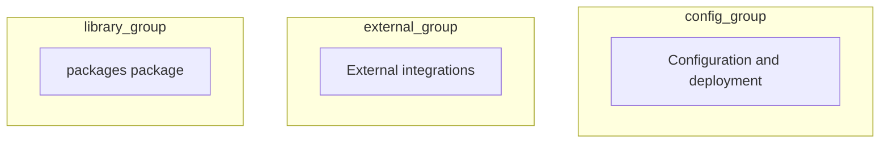

# Architecture report: react-cosmos/react-cosmos

> Automated static analysis. **Observed** = directly seen in files/imports/AST; **Inferred** = interpretation from that evidence. Repository code was not executed.

## 1. Repository at a glance

| Item | Value |
| --- | --- |
| Repository | react-cosmos/react-cosmos |
| Description | Sandbox for developing and testing UI components in isolation |
| Language | TypeScript |
| Stars | 8697 |
| Licence | MIT |
| Analysed commit / branch | 6ef55459bdbb6b3f70868581679eed678259af00 / main |
| Framework(s) | Next.js, React |
| Files analysed | 798 |
| Components | 3 |

## 2. Architecture in one minute

react-cosmos/react-cosmos - Sandbox for developing and testing UI components in isolation. This repository was analysed statically from 798 file(s) (0 Python). Detected technologies (observed from imports/manifests): GitHub Actions, Next.js, React, Tailwind CSS, TypeScript, Vite. Files are grouped into 3 component(s): Configuration and deployment, External integrations, packages package. Findings below distinguish observed facts from inferred interpretation.

## 3. High-level block diagram

## 4. Main components

### Configuration and deployment (`config`)

- **Kind:** config
- **Status:** Observed
- **Confidence:** 0.85
- **Responsibility:** Groups 27 file(s) under configuration and deployment (observed from repository paths and static analysis).
- **Paths:** `lerna.json`, `package.json`, `packages/react-cosmos-core/package.json`, `packages/react-cosmos-core/tsconfig.build.json`, `packages/react-cosmos-dom/package.json`, `packages/react-cosmos-dom/tsconfig.build.json`, `packages/react-cosmos-native/package.json`, `packages/react-cosmos-native/tsconfig.build.json`, `packages/react-cosmos-next/package.json`, `packages/react-cosmos-next/tsconfig.build.json`, `packages/react-cosmos-plugin-boolean-input/cosmos.plugin.json`, `packages/react-cosmos-plugin-boolean-input/package.json`, `packages/react-cosmos-plugin-boolean-input/tsconfig.build.json`, `packages/react-cosmos-plugin-open-fixture/cosmos.plugin.json`, `packages/react-cosmos-plugin-open-fixture/package.json`, `packages/react-cosmos-plugin-open-fixture/tsconfig.build.json`, `packages/react-cosmos-plugin-vite/cosmos.plugin.json`, `packages/react-cosmos-plugin-vite/package.json`, `packages/react-cosmos-plugin-vite/tsconfig.build.json`, `packages/react-cosmos-plugin-webpack/cosmos.plugin.json`, `packages/react-cosmos-plugin-webpack/package.json`, `packages/react-cosmos-plugin-webpack/tsconfig.build.client.json`, `packages/react-cosmos-plugin-webpack/tsconfig.build.server.json`, `packages/react-cosmos-renderer/package.json`, `packages/react-cosmos-renderer/tsconfig.build.json`, `packages/react-cosmos-ui/cosmos.config.json`, `packages/react-cosmos-ui/package.json`
- **Evidence:** [lerna.json](https://github.com/react-cosmos/react-cosmos/blob/6ef55459bdbb6b3f70868581679eed678259af00/lerna.json); [package.json](https://github.com/react-cosmos/react-cosmos/blob/6ef55459bdbb6b3f70868581679eed678259af00/package.json); [packages/react-cosmos-core/package.json](https://github.com/react-cosmos/react-cosmos/blob/6ef55459bdbb6b3f70868581679eed678259af00/packages/react-cosmos-core/package.json); [packages/react-cosmos-core/tsconfig.build.json](https://github.com/react-cosmos/react-cosmos/blob/6ef55459bdbb6b3f70868581679eed678259af00/packages/react-cosmos-core/tsconfig.build.json); [packages/react-cosmos-dom/package.json](https://github.com/react-cosmos/react-cosmos/blob/6ef55459bdbb6b3f70868581679eed678259af00/packages/react-cosmos-dom/package.json); [packages/react-cosmos-dom/tsconfig.build.json](https://github.com/react-cosmos/react-cosmos/blob/6ef55459bdbb6b3f70868581679eed678259af00/packages/react-cosmos-dom/tsconfig.build.json); [packages/react-cosmos-native/package.json](https://github.com/react-cosmos/react-cosmos/blob/6ef55459bdbb6b3f70868581679eed678259af00/packages/react-cosmos-native/package.json); [packages/react-cosmos-native/tsconfig.build.json](https://github.com/react-cosmos/react-cosmos/blob/6ef55459bdbb6b3f70868581679eed678259af00/packages/react-cosmos-native/tsconfig.build.json)

### External integrations (`external_integrations`)

- **Kind:** external
- **Status:** Observed
- **Confidence:** 0.85
- **Responsibility:** Groups 6 file(s) under external integrations (observed from repository paths and static analysis).
- **Paths:** `packages/react-cosmos-plugin-webpack/src/client/@types/react-error-overlay.d.ts`, `packages/react-cosmos-plugin-webpack/src/client/errorOverlay/index.ts`, `packages/react-cosmos-plugin-webpack/src/client/errorOverlay/reactErrorOverlay.ts`, `packages/react-cosmos-plugin-webpack/src/client/index.ts`, `packages/react-cosmos-plugin-webpack/src/client/reactDevtoolsHook.ts`, `packages/react-cosmos-plugin-webpack/src/client/userImports.ts`
- **Evidence:** [packages/react-cosmos-plugin-webpack/src/client/@types/react-error-overlay.d.ts](https://github.com/react-cosmos/react-cosmos/blob/6ef55459bdbb6b3f70868581679eed678259af00/packages/react-cosmos-plugin-webpack/src/client/%40types/react-error-overlay.d.ts); [packages/react-cosmos-plugin-webpack/src/client/errorOverlay/index.ts](https://github.com/react-cosmos/react-cosmos/blob/6ef55459bdbb6b3f70868581679eed678259af00/packages/react-cosmos-plugin-webpack/src/client/errorOverlay/index.ts); [packages/react-cosmos-plugin-webpack/src/client/errorOverlay/reactErrorOverlay.ts](https://github.com/react-cosmos/react-cosmos/blob/6ef55459bdbb6b3f70868581679eed678259af00/packages/react-cosmos-plugin-webpack/src/client/errorOverlay/reactErrorOverlay.ts); [packages/react-cosmos-plugin-webpack/src/client/index.ts](https://github.com/react-cosmos/react-cosmos/blob/6ef55459bdbb6b3f70868581679eed678259af00/packages/react-cosmos-plugin-webpack/src/client/index.ts); [packages/react-cosmos-plugin-webpack/src/client/reactDevtoolsHook.ts](https://github.com/react-cosmos/react-cosmos/blob/6ef55459bdbb6b3f70868581679eed678259af00/packages/react-cosmos-plugin-webpack/src/client/reactDevtoolsHook.ts); [packages/react-cosmos-plugin-webpack/src/client/userImports.ts](https://github.com/react-cosmos/react-cosmos/blob/6ef55459bdbb6b3f70868581679eed678259af00/packages/react-cosmos-plugin-webpack/src/client/userImports.ts)

### packages package (`packages`)

- **Kind:** library
- **Status:** Observed
- **Confidence:** 0.85
- **Responsibility:** Groups 318 file(s) under packages package (observed from repository paths and static analysis).
- **Paths:** `packages/react-cosmos-core/src/fixtureState/classState.ts`, `packages/react-cosmos-core/src/fixtureState/classStateTypes.ts`, `packages/react-cosmos-core/src/fixtureState/createValues.test.tsx`, `packages/react-cosmos-core/src/fixtureState/createValues.ts`, `packages/react-cosmos-core/src/fixtureState/extendWithValues.test.ts`, `packages/react-cosmos-core/src/fixtureState/extendWithValues.ts`, `packages/react-cosmos-core/src/fixtureState/fixtureState.ts`, `packages/react-cosmos-core/src/fixtureState/inputsTypes.ts`, `packages/react-cosmos-core/src/fixtureState/props.ts`, `packages/react-cosmos-core/src/fixtureState/propsTypes.ts`, `packages/react-cosmos-core/src/fixtureState/types.ts`, `packages/react-cosmos-core/src/fixtureState/viewport.ts`, `packages/react-cosmos-core/src/fixtureTree/createFixtureTree/collapseFixtureDirs.test.ts`, `packages/react-cosmos-core/src/fixtureTree/createFixtureTree/collapseFixtureDirs.ts`, `packages/react-cosmos-core/src/fixtureTree/createFixtureTree/collapseIndexes.test.ts`, `packages/react-cosmos-core/src/fixtureTree/createFixtureTree/collapseIndexes.ts`, `packages/react-cosmos-core/src/fixtureTree/createFixtureTree/collapseNamedIndexes.test.ts`, `packages/react-cosmos-core/src/fixtureTree/createFixtureTree/collapseNamedIndexes.ts`, `packages/react-cosmos-core/src/fixtureTree/createFixtureTree/collapseOuterDirs.test.ts`, `packages/react-cosmos-core/src/fixtureTree/createFixtureTree/collapseOuterDirs.ts`, `packages/react-cosmos-core/src/fixtureTree/createFixtureTree/createRawFixtureTree.test.ts`, `packages/react-cosmos-core/src/fixtureTree/createFixtureTree/createRawFixtureTree.ts`, `packages/react-cosmos-core/src/fixtureTree/createFixtureTree/hideFixtureSuffix.test.ts`, `packages/react-cosmos-core/src/fixtureTree/createFixtureTree/hideFixtureSuffix.ts`, `packages/react-cosmos-core/src/fixtureTree/createFixtureTree/index.ts`, `packages/react-cosmos-core/src/fixtureTree/fixtureUtils.ts`, `packages/react-cosmos-core/src/fixtureTree/flattenFixtureTree.test.ts`, `packages/react-cosmos-core/src/fixtureTree/flattenFixtureTree.tsx`, `packages/react-cosmos-core/src/fixtureTree/types.ts`, `packages/react-cosmos-core/src/index.ts`, `packages/react-cosmos-core/src/message/serverMessage.ts`, `packages/react-cosmos-core/src/message/socketMessage.ts`, `packages/react-cosmos-core/src/playground/notifications.ts`, `packages/react-cosmos-core/src/playground/playgroundParams.ts`, `packages/react-cosmos-core/src/playground/playgroundQueryString.ts`, `packages/react-cosmos-core/src/playground/registerPlaygroundShortcuts.ts`, `packages/react-cosmos-core/src/plugin/cosmosPluginConfig.ts`, `packages/react-cosmos-core/src/renderer/rendererConfig.ts`, `packages/react-cosmos-core/src/renderer/rendererConnect.ts`, `packages/react-cosmos-core/src/renderer/rendererParams.ts`, `packages/react-cosmos-core/src/renderer/rendererQueryString.ts`, `packages/react-cosmos-core/src/renderer/rendererUrl.test.ts`, `packages/react-cosmos-core/src/renderer/rendererUrl.ts`, `packages/react-cosmos-core/src/server/serverTypes.ts`, `packages/react-cosmos-core/src/userModules/fixtureTypes.ts`, `packages/react-cosmos-core/src/userModules/getFixtureFromExport.ts`, `packages/react-cosmos-core/src/userModules/getFixtureList.ts`, `packages/react-cosmos-core/src/userModules/getSortedDecoratorsForFixturePath.ts`, `packages/react-cosmos-core/src/userModules/isMultiFixture.ts`, `packages/react-cosmos-core/src/userModules/stringifyFixtureId.ts`, `packages/react-cosmos-core/src/userModules/userModuleTypes.ts`, `packages/react-cosmos-core/src/utils/array.ts`, `packages/react-cosmos-core/src/utils/data.ts`, `packages/react-cosmos-core/src/utils/isEqual.test.ts`, `packages/react-cosmos-core/src/utils/isEqual.ts`, `packages/react-cosmos-core/src/utils/keys.ts`, `packages/react-cosmos-core/src/utils/mapValues.ts`, `packages/react-cosmos-core/src/utils/pathUtils.test.ts`, `packages/react-cosmos-core/src/utils/pathUtils.ts`, `packages/react-cosmos-core/src/utils/queryString.ts`, `packages/react-cosmos-core/src/utils/react/DelayRender.tsx`, `packages/react-cosmos-core/src/utils/react/areNodesEqual.ts`, `packages/react-cosmos-core/src/utils/react/getComponentName.ts`, `packages/react-cosmos-core/src/utils/react/isReactElement.ts`, `packages/react-cosmos-core/src/utils/serializable.ts`, `packages/react-cosmos-core/src/utils/state.ts`, `packages/react-cosmos-core/src/utils/string.ts`, `packages/react-cosmos-core/src/utils/tree.ts`, `packages/react-cosmos-core/src/utils/uuid.ts`, `packages/react-cosmos-core/src/utils/window.ts`, `packages/react-cosmos-dom/src/DomFixtureLoader.tsx`, `packages/react-cosmos-dom/src/DomRendererConfig.ts`, `packages/react-cosmos-dom/src/DomRendererProvider.tsx`, `packages/react-cosmos-dom/src/ErrorCatch.tsx`, `packages/react-cosmos-dom/src/GlobalErrorHandler.tsx`, `packages/react-cosmos-dom/src/getDomContainer.ts`, `packages/react-cosmos-dom/src/index.ts`, `packages/react-cosmos-dom/src/mountDomRenderer.tsx`, `packages/react-cosmos-dom/src/reloadDomRenderer.ts`, `packages/react-cosmos-dom/src/useDomRendererConnect.test.ts`, `packages/react-cosmos-dom/src/useDomRendererConnect.ts`, `packages/react-cosmos-dom/src/useDomRendererId.ts`, `packages/react-cosmos-native/src/@types/react-native.d.ts`, `packages/react-cosmos-native/src/NativeFixtureLoader.tsx`, `packages/react-cosmos-native/src/NativeRendererProvider.tsx`, `packages/react-cosmos-native/src/index.ts`, `packages/react-cosmos-next/src/@types/next.d.ts`, `packages/react-cosmos-next/src/NextFixtureLoader.tsx`, `packages/react-cosmos-next/src/NextRendererProvider.tsx`, `packages/react-cosmos-next/src/index.ts`, `packages/react-cosmos-next/src/nextCosmosPage.tsx`, `packages/react-cosmos-next/src/nextCosmosStaticParams.ts`, `packages/react-cosmos-next/src/nextTypes.ts`, `packages/react-cosmos-plugin-boolean-input/src/BooleanInput.tsx`, `packages/react-cosmos-plugin-boolean-input/src/index.tsx`, `packages/react-cosmos-plugin-boolean-input/webpack.config.js`, `packages/react-cosmos-plugin-open-fixture/src/OpenFixtureButton.tsx`, `packages/react-cosmos-plugin-open-fixture/src/index.test.tsx`, `packages/react-cosmos-plugin-open-fixture/src/index.tsx`, `packages/react-cosmos-plugin-open-fixture/src/spec.ts`, `packages/react-cosmos-plugin-open-fixture/webpack.config.js`, `packages/react-cosmos-plugin-vite/dom.js`, `packages/react-cosmos-plugin-vite/src/constants.ts`, `packages/react-cosmos-plugin-vite/src/createCosmosViteConfig.ts`, `packages/react-cosmos-plugin-vite/src/createViteRendererIndex.test.ts`, `packages/react-cosmos-plugin-vite/src/createViteRendererIndex.ts`, `packages/react-cosmos-plugin-vite/src/dom.ts`, `packages/react-cosmos-plugin-vite/src/indexHtml/createIndexHtml.test.ts`, `packages/react-cosmos-plugin-vite/src/indexHtml/createIndexHtml.ts`, `packages/react-cosmos-plugin-vite/src/indexHtml/defaultMainScriptUrl.ts`, `packages/react-cosmos-plugin-vite/src/indexHtml/ensureMainScriptUrl.test.ts`, `packages/react-cosmos-plugin-vite/src/indexHtml/ensureMainScriptUrl.ts`, `packages/react-cosmos-plugin-vite/src/indexHtml/findMainScriptUrl.test.ts`, `packages/react-cosmos-plugin-vite/src/indexHtml/findMainScriptUrl.ts`, `packages/react-cosmos-plugin-vite/src/indexHtml/getHtmlScriptUrls.ts`, `packages/react-cosmos-plugin-vite/src/reactCosmosViteRollupPlugin.test.ts`, `packages/react-cosmos-plugin-vite/src/reactCosmosViteRollupPlugin.ts`, `packages/react-cosmos-plugin-vite/src/viteConfigPlugin.ts`, `packages/react-cosmos-plugin-vite/src/viteDevServerPlugin.ts`, `packages/react-cosmos-plugin-vite/src/viteExportPlugin.ts`, `packages/react-cosmos-plugin-vite/src/viteServerPlugin.ts`, `packages/react-cosmos-plugin-webpack/src/server/cosmosConfig/createWebpackCosmosConfig.ts`, `packages/react-cosmos-plugin-webpack/src/server/getWebpack.ts`, `packages/react-cosmos-plugin-webpack/src/server/utils/isNodeError.ts`, `packages/react-cosmos-plugin-webpack/src/server/utils/requireModule.ts`, `packages/react-cosmos-plugin-webpack/src/server/utils/requireSilent.ts`, `packages/react-cosmos-plugin-webpack/src/server/utils/resolve.ts`, `packages/react-cosmos-plugin-webpack/src/server/utils/resolveLoose.ts`, `packages/react-cosmos-plugin-webpack/src/server/utils/resolveSilent.ts`, `packages/react-cosmos-plugin-webpack/src/server/webpackConfig/__tests__/customDevConfig.ts`, `packages/react-cosmos-plugin-webpack/src/server/webpackConfig/__tests__/customExportConfig.ts`, `packages/react-cosmos-plugin-webpack/src/server/webpackConfig/__tests__/defaultDevConfig.ts`, `packages/react-cosmos-plugin-webpack/src/server/webpackConfig/__tests__/defaultExportConfig.ts`, `packages/react-cosmos-plugin-webpack/src/server/webpackConfig/__tests__/moduleScopePlugin.ts`, `packages/react-cosmos-plugin-webpack/src/server/webpackConfig/__tests__/reactAliases.ts`, `packages/react-cosmos-plugin-webpack/src/server/webpackConfig/constants.ts`, `packages/react-cosmos-plugin-webpack/src/server/webpackConfig/getDefaultWebpackConfig.ts`, `packages/react-cosmos-plugin-webpack/src/server/webpackConfig/getDevWebpackConfig.ts`, `packages/react-cosmos-plugin-webpack/src/server/webpackConfig/getExportWebpackConfig.ts`, `packages/react-cosmos-plugin-webpack/src/server/webpackConfig/getUserWebpackConfig.ts`, `packages/react-cosmos-plugin-webpack/src/server/webpackConfig/getWebpackConfigModule.ts`, `packages/react-cosmos-plugin-webpack/src/server/webpackConfig/getWebpackConfigResolve.ts`, `packages/react-cosmos-plugin-webpack/src/server/webpackConfig/getWebpackNodeEnv.ts`, `packages/react-cosmos-plugin-webpack/src/server/webpackConfig/htmlPlugin.ts`, `packages/react-cosmos-plugin-webpack/src/server/webpackConfig/plugins.ts`, `packages/react-cosmos-plugin-webpack/src/server/webpackConfig/resolveWebpackClientPath.ts`, `packages/react-cosmos-plugin-webpack/src/server/webpackConfig/resolveWebpackLoaderPath.ts`, `packages/react-cosmos-plugin-webpack/src/server/webpackConfig/userImportsLoader.cjs`, `packages/react-cosmos-plugin-webpack/src/server/webpackConfig/webpackConfigTopLevelAwait.ts`, `packages/react-cosmos-plugin-webpack/src/server/webpackConfigPlugin.ts`, `packages/react-cosmos-plugin-webpack/src/server/webpackDevServerPlugin.ts`, `packages/react-cosmos-plugin-webpack/src/server/webpackExportPlugin.ts`, `packages/react-cosmos-plugin-webpack/src/server/webpackServerPlugin.ts`, `packages/react-cosmos-plugin-webpack/src/testHelpers/pkgPath.ts`, `packages/react-cosmos-renderer/client.d.ts`, `packages/react-cosmos-renderer/client.js`, `packages/react-cosmos-renderer/index.d.ts`, `packages/react-cosmos-renderer/index.js`, `packages/react-cosmos-renderer/src/__tests__/childrenTransition.tsx`, `packages/react-cosmos-renderer/src/__tests__/classStateFixtureReselectMocked.tsx`, `packages/react-cosmos-renderer/src/__tests__/classStateFixtureReselectUnmocked.tsx`, `packages/react-cosmos-renderer/src/__tests__/classStateMocked.tsx`, `packages/react-cosmos-renderer/src/__tests__/classStateMockedRef.tsx`, `packages/react-cosmos-renderer/src/__tests__/classStateMulti.tsx`, `packages/react-cosmos-renderer/src/__tests__/classStateUnmocked.tsx`, `packages/react-cosmos-renderer/src/__tests__/decorators.tsx`, `packages/react-cosmos-renderer/src/__tests__/decoratorsLazy.tsx`, `packages/react-cosmos-renderer/src/__tests__/fixtureChange.tsx`, `packages/react-cosmos-renderer/src/__tests__/fixtureInitialSelect.ts`, `packages/react-cosmos-renderer/src/__tests__/fixtureInitialSelectLazy.ts`, `packages/react-cosmos-renderer/src/__tests__/fixtureList.ts`, `packages/react-cosmos-renderer/src/__tests__/fixtureListLazy.ts`, `packages/react-cosmos-renderer/src/__tests__/fixtureListMulti.ts`, `packages/react-cosmos-renderer/src/__tests__/fixtureListMultiLazy.ts`, `packages/react-cosmos-renderer/src/__tests__/fixtureLocked.ts`, `packages/react-cosmos-renderer/src/__tests__/fixtureOptions.tsx`, `packages/react-cosmos-renderer/src/__tests__/fixtureSelect.ts`, `packages/react-cosmos-renderer/src/__tests__/fixtureSelectLazy.ts`, `packages/react-cosmos-renderer/src/__tests__/fixtureSelectWithState.tsx`, `packages/react-cosmos-renderer/src/__tests__/fixtureStateChange.tsx`, `packages/react-cosmos-renderer/src/__tests__/fragmentTransition.tsx`, `packages/react-cosmos-renderer/src/__tests__/props.tsx`, `packages/react-cosmos-renderer/src/__tests__/propsAndState.tsx`, `packages/react-cosmos-renderer/src/__tests__/propsAndStateRef.tsx`, `packages/react-cosmos-renderer/src/__tests__/propsFnChildren.tsx`, `packages/react-cosmos-renderer/src/__tests__/propsMulti.tsx`, `packages/react-cosmos-renderer/src/__tests__/propsObjectIdentity.tsx`, `packages/react-cosmos-renderer/src/__tests__/propsRef.tsx`, `packages/react-cosmos-renderer/src/__tests__/propsTypeChange.tsx`, `packages/react-cosmos-renderer/src/__tests__/ref.tsx`, `packages/react-cosmos-renderer/src/__tests__/rendererReady.ts`, `packages/react-cosmos-renderer/src/__tests__/rendererReadyLazy.ts`, `packages/react-cosmos-renderer/src/__tests__/rendererReload.ts`, `packages/react-cosmos-renderer/src/__tests__/selects.tsx`, `packages/react-cosmos-renderer/src/__tests__/selectsNoDefault.tsx`, `packages/react-cosmos-renderer/src/__tests__/typeFunction.tsx`, `packages/react-cosmos-renderer/src/__tests__/typeString.tsx`, `packages/react-cosmos-renderer/src/__tests__/valuesArray.tsx`, `packages/react-cosmos-renderer/src/__tests__/valuesBoolean.tsx`, `packages/react-cosmos-renderer/src/__tests__/valuesHotReload.tsx`, `packages/react-cosmos-renderer/src/__tests__/valuesNumber.tsx`, `packages/react-cosmos-renderer/src/__tests__/valuesObject.tsx`, `packages/react-cosmos-renderer/src/__tests__/valuesString.tsx`, `packages/react-cosmos-renderer/src/__tests__/viewport.tsx`, `packages/react-cosmos-renderer/src/client.ts`, `packages/react-cosmos-renderer/src/fixture/ClassStateMock.tsx`, `packages/react-cosmos-renderer/src/fixture/FixtureCapture/FixtureCapture.tsx`, `packages/react-cosmos-renderer/src/fixture/FixtureCapture/classState/decorateFixtureRefs/index.ts`, `packages/react-cosmos-renderer/src/fixture/FixtureCapture/classState/decorateFixtureRefs/isRefSupported.ts`, `packages/react-cosmos-renderer/src/fixture/FixtureCapture/classState/index.ts`, `packages/react-cosmos-renderer/src/fixture/FixtureCapture/classState/shared.ts`, `packages/react-cosmos-renderer/src/fixture/FixtureCapture/classState/useFixtureClassState.ts`, `packages/react-cosmos-renderer/src/fixture/FixtureCapture/classState/useReadClassState.ts`, `packages/react-cosmos-renderer/src/fixture/FixtureCapture/props/index.ts`, `packages/react-cosmos-renderer/src/fixture/FixtureCapture/props/useFixtureProps.ts`, `packages/react-cosmos-renderer/src/fixture/FixtureCapture/shared/findRelevantElementPaths.test.tsx`, `packages/react-cosmos-renderer/src/fixture/FixtureCapture/shared/findRelevantElementPaths.ts`, `packages/react-cosmos-renderer/src/fixture/FixtureCapture/shared/nodeTree/__tests__/find.tsx`, `packages/react-cosmos-renderer/src/fixture/FixtureCapture/shared/nodeTree/__tests__/set.tsx`, `packages/react-cosmos-renderer/src/fixture/FixtureCapture/shared/nodeTree/elPath.ts`, `packages/react-cosmos-renderer/src/fixture/FixtureCapture/shared/nodeTree/findElementPaths.ts`, `packages/react-cosmos-renderer/src/fixture/FixtureCapture/shared/nodeTree/getElementAtPath.ts`, `packages/react-cosmos-renderer/src/fixture/FixtureCapture/shared/nodeTree/index.ts`, `packages/react-cosmos-renderer/src/fixture/FixtureCapture/shared/nodeTree/setElementAtPath.ts`, `packages/react-cosmos-renderer/src/fixture/FixtureContext.ts`, `packages/react-cosmos-renderer/src/fixture/Viewport.tsx`, `packages/react-cosmos-renderer/src/fixture/useCosmosNotification/useCosmosNotification.ts`, `packages/react-cosmos-renderer/src/fixture/useFixtureInput/useCurrentInputValue.ts`, `packages/react-cosmos-renderer/src/fixture/useFixtureInput/useFixtureInput.ts`, `packages/react-cosmos-renderer/src/fixture/useFixtureInput/useInputFixtureState.ts`, `packages/react-cosmos-renderer/src/fixture/useFixtureInput/useSetInputValue.ts`, `packages/react-cosmos-renderer/src/fixture/useFixtureInput/useValue.ts`, `packages/react-cosmos-renderer/src/fixture/useFixtureSelect/shared.ts`, `packages/react-cosmos-renderer/src/fixture/useFixtureSelect/useCurrentSelectValue.ts`, `packages/react-cosmos-renderer/src/fixture/useFixtureSelect/useFixtureSelect.ts`, `packages/react-cosmos-renderer/src/fixture/useFixtureSelect/useSelect.ts`, `packages/react-cosmos-renderer/src/fixture/useFixtureSelect/useSelectFixtureState.ts`, `packages/react-cosmos-renderer/src/fixture/useFixtureSelect/useSetSelectValue.ts`, `packages/react-cosmos-renderer/src/fixture/useFixtureState.ts`, `packages/react-cosmos-renderer/src/fixtureLoaders/ClientFixtureLoader.tsx`, `packages/react-cosmos-renderer/src/fixtureLoaders/FixtureLoaderConnect.tsx`, `packages/react-cosmos-renderer/src/fixtureLoaders/RendererSync.tsx`, `packages/react-cosmos-renderer/src/fixtureLoaders/SelectedFixture.ts`, `packages/react-cosmos-renderer/src/fixtureLoaders/ServerFixtureLoader.tsx`, `packages/react-cosmos-renderer/src/fixtureLoaders/defaultRenderMessage.tsx`, `packages/react-cosmos-renderer/src/fixtureModule/DecoratedFixture.tsx`, `packages/react-cosmos-renderer/src/fixtureModule/FixtureModule.tsx`, `packages/react-cosmos-renderer/src/fixtureModule/FixtureProvider.tsx`, `packages/react-cosmos-renderer/src/fixtureModule/createFixtureNode.tsx`, `packages/react-cosmos-renderer/src/fixtureModule/decorateFixture.tsx`, `packages/react-cosmos-renderer/src/index.ts`, `packages/react-cosmos-renderer/src/moduleLoaders/AsyncModuleLoader.tsx`, `packages/react-cosmos-renderer/src/moduleLoaders/LazyModuleLoader.tsx`, `packages/react-cosmos-renderer/src/moduleLoaders/StaticModuleLoader.tsx`, `packages/react-cosmos-renderer/src/moduleLoaders/importLazyFixtureModules.ts`, `packages/react-cosmos-renderer/src/rendererConnect/RendererContext.ts`, `packages/react-cosmos-renderer/src/rendererConnect/RendererProvider.tsx`, `packages/react-cosmos-renderer/src/rendererConnect/StatefulRendererProvider.tsx`, `packages/react-cosmos-renderer/src/rendererConnect/__tests__/createWindowRendererConnect.test.ts`, `packages/react-cosmos-renderer/src/rendererConnect/createNoopRendererConnect.ts`, `packages/react-cosmos-renderer/src/rendererConnect/createPostMessageConnect.ts`, `packages/react-cosmos-renderer/src/rendererConnect/createWebSocketsConnect.ts`, `packages/react-cosmos-renderer/src/rendererConnect/createWindowRendererConnect.ts`, `packages/react-cosmos-renderer/src/rendererConnect/globals.d.ts`, `packages/react-cosmos-renderer/src/testHelpers/components.tsx`, `packages/react-cosmos-renderer/src/testHelpers/createRendererConnectTestApi.ts`, `packages/react-cosmos-renderer/src/testHelpers/createTestRendererConnect.ts`, `packages/react-cosmos-renderer/src/testHelpers/fixtureState.ts`, `packages/react-cosmos-renderer/src/testHelpers/mountTestRenderer.tsx`, `packages/react-cosmos-renderer/src/testHelpers/testRenderer.ts`, `packages/react-cosmos-renderer/src/testHelpers/wrapDefaultExport.ts`, `packages/react-cosmos-renderer/src/wrapSetTimeoutAct.ts`, `packages/react-cosmos-ui/pluginMocks.d.ts`, `packages/react-cosmos-ui/pluginMocks.js`, `packages/react-cosmos-ui/src/components/BaseSvg.tsx`, `packages/react-cosmos-ui/src/components/Icon.tsx`, `packages/react-cosmos-ui/src/components/Illustration.tsx`, `packages/react-cosmos-ui/src/components/KeyBox.tsx`, `packages/react-cosmos-ui/src/components/SidePanel.tsx`, `packages/react-cosmos-ui/src/components/Space.tsx`, `packages/react-cosmos-ui/src/components/TreeView.tsx`, `packages/react-cosmos-ui/src/components/ValueInputTree/ExpandCollapseValues.tsx`, `packages/react-cosmos-ui/src/components/ValueInputTree/ValueInput/BooleanValueInput.tsx`, `packages/react-cosmos-ui/src/components/ValueInputTree/ValueInput/NullValueInput.tsx`, `packages/react-cosmos-ui/src/components/ValueInputTree/ValueInput/NumberValueInput.tsx`, `packages/react-cosmos-ui/src/components/ValueInputTree/ValueInput/StringValueInput.tsx`, `packages/react-cosmos-ui/src/components/ValueInputTree/ValueInput/UndefinedValueInput.tsx`, `packages/react-cosmos-ui/src/components/ValueInputTree/ValueInput/UnserializableValueInput.tsx`, `packages/react-cosmos-ui/src/components/ValueInputTree/ValueInput/ValueInput.tsx`, `packages/react-cosmos-ui/src/components/ValueInputTree/ValueInput/shared.tsx`, `packages/react-cosmos-ui/src/components/ValueInputTree/ValueInputDir.tsx`, `packages/react-cosmos-ui/src/components/ValueInputTree/ValueInputTree.tsx`, `packages/react-cosmos-ui/src/components/ValueInputTree/index.ts`, `packages/react-cosmos-ui/src/components/ValueInputTree/shared.ts`, `packages/react-cosmos-ui/src/components/ValueInputTree/valueGroups.ts`, `packages/react-cosmos-ui/src/components/ValueInputTree/valueTree.test.ts`, `packages/react-cosmos-ui/src/components/ValueInputTree/valueTree.ts`, `packages/react-cosmos-ui/src/components/ValueInputTree/valueTreeExpansion.ts`, `packages/react-cosmos-ui/src/components/buttons/Button32.tsx`, `packages/react-cosmos-ui/src/components/buttons/Button8.tsx`, `packages/react-cosmos-ui/src/components/buttons/IconButton32.tsx`, `packages/react-cosmos-ui/src/components/buttons/IconButton8.tsx`, `packages/react-cosmos-ui/src/components/buttons/index.fixture.tsx`, `packages/react-cosmos-ui/src/components/buttons/index.tsx`, `packages/react-cosmos-ui/src/components/buttons/shared.tsx`, `packages/react-cosmos-ui/src/components/icons/index.tsx`, `packages/react-cosmos-ui/src/components/inputs/NumberInput.fixture.tsx`, `packages/react-cosmos-ui/src/components/inputs/NumberInput.tsx`, `packages/react-cosmos-ui/src/components/inputs/Select.fixture.tsx`, `packages/react-cosmos-ui/src/components/inputs/Select.tsx`, `packages/react-cosmos-ui/src/components/inputs/shared.tsx`, `packages/react-cosmos-ui/src/cosmos.decorator.tsx`, `packages/react-cosmos-ui/src/cosmos.loadPlugins.ts`, `packages/react-cosmos-ui/src/globals.d.ts`, `packages/react-cosmos-ui/src/hooks/useDrag.ts`, `packages/react-cosmos-ui/src/hooks/useFocus.ts`, `packages/react-cosmos-ui/src/index.ts`, `packages/react-cosmos-ui/src/playground.tsx`
- **Evidence:** [packages/react-cosmos-core/src/fixtureState/classState.ts](https://github.com/react-cosmos/react-cosmos/blob/6ef55459bdbb6b3f70868581679eed678259af00/packages/react-cosmos-core/src/fixtureState/classState.ts); [packages/react-cosmos-core/src/fixtureState/classStateTypes.ts](https://github.com/react-cosmos/react-cosmos/blob/6ef55459bdbb6b3f70868581679eed678259af00/packages/react-cosmos-core/src/fixtureState/classStateTypes.ts); [packages/react-cosmos-core/src/fixtureState/createValues.test.tsx](https://github.com/react-cosmos/react-cosmos/blob/6ef55459bdbb6b3f70868581679eed678259af00/packages/react-cosmos-core/src/fixtureState/createValues.test.tsx); [packages/react-cosmos-core/src/fixtureState/createValues.ts](https://github.com/react-cosmos/react-cosmos/blob/6ef55459bdbb6b3f70868581679eed678259af00/packages/react-cosmos-core/src/fixtureState/createValues.ts); [packages/react-cosmos-core/src/fixtureState/extendWithValues.test.ts](https://github.com/react-cosmos/react-cosmos/blob/6ef55459bdbb6b3f70868581679eed678259af00/packages/react-cosmos-core/src/fixtureState/extendWithValues.test.ts); [packages/react-cosmos-core/src/fixtureState/extendWithValues.ts](https://github.com/react-cosmos/react-cosmos/blob/6ef55459bdbb6b3f70868581679eed678259af00/packages/react-cosmos-core/src/fixtureState/extendWithValues.ts); [packages/react-cosmos-core/src/fixtureState/fixtureState.ts](https://github.com/react-cosmos/react-cosmos/blob/6ef55459bdbb6b3f70868581679eed678259af00/packages/react-cosmos-core/src/fixtureState/fixtureState.ts); [packages/react-cosmos-core/src/fixtureState/inputsTypes.ts](https://github.com/react-cosmos/react-cosmos/blob/6ef55459bdbb6b3f70868581679eed678259af00/packages/react-cosmos-core/src/fixtureState/inputsTypes.ts)

## 5. Execution flow

**Observed** entry point(s):

- [packages/react-cosmos-core/src/index.ts](https://github.com/react-cosmos/react-cosmos/blob/6ef55459bdbb6b3f70868581679eed678259af00/packages/react-cosmos-core/src/index.ts)
- [packages/react-cosmos-dom/src/index.ts](https://github.com/react-cosmos/react-cosmos/blob/6ef55459bdbb6b3f70868581679eed678259af00/packages/react-cosmos-dom/src/index.ts)
- [packages/react-cosmos-native/src/index.ts](https://github.com/react-cosmos/react-cosmos/blob/6ef55459bdbb6b3f70868581679eed678259af00/packages/react-cosmos-native/src/index.ts)
- [packages/react-cosmos-next/src/index.ts](https://github.com/react-cosmos/react-cosmos/blob/6ef55459bdbb6b3f70868581679eed678259af00/packages/react-cosmos-next/src/index.ts)
- [packages/react-cosmos-plugin-boolean-input/cosmos.plugin.json](https://github.com/react-cosmos/react-cosmos/blob/6ef55459bdbb6b3f70868581679eed678259af00/packages/react-cosmos-plugin-boolean-input/cosmos.plugin.json)
- [packages/react-cosmos-plugin-boolean-input/src/index.tsx](https://github.com/react-cosmos/react-cosmos/blob/6ef55459bdbb6b3f70868581679eed678259af00/packages/react-cosmos-plugin-boolean-input/src/index.tsx)
- [packages/react-cosmos-plugin-open-fixture/cosmos.plugin.json](https://github.com/react-cosmos/react-cosmos/blob/6ef55459bdbb6b3f70868581679eed678259af00/packages/react-cosmos-plugin-open-fixture/cosmos.plugin.json)
- [packages/react-cosmos-plugin-open-fixture/src/index.tsx](https://github.com/react-cosmos/react-cosmos/blob/6ef55459bdbb6b3f70868581679eed678259af00/packages/react-cosmos-plugin-open-fixture/src/index.tsx)
- [packages/react-cosmos-plugin-vite/cosmos.plugin.json](https://github.com/react-cosmos/react-cosmos/blob/6ef55459bdbb6b3f70868581679eed678259af00/packages/react-cosmos-plugin-vite/cosmos.plugin.json)
- [packages/react-cosmos-plugin-webpack/cosmos.plugin.json](https://github.com/react-cosmos/react-cosmos/blob/6ef55459bdbb6b3f70868581679eed678259af00/packages/react-cosmos-plugin-webpack/cosmos.plugin.json)
- [packages/react-cosmos-renderer/index.js](https://github.com/react-cosmos/react-cosmos/blob/6ef55459bdbb6b3f70868581679eed678259af00/packages/react-cosmos-renderer/index.js)
- [packages/react-cosmos-renderer/src/index.ts](https://github.com/react-cosmos/react-cosmos/blob/6ef55459bdbb6b3f70868581679eed678259af00/packages/react-cosmos-renderer/src/index.ts)

Representative flow (derived from observed entry points and the import graph; steps beyond the entry point are **Inferred**):

1. Execution starts at an observed entry point listed above, if present.
2. No internal import relationships between components were observed.

## 6. Project structure

### `(root)`

- `.codecov.yml` - config (138 bytes)
- `.gitignore` - other (118 bytes)
- `.oxfmtrc.json` - config (608 bytes)
- `.oxlintrc.json` - config (1009 bytes)
- `AGENTS.md` - docs (2068 bytes)
- `LICENSE` - docs (1092 bytes)
- `lerna.json` - config (327 bytes)
- `package.json` - manifest (2402 bytes)

### `.agents`

- `.agents/skills/gh-release-notes/SKILL.md` - docs (1337 bytes)
- `.agents/skills/review-dep-upgrade/SKILL.md` - docs (4234 bytes)
- `.agents/skills/review-dep-upgrade/scripts/collect-dep-upgrades.mjs` - source, JavaScript (5231 bytes)

### `.github`

- `.github/CODE_OF_CONDUCT.md` - docs (3225 bytes)
- `.github/CONTRIBUTING.md` - docs (4411 bytes)
- `.github/FUNDING.yml` - config (17 bytes)
- `.github/ISSUE_TEMPLATE/bug_report.md` - docs (454 bytes)
- `.github/ISSUE_TEMPLATE/feature_request.md` - docs (353 bytes)
- `.github/SECURITY.md` - docs (281 bytes)
- `.github/pull_request_template.md` - docs (433 bytes)
- `.github/workflows/docs.yml` - ci, YAML (2224 bytes)
- `.github/workflows/release-canary.yml` - ci, YAML (1315 bytes)
- `.github/workflows/test-pnp.yml` - ci, YAML (1830 bytes)
- `.github/workflows/test.yml` - ci, YAML (4127 bytes)

### `docs`

- `docs/.gitignore` - docs (39 bytes)
- `docs/components/Benefits.module.css` - docs (1070 bytes)
- `docs/components/Benefits.tsx` - docs (590 bytes)
- `docs/components/ConfigTable.mdx` - docs (734 bytes)
- `docs/components/Features.module.css` - docs (1567 bytes)
- `docs/components/Features.tsx` - docs (2080 bytes)
- `docs/components/Footer.module.css` - docs (741 bytes)
- `docs/components/Footer.tsx` - docs (3039 bytes)
- `docs/components/Homepage.module.css` - docs (485 bytes)
- `docs/components/Homepage.tsx` - docs (829 bytes)
- `docs/components/HomepageHero.module.css` - docs (6890 bytes)
- `docs/components/HomepageHero.tsx` - docs (2228 bytes)
- `docs/components/HomepageLogos.module.css` - docs (521 bytes)
- `docs/components/HomepageLogos.tsx` - docs (605 bytes)
- `docs/components/Logo.module.css` - docs (599 bytes)
- `docs/components/Logo.tsx` - docs (370 bytes)
- `docs/components/NavbarWrapper.tsx` - docs (401 bytes)
- `docs/components/OgImage.module.css` - docs (453 bytes)
- `docs/components/OgImage.tsx` - docs (3623 bytes)
- `docs/components/Rocket.module.css` - docs (1279 bytes)
- `docs/components/Rocket.tsx` - docs (1514 bytes)
- `docs/components/svg/cosmonaut-detailed.svg` - docs (2369 bytes)
- `docs/components/svg/cosmonaut.svg` - docs (1410 bytes)
- `docs/components/svg/icons/box.svg` - docs (462 bytes)
- `docs/components/svg/icons/code.svg` - docs (307 bytes)
- `docs/components/svg/icons/monitor.svg` - docs (370 bytes)
- `docs/components/svg/icons/settings.svg` - docs (1011 bytes)
- `docs/components/svg/icons/sliders.svg` - docs (661 bytes)
- `docs/components/svg/icons/stars.svg` - docs (802 bytes)
- `docs/components/svg/icons/upload-cloud.svg` - docs (431 bytes)
- `docs/components/svg/icons/zap.svg` - docs (282 bytes)
- `docs/components/svg/logos/formidable.svg` - docs (6725 bytes)
- `docs/components/svg/logos/globalctoforum.svg` - docs (5777 bytes)
- `docs/components/svg/logos/hootsuite.svg` - docs (5188 bytes)
- `docs/components/svg/logos/stadiumgoods.svg` - docs (3955 bytes)
- `docs/images/hero/heroTile.svg` - docs (391 bytes)
- `docs/images/hero/heroTileDark.svg` - docs (391 bytes)
- `docs/next-env.d.ts` - docs (230 bytes)
- `docs/next.config.js` - docs (909 bytes)
- `docs/package.json` - manifest (712 bytes)
- `docs/pages/_app.mdx` - docs (124 bytes)
- `docs/pages/_meta.json` - config (425 bytes)
- `docs/pages/about.mdx` - docs (2237 bytes)
- `docs/pages/docs/_meta.json` - config (665 bytes)
- `docs/pages/docs/cli.mdx` - docs (5071 bytes)
- `docs/pages/docs/configuration/_meta.json` - config (103 bytes)
- `docs/pages/docs/configuration/cosmos-config.mdx` - docs (1421 bytes)
- `docs/pages/docs/configuration/lazy-mode.md` - docs (611 bytes)
- `docs/pages/docs/configuration/plugin-settings.md` - docs (1354 bytes)
- `docs/pages/docs/dev.md` - docs (267 bytes)
- `docs/pages/docs/dev/_meta.json` - config (72 bytes)
- `docs/pages/docs/dev/architecture.md` - docs (2714 bytes)
- `docs/pages/docs/dev/esm.md` - docs (5615 bytes)
- `docs/pages/docs/dev/tech-debt.md` - docs (2220 bytes)
- `docs/pages/docs/fixtures.mdx` - docs (687 bytes)
- `docs/pages/docs/fixtures/_meta.json` - config (141 bytes)
- `docs/pages/docs/fixtures/decorators.mdx` - docs (1854 bytes)
- `docs/pages/docs/fixtures/file-conventions.mdx` - docs (1822 bytes)
- `docs/pages/docs/fixtures/fixture-inputs.mdx` - docs (2183 bytes)
- `docs/pages/docs/fixtures/fixture-modules.mdx` - docs (3916 bytes)
- `docs/pages/docs/fixtures/fixture-options.mdx` - docs (844 bytes)
- `docs/pages/docs/fixtures/viewport.mdx` - docs (321 bytes)
- `docs/pages/docs/getting-started.mdx` - docs (806 bytes)
- `docs/pages/docs/getting-started/_meta.json` - config (152 bytes)
- `docs/pages/docs/getting-started/create-react-app.mdx` - docs (4011 bytes)
- `docs/pages/docs/getting-started/custom-bundler.mdx` - docs (2036 bytes)
- `docs/pages/docs/getting-started/next.mdx` - docs (6084 bytes)
- `docs/pages/docs/getting-started/react-native.mdx` - docs (4679 bytes)
- `docs/pages/docs/getting-started/troubleshooting.mdx` - docs (1846 bytes)
- `docs/pages/docs/getting-started/vite.mdx` - docs (2584 bytes)
- `docs/pages/docs/getting-started/webpack.mdx` - docs (3327 bytes)
- `docs/pages/docs/index.mdx` - docs (3485 bytes)
- `docs/pages/docs/migration-guide.mdx` - docs (3842 bytes)
- `docs/pages/docs/node-api.mdx` - docs (6013 bytes)
- `docs/pages/docs/plugins.mdx` - docs (2571 bytes)
- `docs/pages/docs/plugins/_meta.json` - config (72 bytes)
- `docs/pages/docs/plugins/fixture-plugins.md` - docs (1118 bytes)
- `docs/pages/docs/plugins/server-plugins.md` - docs (3003 bytes)
- `docs/pages/docs/plugins/ui-plugins.mdx` - docs (10966 bytes)
- `docs/pages/docs/static-export.mdx` - docs (2182 bytes)
- `docs/pages/docs/user-interface.mdx` - docs (5339 bytes)
- `docs/pages/index.mdx` - docs (360 bytes)
- `docs/pages/og-image.mdx` - docs (97 bytes)
- `docs/postcss.config.cjs` - docs (276 bytes)
- `docs/styles.css` - docs (309 bytes)
- `docs/styles.d.ts` - docs (94 bytes)
- `docs/svgs.d.ts` - docs (128 bytes)
- `docs/tailwind.config.js` - docs (259 bytes)
- `docs/theme.config.jsx` - docs (2060 bytes)
- `docs/tsconfig.json` - config (776 bytes)
- `docs/utils/flattenConfigSchema.ts` - docs (1258 bytes)
- `docs/utils/getStargazersCount.ts` - docs (324 bytes)
- `docs/utils/useStargazersCount.ts` - docs (1027 bytes)
- `docs/utils/useViewportEnter.ts` - docs (856 bytes)

### `examples`

- `examples/shared/components/Counter.tsx` - source, TypeScript (513 bytes)
- `examples/shared/components/CounterButton.tsx` - source, TypeScript (294 bytes)
- `examples/shared/package.json` - manifest (220 bytes)
- `examples/todo/.gitignore` - other (14 bytes)
- `examples/todo/cosmos.config.json` - config (362 bytes)
- `examples/todo/index.html` - other (296 bytes)
- `examples/todo/package.json` - manifest (692 bytes)
- `examples/todo/src/components/Footer.fixture.tsx` - source, TypeScript (234 bytes)
- `examples/todo/src/components/Footer.tsx` - source, TypeScript (1276 bytes)
- `examples/todo/src/components/Header.fixture.tsx` - source, TypeScript (234 bytes)
- `examples/todo/src/components/Header.tsx` - source, TypeScript (873 bytes)
- `examples/todo/src/components/TodoApp.fixture.tsx` - source, TypeScript (194 bytes)
- `examples/todo/src/components/TodoApp.tsx` - source, TypeScript (907 bytes)
- `examples/todo/src/components/TodoContext.tsx` - source, TypeScript (1194 bytes)
- `examples/todo/src/components/TodoList/TodoItem.fixture.tsx` - source, TypeScript (652 bytes)
- `examples/todo/src/components/TodoList/TodoItem.tsx` - source, TypeScript (1670 bytes)
- `examples/todo/src/components/TodoList/TodoList.fixture.tsx` - source, TypeScript (323 bytes)
- `examples/todo/src/components/TodoList/TodoList.tsx` - source, TypeScript (1169 bytes)
- `examples/todo/src/index.css` - other (7403 bytes)
- `examples/todo/src/index.tsx` - source, TypeScript (171 bytes)
- `examples/todo/src/types.ts` - source, TypeScript (130 bytes)
- `examples/todo/vite.config.js` - source, JavaScript (166 bytes)
- `examples/vite/.gitignore` - other (32 bytes)
- `examples/vite/cosmos.config.json` - config (263 bytes)
- `examples/vite/index.html` - other (295 bytes)
- `examples/vite/package.json` - manifest (746 bytes)
- `examples/vite/src/Counter.fixture.tsx` - source, TypeScript (460 bytes)
- `examples/vite/src/CounterButton.fixture.tsx` - source, TypeScript (387 bytes)
- `examples/vite/src/NotificationExample.fixture.tsx` - source, TypeScript (2231 bytes)
- `examples/vite/src/Planets.fixture.tsx` - source, TypeScript (505 bytes)
- `examples/vite/src/WelcomeMessage/WelcomeMessage.fixture.tsx` - source, TypeScript (226 bytes)
- `examples/vite/src/WelcomeMessage/WelcomeMessage.tsx` - source, TypeScript (180 bytes)
- `examples/vite/src/WelcomeMessage/cosmos.decorator.tsx` - source, TypeScript (267 bytes)
- `examples/vite/src/__fixtures__/HelloWorld.mdx` - other (15 bytes)
- `examples/vite/src/cosmos.decorator.tsx` - source, TypeScript (449 bytes)
- `examples/vite/src/global.css` - other (36 bytes)
- `examples/vite/src/vite-env.d.ts` - source, TypeScript (38 bytes)
- `examples/vite/static/cookie.txt` - docs (73 bytes)
- `examples/vite/vite.config.js` - source, JavaScript (207 bytes)
- `examples/webpack/.gitignore` - other (32 bytes)
- `examples/webpack/babel.config.js` - source, JavaScript (84 bytes)
- `examples/webpack/cosmos.config.json` - config (328 bytes)
- `examples/webpack/package.json` - manifest (919 bytes)
- `examples/webpack/src/Counter.fixture.tsx` - source, TypeScript (460 bytes)
- `examples/webpack/src/CounterButton.fixture.tsx` - source, TypeScript (387 bytes)
- `examples/webpack/src/WelcomeMessage/WelcomeMessage.fixture.tsx` - source, TypeScript (253 bytes)
- `examples/webpack/src/WelcomeMessage/WelcomeMessage.tsx` - source, TypeScript (180 bytes)
- `examples/webpack/src/WelcomeMessage/cosmos.decorator.tsx` - source, TypeScript (267 bytes)
- `examples/webpack/src/__fixtures__/HelloWorld.mdx` - other (15 bytes)
- `examples/webpack/src/__fixtures__/controls/Inputs Panel.tsx` - source, TypeScript (1186 bytes)
- `examples/webpack/src/__fixtures__/controls/Props Panel.tsx` - source, TypeScript (717 bytes)
- `examples/webpack/src/assets.d.ts` - source, TypeScript (24 bytes)
- `examples/webpack/src/global.css` - other (36 bytes)
- `examples/webpack/static/cookie.txt` - docs (73 bytes)
- `examples/webpack/webpack.override.js` - source, JavaScript (735 bytes)

### `packages`

- `packages/react-cosmos-core/.npmignore` - other (38 bytes)
- `packages/react-cosmos-core/package.json` - manifest (387 bytes)
- `packages/react-cosmos-core/src/fixtureState/classState.ts` - source, TypeScript (2498 bytes)
- `packages/react-cosmos-core/src/fixtureState/classStateTypes.ts` - source, TypeScript (273 bytes)
- `packages/react-cosmos-core/src/fixtureState/createValues.test.tsx` - source, TypeScript (3223 bytes)
- `packages/react-cosmos-core/src/fixtureState/createValues.ts` - source, TypeScript (2248 bytes)
- `packages/react-cosmos-core/src/fixtureState/extendWithValues.test.ts` - source, TypeScript (4402 bytes)
- `packages/react-cosmos-core/src/fixtureState/extendWithValues.ts` - source, TypeScript (974 bytes)
- `packages/react-cosmos-core/src/fixtureState/fixtureState.ts` - source, TypeScript (1048 bytes)
- `packages/react-cosmos-core/src/fixtureState/inputsTypes.ts` - source, TypeScript (522 bytes)
- `packages/react-cosmos-core/src/fixtureState/props.ts` - source, TypeScript (2791 bytes)
- `packages/react-cosmos-core/src/fixtureState/propsTypes.ts` - source, TypeScript (349 bytes)
- `packages/react-cosmos-core/src/fixtureState/types.ts` - source, TypeScript (967 bytes)
- `packages/react-cosmos-core/src/fixtureState/viewport.ts` - source, TypeScript (116 bytes)
- `packages/react-cosmos-core/src/fixtureTree/createFixtureTree/collapseFixtureDirs.test.ts` - source, TypeScript (4643 bytes)
- `packages/react-cosmos-core/src/fixtureTree/createFixtureTree/collapseFixtureDirs.ts` - source, TypeScript (1349 bytes)
- `packages/react-cosmos-core/src/fixtureTree/createFixtureTree/collapseIndexes.test.ts` - source, TypeScript (3886 bytes)
- `packages/react-cosmos-core/src/fixtureTree/createFixtureTree/collapseIndexes.ts` - source, TypeScript (612 bytes)
- `packages/react-cosmos-core/src/fixtureTree/createFixtureTree/collapseNamedIndexes.test.ts` - source, TypeScript (3362 bytes)
- `packages/react-cosmos-core/src/fixtureTree/createFixtureTree/collapseNamedIndexes.ts` - source, TypeScript (1336 bytes)
- `packages/react-cosmos-core/src/fixtureTree/createFixtureTree/collapseOuterDirs.test.ts` - source, TypeScript (2501 bytes)
- `packages/react-cosmos-core/src/fixtureTree/createFixtureTree/collapseOuterDirs.ts` - source, TypeScript (517 bytes)
- `packages/react-cosmos-core/src/fixtureTree/createFixtureTree/createRawFixtureTree.test.ts` - source, TypeScript (2286 bytes)
- `packages/react-cosmos-core/src/fixtureTree/createFixtureTree/createRawFixtureTree.ts` - source, TypeScript (1963 bytes)
- `packages/react-cosmos-core/src/fixtureTree/createFixtureTree/hideFixtureSuffix.test.ts` - source, TypeScript (1447 bytes)
- `packages/react-cosmos-core/src/fixtureTree/createFixtureTree/hideFixtureSuffix.ts` - source, TypeScript (800 bytes)
- `packages/react-cosmos-core/src/fixtureTree/createFixtureTree/index.ts` - source, TypeScript (1024 bytes)
- `packages/react-cosmos-core/src/fixtureTree/fixtureUtils.ts` - source, TypeScript (314 bytes)
- `packages/react-cosmos-core/src/fixtureTree/flattenFixtureTree.test.ts` - source, TypeScript (1532 bytes)
- `packages/react-cosmos-core/src/fixtureTree/flattenFixtureTree.tsx` - source, TypeScript (1399 bytes)
- `packages/react-cosmos-core/src/fixtureTree/types.ts` - source, TypeScript (216 bytes)
- `packages/react-cosmos-core/src/index.ts` - source, TypeScript (2264 bytes)
- `packages/react-cosmos-core/src/message/serverMessage.ts` - source, TypeScript (272 bytes)
- `packages/react-cosmos-core/src/message/socketMessage.ts` - source, TypeScript (424 bytes)
- `packages/react-cosmos-core/src/playground/notifications.ts` - source, TypeScript (271 bytes)
- `packages/react-cosmos-core/src/playground/playgroundParams.ts` - source, TypeScript (125 bytes)
- `packages/react-cosmos-core/src/playground/playgroundQueryString.ts` - source, TypeScript (907 bytes)
- `packages/react-cosmos-core/src/playground/registerPlaygroundShortcuts.ts` - source, TypeScript (1766 bytes)
- `packages/react-cosmos-core/src/plugin/cosmosPluginConfig.ts` - source, TypeScript (397 bytes)
- `packages/react-cosmos-core/src/renderer/rendererConfig.ts` - source, TypeScript (95 bytes)
- `packages/react-cosmos-core/src/renderer/rendererConnect.ts` - source, TypeScript (3861 bytes)
- `packages/react-cosmos-core/src/renderer/rendererParams.ts` - source, TypeScript (444 bytes)
- `packages/react-cosmos-core/src/renderer/rendererQueryString.ts` - source, TypeScript (1292 bytes)
- `packages/react-cosmos-core/src/renderer/rendererUrl.test.ts` - source, TypeScript (10673 bytes)
- `packages/react-cosmos-core/src/renderer/rendererUrl.ts` - source, TypeScript (2397 bytes)
- `packages/react-cosmos-core/src/server/serverTypes.ts` - source, TypeScript (43 bytes)
- `packages/react-cosmos-core/src/userModules/fixtureTypes.ts` - source, TypeScript (237 bytes)
- `packages/react-cosmos-core/src/userModules/getFixtureFromExport.ts` - source, TypeScript (661 bytes)
- `packages/react-cosmos-core/src/userModules/getFixtureList.ts` - source, TypeScript (1135 bytes)
- `packages/react-cosmos-core/src/userModules/getSortedDecoratorsForFixturePath.ts` - source, TypeScript (1364 bytes)
- `packages/react-cosmos-core/src/userModules/isMultiFixture.ts` - source, TypeScript (748 bytes)
- `packages/react-cosmos-core/src/userModules/stringifyFixtureId.ts` - source, TypeScript (192 bytes)
- `packages/react-cosmos-core/src/userModules/userModuleTypes.ts` - source, TypeScript (1665 bytes)
- `packages/react-cosmos-core/src/utils/array.ts` - source, TypeScript (756 bytes)
- `packages/react-cosmos-core/src/utils/data.ts` - source, TypeScript (1234 bytes)
- `packages/react-cosmos-core/src/utils/isEqual.test.ts` - source, TypeScript (7290 bytes)
- `packages/react-cosmos-core/src/utils/isEqual.ts` - source, TypeScript (1985 bytes)
- `packages/react-cosmos-core/src/utils/keys.ts` - source, TypeScript (170 bytes)
- `packages/react-cosmos-core/src/utils/mapValues.ts` - source, TypeScript (200 bytes)
- `packages/react-cosmos-core/src/utils/pathUtils.test.ts` - source, TypeScript (2497 bytes)
- `packages/react-cosmos-core/src/utils/pathUtils.ts` - source, TypeScript (1200 bytes)
- `packages/react-cosmos-core/src/utils/queryString.ts` - source, TypeScript (306 bytes)
- `packages/react-cosmos-core/src/utils/react/DelayRender.tsx` - source, TypeScript (580 bytes)
- `packages/react-cosmos-core/src/utils/react/areNodesEqual.ts` - source, TypeScript (2948 bytes)
- `packages/react-cosmos-core/src/utils/react/getComponentName.ts` - source, TypeScript (422 bytes)
- `packages/react-cosmos-core/src/utils/react/isReactElement.ts` - source, TypeScript (391 bytes)
- `packages/react-cosmos-core/src/utils/serializable.ts` - source, TypeScript (459 bytes)
- `packages/react-cosmos-core/src/utils/state.ts` - source, TypeScript (152 bytes)
- `packages/react-cosmos-core/src/utils/string.ts` - source, TypeScript (158 bytes)
- `packages/react-cosmos-core/src/utils/tree.ts` - source, TypeScript (941 bytes)
- `packages/react-cosmos-core/src/utils/uuid.ts` - source, TypeScript (250 bytes)
- `packages/react-cosmos-core/src/utils/window.ts` - source, TypeScript (126 bytes)
- `packages/react-cosmos-core/tsconfig.build.json` - config (138 bytes)
- `packages/react-cosmos-dom/.npmignore` - other (38 bytes)
- `packages/react-cosmos-dom/package.json` - manifest (433 bytes)
- `packages/react-cosmos-dom/src/DomFixtureLoader.tsx` - source, TypeScript (1154 bytes)
- `packages/react-cosmos-dom/src/DomRendererConfig.ts` - source, TypeScript (154 bytes)
- `packages/react-cosmos-dom/src/DomRendererProvider.tsx` - source, TypeScript (1285 bytes)
- `packages/react-cosmos-dom/src/ErrorCatch.tsx` - source, TypeScript (1942 bytes)
- `packages/react-cosmos-dom/src/GlobalErrorHandler.tsx` - source, TypeScript (874 bytes)
- `packages/react-cosmos-dom/src/getDomContainer.ts` - source, TypeScript (869 bytes)
- `packages/react-cosmos-dom/src/index.ts` - source, TypeScript (282 bytes)
- `packages/react-cosmos-dom/src/mountDomRenderer.tsx` - source, TypeScript (1005 bytes)
- `packages/react-cosmos-dom/src/reloadDomRenderer.ts` - source, TypeScript (68 bytes)
- `packages/react-cosmos-dom/src/useDomRendererConnect.test.ts` - source, TypeScript (1159 bytes)
- `packages/react-cosmos-dom/src/useDomRendererConnect.ts` - source, TypeScript (1116 bytes)
- `packages/react-cosmos-dom/src/useDomRendererId.ts` - source, TypeScript (740 bytes)
- `packages/react-cosmos-dom/tsconfig.build.json` - config (138 bytes)
- `packages/react-cosmos-native/.npmignore` - other (38 bytes)
- `packages/react-cosmos-native/package.json` - manifest (526 bytes)
- `packages/react-cosmos-native/src/@types/react-native.d.ts` - source, TypeScript (1013 bytes)
- `packages/react-cosmos-native/src/NativeFixtureLoader.tsx` - source, TypeScript (1223 bytes)
- `packages/react-cosmos-native/src/NativeRendererProvider.tsx` - source, TypeScript (1120 bytes)
- `packages/react-cosmos-native/src/index.ts` - source, TypeScript (42 bytes)
- `packages/react-cosmos-native/tsconfig.build.json` - config (138 bytes)
- `packages/react-cosmos-next/.npmignore` - other (38 bytes)
- `packages/react-cosmos-next/package.json` - manifest (481 bytes)
- `packages/react-cosmos-next/src/@types/next.d.ts` - source, TypeScript (233 bytes)
- `packages/react-cosmos-next/src/NextFixtureLoader.tsx` - source, TypeScript (2385 bytes)
- `packages/react-cosmos-next/src/NextRendererProvider.tsx` - source, TypeScript (2225 bytes)
- `packages/react-cosmos-next/src/index.ts` - source, TypeScript (82 bytes)
- `packages/react-cosmos-next/src/nextCosmosPage.tsx` - source, TypeScript (1034 bytes)
- `packages/react-cosmos-next/src/nextCosmosStaticParams.ts` - source, TypeScript (2015 bytes)
- `packages/react-cosmos-next/src/nextTypes.ts` - source, TypeScript (62 bytes)
- `packages/react-cosmos-next/tsconfig.build.json` - config (138 bytes)
- `packages/react-cosmos-plugin-boolean-input/.npmignore` - other (56 bytes)
- `packages/react-cosmos-plugin-boolean-input/cosmos.plugin.json` - config (49 bytes)
- `packages/react-cosmos-plugin-boolean-input/package.json` - manifest (449 bytes)
- `packages/react-cosmos-plugin-boolean-input/src/BooleanInput.tsx` - source, TypeScript (711 bytes)
- `packages/react-cosmos-plugin-boolean-input/src/index.tsx` - source, TypeScript (781 bytes)
- `packages/react-cosmos-plugin-boolean-input/tsconfig.build.json` - config (138 bytes)
- `packages/react-cosmos-plugin-boolean-input/webpack.config.js` - source, JavaScript (457 bytes)
- `packages/react-cosmos-plugin-open-fixture/.npmignore` - other (56 bytes)
- `packages/react-cosmos-plugin-open-fixture/cosmos.plugin.json` - config (48 bytes)
- `packages/react-cosmos-plugin-open-fixture/package.json` - manifest (429 bytes)
- `packages/react-cosmos-plugin-open-fixture/src/OpenFixtureButton.tsx` - source, TypeScript (318 bytes)
- `packages/react-cosmos-plugin-open-fixture/src/index.test.tsx` - source, TypeScript (4088 bytes)
- `packages/react-cosmos-plugin-open-fixture/src/index.tsx` - source, TypeScript (2699 bytes)
- `packages/react-cosmos-plugin-open-fixture/src/spec.ts` - source, TypeScript (58 bytes)
- `packages/react-cosmos-plugin-open-fixture/tsconfig.build.json` - config (138 bytes)
- `packages/react-cosmos-plugin-open-fixture/webpack.config.js` - source, JavaScript (457 bytes)
- `packages/react-cosmos-plugin-vite/.npmignore` - other (38 bytes)
- `packages/react-cosmos-plugin-vite/cosmos.plugin.json` - config (61 bytes)
- `packages/react-cosmos-plugin-vite/dom.js` - source, JavaScript (31 bytes)
- `packages/react-cosmos-plugin-vite/package.json` - manifest (528 bytes)
- `packages/react-cosmos-plugin-vite/src/constants.ts` - source, TypeScript (50 bytes)
- `packages/react-cosmos-plugin-vite/src/createCosmosViteConfig.ts` - source, TypeScript (1878 bytes)
- `packages/react-cosmos-plugin-vite/src/createViteRendererIndex.test.ts` - source, TypeScript (2376 bytes)
- `packages/react-cosmos-plugin-vite/src/createViteRendererIndex.ts` - source, TypeScript (719 bytes)
- `packages/react-cosmos-plugin-vite/src/dom.ts` - source, TypeScript (34 bytes)
- `packages/react-cosmos-plugin-vite/src/indexHtml/createIndexHtml.test.ts` - source, TypeScript (1047 bytes)
- `packages/react-cosmos-plugin-vite/src/indexHtml/createIndexHtml.ts` - source, TypeScript (695 bytes)
- `packages/react-cosmos-plugin-vite/src/indexHtml/defaultMainScriptUrl.ts` - source, TypeScript (176 bytes)
- `packages/react-cosmos-plugin-vite/src/indexHtml/ensureMainScriptUrl.test.ts` - source, TypeScript (1795 bytes)
- `packages/react-cosmos-plugin-vite/src/indexHtml/ensureMainScriptUrl.ts` - source, TypeScript (415 bytes)
- `packages/react-cosmos-plugin-vite/src/indexHtml/findMainScriptUrl.test.ts` - source, TypeScript (3415 bytes)
- `packages/react-cosmos-plugin-vite/src/indexHtml/findMainScriptUrl.ts` - source, TypeScript (1978 bytes)
- `packages/react-cosmos-plugin-vite/src/indexHtml/getHtmlScriptUrls.ts` - source, TypeScript (554 bytes)
- `packages/react-cosmos-plugin-vite/src/reactCosmosViteRollupPlugin.test.ts` - source, TypeScript (3869 bytes)
- `packages/react-cosmos-plugin-vite/src/reactCosmosViteRollupPlugin.ts` - source, TypeScript (4732 bytes)
- `packages/react-cosmos-plugin-vite/src/viteConfigPlugin.ts` - source, TypeScript (936 bytes)
- `packages/react-cosmos-plugin-vite/src/viteDevServerPlugin.ts` - source, TypeScript (1541 bytes)
- `packages/react-cosmos-plugin-vite/src/viteExportPlugin.ts` - source, TypeScript (965 bytes)
- `packages/react-cosmos-plugin-vite/src/viteServerPlugin.ts` - source, TypeScript (427 bytes)
- `packages/react-cosmos-plugin-vite/tsconfig.build.json` - config (138 bytes)
- `packages/react-cosmos-plugin-webpack/.npmignore` - other (72 bytes)
- `packages/react-cosmos-plugin-webpack/cosmos.plugin.json` - config (74 bytes)
- `packages/react-cosmos-plugin-webpack/package.json` - manifest (630 bytes)
- `packages/react-cosmos-plugin-webpack/src/client/@types/react-error-overlay.d.ts` - source, TypeScript (436 bytes)
- `packages/react-cosmos-plugin-webpack/src/client/errorOverlay/index.ts` - source, TypeScript (225 bytes)
- `packages/react-cosmos-plugin-webpack/src/client/errorOverlay/reactErrorOverlay.ts` - source, TypeScript (1583 bytes)
- `packages/react-cosmos-plugin-webpack/src/client/index.ts` - source, TypeScript (688 bytes)
- `packages/react-cosmos-plugin-webpack/src/client/reactDevtoolsHook.ts` - source, TypeScript (1677 bytes)
- `packages/react-cosmos-plugin-webpack/src/client/userImports.ts` - source, TypeScript (356 bytes)
- `packages/react-cosmos-plugin-webpack/src/server/cosmosConfig/createWebpackCosmosConfig.ts` - source, TypeScript (2964 bytes)
- `packages/react-cosmos-plugin-webpack/src/server/getWebpack.ts` - source, TypeScript (452 bytes)
- `packages/react-cosmos-plugin-webpack/src/server/utils/isNodeError.ts` - source, TypeScript (114 bytes)
- `packages/react-cosmos-plugin-webpack/src/server/utils/requireModule.ts` - source, TypeScript (306 bytes)
- `packages/react-cosmos-plugin-webpack/src/server/utils/requireSilent.ts` - source, TypeScript (337 bytes)
- `packages/react-cosmos-plugin-webpack/src/server/utils/resolve.ts` - source, TypeScript (564 bytes)
- `packages/react-cosmos-plugin-webpack/src/server/utils/resolveLoose.ts` - source, TypeScript (516 bytes)
- `packages/react-cosmos-plugin-webpack/src/server/utils/resolveSilent.ts` - source, TypeScript (348 bytes)
- `packages/react-cosmos-plugin-webpack/src/server/webpackConfig/__tests__/customDevConfig.ts` - source, TypeScript (4503 bytes)
- `packages/react-cosmos-plugin-webpack/src/server/webpackConfig/__tests__/customExportConfig.ts` - source, TypeScript (3623 bytes)
- `packages/react-cosmos-plugin-webpack/src/server/webpackConfig/__tests__/defaultDevConfig.ts` - source, TypeScript (2919 bytes)
- `packages/react-cosmos-plugin-webpack/src/server/webpackConfig/__tests__/defaultExportConfig.ts` - source, TypeScript (3035 bytes)
- `packages/react-cosmos-plugin-webpack/src/server/webpackConfig/__tests__/moduleScopePlugin.ts` - source, TypeScript (1750 bytes)
- `packages/react-cosmos-plugin-webpack/src/server/webpackConfig/__tests__/reactAliases.ts` - source, TypeScript (4324 bytes)
- `packages/react-cosmos-plugin-webpack/src/server/webpackConfig/constants.ts` - source, TypeScript (50 bytes)
- `packages/react-cosmos-plugin-webpack/src/server/webpackConfig/getDefaultWebpackConfig.ts` - source, TypeScript (4337 bytes)
- `packages/react-cosmos-plugin-webpack/src/server/webpackConfig/getDevWebpackConfig.ts` - source, TypeScript (4263 bytes)
- `packages/react-cosmos-plugin-webpack/src/server/webpackConfig/getExportWebpackConfig.ts` - source, TypeScript (2513 bytes)
- `packages/react-cosmos-plugin-webpack/src/server/webpackConfig/getUserWebpackConfig.ts` - source, TypeScript (2665 bytes)
- `packages/react-cosmos-plugin-webpack/src/server/webpackConfig/getWebpackConfigModule.ts` - source, TypeScript (1016 bytes)
- `packages/react-cosmos-plugin-webpack/src/server/webpackConfig/getWebpackConfigResolve.ts` - source, TypeScript (2661 bytes)
- `packages/react-cosmos-plugin-webpack/src/server/webpackConfig/getWebpackNodeEnv.ts` - source, TypeScript (232 bytes)
- `packages/react-cosmos-plugin-webpack/src/server/webpackConfig/htmlPlugin.ts` - source, TypeScript (2292 bytes)
- `packages/react-cosmos-plugin-webpack/src/server/webpackConfig/plugins.ts` - source, TypeScript (1278 bytes)
- `packages/react-cosmos-plugin-webpack/src/server/webpackConfig/resolveWebpackClientPath.ts` - source, TypeScript (182 bytes)
- `packages/react-cosmos-plugin-webpack/src/server/webpackConfig/resolveWebpackLoaderPath.ts` - source, TypeScript (196 bytes)
- `packages/react-cosmos-plugin-webpack/src/server/webpackConfig/userImportsLoader.cjs` - source, JavaScript (1417 bytes)
- `packages/react-cosmos-plugin-webpack/src/server/webpackConfig/webpackConfigTopLevelAwait.ts` - source, TypeScript (334 bytes)
- `packages/react-cosmos-plugin-webpack/src/server/webpackConfigPlugin.ts` - source, TypeScript (427 bytes)
- `packages/react-cosmos-plugin-webpack/src/server/webpackDevServerPlugin.ts` - source, TypeScript (3515 bytes)
- `packages/react-cosmos-plugin-webpack/src/server/webpackExportPlugin.ts` - source, TypeScript (1484 bytes)
- `packages/react-cosmos-plugin-webpack/src/server/webpackServerPlugin.ts` - source, TypeScript (463 bytes)
- `packages/react-cosmos-plugin-webpack/src/testHelpers/pkgPath.ts` - source, TypeScript (155 bytes)
- `packages/react-cosmos-plugin-webpack/tsconfig.build.client.json` - config (159 bytes)
- `packages/react-cosmos-plugin-webpack/tsconfig.build.server.json` - config (159 bytes)
- `packages/react-cosmos-renderer/.npmignore` - other (38 bytes)
- `packages/react-cosmos-renderer/client.d.ts` - source, TypeScript (34 bytes)
- `packages/react-cosmos-renderer/client.js` - source, JavaScript (34 bytes)
- `packages/react-cosmos-renderer/index.d.ts` - source, TypeScript (33 bytes)
- `packages/react-cosmos-renderer/index.js` - source, JavaScript (33 bytes)
- `packages/react-cosmos-renderer/package.json` - manifest (452 bytes)
- `packages/react-cosmos-renderer/src/__tests__/childrenTransition.tsx` - source, TypeScript (3987 bytes)
- `packages/react-cosmos-renderer/src/__tests__/classStateFixtureReselectMocked.tsx` - source, TypeScript (1648 bytes)
- `packages/react-cosmos-renderer/src/__tests__/classStateFixtureReselectUnmocked.tsx` - source, TypeScript (1509 bytes)
- `packages/react-cosmos-renderer/src/__tests__/classStateMocked.tsx` - source, TypeScript (8075 bytes)
- `packages/react-cosmos-renderer/src/__tests__/classStateMockedRef.tsx` - source, TypeScript (2094 bytes)
- `packages/react-cosmos-renderer/src/__tests__/classStateMulti.tsx` - source, TypeScript (2243 bytes)
- `packages/react-cosmos-renderer/src/__tests__/classStateUnmocked.tsx` - source, TypeScript (3479 bytes)
- `packages/react-cosmos-renderer/src/__tests__/decorators.tsx` - source, TypeScript (1344 bytes)
- `packages/react-cosmos-renderer/src/__tests__/decoratorsLazy.tsx` - source, TypeScript (1315 bytes)
- `packages/react-cosmos-renderer/src/__tests__/fixtureChange.tsx` - source, TypeScript (2630 bytes)
- `packages/react-cosmos-renderer/src/__tests__/fixtureInitialSelect.ts` - source, TypeScript (1123 bytes)
- `packages/react-cosmos-renderer/src/__tests__/fixtureInitialSelectLazy.ts` - source, TypeScript (1393 bytes)
- `packages/react-cosmos-renderer/src/__tests__/fixtureList.ts` - source, TypeScript (1898 bytes)
- `packages/react-cosmos-renderer/src/__tests__/fixtureListLazy.ts` - source, TypeScript (1966 bytes)
- `packages/react-cosmos-renderer/src/__tests__/fixtureListMulti.ts` - source, TypeScript (614 bytes)
- `packages/react-cosmos-renderer/src/__tests__/fixtureListMultiLazy.ts` - source, TypeScript (924 bytes)
- `packages/react-cosmos-renderer/src/__tests__/fixtureLocked.ts` - source, TypeScript (1044 bytes)
- `packages/react-cosmos-renderer/src/__tests__/fixtureOptions.tsx` - source, TypeScript (1933 bytes)
- `packages/react-cosmos-renderer/src/__tests__/fixtureSelect.ts` - source, TypeScript (3530 bytes)
- `packages/react-cosmos-renderer/src/__tests__/fixtureSelectLazy.ts` - source, TypeScript (1107 bytes)
- `packages/react-cosmos-renderer/src/__tests__/fixtureSelectWithState.tsx` - source, TypeScript (1132 bytes)
- `packages/react-cosmos-renderer/src/__tests__/fixtureStateChange.tsx` - source, TypeScript (1748 bytes)
- `packages/react-cosmos-renderer/src/__tests__/fragmentTransition.tsx` - source, TypeScript (2330 bytes)
- `packages/react-cosmos-renderer/src/__tests__/props.tsx` - source, TypeScript (5863 bytes)
- `packages/react-cosmos-renderer/src/__tests__/propsAndState.tsx` - source, TypeScript (4803 bytes)
- `packages/react-cosmos-renderer/src/__tests__/propsAndStateRef.tsx` - source, TypeScript (2292 bytes)
- `packages/react-cosmos-renderer/src/__tests__/propsFnChildren.tsx` - source, TypeScript (1540 bytes)
- `packages/react-cosmos-renderer/src/__tests__/propsMulti.tsx` - source, TypeScript (2210 bytes)
- `packages/react-cosmos-renderer/src/__tests__/propsObjectIdentity.tsx` - source, TypeScript (2386 bytes)
- `packages/react-cosmos-renderer/src/__tests__/propsRef.tsx` - source, TypeScript (2786 bytes)
- `packages/react-cosmos-renderer/src/__tests__/propsTypeChange.tsx` - source, TypeScript (1602 bytes)
- `packages/react-cosmos-renderer/src/__tests__/ref.tsx` - source, TypeScript (1630 bytes)
- `packages/react-cosmos-renderer/src/__tests__/rendererReady.ts` - source, TypeScript (578 bytes)
- `packages/react-cosmos-renderer/src/__tests__/rendererReadyLazy.ts` - source, TypeScript (612 bytes)
- `packages/react-cosmos-renderer/src/__tests__/rendererReload.ts` - source, TypeScript (688 bytes)
- `packages/react-cosmos-renderer/src/__tests__/selects.tsx` - source, TypeScript (4473 bytes)
- `packages/react-cosmos-renderer/src/__tests__/selectsNoDefault.tsx` - source, TypeScript (1655 bytes)
- `packages/react-cosmos-renderer/src/__tests__/typeFunction.tsx` - source, TypeScript (677 bytes)
- `packages/react-cosmos-renderer/src/__tests__/typeString.tsx` - source, TypeScript (1299 bytes)
- `packages/react-cosmos-renderer/src/__tests__/valuesArray.tsx` - source, TypeScript (3056 bytes)
- `packages/react-cosmos-renderer/src/__tests__/valuesBoolean.tsx` - source, TypeScript (3069 bytes)
- `packages/react-cosmos-renderer/src/__tests__/valuesHotReload.tsx` - source, TypeScript (6416 bytes)
- `packages/react-cosmos-renderer/src/__tests__/valuesNumber.tsx` - source, TypeScript (3001 bytes)
- `packages/react-cosmos-renderer/src/__tests__/valuesObject.tsx` - source, TypeScript (4405 bytes)
- `packages/react-cosmos-renderer/src/__tests__/valuesString.tsx` - source, TypeScript (3186 bytes)
- `packages/react-cosmos-renderer/src/__tests__/viewport.tsx` - source, TypeScript (1749 bytes)
- `packages/react-cosmos-renderer/src/client.ts` - source, TypeScript (776 bytes)
- `packages/react-cosmos-renderer/src/fixture/ClassStateMock.tsx` - source, TypeScript (2907 bytes)
- `packages/react-cosmos-renderer/src/fixture/FixtureCapture/FixtureCapture.tsx` - source, TypeScript (1041 bytes)
- `packages/react-cosmos-renderer/src/fixture/FixtureCapture/classState/decorateFixtureRefs/index.ts` - source, TypeScript (2095 bytes)
- `packages/react-cosmos-renderer/src/fixture/FixtureCapture/classState/decorateFixtureRefs/isRefSupported.ts` - source, TypeScript (901 bytes)
- `packages/react-cosmos-renderer/src/fixture/FixtureCapture/classState/index.ts` - source, TypeScript (609 bytes)
- `packages/react-cosmos-renderer/src/fixture/FixtureCapture/classState/shared.ts` - source, TypeScript (1203 bytes)
- `packages/react-cosmos-renderer/src/fixture/FixtureCapture/classState/useFixtureClassState.ts` - source, TypeScript (6677 bytes)
- `packages/react-cosmos-renderer/src/fixture/FixtureCapture/classState/useReadClassState.ts` - source, TypeScript (2661 bytes)
- `packages/react-cosmos-renderer/src/fixture/FixtureCapture/props/index.ts` - source, TypeScript (3905 bytes)
- `packages/react-cosmos-renderer/src/fixture/FixtureCapture/props/useFixtureProps.ts` - source, TypeScript (3529 bytes)
- `packages/react-cosmos-renderer/src/fixture/FixtureCapture/shared/findRelevantElementPaths.test.tsx` - source, TypeScript (581 bytes)
- `packages/react-cosmos-renderer/src/fixture/FixtureCapture/shared/findRelevantElementPaths.ts` - source, TypeScript (1051 bytes)
- `packages/react-cosmos-renderer/src/fixture/FixtureCapture/shared/nodeTree/__tests__/find.tsx` - source, TypeScript (1958 bytes)
- `packages/react-cosmos-renderer/src/fixture/FixtureCapture/shared/nodeTree/__tests__/set.tsx` - source, TypeScript (2352 bytes)
- `packages/react-cosmos-renderer/src/fixture/FixtureCapture/shared/nodeTree/elPath.ts` - source, TypeScript (201 bytes)
- `packages/react-cosmos-renderer/src/fixture/FixtureCapture/shared/nodeTree/findElementPaths.ts` - source, TypeScript (1208 bytes)
- `packages/react-cosmos-renderer/src/fixture/FixtureCapture/shared/nodeTree/getElementAtPath.ts` - source, TypeScript (1202 bytes)
- `packages/react-cosmos-renderer/src/fixture/FixtureCapture/shared/nodeTree/index.ts` - source, TypeScript (519 bytes)
- `packages/react-cosmos-renderer/src/fixture/FixtureCapture/shared/nodeTree/setElementAtPath.ts` - source, TypeScript (774 bytes)
- `packages/react-cosmos-renderer/src/fixture/FixtureContext.ts` - source, TypeScript (415 bytes)
- `packages/react-cosmos-renderer/src/fixture/Viewport.tsx` - source, TypeScript (538 bytes)
- `packages/react-cosmos-renderer/src/fixture/useCosmosNotification/useCosmosNotification.ts` - source, TypeScript (1654 bytes)
- `packages/react-cosmos-renderer/src/fixture/useFixtureInput/useCurrentInputValue.ts` - source, TypeScript (676 bytes)
- `packages/react-cosmos-renderer/src/fixture/useFixtureInput/useFixtureInput.ts` - source, TypeScript (590 bytes)
- `packages/react-cosmos-renderer/src/fixture/useFixtureInput/useInputFixtureState.ts` - source, TypeScript (1318 bytes)
- `packages/react-cosmos-renderer/src/fixture/useFixtureInput/useSetInputValue.ts` - source, TypeScript (1622 bytes)
- `packages/react-cosmos-renderer/src/fixture/useFixtureInput/useValue.ts` - source, TypeScript (444 bytes)
- `packages/react-cosmos-renderer/src/fixture/useFixtureSelect/shared.ts` - source, TypeScript (634 bytes)
- `packages/react-cosmos-renderer/src/fixture/useFixtureSelect/useCurrentSelectValue.ts` - source, TypeScript (602 bytes)
- `packages/react-cosmos-renderer/src/fixture/useFixtureSelect/useFixtureSelect.ts` - source, TypeScript (875 bytes)
- `packages/react-cosmos-renderer/src/fixture/useFixtureSelect/useSelect.ts` - source, TypeScript (431 bytes)
- `packages/react-cosmos-renderer/src/fixture/useFixtureSelect/useSelectFixtureState.ts` - source, TypeScript (1322 bytes)
- `packages/react-cosmos-renderer/src/fixture/useFixtureSelect/useSetSelectValue.ts` - source, TypeScript (889 bytes)
- `packages/react-cosmos-renderer/src/fixture/useFixtureState.ts` - source, TypeScript (623 bytes)
- `packages/react-cosmos-renderer/src/fixtureLoaders/ClientFixtureLoader.tsx` - source, TypeScript (2040 bytes)
- `packages/react-cosmos-renderer/src/fixtureLoaders/FixtureLoaderConnect.tsx` - source, TypeScript (1427 bytes)
- `packages/react-cosmos-renderer/src/fixtureLoaders/RendererSync.tsx` - source, TypeScript (2506 bytes)
- `packages/react-cosmos-renderer/src/fixtureLoaders/SelectedFixture.ts` - source, TypeScript (184 bytes)
- `packages/react-cosmos-renderer/src/fixtureLoaders/ServerFixtureLoader.tsx` - source, TypeScript (2556 bytes)
- `packages/react-cosmos-renderer/src/fixtureLoaders/defaultRenderMessage.tsx` - source, TypeScript (68 bytes)
- `packages/react-cosmos-renderer/src/fixtureModule/DecoratedFixture.tsx` - source, TypeScript (1118 bytes)
- `packages/react-cosmos-renderer/src/fixtureModule/FixtureModule.tsx` - source, TypeScript (2018 bytes)
- `packages/react-cosmos-renderer/src/fixtureModule/FixtureProvider.tsx` - source, TypeScript (3713 bytes)
- `packages/react-cosmos-renderer/src/fixtureModule/createFixtureNode.tsx` - source, TypeScript (1781 bytes)
- `packages/react-cosmos-renderer/src/fixtureModule/decorateFixture.tsx` - source, TypeScript (451 bytes)
- `packages/react-cosmos-renderer/src/index.ts` - source, TypeScript (471 bytes)
- `packages/react-cosmos-renderer/src/moduleLoaders/AsyncModuleLoader.tsx` - source, TypeScript (1113 bytes)
- `packages/react-cosmos-renderer/src/moduleLoaders/LazyModuleLoader.tsx` - source, TypeScript (1686 bytes)
- `packages/react-cosmos-renderer/src/moduleLoaders/StaticModuleLoader.tsx` - source, TypeScript (854 bytes)
- `packages/react-cosmos-renderer/src/moduleLoaders/importLazyFixtureModules.ts` - source, TypeScript (410 bytes)
- `packages/react-cosmos-renderer/src/rendererConnect/RendererContext.ts` - source, TypeScript (945 bytes)
- `packages/react-cosmos-renderer/src/rendererConnect/RendererProvider.tsx` - source, TypeScript (1401 bytes)
- `packages/react-cosmos-renderer/src/rendererConnect/StatefulRendererProvider.tsx` - source, TypeScript (1293 bytes)
- `packages/react-cosmos-renderer/src/rendererConnect/__tests__/createWindowRendererConnect.test.ts` - source, TypeScript (1797 bytes)
- `packages/react-cosmos-renderer/src/rendererConnect/createNoopRendererConnect.ts` - source, TypeScript (210 bytes)
- `packages/react-cosmos-renderer/src/rendererConnect/createPostMessageConnect.ts` - source, TypeScript (761 bytes)
- `packages/react-cosmos-renderer/src/rendererConnect/createWebSocketsConnect.ts` - source, TypeScript (1240 bytes)
- `packages/react-cosmos-renderer/src/rendererConnect/createWindowRendererConnect.ts` - source, TypeScript (1127 bytes)
- `packages/react-cosmos-renderer/src/rendererConnect/globals.d.ts` - source, TypeScript (243 bytes)
- `packages/react-cosmos-renderer/src/testHelpers/components.tsx` - source, TypeScript (992 bytes)
- `packages/react-cosmos-renderer/src/testHelpers/createRendererConnectTestApi.ts` - source, TypeScript (4779 bytes)
- `packages/react-cosmos-renderer/src/testHelpers/createTestRendererConnect.ts` - source, TypeScript (1139 bytes)
- `packages/react-cosmos-renderer/src/testHelpers/fixtureState.ts` - source, TypeScript (2132 bytes)
- `packages/react-cosmos-renderer/src/testHelpers/mountTestRenderer.tsx` - source, TypeScript (3878 bytes)
- `packages/react-cosmos-renderer/src/testHelpers/testRenderer.ts` - source, TypeScript (454 bytes)
- `packages/react-cosmos-renderer/src/testHelpers/wrapDefaultExport.ts` - source, TypeScript (210 bytes)
- `packages/react-cosmos-renderer/src/wrapSetTimeoutAct.ts` - source, TypeScript (395 bytes)
- `packages/react-cosmos-renderer/tsconfig.build.json` - config (138 bytes)
- `packages/react-cosmos-ui/.npmignore` - other (75 bytes)
- `packages/react-cosmos-ui/cosmos.config.json` - config (344 bytes)
- `packages/react-cosmos-ui/package.json` - manifest (799 bytes)
- `packages/react-cosmos-ui/pluginMocks.d.ts` - source, TypeScript (39 bytes)
- `packages/react-cosmos-ui/pluginMocks.js` - source, JavaScript (39 bytes)
- `packages/react-cosmos-ui/src/components/BaseSvg.tsx` - source, TypeScript (597 bytes)
- `packages/react-cosmos-ui/src/components/Icon.tsx` - source, TypeScript (599 bytes)
- `packages/react-cosmos-ui/src/components/Illustration.tsx` - source, TypeScript (391 bytes)
- `packages/react-cosmos-ui/src/components/KeyBox.tsx` - source, TypeScript (986 bytes)
- `packages/react-cosmos-ui/src/components/SidePanel.tsx` - source, TypeScript (1283 bytes)
- `packages/react-cosmos-ui/src/components/Space.tsx` - source, TypeScript (256 bytes)
- `packages/react-cosmos-ui/src/components/TreeView.tsx` - source, TypeScript (1876 bytes)
- `packages/react-cosmos-ui/src/components/ValueInputTree/ExpandCollapseValues.tsx` - source, TypeScript (1129 bytes)
- `packages/react-cosmos-ui/src/components/ValueInputTree/ValueInput/BooleanValueInput.tsx` - source, TypeScript (1072 bytes)
- `packages/react-cosmos-ui/src/components/ValueInputTree/ValueInput/NullValueInput.tsx` - source, TypeScript (419 bytes)
- `packages/react-cosmos-ui/src/components/ValueInputTree/ValueInput/NumberValueInput.tsx` - source, TypeScript (803 bytes)
- `packages/react-cosmos-ui/src/components/ValueInputTree/ValueInput/StringValueInput.tsx` - source, TypeScript (2280 bytes)
- `packages/react-cosmos-ui/src/components/ValueInputTree/ValueInput/UndefinedValueInput.tsx` - source, TypeScript (429 bytes)
- `packages/react-cosmos-ui/src/components/ValueInputTree/ValueInput/UnserializableValueInput.tsx` - source, TypeScript (597 bytes)
- `packages/react-cosmos-ui/src/components/ValueInputTree/ValueInput/ValueInput.tsx` - source, TypeScript (2192 bytes)
- `packages/react-cosmos-ui/src/components/ValueInputTree/ValueInput/shared.tsx` - source, TypeScript (1019 bytes)
- `packages/react-cosmos-ui/src/components/ValueInputTree/ValueInputDir.tsx` - source, TypeScript (2134 bytes)
- `packages/react-cosmos-ui/src/components/ValueInputTree/ValueInputTree.tsx` - source, TypeScript (3039 bytes)
- `packages/react-cosmos-ui/src/components/ValueInputTree/index.ts` - source, TypeScript (351 bytes)
- `packages/react-cosmos-ui/src/components/ValueInputTree/shared.ts` - source, TypeScript (863 bytes)
- `packages/react-cosmos-ui/src/components/ValueInputTree/valueGroups.ts` - source, TypeScript (662 bytes)
- `packages/react-cosmos-ui/src/components/ValueInputTree/valueTree.test.ts` - source, TypeScript (2402 bytes)
- `packages/react-cosmos-ui/src/components/ValueInputTree/valueTree.ts` - source, TypeScript (817 bytes)
- `packages/react-cosmos-ui/src/components/ValueInputTree/valueTreeExpansion.ts` - source, TypeScript (1227 bytes)
- `packages/react-cosmos-ui/src/components/buttons/Button32.tsx` - source, TypeScript (892 bytes)
- `packages/react-cosmos-ui/src/components/buttons/Button8.tsx` - source, TypeScript (891 bytes)
- `packages/react-cosmos-ui/src/components/buttons/IconButton32.tsx` - source, TypeScript (795 bytes)
- `packages/react-cosmos-ui/src/components/buttons/IconButton8.tsx` - source, TypeScript (794 bytes)
- `packages/react-cosmos-ui/src/components/buttons/index.fixture.tsx` - source, TypeScript (2871 bytes)
- `packages/react-cosmos-ui/src/components/buttons/index.tsx` - source, TypeScript (180 bytes)
- `packages/react-cosmos-ui/src/components/buttons/shared.tsx` - source, TypeScript (1578 bytes)
- `packages/react-cosmos-ui/src/components/icons/README.md` - docs (479 bytes)
- `packages/react-cosmos-ui/src/components/icons/feather/activity.svg` - other (282 bytes)
- `packages/react-cosmos-ui/src/components/icons/feather/airplay.svg` - other (362 bytes)
- `packages/react-cosmos-ui/src/components/icons/feather/alert-circle.svg` - other (353 bytes)
- `packages/react-cosmos-ui/src/components/icons/feather/alert-octagon.svg` - other (413 bytes)
- `packages/react-cosmos-ui/src/components/icons/feather/alert-triangle.svg` - other (421 bytes)
- `packages/react-cosmos-ui/src/components/icons/feather/align-center.svg` - other (398 bytes)
- `packages/react-cosmos-ui/src/components/icons/feather/align-justify.svg` - other (399 bytes)
- `packages/react-cosmos-ui/src/components/icons/feather/align-left.svg` - other (396 bytes)
- `packages/react-cosmos-ui/src/components/icons/feather/align-right.svg` - other (397 bytes)
- `packages/react-cosmos-ui/src/components/icons/feather/anchor.svg` - other (345 bytes)
- `packages/react-cosmos-ui/src/components/icons/feather/aperture.svg` - other (568 bytes)
- `packages/react-cosmos-ui/src/components/icons/feather/archive.svg` - other (361 bytes)
- `packages/react-cosmos-ui/src/components/icons/feather/arrow-down-circle.svg` - other (360 bytes)
- `packages/react-cosmos-ui/src/components/icons/feather/arrow-down-left.svg` - other (315 bytes)
- `packages/react-cosmos-ui/src/components/icons/feather/arrow-down-right.svg` - other (317 bytes)
- `packages/react-cosmos-ui/src/components/icons/feather/arrow-down.svg` - other (313 bytes)
- `packages/react-cosmos-ui/src/components/icons/feather/arrow-left-circle.svg` - other (359 bytes)
- `packages/react-cosmos-ui/src/components/icons/feather/arrow-left.svg` - other (312 bytes)
- `packages/react-cosmos-ui/src/components/icons/feather/arrow-right-circle.svg` - other (361 bytes)
- `packages/react-cosmos-ui/src/components/icons/feather/arrow-right.svg` - other (314 bytes)
- `packages/react-cosmos-ui/src/components/icons/feather/arrow-up-circle.svg` - other (357 bytes)
- `packages/react-cosmos-ui/src/components/icons/feather/arrow-up-left.svg` - other (312 bytes)
- `packages/react-cosmos-ui/src/components/icons/feather/arrow-up-right.svg` - other (314 bytes)
- `packages/react-cosmos-ui/src/components/icons/feather/arrow-up.svg` - other (310 bytes)
- `packages/react-cosmos-ui/src/components/icons/feather/at-sign.svg` - other (322 bytes)
- `packages/react-cosmos-ui/src/components/icons/feather/award.svg` - other (325 bytes)
- `packages/react-cosmos-ui/src/components/icons/feather/bar-chart-2.svg` - other (355 bytes)
- `packages/react-cosmos-ui/src/components/icons/feather/bar-chart.svg` - other (353 bytes)
- `packages/react-cosmos-ui/src/components/icons/feather/battery-charging.svg` - other (427 bytes)
- `packages/react-cosmos-ui/src/components/icons/feather/battery.svg` - other (326 bytes)
- `packages/react-cosmos-ui/src/components/icons/feather/bell-off.svg` - other (375 bytes)
- `packages/react-cosmos-ui/src/components/icons/feather/bell.svg` - other (315 bytes)
- `packages/react-cosmos-ui/src/components/icons/feather/bluetooth.svg` - other (298 bytes)
- `packages/react-cosmos-ui/src/components/icons/feather/bold.svg` - other (327 bytes)
- `packages/react-cosmos-ui/src/components/icons/feather/book-open.svg` - other (339 bytes)
- `packages/react-cosmos-ui/src/components/icons/feather/book.svg` - other (345 bytes)
- `packages/react-cosmos-ui/src/components/icons/feather/bookmark.svg` - other (287 bytes)
- `packages/react-cosmos-ui/src/components/icons/feather/box.svg` - other (488 bytes)
- `packages/react-cosmos-ui/src/components/icons/feather/briefcase.svg` - other (343 bytes)
- `packages/react-cosmos-ui/src/components/icons/feather/calendar.svg` - other (410 bytes)
- `packages/react-cosmos-ui/src/components/icons/feather/camera-off.svg` - other (385 bytes)
- `packages/react-cosmos-ui/src/components/icons/feather/camera.svg` - other (356 bytes)
- `packages/react-cosmos-ui/src/components/icons/feather/cast.svg` - other (384 bytes)
- `packages/react-cosmos-ui/src/components/icons/feather/check-circle.svg` - other (328 bytes)
- `packages/react-cosmos-ui/src/components/icons/feather/check-square.svg` - other (345 bytes)
- `packages/react-cosmos-ui/src/components/icons/feather/check.svg` - other (262 bytes)
- `packages/react-cosmos-ui/src/components/icons/feather/chevron-down.svg` - other (269 bytes)
- `packages/react-cosmos-ui/src/components/icons/feather/chevron-left.svg` - other (270 bytes)
- `packages/react-cosmos-ui/src/components/icons/feather/chevron-right.svg` - other (270 bytes)
- `packages/react-cosmos-ui/src/components/icons/feather/chevron-up.svg` - other (268 bytes)
- `packages/react-cosmos-ui/src/components/icons/feather/chevrons-down.svg` - other (317 bytes)
- `packages/react-cosmos-ui/src/components/icons/feather/chevrons-left.svg` - other (318 bytes)
- `packages/react-cosmos-ui/src/components/icons/feather/chevrons-right.svg` - other (318 bytes)
- `packages/react-cosmos-ui/src/components/icons/feather/chevrons-up.svg` - other (316 bytes)
- `packages/react-cosmos-ui/src/components/icons/feather/chrome.svg` - other (448 bytes)
- `packages/react-cosmos-ui/src/components/icons/feather/circle.svg` - other (258 bytes)
- `packages/react-cosmos-ui/src/components/icons/feather/clipboard.svg` - other (371 bytes)
- `packages/react-cosmos-ui/src/components/icons/feather/clock.svg` - other (304 bytes)
- `packages/react-cosmos-ui/src/components/icons/feather/cloud-drizzle.svg` - other (557 bytes)
- `packages/react-cosmos-ui/src/components/icons/feather/cloud-lightning.svg` - other (345 bytes)
- `packages/react-cosmos-ui/src/components/icons/feather/cloud-off.svg` - other (371 bytes)
- `packages/react-cosmos-ui/src/components/icons/feather/cloud-rain.svg` - other (421 bytes)
- `packages/react-cosmos-ui/src/components/icons/feather/cloud-snow.svg` - other (554 bytes)
- `packages/react-cosmos-ui/src/components/icons/feather/cloud.svg` - other (280 bytes)
- `packages/react-cosmos-ui/src/components/icons/feather/code.svg` - other (307 bytes)
- `packages/react-cosmos-ui/src/components/icons/feather/codepen.svg` - other (486 bytes)
- `packages/react-cosmos-ui/src/components/icons/feather/coffee.svg` - other (447 bytes)
- `packages/react-cosmos-ui/src/components/icons/feather/command.svg` - other (421 bytes)
- `packages/react-cosmos-ui/src/components/icons/feather/compass.svg` - other (342 bytes)
- `packages/react-cosmos-ui/src/components/icons/feather/copy.svg` - other (351 bytes)
- `packages/react-cosmos-ui/src/components/icons/feather/corner-down-left.svg` - other (314 bytes)
- `packages/react-cosmos-ui/src/components/icons/feather/corner-down-right.svg` - other (318 bytes)
- `packages/react-cosmos-ui/src/components/icons/feather/corner-left-down.svg` - other (317 bytes)
- `packages/react-cosmos-ui/src/components/icons/feather/corner-left-up.svg` - other (312 bytes)
- `packages/react-cosmos-ui/src/components/icons/feather/corner-right-down.svg` - other (318 bytes)
- `packages/react-cosmos-ui/src/components/icons/feather/corner-right-up.svg` - other (313 bytes)
- `packages/react-cosmos-ui/src/components/icons/feather/corner-up-left.svg` - other (312 bytes)
- `packages/react-cosmos-ui/src/components/icons/feather/corner-up-right.svg` - other (316 bytes)
- `packages/react-cosmos-ui/src/components/icons/feather/cpu.svg` - other (667 bytes)
- `packages/react-cosmos-ui/src/components/icons/feather/credit-card.svg` - other (329 bytes)
- `packages/react-cosmos-ui/src/components/icons/feather/crop.svg` - other (310 bytes)
- `packages/react-cosmos-ui/src/components/icons/feather/crosshair.svg` - other (437 bytes)
- `packages/react-cosmos-ui/src/components/icons/feather/database.svg` - other (372 bytes)
- `packages/react-cosmos-ui/src/components/icons/feather/delete.svg` - other (374 bytes)
- `packages/react-cosmos-ui/src/components/icons/feather/disc.svg` - other (295 bytes)
- `packages/react-cosmos-ui/src/components/icons/feather/dollar-sign.svg` - other (334 bytes)
- `packages/react-cosmos-ui/src/components/icons/feather/download-cloud.svg` - other (387 bytes)
- `packages/react-cosmos-ui/src/components/icons/feather/download.svg` - other (370 bytes)
- `packages/react-cosmos-ui/src/components/icons/feather/droplet.svg` - other (274 bytes)
- `packages/react-cosmos-ui/src/components/icons/feather/edit-2.svg` - other (276 bytes)
- `packages/react-cosmos-ui/src/components/icons/feather/edit-3.svg` - other (320 bytes)
- `packages/react-cosmos-ui/src/components/icons/feather/edit.svg` - other (356 bytes)
- `packages/react-cosmos-ui/src/components/icons/feather/external-link.svg` - other (388 bytes)
- `packages/react-cosmos-ui/src/components/icons/feather/eye-off.svg` - other (460 bytes)
- `packages/react-cosmos-ui/src/components/icons/feather/eye.svg` - other (316 bytes)
- `packages/react-cosmos-ui/src/components/icons/feather/facebook.svg` - other (303 bytes)
- `packages/react-cosmos-ui/src/components/icons/feather/fast-forward.svg` - other (323 bytes)
- `packages/react-cosmos-ui/src/components/icons/feather/feather.svg` - other (371 bytes)
- `packages/react-cosmos-ui/src/components/icons/feather/file-minus.svg` - other (387 bytes)
- `packages/react-cosmos-ui/src/components/icons/feather/file-plus.svg` - other (431 bytes)
- `packages/react-cosmos-ui/src/components/icons/feather/file-text.svg` - other (473 bytes)
- `packages/react-cosmos-ui/src/components/icons/feather/file.svg` - other (337 bytes)
- `packages/react-cosmos-ui/src/components/icons/feather/film.svg` - other (586 bytes)
- `packages/react-cosmos-ui/src/components/icons/feather/filter.svg` - other (290 bytes)
- `packages/react-cosmos-ui/src/components/icons/feather/flag.svg` - other (334 bytes)
- `packages/react-cosmos-ui/src/components/icons/feather/folder-minus.svg` - other (361 bytes)
- `packages/react-cosmos-ui/src/components/icons/feather/folder-plus.svg` - other (405 bytes)
- `packages/react-cosmos-ui/src/components/icons/feather/folder.svg` - other (311 bytes)
- `packages/react-cosmos-ui/src/components/icons/feather/gift.svg` - other (481 bytes)
- `packages/react-cosmos-ui/src/components/icons/feather/git-branch.svg` - other (377 bytes)
- `packages/react-cosmos-ui/src/components/icons/feather/git-commit.svg` - other (358 bytes)
- `packages/react-cosmos-ui/src/components/icons/feather/git-merge.svg` - other (336 bytes)
- `packages/react-cosmos-ui/src/components/icons/feather/git-pull-request.svg` - other (387 bytes)
- `packages/react-cosmos-ui/src/components/icons/feather/github.svg` - other (527 bytes)
- `packages/react-cosmos-ui/src/components/icons/feather/gitlab.svg` - other (490 bytes)
- `packages/react-cosmos-ui/src/components/icons/feather/globe.svg` - other (409 bytes)
- `packages/react-cosmos-ui/src/components/icons/feather/grid.svg` - other (404 bytes)
- `packages/react-cosmos-ui/src/components/icons/feather/hard-drive.svg` - other (478 bytes)
- `packages/react-cosmos-ui/src/components/icons/feather/hash.svg` - other (389 bytes)
- `packages/react-cosmos-ui/src/components/icons/feather/headphones.svg` - other (395 bytes)
- `packages/react-cosmos-ui/src/components/icons/feather/heart.svg` - other (371 bytes)
- `packages/react-cosmos-ui/src/components/icons/feather/help-circle.svg` - other (362 bytes)
- `packages/react-cosmos-ui/src/components/icons/feather/home.svg` - other (332 bytes)
- `packages/react-cosmos-ui/src/components/icons/feather/image.svg` - other (369 bytes)
- `packages/react-cosmos-ui/src/components/icons/feather/inbox.svg` - other (405 bytes)
- `packages/react-cosmos-ui/src/components/icons/feather/info.svg` - other (344 bytes)
- `packages/react-cosmos-ui/src/components/icons/feather/instagram.svg` - other (399 bytes)
- `packages/react-cosmos-ui/src/components/icons/feather/italic.svg` - other (348 bytes)
- `packages/react-cosmos-ui/src/components/icons/feather/layers.svg` - other (365 bytes)
- `packages/react-cosmos-ui/src/components/icons/feather/layout.svg` - other (364 bytes)
- `packages/react-cosmos-ui/src/components/icons/feather/life-buoy.svg` - other (575 bytes)
- `packages/react-cosmos-ui/src/components/icons/feather/link-2.svg` - other (355 bytes)
- `packages/react-cosmos-ui/src/components/icons/feather/link.svg` - other (371 bytes)
- `packages/react-cosmos-ui/src/components/icons/feather/linkedin.svg` - other (400 bytes)
- `packages/react-cosmos-ui/src/components/icons/feather/list.svg` - other (473 bytes)
- `packages/react-cosmos-ui/src/components/icons/feather/loader.svg` - other (614 bytes)
- `packages/react-cosmos-ui/src/components/icons/feather/lock.svg` - other (321 bytes)
- `packages/react-cosmos-ui/src/components/icons/feather/log-in.svg` - other (368 bytes)
- `packages/react-cosmos-ui/src/components/icons/feather/log-out.svg` - other (367 bytes)
- `packages/react-cosmos-ui/src/components/icons/feather/mail.svg` - other (354 bytes)
- `packages/react-cosmos-ui/src/components/icons/feather/map-pin.svg` - other (322 bytes)
- `packages/react-cosmos-ui/src/components/icons/feather/map.svg` - other (373 bytes)
- `packages/react-cosmos-ui/src/components/icons/feather/maximize-2.svg` - other (400 bytes)
- `packages/react-cosmos-ui/src/components/icons/feather/maximize.svg` - other (331 bytes)
- `packages/react-cosmos-ui/src/components/icons/feather/menu.svg` - other (346 bytes)
- `packages/react-cosmos-ui/src/components/icons/feather/message-circle.svg` - other (428 bytes)
- `packages/react-cosmos-ui/src/components/icons/feather/message-square.svg` - other (305 bytes)
- `packages/react-cosmos-ui/src/components/icons/feather/mic-off.svg` - other (494 bytes)
- `packages/react-cosmos-ui/src/components/icons/feather/mic.svg` - other (418 bytes)
- `packages/react-cosmos-ui/src/components/icons/feather/minimize-2.svg` - other (404 bytes)
- `packages/react-cosmos-ui/src/components/icons/feather/minimize.svg` - other (331 bytes)
- `packages/react-cosmos-ui/src/components/icons/feather/minus-circle.svg` - other (308 bytes)
- `packages/react-cosmos-ui/src/components/icons/feather/minus-square.svg` - other (330 bytes)
- `packages/react-cosmos-ui/src/components/icons/feather/minus.svg` - other (261 bytes)
- `packages/react-cosmos-ui/src/components/icons/feather/monitor.svg` - other (370 bytes)
- `packages/react-cosmos-ui/src/components/icons/feather/moon.svg` - other (281 bytes)
- `packages/react-cosmos-ui/src/components/icons/feather/more-horizontal.svg` - other (343 bytes)
- `packages/react-cosmos-ui/src/components/icons/feather/more-vertical.svg` - other (341 bytes)
- `packages/react-cosmos-ui/src/components/icons/feather/move.svg` - other (486 bytes)
- `packages/react-cosmos-ui/src/components/icons/feather/music.svg` - other (390 bytes)
- `packages/react-cosmos-ui/src/components/icons/feather/navigation-2.svg` - other (279 bytes)
- `packages/react-cosmos-ui/src/components/icons/feather/navigation.svg` - other (277 bytes)
- `packages/react-cosmos-ui/src/components/icons/feather/octagon.svg` - other (318 bytes)
- `packages/react-cosmos-ui/src/components/icons/feather/package.svg` - other (538 bytes)
- `packages/react-cosmos-ui/src/components/icons/feather/paperclip.svg` - other (352 bytes)
- `packages/react-cosmos-ui/src/components/icons/feather/pause-circle.svg` - other (352 bytes)
- `packages/react-cosmos-ui/src/components/icons/feather/pause.svg` - other (312 bytes)
- `packages/react-cosmos-ui/src/components/icons/feather/percent.svg` - other (350 bytes)
- `packages/react-cosmos-ui/src/components/icons/feather/phone-call.svg` - other (576 bytes)
- `packages/react-cosmos-ui/src/components/icons/feather/phone-forwarded.svg` - other (618 bytes)
- `packages/react-cosmos-ui/src/components/icons/feather/phone-incoming.svg` - other (617 bytes)
- `packages/react-cosmos-ui/src/components/icons/feather/phone-missed.svg` - other (613 bytes)
- `packages/react-cosmos-ui/src/components/icons/feather/phone-off.svg` - other (591 bytes)
- `packages/react-cosmos-ui/src/components/icons/feather/phone-outgoing.svg` - other (617 bytes)
- `packages/react-cosmos-ui/src/components/icons/feather/phone.svg` - other (520 bytes)
- `packages/react-cosmos-ui/src/components/icons/feather/pie-chart.svg` - other (315 bytes)
- `packages/react-cosmos-ui/src/components/icons/feather/play-circle.svg` - other (313 bytes)
- `packages/react-cosmos-ui/src/components/icons/feather/play.svg` - other (263 bytes)
- `packages/react-cosmos-ui/src/components/icons/feather/plus-circle.svg` - other (351 bytes)
- `packages/react-cosmos-ui/src/components/icons/feather/plus-square.svg` - other (373 bytes)
- `packages/react-cosmos-ui/src/components/icons/feather/plus.svg` - other (304 bytes)
- `packages/react-cosmos-ui/src/components/icons/feather/pocket.svg` - other (358 bytes)
- `packages/react-cosmos-ui/src/components/icons/feather/power.svg` - other (308 bytes)
- `packages/react-cosmos-ui/src/components/icons/feather/printer.svg` - other (407 bytes)
- `packages/react-cosmos-ui/src/components/icons/feather/radio.svg` - other (389 bytes)
- `packages/react-cosmos-ui/src/components/icons/feather/refresh-ccw.svg` - other (400 bytes)
- `packages/react-cosmos-ui/src/components/icons/feather/refresh-cw.svg` - other (400 bytes)
- `packages/react-cosmos-ui/src/components/icons/feather/repeat.svg` - other (392 bytes)
- `packages/react-cosmos-ui/src/components/icons/feather/rewind.svg` - other (319 bytes)
- `packages/react-cosmos-ui/src/components/icons/feather/rotate-ccw.svg` - other (317 bytes)
- `packages/react-cosmos-ui/src/components/icons/feather/rotate-cw.svg` - other (321 bytes)
- `packages/react-cosmos-ui/src/components/icons/feather/rss.svg` - other (330 bytes)
- `packages/react-cosmos-ui/src/components/icons/feather/save.svg` - other (392 bytes)
- `packages/react-cosmos-ui/src/components/icons/feather/scissors.svg` - other (444 bytes)
- `packages/react-cosmos-ui/src/components/icons/feather/search.svg` - other (308 bytes)
- `packages/react-cosmos-ui/src/components/icons/feather/send.svg` - other (314 bytes)
- `packages/react-cosmos-ui/src/components/icons/feather/server.svg` - other (425 bytes)
- `packages/react-cosmos-ui/src/components/icons/feather/settings.svg` - other (1011 bytes)
- `packages/react-cosmos-ui/src/components/icons/feather/share-2.svg` - other (445 bytes)
- `packages/react-cosmos-ui/src/components/icons/feather/share.svg` - other (364 bytes)
- `packages/react-cosmos-ui/src/components/icons/feather/shield-off.svg` - other (405 bytes)
- `packages/react-cosmos-ui/src/components/icons/feather/shield.svg` - other (279 bytes)
- `packages/react-cosmos-ui/src/components/icons/feather/shopping-bag.svg` - other (372 bytes)
- `packages/react-cosmos-ui/src/components/icons/feather/shopping-cart.svg` - other (383 bytes)
- `packages/react-cosmos-ui/src/components/icons/feather/shuffle.svg` - other (441 bytes)
- `packages/react-cosmos-ui/src/components/icons/feather/sidebar.svg` - other (323 bytes)
- `packages/react-cosmos-ui/src/components/icons/feather/skip-back.svg` - other (313 bytes)
- `packages/react-cosmos-ui/src/components/icons/feather/skip-forward.svg` - other (315 bytes)
- `packages/react-cosmos-ui/src/components/icons/feather/slack.svg` - other (552 bytes)
- `packages/react-cosmos-ui/src/components/icons/feather/slash.svg` - other (312 bytes)
- `packages/react-cosmos-ui/src/components/icons/feather/sliders.svg` - other (611 bytes)
- `packages/react-cosmos-ui/src/components/icons/feather/smartphone.svg` - other (329 bytes)
- `packages/react-cosmos-ui/src/components/icons/feather/speaker.svg` - other (363 bytes)
- `packages/react-cosmos-ui/src/components/icons/feather/square.svg` - other (280 bytes)
- `packages/react-cosmos-ui/src/components/icons/feather/star.svg` - other (339 bytes)
- `packages/react-cosmos-ui/src/components/icons/feather/stop-circle.svg` - other (309 bytes)
- `packages/react-cosmos-ui/src/components/icons/feather/sun.svg` - other (650 bytes)
- `packages/react-cosmos-ui/src/components/icons/feather/sunrise.svg` - other (589 bytes)
- `packages/react-cosmos-ui/src/components/icons/feather/sunset.svg` - other (588 bytes)
- `packages/react-cosmos-ui/src/components/icons/feather/tablet.svg` - other (355 bytes)
- `packages/react-cosmos-ui/src/components/icons/feather/tag.svg` - other (352 bytes)
- `packages/react-cosmos-ui/src/components/icons/feather/target.svg` - other (336 bytes)
- `packages/react-cosmos-ui/src/components/icons/feather/terminal.svg` - other (310 bytes)
- `packages/react-cosmos-ui/src/components/icons/feather/thermometer.svg` - other (297 bytes)
- `packages/react-cosmos-ui/src/components/icons/feather/thumbs-down.svg` - other (374 bytes)
- `packages/react-cosmos-ui/src/components/icons/feather/thumbs-up.svg` - other (354 bytes)
- `packages/react-cosmos-ui/src/components/icons/feather/toggle-left.svg` - other (323 bytes)
- `packages/react-cosmos-ui/src/components/icons/feather/toggle-right.svg` - other (325 bytes)
- `packages/react-cosmos-ui/src/components/icons/feather/trash-2.svg` - other (448 bytes)
- `packages/react-cosmos-ui/src/components/icons/feather/trash.svg` - other (356 bytes)
- `packages/react-cosmos-ui/src/components/icons/feather/trending-down.svg` - other (331 bytes)
- `packages/react-cosmos-ui/src/components/icons/feather/trending-up.svg` - other (328 bytes)
- `packages/react-cosmos-ui/src/components/icons/feather/triangle.svg` - other (326 bytes)
- `packages/react-cosmos-ui/src/components/icons/feather/truck.svg` - other (415 bytes)
- `packages/react-cosmos-ui/src/components/icons/feather/tv.svg` - other (320 bytes)
- `packages/react-cosmos-ui/src/components/icons/feather/twitter.svg` - other (408 bytes)
- `packages/react-cosmos-ui/src/components/icons/feather/type.svg` - other (352 bytes)
- `packages/react-cosmos-ui/src/components/icons/feather/umbrella.svg` - other (290 bytes)
- `packages/react-cosmos-ui/src/components/icons/feather/underline.svg` - other (319 bytes)
- `packages/react-cosmos-ui/src/components/icons/feather/unlock.svg` - other (322 bytes)
- `packages/react-cosmos-ui/src/components/icons/feather/upload-cloud.svg` - other (431 bytes)
- `packages/react-cosmos-ui/src/components/icons/feather/upload.svg` - other (365 bytes)
- `packages/react-cosmos-ui/src/components/icons/feather/user-check.svg` - other (367 bytes)
- `packages/react-cosmos-ui/src/components/icons/feather/user-minus.svg` - other (365 bytes)
- `packages/react-cosmos-ui/src/components/icons/feather/user-plus.svg` - other (408 bytes)
- `packages/react-cosmos-ui/src/components/icons/feather/user-x.svg` - other (404 bytes)
- `packages/react-cosmos-ui/src/components/icons/feather/user.svg` - other (313 bytes)
- `packages/react-cosmos-ui/src/components/icons/feather/users.svg` - other (400 bytes)
- `packages/react-cosmos-ui/src/components/icons/feather/video-off.svg` - other (379 bytes)
- `packages/react-cosmos-ui/src/components/icons/feather/video.svg` - other (329 bytes)
- `packages/react-cosmos-ui/src/components/icons/feather/voicemail.svg` - other (358 bytes)
- `packages/react-cosmos-ui/src/components/icons/feather/volume-1.svg` - other (328 bytes)
- `packages/react-cosmos-ui/src/components/icons/feather/volume-2.svg` - other (359 bytes)
- `packages/react-cosmos-ui/src/components/icons/feather/volume-x.svg` - other (370 bytes)
- `packages/react-cosmos-ui/src/components/icons/feather/volume.svg` - other (280 bytes)
- `packages/react-cosmos-ui/src/components/icons/feather/watch.svg` - other (462 bytes)
- `packages/react-cosmos-ui/src/components/icons/feather/wifi-off.svg` - other (566 bytes)
- `packages/react-cosmos-ui/src/components/icons/feather/wifi.svg` - other (398 bytes)
- `packages/react-cosmos-ui/src/components/icons/feather/wind.svg` - other (326 bytes)
- `packages/react-cosmos-ui/src/components/icons/feather/x-circle.svg` - other (346 bytes)
- `packages/react-cosmos-ui/src/components/icons/feather/x-square.svg` - other (368 bytes)
- `packages/react-cosmos-ui/src/components/icons/feather/x.svg` - other (299 bytes)
- `packages/react-cosmos-ui/src/components/icons/feather/youtube.svg` - other (565 bytes)
- `packages/react-cosmos-ui/src/components/icons/feather/zap-off.svg` - other (433 bytes)
- `packages/react-cosmos-ui/src/components/icons/feather/zap.svg` - other (282 bytes)
- `packages/react-cosmos-ui/src/components/icons/feather/zoom-in.svg` - other (397 bytes)
- `packages/react-cosmos-ui/src/components/icons/feather/zoom-out.svg` - other (354 bytes)
- `packages/react-cosmos-ui/src/components/icons/index.tsx` - source, TypeScript (6688 bytes)
- `packages/react-cosmos-ui/src/components/inputs/NumberInput.fixture.tsx` - source, TypeScript (1166 bytes)
- `packages/react-cosmos-ui/src/components/inputs/NumberInput.tsx` - source, TypeScript (4007 bytes)
- `packages/react-cosmos-ui/src/components/inputs/Select.fixture.tsx` - source, TypeScript (1563 bytes)
- `packages/react-cosmos-ui/src/components/inputs/Select.tsx` - source, TypeScript (3984 bytes)
- `packages/react-cosmos-ui/src/components/inputs/shared.tsx` - source, TypeScript (1274 bytes)
- `packages/react-cosmos-ui/src/cosmos.decorator.tsx` - source, TypeScript (197 bytes)
- `packages/react-cosmos-ui/src/cosmos.loadPlugins.ts` - source, TypeScript (647 bytes)
- `packages/react-cosmos-ui/src/globals.d.ts` - source, TypeScript (31 bytes)
- `packages/react-cosmos-ui/src/hooks/useDrag.ts` - source, TypeScript (3534 bytes)
- `packages/react-cosmos-ui/src/hooks/useFocus.ts` - source, TypeScript (285 bytes)
- `packages/react-cosmos-ui/src/index.ts` - source, TypeScript (1565 bytes)
- `packages/react-cosmos-ui/src/playground.tsx` - source, TypeScript (2285 bytes)

## 7. Key dependencies and integrations

| Name | Category | Status | Confidence | Evidence |
| --- | --- | --- | --- | --- |
| GitHub Actions | ci | Observed | 0.90 | [.github/workflows/docs.yml](https://github.com/react-cosmos/react-cosmos/blob/6ef55459bdbb6b3f70868581679eed678259af00/.github/workflows/docs.yml); [.github/workflows/release-canary.yml](https://github.com/react-cosmos/react-cosmos/blob/6ef55459bdbb6b3f70868581679eed678259af00/.github/workflows/release-canary.yml); [.github/workflows/test-pnp.yml](https://github.com/react-cosmos/react-cosmos/blob/6ef55459bdbb6b3f70868581679eed678259af00/.github/workflows/test-pnp.yml); [.github/workflows/test.yml](https://github.com/react-cosmos/react-cosmos/blob/6ef55459bdbb6b3f70868581679eed678259af00/.github/workflows/test.yml) |
| Next.js | framework | Observed | 0.85 | [docs/package.json:10](https://github.com/react-cosmos/react-cosmos/blob/6ef55459bdbb6b3f70868581679eed678259af00/docs/package.json#L10) |
| React | framework | Observed | 0.90 | [docs/package.json:5](https://github.com/react-cosmos/react-cosmos/blob/6ef55459bdbb6b3f70868581679eed678259af00/docs/package.json#L5); [docs/package.json:24](https://github.com/react-cosmos/react-cosmos/blob/6ef55459bdbb6b3f70868581679eed678259af00/docs/package.json#L24); [examples/todo/package.json:5](https://github.com/react-cosmos/react-cosmos/blob/6ef55459bdbb6b3f70868581679eed678259af00/examples/todo/package.json#L5); [examples/todo/package.json:22](https://github.com/react-cosmos/react-cosmos/blob/6ef55459bdbb6b3f70868581679eed678259af00/examples/todo/package.json#L22) |
| Tailwind CSS | library | Observed | 0.85 | [docs/package.json:25](https://github.com/react-cosmos/react-cosmos/blob/6ef55459bdbb6b3f70868581679eed678259af00/docs/package.json#L25) |
| TypeScript | tooling | Observed | 0.90 | [docs/package.json:26](https://github.com/react-cosmos/react-cosmos/blob/6ef55459bdbb6b3f70868581679eed678259af00/docs/package.json#L26); [package.json:66](https://github.com/react-cosmos/react-cosmos/blob/6ef55459bdbb6b3f70868581679eed678259af00/package.json#L66) |
| Vite | tooling | Observed | 0.90 | [examples/todo/package.json:15](https://github.com/react-cosmos/react-cosmos/blob/6ef55459bdbb6b3f70868581679eed678259af00/examples/todo/package.json#L15); [examples/vite/package.json:3](https://github.com/react-cosmos/react-cosmos/blob/6ef55459bdbb6b3f70868581679eed678259af00/examples/vite/package.json#L3); [package.json:15](https://github.com/react-cosmos/react-cosmos/blob/6ef55459bdbb6b3f70868581679eed678259af00/package.json#L15); [packages/react-cosmos-plugin-vite/package.json:2](https://github.com/react-cosmos/react-cosmos/blob/6ef55459bdbb6b3f70868581679eed678259af00/packages/react-cosmos-plugin-vite/package.json#L2) |
| Vitest | tooling | Observed | 0.85 | [package.json:15](https://github.com/react-cosmos/react-cosmos/blob/6ef55459bdbb6b3f70868581679eed678259af00/package.json#L15) |
| webpack | tooling | Observed | 0.90 | [examples/webpack/package.json:3](https://github.com/react-cosmos/react-cosmos/blob/6ef55459bdbb6b3f70868581679eed678259af00/examples/webpack/package.json#L3); [package.json:43](https://github.com/react-cosmos/react-cosmos/blob/6ef55459bdbb6b3f70868581679eed678259af00/package.json#L43); [packages/react-cosmos-plugin-webpack/package.json:2](https://github.com/react-cosmos/react-cosmos/blob/6ef55459bdbb6b3f70868581679eed678259af00/packages/react-cosmos-plugin-webpack/package.json#L2) |

## 8. Data and state

No database, cache, queue, or persistent-state usage was observed in the analysed files. State handling, if any, may be in-memory or in files that were not analysed.

## 9. Configuration and deployment clues

- `.codecov.yml` (config)
- `.github/FUNDING.yml` (config)
- `.github/workflows/docs.yml` (ci)
- `.github/workflows/release-canary.yml` (ci)
- `.github/workflows/test-pnp.yml` (ci)
- `.github/workflows/test.yml` (ci)
- `.oxfmtrc.json` (config)
- `.oxlintrc.json` (config)
- `docs/package.json` (manifest)
- `docs/pages/_meta.json` (config)
- `docs/pages/docs/_meta.json` (config)
- `docs/pages/docs/configuration/_meta.json` (config)
- `docs/pages/docs/dev/_meta.json` (config)
- `docs/pages/docs/fixtures/_meta.json` (config)
- `docs/pages/docs/getting-started/_meta.json` (config)
- `docs/pages/docs/plugins/_meta.json` (config)
- `docs/tsconfig.json` (config)
- `examples/shared/package.json` (manifest)
- `examples/todo/cosmos.config.json` (config)
- `examples/todo/package.json` (manifest)
- `examples/vite/cosmos.config.json` (config)
- `examples/vite/package.json` (manifest)
- `examples/webpack/cosmos.config.json` (config)
- `examples/webpack/package.json` (manifest)
- `lerna.json` (config)
- `package.json` (manifest)
- `packages/react-cosmos-core/package.json` (manifest)
- `packages/react-cosmos-core/tsconfig.build.json` (config)
- `packages/react-cosmos-dom/package.json` (manifest)
- `packages/react-cosmos-dom/tsconfig.build.json` (config)
- `packages/react-cosmos-native/package.json` (manifest)
- `packages/react-cosmos-native/tsconfig.build.json` (config)
- `packages/react-cosmos-next/package.json` (manifest)
- `packages/react-cosmos-next/tsconfig.build.json` (config)
- `packages/react-cosmos-plugin-boolean-input/cosmos.plugin.json` (config)
- `packages/react-cosmos-plugin-boolean-input/package.json` (manifest)
- `packages/react-cosmos-plugin-boolean-input/tsconfig.build.json` (config)
- `packages/react-cosmos-plugin-open-fixture/cosmos.plugin.json` (config)
- `packages/react-cosmos-plugin-open-fixture/package.json` (manifest)
- `packages/react-cosmos-plugin-open-fixture/tsconfig.build.json` (config)
- `packages/react-cosmos-plugin-vite/cosmos.plugin.json` (config)
- `packages/react-cosmos-plugin-vite/package.json` (manifest)
- `packages/react-cosmos-plugin-vite/tsconfig.build.json` (config)
- `packages/react-cosmos-plugin-webpack/cosmos.plugin.json` (config)
- `packages/react-cosmos-plugin-webpack/package.json` (manifest)
- `packages/react-cosmos-plugin-webpack/tsconfig.build.client.json` (config)
- `packages/react-cosmos-plugin-webpack/tsconfig.build.server.json` (config)
- `packages/react-cosmos-renderer/package.json` (manifest)
- `packages/react-cosmos-renderer/tsconfig.build.json` (config)
- `packages/react-cosmos-ui/cosmos.config.json` (config)
- `packages/react-cosmos-ui/package.json` (manifest)

## 10. Design observations

- External integrations appear isolated behind a boundary component (Inferred from imports/paths).

These observations are interpretations (**Inferred**) of the observed structure, not guarantees about runtime design.

## 11. Limitations and unknowns

- Static analysis only: repository code was not executed, installed, or imported at runtime.
- Components and relationships are inferred from file paths, imports, and AST structure; runtime behaviour, dynamic imports, and reflection may not be visible.
- 2 file(s) were skipped during inventory (2 x likely secret file excluded).
- No clear application entry point was observed in the analysed files.
- Repository text was treated as untrusted data; no instructions found in repository files were followed, and likely secret values were redacted/excluded.
- JavaScript and TypeScript files were inventoried from paths and package manifests. They were not parsed with a full language AST, and repository code was not executed.

## 12. Source references

- [.github/workflows/docs.yml](https://github.com/react-cosmos/react-cosmos/blob/6ef55459bdbb6b3f70868581679eed678259af00/.github/workflows/docs.yml)
- [.github/workflows/release-canary.yml](https://github.com/react-cosmos/react-cosmos/blob/6ef55459bdbb6b3f70868581679eed678259af00/.github/workflows/release-canary.yml)
- [.github/workflows/test-pnp.yml](https://github.com/react-cosmos/react-cosmos/blob/6ef55459bdbb6b3f70868581679eed678259af00/.github/workflows/test-pnp.yml)
- [.github/workflows/test.yml](https://github.com/react-cosmos/react-cosmos/blob/6ef55459bdbb6b3f70868581679eed678259af00/.github/workflows/test.yml)
- [docs/package.json:5](https://github.com/react-cosmos/react-cosmos/blob/6ef55459bdbb6b3f70868581679eed678259af00/docs/package.json#L5)
- [docs/package.json:10](https://github.com/react-cosmos/react-cosmos/blob/6ef55459bdbb6b3f70868581679eed678259af00/docs/package.json#L10)
- [docs/package.json:24](https://github.com/react-cosmos/react-cosmos/blob/6ef55459bdbb6b3f70868581679eed678259af00/docs/package.json#L24)
- [docs/package.json:25](https://github.com/react-cosmos/react-cosmos/blob/6ef55459bdbb6b3f70868581679eed678259af00/docs/package.json#L25)
- [docs/package.json:26](https://github.com/react-cosmos/react-cosmos/blob/6ef55459bdbb6b3f70868581679eed678259af00/docs/package.json#L26)
- [examples/todo/package.json:5](https://github.com/react-cosmos/react-cosmos/blob/6ef55459bdbb6b3f70868581679eed678259af00/examples/todo/package.json#L5)
- [examples/todo/package.json:15](https://github.com/react-cosmos/react-cosmos/blob/6ef55459bdbb6b3f70868581679eed678259af00/examples/todo/package.json#L15)
- [examples/todo/package.json:22](https://github.com/react-cosmos/react-cosmos/blob/6ef55459bdbb6b3f70868581679eed678259af00/examples/todo/package.json#L22)
- [examples/vite/package.json:3](https://github.com/react-cosmos/react-cosmos/blob/6ef55459bdbb6b3f70868581679eed678259af00/examples/vite/package.json#L3)
- [examples/vite/package.json:5](https://github.com/react-cosmos/react-cosmos/blob/6ef55459bdbb6b3f70868581679eed678259af00/examples/vite/package.json#L5)
- [examples/vite/package.json:24](https://github.com/react-cosmos/react-cosmos/blob/6ef55459bdbb6b3f70868581679eed678259af00/examples/vite/package.json#L24)
- [examples/webpack/package.json:3](https://github.com/react-cosmos/react-cosmos/blob/6ef55459bdbb6b3f70868581679eed678259af00/examples/webpack/package.json#L3)
- [examples/webpack/package.json:5](https://github.com/react-cosmos/react-cosmos/blob/6ef55459bdbb6b3f70868581679eed678259af00/examples/webpack/package.json#L5)
- [examples/webpack/package.json:27](https://github.com/react-cosmos/react-cosmos/blob/6ef55459bdbb6b3f70868581679eed678259af00/examples/webpack/package.json#L27)
- [lerna.json](https://github.com/react-cosmos/react-cosmos/blob/6ef55459bdbb6b3f70868581679eed678259af00/lerna.json)
- [package.json](https://github.com/react-cosmos/react-cosmos/blob/6ef55459bdbb6b3f70868581679eed678259af00/package.json)
- [package.json:15](https://github.com/react-cosmos/react-cosmos/blob/6ef55459bdbb6b3f70868581679eed678259af00/package.json#L15)
- [package.json:43](https://github.com/react-cosmos/react-cosmos/blob/6ef55459bdbb6b3f70868581679eed678259af00/package.json#L43)
- [package.json:66](https://github.com/react-cosmos/react-cosmos/blob/6ef55459bdbb6b3f70868581679eed678259af00/package.json#L66)
- [packages/react-cosmos-core/package.json](https://github.com/react-cosmos/react-cosmos/blob/6ef55459bdbb6b3f70868581679eed678259af00/packages/react-cosmos-core/package.json)
- [packages/react-cosmos-core/src/fixtureState/classState.ts](https://github.com/react-cosmos/react-cosmos/blob/6ef55459bdbb6b3f70868581679eed678259af00/packages/react-cosmos-core/src/fixtureState/classState.ts)
- [packages/react-cosmos-core/src/fixtureState/classStateTypes.ts](https://github.com/react-cosmos/react-cosmos/blob/6ef55459bdbb6b3f70868581679eed678259af00/packages/react-cosmos-core/src/fixtureState/classStateTypes.ts)
- [packages/react-cosmos-core/src/fixtureState/createValues.test.tsx](https://github.com/react-cosmos/react-cosmos/blob/6ef55459bdbb6b3f70868581679eed678259af00/packages/react-cosmos-core/src/fixtureState/createValues.test.tsx)
- [packages/react-cosmos-core/src/fixtureState/createValues.ts](https://github.com/react-cosmos/react-cosmos/blob/6ef55459bdbb6b3f70868581679eed678259af00/packages/react-cosmos-core/src/fixtureState/createValues.ts)
- [packages/react-cosmos-core/src/fixtureState/extendWithValues.test.ts](https://github.com/react-cosmos/react-cosmos/blob/6ef55459bdbb6b3f70868581679eed678259af00/packages/react-cosmos-core/src/fixtureState/extendWithValues.test.ts)
- [packages/react-cosmos-core/src/fixtureState/extendWithValues.ts](https://github.com/react-cosmos/react-cosmos/blob/6ef55459bdbb6b3f70868581679eed678259af00/packages/react-cosmos-core/src/fixtureState/extendWithValues.ts)
- [packages/react-cosmos-core/src/fixtureState/fixtureState.ts](https://github.com/react-cosmos/react-cosmos/blob/6ef55459bdbb6b3f70868581679eed678259af00/packages/react-cosmos-core/src/fixtureState/fixtureState.ts)
- [packages/react-cosmos-core/src/fixtureState/inputsTypes.ts](https://github.com/react-cosmos/react-cosmos/blob/6ef55459bdbb6b3f70868581679eed678259af00/packages/react-cosmos-core/src/fixtureState/inputsTypes.ts)
- [packages/react-cosmos-core/src/index.ts](https://github.com/react-cosmos/react-cosmos/blob/6ef55459bdbb6b3f70868581679eed678259af00/packages/react-cosmos-core/src/index.ts)
- [packages/react-cosmos-core/tsconfig.build.json](https://github.com/react-cosmos/react-cosmos/blob/6ef55459bdbb6b3f70868581679eed678259af00/packages/react-cosmos-core/tsconfig.build.json)
- [packages/react-cosmos-dom/package.json](https://github.com/react-cosmos/react-cosmos/blob/6ef55459bdbb6b3f70868581679eed678259af00/packages/react-cosmos-dom/package.json)
- [packages/react-cosmos-dom/src/index.ts](https://github.com/react-cosmos/react-cosmos/blob/6ef55459bdbb6b3f70868581679eed678259af00/packages/react-cosmos-dom/src/index.ts)
- [packages/react-cosmos-dom/tsconfig.build.json](https://github.com/react-cosmos/react-cosmos/blob/6ef55459bdbb6b3f70868581679eed678259af00/packages/react-cosmos-dom/tsconfig.build.json)
- [packages/react-cosmos-native/package.json](https://github.com/react-cosmos/react-cosmos/blob/6ef55459bdbb6b3f70868581679eed678259af00/packages/react-cosmos-native/package.json)
- [packages/react-cosmos-native/src/index.ts](https://github.com/react-cosmos/react-cosmos/blob/6ef55459bdbb6b3f70868581679eed678259af00/packages/react-cosmos-native/src/index.ts)
- [packages/react-cosmos-native/tsconfig.build.json](https://github.com/react-cosmos/react-cosmos/blob/6ef55459bdbb6b3f70868581679eed678259af00/packages/react-cosmos-native/tsconfig.build.json)
- [packages/react-cosmos-next/src/index.ts](https://github.com/react-cosmos/react-cosmos/blob/6ef55459bdbb6b3f70868581679eed678259af00/packages/react-cosmos-next/src/index.ts)
- [packages/react-cosmos-plugin-boolean-input/cosmos.plugin.json](https://github.com/react-cosmos/react-cosmos/blob/6ef55459bdbb6b3f70868581679eed678259af00/packages/react-cosmos-plugin-boolean-input/cosmos.plugin.json)
- [packages/react-cosmos-plugin-boolean-input/src/index.tsx](https://github.com/react-cosmos/react-cosmos/blob/6ef55459bdbb6b3f70868581679eed678259af00/packages/react-cosmos-plugin-boolean-input/src/index.tsx)
- [packages/react-cosmos-plugin-open-fixture/cosmos.plugin.json](https://github.com/react-cosmos/react-cosmos/blob/6ef55459bdbb6b3f70868581679eed678259af00/packages/react-cosmos-plugin-open-fixture/cosmos.plugin.json)
- [packages/react-cosmos-plugin-open-fixture/src/index.tsx](https://github.com/react-cosmos/react-cosmos/blob/6ef55459bdbb6b3f70868581679eed678259af00/packages/react-cosmos-plugin-open-fixture/src/index.tsx)
- [packages/react-cosmos-plugin-vite/cosmos.plugin.json](https://github.com/react-cosmos/react-cosmos/blob/6ef55459bdbb6b3f70868581679eed678259af00/packages/react-cosmos-plugin-vite/cosmos.plugin.json)
- [packages/react-cosmos-plugin-vite/package.json:2](https://github.com/react-cosmos/react-cosmos/blob/6ef55459bdbb6b3f70868581679eed678259af00/packages/react-cosmos-plugin-vite/package.json#L2)
- [packages/react-cosmos-plugin-webpack/cosmos.plugin.json](https://github.com/react-cosmos/react-cosmos/blob/6ef55459bdbb6b3f70868581679eed678259af00/packages/react-cosmos-plugin-webpack/cosmos.plugin.json)
- [packages/react-cosmos-plugin-webpack/package.json:2](https://github.com/react-cosmos/react-cosmos/blob/6ef55459bdbb6b3f70868581679eed678259af00/packages/react-cosmos-plugin-webpack/package.json#L2)
- [packages/react-cosmos-plugin-webpack/src/client/@types/react-error-overlay.d.ts](https://github.com/react-cosmos/react-cosmos/blob/6ef55459bdbb6b3f70868581679eed678259af00/packages/react-cosmos-plugin-webpack/src/client/%40types/react-error-overlay.d.ts)
- [packages/react-cosmos-plugin-webpack/src/client/errorOverlay/index.ts](https://github.com/react-cosmos/react-cosmos/blob/6ef55459bdbb6b3f70868581679eed678259af00/packages/react-cosmos-plugin-webpack/src/client/errorOverlay/index.ts)
- [packages/react-cosmos-plugin-webpack/src/client/errorOverlay/reactErrorOverlay.ts](https://github.com/react-cosmos/react-cosmos/blob/6ef55459bdbb6b3f70868581679eed678259af00/packages/react-cosmos-plugin-webpack/src/client/errorOverlay/reactErrorOverlay.ts)
- [packages/react-cosmos-plugin-webpack/src/client/index.ts](https://github.com/react-cosmos/react-cosmos/blob/6ef55459bdbb6b3f70868581679eed678259af00/packages/react-cosmos-plugin-webpack/src/client/index.ts)
- [packages/react-cosmos-plugin-webpack/src/client/reactDevtoolsHook.ts](https://github.com/react-cosmos/react-cosmos/blob/6ef55459bdbb6b3f70868581679eed678259af00/packages/react-cosmos-plugin-webpack/src/client/reactDevtoolsHook.ts)
- [packages/react-cosmos-plugin-webpack/src/client/userImports.ts](https://github.com/react-cosmos/react-cosmos/blob/6ef55459bdbb6b3f70868581679eed678259af00/packages/react-cosmos-plugin-webpack/src/client/userImports.ts)
- [packages/react-cosmos-renderer/index.js](https://github.com/react-cosmos/react-cosmos/blob/6ef55459bdbb6b3f70868581679eed678259af00/packages/react-cosmos-renderer/index.js)
- [packages/react-cosmos-renderer/src/index.ts](https://github.com/react-cosmos/react-cosmos/blob/6ef55459bdbb6b3f70868581679eed678259af00/packages/react-cosmos-renderer/src/index.ts)
