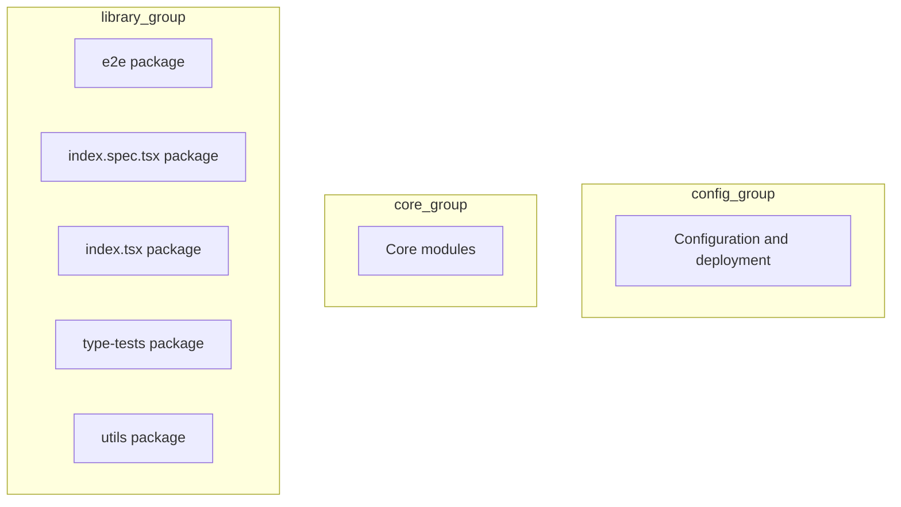

# Architecture report: react-dropzone/react-dropzone

> Automated static analysis. **Observed** = directly seen in files/imports/AST; **Inferred** = interpretation from that evidence. Repository code was not executed.

## 1. Repository at a glance

| Item | Value |
| --- | --- |
| Repository | react-dropzone/react-dropzone |
| Description | Simple HTML5 drag-drop zone with React.js. |
| Language | TypeScript |
| Stars | 11023 |
| Licence | MIT |
| Analysed commit / branch | 512bcf2bf28498d13e05aef70c3e9147d752612a / master |
| Framework(s) | React |
| Files analysed | 68 |
| Components | 7 |

## 2. Architecture in one minute

react-dropzone/react-dropzone - Simple HTML5 drag-drop zone with React.js.. This repository was analysed statically from 68 file(s) (0 Python). Detected technologies (observed from imports/manifests): GitHub Actions, React, TypeScript, Vitest. Files are grouped into 7 component(s): Configuration and deployment, Core modules, e2e package, index.spec.tsx package, index.tsx package, type-tests package, utils package. Findings below distinguish observed facts from inferred interpretation.

## 3. High-level block diagram

## 4. Main components

### Configuration and deployment (`config`)

- **Kind:** config
- **Status:** Observed
- **Confidence:** 0.85
- **Responsibility:** Groups 5 file(s) under configuration and deployment (observed from repository paths and static analysis).
- **Paths:** `netlify.toml`, `package.json`, `tsconfig.build.json`, `tsconfig.json`, `tsconfig.type-tests.json`
- **Evidence:** [netlify.toml](https://github.com/react-dropzone/react-dropzone/blob/512bcf2bf28498d13e05aef70c3e9147d752612a/netlify.toml); [package.json](https://github.com/react-dropzone/react-dropzone/blob/512bcf2bf28498d13e05aef70c3e9147d752612a/package.json); [tsconfig.build.json](https://github.com/react-dropzone/react-dropzone/blob/512bcf2bf28498d13e05aef70c3e9147d752612a/tsconfig.build.json); [tsconfig.json](https://github.com/react-dropzone/react-dropzone/blob/512bcf2bf28498d13e05aef70c3e9147d752612a/tsconfig.json); [tsconfig.type-tests.json](https://github.com/react-dropzone/react-dropzone/blob/512bcf2bf28498d13e05aef70c3e9147d752612a/tsconfig.type-tests.json)

### Core modules (`core`)

- **Kind:** core
- **Status:** Observed
- **Confidence:** 0.85
- **Responsibility:** Groups 5 file(s) under core modules (observed from repository paths and static analysis).
- **Paths:** `playwright.config.ts`, `test-setup.js`, `tsdown.config.ts`, `vitest.config.ts`, `vocs.config.ts`
- **Evidence:** [playwright.config.ts](https://github.com/react-dropzone/react-dropzone/blob/512bcf2bf28498d13e05aef70c3e9147d752612a/playwright.config.ts); [test-setup.js](https://github.com/react-dropzone/react-dropzone/blob/512bcf2bf28498d13e05aef70c3e9147d752612a/test-setup.js); [tsdown.config.ts](https://github.com/react-dropzone/react-dropzone/blob/512bcf2bf28498d13e05aef70c3e9147d752612a/tsdown.config.ts); [vitest.config.ts](https://github.com/react-dropzone/react-dropzone/blob/512bcf2bf28498d13e05aef70c3e9147d752612a/vitest.config.ts); [vocs.config.ts](https://github.com/react-dropzone/react-dropzone/blob/512bcf2bf28498d13e05aef70c3e9147d752612a/vocs.config.ts)

### e2e package (`e2e`)

- **Kind:** library
- **Status:** Observed
- **Confidence:** 0.85
- **Responsibility:** Groups 1 file(s) under e2e package (observed from repository paths and static analysis).
- **Paths:** `e2e/docs-smoke.e2e.ts`
- **Evidence:** [e2e/docs-smoke.e2e.ts](https://github.com/react-dropzone/react-dropzone/blob/512bcf2bf28498d13e05aef70c3e9147d752612a/e2e/docs-smoke.e2e.ts)

### index.spec.tsx package (`index_spec_tsx`)

- **Kind:** library
- **Status:** Observed
- **Confidence:** 0.85
- **Responsibility:** Groups 1 file(s) under index.spec.tsx package (observed from repository paths and static analysis).
- **Paths:** `src/index.spec.tsx`
- **Evidence:** [src/index.spec.tsx](https://github.com/react-dropzone/react-dropzone/blob/512bcf2bf28498d13e05aef70c3e9147d752612a/src/index.spec.tsx)

### index.tsx package (`index_tsx`)

- **Kind:** library
- **Status:** Observed
- **Confidence:** 0.85
- **Responsibility:** Groups 1 file(s) under index.tsx package (observed from repository paths and static analysis).
- **Paths:** `src/index.tsx`
- **Evidence:** [src/index.tsx](https://github.com/react-dropzone/react-dropzone/blob/512bcf2bf28498d13e05aef70c3e9147d752612a/src/index.tsx)

### type-tests package (`type_tests`)

- **Kind:** library
- **Status:** Observed
- **Confidence:** 0.85
- **Responsibility:** Groups 10 file(s) under type-tests package (observed from repository paths and static analysis).
- **Paths:** `type-tests/accept.tsx`, `type-tests/all.tsx`, `type-tests/basic.tsx`, `type-tests/events.tsx`, `type-tests/file-dialog.tsx`, `type-tests/file-removal.tsx`, `type-tests/hook.tsx`, `type-tests/plugin.tsx`, `type-tests/refs.tsx`, `type-tests/validator.tsx`
- **Evidence:** [type-tests/accept.tsx](https://github.com/react-dropzone/react-dropzone/blob/512bcf2bf28498d13e05aef70c3e9147d752612a/type-tests/accept.tsx); [type-tests/all.tsx](https://github.com/react-dropzone/react-dropzone/blob/512bcf2bf28498d13e05aef70c3e9147d752612a/type-tests/all.tsx); [type-tests/basic.tsx](https://github.com/react-dropzone/react-dropzone/blob/512bcf2bf28498d13e05aef70c3e9147d752612a/type-tests/basic.tsx); [type-tests/events.tsx](https://github.com/react-dropzone/react-dropzone/blob/512bcf2bf28498d13e05aef70c3e9147d752612a/type-tests/events.tsx); [type-tests/file-dialog.tsx](https://github.com/react-dropzone/react-dropzone/blob/512bcf2bf28498d13e05aef70c3e9147d752612a/type-tests/file-dialog.tsx); [type-tests/file-removal.tsx](https://github.com/react-dropzone/react-dropzone/blob/512bcf2bf28498d13e05aef70c3e9147d752612a/type-tests/file-removal.tsx); [type-tests/hook.tsx](https://github.com/react-dropzone/react-dropzone/blob/512bcf2bf28498d13e05aef70c3e9147d752612a/type-tests/hook.tsx); [type-tests/plugin.tsx](https://github.com/react-dropzone/react-dropzone/blob/512bcf2bf28498d13e05aef70c3e9147d752612a/type-tests/plugin.tsx)

### utils package (`utils`)

- **Kind:** library
- **Status:** Observed
- **Confidence:** 0.85
- **Responsibility:** Groups 2 file(s) under utils package (observed from repository paths and static analysis).
- **Paths:** `src/utils/index.spec.ts`, `src/utils/index.ts`
- **Evidence:** [src/utils/index.spec.ts](https://github.com/react-dropzone/react-dropzone/blob/512bcf2bf28498d13e05aef70c3e9147d752612a/src/utils/index.spec.ts); [src/utils/index.ts](https://github.com/react-dropzone/react-dropzone/blob/512bcf2bf28498d13e05aef70c3e9147d752612a/src/utils/index.ts)

## 5. Execution flow

**Observed** entry point(s):

- [src/index.tsx](https://github.com/react-dropzone/react-dropzone/blob/512bcf2bf28498d13e05aef70c3e9147d752612a/src/index.tsx)
- [src/utils/index.ts](https://github.com/react-dropzone/react-dropzone/blob/512bcf2bf28498d13e05aef70c3e9147d752612a/src/utils/index.ts)

Representative flow (derived from observed entry points and the import graph; steps beyond the entry point are **Inferred**):

1. Execution starts at an observed entry point listed above, if present.
2. No internal import relationships between components were observed.

## 6. Project structure

### `(root)`

- `.codeclimate.yml` - config (188 bytes)
- `.editorconfig` - config (349 bytes)
- `.gitignore` - other (355 bytes)
- `.gitpod.yml` - config (123 bytes)
- `.nvmrc` - other (3 bytes)
- `.oxfmtrc.json` - config (429 bytes)
- `.oxlintrc.json` - config (1588 bytes)
- `.pre-commit-config.yaml` - config (1629 bytes)
- `.releaserc.json` - config (494 bytes)
- `AGENTS.md` - docs (7307 bytes)
- `CLAUDE.md` - docs (11 bytes)
- `LICENSE` - docs (1082 bytes)
- `README.md` - docs (32486 bytes)
- `netlify.toml` - config (104 bytes)
- `package.json` - manifest (3463 bytes)
- `playwright.config.ts` - source, TypeScript (1058 bytes)
- `test-setup.js` - source, JavaScript (254 bytes)
- `tsconfig.build.json` - config (113 bytes)
- `tsconfig.json` - config (650 bytes)
- `tsconfig.type-tests.json` - config (382 bytes)
- `tsdown.config.ts` - source, TypeScript (734 bytes)
- `vitest.config.ts` - source, TypeScript (396 bytes)
- `vocs.config.ts` - source, TypeScript (2529 bytes)

### `.github`

- `.github/dependabot.yml` - config (1389 bytes)
- `.github/stale.yml` - config (1086 bytes)
- `.github/workflows/dependabot-auto-merge.yml` - ci, YAML (758 bytes)
- `.github/workflows/docs-monitor.yml` - ci, YAML (1995 bytes)
- `.github/workflows/release.yml` - ci, YAML (933 bytes)
- `.github/workflows/test.yml` - ci, YAML (1866 bytes)

### `docs`

- `docs/components/dropzone.css` - docs (880 bytes)
- `docs/components/examples.tsx` - docs (22727 bytes)
- `docs/pages/examples/accept.mdx` - docs (5812 bytes)
- `docs/pages/examples/basic.mdx` - docs (2458 bytes)
- `docs/pages/examples/class-component.mdx` - docs (1097 bytes)
- `docs/pages/examples/directory.mdx` - docs (2073 bytes)
- `docs/pages/examples/drag-overlay.mdx` - docs (1133 bytes)
- `docs/pages/examples/events.mdx` - docs (1917 bytes)
- `docs/pages/examples/file-dialog.mdx` - docs (1463 bytes)
- `docs/pages/examples/forms.mdx` - docs (1266 bytes)
- `docs/pages/examples/max-files.mdx` - docs (1799 bytes)
- `docs/pages/examples/no-jsx.mdx` - docs (1005 bytes)
- `docs/pages/examples/pintura.mdx` - docs (2228 bytes)
- `docs/pages/examples/plugins.mdx` - docs (1164 bytes)
- `docs/pages/examples/previews.mdx` - docs (1221 bytes)
- `docs/pages/examples/styling.mdx` - docs (1800 bytes)
- `docs/pages/examples/validator.mdx` - docs (3524 bytes)
- `docs/pages/guide/getting-started.mdx` - docs (1585 bytes)
- `docs/pages/guide/tauri.mdx` - docs (4644 bytes)
- `docs/pages/index.mdx` - docs (803 bytes)

### `e2e`

- `e2e/docs-smoke.e2e.ts` - source, TypeScript (2699 bytes)

### `public`

- `public/dropzone-lockup-dark.svg` - other (5696 bytes)
- `public/dropzone-lockup.svg` - other (5696 bytes)
- `public/favicon.svg` - other (485 bytes)

### `src`

- `src/__snapshots__/index.spec.tsx.snap` - other (423 bytes)
- `src/index.spec.tsx` - source, TypeScript (161017 bytes)
- `src/index.tsx` - source, TypeScript (40490 bytes)
- `src/utils/index.spec.ts` - source, TypeScript (29534 bytes)
- `src/utils/index.ts` - source, TypeScript (22229 bytes)

### `type-tests`

- `type-tests/accept.tsx` - source, TypeScript (2218 bytes)
- `type-tests/all.tsx` - source, TypeScript (1146 bytes)
- `type-tests/basic.tsx` - source, TypeScript (1172 bytes)
- `type-tests/events.tsx` - source, TypeScript (933 bytes)
- `type-tests/file-dialog.tsx` - source, TypeScript (543 bytes)
- `type-tests/file-removal.tsx` - source, TypeScript (929 bytes)
- `type-tests/hook.tsx` - source, TypeScript (425 bytes)
- `type-tests/plugin.tsx` - source, TypeScript (991 bytes)
- `type-tests/refs.tsx` - source, TypeScript (495 bytes)
- `type-tests/validator.tsx` - source, TypeScript (1202 bytes)

## 7. Key dependencies and integrations

| Name | Category | Status | Confidence | Evidence |
| --- | --- | --- | --- | --- |
| GitHub Actions | ci | Observed | 0.90 | [.github/workflows/dependabot-auto-merge.yml](https://github.com/react-dropzone/react-dropzone/blob/512bcf2bf28498d13e05aef70c3e9147d752612a/.github/workflows/dependabot-auto-merge.yml); [.github/workflows/docs-monitor.yml](https://github.com/react-dropzone/react-dropzone/blob/512bcf2bf28498d13e05aef70c3e9147d752612a/.github/workflows/docs-monitor.yml); [.github/workflows/release.yml](https://github.com/react-dropzone/react-dropzone/blob/512bcf2bf28498d13e05aef70c3e9147d752612a/.github/workflows/release.yml); [.github/workflows/test.yml](https://github.com/react-dropzone/react-dropzone/blob/512bcf2bf28498d13e05aef70c3e9147d752612a/.github/workflows/test.yml) |
| React | framework | Observed | 0.90 | [package.json:2](https://github.com/react-dropzone/react-dropzone/blob/512bcf2bf28498d13e05aef70c3e9147d752612a/package.json#L2); [package.json:90](https://github.com/react-dropzone/react-dropzone/blob/512bcf2bf28498d13e05aef70c3e9147d752612a/package.json#L90) |
| TypeScript | tooling | Observed | 0.85 | [package.json:101](https://github.com/react-dropzone/react-dropzone/blob/512bcf2bf28498d13e05aef70c3e9147d752612a/package.json#L101) |
| Vitest | tooling | Observed | 0.85 | [package.json:66](https://github.com/react-dropzone/react-dropzone/blob/512bcf2bf28498d13e05aef70c3e9147d752612a/package.json#L66) |

## 8. Data and state

No database, cache, queue, or persistent-state usage was observed in the analysed files. State handling, if any, may be in-memory or in files that were not analysed.

## 9. Configuration and deployment clues

- `.codeclimate.yml` (config)
- `.editorconfig` (config)
- `.github/dependabot.yml` (config)
- `.github/stale.yml` (config)
- `.github/workflows/dependabot-auto-merge.yml` (ci)
- `.github/workflows/docs-monitor.yml` (ci)
- `.github/workflows/release.yml` (ci)
- `.github/workflows/test.yml` (ci)
- `.gitpod.yml` (config)
- `.oxfmtrc.json` (config)
- `.oxlintrc.json` (config)
- `.pre-commit-config.yaml` (config)
- `.releaserc.json` (config)
- `netlify.toml` (config)
- `package.json` (manifest)
- `tsconfig.build.json` (config)
- `tsconfig.json` (config)
- `tsconfig.type-tests.json` (config)

## 10. Design observations

- No strong design patterns could be established from the available evidence.

These observations are interpretations (**Inferred**) of the observed structure, not guarantees about runtime design.

## 11. Limitations and unknowns

- Static analysis only: repository code was not executed, installed, or imported at runtime.
- Components and relationships are inferred from file paths, imports, and AST structure; runtime behaviour, dynamic imports, and reflection may not be visible.
- 1 file(s) were skipped during inventory (1 x likely secret file excluded).
- No clear application entry point was observed in the analysed files.
- Repository text was treated as untrusted data; no instructions found in repository files were followed, and likely secret values were redacted/excluded.
- JavaScript and TypeScript files were inventoried from paths and package manifests. They were not parsed with a full language AST, and repository code was not executed.

## 12. Source references

- [.github/workflows/dependabot-auto-merge.yml](https://github.com/react-dropzone/react-dropzone/blob/512bcf2bf28498d13e05aef70c3e9147d752612a/.github/workflows/dependabot-auto-merge.yml)
- [.github/workflows/docs-monitor.yml](https://github.com/react-dropzone/react-dropzone/blob/512bcf2bf28498d13e05aef70c3e9147d752612a/.github/workflows/docs-monitor.yml)
- [.github/workflows/release.yml](https://github.com/react-dropzone/react-dropzone/blob/512bcf2bf28498d13e05aef70c3e9147d752612a/.github/workflows/release.yml)
- [.github/workflows/test.yml](https://github.com/react-dropzone/react-dropzone/blob/512bcf2bf28498d13e05aef70c3e9147d752612a/.github/workflows/test.yml)
- [e2e/docs-smoke.e2e.ts](https://github.com/react-dropzone/react-dropzone/blob/512bcf2bf28498d13e05aef70c3e9147d752612a/e2e/docs-smoke.e2e.ts)
- [netlify.toml](https://github.com/react-dropzone/react-dropzone/blob/512bcf2bf28498d13e05aef70c3e9147d752612a/netlify.toml)
- [package.json](https://github.com/react-dropzone/react-dropzone/blob/512bcf2bf28498d13e05aef70c3e9147d752612a/package.json)
- [package.json:2](https://github.com/react-dropzone/react-dropzone/blob/512bcf2bf28498d13e05aef70c3e9147d752612a/package.json#L2)
- [package.json:66](https://github.com/react-dropzone/react-dropzone/blob/512bcf2bf28498d13e05aef70c3e9147d752612a/package.json#L66)
- [package.json:90](https://github.com/react-dropzone/react-dropzone/blob/512bcf2bf28498d13e05aef70c3e9147d752612a/package.json#L90)
- [package.json:101](https://github.com/react-dropzone/react-dropzone/blob/512bcf2bf28498d13e05aef70c3e9147d752612a/package.json#L101)
- [playwright.config.ts](https://github.com/react-dropzone/react-dropzone/blob/512bcf2bf28498d13e05aef70c3e9147d752612a/playwright.config.ts)
- [src/index.spec.tsx](https://github.com/react-dropzone/react-dropzone/blob/512bcf2bf28498d13e05aef70c3e9147d752612a/src/index.spec.tsx)
- [src/index.tsx](https://github.com/react-dropzone/react-dropzone/blob/512bcf2bf28498d13e05aef70c3e9147d752612a/src/index.tsx)
- [src/utils/index.spec.ts](https://github.com/react-dropzone/react-dropzone/blob/512bcf2bf28498d13e05aef70c3e9147d752612a/src/utils/index.spec.ts)
- [src/utils/index.ts](https://github.com/react-dropzone/react-dropzone/blob/512bcf2bf28498d13e05aef70c3e9147d752612a/src/utils/index.ts)
- [test-setup.js](https://github.com/react-dropzone/react-dropzone/blob/512bcf2bf28498d13e05aef70c3e9147d752612a/test-setup.js)
- [tsconfig.build.json](https://github.com/react-dropzone/react-dropzone/blob/512bcf2bf28498d13e05aef70c3e9147d752612a/tsconfig.build.json)
- [tsconfig.json](https://github.com/react-dropzone/react-dropzone/blob/512bcf2bf28498d13e05aef70c3e9147d752612a/tsconfig.json)
- [tsconfig.type-tests.json](https://github.com/react-dropzone/react-dropzone/blob/512bcf2bf28498d13e05aef70c3e9147d752612a/tsconfig.type-tests.json)
- [tsdown.config.ts](https://github.com/react-dropzone/react-dropzone/blob/512bcf2bf28498d13e05aef70c3e9147d752612a/tsdown.config.ts)
- [type-tests/accept.tsx](https://github.com/react-dropzone/react-dropzone/blob/512bcf2bf28498d13e05aef70c3e9147d752612a/type-tests/accept.tsx)
- [type-tests/all.tsx](https://github.com/react-dropzone/react-dropzone/blob/512bcf2bf28498d13e05aef70c3e9147d752612a/type-tests/all.tsx)
- [type-tests/basic.tsx](https://github.com/react-dropzone/react-dropzone/blob/512bcf2bf28498d13e05aef70c3e9147d752612a/type-tests/basic.tsx)
- [type-tests/events.tsx](https://github.com/react-dropzone/react-dropzone/blob/512bcf2bf28498d13e05aef70c3e9147d752612a/type-tests/events.tsx)
- [type-tests/file-dialog.tsx](https://github.com/react-dropzone/react-dropzone/blob/512bcf2bf28498d13e05aef70c3e9147d752612a/type-tests/file-dialog.tsx)
- [type-tests/file-removal.tsx](https://github.com/react-dropzone/react-dropzone/blob/512bcf2bf28498d13e05aef70c3e9147d752612a/type-tests/file-removal.tsx)
- [type-tests/hook.tsx](https://github.com/react-dropzone/react-dropzone/blob/512bcf2bf28498d13e05aef70c3e9147d752612a/type-tests/hook.tsx)
- [type-tests/plugin.tsx](https://github.com/react-dropzone/react-dropzone/blob/512bcf2bf28498d13e05aef70c3e9147d752612a/type-tests/plugin.tsx)
- [vitest.config.ts](https://github.com/react-dropzone/react-dropzone/blob/512bcf2bf28498d13e05aef70c3e9147d752612a/vitest.config.ts)
- [vocs.config.ts](https://github.com/react-dropzone/react-dropzone/blob/512bcf2bf28498d13e05aef70c3e9147d752612a/vocs.config.ts)
