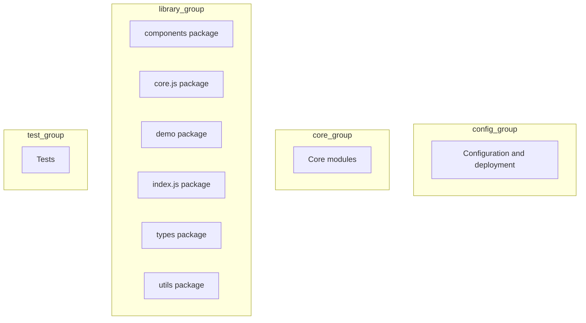

# Architecture report: react-ga/react-ga

> Automated static analysis. **Observed** = directly seen in files/imports/AST; **Inferred** = interpretation from that evidence. Repository code was not executed.

## 1. Repository at a glance

| Item | Value |
| --- | --- |
| Repository | react-ga/react-ga |
| Description | React Google Analytics Module |
| Language | JavaScript |
| Stars | 5092 |
| Licence | Other |
| Analysed commit / branch | 087837dc03d482549ded7669ac559df0c7cc5498 / master |
| Framework(s) | React |
| Files analysed | 69 |
| Components | 9 |

## 2. Architecture in one minute

react-ga/react-ga - React Google Analytics Module. This repository was analysed statically from 69 file(s) (0 Python). Detected technologies (observed from imports/manifests): GitHub Actions, React, React Router, Jest, TypeScript, webpack. Files are grouped into 9 component(s): components package, Configuration and deployment, Core modules, core.js package, demo package, index.js package, Tests, types package. Findings below distinguish observed facts from inferred interpretation.

## 3. High-level block diagram

## 4. Main components

### components package (`components`)

- **Kind:** library
- **Status:** Observed
- **Confidence:** 0.85
- **Responsibility:** Groups 1 file(s) under components package (observed from repository paths and static analysis).
- **Paths:** `src/components/OutboundLink.js`
- **Evidence:** [src/components/OutboundLink.js](https://github.com/react-ga/react-ga/blob/087837dc03d482549ded7669ac559df0c7cc5498/src/components/OutboundLink.js)

### Configuration and deployment (`config`)

- **Kind:** config
- **Status:** Observed
- **Confidence:** 0.85
- **Responsibility:** Groups 3 file(s) under configuration and deployment (observed from repository paths and static analysis).
- **Paths:** `bower.json`, `package.json`, `types/tsconfig.json`
- **Evidence:** [bower.json](https://github.com/react-ga/react-ga/blob/087837dc03d482549ded7669ac559df0c7cc5498/bower.json); [package.json](https://github.com/react-ga/react-ga/blob/087837dc03d482549ded7669ac559df0c7cc5498/package.json); [types/tsconfig.json](https://github.com/react-ga/react-ga/blob/087837dc03d482549ded7669ac559df0c7cc5498/types/tsconfig.json)

### Core modules (`core`)

- **Kind:** core
- **Status:** Observed
- **Confidence:** 0.85
- **Responsibility:** Groups 7 file(s) under core modules (observed from repository paths and static analysis).
- **Paths:** `commitlint.config.js`, `core.d.ts`, `core.js`, `jest.config.js`, `jest.setup.js`, `version-bower.js`, `webpack.config.js`
- **Evidence:** [commitlint.config.js](https://github.com/react-ga/react-ga/blob/087837dc03d482549ded7669ac559df0c7cc5498/commitlint.config.js); [core.d.ts](https://github.com/react-ga/react-ga/blob/087837dc03d482549ded7669ac559df0c7cc5498/core.d.ts); [core.js](https://github.com/react-ga/react-ga/blob/087837dc03d482549ded7669ac559df0c7cc5498/core.js); [jest.config.js](https://github.com/react-ga/react-ga/blob/087837dc03d482549ded7669ac559df0c7cc5498/jest.config.js); [jest.setup.js](https://github.com/react-ga/react-ga/blob/087837dc03d482549ded7669ac559df0c7cc5498/jest.setup.js); [version-bower.js](https://github.com/react-ga/react-ga/blob/087837dc03d482549ded7669ac559df0c7cc5498/version-bower.js); [webpack.config.js](https://github.com/react-ga/react-ga/blob/087837dc03d482549ded7669ac559df0c7cc5498/webpack.config.js)

### core.js package (`core_js`)

- **Kind:** library
- **Status:** Observed
- **Confidence:** 0.85
- **Responsibility:** Groups 1 file(s) under core.js package (observed from repository paths and static analysis).
- **Paths:** `src/core.js`
- **Evidence:** [src/core.js](https://github.com/react-ga/react-ga/blob/087837dc03d482549ded7669ac559df0c7cc5498/src/core.js)

### demo package (`demo`)

- **Kind:** library
- **Status:** Observed
- **Confidence:** 0.85
- **Responsibility:** Groups 6 file(s) under demo package (observed from repository paths and static analysis).
- **Paths:** `demo/app/Events.jsx`, `demo/app/Router.jsx`, `demo/app/index.jsx`, `demo/app/withTracker.jsx`, `demo/index.jsx`, `demo/webpack.config.js`
- **Evidence:** [demo/app/Events.jsx](https://github.com/react-ga/react-ga/blob/087837dc03d482549ded7669ac559df0c7cc5498/demo/app/Events.jsx); [demo/app/Router.jsx](https://github.com/react-ga/react-ga/blob/087837dc03d482549ded7669ac559df0c7cc5498/demo/app/Router.jsx); [demo/app/index.jsx](https://github.com/react-ga/react-ga/blob/087837dc03d482549ded7669ac559df0c7cc5498/demo/app/index.jsx); [demo/app/withTracker.jsx](https://github.com/react-ga/react-ga/blob/087837dc03d482549ded7669ac559df0c7cc5498/demo/app/withTracker.jsx); [demo/index.jsx](https://github.com/react-ga/react-ga/blob/087837dc03d482549ded7669ac559df0c7cc5498/demo/index.jsx); [demo/webpack.config.js](https://github.com/react-ga/react-ga/blob/087837dc03d482549ded7669ac559df0c7cc5498/demo/webpack.config.js)

### index.js package (`index_js`)

- **Kind:** library
- **Status:** Observed
- **Confidence:** 0.85
- **Responsibility:** Groups 1 file(s) under index.js package (observed from repository paths and static analysis).
- **Paths:** `src/index.js`
- **Evidence:** [src/index.js](https://github.com/react-ga/react-ga/blob/087837dc03d482549ded7669ac559df0c7cc5498/src/index.js)

### Tests (`tests`)

- **Kind:** test
- **Status:** Observed
- **Confidence:** 0.85
- **Responsibility:** Groups 21 file(s) under tests (observed from repository paths and static analysis).
- **Paths:** `test/components/OutboundLink.test.jsx`, `test/functionality/event.test.js`, `test/functionality/exception.test.js`, `test/functionality/ga.test.js`, `test/functionality/initialize.test.js`, `test/functionality/modalview.test.js`, `test/functionality/outboundLink.test.jsx`, `test/functionality/pageview.test.js`, `test/functionality/plugin.test.js`, `test/functionality/send.test.js`, `test/functionality/set.test.js`, `test/functionality/timing.test.js`, `test/index.test.js`, `test/utils/console/log.test.js`, `test/utils/console/warn.test.js`, `test/utils/format.test.js`, `test/utils/mightBeEmail.test.js`, `test/utils/removeLeadingSlash.test.js`, `test/utils/testMode.test.js`, `test/utils/toTitleCase.test.js`, `test/utils/trim.test.js`
- **Evidence:** [test/components/OutboundLink.test.jsx](https://github.com/react-ga/react-ga/blob/087837dc03d482549ded7669ac559df0c7cc5498/test/components/OutboundLink.test.jsx); [test/functionality/event.test.js](https://github.com/react-ga/react-ga/blob/087837dc03d482549ded7669ac559df0c7cc5498/test/functionality/event.test.js); [test/functionality/exception.test.js](https://github.com/react-ga/react-ga/blob/087837dc03d482549ded7669ac559df0c7cc5498/test/functionality/exception.test.js); [test/functionality/ga.test.js](https://github.com/react-ga/react-ga/blob/087837dc03d482549ded7669ac559df0c7cc5498/test/functionality/ga.test.js); [test/functionality/initialize.test.js](https://github.com/react-ga/react-ga/blob/087837dc03d482549ded7669ac559df0c7cc5498/test/functionality/initialize.test.js); [test/functionality/modalview.test.js](https://github.com/react-ga/react-ga/blob/087837dc03d482549ded7669ac559df0c7cc5498/test/functionality/modalview.test.js); [test/functionality/outboundLink.test.jsx](https://github.com/react-ga/react-ga/blob/087837dc03d482549ded7669ac559df0c7cc5498/test/functionality/outboundLink.test.jsx); [test/functionality/pageview.test.js](https://github.com/react-ga/react-ga/blob/087837dc03d482549ded7669ac559df0c7cc5498/test/functionality/pageview.test.js)

### types package (`types`)

- **Kind:** library
- **Status:** Observed
- **Confidence:** 0.85
- **Responsibility:** Groups 2 file(s) under types package (observed from repository paths and static analysis).
- **Paths:** `types/index.d.ts`, `types/react-ga-tests.ts`
- **Evidence:** [types/index.d.ts](https://github.com/react-ga/react-ga/blob/087837dc03d482549ded7669ac559df0c7cc5498/types/index.d.ts); [types/react-ga-tests.ts](https://github.com/react-ga/react-ga/blob/087837dc03d482549ded7669ac559df0c7cc5498/types/react-ga-tests.ts)

### utils package (`utils`)

- **Kind:** library
- **Status:** Observed
- **Confidence:** 0.85
- **Responsibility:** Groups 11 file(s) under utils package (observed from repository paths and static analysis).
- **Paths:** `src/utils/__mocks__/loadGA.js`, `src/utils/console/log.js`, `src/utils/console/warn.js`, `src/utils/format.js`, `src/utils/loadGA.js`, `src/utils/mightBeEmail.js`, `src/utils/redactEmail.js`, `src/utils/removeLeadingSlash.js`, `src/utils/testModeAPI.js`, `src/utils/toTitleCase.js`, `src/utils/trim.js`
- **Evidence:** [src/utils/__mocks__/loadGA.js](https://github.com/react-ga/react-ga/blob/087837dc03d482549ded7669ac559df0c7cc5498/src/utils/__mocks__/loadGA.js); [src/utils/console/log.js](https://github.com/react-ga/react-ga/blob/087837dc03d482549ded7669ac559df0c7cc5498/src/utils/console/log.js); [src/utils/console/warn.js](https://github.com/react-ga/react-ga/blob/087837dc03d482549ded7669ac559df0c7cc5498/src/utils/console/warn.js); [src/utils/format.js](https://github.com/react-ga/react-ga/blob/087837dc03d482549ded7669ac559df0c7cc5498/src/utils/format.js); [src/utils/loadGA.js](https://github.com/react-ga/react-ga/blob/087837dc03d482549ded7669ac559df0c7cc5498/src/utils/loadGA.js); [src/utils/mightBeEmail.js](https://github.com/react-ga/react-ga/blob/087837dc03d482549ded7669ac559df0c7cc5498/src/utils/mightBeEmail.js); [src/utils/redactEmail.js](https://github.com/react-ga/react-ga/blob/087837dc03d482549ded7669ac559df0c7cc5498/src/utils/redactEmail.js); [src/utils/removeLeadingSlash.js](https://github.com/react-ga/react-ga/blob/087837dc03d482549ded7669ac559df0c7cc5498/src/utils/removeLeadingSlash.js)

## 5. Execution flow

**Observed** entry point(s):

- [demo/app/index.jsx](https://github.com/react-ga/react-ga/blob/087837dc03d482549ded7669ac559df0c7cc5498/demo/app/index.jsx)
- [demo/index.jsx](https://github.com/react-ga/react-ga/blob/087837dc03d482549ded7669ac559df0c7cc5498/demo/index.jsx)
- [src/index.js](https://github.com/react-ga/react-ga/blob/087837dc03d482549ded7669ac559df0c7cc5498/src/index.js)

Representative flow (derived from observed entry points and the import graph; steps beyond the entry point are **Inferred**):

1. Execution starts at an observed entry point listed above, if present.
2. No internal import relationships between components were observed.

## 6. Project structure

### `(root)`

- `.babelrc` - other (388 bytes)
- `.eslintignore` - other (53 bytes)
- `.eslintrc.js` - source, JavaScript (1569 bytes)
- `.gitignore` - other (83 bytes)
- `.lintstagedrc.js` - source, JavaScript (62 bytes)
- `.npmignore` - other (163 bytes)
- `.nvmrc` - other (8 bytes)
- `.prettierrc.js` - source, JavaScript (67 bytes)
- `.releaserc.json` - config (29 bytes)
- `CONTRIBUTING.md` - docs (406 bytes)
- `LICENSE` - docs (536 bytes)
- `README.md` - docs (20859 bytes)
- `bower.json` - config (489 bytes)
- `commitlint.config.js` - source, JavaScript (67 bytes)
- `core.d.ts` - source, TypeScript (72 bytes)
- `core.js` - source, JavaScript (111 bytes)
- `jest.config.js` - source, JavaScript (64 bytes)
- `jest.setup.js` - source, JavaScript (123 bytes)
- `package.json` - manifest (2951 bytes)
- `version-bower.js` - source, JavaScript (276 bytes)
- `webpack.config.js` - source, JavaScript (939 bytes)

### `.github`

- `.github/workflows/release.yml` - ci, YAML (511 bytes)
- `.github/workflows/tests.yml` - ci, YAML (559 bytes)

### `.husky`

- `.husky/commit-msg` - other (71 bytes)
- `.husky/pre-commit` - other (69 bytes)

### `demo`

- `demo/app/Events.jsx` - source, JavaScript (1270 bytes)
- `demo/app/Router.jsx` - source, JavaScript (1851 bytes)
- `demo/app/index.jsx` - source, JavaScript (4374 bytes)
- `demo/app/withTracker.jsx` - source, JavaScript (952 bytes)
- `demo/index.jsx` - source, JavaScript (205 bytes)
- `demo/webpack.config.js` - source, JavaScript (380 bytes)

### `src`

- `src/components/OutboundLink.js` - source, JavaScript (1680 bytes)
- `src/core.js` - source, JavaScript (15224 bytes)
- `src/index.js` - source, JavaScript (807 bytes)
- `src/utils/__mocks__/loadGA.js` - source, JavaScript (36 bytes)
- `src/utils/console/log.js` - source, JavaScript (68 bytes)
- `src/utils/console/warn.js` - source, JavaScript (69 bytes)
- `src/utils/format.js` - source, JavaScript (324 bytes)
- `src/utils/loadGA.js` - source, JavaScript (952 bytes)
- `src/utils/mightBeEmail.js` - source, JavaScript (326 bytes)
- `src/utils/redactEmail.js` - source, JavaScript (318 bytes)
- `src/utils/removeLeadingSlash.js` - source, JavaScript (149 bytes)
- `src/utils/testModeAPI.js` - source, JavaScript (171 bytes)
- `src/utils/toTitleCase.js` - source, JavaScript (1001 bytes)
- `src/utils/trim.js` - source, JavaScript (210 bytes)

### `test`

- `test/components/OutboundLink.test.jsx` - test, JavaScript (4475 bytes)
- `test/functionality/event.test.js` - test, JavaScript (9815 bytes)
- `test/functionality/exception.test.js` - test, JavaScript (2029 bytes)
- `test/functionality/ga.test.js` - test, JavaScript (1467 bytes)
- `test/functionality/initialize.test.js` - test, JavaScript (2303 bytes)
- `test/functionality/modalview.test.js` - test, JavaScript (2919 bytes)
- `test/functionality/outboundLink.test.jsx` - test, JavaScript (4342 bytes)
- `test/functionality/pageview.test.js` - test, JavaScript (3727 bytes)
- `test/functionality/plugin.test.js` - test, JavaScript (1965 bytes)
- `test/functionality/send.test.js` - test, JavaScript (3824 bytes)
- `test/functionality/set.test.js` - test, JavaScript (1942 bytes)
- `test/functionality/timing.test.js` - test, JavaScript (4445 bytes)
- `test/index.test.js` - test, JavaScript (384 bytes)
- `test/utils/console/log.test.js` - test, JavaScript (446 bytes)
- `test/utils/console/warn.test.js` - test, JavaScript (458 bytes)
- `test/utils/format.test.js` - test, JavaScript (2044 bytes)
- `test/utils/mightBeEmail.test.js` - test, JavaScript (656 bytes)
- `test/utils/removeLeadingSlash.test.js` - test, JavaScript (566 bytes)
- `test/utils/testMode.test.js` - test, JavaScript (405 bytes)
- `test/utils/toTitleCase.test.js` - test, JavaScript (4688 bytes)
- `test/utils/trim.test.js` - test, JavaScript (1601 bytes)

### `types`

- `types/index.d.ts` - source, TypeScript (5587 bytes)
- `types/react-ga-tests.ts` - source, TypeScript (4278 bytes)
- `types/tsconfig.json` - config (400 bytes)

## 7. Key dependencies and integrations

| Name | Category | Status | Confidence | Evidence |
| --- | --- | --- | --- | --- |
| GitHub Actions | ci | Observed | 0.90 | [.github/workflows/release.yml](https://github.com/react-ga/react-ga/blob/087837dc03d482549ded7669ac559df0c7cc5498/.github/workflows/release.yml); [.github/workflows/tests.yml](https://github.com/react-ga/react-ga/blob/087837dc03d482549ded7669ac559df0c7cc5498/.github/workflows/tests.yml) |
| React | framework | Observed | 0.90 | [package.json:2](https://github.com/react-ga/react-ga/blob/087837dc03d482549ded7669ac559df0c7cc5498/package.json#L2); [package.json:79](https://github.com/react-ga/react-ga/blob/087837dc03d482549ded7669ac559df0c7cc5498/package.json#L79) |
| React Router | library | Observed | 0.90 | [package.json:80](https://github.com/react-ga/react-ga/blob/087837dc03d482549ded7669ac559df0c7cc5498/package.json#L80); [package.json:81](https://github.com/react-ga/react-ga/blob/087837dc03d482549ded7669ac559df0c7cc5498/package.json#L81) |
| Jest | tooling | Observed | 0.85 | [package.json:9](https://github.com/react-ga/react-ga/blob/087837dc03d482549ded7669ac559df0c7cc5498/package.json#L9) |
| TypeScript | tooling | Observed | 0.85 | [package.json:83](https://github.com/react-ga/react-ga/blob/087837dc03d482549ded7669ac559df0c7cc5498/package.json#L83) |
| webpack | tooling | Observed | 0.85 | [package.json:8](https://github.com/react-ga/react-ga/blob/087837dc03d482549ded7669ac559df0c7cc5498/package.json#L8) |

## 8. Data and state

No database, cache, queue, or persistent-state usage was observed in the analysed files. State handling, if any, may be in-memory or in files that were not analysed.

## 9. Configuration and deployment clues

- `.github/workflows/release.yml` (ci)
- `.github/workflows/tests.yml` (ci)
- `.releaserc.json` (config)
- `bower.json` (config)
- `package.json` (manifest)
- `types/tsconfig.json` (config)

## 10. Design observations

- Tests are present alongside source code (Observed from test file paths).

These observations are interpretations (**Inferred**) of the observed structure, not guarantees about runtime design.

## 11. Limitations and unknowns

- Static analysis only: repository code was not executed, installed, or imported at runtime.
- Components and relationships are inferred from file paths, imports, and AST structure; runtime behaviour, dynamic imports, and reflection may not be visible.
- No clear application entry point was observed in the analysed files.
- Repository text was treated as untrusted data; no instructions found in repository files were followed, and likely secret values were redacted/excluded.
- JavaScript and TypeScript files were inventoried from paths and package manifests. They were not parsed with a full language AST, and repository code was not executed.
- The GitHub repository was marked archived at selection time.

## 12. Source references

- [.github/workflows/release.yml](https://github.com/react-ga/react-ga/blob/087837dc03d482549ded7669ac559df0c7cc5498/.github/workflows/release.yml)
- [.github/workflows/tests.yml](https://github.com/react-ga/react-ga/blob/087837dc03d482549ded7669ac559df0c7cc5498/.github/workflows/tests.yml)
- [bower.json](https://github.com/react-ga/react-ga/blob/087837dc03d482549ded7669ac559df0c7cc5498/bower.json)
- [commitlint.config.js](https://github.com/react-ga/react-ga/blob/087837dc03d482549ded7669ac559df0c7cc5498/commitlint.config.js)
- [core.d.ts](https://github.com/react-ga/react-ga/blob/087837dc03d482549ded7669ac559df0c7cc5498/core.d.ts)
- [core.js](https://github.com/react-ga/react-ga/blob/087837dc03d482549ded7669ac559df0c7cc5498/core.js)
- [demo/app/Events.jsx](https://github.com/react-ga/react-ga/blob/087837dc03d482549ded7669ac559df0c7cc5498/demo/app/Events.jsx)
- [demo/app/Router.jsx](https://github.com/react-ga/react-ga/blob/087837dc03d482549ded7669ac559df0c7cc5498/demo/app/Router.jsx)
- [demo/app/index.jsx](https://github.com/react-ga/react-ga/blob/087837dc03d482549ded7669ac559df0c7cc5498/demo/app/index.jsx)
- [demo/app/withTracker.jsx](https://github.com/react-ga/react-ga/blob/087837dc03d482549ded7669ac559df0c7cc5498/demo/app/withTracker.jsx)
- [demo/index.jsx](https://github.com/react-ga/react-ga/blob/087837dc03d482549ded7669ac559df0c7cc5498/demo/index.jsx)
- [demo/webpack.config.js](https://github.com/react-ga/react-ga/blob/087837dc03d482549ded7669ac559df0c7cc5498/demo/webpack.config.js)
- [jest.config.js](https://github.com/react-ga/react-ga/blob/087837dc03d482549ded7669ac559df0c7cc5498/jest.config.js)
- [jest.setup.js](https://github.com/react-ga/react-ga/blob/087837dc03d482549ded7669ac559df0c7cc5498/jest.setup.js)
- [package.json](https://github.com/react-ga/react-ga/blob/087837dc03d482549ded7669ac559df0c7cc5498/package.json)
- [package.json:2](https://github.com/react-ga/react-ga/blob/087837dc03d482549ded7669ac559df0c7cc5498/package.json#L2)
- [package.json:8](https://github.com/react-ga/react-ga/blob/087837dc03d482549ded7669ac559df0c7cc5498/package.json#L8)
- [package.json:9](https://github.com/react-ga/react-ga/blob/087837dc03d482549ded7669ac559df0c7cc5498/package.json#L9)
- [package.json:79](https://github.com/react-ga/react-ga/blob/087837dc03d482549ded7669ac559df0c7cc5498/package.json#L79)
- [package.json:80](https://github.com/react-ga/react-ga/blob/087837dc03d482549ded7669ac559df0c7cc5498/package.json#L80)
- [package.json:81](https://github.com/react-ga/react-ga/blob/087837dc03d482549ded7669ac559df0c7cc5498/package.json#L81)
- [package.json:83](https://github.com/react-ga/react-ga/blob/087837dc03d482549ded7669ac559df0c7cc5498/package.json#L83)
- [src/components/OutboundLink.js](https://github.com/react-ga/react-ga/blob/087837dc03d482549ded7669ac559df0c7cc5498/src/components/OutboundLink.js)
- [src/core.js](https://github.com/react-ga/react-ga/blob/087837dc03d482549ded7669ac559df0c7cc5498/src/core.js)
- [src/index.js](https://github.com/react-ga/react-ga/blob/087837dc03d482549ded7669ac559df0c7cc5498/src/index.js)
- [src/utils/__mocks__/loadGA.js](https://github.com/react-ga/react-ga/blob/087837dc03d482549ded7669ac559df0c7cc5498/src/utils/__mocks__/loadGA.js)
- [src/utils/console/log.js](https://github.com/react-ga/react-ga/blob/087837dc03d482549ded7669ac559df0c7cc5498/src/utils/console/log.js)
- [src/utils/console/warn.js](https://github.com/react-ga/react-ga/blob/087837dc03d482549ded7669ac559df0c7cc5498/src/utils/console/warn.js)
- [src/utils/format.js](https://github.com/react-ga/react-ga/blob/087837dc03d482549ded7669ac559df0c7cc5498/src/utils/format.js)
- [src/utils/loadGA.js](https://github.com/react-ga/react-ga/blob/087837dc03d482549ded7669ac559df0c7cc5498/src/utils/loadGA.js)
- [src/utils/mightBeEmail.js](https://github.com/react-ga/react-ga/blob/087837dc03d482549ded7669ac559df0c7cc5498/src/utils/mightBeEmail.js)
- [src/utils/redactEmail.js](https://github.com/react-ga/react-ga/blob/087837dc03d482549ded7669ac559df0c7cc5498/src/utils/redactEmail.js)
- [src/utils/removeLeadingSlash.js](https://github.com/react-ga/react-ga/blob/087837dc03d482549ded7669ac559df0c7cc5498/src/utils/removeLeadingSlash.js)
- [test/components/OutboundLink.test.jsx](https://github.com/react-ga/react-ga/blob/087837dc03d482549ded7669ac559df0c7cc5498/test/components/OutboundLink.test.jsx)
- [test/functionality/event.test.js](https://github.com/react-ga/react-ga/blob/087837dc03d482549ded7669ac559df0c7cc5498/test/functionality/event.test.js)
- [test/functionality/exception.test.js](https://github.com/react-ga/react-ga/blob/087837dc03d482549ded7669ac559df0c7cc5498/test/functionality/exception.test.js)
- [test/functionality/ga.test.js](https://github.com/react-ga/react-ga/blob/087837dc03d482549ded7669ac559df0c7cc5498/test/functionality/ga.test.js)
- [test/functionality/initialize.test.js](https://github.com/react-ga/react-ga/blob/087837dc03d482549ded7669ac559df0c7cc5498/test/functionality/initialize.test.js)
- [test/functionality/modalview.test.js](https://github.com/react-ga/react-ga/blob/087837dc03d482549ded7669ac559df0c7cc5498/test/functionality/modalview.test.js)
- [test/functionality/outboundLink.test.jsx](https://github.com/react-ga/react-ga/blob/087837dc03d482549ded7669ac559df0c7cc5498/test/functionality/outboundLink.test.jsx)
- [test/functionality/pageview.test.js](https://github.com/react-ga/react-ga/blob/087837dc03d482549ded7669ac559df0c7cc5498/test/functionality/pageview.test.js)
- [types/index.d.ts](https://github.com/react-ga/react-ga/blob/087837dc03d482549ded7669ac559df0c7cc5498/types/index.d.ts)
- [types/react-ga-tests.ts](https://github.com/react-ga/react-ga/blob/087837dc03d482549ded7669ac559df0c7cc5498/types/react-ga-tests.ts)
- [types/tsconfig.json](https://github.com/react-ga/react-ga/blob/087837dc03d482549ded7669ac559df0c7cc5498/types/tsconfig.json)
- [version-bower.js](https://github.com/react-ga/react-ga/blob/087837dc03d482549ded7669ac559df0c7cc5498/version-bower.js)
- [webpack.config.js](https://github.com/react-ga/react-ga/blob/087837dc03d482549ded7669ac559df0c7cc5498/webpack.config.js)
