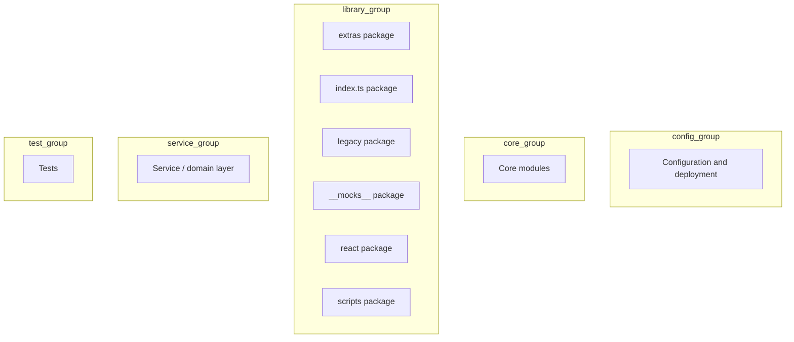

# Architecture report: react-grid-layout/react-grid-layout

> Automated static analysis. **Observed** = directly seen in files/imports/AST; **Inferred** = interpretation from that evidence. Repository code was not executed.

## 1. Repository at a glance

| Item | Value |
| --- | --- |
| Repository | react-grid-layout/react-grid-layout |
| Description | A draggable and resizable grid layout with responsive breakpoints, for React. |
| Language | TypeScript |
| Stars | 22492 |
| Licence | MIT |
| Analysed commit / branch | f0dd77c5b2fee2d2cb09541d220c00d6814c7242 / master |
| Framework(s) | React |
| Files analysed | 562 |
| Components | 10 |

## 2. Architecture in one minute

react-grid-layout/react-grid-layout - A draggable and resizable grid layout with responsive breakpoints, for React.. This repository was analysed statically from 562 file(s) (0 Python). Detected technologies (observed from imports/manifests): GitHub Actions, React, Jest, TypeScript, webpack. Files are grouped into 10 component(s): Configuration and deployment, Core modules, extras package, index.ts package, legacy package, __mocks__ package, react package, scripts package. Findings below distinguish observed facts from inferred interpretation.

## 3. High-level block diagram

## 4. Main components

### Configuration and deployment (`config`)

- **Kind:** config
- **Status:** Observed
- **Confidence:** 0.85
- **Responsibility:** Groups 2 file(s) under configuration and deployment (observed from repository paths and static analysis).
- **Paths:** `package.json`, `tsconfig.json`
- **Evidence:** [package.json](https://github.com/react-grid-layout/react-grid-layout/blob/f0dd77c5b2fee2d2cb09541d220c00d6814c7242/package.json); [tsconfig.json](https://github.com/react-grid-layout/react-grid-layout/blob/f0dd77c5b2fee2d2cb09541d220c00d6814c7242/tsconfig.json)

### Core modules (`core`)

- **Kind:** core
- **Status:** Observed
- **Confidence:** 0.85
- **Responsibility:** Groups 7 file(s) under core modules (observed from repository paths and static analysis).
- **Paths:** `eslint.config.mjs`, `index-dev.js`, `index.js`, `playwright.config.ts`, `tsup.config.ts`, `webpack-dev-server.config.js`, `webpack-examples.config.js`
- **Evidence:** [eslint.config.mjs](https://github.com/react-grid-layout/react-grid-layout/blob/f0dd77c5b2fee2d2cb09541d220c00d6814c7242/eslint.config.mjs); [index-dev.js](https://github.com/react-grid-layout/react-grid-layout/blob/f0dd77c5b2fee2d2cb09541d220c00d6814c7242/index-dev.js); [index.js](https://github.com/react-grid-layout/react-grid-layout/blob/f0dd77c5b2fee2d2cb09541d220c00d6814c7242/index.js); [playwright.config.ts](https://github.com/react-grid-layout/react-grid-layout/blob/f0dd77c5b2fee2d2cb09541d220c00d6814c7242/playwright.config.ts); [tsup.config.ts](https://github.com/react-grid-layout/react-grid-layout/blob/f0dd77c5b2fee2d2cb09541d220c00d6814c7242/tsup.config.ts); [webpack-dev-server.config.js](https://github.com/react-grid-layout/react-grid-layout/blob/f0dd77c5b2fee2d2cb09541d220c00d6814c7242/webpack-dev-server.config.js); [webpack-examples.config.js](https://github.com/react-grid-layout/react-grid-layout/blob/f0dd77c5b2fee2d2cb09541d220c00d6814c7242/webpack-examples.config.js)

### extras package (`extras`)

- **Kind:** library
- **Status:** Observed
- **Confidence:** 0.85
- **Responsibility:** Groups 5 file(s) under extras package (observed from repository paths and static analysis).
- **Paths:** `src/extras/GridBackground.tsx`, `src/extras/fastHorizontalCompactor.ts`, `src/extras/fastVerticalCompactor.ts`, `src/extras/index.ts`, `src/extras/wrapCompactor.ts`
- **Evidence:** [src/extras/GridBackground.tsx](https://github.com/react-grid-layout/react-grid-layout/blob/f0dd77c5b2fee2d2cb09541d220c00d6814c7242/src/extras/GridBackground.tsx); [src/extras/fastHorizontalCompactor.ts](https://github.com/react-grid-layout/react-grid-layout/blob/f0dd77c5b2fee2d2cb09541d220c00d6814c7242/src/extras/fastHorizontalCompactor.ts); [src/extras/fastVerticalCompactor.ts](https://github.com/react-grid-layout/react-grid-layout/blob/f0dd77c5b2fee2d2cb09541d220c00d6814c7242/src/extras/fastVerticalCompactor.ts); [src/extras/index.ts](https://github.com/react-grid-layout/react-grid-layout/blob/f0dd77c5b2fee2d2cb09541d220c00d6814c7242/src/extras/index.ts); [src/extras/wrapCompactor.ts](https://github.com/react-grid-layout/react-grid-layout/blob/f0dd77c5b2fee2d2cb09541d220c00d6814c7242/src/extras/wrapCompactor.ts)

### index.ts package (`index_ts`)

- **Kind:** library
- **Status:** Observed
- **Confidence:** 0.85
- **Responsibility:** Groups 1 file(s) under index.ts package (observed from repository paths and static analysis).
- **Paths:** `src/index.ts`
- **Evidence:** [src/index.ts](https://github.com/react-grid-layout/react-grid-layout/blob/f0dd77c5b2fee2d2cb09541d220c00d6814c7242/src/index.ts)

### legacy package (`legacy`)

- **Kind:** library
- **Status:** Observed
- **Confidence:** 0.85
- **Responsibility:** Groups 4 file(s) under legacy package (observed from repository paths and static analysis).
- **Paths:** `src/legacy/ReactGridLayout.tsx`, `src/legacy/ResponsiveReactGridLayout.tsx`, `src/legacy/WidthProvider.tsx`, `src/legacy/index.ts`
- **Evidence:** [src/legacy/ReactGridLayout.tsx](https://github.com/react-grid-layout/react-grid-layout/blob/f0dd77c5b2fee2d2cb09541d220c00d6814c7242/src/legacy/ReactGridLayout.tsx); [src/legacy/ResponsiveReactGridLayout.tsx](https://github.com/react-grid-layout/react-grid-layout/blob/f0dd77c5b2fee2d2cb09541d220c00d6814c7242/src/legacy/ResponsiveReactGridLayout.tsx); [src/legacy/WidthProvider.tsx](https://github.com/react-grid-layout/react-grid-layout/blob/f0dd77c5b2fee2d2cb09541d220c00d6814c7242/src/legacy/WidthProvider.tsx); [src/legacy/index.ts](https://github.com/react-grid-layout/react-grid-layout/blob/f0dd77c5b2fee2d2cb09541d220c00d6814c7242/src/legacy/index.ts)

### __mocks__ package (`mocks`)

- **Kind:** library
- **Status:** Observed
- **Confidence:** 0.85
- **Responsibility:** Groups 1 file(s) under __mocks__ package (observed from repository paths and static analysis).
- **Paths:** `__mocks__/react-grid-layout.js`
- **Evidence:** [__mocks__/react-grid-layout.js](https://github.com/react-grid-layout/react-grid-layout/blob/f0dd77c5b2fee2d2cb09541d220c00d6814c7242/__mocks__/react-grid-layout.js)

### react package (`react`)

- **Kind:** library
- **Status:** Observed
- **Confidence:** 0.85
- **Responsibility:** Groups 14 file(s) under react package (observed from repository paths and static analysis).
- **Paths:** `src/react/components/GridItem.tsx`, `src/react/components/GridLayout.tsx`, `src/react/components/ResponsiveGridLayout.tsx`, `src/react/components/WidthProvider.tsx`, `src/react/components/deprecations.ts`, `src/react/components/dropMath.ts`, `src/react/components/edgeScroll.ts`, `src/react/components/index.ts`, `src/react/hooks/index.ts`, `src/react/hooks/useContainerWidth.ts`, `src/react/hooks/useGridLayout.ts`, `src/react/hooks/useResponsiveLayout.ts`, `src/react/index.ts`, `src/react/types/react-resizable.d.ts`
- **Evidence:** [src/react/components/GridItem.tsx](https://github.com/react-grid-layout/react-grid-layout/blob/f0dd77c5b2fee2d2cb09541d220c00d6814c7242/src/react/components/GridItem.tsx); [src/react/components/GridLayout.tsx](https://github.com/react-grid-layout/react-grid-layout/blob/f0dd77c5b2fee2d2cb09541d220c00d6814c7242/src/react/components/GridLayout.tsx); [src/react/components/ResponsiveGridLayout.tsx](https://github.com/react-grid-layout/react-grid-layout/blob/f0dd77c5b2fee2d2cb09541d220c00d6814c7242/src/react/components/ResponsiveGridLayout.tsx); [src/react/components/WidthProvider.tsx](https://github.com/react-grid-layout/react-grid-layout/blob/f0dd77c5b2fee2d2cb09541d220c00d6814c7242/src/react/components/WidthProvider.tsx); [src/react/components/deprecations.ts](https://github.com/react-grid-layout/react-grid-layout/blob/f0dd77c5b2fee2d2cb09541d220c00d6814c7242/src/react/components/deprecations.ts); [src/react/components/dropMath.ts](https://github.com/react-grid-layout/react-grid-layout/blob/f0dd77c5b2fee2d2cb09541d220c00d6814c7242/src/react/components/dropMath.ts); [src/react/components/edgeScroll.ts](https://github.com/react-grid-layout/react-grid-layout/blob/f0dd77c5b2fee2d2cb09541d220c00d6814c7242/src/react/components/edgeScroll.ts); [src/react/components/index.ts](https://github.com/react-grid-layout/react-grid-layout/blob/f0dd77c5b2fee2d2cb09541d220c00d6814c7242/src/react/components/index.ts)

### scripts package (`scripts`)

- **Kind:** library
- **Status:** Observed
- **Confidence:** 0.85
- **Responsibility:** Groups 2 file(s) under scripts package (observed from repository paths and static analysis).
- **Paths:** `scripts/check-release.cjs`, `scripts/record-playwright-frames.cjs`
- **Evidence:** [scripts/check-release.cjs](https://github.com/react-grid-layout/react-grid-layout/blob/f0dd77c5b2fee2d2cb09541d220c00d6814c7242/scripts/check-release.cjs); [scripts/record-playwright-frames.cjs](https://github.com/react-grid-layout/react-grid-layout/blob/f0dd77c5b2fee2d2cb09541d220c00d6814c7242/scripts/record-playwright-frames.cjs)

### Service / domain layer (`service_layer`)

- **Kind:** service
- **Status:** Observed
- **Confidence:** 0.85
- **Responsibility:** Groups 19 file(s) under service / domain layer (observed from repository paths and static analysis).
- **Paths:** `src/core/calculate.ts`, `src/core/collision.ts`, `src/core/compaction/cellIndex.ts`, `src/core/compaction/classic.ts`, `src/core/compactors.ts`, `src/core/constraints.ts`, `src/core/dev.ts`, `src/core/geometry/axis.ts`, `src/core/geometry/normalize.ts`, `src/core/geometry/rect.ts`, `src/core/index.ts`, `src/core/interaction/dragCollisionIndex.ts`, `src/core/interaction/resolveDrag.ts`, `src/core/layout.ts`, `src/core/position.ts`, `src/core/responsive.ts`, `src/core/sort.ts`, `src/core/types.ts`, `src/core/validation.ts`
- **Evidence:** [src/core/calculate.ts](https://github.com/react-grid-layout/react-grid-layout/blob/f0dd77c5b2fee2d2cb09541d220c00d6814c7242/src/core/calculate.ts); [src/core/collision.ts](https://github.com/react-grid-layout/react-grid-layout/blob/f0dd77c5b2fee2d2cb09541d220c00d6814c7242/src/core/collision.ts); [src/core/compaction/cellIndex.ts](https://github.com/react-grid-layout/react-grid-layout/blob/f0dd77c5b2fee2d2cb09541d220c00d6814c7242/src/core/compaction/cellIndex.ts); [src/core/compaction/classic.ts](https://github.com/react-grid-layout/react-grid-layout/blob/f0dd77c5b2fee2d2cb09541d220c00d6814c7242/src/core/compaction/classic.ts); [src/core/compactors.ts](https://github.com/react-grid-layout/react-grid-layout/blob/f0dd77c5b2fee2d2cb09541d220c00d6814c7242/src/core/compactors.ts); [src/core/constraints.ts](https://github.com/react-grid-layout/react-grid-layout/blob/f0dd77c5b2fee2d2cb09541d220c00d6814c7242/src/core/constraints.ts); [src/core/dev.ts](https://github.com/react-grid-layout/react-grid-layout/blob/f0dd77c5b2fee2d2cb09541d220c00d6814c7242/src/core/dev.ts); [src/core/geometry/axis.ts](https://github.com/react-grid-layout/react-grid-layout/blob/f0dd77c5b2fee2d2cb09541d220c00d6814c7242/src/core/geometry/axis.ts)

### Tests (`tests`)

- **Kind:** test
- **Status:** Observed
- **Confidence:** 0.85
- **Responsibility:** Groups 456 file(s) under tests (observed from repository paths and static analysis).
- **Paths:** `test/bench/README.md`, `test/bench/baseline.json`, `test/bench/counters.ts`, `test/bench/instrument.cjs`, `test/bench/nonfinite.bench-test.ts`, `test/bench/opcounts.bench-test.ts`, `test/bench/scenarios.ts`, `test/bench/security-scenarios.ts`, `test/bench/security.bench-test.ts`, `test/dev-hook.jsx`, `test/e2e/__frames__/drag-directions.absolute.json`, `test/e2e/__frames__/drag-directions.horizontal.json`, `test/e2e/__frames__/drag-directions.legacy.json`, `test/e2e/__frames__/drag-directions.none.json`, `test/e2e/__frames__/drag-directions.scaled.json`, `test/e2e/__frames__/drag-directions.strict.json`, `test/e2e/__frames__/drag-directions.vertical.json`, `test/e2e/__frames__/drag-directions.wrap.json`, `test/e2e/__frames__/drag-push-chain.horizontal.json`, `test/e2e/__frames__/drag-push-chain.legacy.json`, `test/e2e/__frames__/drag-push-chain.overlap.json`, `test/e2e/__frames__/drag-push-chain.prevent.json`, `test/e2e/__frames__/drag-push-chain.strict.json`, `test/e2e/__frames__/drag-push-chain.vertical.json`, `test/e2e/__frames__/drag-push-chain.wrap.json`, `test/e2e/__frames__/drag-static-and-bounds.bounded.json`, `test/e2e/__frames__/drag-static-and-bounds.none.json`, `test/e2e/__frames__/drag-static-and-bounds.overlap.json`, `test/e2e/__frames__/drag-static-and-bounds.prevent.json`, `test/e2e/__frames__/drag-static-and-bounds.vertical.json`, `test/e2e/__frames__/manifest.json`, `test/e2e/__frames__/net-zero-drag.legacy.json`, `test/e2e/__frames__/net-zero-drag.none.json`, `test/e2e/__frames__/net-zero-drag.strict.json`, `test/e2e/__frames__/net-zero-drag.vertical.json`, `test/e2e/__frames__/preview-drag.absolute.json`, `test/e2e/__frames__/preview-drag.none.json`, `test/e2e/__frames__/preview-drag.scaled-padding.json`, `test/e2e/__frames__/preview-drag.scaled.json`, `test/e2e/__frames__/preview-e.absolute.json`, `test/e2e/__frames__/preview-e.none.json`, `test/e2e/__frames__/preview-e.scaled-padding.json`, `test/e2e/__frames__/preview-e.scaled.json`, `test/e2e/__frames__/preview-n.absolute.json`, `test/e2e/__frames__/preview-n.none.json`, `test/e2e/__frames__/preview-n.scaled-padding.json`, `test/e2e/__frames__/preview-n.scaled.json`, `test/e2e/__frames__/preview-ne.absolute.json`, `test/e2e/__frames__/preview-ne.none.json`, `test/e2e/__frames__/preview-ne.scaled-padding.json`, `test/e2e/__frames__/preview-ne.scaled.json`, `test/e2e/__frames__/preview-nw.absolute.json`, `test/e2e/__frames__/preview-nw.none.json`, `test/e2e/__frames__/preview-nw.scaled-padding.json`, `test/e2e/__frames__/preview-nw.scaled.json`, `test/e2e/__frames__/preview-s.absolute.json`, `test/e2e/__frames__/preview-s.none.json`, `test/e2e/__frames__/preview-s.scaled-padding.json`, `test/e2e/__frames__/preview-s.scaled.json`, `test/e2e/__frames__/preview-se.absolute.json`, `test/e2e/__frames__/preview-se.none.json`, `test/e2e/__frames__/preview-se.scaled-padding.json`, `test/e2e/__frames__/preview-se.scaled.json`, `test/e2e/__frames__/preview-sw.absolute.json`, `test/e2e/__frames__/preview-sw.none.json`, `test/e2e/__frames__/preview-sw.scaled-padding.json`, `test/e2e/__frames__/preview-sw.scaled.json`, `test/e2e/__frames__/preview-w.absolute.json`, `test/e2e/__frames__/preview-w.none.json`, `test/e2e/__frames__/preview-w.scaled-padding.json`, `test/e2e/__frames__/preview-w.scaled.json`, `test/e2e/__frames__/resize-e.absolute.json`, `test/e2e/__frames__/resize-e.prevent.json`, `test/e2e/__frames__/resize-e.scaled.json`, `test/e2e/__frames__/resize-e.vertical.json`, `test/e2e/__frames__/resize-n.absolute.json`, `test/e2e/__frames__/resize-n.prevent.json`, `test/e2e/__frames__/resize-n.scaled.json`, `test/e2e/__frames__/resize-n.vertical.json`, `test/e2e/__frames__/resize-ne.absolute.json`, `test/e2e/__frames__/resize-ne.prevent.json`, `test/e2e/__frames__/resize-ne.scaled.json`, `test/e2e/__frames__/resize-ne.vertical.json`, `test/e2e/__frames__/resize-nw.absolute.json`, `test/e2e/__frames__/resize-nw.prevent.json`, `test/e2e/__frames__/resize-nw.scaled.json`, `test/e2e/__frames__/resize-nw.vertical.json`, `test/e2e/__frames__/resize-s.absolute.json`, `test/e2e/__frames__/resize-s.prevent.json`, `test/e2e/__frames__/resize-s.scaled.json`, `test/e2e/__frames__/resize-s.vertical.json`, `test/e2e/__frames__/resize-se.absolute.json`, `test/e2e/__frames__/resize-se.prevent.json`, `test/e2e/__frames__/resize-se.scaled.json`, `test/e2e/__frames__/resize-se.vertical.json`, `test/e2e/__frames__/resize-sw.absolute.json`, `test/e2e/__frames__/resize-sw.prevent.json`, `test/e2e/__frames__/resize-sw.scaled.json`, `test/e2e/__frames__/resize-sw.vertical.json`, `test/e2e/__frames__/resize-w.absolute.json`, `test/e2e/__frames__/resize-w.prevent.json`, `test/e2e/__frames__/resize-w.scaled.json`, `test/e2e/__frames__/resize-w.vertical.json`, `test/e2e/dist.spec.ts`, `test/e2e/grid-smoke.spec.ts`, `test/e2e/harness-app.jsx`, `test/e2e/known-browser-divergences.json`, `test/e2e/live-interaction.spec.ts`, `test/e2e/scenarioDriver.ts`, `test/e2e/scenarios.spec.ts`, `test/e2e/touch-drop.spec.ts`, `test/e2e/webpack.harness.config.js`, `test/examples/00-showcase.jsx`, `test/examples/01-basic.jsx`, `test/examples/02-no-dragging.jsx`, `test/examples/03-messy.jsx`, `test/examples/04-grid-property.jsx`, `test/examples/05-static-elements.jsx`, `test/examples/06-dynamic-add-remove.jsx`, `test/examples/07-localstorage.jsx`, `test/examples/08-localstorage-responsive.jsx`, `test/examples/09-min-max-wh.jsx`, `test/examples/10-dynamic-min-max-wh.jsx`, `test/examples/11-toolbox.jsx`, `test/examples/12-drag-from-outside.jsx`, `test/examples/13-bounded.jsx`, `test/examples/14-responsive-bootstrap-style.jsx`, `test/examples/15-scale.jsx`, `test/examples/16-allow-overlap.jsx`, `test/examples/17-resizable-handles.jsx`, `test/examples/18-compactors.jsx`, `test/examples/19-constraints.jsx`, `test/examples/20-aspect-ratio.jsx`, `test/examples/21-custom-constraints.jsx`, `test/examples/test_demo.jsx`, `test/golden-react/README.md`, `test/golden-react/__golden__/children-add-remove-reorder.v2.trace.json`, `test/golden-react/__golden__/cols-no-resync.legacy.trace.json`, `test/golden-react/__golden__/cols-no-resync.v2.trace.json`, `test/golden-react/__golden__/controlled-layout-between-drags.legacy.trace.json`, `test/golden-react/__golden__/controlled-layout-mid-drag.strict.trace.json`, `test/golden-react/__golden__/controlled-layout-mid-drag.v2.trace.json`, `test/golden-react/__golden__/drag-directions.absolute.trace.json`, `test/golden-react/__golden__/drag-directions.horizontal.trace.json`, `test/golden-react/__golden__/drag-directions.legacy.trace.json`, `test/golden-react/__golden__/drag-directions.none.trace.json`, `test/golden-react/__golden__/drag-directions.scaled.trace.json`, `test/golden-react/__golden__/drag-directions.strict.trace.json`, `test/golden-react/__golden__/drag-directions.vertical.trace.json`, `test/golden-react/__golden__/drag-directions.wrap.trace.json`, `test/golden-react/__golden__/drag-push-chain.horizontal.trace.json`, `test/golden-react/__golden__/drag-push-chain.legacy.trace.json`, `test/golden-react/__golden__/drag-push-chain.overlap.trace.json`, `test/golden-react/__golden__/drag-push-chain.prevent.trace.json`, `test/golden-react/__golden__/drag-push-chain.strict.trace.json`, `test/golden-react/__golden__/drag-push-chain.vertical.trace.json`, `test/golden-react/__golden__/drag-push-chain.wrap.trace.json`, `test/golden-react/__golden__/drag-static-and-bounds.bounded.trace.json`, `test/golden-react/__golden__/drag-static-and-bounds.none.trace.json`, `test/golden-react/__golden__/drag-static-and-bounds.overlap.trace.json`, `test/golden-react/__golden__/drag-static-and-bounds.prevent.trace.json`, `test/golden-react/__golden__/drag-static-and-bounds.vertical.trace.json`, `test/golden-react/__golden__/drag-threshold.normal.trace.json`, `test/golden-react/__golden__/drag-threshold.strict.trace.json`, `test/golden-react/__golden__/dragged-child-removed-mid-drag.v2.trace.json`, `test/golden-react/__golden__/duplicate-stop-notifications.none.trace.json`, `test/golden-react/__golden__/edge-scroll-unmount-stop.queued-raf.trace.json`, `test/golden-react/__golden__/existing-data-grid-change-ignored.v2.trace.json`, `test/golden-react/__golden__/external-config-override.vertical.trace.json`, `test/golden-react/__golden__/external-desktop-drop.absolute.trace.json`, `test/golden-react/__golden__/external-desktop-drop.legacy.trace.json`, `test/golden-react/__golden__/external-desktop-drop.scaled.trace.json`, `test/golden-react/__golden__/external-desktop-drop.strict.trace.json`, `test/golden-react/__golden__/external-desktop-drop.vertical.trace.json`, `test/golden-react/__golden__/external-leave.vertical.trace.json`, `test/golden-react/__golden__/external-reject.vertical.trace.json`, `test/golden-react/__golden__/external-touch-cancel.vertical.trace.json`, `test/golden-react/__golden__/external-touch-commit.vertical.trace.json`, `test/golden-react/__golden__/external-touch-leave.vertical.trace.json`, `test/golden-react/__golden__/hook-cols-and-compactor-sync.normal-component.trace.json`, `test/golden-react/__golden__/hook-cols-and-compactor-sync.normal-disagreements.trace.json`, `test/golden-react/__golden__/hook-cols-and-compactor-sync.normal-hook.trace.json`, `test/golden-react/__golden__/hook-cols-and-compactor-sync.strict-component.trace.json`, `test/golden-react/__golden__/hook-cols-and-compactor-sync.strict-disagreements.trace.json`, `test/golden-react/__golden__/hook-cols-and-compactor-sync.strict-hook.trace.json`, `test/golden-react/__golden__/hook-controlled-during-drag.normal-component.trace.json`, `test/golden-react/__golden__/hook-controlled-during-drag.normal-disagreements.trace.json`, `test/golden-react/__golden__/hook-controlled-during-drag.normal-hook.trace.json`, `test/golden-react/__golden__/hook-controlled-during-drag.strict-component.trace.json`, `test/golden-react/__golden__/hook-controlled-during-drag.strict-disagreements.trace.json`, `test/golden-react/__golden__/hook-controlled-during-drag.strict-hook.trace.json`, `test/golden-react/__golden__/hook-inline-layout-render-cap.normal-component.trace.json`, `test/golden-react/__golden__/hook-inline-layout-render-cap.normal-hook.trace.json`, `test/golden-react/__golden__/hook-inline-layout-render-cap.strict-component.trace.json`, `test/golden-react/__golden__/hook-inline-layout-render-cap.strict-hook.trace.json`, `test/golden-react/__golden__/hook-native-gestures.normal-horizontal-component.trace.json`, `test/golden-react/__golden__/hook-native-gestures.normal-horizontal-disagreements.trace.json`, `test/golden-react/__golden__/hook-native-gestures.normal-horizontal-hook.trace.json`, `test/golden-react/__golden__/hook-native-gestures.normal-none-component.trace.json`, `test/golden-react/__golden__/hook-native-gestures.normal-none-disagreements.trace.json`, `test/golden-react/__golden__/hook-native-gestures.normal-none-hook.trace.json`, `test/golden-react/__golden__/hook-native-gestures.normal-overlap-component.trace.json`, `test/golden-react/__golden__/hook-native-gestures.normal-overlap-disagreements.trace.json`, `test/golden-react/__golden__/hook-native-gestures.normal-overlap-hook.trace.json`, `test/golden-react/__golden__/hook-native-gestures.normal-prevent-collision-component.trace.json`, `test/golden-react/__golden__/hook-native-gestures.normal-prevent-collision-disagreements.trace.json`, `test/golden-react/__golden__/hook-native-gestures.normal-prevent-collision-hook.trace.json`, `test/golden-react/__golden__/hook-native-gestures.normal-vertical-component.trace.json`, `test/golden-react/__golden__/hook-native-gestures.normal-vertical-disagreements.trace.json`, `test/golden-react/__golden__/hook-native-gestures.normal-vertical-hook.trace.json`, `test/golden-react/__golden__/hook-native-gestures.strict-horizontal-component.trace.json`, `test/golden-react/__golden__/hook-native-gestures.strict-horizontal-disagreements.trace.json`, `test/golden-react/__golden__/hook-native-gestures.strict-horizontal-hook.trace.json`, `test/golden-react/__golden__/hook-native-gestures.strict-none-component.trace.json`, `test/golden-react/__golden__/hook-native-gestures.strict-none-disagreements.trace.json`, `test/golden-react/__golden__/hook-native-gestures.strict-none-hook.trace.json`, `test/golden-react/__golden__/hook-native-gestures.strict-overlap-component.trace.json`, `test/golden-react/__golden__/hook-native-gestures.strict-overlap-disagreements.trace.json`, `test/golden-react/__golden__/hook-native-gestures.strict-overlap-hook.trace.json`, `test/golden-react/__golden__/hook-native-gestures.strict-prevent-collision-component.trace.json`, `test/golden-react/__golden__/hook-native-gestures.strict-prevent-collision-disagreements.trace.json`, `test/golden-react/__golden__/hook-native-gestures.strict-prevent-collision-hook.trace.json`, `test/golden-react/__golden__/hook-native-gestures.strict-vertical-component.trace.json`, `test/golden-react/__golden__/hook-native-gestures.strict-vertical-disagreements.trace.json`, `test/golden-react/__golden__/hook-native-gestures.strict-vertical-hook.trace.json`, `test/golden-react/__golden__/internal-touch-cancel.touch.trace.json`, `test/golden-react/__golden__/legacy-bounded-resize-item-measurement.legacy.trace.json`, `test/golden-react/__golden__/legacy-responsive-bounds.legacy-responsive.trace.json`, `test/golden-react/__golden__/legacy-responsive-bounds.legacy-rgl.trace.json`, `test/golden-react/__golden__/legacy-responsive-threshold.legacy-responsive.trace.json`, `test/golden-react/__golden__/legacy-responsive-threshold.legacy-rgl.trace.json`, `test/golden-react/__golden__/live-subcell-preview.absolute.trace.json`, `test/golden-react/__golden__/live-subcell-preview.legacy-absolute.trace.json`, `test/golden-react/__golden__/live-subcell-preview.legacy-scaled.trace.json`, `test/golden-react/__golden__/live-subcell-preview.legacy.trace.json`, `test/golden-react/__golden__/live-subcell-preview.scaled.trace.json`, `test/golden-react/__golden__/live-subcell-preview.transform.trace.json`, `test/golden-react/__golden__/memo-ignored-drag-start-callback.v2.trace.json`, `test/golden-react/__golden__/memo-ignored-resize-handles.v2.trace.json`, `test/golden-react/__golden__/memo-ignored-static.v2.trace.json`, `test/golden-react/__golden__/net-zero-drag.legacy.trace.json`, `test/golden-react/__golden__/net-zero-drag.none.trace.json`, `test/golden-react/__golden__/net-zero-drag.strict.trace.json`, `test/golden-react/__golden__/net-zero-drag.vertical.trace.json`, `test/golden-react/__golden__/offset-scrolled-geometry.absolute.trace.json`, `test/golden-react/__golden__/offset-scrolled-geometry.scaled.trace.json`, `test/golden-react/__golden__/offset-scrolled-geometry.transform.trace.json`, `test/golden-react/__golden__/resize-e.absolute.trace.json`, `test/golden-react/__golden__/resize-e.prevent.trace.json`, `test/golden-react/__golden__/resize-e.scaled.trace.json`, `test/golden-react/__golden__/resize-e.vertical.trace.json`, `test/golden-react/__golden__/resize-limits.bounded.trace.json`, `test/golden-react/__golden__/resize-limits.legacy.trace.json`, `test/golden-react/__golden__/resize-limits.none.trace.json`, `test/golden-react/__golden__/resize-limits.overlap.trace.json`, `test/golden-react/__golden__/resize-limits.prevent.trace.json`, `test/golden-react/__golden__/resize-n.absolute.trace.json`, `test/golden-react/__golden__/resize-n.prevent.trace.json`, `test/golden-react/__golden__/resize-n.scaled.trace.json`, `test/golden-react/__golden__/resize-n.vertical.trace.json`, `test/golden-react/__golden__/resize-ne.absolute.trace.json`, `test/golden-react/__golden__/resize-ne.prevent.trace.json`, `test/golden-react/__golden__/resize-ne.scaled.trace.json`, `test/golden-react/__golden__/resize-ne.vertical.trace.json`, `test/golden-react/__golden__/resize-nw.absolute.trace.json`, `test/golden-react/__golden__/resize-nw.prevent.trace.json`, `test/golden-react/__golden__/resize-nw.scaled.trace.json`, `test/golden-react/__golden__/resize-nw.vertical.trace.json`, `test/golden-react/__golden__/resize-s.absolute.trace.json`, `test/golden-react/__golden__/resize-s.prevent.trace.json`, `test/golden-react/__golden__/resize-s.scaled.trace.json`, `test/golden-react/__golden__/resize-s.vertical.trace.json`, `test/golden-react/__golden__/resize-se.absolute.trace.json`, `test/golden-react/__golden__/resize-se.prevent.trace.json`, `test/golden-react/__golden__/resize-se.scaled.trace.json`, `test/golden-react/__golden__/resize-se.vertical.trace.json`, `test/golden-react/__golden__/resize-sw.absolute.trace.json`, `test/golden-react/__golden__/resize-sw.prevent.trace.json`, `test/golden-react/__golden__/resize-sw.scaled.trace.json`, `test/golden-react/__golden__/resize-sw.vertical.trace.json`, `test/golden-react/__golden__/resize-w.absolute.trace.json`, `test/golden-react/__golden__/resize-w.prevent.trace.json`, `test/golden-react/__golden__/resize-w.scaled.trace.json`, `test/golden-react/__golden__/resize-w.vertical.trace.json`, `test/golden-react/__golden__/responsive-breakpoint-mid-drag.strict.trace.json`, `test/golden-react/__golden__/responsive-breakpoint-roundtrip.legacy.trace.json`, `test/golden-react/__golden__/responsive-breakpoint-roundtrip.v2.trace.json`, `test/golden-react/__golden__/responsive-compactor-double-layout-change.v2.trace.json`, `test/golden-react/__golden__/responsive-generated-data-grid.legacy.trace.json`, `test/golden-react/__golden__/responsive-generated-data-grid.v2.trace.json`, `test/golden-react/__golden__/touch-threshold-nan.scaled.trace.json`, `test/golden-react/__golden__/touch-threshold-nan.transform.trace.json`, `test/golden-react/__golden__/uncontrolled-data-grid.legacy.trace.json`, `test/golden-react/__golden__/uncontrolled-data-grid.v2.trace.json`, `test/golden-react/drop.ts`, `test/golden-react/expectGolden.ts`, `test/golden-react/fixture.tsx`, `test/golden-react/formatTrace.ts`, `test/golden-react/geometry.ts`, `test/golden-react/hookHarness.tsx`, `test/golden-react/pointer.ts`, `test/golden-react/recorder.ts`, `test/golden-react/scenarioDefinitions.ts`, `test/golden-react/scenarios/differential.golden-test.tsx`, `test/golden-react/scenarios/interaction.golden-test.tsx`, `test/golden-react/scenarios/lifecycle.golden-test.tsx`, `test/golden-react/scenarios/tooling.golden-test.tsx`, `test/golden-react/verification.md`, `test/golden/README.md`, `test/golden/__golden__/calculate/item-position.golden.json`, `test/golden/__golden__/calculate/metrics.golden.json`, `test/golden/__golden__/collision/generated.golden.json`, `test/golden/__golden__/collision/queries.golden.json`, `test/golden/__golden__/collision/rectangles.golden.json`, `test/golden/__golden__/compactors/factory.golden.json`, `test/golden/__golden__/compactors/horizontal-overlap/families.golden.json`, `test/golden/__golden__/compactors/horizontal/families.golden.json`, `test/golden/__golden__/compactors/input-mutation.golden.json`, `test/golden/__golden__/compactors/item-helpers.golden.json`, `test/golden/__golden__/compactors/none-overlap/families.golden.json`, `test/golden/__golden__/compactors/none/families.golden.json`, `test/golden/__golden__/compactors/repeated-reference-hole.golden.json`, `test/golden/__golden__/compactors/resolver-cascade.golden.json`, `test/golden/__golden__/compactors/suspected-x-axis-early-break.golden.json`, `test/golden/__golden__/compactors/vertical-overlap/families.golden.json`, `test/golden/__golden__/compactors/vertical/families.golden.json`, `test/golden/__golden__/constraints/aspect-ratio-known-bug.golden.json`, `test/golden/__golden__/constraints/chains.golden.json`, `test/golden/__golden__/constraints/factories.golden.json`, `test/golden/__golden__/constraints/factory-methods.golden.json`, `test/golden/__golden__/constraints/position-singletons.golden.json`, `test/golden/__golden__/constraints/size-singletons.golden.json`, `test/golden/__golden__/correctBounds/edges.golden.json`, `test/golden/__golden__/drag/modes-and-reversals.golden.json`, `test/golden/__golden__/extras-fast/disagreement-families.golden.json`, `test/golden/__golden__/extras-fast/horizontal-overlap/families.golden.json`, `test/golden/__golden__/extras-fast/horizontal/families.golden.json`, `test/golden/__golden__/extras-fast/known-bug-c.golden.json`, `test/golden/__golden__/extras-fast/known-bug-d.golden.json`, `test/golden/__golden__/extras-fast/overlap-semantics.golden.json`, `test/golden/__golden__/extras-fast/vertical-overlap/families.golden.json`, `test/golden/__golden__/extras-fast/vertical/families.golden.json`, `test/golden/__golden__/extras-wrap/known-bug-e-geometry.golden.json`, `test/golden/__golden__/extras-wrap/known-bug-e-static-infinity-budget.golden.json`, `test/golden/__golden__/extras-wrap/overlap-clone-contract.golden.json`, `test/golden/__golden__/extras-wrap/overlap/families.golden.json`, `test/golden/__golden__/extras-wrap/static-cells-and-ties.golden.json`, `test/golden/__golden__/extras-wrap/wrap/families.golden.json`, `test/golden/__golden__/harness/seeds.golden.json`, `test/golden/__golden__/knownBug/a-moved-leak-across-drags.golden.json`, `test/golden/__golden__/knownBug/b-old-layout-alias.golden.json`, `test/golden/__golden__/knownBug/f-free-form-swap-no-cascade.golden.json`, `test/golden/__golden__/knownBug/h-infinity-order.golden.json`, `test/golden/__golden__/knownBug/i-static-yields-to-nonstatic.golden.json`, `test/golden/__golden__/knownBug/j-negative-x-expands-width.golden.json`, `test/golden/__golden__/knownBug/n-duplicate-id-collision.golden.json`, `test/golden/__golden__/knownBug/p-detached-item.golden.json`, `test/golden/__golden__/knownBug/q-move-horizontal-overflow.golden.json`, `test/golden/__golden__/knownBug/q-move-static-free-form-swap.golden.json`, `test/golden/__golden__/layout/clones.golden.json`, `test/golden/__golden__/layout/modification.golden.json`, `test/golden/__golden__/layout/queries.golden.json`, `test/golden/__golden__/layout/validation.golden.json`, `test/golden/__golden__/moveElement/axis-and-early-return-edges.golden.json`, `test/golden/__golden__/moveElement/equal-axis-multiple-colliders.golden.json`, `test/golden/__golden__/moveElement/generated.golden.json`, `test/golden/__golden__/moveElementAwayFromCollision/probe-matrix.golden.json`, `test/golden/__golden__/position/resize-directions.golden.json`, `test/golden/__golden__/position/scaled-strategy.golden.json`, `test/golden/__golden__/position/styles.golden.json`, `test/golden/__golden__/responsive/cols.golden.json`, `test/golden/__golden__/responsive/existing.golden.json`, `test/golden/__golden__/responsive/indentation.golden.json`, `test/golden/__golden__/responsive/infinity-append.golden.json`, `test/golden/__golden__/responsive/policies-and-cols.golden.json`, `test/golden/__golden__/responsive/sort.golden.json`, `test/golden/__golden__/responsive/source-selection.golden.json`, `test/golden/__golden__/responsive/widths.golden.json`, `test/golden/__golden__/sort/generated.golden.json`, `test/golden/__golden__/sort/holes.golden.json`, `test/golden/__golden__/sort/ties-and-modes.golden.json`, `test/golden/capture.ts`, `test/golden/cases/calculate.golden-test.ts`, `test/golden/cases/collision.golden-test.ts`, `test/golden/cases/compaction.ts`, `test/golden/cases/compactors.golden-test.ts`, `test/golden/cases/constraints.golden-test.ts`, `test/golden/cases/extras-fast.golden-test.ts`, `test/golden/cases/extras-wrap.golden-test.ts`, `test/golden/cases/harness.golden-test.ts`, `test/golden/cases/moveElement.golden-test.ts`, `test/golden/cases/position.golden-test.ts`, `test/golden/cases/responsive.golden-test.ts`, `test/golden/cases/sort.golden-test.ts`, `test/golden/expectGolden.ts`, `test/golden/generators.ts`, `test/golden/rng.ts`, `test/golden/serialize.ts`, `test/jest.bench.cjs`, `test/jest.ops.cjs`, `test/spec/__snapshots__/benchmark-test.js.snap`, `test/spec/backcompat-test.js`, `test/spec/benchmark-test.js`, `test/spec/bounds-regressions-test.tsx`, `test/spec/classic-compaction-differential-test.ts`, `test/spec/compactor-resync-test.tsx`, `test/spec/compactors-test.ts`, `test/spec/constraints-test.ts`, `test/spec/core-functions-test.ts`, `test/spec/correct-bounds-differential-test.ts`, `test/spec/correct-bounds-sweep-test.ts`, `test/spec/dev-warnings-test.tsx`, `test/spec/drag-resolution-test.ts`, `test/spec/drag-stop-race-test.tsx`, `test/spec/drop-alignment.test.ts`, `test/spec/drop-edge-scroll-test.tsx`, `test/spec/drop-placeholder-ports-test.tsx`, `test/spec/edgeScroll-test.ts`, `test/spec/external-drop-push-test.tsx`, `test/spec/fast-compactor-test.js`, `test/spec/fast-horizontal-compaction-differential-test.ts`, `test/spec/fast-horizontal-compactor-test.js`, `test/spec/helpers/loopRewrite.ts`, `test/spec/hooks-test.tsx`, `test/spec/layout-input-test.tsx`, `test/spec/lifecycle-test.js`, `test/spec/live-interaction-test.tsx`, `test/spec/margin-consistency.test.ts`, `test/spec/moveElement-purity-test.ts`, `test/spec/notify-once-test.tsx`, `test/spec/oracles/legacyClassicCompactor.ts`, `test/spec/oracles/legacyCorrectBounds.ts`, `test/spec/oracles/legacyFastHorizontalCompactor.ts`, `test/spec/oracles/legacyMoveElement.ts`, `test/spec/oracles/legacyWrapCompactor.ts`, `test/spec/resize-constraints-test.tsx`, `test/spec/resize-event-test.tsx`, `test/spec/responsive-gap-collapse-test.tsx`, `test/spec/responsive-generation-test.ts`, `test/spec/responsive-seeding-test.tsx`, `test/spec/responsive-settle-test.tsx`, `test/spec/static-compaction.test.ts`, `test/spec/subpixel-width-test.tsx`, `test/spec/touch-drag-props-test.tsx`, `test/spec/touch-drop-test.tsx`, `test/spec/typescript-components-test.tsx`, `test/spec/user-select-hack-test.tsx`, `test/spec/utils-test.js`, `test/spec/warning-dedup-test.tsx`, `test/spec/wrap-bounds-test.ts`, `test/spec/wrap-compaction-differential-test.ts`, `test/spec/wrapCompactor-test.ts`, `test/test-hook.jsx`, `test/util/deepFreeze.js`, `test/util/examples-server.cjs`, `test/util/setupTests.js`
- **Evidence:** [test/bench/README.md](https://github.com/react-grid-layout/react-grid-layout/blob/f0dd77c5b2fee2d2cb09541d220c00d6814c7242/test/bench/README.md); [test/bench/baseline.json](https://github.com/react-grid-layout/react-grid-layout/blob/f0dd77c5b2fee2d2cb09541d220c00d6814c7242/test/bench/baseline.json); [test/bench/counters.ts](https://github.com/react-grid-layout/react-grid-layout/blob/f0dd77c5b2fee2d2cb09541d220c00d6814c7242/test/bench/counters.ts); [test/bench/instrument.cjs](https://github.com/react-grid-layout/react-grid-layout/blob/f0dd77c5b2fee2d2cb09541d220c00d6814c7242/test/bench/instrument.cjs); [test/bench/nonfinite.bench-test.ts](https://github.com/react-grid-layout/react-grid-layout/blob/f0dd77c5b2fee2d2cb09541d220c00d6814c7242/test/bench/nonfinite.bench-test.ts); [test/bench/opcounts.bench-test.ts](https://github.com/react-grid-layout/react-grid-layout/blob/f0dd77c5b2fee2d2cb09541d220c00d6814c7242/test/bench/opcounts.bench-test.ts); [test/bench/scenarios.ts](https://github.com/react-grid-layout/react-grid-layout/blob/f0dd77c5b2fee2d2cb09541d220c00d6814c7242/test/bench/scenarios.ts); [test/bench/security-scenarios.ts](https://github.com/react-grid-layout/react-grid-layout/blob/f0dd77c5b2fee2d2cb09541d220c00d6814c7242/test/bench/security-scenarios.ts)

## 5. Execution flow

**Observed** entry point(s):

- [index.js](https://github.com/react-grid-layout/react-grid-layout/blob/f0dd77c5b2fee2d2cb09541d220c00d6814c7242/index.js)
- [src/core/index.ts](https://github.com/react-grid-layout/react-grid-layout/blob/f0dd77c5b2fee2d2cb09541d220c00d6814c7242/src/core/index.ts)
- [src/extras/index.ts](https://github.com/react-grid-layout/react-grid-layout/blob/f0dd77c5b2fee2d2cb09541d220c00d6814c7242/src/extras/index.ts)
- [src/index.ts](https://github.com/react-grid-layout/react-grid-layout/blob/f0dd77c5b2fee2d2cb09541d220c00d6814c7242/src/index.ts)
- [src/legacy/index.ts](https://github.com/react-grid-layout/react-grid-layout/blob/f0dd77c5b2fee2d2cb09541d220c00d6814c7242/src/legacy/index.ts)
- [src/react/components/index.ts](https://github.com/react-grid-layout/react-grid-layout/blob/f0dd77c5b2fee2d2cb09541d220c00d6814c7242/src/react/components/index.ts)
- [src/react/hooks/index.ts](https://github.com/react-grid-layout/react-grid-layout/blob/f0dd77c5b2fee2d2cb09541d220c00d6814c7242/src/react/hooks/index.ts)
- [src/react/index.ts](https://github.com/react-grid-layout/react-grid-layout/blob/f0dd77c5b2fee2d2cb09541d220c00d6814c7242/src/react/index.ts)

Representative flow (derived from observed entry points and the import graph; steps beyond the entry point are **Inferred**):

1. Execution starts at an observed entry point listed above, if present.
2. No internal import relationships between components were observed.

## 6. Project structure

### `(root)`

- `.babelrc.js` - source, JavaScript (393 bytes)
- `.browserslistrc` - other (22 bytes)
- `.coderabbit.yaml` - config (313 bytes)
- `.gitignore` - other (531 bytes)
- `.graphifyignore` - other (215 bytes)
- `.npmignore` - other (207 bytes)
- `.prettierignore` - other (265 bytes)
- `.prettierrc` - other (374 bytes)
- `.yarnrc.yml` - config (49 bytes)
- `AGENTS.md` - docs (2014 bytes)
- `CHANGELOG.md` - docs (75615 bytes)
- `CLAUDE.md` - docs (9544 bytes)
- `LICENSE` - docs (1078 bytes)
- `Makefile` - other (3122 bytes)
- `README.md` - docs (44619 bytes)
- `eslint.config.mjs` - source, JavaScript (7581 bytes)
- `index-dev.html` - other (424 bytes)
- `index-dev.js` - source, JavaScript (952 bytes)
- `index.html` - other (150 bytes)
- `index.js` - source, JavaScript (417 bytes)
- `index.js.flow` - other (264 bytes)
- `package.json` - manifest (6764 bytes)
- `playwright.config.ts` - source, TypeScript (1883 bytes)
- `tsconfig.json` - config (1474 bytes)
- `tsup.config.ts` - source, TypeScript (484 bytes)
- `webpack-dev-server.config.js` - source, JavaScript (1419 bytes)
- `webpack-examples.config.js` - source, JavaScript (1850 bytes)

### `.claude`

- `.claude/commands/fix-issue.md` - docs (2128 bytes)
- `.claude/skills/fix-issue.md` - docs (4644 bytes)

### `.github`

- `.github/ISSUE_TEMPLATE/bug_report.yml` - config (4298 bytes)
- `.github/ISSUE_TEMPLATE/config.yml` - config (618 bytes)
- `.github/PULL_REQUEST_TEMPLATE.md` - docs (2139 bytes)
- `.github/changelog-configuration.json` - config (2347 bytes)
- `.github/labeler.yml` - config (789 bytes)
- `.github/release.yml` - config (870 bytes)
- `.github/workflows/audit.yml` - ci, YAML (3946 bytes)
- `.github/workflows/changelog.yml` - ci, YAML (835 bytes)
- `.github/workflows/frames.yml` - ci, YAML (1635 bytes)
- `.github/workflows/gh-pages.yml` - ci, YAML (706 bytes)
- `.github/workflows/label.yml` - ci, YAML (237 bytes)
- `.github/workflows/lint.yml` - ci, YAML (698 bytes)
- `.github/workflows/release.yml` - ci, YAML (1645 bytes)
- `.github/workflows/stale.yml` - ci, YAML (780 bytes)
- `.github/workflows/test.yml` - ci, YAML (2126 bytes)

### `.husky`

- `.husky/.gitignore` - other (2 bytes)
- `.husky/pre-commit` - other (42 bytes)

### `.out-of-scope`

- `.out-of-scope/drop-target-threshold.md` - docs (939 bytes)
- `.out-of-scope/resize-neighbors.md` - docs (1075 bytes)

### `__mocks__`

- `__mocks__/react-grid-layout.js` - source, JavaScript (128 bytes)

### `codemaps`

- `codemaps/architecture.md` - docs (4320 bytes)
- `codemaps/backend.md` - docs (4851 bytes)
- `codemaps/data.md` - docs (4253 bytes)
- `codemaps/frontend.md` - docs (6120 bytes)

### `css`

- `css/styles.css` - other (2709 bytes)

### `docs`

- `docs/warnings.md` - docs (11626 bytes)

### `examples`

- `examples/util/example-styles.css` - other (19405 bytes)
- `examples/util/generate.js` - source, JavaScript (1156 bytes)
- `examples/util/template.ejs` - other (3645 bytes)
- `examples/util/vars.js` - source, JavaScript (7493 bytes)

### `rfcs`

- `rfcs/0001-v2-typescript-rewrite.md` - docs (49113 bytes)
- `rfcs/0002-pluggable-constraints.md` - docs (8783 bytes)

### `scripts`

- `scripts/check-release.cjs` - source, JavaScript (4639 bytes)
- `scripts/record-playwright-frames.cjs` - source, JavaScript (2461 bytes)

### `src`

- `src/core/calculate.ts` - source, TypeScript (12694 bytes)
- `src/core/collision.ts` - source, TypeScript (1902 bytes)
- `src/core/compaction/cellIndex.ts` - source, TypeScript (12640 bytes)
- `src/core/compaction/classic.ts` - source, TypeScript (12526 bytes)
- `src/core/compactors.ts` - source, TypeScript (10223 bytes)
- `src/core/constraints.ts` - source, TypeScript (13521 bytes)
- `src/core/dev.ts` - source, TypeScript (2116 bytes)
- `src/core/geometry/axis.ts` - source, TypeScript (594 bytes)
- `src/core/geometry/normalize.ts` - source, TypeScript (1949 bytes)
- `src/core/geometry/rect.ts` - source, TypeScript (330 bytes)
- `src/core/index.ts` - source, TypeScript (4693 bytes)
- `src/core/interaction/dragCollisionIndex.ts` - source, TypeScript (5615 bytes)
- `src/core/interaction/resolveDrag.ts` - source, TypeScript (8984 bytes)
- `src/core/layout.ts` - source, TypeScript (15000 bytes)
- `src/core/position.ts` - source, TypeScript (8159 bytes)
- `src/core/responsive.ts` - source, TypeScript (6926 bytes)
- `src/core/sort.ts` - source, TypeScript (2238 bytes)
- `src/core/types.ts` - source, TypeScript (18661 bytes)
- `src/core/validation.ts` - source, TypeScript (8155 bytes)
- `src/extras/GridBackground.tsx` - source, TypeScript (4058 bytes)
- `src/extras/fastHorizontalCompactor.ts` - source, TypeScript (14682 bytes)
- `src/extras/fastVerticalCompactor.ts` - source, TypeScript (6631 bytes)
- `src/extras/index.ts` - source, TypeScript (590 bytes)
- `src/extras/wrapCompactor.ts` - source, TypeScript (11530 bytes)
- `src/index.ts` - source, TypeScript (2991 bytes)
- `src/legacy/ReactGridLayout.tsx` - source, TypeScript (7247 bytes)
- `src/legacy/ResponsiveReactGridLayout.tsx` - source, TypeScript (8769 bytes)
- `src/legacy/WidthProvider.tsx` - source, TypeScript (249 bytes)
- `src/legacy/index.ts` - source, TypeScript (1244 bytes)
- `src/react/components/GridItem.tsx` - source, TypeScript (33389 bytes)
- `src/react/components/GridLayout.tsx` - source, TypeScript (50750 bytes)
- `src/react/components/ResponsiveGridLayout.tsx` - source, TypeScript (17397 bytes)
- `src/react/components/WidthProvider.tsx` - source, TypeScript (4401 bytes)
- `src/react/components/deprecations.ts` - source, TypeScript (4232 bytes)
- `src/react/components/dropMath.ts` - source, TypeScript (4357 bytes)
- `src/react/components/edgeScroll.ts` - source, TypeScript (3149 bytes)
- `src/react/components/index.ts` - source, TypeScript (398 bytes)
- `src/react/hooks/index.ts` - source, TypeScript (766 bytes)
- `src/react/hooks/useContainerWidth.ts` - source, TypeScript (7367 bytes)
- `src/react/hooks/useGridLayout.ts` - source, TypeScript (13177 bytes)
- `src/react/hooks/useResponsiveLayout.ts` - source, TypeScript (11114 bytes)
- `src/react/index.ts` - source, TypeScript (2060 bytes)
- `src/react/types/react-resizable.d.ts` - source, TypeScript (1235 bytes)

### `test`

- `test/bench/README.md` - test (10508 bytes)
- `test/bench/baseline.json` - test (129549 bytes)
- `test/bench/counters.ts` - test, TypeScript (5844 bytes)
- `test/bench/instrument.cjs` - test, JavaScript (4759 bytes)
- `test/bench/nonfinite.bench-test.ts` - test, TypeScript (6429 bytes)
- `test/bench/opcounts.bench-test.ts` - test, TypeScript (11516 bytes)
- `test/bench/scenarios.ts` - test, TypeScript (12653 bytes)
- `test/bench/security-scenarios.ts` - test, TypeScript (7862 bytes)
- `test/bench/security.bench-test.ts` - test, TypeScript (223 bytes)
- `test/dev-hook.jsx` - test, JavaScript (251 bytes)
- `test/e2e/__frames__/drag-directions.absolute.json` - test (3878 bytes)
- `test/e2e/__frames__/drag-directions.horizontal.json` - test (3849 bytes)
- `test/e2e/__frames__/drag-directions.legacy.json` - test (3865 bytes)
- `test/e2e/__frames__/drag-directions.none.json` - test (3878 bytes)
- `test/e2e/__frames__/drag-directions.scaled.json` - test (3788 bytes)
- `test/e2e/__frames__/drag-directions.strict.json` - test (3865 bytes)
- `test/e2e/__frames__/drag-directions.vertical.json` - test (3865 bytes)
- `test/e2e/__frames__/drag-directions.wrap.json` - test (3849 bytes)
- `test/e2e/__frames__/drag-push-chain.horizontal.json` - test (1831 bytes)
- `test/e2e/__frames__/drag-push-chain.legacy.json` - test (1823 bytes)
- `test/e2e/__frames__/drag-push-chain.overlap.json` - test (1827 bytes)
- `test/e2e/__frames__/drag-push-chain.prevent.json` - test (1823 bytes)
- `test/e2e/__frames__/drag-push-chain.strict.json` - test (1823 bytes)
- `test/e2e/__frames__/drag-push-chain.vertical.json` - test (1823 bytes)
- `test/e2e/__frames__/drag-push-chain.wrap.json` - test (1823 bytes)
- `test/e2e/__frames__/drag-static-and-bounds.bounded.json` - test (1512 bytes)
- `test/e2e/__frames__/drag-static-and-bounds.none.json` - test (1518 bytes)
- `test/e2e/__frames__/drag-static-and-bounds.overlap.json` - test (1516 bytes)
- `test/e2e/__frames__/drag-static-and-bounds.prevent.json` - test (1512 bytes)
- `test/e2e/__frames__/drag-static-and-bounds.vertical.json` - test (1516 bytes)
- `test/e2e/__frames__/manifest.json` - test (3053 bytes)
- `test/e2e/__frames__/net-zero-drag.legacy.json` - test (1484 bytes)
- `test/e2e/__frames__/net-zero-drag.none.json` - test (1484 bytes)
- `test/e2e/__frames__/net-zero-drag.strict.json` - test (1484 bytes)
- `test/e2e/__frames__/net-zero-drag.vertical.json` - test (1484 bytes)
- `test/e2e/__frames__/preview-drag.absolute.json` - test (826 bytes)
- `test/e2e/__frames__/preview-drag.none.json` - test (826 bytes)
- `test/e2e/__frames__/preview-drag.scaled-padding.json` - test (826 bytes)
- `test/e2e/__frames__/preview-drag.scaled.json` - test (826 bytes)
- `test/e2e/__frames__/preview-e.absolute.json` - test (826 bytes)
- `test/e2e/__frames__/preview-e.none.json` - test (826 bytes)
- `test/e2e/__frames__/preview-e.scaled-padding.json` - test (826 bytes)
- `test/e2e/__frames__/preview-e.scaled.json` - test (826 bytes)
- `test/e2e/__frames__/preview-n.absolute.json` - test (826 bytes)
- `test/e2e/__frames__/preview-n.none.json` - test (826 bytes)
- `test/e2e/__frames__/preview-n.scaled-padding.json` - test (825 bytes)
- `test/e2e/__frames__/preview-n.scaled.json` - test (823 bytes)
- `test/e2e/__frames__/preview-ne.absolute.json` - test (826 bytes)
- `test/e2e/__frames__/preview-ne.none.json` - test (826 bytes)
- `test/e2e/__frames__/preview-ne.scaled-padding.json` - test (825 bytes)
- `test/e2e/__frames__/preview-ne.scaled.json` - test (823 bytes)
- `test/e2e/__frames__/preview-nw.absolute.json` - test (826 bytes)
- `test/e2e/__frames__/preview-nw.none.json` - test (826 bytes)
- `test/e2e/__frames__/preview-nw.scaled-padding.json` - test (824 bytes)
- `test/e2e/__frames__/preview-nw.scaled.json` - test (820 bytes)
- `test/e2e/__frames__/preview-s.absolute.json` - test (826 bytes)
- `test/e2e/__frames__/preview-s.none.json` - test (826 bytes)
- `test/e2e/__frames__/preview-s.scaled-padding.json` - test (826 bytes)
- `test/e2e/__frames__/preview-s.scaled.json` - test (826 bytes)
- `test/e2e/__frames__/preview-se.absolute.json` - test (826 bytes)
- `test/e2e/__frames__/preview-se.none.json` - test (826 bytes)
- `test/e2e/__frames__/preview-se.scaled-padding.json` - test (826 bytes)
- `test/e2e/__frames__/preview-se.scaled.json` - test (826 bytes)
- `test/e2e/__frames__/preview-sw.absolute.json` - test (826 bytes)
- `test/e2e/__frames__/preview-sw.none.json` - test (826 bytes)
- `test/e2e/__frames__/preview-sw.scaled-padding.json` - test (825 bytes)
- `test/e2e/__frames__/preview-sw.scaled.json` - test (823 bytes)
- `test/e2e/__frames__/preview-w.absolute.json` - test (826 bytes)
- `test/e2e/__frames__/preview-w.none.json` - test (826 bytes)
- `test/e2e/__frames__/preview-w.scaled-padding.json` - test (825 bytes)
- `test/e2e/__frames__/preview-w.scaled.json` - test (823 bytes)
- `test/e2e/__frames__/resize-e.absolute.json` - test (1165 bytes)
- `test/e2e/__frames__/resize-e.prevent.json` - test (1165 bytes)
- `test/e2e/__frames__/resize-e.scaled.json` - test (1165 bytes)
- `test/e2e/__frames__/resize-e.vertical.json` - test (1165 bytes)
- `test/e2e/__frames__/resize-n.absolute.json` - test (1162 bytes)
- `test/e2e/__frames__/resize-n.prevent.json` - test (1162 bytes)
- `test/e2e/__frames__/resize-n.scaled.json` - test (1159 bytes)
- `test/e2e/__frames__/resize-n.vertical.json` - test (1162 bytes)
- `test/e2e/__frames__/resize-ne.absolute.json` - test (1162 bytes)
- `test/e2e/__frames__/resize-ne.prevent.json` - test (1162 bytes)
- `test/e2e/__frames__/resize-ne.scaled.json` - test (1159 bytes)
- `test/e2e/__frames__/resize-ne.vertical.json` - test (1162 bytes)
- `test/e2e/__frames__/resize-nw.absolute.json` - test (1161 bytes)
- `test/e2e/__frames__/resize-nw.prevent.json` - test (1157 bytes)
- `test/e2e/__frames__/resize-nw.scaled.json` - test (1156 bytes)
- `test/e2e/__frames__/resize-nw.vertical.json` - test (1157 bytes)
- `test/e2e/__frames__/resize-s.absolute.json` - test (1165 bytes)
- `test/e2e/__frames__/resize-s.prevent.json` - test (1165 bytes)
- `test/e2e/__frames__/resize-s.scaled.json` - test (1165 bytes)
- `test/e2e/__frames__/resize-s.vertical.json` - test (1165 bytes)
- `test/e2e/__frames__/resize-se.absolute.json` - test (1165 bytes)
- `test/e2e/__frames__/resize-se.prevent.json` - test (1165 bytes)
- `test/e2e/__frames__/resize-se.scaled.json` - test (1165 bytes)
- `test/e2e/__frames__/resize-se.vertical.json` - test (1165 bytes)
- `test/e2e/__frames__/resize-sw.absolute.json` - test (1160 bytes)
- `test/e2e/__frames__/resize-sw.prevent.json` - test (1160 bytes)
- `test/e2e/__frames__/resize-sw.scaled.json` - test (1158 bytes)
- `test/e2e/__frames__/resize-sw.vertical.json` - test (1160 bytes)
- `test/e2e/__frames__/resize-w.absolute.json` - test (1160 bytes)
- `test/e2e/__frames__/resize-w.prevent.json` - test (1160 bytes)
- `test/e2e/__frames__/resize-w.scaled.json` - test (1158 bytes)
- `test/e2e/__frames__/resize-w.vertical.json` - test (1160 bytes)
- `test/e2e/dist.spec.ts` - test, TypeScript (1470 bytes)
- `test/e2e/grid-smoke.spec.ts` - test, TypeScript (1159 bytes)
- `test/e2e/harness-app.jsx` - test, JavaScript (7746 bytes)
- `test/e2e/known-browser-divergences.json` - test (3 bytes)
- `test/e2e/live-interaction.spec.ts` - test, TypeScript (1302 bytes)
- `test/e2e/scenarioDriver.ts` - test, TypeScript (6417 bytes)
- `test/e2e/scenarios.spec.ts` - test, TypeScript (7067 bytes)
- `test/e2e/touch-drop.spec.ts` - test, TypeScript (2427 bytes)
- `test/e2e/webpack.harness.config.js` - test, JavaScript (2915 bytes)
- `test/examples/00-showcase.jsx` - test, JavaScript (4036 bytes)
- `test/examples/01-basic.jsx` - test, JavaScript (1401 bytes)
- `test/examples/02-no-dragging.jsx` - test, JavaScript (1457 bytes)
- `test/examples/03-messy.jsx` - test, JavaScript (1514 bytes)
- `test/examples/04-grid-property.jsx` - test, JavaScript (1478 bytes)
- `test/examples/05-static-elements.jsx` - test, JavaScript (1706 bytes)
- `test/examples/06-dynamic-add-remove.jsx` - test, JavaScript (3076 bytes)
- `test/examples/07-localstorage.jsx` - test, JavaScript (2361 bytes)
- `test/examples/08-localstorage-responsive.jsx` - test, JavaScript (2542 bytes)
- `test/examples/09-min-max-wh.jsx` - test, JavaScript (1725 bytes)
- `test/examples/10-dynamic-min-max-wh.jsx` - test, JavaScript (2082 bytes)
- `test/examples/11-toolbox.jsx` - test, JavaScript (5511 bytes)
- `test/examples/12-drag-from-outside.jsx` - test, JavaScript (4221 bytes)
- `test/examples/13-bounded.jsx` - test, JavaScript (1415 bytes)
- `test/examples/14-responsive-bootstrap-style.jsx` - test, JavaScript (1822 bytes)
- `test/examples/15-scale.jsx` - test, JavaScript (1523 bytes)
- `test/examples/16-allow-overlap.jsx` - test, JavaScript (1463 bytes)
- `test/examples/17-resizable-handles.jsx` - test, JavaScript (1528 bytes)
- `test/examples/18-compactors.jsx` - test, JavaScript (5574 bytes)
- `test/examples/19-constraints.jsx` - test, JavaScript (7456 bytes)
- `test/examples/20-aspect-ratio.jsx` - test, JavaScript (4870 bytes)
- `test/examples/21-custom-constraints.jsx` - test, JavaScript (7359 bytes)
- `test/examples/test_demo.jsx` - test, JavaScript (500 bytes)
- `test/golden-react/README.md` - test (7832 bytes)
- `test/golden-react/__golden__/children-add-remove-reorder.v2.trace.json` - test (11814 bytes)
- `test/golden-react/__golden__/cols-no-resync.legacy.trace.json` - test (1559 bytes)
- `test/golden-react/__golden__/cols-no-resync.v2.trace.json` - test (1622 bytes)
- `test/golden-react/__golden__/controlled-layout-between-drags.legacy.trace.json` - test (15196 bytes)
- `test/golden-react/__golden__/controlled-layout-mid-drag.strict.trace.json` - test (17516 bytes)
- `test/golden-react/__golden__/controlled-layout-mid-drag.v2.trace.json` - test (16987 bytes)
- `test/golden-react/__golden__/drag-directions.absolute.trace.json` - test (40872 bytes)
- `test/golden-react/__golden__/drag-directions.horizontal.trace.json` - test (41740 bytes)
- `test/golden-react/__golden__/drag-directions.legacy.trace.json` - test (42762 bytes)
- `test/golden-react/__golden__/drag-directions.none.trace.json` - test (42516 bytes)
- `test/golden-react/__golden__/drag-directions.scaled.trace.json` - test (42508 bytes)
- `test/golden-react/__golden__/drag-directions.strict.trace.json` - test (42528 bytes)
- `test/golden-react/__golden__/drag-directions.vertical.trace.json` - test (41769 bytes)
- `test/golden-react/__golden__/drag-directions.wrap.trace.json` - test (41731 bytes)
- `test/golden-react/__golden__/drag-push-chain.horizontal.trace.json` - test (17542 bytes)
- `test/golden-react/__golden__/drag-push-chain.legacy.trace.json` - test (17782 bytes)
- `test/golden-react/__golden__/drag-push-chain.overlap.trace.json` - test (17529 bytes)
- `test/golden-react/__golden__/drag-push-chain.prevent.trace.json` - test (16525 bytes)
- `test/golden-react/__golden__/drag-push-chain.strict.trace.json` - test (18527 bytes)
- `test/golden-react/__golden__/drag-push-chain.vertical.trace.json` - test (17526 bytes)
- `test/golden-react/__golden__/drag-push-chain.wrap.trace.json` - test (17519 bytes)
- `test/golden-react/__golden__/drag-static-and-bounds.bounded.trace.json` - test (13052 bytes)
- `test/golden-react/__golden__/drag-static-and-bounds.none.trace.json` - test (13052 bytes)
- `test/golden-react/__golden__/drag-static-and-bounds.overlap.trace.json` - test (13056 bytes)
- `test/golden-react/__golden__/drag-static-and-bounds.prevent.trace.json` - test (13056 bytes)
- `test/golden-react/__golden__/drag-static-and-bounds.vertical.trace.json` - test (13062 bytes)
- `test/golden-react/__golden__/drag-threshold.normal.trace.json` - test (16591 bytes)
- `test/golden-react/__golden__/drag-threshold.strict.trace.json` - test (17354 bytes)
- `test/golden-react/__golden__/dragged-child-removed-mid-drag.v2.trace.json` - test (7889 bytes)
- `test/golden-react/__golden__/duplicate-stop-notifications.none.trace.json` - test (19738 bytes)
- `test/golden-react/__golden__/edge-scroll-unmount-stop.queued-raf.trace.json` - test (7983 bytes)
- `test/golden-react/__golden__/existing-data-grid-change-ignored.v2.trace.json` - test (2115 bytes)
- `test/golden-react/__golden__/external-config-override.vertical.trace.json` - test (11013 bytes)
- `test/golden-react/__golden__/external-desktop-drop.absolute.trace.json` - test (11411 bytes)
- `test/golden-react/__golden__/external-desktop-drop.legacy.trace.json` - test (11429 bytes)
- `test/golden-react/__golden__/external-desktop-drop.scaled.trace.json` - test (11911 bytes)
- `test/golden-react/__golden__/external-desktop-drop.strict.trace.json` - test (11913 bytes)
- `test/golden-react/__golden__/external-desktop-drop.vertical.trace.json` - test (11154 bytes)
- `test/golden-react/__golden__/external-leave.vertical.trace.json` - test (4844 bytes)
- `test/golden-react/__golden__/external-reject.vertical.trace.json` - test (6578 bytes)
- `test/golden-react/__golden__/external-touch-cancel.vertical.trace.json` - test (9698 bytes)
- `test/golden-react/__golden__/external-touch-commit.vertical.trace.json` - test (10987 bytes)
- `test/golden-react/__golden__/external-touch-leave.vertical.trace.json` - test (10614 bytes)
- `test/golden-react/__golden__/hook-cols-and-compactor-sync.normal-component.trace.json` - test (7734 bytes)
- `test/golden-react/__golden__/hook-cols-and-compactor-sync.normal-disagreements.trace.json` - test (1075 bytes)
- `test/golden-react/__golden__/hook-cols-and-compactor-sync.normal-hook.trace.json` - test (13636 bytes)
- `test/golden-react/__golden__/hook-cols-and-compactor-sync.strict-component.trace.json` - test (8497 bytes)
- `test/golden-react/__golden__/hook-cols-and-compactor-sync.strict-disagreements.trace.json` - test (1074 bytes)
- `test/golden-react/__golden__/hook-cols-and-compactor-sync.strict-hook.trace.json` - test (13635 bytes)
- `test/golden-react/__golden__/hook-controlled-during-drag.normal-component.trace.json` - test (15312 bytes)
- `test/golden-react/__golden__/hook-controlled-during-drag.normal-disagreements.trace.json` - test (1445 bytes)
- `test/golden-react/__golden__/hook-controlled-during-drag.normal-hook.trace.json` - test (22262 bytes)
- `test/golden-react/__golden__/hook-controlled-during-drag.strict-component.trace.json` - test (16074 bytes)
- `test/golden-react/__golden__/hook-controlled-during-drag.strict-disagreements.trace.json` - test (1444 bytes)
- `test/golden-react/__golden__/hook-controlled-during-drag.strict-hook.trace.json` - test (22261 bytes)
- `test/golden-react/__golden__/hook-inline-layout-render-cap.normal-component.trace.json` - test (1547 bytes)
- `test/golden-react/__golden__/hook-inline-layout-render-cap.normal-hook.trace.json` - test (840 bytes)
- `test/golden-react/__golden__/hook-inline-layout-render-cap.strict-component.trace.json` - test (1826 bytes)
- `test/golden-react/__golden__/hook-inline-layout-render-cap.strict-hook.trace.json` - test (837 bytes)
- `test/golden-react/__golden__/hook-native-gestures.normal-horizontal-component.trace.json` - test (33447 bytes)
- `test/golden-react/__golden__/hook-native-gestures.normal-horizontal-disagreements.trace.json` - test (2378 bytes)
- `test/golden-react/__golden__/hook-native-gestures.normal-horizontal-hook.trace.json` - test (40269 bytes)
- `test/golden-react/__golden__/hook-native-gestures.normal-none-component.trace.json` - test (33471 bytes)
- `test/golden-react/__golden__/hook-native-gestures.normal-none-disagreements.trace.json` - test (2373 bytes)
- `test/golden-react/__golden__/hook-native-gestures.normal-none-hook.trace.json` - test (41798 bytes)
- `test/golden-react/__golden__/hook-native-gestures.normal-overlap-component.trace.json` - test (33451 bytes)
- `test/golden-react/__golden__/hook-native-gestures.normal-overlap-disagreements.trace.json` - test (2414 bytes)
- `test/golden-react/__golden__/hook-native-gestures.normal-overlap-hook.trace.json` - test (41021 bytes)
- `test/golden-react/__golden__/hook-native-gestures.normal-prevent-collision-component.trace.json` - test (31920 bytes)
- `test/golden-react/__golden__/hook-native-gestures.normal-prevent-collision-disagreements.trace.json` - test (2385 bytes)
- `test/golden-react/__golden__/hook-native-gestures.normal-prevent-collision-hook.trace.json` - test (39503 bytes)
- `test/golden-react/__golden__/hook-native-gestures.normal-vertical-component.trace.json` - test (32688 bytes)
- `test/golden-react/__golden__/hook-native-gestures.normal-vertical-disagreements.trace.json` - test (2352 bytes)
- `test/golden-react/__golden__/hook-native-gestures.normal-vertical-hook.trace.json` - test (40271 bytes)
- `test/golden-react/__golden__/hook-native-gestures.strict-horizontal-component.trace.json` - test (34209 bytes)
- `test/golden-react/__golden__/hook-native-gestures.strict-horizontal-disagreements.trace.json` - test (2377 bytes)
- `test/golden-react/__golden__/hook-native-gestures.strict-horizontal-hook.trace.json` - test (40268 bytes)
- `test/golden-react/__golden__/hook-native-gestures.strict-none-component.trace.json` - test (34233 bytes)
- `test/golden-react/__golden__/hook-native-gestures.strict-none-disagreements.trace.json` - test (2372 bytes)
- `test/golden-react/__golden__/hook-native-gestures.strict-none-hook.trace.json` - test (41797 bytes)
- `test/golden-react/__golden__/hook-native-gestures.strict-overlap-component.trace.json` - test (34213 bytes)
- `test/golden-react/__golden__/hook-native-gestures.strict-overlap-disagreements.trace.json` - test (2413 bytes)
- `test/golden-react/__golden__/hook-native-gestures.strict-overlap-hook.trace.json` - test (41020 bytes)
- `test/golden-react/__golden__/hook-native-gestures.strict-prevent-collision-component.trace.json` - test (32682 bytes)
- `test/golden-react/__golden__/hook-native-gestures.strict-prevent-collision-disagreements.trace.json` - test (2384 bytes)
- `test/golden-react/__golden__/hook-native-gestures.strict-prevent-collision-hook.trace.json` - test (39502 bytes)
- `test/golden-react/__golden__/hook-native-gestures.strict-vertical-component.trace.json` - test (33450 bytes)
- `test/golden-react/__golden__/hook-native-gestures.strict-vertical-disagreements.trace.json` - test (2351 bytes)
- `test/golden-react/__golden__/hook-native-gestures.strict-vertical-hook.trace.json` - test (40270 bytes)
- `test/golden-react/__golden__/internal-touch-cancel.touch.trace.json` - test (7825 bytes)
- `test/golden-react/__golden__/legacy-bounded-resize-item-measurement.legacy.trace.json` - test (5491 bytes)
- `test/golden-react/__golden__/legacy-responsive-bounds.legacy-responsive.trace.json` - test (5474 bytes)
- `test/golden-react/__golden__/legacy-responsive-bounds.legacy-rgl.trace.json` - test (5468 bytes)
- `test/golden-react/__golden__/legacy-responsive-threshold.legacy-responsive.trace.json` - test (2967 bytes)
- `test/golden-react/__golden__/legacy-responsive-threshold.legacy-rgl.trace.json` - test (7154 bytes)
- `test/golden-react/__golden__/live-subcell-preview.absolute.trace.json` - test (15269 bytes)
- `test/golden-react/__golden__/live-subcell-preview.legacy-absolute.trace.json` - test (15283 bytes)
- `test/golden-react/__golden__/live-subcell-preview.legacy-scaled.trace.json` - test (15813 bytes)
- `test/golden-react/__golden__/live-subcell-preview.legacy.trace.json` - test (15769 bytes)
- `test/golden-react/__golden__/live-subcell-preview.scaled.trace.json` - test (15799 bytes)
- `test/golden-react/__golden__/live-subcell-preview.transform.trace.json` - test (15775 bytes)
- `test/golden-react/__golden__/memo-ignored-drag-start-callback.v2.trace.json` - test (8191 bytes)
- `test/golden-react/__golden__/memo-ignored-resize-handles.v2.trace.json` - test (2758 bytes)
- `test/golden-react/__golden__/memo-ignored-static.v2.trace.json` - test (2137 bytes)
- `test/golden-react/__golden__/net-zero-drag.legacy.trace.json` - test (13973 bytes)
- `test/golden-react/__golden__/net-zero-drag.none.trace.json` - test (13707 bytes)
- `test/golden-react/__golden__/net-zero-drag.strict.trace.json` - test (14476 bytes)
- `test/golden-react/__golden__/net-zero-drag.vertical.trace.json` - test (13717 bytes)
- `test/golden-react/__golden__/offset-scrolled-geometry.absolute.trace.json` - test (20340 bytes)
- `test/golden-react/__golden__/offset-scrolled-geometry.scaled.trace.json` - test (21239 bytes)
- `test/golden-react/__golden__/offset-scrolled-geometry.transform.trace.json` - test (21238 bytes)
- `test/golden-react/__golden__/resize-e.absolute.trace.json` - test (11269 bytes)
- `test/golden-react/__golden__/resize-e.prevent.trace.json` - test (11687 bytes)
- `test/golden-react/__golden__/resize-e.scaled.trace.json` - test (11701 bytes)
- `test/golden-react/__golden__/resize-e.vertical.trace.json` - test (11689 bytes)
- `test/golden-react/__golden__/resize-limits.bounded.trace.json` - test (11202 bytes)
- `test/golden-react/__golden__/resize-limits.legacy.trace.json` - test (11206 bytes)
- `test/golden-react/__golden__/resize-limits.none.trace.json` - test (11196 bytes)
- `test/golden-react/__golden__/resize-limits.overlap.trace.json` - test (11202 bytes)
- `test/golden-react/__golden__/resize-limits.prevent.trace.json` - test (11202 bytes)
- `test/golden-react/__golden__/resize-n.absolute.trace.json` - test (11265 bytes)
- `test/golden-react/__golden__/resize-n.prevent.trace.json` - test (11163 bytes)
- `test/golden-react/__golden__/resize-n.scaled.trace.json` - test (11698 bytes)
- `test/golden-react/__golden__/resize-n.vertical.trace.json` - test (11794 bytes)
- `test/golden-react/__golden__/resize-ne.absolute.trace.json` - test (11290 bytes)
- `test/golden-react/__golden__/resize-ne.prevent.trace.json` - test (11188 bytes)
- `test/golden-react/__golden__/resize-ne.scaled.trace.json` - test (11719 bytes)
- `test/golden-react/__golden__/resize-ne.vertical.trace.json` - test (11819 bytes)
- `test/golden-react/__golden__/resize-nw.absolute.trace.json` - test (11281 bytes)
- `test/golden-react/__golden__/resize-nw.prevent.trace.json` - test (11698 bytes)
- `test/golden-react/__golden__/resize-nw.scaled.trace.json` - test (11711 bytes)
- `test/golden-react/__golden__/resize-nw.vertical.trace.json` - test (11807 bytes)
- `test/golden-react/__golden__/resize-s.absolute.trace.json` - test (11269 bytes)
- `test/golden-react/__golden__/resize-s.prevent.trace.json` - test (11687 bytes)
- `test/golden-react/__golden__/resize-s.scaled.trace.json` - test (11701 bytes)
- `test/golden-react/__golden__/resize-s.vertical.trace.json` - test (11689 bytes)
- `test/golden-react/__golden__/resize-se.absolute.trace.json` - test (11294 bytes)
- `test/golden-react/__golden__/resize-se.prevent.trace.json` - test (11712 bytes)
- `test/golden-react/__golden__/resize-se.scaled.trace.json` - test (11722 bytes)
- `test/golden-react/__golden__/resize-se.vertical.trace.json` - test (11714 bytes)
- `test/golden-react/__golden__/resize-sw.absolute.trace.json` - test (11279 bytes)
- `test/golden-react/__golden__/resize-sw.prevent.trace.json` - test (11700 bytes)
- `test/golden-react/__golden__/resize-sw.scaled.trace.json` - test (11708 bytes)
- `test/golden-react/__golden__/resize-sw.vertical.trace.json` - test (11702 bytes)
- `test/golden-react/__golden__/resize-w.absolute.trace.json` - test (11254 bytes)
- `test/golden-react/__golden__/resize-w.prevent.trace.json` - test (11675 bytes)
- `test/golden-react/__golden__/resize-w.scaled.trace.json` - test (11687 bytes)
- `test/golden-react/__golden__/resize-w.vertical.trace.json` - test (11677 bytes)
- `test/golden-react/__golden__/responsive-breakpoint-mid-drag.strict.trace.json` - test (16423 bytes)
- `test/golden-react/__golden__/responsive-breakpoint-roundtrip.legacy.trace.json` - test (21854 bytes)
- `test/golden-react/__golden__/responsive-breakpoint-roundtrip.v2.trace.json` - test (21846 bytes)
- `test/golden-react/__golden__/responsive-compactor-double-layout-change.v2.trace.json` - test (3580 bytes)
- `test/golden-react/__golden__/responsive-generated-data-grid.legacy.trace.json` - test (6354 bytes)
- `test/golden-react/__golden__/responsive-generated-data-grid.v2.trace.json` - test (6346 bytes)
- `test/golden-react/__golden__/touch-threshold-nan.scaled.trace.json` - test (11530 bytes)
- `test/golden-react/__golden__/touch-threshold-nan.transform.trace.json` - test (12138 bytes)
- `test/golden-react/__golden__/uncontrolled-data-grid.legacy.trace.json` - test (14619 bytes)
- `test/golden-react/__golden__/uncontrolled-data-grid.v2.trace.json` - test (14105 bytes)
- `test/golden-react/drop.ts` - test, TypeScript (3821 bytes)
- `test/golden-react/expectGolden.ts` - test, TypeScript (1474 bytes)
- `test/golden-react/fixture.tsx` - test, TypeScript (6452 bytes)
- `test/golden-react/formatTrace.ts` - test, TypeScript (522 bytes)
- `test/golden-react/geometry.ts` - test, TypeScript (6915 bytes)
- `test/golden-react/hookHarness.tsx` - test, TypeScript (5848 bytes)
- `test/golden-react/pointer.ts` - test, TypeScript (3506 bytes)
- `test/golden-react/recorder.ts` - test, TypeScript (6163 bytes)
- `test/golden-react/scenarioDefinitions.ts` - test, TypeScript (4523 bytes)
- `test/golden-react/scenarios/differential.golden-test.tsx` - test, TypeScript (12309 bytes)
- `test/golden-react/scenarios/interaction.golden-test.tsx` - test, TypeScript (15189 bytes)
- `test/golden-react/scenarios/lifecycle.golden-test.tsx` - test, TypeScript (11498 bytes)
- `test/golden-react/scenarios/tooling.golden-test.tsx` - test, TypeScript (317 bytes)
- `test/golden-react/verification.md` - test (4962 bytes)
- `test/golden/README.md` - test (3990 bytes)
- `test/golden/__golden__/calculate/item-position.golden.json` - test (25779 bytes)
- `test/golden/__golden__/calculate/metrics.golden.json` - test (11668 bytes)
- `test/golden/__golden__/collision/generated.golden.json` - test (22625 bytes)
- `test/golden/__golden__/collision/queries.golden.json` - test (5961 bytes)
- `test/golden/__golden__/collision/rectangles.golden.json` - test (9702 bytes)
- `test/golden/__golden__/compactors/factory.golden.json` - test (48271 bytes)
- `test/golden/__golden__/compactors/horizontal-overlap/families.golden.json` - test (4822 bytes)
- `test/golden/__golden__/compactors/horizontal/families.golden.json` - test (4742 bytes)
- `test/golden/__golden__/compactors/input-mutation.golden.json` - test (12590 bytes)
- `test/golden/__golden__/compactors/item-helpers.golden.json` - test (4129 bytes)
- `test/golden/__golden__/compactors/none-overlap/families.golden.json` - test (4822 bytes)
- `test/golden/__golden__/compactors/none/families.golden.json` - test (47016 bytes)
- `test/golden/__golden__/compactors/repeated-reference-hole.golden.json` - test (1697 bytes)
- `test/golden/__golden__/compactors/resolver-cascade.golden.json` - test (4625 bytes)
- `test/golden/__golden__/compactors/suspected-x-axis-early-break.golden.json` - test (2407 bytes)
- `test/golden/__golden__/compactors/vertical-overlap/families.golden.json` - test (4822 bytes)
- `test/golden/__golden__/compactors/vertical/families.golden.json` - test (74468 bytes)
- `test/golden/__golden__/constraints/aspect-ratio-known-bug.golden.json` - test (21723 bytes)
- `test/golden/__golden__/constraints/chains.golden.json` - test (80947 bytes)
- `test/golden/__golden__/constraints/factories.golden.json` - test (7037 bytes)
- `test/golden/__golden__/constraints/factory-methods.golden.json` - test (38028 bytes)
- `test/golden/__golden__/constraints/position-singletons.golden.json` - test (105342 bytes)
- `test/golden/__golden__/constraints/size-singletons.golden.json` - test (103289 bytes)
- `test/golden/__golden__/correctBounds/edges.golden.json` - test (9935 bytes)
- `test/golden/__golden__/drag/modes-and-reversals.golden.json` - test (191445 bytes)
- `test/golden/__golden__/extras-fast/disagreement-families.golden.json` - test (1389 bytes)
- `test/golden/__golden__/extras-fast/horizontal-overlap/families.golden.json` - test (2828 bytes)
- `test/golden/__golden__/extras-fast/horizontal/families.golden.json` - test (2746 bytes)
- `test/golden/__golden__/extras-fast/known-bug-c.golden.json` - test (27525 bytes)
- `test/golden/__golden__/extras-fast/known-bug-d.golden.json` - test (19731 bytes)
- `test/golden/__golden__/extras-fast/overlap-semantics.golden.json` - test (8481 bytes)
- `test/golden/__golden__/extras-fast/vertical-overlap/families.golden.json` - test (2830 bytes)
- `test/golden/__golden__/extras-fast/vertical/families.golden.json` - test (2748 bytes)
- `test/golden/__golden__/extras-wrap/known-bug-e-geometry.golden.json` - test (5009 bytes)
- `test/golden/__golden__/extras-wrap/known-bug-e-static-infinity-budget.golden.json` - test (2204 bytes)
- `test/golden/__golden__/extras-wrap/overlap-clone-contract.golden.json` - test (2092 bytes)
- `test/golden/__golden__/extras-wrap/overlap/families.golden.json` - test (46634 bytes)
- `test/golden/__golden__/extras-wrap/static-cells-and-ties.golden.json` - test (3430 bytes)
- `test/golden/__golden__/extras-wrap/wrap/families.golden.json` - test (116619 bytes)
- `test/golden/__golden__/harness/seeds.golden.json` - test (13648 bytes)
- `test/golden/__golden__/knownBug/a-moved-leak-across-drags.golden.json` - test (37704 bytes)
- `test/golden/__golden__/knownBug/b-old-layout-alias.golden.json` - test (17592 bytes)
- `test/golden/__golden__/knownBug/f-free-form-swap-no-cascade.golden.json` - test (1406 bytes)
- `test/golden/__golden__/knownBug/h-infinity-order.golden.json` - test (1830 bytes)
- `test/golden/__golden__/knownBug/i-static-yields-to-nonstatic.golden.json` - test (1829 bytes)
- `test/golden/__golden__/knownBug/j-negative-x-expands-width.golden.json` - test (660 bytes)
- `test/golden/__golden__/knownBug/n-duplicate-id-collision.golden.json` - test (954 bytes)
- `test/golden/__golden__/knownBug/p-detached-item.golden.json` - test (1664 bytes)
- `test/golden/__golden__/knownBug/q-move-horizontal-overflow.golden.json` - test (1258 bytes)
- `test/golden/__golden__/knownBug/q-move-static-free-form-swap.golden.json` - test (1267 bytes)
- `test/golden/__golden__/layout/clones.golden.json` - test (4370 bytes)
- `test/golden/__golden__/layout/modification.golden.json` - test (5320 bytes)
- `test/golden/__golden__/layout/queries.golden.json` - test (7723 bytes)
- `test/golden/__golden__/layout/validation.golden.json` - test (8881 bytes)
- `test/golden/__golden__/moveElement/axis-and-early-return-edges.golden.json` - test (59255 bytes)
- `test/golden/__golden__/moveElement/equal-axis-multiple-colliders.golden.json` - test (24059 bytes)
- `test/golden/__golden__/moveElement/generated.golden.json` - test (44649 bytes)
- `test/golden/__golden__/moveElementAwayFromCollision/probe-matrix.golden.json` - test (174471 bytes)
- `test/golden/__golden__/position/resize-directions.golden.json` - test (35787 bytes)
- `test/golden/__golden__/position/scaled-strategy.golden.json` - test (9450 bytes)
- `test/golden/__golden__/position/styles.golden.json` - test (11312 bytes)
- `test/golden/__golden__/responsive/cols.golden.json` - test (3566 bytes)
- `test/golden/__golden__/responsive/existing.golden.json` - test (8727 bytes)
- `test/golden/__golden__/responsive/indentation.golden.json` - test (6187 bytes)
- `test/golden/__golden__/responsive/infinity-append.golden.json` - test (10899 bytes)
- `test/golden/__golden__/responsive/policies-and-cols.golden.json` - test (65243 bytes)
- `test/golden/__golden__/responsive/sort.golden.json` - test (2393 bytes)
- `test/golden/__golden__/responsive/source-selection.golden.json` - test (34583 bytes)
- `test/golden/__golden__/responsive/widths.golden.json` - test (5028 bytes)
- `test/golden/__golden__/sort/generated.golden.json` - test (125401 bytes)
- `test/golden/__golden__/sort/holes.golden.json` - test (2727 bytes)
- `test/golden/__golden__/sort/ties-and-modes.golden.json` - test (22938 bytes)
- `test/golden/capture.ts` - test, TypeScript (4380 bytes)
- `test/golden/cases/calculate.golden-test.ts` - test, TypeScript (7235 bytes)
- `test/golden/cases/collision.golden-test.ts` - test, TypeScript (11274 bytes)
- `test/golden/cases/compaction.ts` - test, TypeScript (1870 bytes)
- `test/golden/cases/compactors.golden-test.ts` - test, TypeScript (11762 bytes)
- `test/golden/cases/constraints.golden-test.ts` - test, TypeScript (13119 bytes)
- `test/golden/cases/extras-fast.golden-test.ts` - test, TypeScript (12896 bytes)
- `test/golden/cases/extras-wrap.golden-test.ts` - test, TypeScript (6041 bytes)
- `test/golden/cases/harness.golden-test.ts` - test, TypeScript (5082 bytes)
- `test/golden/cases/moveElement.golden-test.ts` - test, TypeScript (17856 bytes)
- `test/golden/cases/position.golden-test.ts` - test, TypeScript (5981 bytes)
- `test/golden/cases/responsive.golden-test.ts` - test, TypeScript (7288 bytes)
- `test/golden/cases/sort.golden-test.ts` - test, TypeScript (2959 bytes)
- `test/golden/expectGolden.ts` - test, TypeScript (920 bytes)
- `test/golden/generators.ts` - test, TypeScript (3475 bytes)
- `test/golden/rng.ts` - test, TypeScript (1096 bytes)
- `test/golden/serialize.ts` - test, TypeScript (2718 bytes)
- `test/jest.bench.cjs` - test, JavaScript (495 bytes)
- `test/jest.ops.cjs` - test, JavaScript (528 bytes)
- `test/spec/__snapshots__/benchmark-test.js.snap` - test (71381 bytes)
- `test/spec/backcompat-test.js` - test, JavaScript (25580 bytes)
- `test/spec/benchmark-test.js` - test, JavaScript (11325 bytes)
- `test/spec/bounds-regressions-test.tsx` - test, TypeScript (2980 bytes)
- `test/spec/classic-compaction-differential-test.ts` - test, TypeScript (8283 bytes)
- `test/spec/compactor-resync-test.tsx` - test, TypeScript (4963 bytes)
- `test/spec/compactors-test.ts` - test, TypeScript (14441 bytes)
- `test/spec/constraints-test.ts` - test, TypeScript (28240 bytes)
- `test/spec/core-functions-test.ts` - test, TypeScript (21464 bytes)
- `test/spec/correct-bounds-differential-test.ts` - test, TypeScript (915 bytes)
- `test/spec/correct-bounds-sweep-test.ts` - test, TypeScript (2056 bytes)
- `test/spec/dev-warnings-test.tsx` - test, TypeScript (16237 bytes)
- `test/spec/drag-resolution-test.ts` - test, TypeScript (4750 bytes)
- `test/spec/drag-stop-race-test.tsx` - test, TypeScript (1862 bytes)
- `test/spec/drop-alignment.test.ts` - test, TypeScript (10030 bytes)
- `test/spec/drop-edge-scroll-test.tsx` - test, TypeScript (3389 bytes)
- `test/spec/drop-placeholder-ports-test.tsx` - test, TypeScript (2547 bytes)
- `test/spec/edgeScroll-test.ts` - test, TypeScript (7067 bytes)
- `test/spec/external-drop-push-test.tsx` - test, TypeScript (2238 bytes)
- `test/spec/fast-compactor-test.js` - test, JavaScript (20113 bytes)
- `test/spec/fast-horizontal-compaction-differential-test.ts` - test, TypeScript (1096 bytes)
- `test/spec/fast-horizontal-compactor-test.js` - test, JavaScript (23796 bytes)
- `test/spec/helpers/loopRewrite.ts` - test, TypeScript (2055 bytes)
- `test/spec/hooks-test.tsx` - test, TypeScript (28858 bytes)
- `test/spec/layout-input-test.tsx` - test, TypeScript (33098 bytes)
- `test/spec/lifecycle-test.js` - test, JavaScript (85962 bytes)
- `test/spec/live-interaction-test.tsx` - test, TypeScript (9407 bytes)
- `test/spec/margin-consistency.test.ts` - test, TypeScript (4095 bytes)
- `test/spec/moveElement-purity-test.ts` - test, TypeScript (8825 bytes)
- `test/spec/notify-once-test.tsx` - test, TypeScript (5444 bytes)
- `test/spec/oracles/legacyClassicCompactor.ts` - test, TypeScript (5074 bytes)
- `test/spec/oracles/legacyCorrectBounds.ts` - test, TypeScript (1425 bytes)
- `test/spec/oracles/legacyFastHorizontalCompactor.ts` - test, TypeScript (8911 bytes)
- `test/spec/oracles/legacyMoveElement.ts` - test, TypeScript (6773 bytes)
- `test/spec/oracles/legacyWrapCompactor.ts` - test, TypeScript (4620 bytes)
- `test/spec/resize-constraints-test.tsx` - test, TypeScript (9366 bytes)
- `test/spec/resize-event-test.tsx` - test, TypeScript (3873 bytes)
- `test/spec/responsive-gap-collapse-test.tsx` - test, TypeScript (8855 bytes)
- `test/spec/responsive-generation-test.ts` - test, TypeScript (2714 bytes)
- `test/spec/responsive-seeding-test.tsx` - test, TypeScript (5505 bytes)
- `test/spec/responsive-settle-test.tsx` - test, TypeScript (3662 bytes)
- `test/spec/static-compaction.test.ts` - test, TypeScript (3032 bytes)
- `test/spec/subpixel-width-test.tsx` - test, TypeScript (5874 bytes)
- `test/spec/touch-drag-props-test.tsx` - test, TypeScript (2883 bytes)
- `test/spec/touch-drop-test.tsx` - test, TypeScript (18421 bytes)
- `test/spec/typescript-components-test.tsx` - test, TypeScript (24898 bytes)
- `test/spec/user-select-hack-test.tsx` - test, TypeScript (2947 bytes)
- `test/spec/utils-test.js` - test, JavaScript (34051 bytes)
- `test/spec/warning-dedup-test.tsx` - test, TypeScript (7047 bytes)
- `test/spec/wrap-bounds-test.ts` - test, TypeScript (2207 bytes)
- `test/spec/wrap-compaction-differential-test.ts` - test, TypeScript (1011 bytes)
- `test/spec/wrapCompactor-test.ts` - test, TypeScript (8045 bytes)
- `test/test-hook.jsx` - test, JavaScript (1785 bytes)
- `test/util/deepFreeze.js` - test, JavaScript (1499 bytes)
- `test/util/examples-server.cjs` - test, JavaScript (1854 bytes)
- `test/util/setupTests.js` - test, JavaScript (2613 bytes)

## 7. Key dependencies and integrations

| Name | Category | Status | Confidence | Evidence |
| --- | --- | --- | --- | --- |
| GitHub Actions | ci | Observed | 0.90 | [.github/workflows/audit.yml](https://github.com/react-grid-layout/react-grid-layout/blob/f0dd77c5b2fee2d2cb09541d220c00d6814c7242/.github/workflows/audit.yml); [.github/workflows/changelog.yml](https://github.com/react-grid-layout/react-grid-layout/blob/f0dd77c5b2fee2d2cb09541d220c00d6814c7242/.github/workflows/changelog.yml); [.github/workflows/frames.yml](https://github.com/react-grid-layout/react-grid-layout/blob/f0dd77c5b2fee2d2cb09541d220c00d6814c7242/.github/workflows/frames.yml); [.github/workflows/gh-pages.yml](https://github.com/react-grid-layout/react-grid-layout/blob/f0dd77c5b2fee2d2cb09541d220c00d6814c7242/.github/workflows/gh-pages.yml) |
| React | framework | Observed | 0.90 | [package.json:2](https://github.com/react-grid-layout/react-grid-layout/blob/f0dd77c5b2fee2d2cb09541d220c00d6814c7242/package.json#L2); [package.json:159](https://github.com/react-grid-layout/react-grid-layout/blob/f0dd77c5b2fee2d2cb09541d220c00d6814c7242/package.json#L159) |
| Jest | tooling | Observed | 0.85 | [package.json:73](https://github.com/react-grid-layout/react-grid-layout/blob/f0dd77c5b2fee2d2cb09541d220c00d6814c7242/package.json#L73) |
| TypeScript | tooling | Observed | 0.85 | [package.json:127](https://github.com/react-grid-layout/react-grid-layout/blob/f0dd77c5b2fee2d2cb09541d220c00d6814c7242/package.json#L127) |
| webpack | tooling | Observed | 0.85 | [package.json:137](https://github.com/react-grid-layout/react-grid-layout/blob/f0dd77c5b2fee2d2cb09541d220c00d6814c7242/package.json#L137) |

## 8. Data and state

No database, cache, queue, or persistent-state usage was observed in the analysed files. State handling, if any, may be in-memory or in files that were not analysed.

## 9. Configuration and deployment clues

- `.coderabbit.yaml` (config)
- `.github/ISSUE_TEMPLATE/bug_report.yml` (config)
- `.github/ISSUE_TEMPLATE/config.yml` (config)
- `.github/changelog-configuration.json` (config)
- `.github/labeler.yml` (config)
- `.github/release.yml` (config)
- `.github/workflows/audit.yml` (ci)
- `.github/workflows/changelog.yml` (ci)
- `.github/workflows/frames.yml` (ci)
- `.github/workflows/gh-pages.yml` (ci)
- `.github/workflows/label.yml` (ci)
- `.github/workflows/lint.yml` (ci)
- `.github/workflows/release.yml` (ci)
- `.github/workflows/stale.yml` (ci)
- `.github/workflows/test.yml` (ci)
- `.yarnrc.yml` (config)
- `package.json` (manifest)
- `tsconfig.json` (config)

## 10. Design observations

- Service/domain code is distinct from entry and data code, suggesting layered separation (Inferred).
- Tests are present alongside source code (Observed from test file paths).

These observations are interpretations (**Inferred**) of the observed structure, not guarantees about runtime design.

## 11. Limitations and unknowns

- Static analysis only: repository code was not executed, installed, or imported at runtime.
- Components and relationships are inferred from file paths, imports, and AST structure; runtime behaviour, dynamic imports, and reflection may not be visible.
- No clear application entry point was observed in the analysed files.
- Repository text was treated as untrusted data; no instructions found in repository files were followed, and likely secret values were redacted/excluded.
- JavaScript and TypeScript files were inventoried from paths and package manifests. They were not parsed with a full language AST, and repository code was not executed.

## 12. Source references

- [.github/workflows/audit.yml](https://github.com/react-grid-layout/react-grid-layout/blob/f0dd77c5b2fee2d2cb09541d220c00d6814c7242/.github/workflows/audit.yml)
- [.github/workflows/changelog.yml](https://github.com/react-grid-layout/react-grid-layout/blob/f0dd77c5b2fee2d2cb09541d220c00d6814c7242/.github/workflows/changelog.yml)
- [.github/workflows/frames.yml](https://github.com/react-grid-layout/react-grid-layout/blob/f0dd77c5b2fee2d2cb09541d220c00d6814c7242/.github/workflows/frames.yml)
- [.github/workflows/gh-pages.yml](https://github.com/react-grid-layout/react-grid-layout/blob/f0dd77c5b2fee2d2cb09541d220c00d6814c7242/.github/workflows/gh-pages.yml)
- [.github/workflows/label.yml](https://github.com/react-grid-layout/react-grid-layout/blob/f0dd77c5b2fee2d2cb09541d220c00d6814c7242/.github/workflows/label.yml)
- [.github/workflows/lint.yml](https://github.com/react-grid-layout/react-grid-layout/blob/f0dd77c5b2fee2d2cb09541d220c00d6814c7242/.github/workflows/lint.yml)
- [.github/workflows/release.yml](https://github.com/react-grid-layout/react-grid-layout/blob/f0dd77c5b2fee2d2cb09541d220c00d6814c7242/.github/workflows/release.yml)
- [.github/workflows/stale.yml](https://github.com/react-grid-layout/react-grid-layout/blob/f0dd77c5b2fee2d2cb09541d220c00d6814c7242/.github/workflows/stale.yml)
- [__mocks__/react-grid-layout.js](https://github.com/react-grid-layout/react-grid-layout/blob/f0dd77c5b2fee2d2cb09541d220c00d6814c7242/__mocks__/react-grid-layout.js)
- [eslint.config.mjs](https://github.com/react-grid-layout/react-grid-layout/blob/f0dd77c5b2fee2d2cb09541d220c00d6814c7242/eslint.config.mjs)
- [index-dev.js](https://github.com/react-grid-layout/react-grid-layout/blob/f0dd77c5b2fee2d2cb09541d220c00d6814c7242/index-dev.js)
- [index.js](https://github.com/react-grid-layout/react-grid-layout/blob/f0dd77c5b2fee2d2cb09541d220c00d6814c7242/index.js)
- [package.json](https://github.com/react-grid-layout/react-grid-layout/blob/f0dd77c5b2fee2d2cb09541d220c00d6814c7242/package.json)
- [package.json:2](https://github.com/react-grid-layout/react-grid-layout/blob/f0dd77c5b2fee2d2cb09541d220c00d6814c7242/package.json#L2)
- [package.json:73](https://github.com/react-grid-layout/react-grid-layout/blob/f0dd77c5b2fee2d2cb09541d220c00d6814c7242/package.json#L73)
- [package.json:127](https://github.com/react-grid-layout/react-grid-layout/blob/f0dd77c5b2fee2d2cb09541d220c00d6814c7242/package.json#L127)
- [package.json:137](https://github.com/react-grid-layout/react-grid-layout/blob/f0dd77c5b2fee2d2cb09541d220c00d6814c7242/package.json#L137)
- [package.json:159](https://github.com/react-grid-layout/react-grid-layout/blob/f0dd77c5b2fee2d2cb09541d220c00d6814c7242/package.json#L159)
- [playwright.config.ts](https://github.com/react-grid-layout/react-grid-layout/blob/f0dd77c5b2fee2d2cb09541d220c00d6814c7242/playwright.config.ts)
- [scripts/check-release.cjs](https://github.com/react-grid-layout/react-grid-layout/blob/f0dd77c5b2fee2d2cb09541d220c00d6814c7242/scripts/check-release.cjs)
- [scripts/record-playwright-frames.cjs](https://github.com/react-grid-layout/react-grid-layout/blob/f0dd77c5b2fee2d2cb09541d220c00d6814c7242/scripts/record-playwright-frames.cjs)
- [src/core/calculate.ts](https://github.com/react-grid-layout/react-grid-layout/blob/f0dd77c5b2fee2d2cb09541d220c00d6814c7242/src/core/calculate.ts)
- [src/core/collision.ts](https://github.com/react-grid-layout/react-grid-layout/blob/f0dd77c5b2fee2d2cb09541d220c00d6814c7242/src/core/collision.ts)
- [src/core/compaction/cellIndex.ts](https://github.com/react-grid-layout/react-grid-layout/blob/f0dd77c5b2fee2d2cb09541d220c00d6814c7242/src/core/compaction/cellIndex.ts)
- [src/core/compaction/classic.ts](https://github.com/react-grid-layout/react-grid-layout/blob/f0dd77c5b2fee2d2cb09541d220c00d6814c7242/src/core/compaction/classic.ts)
- [src/core/compactors.ts](https://github.com/react-grid-layout/react-grid-layout/blob/f0dd77c5b2fee2d2cb09541d220c00d6814c7242/src/core/compactors.ts)
- [src/core/constraints.ts](https://github.com/react-grid-layout/react-grid-layout/blob/f0dd77c5b2fee2d2cb09541d220c00d6814c7242/src/core/constraints.ts)
- [src/core/dev.ts](https://github.com/react-grid-layout/react-grid-layout/blob/f0dd77c5b2fee2d2cb09541d220c00d6814c7242/src/core/dev.ts)
- [src/core/geometry/axis.ts](https://github.com/react-grid-layout/react-grid-layout/blob/f0dd77c5b2fee2d2cb09541d220c00d6814c7242/src/core/geometry/axis.ts)
- [src/core/index.ts](https://github.com/react-grid-layout/react-grid-layout/blob/f0dd77c5b2fee2d2cb09541d220c00d6814c7242/src/core/index.ts)
- [src/extras/GridBackground.tsx](https://github.com/react-grid-layout/react-grid-layout/blob/f0dd77c5b2fee2d2cb09541d220c00d6814c7242/src/extras/GridBackground.tsx)
- [src/extras/fastHorizontalCompactor.ts](https://github.com/react-grid-layout/react-grid-layout/blob/f0dd77c5b2fee2d2cb09541d220c00d6814c7242/src/extras/fastHorizontalCompactor.ts)
- [src/extras/fastVerticalCompactor.ts](https://github.com/react-grid-layout/react-grid-layout/blob/f0dd77c5b2fee2d2cb09541d220c00d6814c7242/src/extras/fastVerticalCompactor.ts)
- [src/extras/index.ts](https://github.com/react-grid-layout/react-grid-layout/blob/f0dd77c5b2fee2d2cb09541d220c00d6814c7242/src/extras/index.ts)
- [src/extras/wrapCompactor.ts](https://github.com/react-grid-layout/react-grid-layout/blob/f0dd77c5b2fee2d2cb09541d220c00d6814c7242/src/extras/wrapCompactor.ts)
- [src/index.ts](https://github.com/react-grid-layout/react-grid-layout/blob/f0dd77c5b2fee2d2cb09541d220c00d6814c7242/src/index.ts)
- [src/legacy/ReactGridLayout.tsx](https://github.com/react-grid-layout/react-grid-layout/blob/f0dd77c5b2fee2d2cb09541d220c00d6814c7242/src/legacy/ReactGridLayout.tsx)
- [src/legacy/ResponsiveReactGridLayout.tsx](https://github.com/react-grid-layout/react-grid-layout/blob/f0dd77c5b2fee2d2cb09541d220c00d6814c7242/src/legacy/ResponsiveReactGridLayout.tsx)
- [src/legacy/WidthProvider.tsx](https://github.com/react-grid-layout/react-grid-layout/blob/f0dd77c5b2fee2d2cb09541d220c00d6814c7242/src/legacy/WidthProvider.tsx)
- [src/legacy/index.ts](https://github.com/react-grid-layout/react-grid-layout/blob/f0dd77c5b2fee2d2cb09541d220c00d6814c7242/src/legacy/index.ts)
- [src/react/components/GridItem.tsx](https://github.com/react-grid-layout/react-grid-layout/blob/f0dd77c5b2fee2d2cb09541d220c00d6814c7242/src/react/components/GridItem.tsx)
- [src/react/components/GridLayout.tsx](https://github.com/react-grid-layout/react-grid-layout/blob/f0dd77c5b2fee2d2cb09541d220c00d6814c7242/src/react/components/GridLayout.tsx)
- [src/react/components/ResponsiveGridLayout.tsx](https://github.com/react-grid-layout/react-grid-layout/blob/f0dd77c5b2fee2d2cb09541d220c00d6814c7242/src/react/components/ResponsiveGridLayout.tsx)
- [src/react/components/WidthProvider.tsx](https://github.com/react-grid-layout/react-grid-layout/blob/f0dd77c5b2fee2d2cb09541d220c00d6814c7242/src/react/components/WidthProvider.tsx)
- [src/react/components/deprecations.ts](https://github.com/react-grid-layout/react-grid-layout/blob/f0dd77c5b2fee2d2cb09541d220c00d6814c7242/src/react/components/deprecations.ts)
- [src/react/components/dropMath.ts](https://github.com/react-grid-layout/react-grid-layout/blob/f0dd77c5b2fee2d2cb09541d220c00d6814c7242/src/react/components/dropMath.ts)
- [src/react/components/edgeScroll.ts](https://github.com/react-grid-layout/react-grid-layout/blob/f0dd77c5b2fee2d2cb09541d220c00d6814c7242/src/react/components/edgeScroll.ts)
- [src/react/components/index.ts](https://github.com/react-grid-layout/react-grid-layout/blob/f0dd77c5b2fee2d2cb09541d220c00d6814c7242/src/react/components/index.ts)
- [src/react/hooks/index.ts](https://github.com/react-grid-layout/react-grid-layout/blob/f0dd77c5b2fee2d2cb09541d220c00d6814c7242/src/react/hooks/index.ts)
- [src/react/index.ts](https://github.com/react-grid-layout/react-grid-layout/blob/f0dd77c5b2fee2d2cb09541d220c00d6814c7242/src/react/index.ts)
- [test/bench/README.md](https://github.com/react-grid-layout/react-grid-layout/blob/f0dd77c5b2fee2d2cb09541d220c00d6814c7242/test/bench/README.md)
- [test/bench/baseline.json](https://github.com/react-grid-layout/react-grid-layout/blob/f0dd77c5b2fee2d2cb09541d220c00d6814c7242/test/bench/baseline.json)
- [test/bench/counters.ts](https://github.com/react-grid-layout/react-grid-layout/blob/f0dd77c5b2fee2d2cb09541d220c00d6814c7242/test/bench/counters.ts)
- [test/bench/instrument.cjs](https://github.com/react-grid-layout/react-grid-layout/blob/f0dd77c5b2fee2d2cb09541d220c00d6814c7242/test/bench/instrument.cjs)
- [test/bench/nonfinite.bench-test.ts](https://github.com/react-grid-layout/react-grid-layout/blob/f0dd77c5b2fee2d2cb09541d220c00d6814c7242/test/bench/nonfinite.bench-test.ts)
- [test/bench/opcounts.bench-test.ts](https://github.com/react-grid-layout/react-grid-layout/blob/f0dd77c5b2fee2d2cb09541d220c00d6814c7242/test/bench/opcounts.bench-test.ts)
- [test/bench/scenarios.ts](https://github.com/react-grid-layout/react-grid-layout/blob/f0dd77c5b2fee2d2cb09541d220c00d6814c7242/test/bench/scenarios.ts)
- [test/bench/security-scenarios.ts](https://github.com/react-grid-layout/react-grid-layout/blob/f0dd77c5b2fee2d2cb09541d220c00d6814c7242/test/bench/security-scenarios.ts)
- [tsconfig.json](https://github.com/react-grid-layout/react-grid-layout/blob/f0dd77c5b2fee2d2cb09541d220c00d6814c7242/tsconfig.json)
- [tsup.config.ts](https://github.com/react-grid-layout/react-grid-layout/blob/f0dd77c5b2fee2d2cb09541d220c00d6814c7242/tsup.config.ts)
- [webpack-dev-server.config.js](https://github.com/react-grid-layout/react-grid-layout/blob/f0dd77c5b2fee2d2cb09541d220c00d6814c7242/webpack-dev-server.config.js)
- [webpack-examples.config.js](https://github.com/react-grid-layout/react-grid-layout/blob/f0dd77c5b2fee2d2cb09541d220c00d6814c7242/webpack-examples.config.js)
