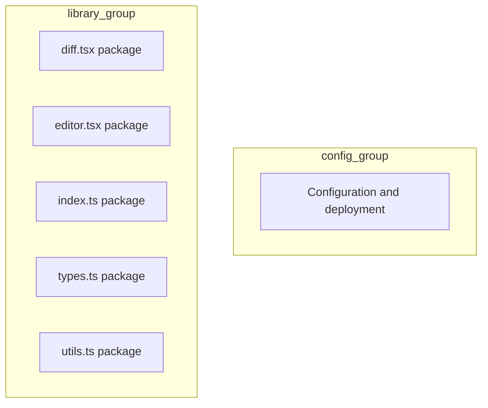

# Architecture report: react-monaco-editor/react-monaco-editor

> Automated static analysis. **Observed** = directly seen in files/imports/AST; **Inferred** = interpretation from that evidence. Repository code was not executed.

## 1. Repository at a glance

| Item | Value |
| --- | --- |
| Repository | react-monaco-editor/react-monaco-editor |
| Description | Monaco Editor for React. |
| Language | TypeScript |
| Stars | 4216 |
| Licence | MIT |
| Analysed commit / branch | 5d3e35ac981b6ad41407168805222275a83d643d / master |
| Framework(s) | React |
| Files analysed | 22 |
| Components | 6 |

## 2. Architecture in one minute

react-monaco-editor/react-monaco-editor - Monaco Editor for React.. This repository was analysed statically from 22 file(s) (0 Python). Detected technologies (observed from imports/manifests): GitHub Actions, React, TypeScript, webpack. Files are grouped into 6 component(s): Configuration and deployment, diff.tsx package, editor.tsx package, index.ts package, types.ts package, utils.ts package. Findings below distinguish observed facts from inferred interpretation.

## 3. High-level block diagram

## 4. Main components

### Configuration and deployment (`config`)

- **Kind:** config
- **Status:** Observed
- **Confidence:** 0.85
- **Responsibility:** Groups 2 file(s) under configuration and deployment (observed from repository paths and static analysis).
- **Paths:** `package.json`, `tsconfig.json`
- **Evidence:** [package.json](https://github.com/react-monaco-editor/react-monaco-editor/blob/5d3e35ac981b6ad41407168805222275a83d643d/package.json); [tsconfig.json](https://github.com/react-monaco-editor/react-monaco-editor/blob/5d3e35ac981b6ad41407168805222275a83d643d/tsconfig.json)

### diff.tsx package (`diff_tsx`)

- **Kind:** library
- **Status:** Observed
- **Confidence:** 0.85
- **Responsibility:** Groups 1 file(s) under diff.tsx package (observed from repository paths and static analysis).
- **Paths:** `src/diff.tsx`
- **Evidence:** [src/diff.tsx](https://github.com/react-monaco-editor/react-monaco-editor/blob/5d3e35ac981b6ad41407168805222275a83d643d/src/diff.tsx)

### editor.tsx package (`editor_tsx`)

- **Kind:** library
- **Status:** Observed
- **Confidence:** 0.85
- **Responsibility:** Groups 1 file(s) under editor.tsx package (observed from repository paths and static analysis).
- **Paths:** `src/editor.tsx`
- **Evidence:** [src/editor.tsx](https://github.com/react-monaco-editor/react-monaco-editor/blob/5d3e35ac981b6ad41407168805222275a83d643d/src/editor.tsx)

### index.ts package (`index_ts`)

- **Kind:** library
- **Status:** Observed
- **Confidence:** 0.85
- **Responsibility:** Groups 1 file(s) under index.ts package (observed from repository paths and static analysis).
- **Paths:** `src/index.ts`
- **Evidence:** [src/index.ts](https://github.com/react-monaco-editor/react-monaco-editor/blob/5d3e35ac981b6ad41407168805222275a83d643d/src/index.ts)

### types.ts package (`types_ts`)

- **Kind:** library
- **Status:** Observed
- **Confidence:** 0.85
- **Responsibility:** Groups 1 file(s) under types.ts package (observed from repository paths and static analysis).
- **Paths:** `src/types.ts`
- **Evidence:** [src/types.ts](https://github.com/react-monaco-editor/react-monaco-editor/blob/5d3e35ac981b6ad41407168805222275a83d643d/src/types.ts)

### utils.ts package (`utils_ts`)

- **Kind:** library
- **Status:** Observed
- **Confidence:** 0.85
- **Responsibility:** Groups 1 file(s) under utils.ts package (observed from repository paths and static analysis).
- **Paths:** `src/utils.ts`
- **Evidence:** [src/utils.ts](https://github.com/react-monaco-editor/react-monaco-editor/blob/5d3e35ac981b6ad41407168805222275a83d643d/src/utils.ts)

## 5. Execution flow

**Observed** entry point(s):

- [src/index.ts](https://github.com/react-monaco-editor/react-monaco-editor/blob/5d3e35ac981b6ad41407168805222275a83d643d/src/index.ts)

Representative flow (derived from observed entry points and the import graph; steps beyond the entry point are **Inferred**):

1. Execution starts at an observed entry point listed above, if present.
2. No internal import relationships between components were observed.

## 6. Project structure

### `(root)`

- `.eslintignore` - other (43 bytes)
- `.eslintrc` - other (1473 bytes)
- `.gitignore` - other (199 bytes)
- `.npmignore` - other (126 bytes)
- `LICENSE.md` - docs (1083 bytes)
- `README.md` - docs (8127 bytes)
- `package.json` - manifest (1703 bytes)
- `tsconfig.json` - config (446 bytes)

### `.github`

- `.github/ISSUE_TEMPLATE/bug_report.md` - docs (740 bytes)
- `.github/ISSUE_TEMPLATE/feature_request.md` - docs (365 bytes)
- `.github/dependabot.yml` - config (357 bytes)
- `.github/workflows/merge-dependabot.yml` - ci, YAML (338 bytes)
- `.github/workflows/test.yml` - ci, YAML (441 bytes)

### `example`

- `example/index.html` - other (341 bytes)
- `example/index.js` - source, JavaScript (6740 bytes)
- `example/package.json` - manifest (877 bytes)
- `example/webpack.config.js` - source, JavaScript (1320 bytes)

### `src`

- `src/diff.tsx` - source, TypeScript (6180 bytes)
- `src/editor.tsx` - source, TypeScript (5201 bytes)
- `src/index.ts` - source, TypeScript (280 bytes)
- `src/types.ts` - source, TypeScript (5194 bytes)
- `src/utils.ts` - source, TypeScript (143 bytes)

## 7. Key dependencies and integrations

| Name | Category | Status | Confidence | Evidence |
| --- | --- | --- | --- | --- |
| GitHub Actions | ci | Observed | 0.90 | [.github/workflows/merge-dependabot.yml](https://github.com/react-monaco-editor/react-monaco-editor/blob/5d3e35ac981b6ad41407168805222275a83d643d/.github/workflows/merge-dependabot.yml); [.github/workflows/test.yml](https://github.com/react-monaco-editor/react-monaco-editor/blob/5d3e35ac981b6ad41407168805222275a83d643d/.github/workflows/test.yml) |
| React | framework | Observed | 0.90 | [example/package.json:2](https://github.com/react-monaco-editor/react-monaco-editor/blob/5d3e35ac981b6ad41407168805222275a83d643d/example/package.json#L2); [example/package.json:29](https://github.com/react-monaco-editor/react-monaco-editor/blob/5d3e35ac981b6ad41407168805222275a83d643d/example/package.json#L29); [package.json:2](https://github.com/react-monaco-editor/react-monaco-editor/blob/5d3e35ac981b6ad41407168805222275a83d643d/package.json#L2); [package.json:48](https://github.com/react-monaco-editor/react-monaco-editor/blob/5d3e35ac981b6ad41407168805222275a83d643d/package.json#L48) |
| TypeScript | tooling | Observed | 0.85 | [package.json:35](https://github.com/react-monaco-editor/react-monaco-editor/blob/5d3e35ac981b6ad41407168805222275a83d643d/package.json#L35) |
| webpack | tooling | Observed | 0.85 | [example/package.json:7](https://github.com/react-monaco-editor/react-monaco-editor/blob/5d3e35ac981b6ad41407168805222275a83d643d/example/package.json#L7) |

## 8. Data and state

No database, cache, queue, or persistent-state usage was observed in the analysed files. State handling, if any, may be in-memory or in files that were not analysed.

## 9. Configuration and deployment clues

- `.github/dependabot.yml` (config)
- `.github/workflows/merge-dependabot.yml` (ci)
- `.github/workflows/test.yml` (ci)
- `example/package.json` (manifest)
- `package.json` (manifest)
- `tsconfig.json` (config)

## 10. Design observations

- No strong design patterns could be established from the available evidence.

These observations are interpretations (**Inferred**) of the observed structure, not guarantees about runtime design.

## 11. Limitations and unknowns

- Static analysis only: repository code was not executed, installed, or imported at runtime.
- Components and relationships are inferred from file paths, imports, and AST structure; runtime behaviour, dynamic imports, and reflection may not be visible.
- 1 file(s) were skipped during inventory (1 x lockfile excluded).
- No clear application entry point was observed in the analysed files.
- Repository text was treated as untrusted data; no instructions found in repository files were followed, and likely secret values were redacted/excluded.
- JavaScript and TypeScript files were inventoried from paths and package manifests. They were not parsed with a full language AST, and repository code was not executed.

## 12. Source references

- [.github/workflows/merge-dependabot.yml](https://github.com/react-monaco-editor/react-monaco-editor/blob/5d3e35ac981b6ad41407168805222275a83d643d/.github/workflows/merge-dependabot.yml)
- [.github/workflows/test.yml](https://github.com/react-monaco-editor/react-monaco-editor/blob/5d3e35ac981b6ad41407168805222275a83d643d/.github/workflows/test.yml)
- [example/package.json:2](https://github.com/react-monaco-editor/react-monaco-editor/blob/5d3e35ac981b6ad41407168805222275a83d643d/example/package.json#L2)
- [example/package.json:7](https://github.com/react-monaco-editor/react-monaco-editor/blob/5d3e35ac981b6ad41407168805222275a83d643d/example/package.json#L7)
- [example/package.json:29](https://github.com/react-monaco-editor/react-monaco-editor/blob/5d3e35ac981b6ad41407168805222275a83d643d/example/package.json#L29)
- [package.json](https://github.com/react-monaco-editor/react-monaco-editor/blob/5d3e35ac981b6ad41407168805222275a83d643d/package.json)
- [package.json:2](https://github.com/react-monaco-editor/react-monaco-editor/blob/5d3e35ac981b6ad41407168805222275a83d643d/package.json#L2)
- [package.json:35](https://github.com/react-monaco-editor/react-monaco-editor/blob/5d3e35ac981b6ad41407168805222275a83d643d/package.json#L35)
- [package.json:48](https://github.com/react-monaco-editor/react-monaco-editor/blob/5d3e35ac981b6ad41407168805222275a83d643d/package.json#L48)
- [src/diff.tsx](https://github.com/react-monaco-editor/react-monaco-editor/blob/5d3e35ac981b6ad41407168805222275a83d643d/src/diff.tsx)
- [src/editor.tsx](https://github.com/react-monaco-editor/react-monaco-editor/blob/5d3e35ac981b6ad41407168805222275a83d643d/src/editor.tsx)
- [src/index.ts](https://github.com/react-monaco-editor/react-monaco-editor/blob/5d3e35ac981b6ad41407168805222275a83d643d/src/index.ts)
- [src/types.ts](https://github.com/react-monaco-editor/react-monaco-editor/blob/5d3e35ac981b6ad41407168805222275a83d643d/src/types.ts)
- [src/utils.ts](https://github.com/react-monaco-editor/react-monaco-editor/blob/5d3e35ac981b6ad41407168805222275a83d643d/src/utils.ts)
- [tsconfig.json](https://github.com/react-monaco-editor/react-monaco-editor/blob/5d3e35ac981b6ad41407168805222275a83d643d/tsconfig.json)
