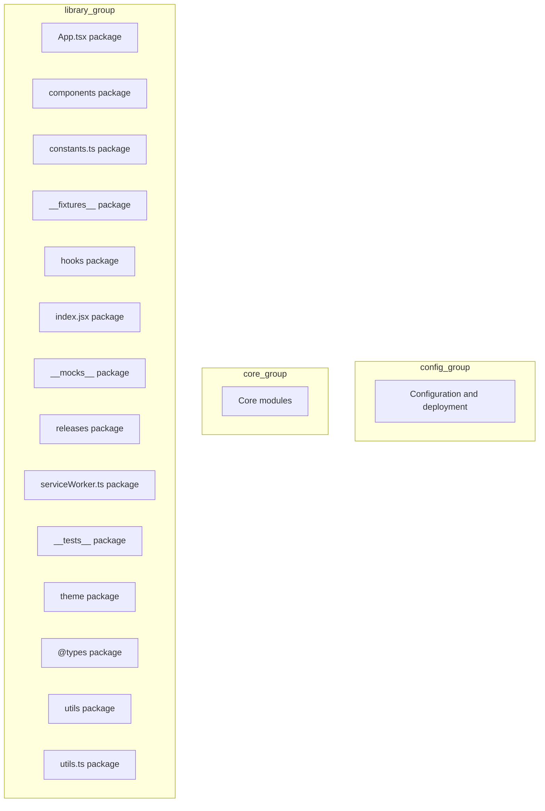

# Architecture report: react-native-community/upgrade-helper

> Automated static analysis. **Observed** = directly seen in files/imports/AST; **Inferred** = interpretation from that evidence. Repository code was not executed.

## 1. Repository at a glance

| Item | Value |
| --- | --- |
| Repository | react-native-community/upgrade-helper |
| Description | ⚛️ A web tool to support React Native developers in upgrading their apps. |
| Language | TypeScript |
| Stars | 4074 |
| Licence | MIT |
| Analysed commit / branch | f44a405d9834c797d527c87dbf05d5b7d636367b / master |
| Framework(s) | React |
| Files analysed | 100 |
| Components | 16 |

## 2. Architecture in one minute

react-native-community/upgrade-helper - ⚛️ A web tool to support React Native developers in upgrading their apps.. This repository was analysed statically from 100 file(s) (0 Python). Detected technologies (observed from imports/manifests): GitHub Actions, React, Docker, Docker Compose, TypeScript. Files are grouped into 16 component(s): App.tsx package, components package, Configuration and deployment, constants.ts package, Core modules, __fixtures__ package, hooks package, index.jsx package. Findings below distinguish observed facts from inferred interpretation.

## 3. High-level block diagram

## 4. Main components

### App.tsx package (`app_tsx`)

- **Kind:** library
- **Status:** Observed
- **Confidence:** 0.85
- **Responsibility:** Groups 1 file(s) under app.tsx package (observed from repository paths and static analysis).
- **Paths:** `src/App.tsx`
- **Evidence:** [src/App.tsx](https://github.com/react-native-community/upgrade-helper/blob/f44a405d9834c797d527c87dbf05d5b7d636367b/src/App.tsx)

### components package (`components`)

- **Kind:** library
- **Status:** Observed
- **Confidence:** 0.85
- **Responsibility:** Groups 28 file(s) under components package (observed from repository paths and static analysis).
- **Paths:** `src/components/common/AlignDepsAlert.tsx`, `src/components/common/BinaryDownload.tsx`, `src/components/common/CompletedFilesCounter.tsx`, `src/components/common/CopyFileButton.tsx`, `src/components/common/DarkModeButton.tsx`, `src/components/common/Diff/Diff.tsx`, `src/components/common/Diff/DiffComment.tsx`, `src/components/common/Diff/DiffCommentReminder.tsx`, `src/components/common/Diff/DiffHeader.tsx`, `src/components/common/Diff/DiffLoading.tsx`, `src/components/common/Diff/DiffSection.tsx`, `src/components/common/Diff/DiffViewStyleOptions.tsx`, `src/components/common/DiffViewer.tsx`, `src/components/common/DownloadFileButton.tsx`, `src/components/common/Markdown.tsx`, `src/components/common/Select.test.tsx`, `src/components/common/Select.tsx`, `src/components/common/Settings.tsx`, `src/components/common/TroubleshootingGuides.tsx`, `src/components/common/TroubleshootingGuidesButton.tsx`, `src/components/common/UpgradeButton.tsx`, `src/components/common/UpgradeSupportAlert.tsx`, `src/components/common/UsefulContentSection.tsx`, `src/components/common/UsefulLinks.tsx`, `src/components/common/VersionSelector.tsx`, `src/components/common/ViewFileButton.tsx`, `src/components/common/index.ts`, `src/components/pages/Home.tsx`
- **Evidence:** [src/components/common/AlignDepsAlert.tsx](https://github.com/react-native-community/upgrade-helper/blob/f44a405d9834c797d527c87dbf05d5b7d636367b/src/components/common/AlignDepsAlert.tsx); [src/components/common/BinaryDownload.tsx](https://github.com/react-native-community/upgrade-helper/blob/f44a405d9834c797d527c87dbf05d5b7d636367b/src/components/common/BinaryDownload.tsx); [src/components/common/CompletedFilesCounter.tsx](https://github.com/react-native-community/upgrade-helper/blob/f44a405d9834c797d527c87dbf05d5b7d636367b/src/components/common/CompletedFilesCounter.tsx); [src/components/common/CopyFileButton.tsx](https://github.com/react-native-community/upgrade-helper/blob/f44a405d9834c797d527c87dbf05d5b7d636367b/src/components/common/CopyFileButton.tsx); [src/components/common/DarkModeButton.tsx](https://github.com/react-native-community/upgrade-helper/blob/f44a405d9834c797d527c87dbf05d5b7d636367b/src/components/common/DarkModeButton.tsx); [src/components/common/Diff/Diff.tsx](https://github.com/react-native-community/upgrade-helper/blob/f44a405d9834c797d527c87dbf05d5b7d636367b/src/components/common/Diff/Diff.tsx); [src/components/common/Diff/DiffComment.tsx](https://github.com/react-native-community/upgrade-helper/blob/f44a405d9834c797d527c87dbf05d5b7d636367b/src/components/common/Diff/DiffComment.tsx); [src/components/common/Diff/DiffCommentReminder.tsx](https://github.com/react-native-community/upgrade-helper/blob/f44a405d9834c797d527c87dbf05d5b7d636367b/src/components/common/Diff/DiffCommentReminder.tsx)

### Configuration and deployment (`config`)

- **Kind:** config
- **Status:** Observed
- **Confidence:** 0.85
- **Responsibility:** Groups 8 file(s) under configuration and deployment (observed from repository paths and static analysis).
- **Paths:** `Dockerfile`, `docker-compose.yml`, `mise.toml`, `package.json`, `public/manifest.json`, `renovate.json`, `src/mocks/repositoryInfo.json`, `tsconfig.json`
- **Evidence:** [Dockerfile](https://github.com/react-native-community/upgrade-helper/blob/f44a405d9834c797d527c87dbf05d5b7d636367b/Dockerfile); [docker-compose.yml](https://github.com/react-native-community/upgrade-helper/blob/f44a405d9834c797d527c87dbf05d5b7d636367b/docker-compose.yml); [mise.toml](https://github.com/react-native-community/upgrade-helper/blob/f44a405d9834c797d527c87dbf05d5b7d636367b/mise.toml); [package.json](https://github.com/react-native-community/upgrade-helper/blob/f44a405d9834c797d527c87dbf05d5b7d636367b/package.json); [public/manifest.json](https://github.com/react-native-community/upgrade-helper/blob/f44a405d9834c797d527c87dbf05d5b7d636367b/public/manifest.json); [renovate.json](https://github.com/react-native-community/upgrade-helper/blob/f44a405d9834c797d527c87dbf05d5b7d636367b/renovate.json); [src/mocks/repositoryInfo.json](https://github.com/react-native-community/upgrade-helper/blob/f44a405d9834c797d527c87dbf05d5b7d636367b/src/mocks/repositoryInfo.json); [tsconfig.json](https://github.com/react-native-community/upgrade-helper/blob/f44a405d9834c797d527c87dbf05d5b7d636367b/tsconfig.json)

### constants.ts package (`constants_ts`)

- **Kind:** library
- **Status:** Observed
- **Confidence:** 0.85
- **Responsibility:** Groups 1 file(s) under constants.ts package (observed from repository paths and static analysis).
- **Paths:** `src/constants.ts`
- **Evidence:** [src/constants.ts](https://github.com/react-native-community/upgrade-helper/blob/f44a405d9834c797d527c87dbf05d5b7d636367b/src/constants.ts)

### Core modules (`core`)

- **Kind:** core
- **Status:** Observed
- **Confidence:** 0.85
- **Responsibility:** Groups 3 file(s) under core modules (observed from repository paths and static analysis).
- **Paths:** `config-overrides.js`, `jest.config.js`, `jest.setup.js`
- **Evidence:** [config-overrides.js](https://github.com/react-native-community/upgrade-helper/blob/f44a405d9834c797d527c87dbf05d5b7d636367b/config-overrides.js); [jest.config.js](https://github.com/react-native-community/upgrade-helper/blob/f44a405d9834c797d527c87dbf05d5b7d636367b/jest.config.js); [jest.setup.js](https://github.com/react-native-community/upgrade-helper/blob/f44a405d9834c797d527c87dbf05d5b7d636367b/jest.setup.js)

### __fixtures__ package (`fixtures`)

- **Kind:** library
- **Status:** Observed
- **Confidence:** 0.85
- **Responsibility:** Groups 1 file(s) under __fixtures__ package (observed from repository paths and static analysis).
- **Paths:** `src/__fixtures__/releases/0.59.js`
- **Evidence:** [src/__fixtures__/releases/0.59.js](https://github.com/react-native-community/upgrade-helper/blob/f44a405d9834c797d527c87dbf05d5b7d636367b/src/__fixtures__/releases/0.59.js)

### hooks package (`hooks`)

- **Kind:** library
- **Status:** Observed
- **Confidence:** 0.85
- **Responsibility:** Groups 4 file(s) under hooks package (observed from repository paths and static analysis).
- **Paths:** `src/hooks/fetch-diff.ts`, `src/hooks/fetch-release-versions.ts`, `src/hooks/get-language-from-url.ts`, `src/hooks/get-package-name-from-url.ts`
- **Evidence:** [src/hooks/fetch-diff.ts](https://github.com/react-native-community/upgrade-helper/blob/f44a405d9834c797d527c87dbf05d5b7d636367b/src/hooks/fetch-diff.ts); [src/hooks/fetch-release-versions.ts](https://github.com/react-native-community/upgrade-helper/blob/f44a405d9834c797d527c87dbf05d5b7d636367b/src/hooks/fetch-release-versions.ts); [src/hooks/get-language-from-url.ts](https://github.com/react-native-community/upgrade-helper/blob/f44a405d9834c797d527c87dbf05d5b7d636367b/src/hooks/get-language-from-url.ts); [src/hooks/get-package-name-from-url.ts](https://github.com/react-native-community/upgrade-helper/blob/f44a405d9834c797d527c87dbf05d5b7d636367b/src/hooks/get-package-name-from-url.ts)

### index.jsx package (`index_jsx`)

- **Kind:** library
- **Status:** Observed
- **Confidence:** 0.85
- **Responsibility:** Groups 1 file(s) under index.jsx package (observed from repository paths and static analysis).
- **Paths:** `src/index.jsx`
- **Evidence:** [src/index.jsx](https://github.com/react-native-community/upgrade-helper/blob/f44a405d9834c797d527c87dbf05d5b7d636367b/src/index.jsx)

### __mocks__ package (`mocks`)

- **Kind:** library
- **Status:** Observed
- **Confidence:** 0.85
- **Responsibility:** Groups 1 file(s) under __mocks__ package (observed from repository paths and static analysis).
- **Paths:** `__mocks__/react-github-btn.js`
- **Evidence:** [__mocks__/react-github-btn.js](https://github.com/react-native-community/upgrade-helper/blob/f44a405d9834c797d527c87dbf05d5b7d636367b/__mocks__/react-github-btn.js)

### releases package (`releases`)

- **Kind:** library
- **Status:** Observed
- **Confidence:** 0.85
- **Responsibility:** Groups 17 file(s) under releases package (observed from repository paths and static analysis).
- **Paths:** `src/releases/__mocks__/index.ts`, `src/releases/index.js`, `src/releases/react-native/0.57.tsx`, `src/releases/react-native/0.58.tsx`, `src/releases/react-native/0.59.tsx`, `src/releases/react-native/0.60.tsx`, `src/releases/react-native/0.61.tsx`, `src/releases/react-native/0.62.tsx`, `src/releases/react-native/0.64.tsx`, `src/releases/react-native/0.68.tsx`, `src/releases/react-native/0.69.tsx`, `src/releases/react-native/0.71.tsx`, `src/releases/react-native/0.72.tsx`, `src/releases/react-native/0.73.tsx`, `src/releases/react-native/0.74.tsx`, `src/releases/react-native/0.77.tsx`, `src/releases/types.d.ts`
- **Evidence:** [src/releases/__mocks__/index.ts](https://github.com/react-native-community/upgrade-helper/blob/f44a405d9834c797d527c87dbf05d5b7d636367b/src/releases/__mocks__/index.ts); [src/releases/index.js](https://github.com/react-native-community/upgrade-helper/blob/f44a405d9834c797d527c87dbf05d5b7d636367b/src/releases/index.js); [src/releases/react-native/0.57.tsx](https://github.com/react-native-community/upgrade-helper/blob/f44a405d9834c797d527c87dbf05d5b7d636367b/src/releases/react-native/0.57.tsx); [src/releases/react-native/0.58.tsx](https://github.com/react-native-community/upgrade-helper/blob/f44a405d9834c797d527c87dbf05d5b7d636367b/src/releases/react-native/0.58.tsx); [src/releases/react-native/0.59.tsx](https://github.com/react-native-community/upgrade-helper/blob/f44a405d9834c797d527c87dbf05d5b7d636367b/src/releases/react-native/0.59.tsx); [src/releases/react-native/0.60.tsx](https://github.com/react-native-community/upgrade-helper/blob/f44a405d9834c797d527c87dbf05d5b7d636367b/src/releases/react-native/0.60.tsx); [src/releases/react-native/0.61.tsx](https://github.com/react-native-community/upgrade-helper/blob/f44a405d9834c797d527c87dbf05d5b7d636367b/src/releases/react-native/0.61.tsx); [src/releases/react-native/0.62.tsx](https://github.com/react-native-community/upgrade-helper/blob/f44a405d9834c797d527c87dbf05d5b7d636367b/src/releases/react-native/0.62.tsx)

### serviceWorker.ts package (`serviceworker_ts`)

- **Kind:** library
- **Status:** Observed
- **Confidence:** 0.85
- **Responsibility:** Groups 1 file(s) under serviceworker.ts package (observed from repository paths and static analysis).
- **Paths:** `src/serviceWorker.ts`
- **Evidence:** [src/serviceWorker.ts](https://github.com/react-native-community/upgrade-helper/blob/f44a405d9834c797d527c87dbf05d5b7d636367b/src/serviceWorker.ts)

### __tests__ package (`tests`)

- **Kind:** library
- **Status:** Observed
- **Confidence:** 0.85
- **Responsibility:** Groups 4 file(s) under __tests__ package (observed from repository paths and static analysis).
- **Paths:** `src/__tests__/Home.e2e.spec.ts`, `src/__tests__/components/common/CompletedFilesCounter.spec.tsx`, `src/__tests__/components/common/Markdown.spec.tsx`, `src/__tests__/utils.spec.ts`
- **Evidence:** [src/__tests__/Home.e2e.spec.ts](https://github.com/react-native-community/upgrade-helper/blob/f44a405d9834c797d527c87dbf05d5b7d636367b/src/__tests__/Home.e2e.spec.ts); [src/__tests__/components/common/CompletedFilesCounter.spec.tsx](https://github.com/react-native-community/upgrade-helper/blob/f44a405d9834c797d527c87dbf05d5b7d636367b/src/__tests__/components/common/CompletedFilesCounter.spec.tsx); [src/__tests__/components/common/Markdown.spec.tsx](https://github.com/react-native-community/upgrade-helper/blob/f44a405d9834c797d527c87dbf05d5b7d636367b/src/__tests__/components/common/Markdown.spec.tsx); [src/__tests__/utils.spec.ts](https://github.com/react-native-community/upgrade-helper/blob/f44a405d9834c797d527c87dbf05d5b7d636367b/src/__tests__/utils.spec.ts)

### theme package (`theme`)

- **Kind:** library
- **Status:** Observed
- **Confidence:** 0.85
- **Responsibility:** Groups 1 file(s) under theme package (observed from repository paths and static analysis).
- **Paths:** `src/theme/index.ts`
- **Evidence:** [src/theme/index.ts](https://github.com/react-native-community/upgrade-helper/blob/f44a405d9834c797d527c87dbf05d5b7d636367b/src/theme/index.ts)

### @types package (`types`)

- **Kind:** library
- **Status:** Observed
- **Confidence:** 0.85
- **Responsibility:** Groups 2 file(s) under @types package (observed from repository paths and static analysis).
- **Paths:** `@types/emotion.d.ts`, `@types/global.d.ts`
- **Evidence:** [@types/emotion.d.ts](https://github.com/react-native-community/upgrade-helper/blob/f44a405d9834c797d527c87dbf05d5b7d636367b/%40types/emotion.d.ts); [@types/global.d.ts](https://github.com/react-native-community/upgrade-helper/blob/f44a405d9834c797d527c87dbf05d5b7d636367b/%40types/global.d.ts)

### utils package (`utils`)

- **Kind:** library
- **Status:** Observed
- **Confidence:** 0.85
- **Responsibility:** Groups 3 file(s) under utils package (observed from repository paths and static analysis).
- **Paths:** `src/utils/device-sizes.ts`, `src/utils/test-utils.ts`, `src/utils/update-url.ts`
- **Evidence:** [src/utils/device-sizes.ts](https://github.com/react-native-community/upgrade-helper/blob/f44a405d9834c797d527c87dbf05d5b7d636367b/src/utils/device-sizes.ts); [src/utils/test-utils.ts](https://github.com/react-native-community/upgrade-helper/blob/f44a405d9834c797d527c87dbf05d5b7d636367b/src/utils/test-utils.ts); [src/utils/update-url.ts](https://github.com/react-native-community/upgrade-helper/blob/f44a405d9834c797d527c87dbf05d5b7d636367b/src/utils/update-url.ts)

### utils.ts package (`utils_ts`)

- **Kind:** library
- **Status:** Observed
- **Confidence:** 0.85
- **Responsibility:** Groups 1 file(s) under utils.ts package (observed from repository paths and static analysis).
- **Paths:** `src/utils.ts`
- **Evidence:** [src/utils.ts](https://github.com/react-native-community/upgrade-helper/blob/f44a405d9834c797d527c87dbf05d5b7d636367b/src/utils.ts)

## 5. Execution flow

**Observed** entry point(s):

- [src/App.tsx](https://github.com/react-native-community/upgrade-helper/blob/f44a405d9834c797d527c87dbf05d5b7d636367b/src/App.tsx)
- [src/components/common/index.ts](https://github.com/react-native-community/upgrade-helper/blob/f44a405d9834c797d527c87dbf05d5b7d636367b/src/components/common/index.ts)
- [src/index.jsx](https://github.com/react-native-community/upgrade-helper/blob/f44a405d9834c797d527c87dbf05d5b7d636367b/src/index.jsx)
- [src/releases/__mocks__/index.ts](https://github.com/react-native-community/upgrade-helper/blob/f44a405d9834c797d527c87dbf05d5b7d636367b/src/releases/__mocks__/index.ts)
- [src/releases/index.js](https://github.com/react-native-community/upgrade-helper/blob/f44a405d9834c797d527c87dbf05d5b7d636367b/src/releases/index.js)
- [src/theme/index.ts](https://github.com/react-native-community/upgrade-helper/blob/f44a405d9834c797d527c87dbf05d5b7d636367b/src/theme/index.ts)

Representative flow (derived from observed entry points and the import graph; steps beyond the entry point are **Inferred**):

1. Execution starts at an observed entry point listed above, if present.
2. No internal import relationships between components were observed.

## 6. Project structure

### `(root)`

- `.dockerignore` - container (14 bytes)
- `.eslintignore` - other (34 bytes)
- `.eslintrc.js` - source, JavaScript (430 bytes)
- `.gitignore` - other (371 bytes)
- `.node-version` - other (8 bytes)
- `.prettierrc` - other (43 bytes)
- `AGENTS.md` - docs (11395 bytes)
- `CODE_OF_CONDUCT.md` - docs (5202 bytes)
- `CONTRIBUTING.md` - docs (697 bytes)
- `Dockerfile` - container (235 bytes)
- `LICENSE` - docs (1079 bytes)
- `README.md` - docs (3331 bytes)
- `config-overrides.js` - source, JavaScript (357 bytes)
- `docker-compose.yml` - container (328 bytes)
- `jest.config.js` - source, JavaScript (303 bytes)
- `jest.setup.js` - source, JavaScript (103 bytes)
- `mise.toml` - config (37 bytes)
- `package.json` - manifest (2886 bytes)
- `renovate.json` - config (64 bytes)
- `tsconfig.json` - config (809 bytes)

### `.github`

- `.github/CODEOWNERS` - other (30 bytes)
- `.github/ISSUE_TEMPLATE/bug_report.md` - docs (461 bytes)
- `.github/ISSUE_TEMPLATE/feature_request.md` - docs (637 bytes)
- `.github/ISSUE_TEMPLATE/question.md` - docs (663 bytes)
- `.github/PULL_REQUEST_TEMPLATE.md` - docs (923 bytes)
- `.github/workflows/deploy.yml` - ci, YAML (567 bytes)
- `.github/workflows/push.yml` - ci, YAML (1419 bytes)

### `@types`

- `@types/emotion.d.ts` - source, TypeScript (175 bytes)
- `@types/global.d.ts` - source, TypeScript (179 bytes)

### `__mocks__`

- `__mocks__/react-github-btn.js` - source, JavaScript (263 bytes)

### `public`

- `public/index.html` - other (1560 bytes)
- `public/manifest.json` - config (319 bytes)

### `src`

- `src/App.tsx` - source, TypeScript (117 bytes)
- `src/__fixtures__/releases/0.59.js` - source, JavaScript (304 bytes)
- `src/__tests__/Home.e2e.spec.ts` - source, TypeScript (3877 bytes)
- `src/__tests__/components/common/CompletedFilesCounter.spec.tsx` - source, TypeScript (793 bytes)
- `src/__tests__/components/common/Markdown.spec.tsx` - source, TypeScript (418 bytes)
- `src/__tests__/utils.spec.ts` - source, TypeScript (3666 bytes)
- `src/assets/loading.svg` - other (2670 bytes)
- `src/assets/logo.svg` - other (7527 bytes)
- `src/components/common/AlignDepsAlert.tsx` - source, TypeScript (1062 bytes)
- `src/components/common/BinaryDownload.tsx` - source, TypeScript (2820 bytes)
- `src/components/common/CompletedFilesCounter.tsx` - source, TypeScript (2174 bytes)
- `src/components/common/CopyFileButton.tsx` - source, TypeScript (2077 bytes)
- `src/components/common/DarkModeButton.tsx` - source, TypeScript (589 bytes)
- `src/components/common/Diff/Diff.tsx` - source, TypeScript (9367 bytes)
- `src/components/common/Diff/DiffComment.tsx` - source, TypeScript (4715 bytes)
- `src/components/common/Diff/DiffCommentReminder.tsx` - source, TypeScript (1657 bytes)
- `src/components/common/Diff/DiffHeader.tsx` - source, TypeScript (9935 bytes)
- `src/components/common/Diff/DiffLoading.tsx` - source, TypeScript (2110 bytes)
- `src/components/common/Diff/DiffSection.tsx` - source, TypeScript (3403 bytes)
- `src/components/common/Diff/DiffViewStyleOptions.tsx` - source, TypeScript (1057 bytes)
- `src/components/common/DiffViewer.tsx` - source, TypeScript (7232 bytes)
- `src/components/common/DownloadFileButton.tsx` - source, TypeScript (656 bytes)
- `src/components/common/Markdown.tsx` - source, TypeScript (1251 bytes)
- `src/components/common/Select.test.tsx` - source, TypeScript (2379 bytes)
- `src/components/common/Select.tsx` - source, TypeScript (803 bytes)
- `src/components/common/Settings.tsx` - source, TypeScript (3898 bytes)
- `src/components/common/TroubleshootingGuides.tsx` - source, TypeScript (1550 bytes)
- `src/components/common/TroubleshootingGuidesButton.tsx` - source, TypeScript (1391 bytes)
- `src/components/common/UpgradeButton.tsx` - source, TypeScript (891 bytes)
- `src/components/common/UpgradeSupportAlert.tsx` - source, TypeScript (961 bytes)
- `src/components/common/UsefulContentSection.tsx` - source, TypeScript (6694 bytes)
- `src/components/common/UsefulLinks.tsx` - source, TypeScript (2455 bytes)
- `src/components/common/VersionSelector.tsx` - source, TypeScript (10992 bytes)
- `src/components/common/ViewFileButton.tsx` - source, TypeScript (685 bytes)
- `src/components/common/index.ts` - source, TypeScript (45 bytes)
- `src/components/pages/Home.tsx` - source, TypeScript (10289 bytes)
- `src/constants.ts` - source, TypeScript (805 bytes)
- `src/hooks/fetch-diff.ts` - source, TypeScript (1410 bytes)
- `src/hooks/fetch-release-versions.ts` - source, TypeScript (885 bytes)
- `src/hooks/get-language-from-url.ts` - source, TypeScript (396 bytes)
- `src/hooks/get-package-name-from-url.ts` - source, TypeScript (533 bytes)
- `src/index.css` - other (472 bytes)
- `src/index.jsx` - source, JavaScript (506 bytes)
- `src/mocks/0.63.2..0.64.2.diff` - other (103425 bytes)
- `src/mocks/repositoryInfo.json` - config (7693 bytes)
- `src/releases/__mocks__/index.ts` - source, TypeScript (218 bytes)
- `src/releases/index.js` - source, JavaScript (723 bytes)
- `src/releases/react-native/0.57.tsx` - source, TypeScript (515 bytes)
- `src/releases/react-native/0.58.tsx` - source, TypeScript (568 bytes)
- `src/releases/react-native/0.59.tsx` - source, TypeScript (671 bytes)
- `src/releases/react-native/0.60.tsx` - source, TypeScript (1498 bytes)
- `src/releases/react-native/0.61.tsx` - source, TypeScript (608 bytes)
- `src/releases/react-native/0.62.tsx` - source, TypeScript (1625 bytes)
- `src/releases/react-native/0.64.tsx` - source, TypeScript (888 bytes)
- `src/releases/react-native/0.68.tsx` - source, TypeScript (2894 bytes)
- `src/releases/react-native/0.69.tsx` - source, TypeScript (860 bytes)
- `src/releases/react-native/0.71.tsx` - source, TypeScript (469 bytes)
- `src/releases/react-native/0.72.tsx` - source, TypeScript (1427 bytes)
- `src/releases/react-native/0.73.tsx` - source, TypeScript (469 bytes)
- `src/releases/react-native/0.74.tsx` - source, TypeScript (1316 bytes)
- `src/releases/react-native/0.77.tsx` - source, TypeScript (697 bytes)
- `src/releases/types.d.ts` - source, TypeScript (443 bytes)
- `src/serviceWorker.ts` - source, TypeScript (5177 bytes)
- `src/theme/index.ts` - source, TypeScript (3150 bytes)
- `src/utils.ts` - source, TypeScript (4658 bytes)
- `src/utils/device-sizes.ts` - source, TypeScript (63 bytes)
- `src/utils/test-utils.ts` - source, TypeScript (2255 bytes)
- `src/utils/update-url.ts` - source, TypeScript (989 bytes)

## 7. Key dependencies and integrations

| Name | Category | Status | Confidence | Evidence |
| --- | --- | --- | --- | --- |
| GitHub Actions | ci | Observed | 0.90 | [.github/workflows/deploy.yml](https://github.com/react-native-community/upgrade-helper/blob/f44a405d9834c797d527c87dbf05d5b7d636367b/.github/workflows/deploy.yml); [.github/workflows/push.yml](https://github.com/react-native-community/upgrade-helper/blob/f44a405d9834c797d527c87dbf05d5b7d636367b/.github/workflows/push.yml) |
| React | framework | Observed | 0.90 | [package.json:5](https://github.com/react-native-community/upgrade-helper/blob/f44a405d9834c797d527c87dbf05d5b7d636367b/package.json#L5); [package.json:30](https://github.com/react-native-community/upgrade-helper/blob/f44a405d9834c797d527c87dbf05d5b7d636367b/package.json#L30) |
| Docker | tooling | Observed | 0.85 | [Dockerfile](https://github.com/react-native-community/upgrade-helper/blob/f44a405d9834c797d527c87dbf05d5b7d636367b/Dockerfile) |
| Docker Compose | tooling | Observed | 0.85 | [docker-compose.yml](https://github.com/react-native-community/upgrade-helper/blob/f44a405d9834c797d527c87dbf05d5b7d636367b/docker-compose.yml) |
| TypeScript | tooling | Observed | 0.85 | [package.json:52](https://github.com/react-native-community/upgrade-helper/blob/f44a405d9834c797d527c87dbf05d5b7d636367b/package.json#L52) |

## 8. Data and state

No database, cache, queue, or persistent-state usage was observed in the analysed files. State handling, if any, may be in-memory or in files that were not analysed.

## 9. Configuration and deployment clues

- `.dockerignore` (container)
- `.github/workflows/deploy.yml` (ci)
- `.github/workflows/push.yml` (ci)
- `Dockerfile` (container)
- `docker-compose.yml` (container)
- `mise.toml` (config)
- `package.json` (manifest)
- `public/manifest.json` (config)
- `renovate.json` (config)
- `src/mocks/repositoryInfo.json` (config)
- `tsconfig.json` (config)

## 10. Design observations

- No strong design patterns could be established from the available evidence.

These observations are interpretations (**Inferred**) of the observed structure, not guarantees about runtime design.

## 11. Limitations and unknowns

- Static analysis only: repository code was not executed, installed, or imported at runtime.
- Components and relationships are inferred from file paths, imports, and AST structure; runtime behaviour, dynamic imports, and reflection may not be visible.
- No clear application entry point was observed in the analysed files.
- Repository text was treated as untrusted data; no instructions found in repository files were followed, and likely secret values were redacted/excluded.
- JavaScript and TypeScript files were inventoried from paths and package manifests. They were not parsed with a full language AST, and repository code was not executed.

## 12. Source references

- [.github/workflows/deploy.yml](https://github.com/react-native-community/upgrade-helper/blob/f44a405d9834c797d527c87dbf05d5b7d636367b/.github/workflows/deploy.yml)
- [.github/workflows/push.yml](https://github.com/react-native-community/upgrade-helper/blob/f44a405d9834c797d527c87dbf05d5b7d636367b/.github/workflows/push.yml)
- [@types/emotion.d.ts](https://github.com/react-native-community/upgrade-helper/blob/f44a405d9834c797d527c87dbf05d5b7d636367b/%40types/emotion.d.ts)
- [@types/global.d.ts](https://github.com/react-native-community/upgrade-helper/blob/f44a405d9834c797d527c87dbf05d5b7d636367b/%40types/global.d.ts)
- [Dockerfile](https://github.com/react-native-community/upgrade-helper/blob/f44a405d9834c797d527c87dbf05d5b7d636367b/Dockerfile)
- [__mocks__/react-github-btn.js](https://github.com/react-native-community/upgrade-helper/blob/f44a405d9834c797d527c87dbf05d5b7d636367b/__mocks__/react-github-btn.js)
- [config-overrides.js](https://github.com/react-native-community/upgrade-helper/blob/f44a405d9834c797d527c87dbf05d5b7d636367b/config-overrides.js)
- [docker-compose.yml](https://github.com/react-native-community/upgrade-helper/blob/f44a405d9834c797d527c87dbf05d5b7d636367b/docker-compose.yml)
- [jest.config.js](https://github.com/react-native-community/upgrade-helper/blob/f44a405d9834c797d527c87dbf05d5b7d636367b/jest.config.js)
- [jest.setup.js](https://github.com/react-native-community/upgrade-helper/blob/f44a405d9834c797d527c87dbf05d5b7d636367b/jest.setup.js)
- [mise.toml](https://github.com/react-native-community/upgrade-helper/blob/f44a405d9834c797d527c87dbf05d5b7d636367b/mise.toml)
- [package.json](https://github.com/react-native-community/upgrade-helper/blob/f44a405d9834c797d527c87dbf05d5b7d636367b/package.json)
- [package.json:5](https://github.com/react-native-community/upgrade-helper/blob/f44a405d9834c797d527c87dbf05d5b7d636367b/package.json#L5)
- [package.json:30](https://github.com/react-native-community/upgrade-helper/blob/f44a405d9834c797d527c87dbf05d5b7d636367b/package.json#L30)
- [package.json:52](https://github.com/react-native-community/upgrade-helper/blob/f44a405d9834c797d527c87dbf05d5b7d636367b/package.json#L52)
- [public/manifest.json](https://github.com/react-native-community/upgrade-helper/blob/f44a405d9834c797d527c87dbf05d5b7d636367b/public/manifest.json)
- [renovate.json](https://github.com/react-native-community/upgrade-helper/blob/f44a405d9834c797d527c87dbf05d5b7d636367b/renovate.json)
- [src/App.tsx](https://github.com/react-native-community/upgrade-helper/blob/f44a405d9834c797d527c87dbf05d5b7d636367b/src/App.tsx)
- [src/__fixtures__/releases/0.59.js](https://github.com/react-native-community/upgrade-helper/blob/f44a405d9834c797d527c87dbf05d5b7d636367b/src/__fixtures__/releases/0.59.js)
- [src/__tests__/Home.e2e.spec.ts](https://github.com/react-native-community/upgrade-helper/blob/f44a405d9834c797d527c87dbf05d5b7d636367b/src/__tests__/Home.e2e.spec.ts)
- [src/__tests__/components/common/CompletedFilesCounter.spec.tsx](https://github.com/react-native-community/upgrade-helper/blob/f44a405d9834c797d527c87dbf05d5b7d636367b/src/__tests__/components/common/CompletedFilesCounter.spec.tsx)
- [src/__tests__/components/common/Markdown.spec.tsx](https://github.com/react-native-community/upgrade-helper/blob/f44a405d9834c797d527c87dbf05d5b7d636367b/src/__tests__/components/common/Markdown.spec.tsx)
- [src/__tests__/utils.spec.ts](https://github.com/react-native-community/upgrade-helper/blob/f44a405d9834c797d527c87dbf05d5b7d636367b/src/__tests__/utils.spec.ts)
- [src/components/common/AlignDepsAlert.tsx](https://github.com/react-native-community/upgrade-helper/blob/f44a405d9834c797d527c87dbf05d5b7d636367b/src/components/common/AlignDepsAlert.tsx)
- [src/components/common/BinaryDownload.tsx](https://github.com/react-native-community/upgrade-helper/blob/f44a405d9834c797d527c87dbf05d5b7d636367b/src/components/common/BinaryDownload.tsx)
- [src/components/common/CompletedFilesCounter.tsx](https://github.com/react-native-community/upgrade-helper/blob/f44a405d9834c797d527c87dbf05d5b7d636367b/src/components/common/CompletedFilesCounter.tsx)
- [src/components/common/CopyFileButton.tsx](https://github.com/react-native-community/upgrade-helper/blob/f44a405d9834c797d527c87dbf05d5b7d636367b/src/components/common/CopyFileButton.tsx)
- [src/components/common/DarkModeButton.tsx](https://github.com/react-native-community/upgrade-helper/blob/f44a405d9834c797d527c87dbf05d5b7d636367b/src/components/common/DarkModeButton.tsx)
- [src/components/common/Diff/Diff.tsx](https://github.com/react-native-community/upgrade-helper/blob/f44a405d9834c797d527c87dbf05d5b7d636367b/src/components/common/Diff/Diff.tsx)
- [src/components/common/Diff/DiffComment.tsx](https://github.com/react-native-community/upgrade-helper/blob/f44a405d9834c797d527c87dbf05d5b7d636367b/src/components/common/Diff/DiffComment.tsx)
- [src/components/common/Diff/DiffCommentReminder.tsx](https://github.com/react-native-community/upgrade-helper/blob/f44a405d9834c797d527c87dbf05d5b7d636367b/src/components/common/Diff/DiffCommentReminder.tsx)
- [src/components/common/index.ts](https://github.com/react-native-community/upgrade-helper/blob/f44a405d9834c797d527c87dbf05d5b7d636367b/src/components/common/index.ts)
- [src/constants.ts](https://github.com/react-native-community/upgrade-helper/blob/f44a405d9834c797d527c87dbf05d5b7d636367b/src/constants.ts)
- [src/hooks/fetch-diff.ts](https://github.com/react-native-community/upgrade-helper/blob/f44a405d9834c797d527c87dbf05d5b7d636367b/src/hooks/fetch-diff.ts)
- [src/hooks/fetch-release-versions.ts](https://github.com/react-native-community/upgrade-helper/blob/f44a405d9834c797d527c87dbf05d5b7d636367b/src/hooks/fetch-release-versions.ts)
- [src/hooks/get-language-from-url.ts](https://github.com/react-native-community/upgrade-helper/blob/f44a405d9834c797d527c87dbf05d5b7d636367b/src/hooks/get-language-from-url.ts)
- [src/hooks/get-package-name-from-url.ts](https://github.com/react-native-community/upgrade-helper/blob/f44a405d9834c797d527c87dbf05d5b7d636367b/src/hooks/get-package-name-from-url.ts)
- [src/index.jsx](https://github.com/react-native-community/upgrade-helper/blob/f44a405d9834c797d527c87dbf05d5b7d636367b/src/index.jsx)
- [src/mocks/repositoryInfo.json](https://github.com/react-native-community/upgrade-helper/blob/f44a405d9834c797d527c87dbf05d5b7d636367b/src/mocks/repositoryInfo.json)
- [src/releases/__mocks__/index.ts](https://github.com/react-native-community/upgrade-helper/blob/f44a405d9834c797d527c87dbf05d5b7d636367b/src/releases/__mocks__/index.ts)
- [src/releases/index.js](https://github.com/react-native-community/upgrade-helper/blob/f44a405d9834c797d527c87dbf05d5b7d636367b/src/releases/index.js)
- [src/releases/react-native/0.57.tsx](https://github.com/react-native-community/upgrade-helper/blob/f44a405d9834c797d527c87dbf05d5b7d636367b/src/releases/react-native/0.57.tsx)
- [src/releases/react-native/0.58.tsx](https://github.com/react-native-community/upgrade-helper/blob/f44a405d9834c797d527c87dbf05d5b7d636367b/src/releases/react-native/0.58.tsx)
- [src/releases/react-native/0.59.tsx](https://github.com/react-native-community/upgrade-helper/blob/f44a405d9834c797d527c87dbf05d5b7d636367b/src/releases/react-native/0.59.tsx)
- [src/releases/react-native/0.60.tsx](https://github.com/react-native-community/upgrade-helper/blob/f44a405d9834c797d527c87dbf05d5b7d636367b/src/releases/react-native/0.60.tsx)
- [src/releases/react-native/0.61.tsx](https://github.com/react-native-community/upgrade-helper/blob/f44a405d9834c797d527c87dbf05d5b7d636367b/src/releases/react-native/0.61.tsx)
- [src/releases/react-native/0.62.tsx](https://github.com/react-native-community/upgrade-helper/blob/f44a405d9834c797d527c87dbf05d5b7d636367b/src/releases/react-native/0.62.tsx)
- [src/serviceWorker.ts](https://github.com/react-native-community/upgrade-helper/blob/f44a405d9834c797d527c87dbf05d5b7d636367b/src/serviceWorker.ts)
- [src/theme/index.ts](https://github.com/react-native-community/upgrade-helper/blob/f44a405d9834c797d527c87dbf05d5b7d636367b/src/theme/index.ts)
- [src/utils.ts](https://github.com/react-native-community/upgrade-helper/blob/f44a405d9834c797d527c87dbf05d5b7d636367b/src/utils.ts)
- [src/utils/device-sizes.ts](https://github.com/react-native-community/upgrade-helper/blob/f44a405d9834c797d527c87dbf05d5b7d636367b/src/utils/device-sizes.ts)
- [src/utils/test-utils.ts](https://github.com/react-native-community/upgrade-helper/blob/f44a405d9834c797d527c87dbf05d5b7d636367b/src/utils/test-utils.ts)
- [src/utils/update-url.ts](https://github.com/react-native-community/upgrade-helper/blob/f44a405d9834c797d527c87dbf05d5b7d636367b/src/utils/update-url.ts)
- [tsconfig.json](https://github.com/react-native-community/upgrade-helper/blob/f44a405d9834c797d527c87dbf05d5b7d636367b/tsconfig.json)
