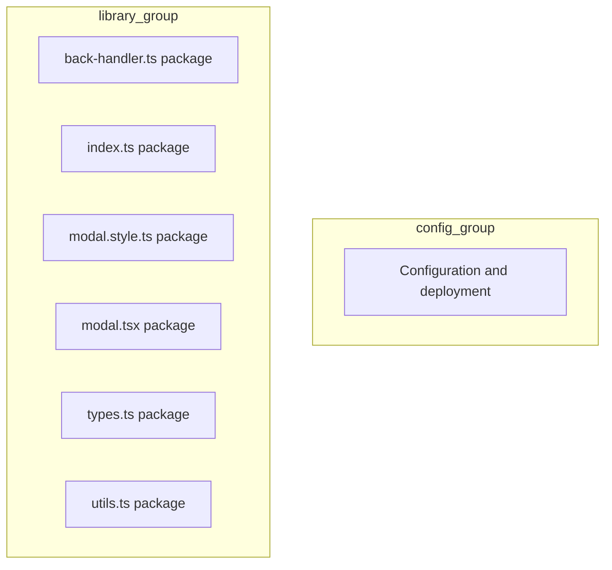

# Architecture report: react-native-modal/react-native-modal

> Automated static analysis. **Observed** = directly seen in files/imports/AST; **Inferred** = interpretation from that evidence. Repository code was not executed.

## 1. Repository at a glance

| Item | Value |
| --- | --- |
| Repository | react-native-modal/react-native-modal |
| Description | An enhanced, animated, customizable Modal for React Native. |
| Language | TypeScript |
| Stars | 5650 |
| Licence | MIT |
| Analysed commit / branch | 3e413c4c3e774697caebe202e7be5856b62444bf / master |
| Framework(s) | React |
| Files analysed | 61 |
| Components | 7 |

## 2. Architecture in one minute

react-native-modal/react-native-modal - An enhanced, animated, customizable Modal for React Native.. This repository was analysed statically from 61 file(s) (0 Python). Detected technologies (observed from imports/manifests): GitHub Actions, React, Jest, TypeScript. Files are grouped into 7 component(s): back-handler.ts package, Configuration and deployment, index.ts package, modal.style.ts package, modal.tsx package, types.ts package, utils.ts package. Findings below distinguish observed facts from inferred interpretation.

## 3. High-level block diagram

## 4. Main components

### back-handler.ts package (`back_handler_ts`)

- **Kind:** library
- **Status:** Observed
- **Confidence:** 0.85
- **Responsibility:** Groups 1 file(s) under back-handler.ts package (observed from repository paths and static analysis).
- **Paths:** `src/back-handler.ts`
- **Evidence:** [src/back-handler.ts](https://github.com/react-native-modal/react-native-modal/blob/3e413c4c3e774697caebe202e7be5856b62444bf/src/back-handler.ts)

### Configuration and deployment (`config`)

- **Kind:** config
- **Status:** Observed
- **Confidence:** 0.85
- **Responsibility:** Groups 2 file(s) under configuration and deployment (observed from repository paths and static analysis).
- **Paths:** `package.json`, `tsconfig.json`
- **Evidence:** [package.json](https://github.com/react-native-modal/react-native-modal/blob/3e413c4c3e774697caebe202e7be5856b62444bf/package.json); [tsconfig.json](https://github.com/react-native-modal/react-native-modal/blob/3e413c4c3e774697caebe202e7be5856b62444bf/tsconfig.json)

### index.ts package (`index_ts`)

- **Kind:** library
- **Status:** Observed
- **Confidence:** 0.85
- **Responsibility:** Groups 1 file(s) under index.ts package (observed from repository paths and static analysis).
- **Paths:** `src/index.ts`
- **Evidence:** [src/index.ts](https://github.com/react-native-modal/react-native-modal/blob/3e413c4c3e774697caebe202e7be5856b62444bf/src/index.ts)

### modal.style.ts package (`modal_style_ts`)

- **Kind:** library
- **Status:** Observed
- **Confidence:** 0.85
- **Responsibility:** Groups 1 file(s) under modal.style.ts package (observed from repository paths and static analysis).
- **Paths:** `src/modal.style.ts`
- **Evidence:** [src/modal.style.ts](https://github.com/react-native-modal/react-native-modal/blob/3e413c4c3e774697caebe202e7be5856b62444bf/src/modal.style.ts)

### modal.tsx package (`modal_tsx`)

- **Kind:** library
- **Status:** Observed
- **Confidence:** 0.85
- **Responsibility:** Groups 1 file(s) under modal.tsx package (observed from repository paths and static analysis).
- **Paths:** `src/modal.tsx`
- **Evidence:** [src/modal.tsx](https://github.com/react-native-modal/react-native-modal/blob/3e413c4c3e774697caebe202e7be5856b62444bf/src/modal.tsx)

### types.ts package (`types_ts`)

- **Kind:** library
- **Status:** Observed
- **Confidence:** 0.85
- **Responsibility:** Groups 1 file(s) under types.ts package (observed from repository paths and static analysis).
- **Paths:** `src/types.ts`
- **Evidence:** [src/types.ts](https://github.com/react-native-modal/react-native-modal/blob/3e413c4c3e774697caebe202e7be5856b62444bf/src/types.ts)

### utils.ts package (`utils_ts`)

- **Kind:** library
- **Status:** Observed
- **Confidence:** 0.85
- **Responsibility:** Groups 1 file(s) under utils.ts package (observed from repository paths and static analysis).
- **Paths:** `src/utils.ts`
- **Evidence:** [src/utils.ts](https://github.com/react-native-modal/react-native-modal/blob/3e413c4c3e774697caebe202e7be5856b62444bf/src/utils.ts)

## 5. Execution flow

**Observed** entry point(s):

- [src/index.ts](https://github.com/react-native-modal/react-native-modal/blob/3e413c4c3e774697caebe202e7be5856b62444bf/src/index.ts)

Representative flow (derived from observed entry points and the import graph; steps beyond the entry point are **Inferred**):

1. Execution starts at an observed entry point listed above, if present.
2. No internal import relationships between components were observed.

## 6. Project structure

### `(root)`

- `.gitattributes` - other (16 bytes)
- `.gitignore` - other (582 bytes)
- `.npmignore` - other (13 bytes)
- `.prettierignore` - other (60 bytes)
- `.prettierrc` - other (108 bytes)
- `.yarnrc.yml` - config (25 bytes)
- `ISSUE_TEMPLATE.md` - docs (1392 bytes)
- `LICENSE.md` - docs (1079 bytes)
- `README.md` - docs (20313 bytes)
- `package.json` - manifest (1257 bytes)
- `tsconfig.json` - config (490 bytes)

### `.github`

- `.github/CODEOWNERS` - other (24 bytes)
- `.github/CONTRIBUTING.md` - docs (2797 bytes)
- `.github/ISSUE_TEMPLATE/BUG_REPORT.md` - docs (1401 bytes)
- `.github/PULL_REQUEST_TEMPLATE.md` - docs (404 bytes)
- `.github/workflows/tests.yml` - ci, YAML (410 bytes)

### `examples`

- `examples/bare/.bundle/config` - other (59 bytes)
- `examples/bare/.gitignore` - other (658 bytes)
- `examples/bare/.watchmanconfig` - other (3 bytes)
- `examples/bare/App.tsx` - source, TypeScript (690 bytes)
- `examples/bare/Gemfile` - other (382 bytes)
- `examples/bare/Gemfile.lock` - other (2857 bytes)
- `examples/bare/README.md` - docs (3582 bytes)
- `examples/bare/android/app/build.gradle` - manifest (4645 bytes)
- `examples/bare/android/app/proguard-rules.pro` - other (435 bytes)
- `examples/bare/android/app/src/debug/AndroidManifest.xml` - other (313 bytes)
- `examples/bare/android/app/src/main/AndroidManifest.xml` - other (1004 bytes)
- `examples/bare/android/app/src/main/java/com/bare/MainActivity.kt` - other (839 bytes)
- `examples/bare/android/app/src/main/java/com/bare/MainApplication.kt` - other (1658 bytes)
- `examples/bare/android/app/src/main/res/drawable/rn_edit_text_material.xml` - other (1917 bytes)
- `examples/bare/android/app/src/main/res/values/strings.xml` - other (67 bytes)
- `examples/bare/android/app/src/main/res/values/styles.xml` - other (282 bytes)
- `examples/bare/android/build.gradle` - manifest (547 bytes)
- `examples/bare/android/gradle.properties` - other (1736 bytes)
- `examples/bare/android/gradle/wrapper/gradle-wrapper.properties` - other (251 bytes)
- `examples/bare/android/gradlew` - other (8763 bytes)
- `examples/bare/android/gradlew.bat` - other (2872 bytes)
- `examples/bare/android/settings.gradle` - other (335 bytes)
- `examples/bare/app.json` - config (46 bytes)
- `examples/bare/babel.config.js` - source, JavaScript (72 bytes)
- `examples/bare/index.js` - source, JavaScript (183 bytes)
- `examples/bare/ios/.xcode.env` - other (482 bytes)
- `examples/bare/ios/Podfile` - other (1032 bytes)
- `examples/bare/ios/Podfile.lock` - other (55608 bytes)
- `examples/bare/ios/bare.xcodeproj/project.pbxproj` - other (18401 bytes)
- `examples/bare/ios/bare/AppDelegate.swift` - other (944 bytes)
- `examples/bare/ios/bare/Images.xcassets/AppIcon.appiconset/Contents.json` - config (818 bytes)
- `examples/bare/ios/bare/Images.xcassets/Contents.json` - config (60 bytes)
- `examples/bare/ios/bare/Info.plist` - other (1612 bytes)
- `examples/bare/ios/bare/LaunchScreen.storyboard` - other (4228 bytes)
- `examples/bare/ios/bare/PrivacyInfo.xcprivacy` - other (986 bytes)
- `examples/bare/jest.config.js` - source, JavaScript (48 bytes)
- `examples/bare/metro.config.js` - source, JavaScript (570 bytes)
- `examples/bare/package.json` - manifest (1174 bytes)
- `examples/bare/tsconfig.json` - config (65 bytes)

### `src`

- `src/back-handler.ts` - source, TypeScript (511 bytes)
- `src/index.ts` - source, TypeScript (332 bytes)
- `src/modal.style.ts` - source, TypeScript (379 bytes)
- `src/modal.tsx` - source, TypeScript (24161 bytes)
- `src/types.ts` - source, TypeScript (843 bytes)
- `src/utils.ts` - source, TypeScript (2651 bytes)

## 7. Key dependencies and integrations

| Name | Category | Status | Confidence | Evidence |
| --- | --- | --- | --- | --- |
| GitHub Actions | ci | Observed | 0.85 | [.github/workflows/tests.yml](https://github.com/react-native-modal/react-native-modal/blob/3e413c4c3e774697caebe202e7be5856b62444bf/.github/workflows/tests.yml) |
| React | framework | Observed | 0.90 | [examples/bare/package.json:6](https://github.com/react-native-modal/react-native-modal/blob/3e413c4c3e774697caebe202e7be5856b62444bf/examples/bare/package.json#L6); [package.json:2](https://github.com/react-native-modal/react-native-modal/blob/3e413c4c3e774697caebe202e7be5856b62444bf/package.json#L2) |
| Jest | tooling | Observed | 0.85 | [examples/bare/package.json:10](https://github.com/react-native-modal/react-native-modal/blob/3e413c4c3e774697caebe202e7be5856b62444bf/examples/bare/package.json#L10) |
| TypeScript | tooling | Observed | 0.90 | [examples/bare/package.json:28](https://github.com/react-native-modal/react-native-modal/blob/3e413c4c3e774697caebe202e7be5856b62444bf/examples/bare/package.json#L28); [package.json:53](https://github.com/react-native-modal/react-native-modal/blob/3e413c4c3e774697caebe202e7be5856b62444bf/package.json#L53) |

## 8. Data and state

No database, cache, queue, or persistent-state usage was observed in the analysed files. State handling, if any, may be in-memory or in files that were not analysed.

## 9. Configuration and deployment clues

- `.github/workflows/tests.yml` (ci)
- `.yarnrc.yml` (config)
- `examples/bare/android/app/build.gradle` (manifest)
- `examples/bare/android/build.gradle` (manifest)
- `examples/bare/app.json` (config)
- `examples/bare/ios/bare/Images.xcassets/AppIcon.appiconset/Contents.json` (config)
- `examples/bare/ios/bare/Images.xcassets/Contents.json` (config)
- `examples/bare/package.json` (manifest)
- `examples/bare/tsconfig.json` (config)
- `package.json` (manifest)
- `tsconfig.json` (config)

## 10. Design observations

- No strong design patterns could be established from the available evidence.

These observations are interpretations (**Inferred**) of the observed structure, not guarantees about runtime design.

## 11. Limitations and unknowns

- Static analysis only: repository code was not executed, installed, or imported at runtime.
- Components and relationships are inferred from file paths, imports, and AST structure; runtime behaviour, dynamic imports, and reflection may not be visible.
- No clear application entry point was observed in the analysed files.
- Repository text was treated as untrusted data; no instructions found in repository files were followed, and likely secret values were redacted/excluded.
- JavaScript and TypeScript files were inventoried from paths and package manifests. They were not parsed with a full language AST, and repository code was not executed.

## 12. Source references

- [.github/workflows/tests.yml](https://github.com/react-native-modal/react-native-modal/blob/3e413c4c3e774697caebe202e7be5856b62444bf/.github/workflows/tests.yml)
- [examples/bare/package.json:6](https://github.com/react-native-modal/react-native-modal/blob/3e413c4c3e774697caebe202e7be5856b62444bf/examples/bare/package.json#L6)
- [examples/bare/package.json:10](https://github.com/react-native-modal/react-native-modal/blob/3e413c4c3e774697caebe202e7be5856b62444bf/examples/bare/package.json#L10)
- [examples/bare/package.json:28](https://github.com/react-native-modal/react-native-modal/blob/3e413c4c3e774697caebe202e7be5856b62444bf/examples/bare/package.json#L28)
- [package.json](https://github.com/react-native-modal/react-native-modal/blob/3e413c4c3e774697caebe202e7be5856b62444bf/package.json)
- [package.json:2](https://github.com/react-native-modal/react-native-modal/blob/3e413c4c3e774697caebe202e7be5856b62444bf/package.json#L2)
- [package.json:53](https://github.com/react-native-modal/react-native-modal/blob/3e413c4c3e774697caebe202e7be5856b62444bf/package.json#L53)
- [src/back-handler.ts](https://github.com/react-native-modal/react-native-modal/blob/3e413c4c3e774697caebe202e7be5856b62444bf/src/back-handler.ts)
- [src/index.ts](https://github.com/react-native-modal/react-native-modal/blob/3e413c4c3e774697caebe202e7be5856b62444bf/src/index.ts)
- [src/modal.style.ts](https://github.com/react-native-modal/react-native-modal/blob/3e413c4c3e774697caebe202e7be5856b62444bf/src/modal.style.ts)
- [src/modal.tsx](https://github.com/react-native-modal/react-native-modal/blob/3e413c4c3e774697caebe202e7be5856b62444bf/src/modal.tsx)
- [src/types.ts](https://github.com/react-native-modal/react-native-modal/blob/3e413c4c3e774697caebe202e7be5856b62444bf/src/types.ts)
- [src/utils.ts](https://github.com/react-native-modal/react-native-modal/blob/3e413c4c3e774697caebe202e7be5856b62444bf/src/utils.ts)
- [tsconfig.json](https://github.com/react-native-modal/react-native-modal/blob/3e413c4c3e774697caebe202e7be5856b62444bf/tsconfig.json)
