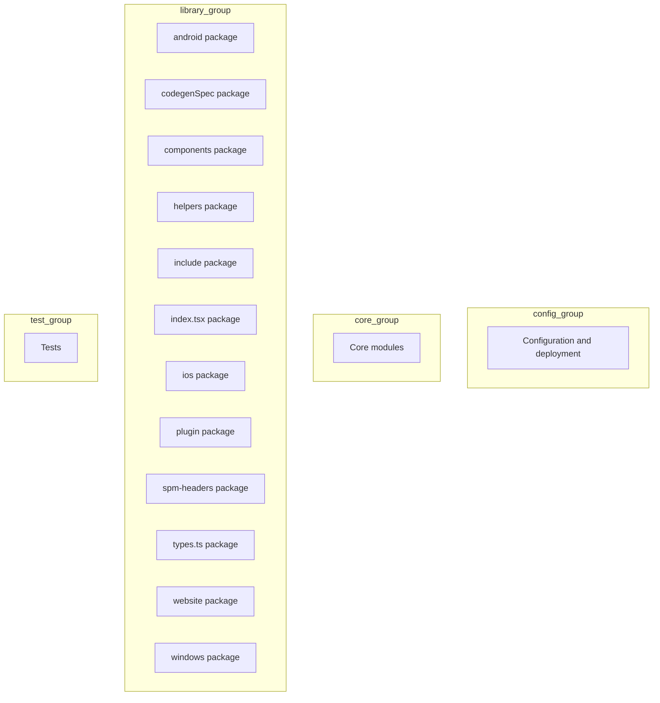

# Architecture report: react-native-share/react-native-share

> Automated static analysis. **Observed** = directly seen in files/imports/AST; **Inferred** = interpretation from that evidence. Repository code was not executed.

## 1. Repository at a glance

| Item | Value |
| --- | --- |
| Repository | react-native-share/react-native-share |
| Description | Social share, sending simple data to other apps. |
| Language | Java |
| Stars | 3896 |
| Licence | MIT |
| Analysed commit / branch | 0df4a3cd0a616fe9b9a3f7b30a3d070f62037e64 / main |
| Framework(s) | React |
| Files analysed | 200 |
| Components | 15 |

## 2. Architecture in one minute

react-native-share/react-native-share - Social share, sending simple data to other apps.. This repository was analysed statically from 200 file(s) (0 Python). Detected technologies (observed from imports/manifests): GitHub Actions, React, Jest, TypeScript. Files are grouped into 15 component(s): android package, codegenSpec package, components package, Configuration and deployment, Core modules, helpers package, include package, index.tsx package. Findings below distinguish observed facts from inferred interpretation.

## 3. High-level block diagram

## 4. Main components

### android package (`android`)

- **Kind:** library
- **Status:** Observed
- **Confidence:** 0.85
- **Responsibility:** Groups 31 file(s) under android package (observed from repository paths and static analysis).
- **Paths:** `android/src/main/java/cl/json/RNShareFileProvider.java`, `android/src/main/java/cl/json/RNShareImpl.java`, `android/src/main/java/cl/json/RNSharePackage.java`, `android/src/main/java/cl/json/RNSharePathUtil.java`, `android/src/main/java/cl/json/ShareApplication.java`, `android/src/main/java/cl/json/ShareFile.java`, `android/src/main/java/cl/json/ShareFiles.java`, `android/src/main/java/cl/json/social/DiscordShare.java`, `android/src/main/java/cl/json/social/EmailShare.java`, `android/src/main/java/cl/json/social/FacebookPagesManagerShare.java`, `android/src/main/java/cl/json/social/FacebookShare.java`, `android/src/main/java/cl/json/social/FacebookStoriesShare.java`, `android/src/main/java/cl/json/social/GenericShare.java`, `android/src/main/java/cl/json/social/GooglePlusShare.java`, `android/src/main/java/cl/json/social/InstagramShare.java`, `android/src/main/java/cl/json/social/InstagramStoriesShare.java`, `android/src/main/java/cl/json/social/LinkedinShare.java`, `android/src/main/java/cl/json/social/MessengerShare.java`, `android/src/main/java/cl/json/social/PinterestShare.java`, `android/src/main/java/cl/json/social/SMSShare.java`, `android/src/main/java/cl/json/social/ShareIntent.java`, `android/src/main/java/cl/json/social/SingleShareIntent.java`, `android/src/main/java/cl/json/social/SnapChatShare.java`, `android/src/main/java/cl/json/social/TargetChosenReceiver.java`, `android/src/main/java/cl/json/social/TelegramShare.java`, `android/src/main/java/cl/json/social/TwitterShare.java`, `android/src/main/java/cl/json/social/ViberShare.java`, `android/src/main/java/cl/json/social/WhatsAppBusinessShare.java`, `android/src/main/java/cl/json/social/WhatsAppShare.java`, `android/src/newarch/cl/json/RNShare.java`, `android/src/oldarch/cl/json/RNShare.java`
- **Evidence:** [android/src/main/java/cl/json/RNShareFileProvider.java](https://github.com/react-native-share/react-native-share/blob/0df4a3cd0a616fe9b9a3f7b30a3d070f62037e64/android/src/main/java/cl/json/RNShareFileProvider.java); [android/src/main/java/cl/json/RNShareImpl.java](https://github.com/react-native-share/react-native-share/blob/0df4a3cd0a616fe9b9a3f7b30a3d070f62037e64/android/src/main/java/cl/json/RNShareImpl.java); [android/src/main/java/cl/json/RNSharePackage.java](https://github.com/react-native-share/react-native-share/blob/0df4a3cd0a616fe9b9a3f7b30a3d070f62037e64/android/src/main/java/cl/json/RNSharePackage.java); [android/src/main/java/cl/json/RNSharePathUtil.java](https://github.com/react-native-share/react-native-share/blob/0df4a3cd0a616fe9b9a3f7b30a3d070f62037e64/android/src/main/java/cl/json/RNSharePathUtil.java); [android/src/main/java/cl/json/ShareApplication.java](https://github.com/react-native-share/react-native-share/blob/0df4a3cd0a616fe9b9a3f7b30a3d070f62037e64/android/src/main/java/cl/json/ShareApplication.java); [android/src/main/java/cl/json/ShareFile.java](https://github.com/react-native-share/react-native-share/blob/0df4a3cd0a616fe9b9a3f7b30a3d070f62037e64/android/src/main/java/cl/json/ShareFile.java); [android/src/main/java/cl/json/ShareFiles.java](https://github.com/react-native-share/react-native-share/blob/0df4a3cd0a616fe9b9a3f7b30a3d070f62037e64/android/src/main/java/cl/json/ShareFiles.java); [android/src/main/java/cl/json/social/DiscordShare.java](https://github.com/react-native-share/react-native-share/blob/0df4a3cd0a616fe9b9a3f7b30a3d070f62037e64/android/src/main/java/cl/json/social/DiscordShare.java)

### codegenSpec package (`codegenspec`)

- **Kind:** library
- **Status:** Observed
- **Confidence:** 0.85
- **Responsibility:** Groups 1 file(s) under codegenspec package (observed from repository paths and static analysis).
- **Paths:** `src/codegenSpec/NativeRNShare.ts`
- **Evidence:** [src/codegenSpec/NativeRNShare.ts](https://github.com/react-native-share/react-native-share/blob/0df4a3cd0a616fe9b9a3f7b30a3d070f62037e64/src/codegenSpec/NativeRNShare.ts)

### components package (`components`)

- **Kind:** library
- **Status:** Observed
- **Confidence:** 0.85
- **Responsibility:** Groups 4 file(s) under components package (observed from repository paths and static analysis).
- **Paths:** `src/components/Button.tsx`, `src/components/Overlay.tsx`, `src/components/ShareSheet.tsx`, `src/components/Sheet.tsx`
- **Evidence:** [src/components/Button.tsx](https://github.com/react-native-share/react-native-share/blob/0df4a3cd0a616fe9b9a3f7b30a3d070f62037e64/src/components/Button.tsx); [src/components/Overlay.tsx](https://github.com/react-native-share/react-native-share/blob/0df4a3cd0a616fe9b9a3f7b30a3d070f62037e64/src/components/Overlay.tsx); [src/components/ShareSheet.tsx](https://github.com/react-native-share/react-native-share/blob/0df4a3cd0a616fe9b9a3f7b30a3d070f62037e64/src/components/ShareSheet.tsx); [src/components/Sheet.tsx](https://github.com/react-native-share/react-native-share/blob/0df4a3cd0a616fe9b9a3f7b30a3d070f62037e64/src/components/Sheet.tsx)

### Configuration and deployment (`config`)

- **Kind:** config
- **Status:** Observed
- **Confidence:** 0.85
- **Responsibility:** Groups 6 file(s) under configuration and deployment (observed from repository paths and static analysis).
- **Paths:** `android/build.gradle`, `package.json`, `plugin/tsconfig.json`, `tsconfig.json`, `website/.yarnrc.yml`, `website/package.json`
- **Evidence:** [android/build.gradle](https://github.com/react-native-share/react-native-share/blob/0df4a3cd0a616fe9b9a3f7b30a3d070f62037e64/android/build.gradle); [package.json](https://github.com/react-native-share/react-native-share/blob/0df4a3cd0a616fe9b9a3f7b30a3d070f62037e64/package.json); [plugin/tsconfig.json](https://github.com/react-native-share/react-native-share/blob/0df4a3cd0a616fe9b9a3f7b30a3d070f62037e64/plugin/tsconfig.json); [tsconfig.json](https://github.com/react-native-share/react-native-share/blob/0df4a3cd0a616fe9b9a3f7b30a3d070f62037e64/tsconfig.json); [website/.yarnrc.yml](https://github.com/react-native-share/react-native-share/blob/0df4a3cd0a616fe9b9a3f7b30a3d070f62037e64/website/.yarnrc.yml); [website/package.json](https://github.com/react-native-share/react-native-share/blob/0df4a3cd0a616fe9b9a3f7b30a3d070f62037e64/website/package.json)

### Core modules (`core`)

- **Kind:** core
- **Status:** Observed
- **Confidence:** 0.85
- **Responsibility:** Groups 5 file(s) under core modules (observed from repository paths and static analysis).
- **Paths:** `app.plugin.js`, `commitlint.config.js`, `metro.config.js`, `react-native-spm-prefix.h`, `react-native.config.js`
- **Evidence:** [app.plugin.js](https://github.com/react-native-share/react-native-share/blob/0df4a3cd0a616fe9b9a3f7b30a3d070f62037e64/app.plugin.js); [commitlint.config.js](https://github.com/react-native-share/react-native-share/blob/0df4a3cd0a616fe9b9a3f7b30a3d070f62037e64/commitlint.config.js); [metro.config.js](https://github.com/react-native-share/react-native-share/blob/0df4a3cd0a616fe9b9a3f7b30a3d070f62037e64/metro.config.js); [react-native-spm-prefix.h](https://github.com/react-native-share/react-native-share/blob/0df4a3cd0a616fe9b9a3f7b30a3d070f62037e64/react-native-spm-prefix.h); [react-native.config.js](https://github.com/react-native-share/react-native-share/blob/0df4a3cd0a616fe9b9a3f7b30a3d070f62037e64/react-native.config.js)

### helpers package (`helpers`)

- **Kind:** library
- **Status:** Observed
- **Confidence:** 0.85
- **Responsibility:** Groups 4 file(s) under helpers package (observed from repository paths and static analysis).
- **Paths:** `src/helpers/android.ts`, `src/helpers/checkPermissions.ts`, `src/helpers/options.ts`, `src/helpers/platform.ts`
- **Evidence:** [src/helpers/android.ts](https://github.com/react-native-share/react-native-share/blob/0df4a3cd0a616fe9b9a3f7b30a3d070f62037e64/src/helpers/android.ts); [src/helpers/checkPermissions.ts](https://github.com/react-native-share/react-native-share/blob/0df4a3cd0a616fe9b9a3f7b30a3d070f62037e64/src/helpers/checkPermissions.ts); [src/helpers/options.ts](https://github.com/react-native-share/react-native-share/blob/0df4a3cd0a616fe9b9a3f7b30a3d070f62037e64/src/helpers/options.ts); [src/helpers/platform.ts](https://github.com/react-native-share/react-native-share/blob/0df4a3cd0a616fe9b9a3f7b30a3d070f62037e64/src/helpers/platform.ts)

### include package (`include`)

- **Kind:** library
- **Status:** Observed
- **Confidence:** 0.85
- **Responsibility:** Groups 1 file(s) under include package (observed from repository paths and static analysis).
- **Paths:** `include/RNShare/RNShare.h`
- **Evidence:** [include/RNShare/RNShare.h](https://github.com/react-native-share/react-native-share/blob/0df4a3cd0a616fe9b9a3f7b30a3d070f62037e64/include/RNShare/RNShare.h)

### index.tsx package (`index_tsx`)

- **Kind:** library
- **Status:** Observed
- **Confidence:** 0.85
- **Responsibility:** Groups 1 file(s) under index.tsx package (observed from repository paths and static analysis).
- **Paths:** `src/index.tsx`
- **Evidence:** [src/index.tsx](https://github.com/react-native-share/react-native-share/blob/0df4a3cd0a616fe9b9a3f7b30a3d070f62037e64/src/index.tsx)

### ios package (`ios`)

- **Kind:** library
- **Status:** Observed
- **Confidence:** 0.85
- **Responsibility:** Groups 16 file(s) under ios package (observed from repository paths and static analysis).
- **Paths:** `ios/DiscordShare.h`, `ios/EmailShare.h`, `ios/FacebookStories.h`, `ios/GenericShare.h`, `ios/GooglePlusShare.h`, `ios/InstagramShare.h`, `ios/InstagramStories.h`, `ios/MessengerShare.h`, `ios/RNShare.h`, `ios/RNShareActivityItemSource.h`, `ios/RNShareUtils.h`, `ios/SmsShare.h`, `ios/TelegramShare.h`, `ios/TwitterShare.h`, `ios/ViberShare.h`, `ios/WhatsAppShare.h`
- **Evidence:** [ios/DiscordShare.h](https://github.com/react-native-share/react-native-share/blob/0df4a3cd0a616fe9b9a3f7b30a3d070f62037e64/ios/DiscordShare.h); [ios/EmailShare.h](https://github.com/react-native-share/react-native-share/blob/0df4a3cd0a616fe9b9a3f7b30a3d070f62037e64/ios/EmailShare.h); [ios/FacebookStories.h](https://github.com/react-native-share/react-native-share/blob/0df4a3cd0a616fe9b9a3f7b30a3d070f62037e64/ios/FacebookStories.h); [ios/GenericShare.h](https://github.com/react-native-share/react-native-share/blob/0df4a3cd0a616fe9b9a3f7b30a3d070f62037e64/ios/GenericShare.h); [ios/GooglePlusShare.h](https://github.com/react-native-share/react-native-share/blob/0df4a3cd0a616fe9b9a3f7b30a3d070f62037e64/ios/GooglePlusShare.h); [ios/InstagramShare.h](https://github.com/react-native-share/react-native-share/blob/0df4a3cd0a616fe9b9a3f7b30a3d070f62037e64/ios/InstagramShare.h); [ios/InstagramStories.h](https://github.com/react-native-share/react-native-share/blob/0df4a3cd0a616fe9b9a3f7b30a3d070f62037e64/ios/InstagramStories.h); [ios/MessengerShare.h](https://github.com/react-native-share/react-native-share/blob/0df4a3cd0a616fe9b9a3f7b30a3d070f62037e64/ios/MessengerShare.h)

### plugin package (`plugin`)

- **Kind:** library
- **Status:** Observed
- **Confidence:** 0.85
- **Responsibility:** Groups 1 file(s) under plugin package (observed from repository paths and static analysis).
- **Paths:** `plugin/src/index.ts`
- **Evidence:** [plugin/src/index.ts](https://github.com/react-native-share/react-native-share/blob/0df4a3cd0a616fe9b9a3f7b30a3d070f62037e64/plugin/src/index.ts)

### spm-headers package (`spm_headers`)

- **Kind:** library
- **Status:** Observed
- **Confidence:** 0.85
- **Responsibility:** Groups 1 file(s) under spm-headers package (observed from repository paths and static analysis).
- **Paths:** `spm-headers/RNShareSpec.h`
- **Evidence:** [spm-headers/RNShareSpec.h](https://github.com/react-native-share/react-native-share/blob/0df4a3cd0a616fe9b9a3f7b30a3d070f62037e64/spm-headers/RNShareSpec.h)

### Tests (`tests`)

- **Kind:** test
- **Status:** Observed
- **Confidence:** 0.85
- **Responsibility:** Groups 1 file(s) under tests (observed from repository paths and static analysis).
- **Paths:** `android/src/test/java/cl/json/FileProviderPathsTest.java`
- **Evidence:** [android/src/test/java/cl/json/FileProviderPathsTest.java](https://github.com/react-native-share/react-native-share/blob/0df4a3cd0a616fe9b9a3f7b30a3d070f62037e64/android/src/test/java/cl/json/FileProviderPathsTest.java)

### types.ts package (`types_ts`)

- **Kind:** library
- **Status:** Observed
- **Confidence:** 0.85
- **Responsibility:** Groups 1 file(s) under types.ts package (observed from repository paths and static analysis).
- **Paths:** `src/types.ts`
- **Evidence:** [src/types.ts](https://github.com/react-native-share/react-native-share/blob/0df4a3cd0a616fe9b9a3f7b30a3d070f62037e64/src/types.ts)

### website package (`website`)

- **Kind:** library
- **Status:** Observed
- **Confidence:** 0.85
- **Responsibility:** Groups 3 file(s) under website package (observed from repository paths and static analysis).
- **Paths:** `website/docusaurus.config.js`, `website/sidebars.js`, `website/src/pages/index.js`
- **Evidence:** [website/docusaurus.config.js](https://github.com/react-native-share/react-native-share/blob/0df4a3cd0a616fe9b9a3f7b30a3d070f62037e64/website/docusaurus.config.js); [website/sidebars.js](https://github.com/react-native-share/react-native-share/blob/0df4a3cd0a616fe9b9a3f7b30a3d070f62037e64/website/sidebars.js); [website/src/pages/index.js](https://github.com/react-native-share/react-native-share/blob/0df4a3cd0a616fe9b9a3f7b30a3d070f62037e64/website/src/pages/index.js)

### windows package (`windows`)

- **Kind:** library
- **Status:** Observed
- **Confidence:** 0.85
- **Responsibility:** Groups 5 file(s) under windows package (observed from repository paths and static analysis).
- **Paths:** `windows/ReactNativeShare/ReactNativeModule.h`, `windows/ReactNativeShare/ReactPackageProvider.cpp`, `windows/ReactNativeShare/ReactPackageProvider.h`, `windows/ReactNativeShare/pch.cpp`, `windows/ReactNativeShare/pch.h`
- **Evidence:** [windows/ReactNativeShare/ReactNativeModule.h](https://github.com/react-native-share/react-native-share/blob/0df4a3cd0a616fe9b9a3f7b30a3d070f62037e64/windows/ReactNativeShare/ReactNativeModule.h); [windows/ReactNativeShare/ReactPackageProvider.cpp](https://github.com/react-native-share/react-native-share/blob/0df4a3cd0a616fe9b9a3f7b30a3d070f62037e64/windows/ReactNativeShare/ReactPackageProvider.cpp); [windows/ReactNativeShare/ReactPackageProvider.h](https://github.com/react-native-share/react-native-share/blob/0df4a3cd0a616fe9b9a3f7b30a3d070f62037e64/windows/ReactNativeShare/ReactPackageProvider.h); [windows/ReactNativeShare/pch.cpp](https://github.com/react-native-share/react-native-share/blob/0df4a3cd0a616fe9b9a3f7b30a3d070f62037e64/windows/ReactNativeShare/pch.cpp); [windows/ReactNativeShare/pch.h](https://github.com/react-native-share/react-native-share/blob/0df4a3cd0a616fe9b9a3f7b30a3d070f62037e64/windows/ReactNativeShare/pch.h)

## 5. Execution flow

**Observed** entry point(s):

- [plugin/src/index.ts](https://github.com/react-native-share/react-native-share/blob/0df4a3cd0a616fe9b9a3f7b30a3d070f62037e64/plugin/src/index.ts)
- [src/index.tsx](https://github.com/react-native-share/react-native-share/blob/0df4a3cd0a616fe9b9a3f7b30a3d070f62037e64/src/index.tsx)
- [website/src/pages/index.js](https://github.com/react-native-share/react-native-share/blob/0df4a3cd0a616fe9b9a3f7b30a3d070f62037e64/website/src/pages/index.js)

Representative flow (derived from observed entry points and the import graph; steps beyond the entry point are **Inferred**):

1. Execution starts at an observed entry point listed above, if present.
2. No internal import relationships between components were observed.

## 6. Project structure

### `(root)`

- `.eslintignore` - other (48 bytes)
- `.eslintrc.js` - source, JavaScript (384 bytes)
- `.gitignore` - other (1185 bytes)
- `.npmignore` - other (141 bytes)
- `.nvmrc` - other (7 bytes)
- `.watchmanconfig` - other (66 bytes)
- `.yarnrc.yml` - config (25 bytes)
- `CHANGELOG.md` - docs (11777 bytes)
- `CODEOWNERS` - other (39 bytes)
- `LICENSE` - docs (1164 bytes)
- `Package.swift` - other (3364 bytes)
- `README.md` - docs (3145 bytes)
- `RNShare.podspec` - other (749 bytes)
- `app.plugin.js` - source, JavaScript (101 bytes)
- `commitlint.config.js` - source, JavaScript (716 bytes)
- `metro.config.js` - source, JavaScript (302 bytes)
- `package.json` - manifest (4645 bytes)
- `react-native-spm-prefix.h` - source, C/C++ (358 bytes)
- `react-native.config.js` - source, JavaScript (233 bytes)
- `tsconfig.json` - config (6663 bytes)

### `.github`

- `.github/ISSUE_TEMPLATE/bug_report.md` - docs (565 bytes)
- `.github/ISSUE_TEMPLATE/feature_request.md` - docs (274 bytes)
- `.github/ISSUE_TEMPLATE/question.md` - docs (135 bytes)
- `.github/PULL_REQUEST_TEMPLATE.md` - docs (454 bytes)
- `.github/config.yml` - config (274 bytes)
- `.github/workflows/build-lint-example-app.yml` - ci, YAML (3542 bytes)
- `.github/workflows/codeql-analysis.yml` - ci, YAML (647 bytes)
- `.github/workflows/docs.yml` - ci, YAML (844 bytes)
- `.github/workflows/release.yml` - ci, YAML (904 bytes)
- `.github/workflows/stale.yml` - ci, YAML (784 bytes)

### `android`

- `android/.npmignore` - other (95 bytes)
- `android/build.gradle` - manifest (1896 bytes)
- `android/src/main/AndroidManifest.xml` - other (539 bytes)
- `android/src/main/java/cl/json/RNShareFileProvider.java` - source, Java (121 bytes)
- `android/src/main/java/cl/json/RNShareImpl.java` - source, Java (8004 bytes)
- `android/src/main/java/cl/json/RNSharePackage.java` - source, Java (1412 bytes)
- `android/src/main/java/cl/json/RNSharePathUtil.java` - source, Java (7866 bytes)
- `android/src/main/java/cl/json/ShareApplication.java` - source, Java (104 bytes)
- `android/src/main/java/cl/json/ShareFile.java` - source, Java (5164 bytes)
- `android/src/main/java/cl/json/ShareFiles.java` - source, Java (6687 bytes)
- `android/src/main/java/cl/json/social/DiscordShare.java` - source, Java (1065 bytes)
- `android/src/main/java/cl/json/social/EmailShare.java` - source, Java (890 bytes)
- `android/src/main/java/cl/json/social/FacebookPagesManagerShare.java` - source, Java (1029 bytes)
- `android/src/main/java/cl/json/social/FacebookShare.java` - source, Java (1003 bytes)
- `android/src/main/java/cl/json/social/FacebookStoriesShare.java` - source, Java (4331 bytes)
- `android/src/main/java/cl/json/social/GenericShare.java` - source, Java (817 bytes)
- `android/src/main/java/cl/json/social/GooglePlusShare.java` - source, Java (1127 bytes)
- `android/src/main/java/cl/json/social/InstagramShare.java` - source, Java (4592 bytes)
- `android/src/main/java/cl/json/social/InstagramStoriesShare.java` - source, Java (4569 bytes)
- `android/src/main/java/cl/json/social/LinkedinShare.java` - source, Java (1106 bytes)
- `android/src/main/java/cl/json/social/MessengerShare.java` - source, Java (1102 bytes)
- `android/src/main/java/cl/json/social/PinterestShare.java` - source, Java (1243 bytes)
- `android/src/main/java/cl/json/social/SMSShare.java` - source, Java (1360 bytes)
- `android/src/main/java/cl/json/social/ShareIntent.java` - source, Java (15483 bytes)
- `android/src/main/java/cl/json/social/SingleShareIntent.java` - source, Java (4423 bytes)
- `android/src/main/java/cl/json/social/SnapChatShare.java` - source, Java (1254 bytes)
- `android/src/main/java/cl/json/social/TargetChosenReceiver.java` - source, Java (4144 bytes)
- `android/src/main/java/cl/json/social/TelegramShare.java` - source, Java (999 bytes)
- `android/src/main/java/cl/json/social/TwitterShare.java` - source, Java (1015 bytes)
- `android/src/main/java/cl/json/social/ViberShare.java` - source, Java (977 bytes)
- `android/src/main/java/cl/json/social/WhatsAppBusinessShare.java` - source, Java (1972 bytes)
- `android/src/main/java/cl/json/social/WhatsAppShare.java` - source, Java (1937 bytes)
- `android/src/main/res/xml/share_download_paths.xml` - other (263 bytes)
- `android/src/newarch/cl/json/RNShare.java` - source, Java (1322 bytes)
- `android/src/oldarch/cl/json/RNShare.java` - source, Java (1351 bytes)
- `android/src/test/java/cl/json/FileProviderPathsTest.java` - test, Java (1034 bytes)

### `example`

- `example/.bundle/config` - other (59 bytes)
- `example/.eslintrc.js` - source, JavaScript (64 bytes)
- `example/.gitignore` - other (989 bytes)
- `example/.prettierrc.js` - source, JavaScript (141 bytes)
- `example/App.js` - source, JavaScript (16233 bytes)
- `example/Gemfile` - other (232 bytes)
- `example/android/app/build.gradle` - manifest (4880 bytes)
- `example/android/app/proguard-rules.pro` - other (435 bytes)
- `example/android/app/src/debug/AndroidManifest.xml` - other (520 bytes)
- `example/android/app/src/debug/java/com/example/ReactNativeFlipper.java` - source, Java (3373 bytes)
- `example/android/app/src/main/AndroidManifest.xml` - other (1113 bytes)
- `example/android/app/src/main/java/com/example/MainActivity.java` - source, Java (1093 bytes)
- `example/android/app/src/main/java/com/example/MainApplication.java` - source, Java (1979 bytes)
- `example/android/app/src/main/res/drawable/rn_edit_text_material.xml` - other (1909 bytes)
- `example/android/app/src/main/res/values/strings.xml` - other (70 bytes)
- `example/android/app/src/main/res/values/styles.xml` - other (282 bytes)
- `example/android/app/src/release/java/com/example/ReactNativeFlipper.java` - source, Java (677 bytes)
- `example/android/build.gradle` - manifest (814 bytes)
- `example/android/gradle.properties` - other (1902 bytes)
- `example/android/gradle/wrapper/gradle-wrapper.properties` - other (223 bytes)
- `example/android/gradlew` - other (8497 bytes)
- `example/android/gradlew.bat` - other (2776 bytes)
- `example/android/settings.gradle` - other (257 bytes)
- `example/app.json` - config (51 bytes)
- `example/images/pdfBase64.js` - source, JavaScript (17739 bytes)
- `example/index.js` - source, JavaScript (183 bytes)
- `example/ios/.xcode.env` - other (482 bytes)
- `example/ios/Podfile` - other (1392 bytes)
- `example/ios/Podfile.lock` - other (20783 bytes)
- `example/ios/example.xcodeproj/project.pbxproj` - other (40278 bytes)
- `example/ios/example.xcodeproj/xcshareddata/xcschemes/example-tvOS.xcscheme` - other (3310 bytes)
- `example/ios/example.xcodeproj/xcshareddata/xcschemes/example.xcscheme` - other (3270 bytes)
- `example/ios/example.xcworkspace/contents.xcworkspacedata` - other (225 bytes)
- `example/ios/example.xcworkspace/xcshareddata/IDEWorkspaceChecks.plist` - other (238 bytes)
- `example/ios/example/AppDelegate.h` - source, C/C++ (98 bytes)
- `example/ios/example/AppDelegate.mm` - other (754 bytes)
- `example/ios/example/Base.lproj/LaunchScreen.xib` - other (3710 bytes)
- `example/ios/example/Images.xcassets/AppIcon.appiconset/Contents.json` - config (849 bytes)
- `example/ios/example/Images.xcassets/Contents.json` - config (63 bytes)
- `example/ios/example/Info.plist` - other (1833 bytes)
- `example/ios/example/main.m` - other (199 bytes)
- `example/ios/exampleTests/Info.plist` - other (733 bytes)
- `example/ios/exampleTests/exampleTests.m` - other (1990 bytes)
- `example/jest.config.js` - source, JavaScript (48 bytes)
- `example/react-native.config.js` - source, JavaScript (143 bytes)
- `example/tsconfig.json` - config (56 bytes)

### `include`

- `include/RNShare/RNShare.h` - source, C/C++ (30 bytes)

### `ios`

- `ios/.npmignore` - other (71 bytes)
- `ios/DiscordShare.h` - source, C/C++ (445 bytes)
- `ios/DiscordShare.m` - other (1716 bytes)
- `ios/EmailShare.h` - source, C/C++ (637 bytes)
- `ios/EmailShare.m` - other (6022 bytes)
- `ios/FacebookStories.h` - source, C/C++ (630 bytes)
- `ios/FacebookStories.m` - other (4262 bytes)
- `ios/GenericShare.h` - source, C/C++ (689 bytes)
- `ios/GenericShare.m` - other (3317 bytes)
- `ios/GooglePlusShare.h` - source, C/C++ (590 bytes)
- `ios/GooglePlusShare.m` - other (1345 bytes)
- `ios/InstagramShare.h` - source, C/C++ (683 bytes)
- `ios/InstagramShare.m` - other (6543 bytes)
- `ios/InstagramStories.h` - source, C/C++ (578 bytes)
- `ios/InstagramStories.m` - other (7725 bytes)
- `ios/MessengerShare.h` - source, C/C++ (243 bytes)
- `ios/MessengerShare.m` - other (1323 bytes)
- `ios/RNShare.h` - source, C/C++ (456 bytes)
- `ios/RNShare.mm` - other (17531 bytes)
- `ios/RNShare.xcodeproj/project.pbxproj` - other (15661 bytes)
- `ios/RNShareActivityItemSource.h` - source, C/C++ (300 bytes)
- `ios/RNShareActivityItemSource.m` - other (12217 bytes)
- `ios/RNShareUtils.h` - source, C/C++ (300 bytes)
- `ios/RNShareUtils.m` - other (2122 bytes)
- `ios/SmsShare.h` - source, C/C++ (619 bytes)
- `ios/SmsShare.m` - other (4669 bytes)
- `ios/TelegramShare.h` - source, C/C++ (529 bytes)
- `ios/TelegramShare.m` - other (1829 bytes)
- `ios/TwitterShare.h` - source, C/C++ (527 bytes)
- `ios/TwitterShare.m` - other (1868 bytes)
- `ios/ViberShare.h` - source, C/C++ (484 bytes)
- `ios/ViberShare.m` - other (1762 bytes)
- `ios/WhatsAppShare.h` - source, C/C++ (627 bytes)
- `ios/WhatsAppShare.m` - other (8309 bytes)

### `patches`

- `patches/react-native+0.72.6.patch` - other (871 bytes)

### `plugin`

- `plugin/src/index.ts` - source, TypeScript (2459 bytes)
- `plugin/tsconfig.json` - config (184 bytes)

### `spm-headers`

- `spm-headers/RNShareSpec.h` - source, C/C++ (117 bytes)

### `src`

- `src/codegenSpec/NativeRNShare.ts` - source, TypeScript (1142 bytes)
- `src/components/Button.tsx` - source, TypeScript (1131 bytes)
- `src/components/Overlay.tsx` - source, TypeScript (1314 bytes)
- `src/components/ShareSheet.tsx` - source, TypeScript (1602 bytes)
- `src/components/Sheet.tsx` - source, TypeScript (668 bytes)
- `src/helpers/android.ts` - source, TypeScript (1015 bytes)
- `src/helpers/checkPermissions.ts` - source, TypeScript (534 bytes)
- `src/helpers/options.ts` - source, TypeScript (869 bytes)
- `src/helpers/platform.ts` - source, TypeScript (320 bytes)
- `src/index.tsx` - source, TypeScript (3913 bytes)
- `src/types.ts` - source, TypeScript (3861 bytes)

### `website`

- `website/.gitignore` - other (352 bytes)
- `website/.yarnrc.yml` - config (25 bytes)
- `website/docs/contributing.mdx` - docs (2281 bytes)
- `website/docs/installing.mdx` - docs (8731 bytes)
- `website/docs/language-support.mdx` - docs (478 bytes)
- `website/docs/migrate-v3-to-v4.mdx` - docs (1841 bytes)
- `website/docs/migrate-v4-to-v5.mdx` - docs (1534 bytes)
- `website/docs/share-open.mdx` - docs (15532 bytes)
- `website/docs/share-package-installed.mdx` - docs (1276 bytes)
- `website/docs/share-remote-file.mdx` - docs (1081 bytes)
- `website/docs/share-single.mdx` - docs (12921 bytes)
- `website/docs/testing.mdx` - docs (809 bytes)
- `website/docs/troubleshooting-ios.mdx` - docs (680 bytes)
- `website/docs/ui-components.mdx` - docs (652 bytes)
- `website/docusaurus.config.js` - source, JavaScript (2868 bytes)
- `website/package.json` - manifest (918 bytes)
- `website/sidebars.js` - source, JavaScript (376 bytes)
- `website/src/css/custom.css` - other (842 bytes)
- `website/src/pages/index.js` - source, JavaScript (2580 bytes)
- `website/src/pages/styles.module.css` - other (559 bytes)
- `website/static/img/app_data.svg` - other (9264 bytes)
- `website/static/img/attached_file.svg` - other (8820 bytes)
- `website/static/img/react.svg` - other (24272 bytes)

### `windows`

- `windows/.gitignore` - other (863 bytes)
- `windows/ExperimentalFeatures.props` - other (356 bytes)
- `windows/NuGet.Config` - other (474 bytes)
- `windows/ReactNativeShare.sln` - other (11441 bytes)
- `windows/ReactNativeShare/PropertySheet.props` - other (605 bytes)
- `windows/ReactNativeShare/ReactNativeModule.h` - source, C/C++ (2705 bytes)
- `windows/ReactNativeShare/ReactNativeShare.def` - other (139 bytes)
- `windows/ReactNativeShare/ReactNativeShare.vcxproj` - other (10727 bytes)
- `windows/ReactNativeShare/ReactNativeShare.vcxproj.filters` - other (674 bytes)
- `windows/ReactNativeShare/ReactPackageProvider.cpp` - source, C++ (474 bytes)
- `windows/ReactNativeShare/ReactPackageProvider.h` - source, C/C++ (662 bytes)
- `windows/ReactNativeShare/ReactPackageProvider.idl` - other (204 bytes)
- `windows/ReactNativeShare/packages.config` - other (328 bytes)
- `windows/ReactNativeShare/pch.cpp` - source, C++ (20 bytes)
- `windows/ReactNativeShare/pch.h` - source, C/C++ (494 bytes)

## 7. Key dependencies and integrations

| Name | Category | Status | Confidence | Evidence |
| --- | --- | --- | --- | --- |
| GitHub Actions | ci | Observed | 0.90 | [.github/workflows/build-lint-example-app.yml](https://github.com/react-native-share/react-native-share/blob/0df4a3cd0a616fe9b9a3f7b30a3d070f62037e64/.github/workflows/build-lint-example-app.yml); [.github/workflows/codeql-analysis.yml](https://github.com/react-native-share/react-native-share/blob/0df4a3cd0a616fe9b9a3f7b30a3d070f62037e64/.github/workflows/codeql-analysis.yml); [.github/workflows/docs.yml](https://github.com/react-native-share/react-native-share/blob/0df4a3cd0a616fe9b9a3f7b30a3d070f62037e64/.github/workflows/docs.yml); [.github/workflows/release.yml](https://github.com/react-native-share/react-native-share/blob/0df4a3cd0a616fe9b9a3f7b30a3d070f62037e64/.github/workflows/release.yml) |
| React | framework | Observed | 0.90 | [package.json:2](https://github.com/react-native-share/react-native-share/blob/0df4a3cd0a616fe9b9a3f7b30a3d070f62037e64/package.json#L2); [website/package.json:14](https://github.com/react-native-share/react-native-share/blob/0df4a3cd0a616fe9b9a3f7b30a3d070f62037e64/website/package.json#L14); [website/package.json:18](https://github.com/react-native-share/react-native-share/blob/0df4a3cd0a616fe9b9a3f7b30a3d070f62037e64/website/package.json#L18) |
| Jest | tooling | Observed | 0.85 | [package.json:52](https://github.com/react-native-share/react-native-share/blob/0df4a3cd0a616fe9b9a3f7b30a3d070f62037e64/package.json#L52) |
| TypeScript | tooling | Observed | 0.85 | [package.json:15](https://github.com/react-native-share/react-native-share/blob/0df4a3cd0a616fe9b9a3f7b30a3d070f62037e64/package.json#L15) |

## 8. Data and state

No database, cache, queue, or persistent-state usage was observed in the analysed files. State handling, if any, may be in-memory or in files that were not analysed.

## 9. Configuration and deployment clues

- `.github/config.yml` (config)
- `.github/workflows/build-lint-example-app.yml` (ci)
- `.github/workflows/codeql-analysis.yml` (ci)
- `.github/workflows/docs.yml` (ci)
- `.github/workflows/release.yml` (ci)
- `.github/workflows/stale.yml` (ci)
- `.yarnrc.yml` (config)
- `android/build.gradle` (manifest)
- `example/android/app/build.gradle` (manifest)
- `example/android/build.gradle` (manifest)
- `example/app.json` (config)
- `example/ios/example/Images.xcassets/AppIcon.appiconset/Contents.json` (config)
- `example/ios/example/Images.xcassets/Contents.json` (config)
- `example/tsconfig.json` (config)
- `package.json` (manifest)
- `plugin/tsconfig.json` (config)
- `tsconfig.json` (config)
- `website/.yarnrc.yml` (config)
- `website/package.json` (manifest)

## 10. Design observations

- Tests are present alongside source code (Observed from test file paths).

These observations are interpretations (**Inferred**) of the observed structure, not guarantees about runtime design.

## 11. Limitations and unknowns

- Static analysis only: repository code was not executed, installed, or imported at runtime.
- Components and relationships are inferred from file paths, imports, and AST structure; runtime behaviour, dynamic imports, and reflection may not be visible.
- No clear application entry point was observed in the analysed files.
- Repository text was treated as untrusted data; no instructions found in repository files were followed, and likely secret values were redacted/excluded.
- JavaScript and TypeScript files were inventoried from paths and package manifests. They were not parsed with a full language AST, and repository code was not executed.

## 12. Source references

- [.github/workflows/build-lint-example-app.yml](https://github.com/react-native-share/react-native-share/blob/0df4a3cd0a616fe9b9a3f7b30a3d070f62037e64/.github/workflows/build-lint-example-app.yml)
- [.github/workflows/codeql-analysis.yml](https://github.com/react-native-share/react-native-share/blob/0df4a3cd0a616fe9b9a3f7b30a3d070f62037e64/.github/workflows/codeql-analysis.yml)
- [.github/workflows/docs.yml](https://github.com/react-native-share/react-native-share/blob/0df4a3cd0a616fe9b9a3f7b30a3d070f62037e64/.github/workflows/docs.yml)
- [.github/workflows/release.yml](https://github.com/react-native-share/react-native-share/blob/0df4a3cd0a616fe9b9a3f7b30a3d070f62037e64/.github/workflows/release.yml)
- [.github/workflows/stale.yml](https://github.com/react-native-share/react-native-share/blob/0df4a3cd0a616fe9b9a3f7b30a3d070f62037e64/.github/workflows/stale.yml)
- [android/build.gradle](https://github.com/react-native-share/react-native-share/blob/0df4a3cd0a616fe9b9a3f7b30a3d070f62037e64/android/build.gradle)
- [android/src/main/java/cl/json/RNShareFileProvider.java](https://github.com/react-native-share/react-native-share/blob/0df4a3cd0a616fe9b9a3f7b30a3d070f62037e64/android/src/main/java/cl/json/RNShareFileProvider.java)
- [android/src/main/java/cl/json/RNShareImpl.java](https://github.com/react-native-share/react-native-share/blob/0df4a3cd0a616fe9b9a3f7b30a3d070f62037e64/android/src/main/java/cl/json/RNShareImpl.java)
- [android/src/main/java/cl/json/RNSharePackage.java](https://github.com/react-native-share/react-native-share/blob/0df4a3cd0a616fe9b9a3f7b30a3d070f62037e64/android/src/main/java/cl/json/RNSharePackage.java)
- [android/src/main/java/cl/json/RNSharePathUtil.java](https://github.com/react-native-share/react-native-share/blob/0df4a3cd0a616fe9b9a3f7b30a3d070f62037e64/android/src/main/java/cl/json/RNSharePathUtil.java)
- [android/src/main/java/cl/json/ShareApplication.java](https://github.com/react-native-share/react-native-share/blob/0df4a3cd0a616fe9b9a3f7b30a3d070f62037e64/android/src/main/java/cl/json/ShareApplication.java)
- [android/src/main/java/cl/json/ShareFile.java](https://github.com/react-native-share/react-native-share/blob/0df4a3cd0a616fe9b9a3f7b30a3d070f62037e64/android/src/main/java/cl/json/ShareFile.java)
- [android/src/main/java/cl/json/ShareFiles.java](https://github.com/react-native-share/react-native-share/blob/0df4a3cd0a616fe9b9a3f7b30a3d070f62037e64/android/src/main/java/cl/json/ShareFiles.java)
- [android/src/main/java/cl/json/social/DiscordShare.java](https://github.com/react-native-share/react-native-share/blob/0df4a3cd0a616fe9b9a3f7b30a3d070f62037e64/android/src/main/java/cl/json/social/DiscordShare.java)
- [android/src/test/java/cl/json/FileProviderPathsTest.java](https://github.com/react-native-share/react-native-share/blob/0df4a3cd0a616fe9b9a3f7b30a3d070f62037e64/android/src/test/java/cl/json/FileProviderPathsTest.java)
- [app.plugin.js](https://github.com/react-native-share/react-native-share/blob/0df4a3cd0a616fe9b9a3f7b30a3d070f62037e64/app.plugin.js)
- [commitlint.config.js](https://github.com/react-native-share/react-native-share/blob/0df4a3cd0a616fe9b9a3f7b30a3d070f62037e64/commitlint.config.js)
- [include/RNShare/RNShare.h](https://github.com/react-native-share/react-native-share/blob/0df4a3cd0a616fe9b9a3f7b30a3d070f62037e64/include/RNShare/RNShare.h)
- [ios/DiscordShare.h](https://github.com/react-native-share/react-native-share/blob/0df4a3cd0a616fe9b9a3f7b30a3d070f62037e64/ios/DiscordShare.h)
- [ios/EmailShare.h](https://github.com/react-native-share/react-native-share/blob/0df4a3cd0a616fe9b9a3f7b30a3d070f62037e64/ios/EmailShare.h)
- [ios/FacebookStories.h](https://github.com/react-native-share/react-native-share/blob/0df4a3cd0a616fe9b9a3f7b30a3d070f62037e64/ios/FacebookStories.h)
- [ios/GenericShare.h](https://github.com/react-native-share/react-native-share/blob/0df4a3cd0a616fe9b9a3f7b30a3d070f62037e64/ios/GenericShare.h)
- [ios/GooglePlusShare.h](https://github.com/react-native-share/react-native-share/blob/0df4a3cd0a616fe9b9a3f7b30a3d070f62037e64/ios/GooglePlusShare.h)
- [ios/InstagramShare.h](https://github.com/react-native-share/react-native-share/blob/0df4a3cd0a616fe9b9a3f7b30a3d070f62037e64/ios/InstagramShare.h)
- [ios/InstagramStories.h](https://github.com/react-native-share/react-native-share/blob/0df4a3cd0a616fe9b9a3f7b30a3d070f62037e64/ios/InstagramStories.h)
- [ios/MessengerShare.h](https://github.com/react-native-share/react-native-share/blob/0df4a3cd0a616fe9b9a3f7b30a3d070f62037e64/ios/MessengerShare.h)
- [metro.config.js](https://github.com/react-native-share/react-native-share/blob/0df4a3cd0a616fe9b9a3f7b30a3d070f62037e64/metro.config.js)
- [package.json](https://github.com/react-native-share/react-native-share/blob/0df4a3cd0a616fe9b9a3f7b30a3d070f62037e64/package.json)
- [package.json:2](https://github.com/react-native-share/react-native-share/blob/0df4a3cd0a616fe9b9a3f7b30a3d070f62037e64/package.json#L2)
- [package.json:15](https://github.com/react-native-share/react-native-share/blob/0df4a3cd0a616fe9b9a3f7b30a3d070f62037e64/package.json#L15)
- [package.json:52](https://github.com/react-native-share/react-native-share/blob/0df4a3cd0a616fe9b9a3f7b30a3d070f62037e64/package.json#L52)
- [plugin/src/index.ts](https://github.com/react-native-share/react-native-share/blob/0df4a3cd0a616fe9b9a3f7b30a3d070f62037e64/plugin/src/index.ts)
- [plugin/tsconfig.json](https://github.com/react-native-share/react-native-share/blob/0df4a3cd0a616fe9b9a3f7b30a3d070f62037e64/plugin/tsconfig.json)
- [react-native-spm-prefix.h](https://github.com/react-native-share/react-native-share/blob/0df4a3cd0a616fe9b9a3f7b30a3d070f62037e64/react-native-spm-prefix.h)
- [react-native.config.js](https://github.com/react-native-share/react-native-share/blob/0df4a3cd0a616fe9b9a3f7b30a3d070f62037e64/react-native.config.js)
- [spm-headers/RNShareSpec.h](https://github.com/react-native-share/react-native-share/blob/0df4a3cd0a616fe9b9a3f7b30a3d070f62037e64/spm-headers/RNShareSpec.h)
- [src/codegenSpec/NativeRNShare.ts](https://github.com/react-native-share/react-native-share/blob/0df4a3cd0a616fe9b9a3f7b30a3d070f62037e64/src/codegenSpec/NativeRNShare.ts)
- [src/components/Button.tsx](https://github.com/react-native-share/react-native-share/blob/0df4a3cd0a616fe9b9a3f7b30a3d070f62037e64/src/components/Button.tsx)
- [src/components/Overlay.tsx](https://github.com/react-native-share/react-native-share/blob/0df4a3cd0a616fe9b9a3f7b30a3d070f62037e64/src/components/Overlay.tsx)
- [src/components/ShareSheet.tsx](https://github.com/react-native-share/react-native-share/blob/0df4a3cd0a616fe9b9a3f7b30a3d070f62037e64/src/components/ShareSheet.tsx)
- [src/components/Sheet.tsx](https://github.com/react-native-share/react-native-share/blob/0df4a3cd0a616fe9b9a3f7b30a3d070f62037e64/src/components/Sheet.tsx)
- [src/helpers/android.ts](https://github.com/react-native-share/react-native-share/blob/0df4a3cd0a616fe9b9a3f7b30a3d070f62037e64/src/helpers/android.ts)
- [src/helpers/checkPermissions.ts](https://github.com/react-native-share/react-native-share/blob/0df4a3cd0a616fe9b9a3f7b30a3d070f62037e64/src/helpers/checkPermissions.ts)
- [src/helpers/options.ts](https://github.com/react-native-share/react-native-share/blob/0df4a3cd0a616fe9b9a3f7b30a3d070f62037e64/src/helpers/options.ts)
- [src/helpers/platform.ts](https://github.com/react-native-share/react-native-share/blob/0df4a3cd0a616fe9b9a3f7b30a3d070f62037e64/src/helpers/platform.ts)
- [src/index.tsx](https://github.com/react-native-share/react-native-share/blob/0df4a3cd0a616fe9b9a3f7b30a3d070f62037e64/src/index.tsx)
- [src/types.ts](https://github.com/react-native-share/react-native-share/blob/0df4a3cd0a616fe9b9a3f7b30a3d070f62037e64/src/types.ts)
- [tsconfig.json](https://github.com/react-native-share/react-native-share/blob/0df4a3cd0a616fe9b9a3f7b30a3d070f62037e64/tsconfig.json)
- [website/.yarnrc.yml](https://github.com/react-native-share/react-native-share/blob/0df4a3cd0a616fe9b9a3f7b30a3d070f62037e64/website/.yarnrc.yml)
- [website/docusaurus.config.js](https://github.com/react-native-share/react-native-share/blob/0df4a3cd0a616fe9b9a3f7b30a3d070f62037e64/website/docusaurus.config.js)
- [website/package.json](https://github.com/react-native-share/react-native-share/blob/0df4a3cd0a616fe9b9a3f7b30a3d070f62037e64/website/package.json)
- [website/package.json:14](https://github.com/react-native-share/react-native-share/blob/0df4a3cd0a616fe9b9a3f7b30a3d070f62037e64/website/package.json#L14)
- [website/package.json:18](https://github.com/react-native-share/react-native-share/blob/0df4a3cd0a616fe9b9a3f7b30a3d070f62037e64/website/package.json#L18)
- [website/sidebars.js](https://github.com/react-native-share/react-native-share/blob/0df4a3cd0a616fe9b9a3f7b30a3d070f62037e64/website/sidebars.js)
- [website/src/pages/index.js](https://github.com/react-native-share/react-native-share/blob/0df4a3cd0a616fe9b9a3f7b30a3d070f62037e64/website/src/pages/index.js)
- [windows/ReactNativeShare/ReactNativeModule.h](https://github.com/react-native-share/react-native-share/blob/0df4a3cd0a616fe9b9a3f7b30a3d070f62037e64/windows/ReactNativeShare/ReactNativeModule.h)
- [windows/ReactNativeShare/ReactPackageProvider.cpp](https://github.com/react-native-share/react-native-share/blob/0df4a3cd0a616fe9b9a3f7b30a3d070f62037e64/windows/ReactNativeShare/ReactPackageProvider.cpp)
- [windows/ReactNativeShare/ReactPackageProvider.h](https://github.com/react-native-share/react-native-share/blob/0df4a3cd0a616fe9b9a3f7b30a3d070f62037e64/windows/ReactNativeShare/ReactPackageProvider.h)
- [windows/ReactNativeShare/pch.cpp](https://github.com/react-native-share/react-native-share/blob/0df4a3cd0a616fe9b9a3f7b30a3d070f62037e64/windows/ReactNativeShare/pch.cpp)
- [windows/ReactNativeShare/pch.h](https://github.com/react-native-share/react-native-share/blob/0df4a3cd0a616fe9b9a3f7b30a3d070f62037e64/windows/ReactNativeShare/pch.h)
