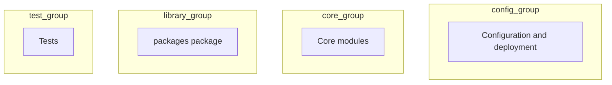

# Architecture report: react-toolbox/react-toolbox

> Automated static analysis. **Observed** = directly seen in files/imports/AST; **Inferred** = interpretation from that evidence. Repository code was not executed.

## 1. Repository at a glance

| Item | Value |
| --- | --- |
| Repository | react-toolbox/react-toolbox |
| Description | A set of React components implementing Google's Material Design specification with the power of CSS Modules |
| Language | TypeScript |
| Stars | 8603 |
| Licence | MIT |
| Analysed commit / branch | 799da67838531b6ea35e464c4817edb189f925ca / main |
| Framework(s) | Next.js, React |
| Files analysed | 407 |
| Components | 4 |

## 2. Architecture in one minute

react-toolbox/react-toolbox - A set of React components implementing Google's Material Design specification with the power of CSS Modules. This repository was analysed statically from 407 file(s) (0 Python). Detected technologies (observed from imports/manifests): GitHub Actions, Next.js, React, Tailwind CSS, TypeScript, Vite. Files are grouped into 4 component(s): Configuration and deployment, Core modules, packages package, Tests. Findings below distinguish observed facts from inferred interpretation.

## 3. High-level block diagram

## 4. Main components

### Configuration and deployment (`config`)

- **Kind:** config
- **Status:** Observed
- **Confidence:** 0.85
- **Responsibility:** Groups 10 file(s) under configuration and deployment (observed from repository paths and static analysis).
- **Paths:** `apps/docs/package.json`, `apps/docs/tsconfig.json`, `apps/docs/vercel.json`, `biome.json`, `package.json`, `packages/react-toolbox/package.json`, `packages/react-toolbox/scripts/footprint-budgets.json`, `packages/react-toolbox/tsconfig.json`, `pnpm-workspace.yaml`, `turbo.json`
- **Evidence:** [apps/docs/package.json](https://github.com/react-toolbox/react-toolbox/blob/799da67838531b6ea35e464c4817edb189f925ca/apps/docs/package.json); [apps/docs/tsconfig.json](https://github.com/react-toolbox/react-toolbox/blob/799da67838531b6ea35e464c4817edb189f925ca/apps/docs/tsconfig.json); [apps/docs/vercel.json](https://github.com/react-toolbox/react-toolbox/blob/799da67838531b6ea35e464c4817edb189f925ca/apps/docs/vercel.json); [biome.json](https://github.com/react-toolbox/react-toolbox/blob/799da67838531b6ea35e464c4817edb189f925ca/biome.json); [package.json](https://github.com/react-toolbox/react-toolbox/blob/799da67838531b6ea35e464c4817edb189f925ca/package.json); [packages/react-toolbox/package.json](https://github.com/react-toolbox/react-toolbox/blob/799da67838531b6ea35e464c4817edb189f925ca/packages/react-toolbox/package.json); [packages/react-toolbox/scripts/footprint-budgets.json](https://github.com/react-toolbox/react-toolbox/blob/799da67838531b6ea35e464c4817edb189f925ca/packages/react-toolbox/scripts/footprint-budgets.json); [packages/react-toolbox/tsconfig.json](https://github.com/react-toolbox/react-toolbox/blob/799da67838531b6ea35e464c4817edb189f925ca/packages/react-toolbox/tsconfig.json)

### Core modules (`core`)

- **Kind:** core
- **Status:** Observed
- **Confidence:** 0.85
- **Responsibility:** Groups 1 file(s) under core modules (observed from repository paths and static analysis).
- **Paths:** `playwright.config.js`
- **Evidence:** [playwright.config.js](https://github.com/react-toolbox/react-toolbox/blob/799da67838531b6ea35e464c4817edb189f925ca/playwright.config.js)

### packages package (`packages`)

- **Kind:** library
- **Status:** Observed
- **Confidence:** 0.85
- **Responsibility:** Groups 169 file(s) under packages package (observed from repository paths and static analysis).
- **Paths:** `packages/react-toolbox/registry.config.mjs`, `packages/react-toolbox/scripts/build-api-docs.mjs`, `packages/react-toolbox/scripts/build-registry.mjs`, `packages/react-toolbox/scripts/build-styles.mjs`, `packages/react-toolbox/scripts/lint-tailwind.mjs`, `packages/react-toolbox/scripts/measure-footprint.mjs`, `packages/react-toolbox/scripts/profile-animations.mjs`, `packages/react-toolbox/scripts/release-registry.mjs`, `packages/react-toolbox/scripts/smoke-registry.mjs`, `packages/react-toolbox/scripts/verify-deployment.mjs`, `packages/react-toolbox/src/examples/field-notes/index.tsx`, `packages/react-toolbox/src/examples/field-notes/theme.ts`, `packages/react-toolbox/src/examples/recipes/avatar-group.tsx`, `packages/react-toolbox/src/examples/recipes/button-actions.tsx`, `packages/react-toolbox/src/examples/recipes/data-table.tsx`, `packages/react-toolbox/src/examples/recipes/index.ts`, `packages/react-toolbox/src/examples/recipes/input-form.tsx`, `packages/react-toolbox/src/examples/snackbar-queue/index.tsx`, `packages/react-toolbox/src/index.ts`, `packages/react-toolbox/src/material/accordion/index.ts`, `packages/react-toolbox/src/material/accordion/parts.tsx`, `packages/react-toolbox/src/material/app-bar/AppBar.tsx`, `packages/react-toolbox/src/material/app-bar/index.ts`, `packages/react-toolbox/src/material/autocomplete/Autocomplete.tsx`, `packages/react-toolbox/src/material/autocomplete/index.ts`, `packages/react-toolbox/src/material/autocomplete/parts.tsx`, `packages/react-toolbox/src/material/avatar/Avatar.tsx`, `packages/react-toolbox/src/material/avatar/index.ts`, `packages/react-toolbox/src/material/button/BrowseButton.tsx`, `packages/react-toolbox/src/material/button/Button.tsx`, `packages/react-toolbox/src/material/button/ButtonElement.tsx`, `packages/react-toolbox/src/material/button/IconButton.tsx`, `packages/react-toolbox/src/material/button/index.ts`, `packages/react-toolbox/src/material/button/styles.ts`, `packages/react-toolbox/src/material/button/types.ts`, `packages/react-toolbox/src/material/card/Card.tsx`, `packages/react-toolbox/src/material/card/CardActions.tsx`, `packages/react-toolbox/src/material/card/CardMedia.tsx`, `packages/react-toolbox/src/material/card/CardText.tsx`, `packages/react-toolbox/src/material/card/CardTitle.tsx`, `packages/react-toolbox/src/material/card/index.ts`, `packages/react-toolbox/src/material/checkbox/Check.tsx`, `packages/react-toolbox/src/material/checkbox/Checkbox.tsx`, `packages/react-toolbox/src/material/checkbox/index.ts`, `packages/react-toolbox/src/material/chip/Chip.tsx`, `packages/react-toolbox/src/material/chip/index.ts`, `packages/react-toolbox/src/material/date-picker/Calendar.tsx`, `packages/react-toolbox/src/material/date-picker/CalendarDay.tsx`, `packages/react-toolbox/src/material/date-picker/CalendarMonth.tsx`, `packages/react-toolbox/src/material/date-picker/CalendarSelection.tsx`, `packages/react-toolbox/src/material/date-picker/DatePicker.tsx`, `packages/react-toolbox/src/material/date-picker/DatePickerDialog.tsx`, `packages/react-toolbox/src/material/date-picker/index.ts`, `packages/react-toolbox/src/material/date-picker/is-date-disabled.ts`, `packages/react-toolbox/src/material/date-picker/styles.ts`, `packages/react-toolbox/src/material/date-picker/types.ts`, `packages/react-toolbox/src/material/dialog/Dialog.tsx`, `packages/react-toolbox/src/material/dialog/index.ts`, `packages/react-toolbox/src/material/dialog/parts.tsx`, `packages/react-toolbox/src/material/dialog/styles.ts`, `packages/react-toolbox/src/material/divider/Divider.tsx`, `packages/react-toolbox/src/material/divider/index.ts`, `packages/react-toolbox/src/material/drawer/Drawer.tsx`, `packages/react-toolbox/src/material/drawer/index.ts`, `packages/react-toolbox/src/material/drawer/parts.tsx`, `packages/react-toolbox/src/material/dropdown/Dropdown.tsx`, `packages/react-toolbox/src/material/dropdown/index.ts`, `packages/react-toolbox/src/material/dropdown/parts.tsx`, `packages/react-toolbox/src/material/font-icon/FontIcon.tsx`, `packages/react-toolbox/src/material/font-icon/index.ts`, `packages/react-toolbox/src/material/foundations/collections/range.ts`, `packages/react-toolbox/src/material/foundations/date-time/calendar.ts`, `packages/react-toolbox/src/material/foundations/date-time/time.ts`, `packages/react-toolbox/src/material/foundations/forms/useChecked.ts`, `packages/react-toolbox/src/material/foundations/forms/useFormReset.ts`, `packages/react-toolbox/src/material/foundations/motion/ViewTransition.tsx`, `packages/react-toolbox/src/material/foundations/motion/usePresence.ts`, `packages/react-toolbox/src/material/foundations/motion/useReducedMotion.ts`, `packages/react-toolbox/src/material/foundations/portal/Portal.tsx`, `packages/react-toolbox/src/material/foundations/portal/useInertOthers.ts`, `packages/react-toolbox/src/material/foundations/portal/useMergedRefs.ts`, `packages/react-toolbox/src/material/foundations/portal/usePortalTheme.ts`, `packages/react-toolbox/src/material/foundations/portal/useReturnFocus.ts`, `packages/react-toolbox/src/material/foundations/styles/classes.ts`, `packages/react-toolbox/src/material/foundations/styles/cn.ts`, `packages/react-toolbox/src/material/foundations/styles/composition.ts`, `packages/react-toolbox/src/material/foundations/styles/styles.d.ts`, `packages/react-toolbox/src/material/foundations/theme/ThemeProvider.tsx`, `packages/react-toolbox/src/material/foundations/theme/shadcn.ts`, `packages/react-toolbox/src/material/index.ts`, `packages/react-toolbox/src/material/input/Input.tsx`, `packages/react-toolbox/src/material/input/index.ts`, `packages/react-toolbox/src/material/input/value.ts`, `packages/react-toolbox/src/material/list/List.tsx`, `packages/react-toolbox/src/material/list/ListCheckbox.tsx`, `packages/react-toolbox/src/material/list/ListDivider.tsx`, `packages/react-toolbox/src/material/list/ListItem.tsx`, `packages/react-toolbox/src/material/list/ListItemAction.tsx`, `packages/react-toolbox/src/material/list/ListItemActions.tsx`, `packages/react-toolbox/src/material/list/ListItemContent.tsx`, `packages/react-toolbox/src/material/list/ListItemLayout.tsx`, `packages/react-toolbox/src/material/list/ListItemText.tsx`, `packages/react-toolbox/src/material/list/ListSubHeader.tsx`, `packages/react-toolbox/src/material/list/context.ts`, `packages/react-toolbox/src/material/list/index.ts`, `packages/react-toolbox/src/material/list/styles.ts`, `packages/react-toolbox/src/material/menu/IconMenu.tsx`, `packages/react-toolbox/src/material/menu/Menu.tsx`, `packages/react-toolbox/src/material/menu/MenuCheckboxItem.tsx`, `packages/react-toolbox/src/material/menu/MenuDivider.tsx`, `packages/react-toolbox/src/material/menu/MenuItem.tsx`, `packages/react-toolbox/src/material/menu/MenuRadioGroup.tsx`, `packages/react-toolbox/src/material/menu/context.ts`, `packages/react-toolbox/src/material/menu/index.ts`, `packages/react-toolbox/src/material/menu/parts.tsx`, `packages/react-toolbox/src/material/menu/styles.ts`, `packages/react-toolbox/src/material/overlay/Overlay.tsx`, `packages/react-toolbox/src/material/overlay/index.ts`, `packages/react-toolbox/src/material/progress-bar/ProgressBar.tsx`, `packages/react-toolbox/src/material/progress-bar/index.ts`, `packages/react-toolbox/src/material/radio/Radio.tsx`, `packages/react-toolbox/src/material/radio/RadioButton.tsx`, `packages/react-toolbox/src/material/radio/RadioGroup.tsx`, `packages/react-toolbox/src/material/radio/context.ts`, `packages/react-toolbox/src/material/radio/index.ts`, `packages/react-toolbox/src/material/ripple/index.ts`, `packages/react-toolbox/src/material/ripple/useRipple.tsx`, `packages/react-toolbox/src/material/sheet/index.ts`, `packages/react-toolbox/src/material/sheet/parts.tsx`, `packages/react-toolbox/src/material/slider/Slider.tsx`, `packages/react-toolbox/src/material/slider/index.ts`, `packages/react-toolbox/src/material/slider/parts.tsx`, `packages/react-toolbox/src/material/snackbar/Snackbar.tsx`, `packages/react-toolbox/src/material/snackbar/index.ts`, `packages/react-toolbox/src/material/switch/Switch.tsx`, `packages/react-toolbox/src/material/switch/Thumb.tsx`, `packages/react-toolbox/src/material/switch/index.ts`, `packages/react-toolbox/src/material/table/Table.tsx`, `packages/react-toolbox/src/material/table/TableCell.tsx`, `packages/react-toolbox/src/material/table/TableHead.tsx`, `packages/react-toolbox/src/material/table/TableRow.tsx`, `packages/react-toolbox/src/material/table/index.ts`, `packages/react-toolbox/src/material/table/parts.tsx`, `packages/react-toolbox/src/material/table/selection.ts`, `packages/react-toolbox/src/material/table/styles.ts`, `packages/react-toolbox/src/material/tabs/Tab.tsx`, `packages/react-toolbox/src/material/tabs/TabContent.tsx`, `packages/react-toolbox/src/material/tabs/Tabs.tsx`, `packages/react-toolbox/src/material/tabs/index.ts`, `packages/react-toolbox/src/material/tabs/parts.tsx`, `packages/react-toolbox/src/material/tabs/styles.ts`, `packages/react-toolbox/src/material/theme/index.ts`, `packages/react-toolbox/src/material/time-picker/Clock.tsx`, `packages/react-toolbox/src/material/time-picker/ClockFace.tsx`, `packages/react-toolbox/src/material/time-picker/ClockHand.tsx`, `packages/react-toolbox/src/material/time-picker/ClockHours.tsx`, `packages/react-toolbox/src/material/time-picker/ClockMinutes.tsx`, `packages/react-toolbox/src/material/time-picker/TimePicker.tsx`, `packages/react-toolbox/src/material/time-picker/TimePickerDialog.tsx`, `packages/react-toolbox/src/material/time-picker/constraints.ts`, `packages/react-toolbox/src/material/time-picker/events.ts`, `packages/react-toolbox/src/material/time-picker/geometry.ts`, `packages/react-toolbox/src/material/time-picker/index.ts`, `packages/react-toolbox/src/material/time-picker/types.ts`, `packages/react-toolbox/src/material/tooltip/index.ts`, `packages/react-toolbox/src/material/tooltip/parts.tsx`, `packages/react-toolbox/src/material/tooltip/useTooltip.tsx`, `packages/react-toolbox/tsdown.config.ts`, `packages/react-toolbox/vitest.config.ts`
- **Evidence:** [packages/react-toolbox/registry.config.mjs](https://github.com/react-toolbox/react-toolbox/blob/799da67838531b6ea35e464c4817edb189f925ca/packages/react-toolbox/registry.config.mjs); [packages/react-toolbox/scripts/build-api-docs.mjs](https://github.com/react-toolbox/react-toolbox/blob/799da67838531b6ea35e464c4817edb189f925ca/packages/react-toolbox/scripts/build-api-docs.mjs); [packages/react-toolbox/scripts/build-registry.mjs](https://github.com/react-toolbox/react-toolbox/blob/799da67838531b6ea35e464c4817edb189f925ca/packages/react-toolbox/scripts/build-registry.mjs); [packages/react-toolbox/scripts/build-styles.mjs](https://github.com/react-toolbox/react-toolbox/blob/799da67838531b6ea35e464c4817edb189f925ca/packages/react-toolbox/scripts/build-styles.mjs); [packages/react-toolbox/scripts/lint-tailwind.mjs](https://github.com/react-toolbox/react-toolbox/blob/799da67838531b6ea35e464c4817edb189f925ca/packages/react-toolbox/scripts/lint-tailwind.mjs); [packages/react-toolbox/scripts/measure-footprint.mjs](https://github.com/react-toolbox/react-toolbox/blob/799da67838531b6ea35e464c4817edb189f925ca/packages/react-toolbox/scripts/measure-footprint.mjs); [packages/react-toolbox/scripts/profile-animations.mjs](https://github.com/react-toolbox/react-toolbox/blob/799da67838531b6ea35e464c4817edb189f925ca/packages/react-toolbox/scripts/profile-animations.mjs); [packages/react-toolbox/scripts/release-registry.mjs](https://github.com/react-toolbox/react-toolbox/blob/799da67838531b6ea35e464c4817edb189f925ca/packages/react-toolbox/scripts/release-registry.mjs)

### Tests (`tests`)

- **Kind:** test
- **Status:** Observed
- **Confidence:** 0.85
- **Responsibility:** Groups 102 file(s) under tests (observed from repository paths and static analysis).
- **Paths:** `apps/docs/tests/browser/accessibility.spec.js`, `apps/docs/tests/browser/content-layout.spec.js`, `apps/docs/tests/browser/docs-layout.spec.js`, `apps/docs/tests/browser/docs-scroll.spec.js`, `apps/docs/tests/browser/documentation.spec.js`, `apps/docs/tests/browser/font-loading.spec.js`, `apps/docs/tests/browser/metadata.spec.js`, `apps/docs/tests/browser/registry.spec.js`, `apps/docs/tests/types/package-contract.ts`, `packages/react-toolbox/tests/accessible-names.test.tsx`, `packages/react-toolbox/tests/accordion-divider-registry.test.js`, `packages/react-toolbox/tests/accordion.test.tsx`, `packages/react-toolbox/tests/app-bar.test.tsx`, `packages/react-toolbox/tests/autocomplete-consolidation.test.tsx`, `packages/react-toolbox/tests/autocomplete.test.tsx`, `packages/react-toolbox/tests/browser/accessibility.spec.js`, `packages/react-toolbox/tests/browser/calendar-range.spec.js`, `packages/react-toolbox/tests/browser/chip-states.spec.js`, `packages/react-toolbox/tests/browser/component-interactions.spec.js`, `packages/react-toolbox/tests/browser/composition.spec.js`, `packages/react-toolbox/tests/browser/compound-styling.spec.js`, `packages/react-toolbox/tests/browser/control-motion.spec.js`, `packages/react-toolbox/tests/browser/display-layout.spec.js`, `packages/react-toolbox/tests/browser/feature-parity.spec.js`, `packages/react-toolbox/tests/browser/gallery.spec.js`, `packages/react-toolbox/tests/browser/icon-alignment.spec.js`, `packages/react-toolbox/tests/browser/input-alignment.spec.js`, `packages/react-toolbox/tests/browser/m1-controls.spec.js`, `packages/react-toolbox/tests/browser/m1-form-controls.spec.js`, `packages/react-toolbox/tests/browser/m1-foundations.spec.js`, `packages/react-toolbox/tests/browser/m1-motion-timing.spec.js`, `packages/react-toolbox/tests/browser/m1-overlays.spec.js`, `packages/react-toolbox/tests/browser/m1-progress-slider.spec.js`, `packages/react-toolbox/tests/browser/m1-surface-measurements.spec.js`, `packages/react-toolbox/tests/browser/material-fixture.js`, `packages/react-toolbox/tests/browser/material-focus.spec.js`, `packages/react-toolbox/tests/browser/menu-ripple.spec.js`, `packages/react-toolbox/tests/browser/menu-selection.spec.js`, `packages/react-toolbox/tests/browser/menu-sizing.spec.js`, `packages/react-toolbox/tests/browser/modal-interoperability.spec.js`, `packages/react-toolbox/tests/browser/picker-layout.spec.js`, `packages/react-toolbox/tests/browser/picker-motion.spec.js`, `packages/react-toolbox/tests/browser/progress-motion.spec.js`, `packages/react-toolbox/tests/browser/selection-controls.spec.js`, `packages/react-toolbox/tests/browser/sheet-overflow.spec.js`, `packages/react-toolbox/tests/browser/sheet.spec.js`, `packages/react-toolbox/tests/browser/tailwind-integration.spec.js`, `packages/react-toolbox/tests/browser/theme-inheritance.spec.js`, `packages/react-toolbox/tests/browser/themed-distribution.spec.js`, `packages/react-toolbox/tests/browser/time-picker-pointer.spec.js`, `packages/react-toolbox/tests/build.test.js`, `packages/react-toolbox/tests/button-composition.test.tsx`, `packages/react-toolbox/tests/calendar-scheduling.test.tsx`, `packages/react-toolbox/tests/composition.test.tsx`, `packages/react-toolbox/tests/date-picker.test.tsx`, `packages/react-toolbox/tests/display-semantics.test.tsx`, `packages/react-toolbox/tests/divider.test.tsx`, `packages/react-toolbox/tests/dropdown-consolidation.test.tsx`, `packages/react-toolbox/tests/dropdown.test.tsx`, `packages/react-toolbox/tests/helpers/component-classes.mjs`, `packages/react-toolbox/tests/helpers/css-imports.mjs`, `packages/react-toolbox/tests/helpers/registry.mjs`, `packages/react-toolbox/tests/list-composition.test.tsx`, `packages/react-toolbox/tests/m1-controls.test.jsx`, `packages/react-toolbox/tests/m1-foundations.test.jsx`, `packages/react-toolbox/tests/m1-overlays.test.jsx`, `packages/react-toolbox/tests/m1-progress-slider.test.jsx`, `packages/react-toolbox/tests/menu-interactions.test.tsx`, `packages/react-toolbox/tests/menu-tooltip-consolidation.test.tsx`, `packages/react-toolbox/tests/modal-consolidation.test.tsx`, `packages/react-toolbox/tests/modal-interoperability.test.jsx`, `packages/react-toolbox/tests/native-forms.test.tsx`, `packages/react-toolbox/tests/overlay-accessibility.test.tsx`, `packages/react-toolbox/tests/picker-forms.test.tsx`, `packages/react-toolbox/tests/primitive-adapter-contracts.test.tsx`, `packages/react-toolbox/tests/recipe-composition.test.tsx`, `packages/react-toolbox/tests/reduced-motion.test.tsx`, `packages/react-toolbox/tests/registry.test.js`, `packages/react-toolbox/tests/release.test.js`, `packages/react-toolbox/tests/ripple.test.tsx`, `packages/react-toolbox/tests/runtime.test.jsx`, `packages/react-toolbox/tests/selection-controls.test.tsx`, `packages/react-toolbox/tests/setup.js`, `packages/react-toolbox/tests/shadcn-theme.test.js`, `packages/react-toolbox/tests/slider-consolidation.test.tsx`, `packages/react-toolbox/tests/slider-parts.test.tsx`, `packages/react-toolbox/tests/slider.test.tsx`, `packages/react-toolbox/tests/snackbar-message.test.jsx`, `packages/react-toolbox/tests/snackbar-queue.test.tsx`, `packages/react-toolbox/tests/styles.test.js`, `packages/react-toolbox/tests/styling.test.tsx`, `packages/react-toolbox/tests/table-selection.test.tsx`, `packages/react-toolbox/tests/tabs-consolidation.test.tsx`, `packages/react-toolbox/tests/tabs.test.tsx`, `packages/react-toolbox/tests/tailwind-lint.test.js`, `packages/react-toolbox/tests/theming.test.jsx`, `packages/react-toolbox/tests/time-picker.test.tsx`, `packages/react-toolbox/tests/token-footprint.test.js`, `packages/react-toolbox/tests/types/accordion-divider.tsx`, `packages/react-toolbox/tests/types/controls.tsx`, `packages/react-toolbox/tests/types/package.tsx`, `packages/react-toolbox/tests/types/public-api.tsx`
- **Evidence:** [apps/docs/tests/browser/accessibility.spec.js](https://github.com/react-toolbox/react-toolbox/blob/799da67838531b6ea35e464c4817edb189f925ca/apps/docs/tests/browser/accessibility.spec.js); [apps/docs/tests/browser/content-layout.spec.js](https://github.com/react-toolbox/react-toolbox/blob/799da67838531b6ea35e464c4817edb189f925ca/apps/docs/tests/browser/content-layout.spec.js); [apps/docs/tests/browser/docs-layout.spec.js](https://github.com/react-toolbox/react-toolbox/blob/799da67838531b6ea35e464c4817edb189f925ca/apps/docs/tests/browser/docs-layout.spec.js); [apps/docs/tests/browser/docs-scroll.spec.js](https://github.com/react-toolbox/react-toolbox/blob/799da67838531b6ea35e464c4817edb189f925ca/apps/docs/tests/browser/docs-scroll.spec.js); [apps/docs/tests/browser/documentation.spec.js](https://github.com/react-toolbox/react-toolbox/blob/799da67838531b6ea35e464c4817edb189f925ca/apps/docs/tests/browser/documentation.spec.js); [apps/docs/tests/browser/font-loading.spec.js](https://github.com/react-toolbox/react-toolbox/blob/799da67838531b6ea35e464c4817edb189f925ca/apps/docs/tests/browser/font-loading.spec.js); [apps/docs/tests/browser/metadata.spec.js](https://github.com/react-toolbox/react-toolbox/blob/799da67838531b6ea35e464c4817edb189f925ca/apps/docs/tests/browser/metadata.spec.js); [apps/docs/tests/browser/registry.spec.js](https://github.com/react-toolbox/react-toolbox/blob/799da67838531b6ea35e464c4817edb189f925ca/apps/docs/tests/browser/registry.spec.js)

## 5. Execution flow

**Observed** entry point(s):

- [packages/react-toolbox/src/index.ts](https://github.com/react-toolbox/react-toolbox/blob/799da67838531b6ea35e464c4817edb189f925ca/packages/react-toolbox/src/index.ts)

Representative flow (derived from observed entry points and the import graph; steps beyond the entry point are **Inferred**):

1. Execution starts at an observed entry point listed above, if present.
2. No internal import relationships between components were observed.

## 6. Project structure

### `(root)`

- `.editorconfig` - config (207 bytes)
- `.gitignore` - other (644 bytes)
- `.nvmrc` - other (3 bytes)
- `.vercelignore` - other (363 bytes)
- `AGENTS.md` - docs (1341 bytes)
- `CONTEXT.md` - docs (1728 bytes)
- `CONTRIBUTING.md` - docs (2376 bytes)
- `LICENSE` - docs (1086 bytes)
- `README.md` - docs (4025 bytes)
- `biome.json` - config (1361 bytes)
- `package.json` - manifest (1245 bytes)
- `playwright.config.js` - source, JavaScript (1075 bytes)
- `pnpm-workspace.yaml` - config (133 bytes)
- `turbo.json` - config (1541 bytes)

### `.github`

- `.github/workflows/ci.yml` - ci, YAML (1070 bytes)
- `.github/workflows/release.yml` - ci, YAML (2343 bytes)

### `apps`

- `apps/docs/AGENTS.md` - docs (679 bytes)
- `apps/docs/README.md` - docs (2794 bytes)
- `apps/docs/app/apple-icon.tsx` - docs (538 bytes)
- `apps/docs/app/brand-icons.tsx` - docs (6587 bytes)
- `apps/docs/app/docs-header.tsx` - docs (1544 bytes)
- `apps/docs/app/docs/action-card.tsx` - docs (748 bytes)
- `apps/docs/app/docs/api-reference.tsx` - docs (7496 bytes)
- `apps/docs/app/docs/api-table.tsx` - docs (1774 bytes)
- `apps/docs/app/docs/api-types.ts` - docs (523 bytes)
- `apps/docs/app/docs/article.tsx` - docs (3539 bytes)
- `apps/docs/app/docs/catalog.tsx` - docs (28989 bytes)
- `apps/docs/app/docs/code-block.tsx` - docs (3041 bytes)
- `apps/docs/app/docs/component-demo.tsx` - docs (15022 bytes)
- `apps/docs/app/docs/component-preview.tsx` - docs (2114 bytes)
- `apps/docs/app/docs/component-state.tsx` - docs (9376 bytes)
- `apps/docs/app/docs/components/[slug]/page.tsx` - docs (6376 bytes)
- `apps/docs/app/docs/components/page.tsx` - docs (1526 bytes)
- `apps/docs/app/docs/composition-preview.tsx` - docs (7383 bytes)
- `apps/docs/app/docs/composition-source.ts` - docs (1649 bytes)
- `apps/docs/app/docs/copy-code-button.tsx` - docs (809 bytes)
- `apps/docs/app/docs/examples/autocomplete.tsx` - docs (3557 bytes)
- `apps/docs/app/docs/examples/avatar.tsx` - docs (543 bytes)
- `apps/docs/app/docs/examples/button.tsx` - docs (347 bytes)
- `apps/docs/app/docs/examples/date-picker.tsx` - docs (890 bytes)
- `apps/docs/app/docs/examples/dialog.tsx` - docs (1318 bytes)
- `apps/docs/app/docs/examples/drawer.tsx` - docs (966 bytes)
- `apps/docs/app/docs/examples/dropdown.tsx` - docs (2624 bytes)
- `apps/docs/app/docs/examples/input.tsx` - docs (159 bytes)
- `apps/docs/app/docs/examples/menu.tsx` - docs (3124 bytes)
- `apps/docs/app/docs/examples/profile-dialog.tsx` - docs (1887 bytes)
- `apps/docs/app/docs/examples/sheet.tsx` - docs (1694 bytes)
- `apps/docs/app/docs/examples/slider.tsx` - docs (1100 bytes)
- `apps/docs/app/docs/examples/snackbar.tsx` - docs (994 bytes)
- `apps/docs/app/docs/examples/table.tsx` - docs (2866 bytes)
- `apps/docs/app/docs/examples/tabs.tsx` - docs (942 bytes)
- `apps/docs/app/docs/examples/time-picker.tsx` - docs (1834 bytes)
- `apps/docs/app/docs/examples/tooltip.tsx` - docs (942 bytes)
- `apps/docs/app/docs/installation/page.tsx` - docs (11657 bytes)
- `apps/docs/app/docs/layout.tsx` - docs (1511 bytes)
- `apps/docs/app/docs/material-guidelines.ts` - docs (12575 bytes)
- `apps/docs/app/docs/opengraph-image.tsx` - docs (284 bytes)
- `apps/docs/app/docs/page.tsx` - docs (4437 bytes)
- `apps/docs/app/docs/shell.tsx` - docs (3524 bytes)
- `apps/docs/app/docs/sidebar.tsx` - docs (2452 bytes)
- `apps/docs/app/docs/theming/page.tsx` - docs (9754 bytes)
- `apps/docs/app/docs/theming/spacing-table.tsx` - docs (946 bytes)
- `apps/docs/app/docs/theming/themed-distribution.tsx` - docs (887 bytes)
- `apps/docs/app/fonts.ts` - docs (922 bytes)
- `apps/docs/app/gallery.jsx` - docs (26344 bytes)
- `apps/docs/app/github-link.tsx` - docs (1721 bytes)
- `apps/docs/app/globals.css` - docs (6413 bytes)
- `apps/docs/app/icon.tsx` - docs (554 bytes)
- `apps/docs/app/json-ld.tsx` - docs (238 bytes)
- `apps/docs/app/landing-demo.tsx` - docs (4475 bytes)
- `apps/docs/app/layout.jsx` - docs (687 bytes)
- `apps/docs/app/opengraph-image.tsx` - docs (273 bytes)
- `apps/docs/app/page.tsx` - docs (3003 bytes)
- `apps/docs/app/playground/page.tsx` - docs (273 bytes)
- `apps/docs/app/r/[item]/route.ts` - docs (1983 bytes)
- `apps/docs/app/robots.ts` - docs (257 bytes)
- `apps/docs/app/site-footer.tsx` - docs (899 bytes)
- `apps/docs/app/site-icon.tsx` - docs (1748 bytes)
- `apps/docs/app/site-metadata.ts` - docs (1165 bytes)
- `apps/docs/app/sitemap.ts` - docs (456 bytes)
- `apps/docs/app/social-card.tsx` - docs (4947 bytes)
- `apps/docs/app/theme-demo/layout.tsx` - docs (304 bytes)
- `apps/docs/app/theme-demo/page.jsx` - docs (2777 bytes)
- `apps/docs/next-env.d.ts` - docs (296 bytes)
- `apps/docs/next.config.mjs` - docs (318 bytes)
- `apps/docs/package.json` - manifest (1037 bytes)
- `apps/docs/postcss.config.mjs` - docs (70 bytes)
- `apps/docs/public/avatar.svg` - docs (269 bytes)
- `apps/docs/styles.d.ts` - docs (24 bytes)
- `apps/docs/tests/browser/accessibility.spec.js` - test, JavaScript (1669 bytes)
- `apps/docs/tests/browser/content-layout.spec.js` - test, JavaScript (2548 bytes)
- `apps/docs/tests/browser/docs-layout.spec.js` - test, JavaScript (8474 bytes)
- `apps/docs/tests/browser/docs-scroll.spec.js` - test, JavaScript (13188 bytes)
- `apps/docs/tests/browser/documentation.spec.js` - test, JavaScript (28744 bytes)
- `apps/docs/tests/browser/font-loading.spec.js` - test, JavaScript (2204 bytes)
- `apps/docs/tests/browser/metadata.spec.js` - test, JavaScript (8062 bytes)
- `apps/docs/tests/browser/registry.spec.js` - test, JavaScript (4225 bytes)
- `apps/docs/tests/types/package-contract.ts` - test, TypeScript (954 bytes)
- `apps/docs/tsconfig.json` - config (595 bytes)
- `apps/docs/vercel.json` - config (197 bytes)

### `docs`

- `docs/releases/3.0.0-next.0.md` - docs (5099 bytes)

### `packages`

- `packages/react-toolbox/LICENSE` - docs (1086 bytes)
- `packages/react-toolbox/package.json` - manifest (11907 bytes)
- `packages/react-toolbox/registry.config.mjs` - source, JavaScript (332 bytes)
- `packages/react-toolbox/scripts/build-api-docs.mjs` - source, JavaScript (16571 bytes)
- `packages/react-toolbox/scripts/build-registry.mjs` - source, JavaScript (14366 bytes)
- `packages/react-toolbox/scripts/build-styles.mjs` - source, JavaScript (4132 bytes)
- `packages/react-toolbox/scripts/footprint-budgets.json` - config (1215 bytes)
- `packages/react-toolbox/scripts/lint-tailwind.mjs` - source, JavaScript (7117 bytes)
- `packages/react-toolbox/scripts/measure-footprint.mjs` - source, JavaScript (9670 bytes)
- `packages/react-toolbox/scripts/profile-animations.mjs` - source, JavaScript (6695 bytes)
- `packages/react-toolbox/scripts/release-registry.mjs` - source, JavaScript (12490 bytes)
- `packages/react-toolbox/scripts/smoke-registry.mjs` - source, JavaScript (30772 bytes)
- `packages/react-toolbox/scripts/verify-deployment.mjs` - source, JavaScript (3324 bytes)
- `packages/react-toolbox/src/examples/field-notes/index.tsx` - source, TypeScript (10702 bytes)
- `packages/react-toolbox/src/examples/field-notes/styles.css` - other (70 bytes)
- `packages/react-toolbox/src/examples/field-notes/theme.ts` - source, TypeScript (1770 bytes)
- `packages/react-toolbox/src/examples/recipes/avatar-group.tsx` - source, TypeScript (2305 bytes)
- `packages/react-toolbox/src/examples/recipes/button-actions.tsx` - source, TypeScript (3098 bytes)
- `packages/react-toolbox/src/examples/recipes/data-table.tsx` - source, TypeScript (4443 bytes)
- `packages/react-toolbox/src/examples/recipes/index.ts` - source, TypeScript (165 bytes)
- `packages/react-toolbox/src/examples/recipes/input-form.tsx` - source, TypeScript (2876 bytes)
- `packages/react-toolbox/src/examples/recipes/styles.css` - other (95 bytes)
- `packages/react-toolbox/src/examples/snackbar-queue/index.tsx` - source, TypeScript (3192 bytes)
- `packages/react-toolbox/src/index.ts` - source, TypeScript (43 bytes)
- `packages/react-toolbox/src/material/accordion/index.ts` - source, TypeScript (83 bytes)
- `packages/react-toolbox/src/material/accordion/parts.tsx` - source, TypeScript (4525 bytes)
- `packages/react-toolbox/src/material/app-bar/AppBar.tsx` - source, TypeScript (5496 bytes)
- `packages/react-toolbox/src/material/app-bar/index.ts` - source, TypeScript (180 bytes)
- `packages/react-toolbox/src/material/app-bar/tokens.css` - other (1638 bytes)
- `packages/react-toolbox/src/material/autocomplete/Autocomplete.tsx` - source, TypeScript (23776 bytes)
- `packages/react-toolbox/src/material/autocomplete/index.ts` - source, TypeScript (206 bytes)
- `packages/react-toolbox/src/material/autocomplete/parts.tsx` - source, TypeScript (13456 bytes)
- `packages/react-toolbox/src/material/autocomplete/tokens.css` - other (1809 bytes)
- `packages/react-toolbox/src/material/avatar/Avatar.tsx` - source, TypeScript (4713 bytes)
- `packages/react-toolbox/src/material/avatar/index.ts` - source, TypeScript (208 bytes)
- `packages/react-toolbox/src/material/avatar/tokens.css` - other (574 bytes)
- `packages/react-toolbox/src/material/button/BrowseButton.tsx` - source, TypeScript (3067 bytes)
- `packages/react-toolbox/src/material/button/Button.tsx` - source, TypeScript (1587 bytes)
- `packages/react-toolbox/src/material/button/ButtonElement.tsx` - source, TypeScript (2604 bytes)
- `packages/react-toolbox/src/material/button/IconButton.tsx` - source, TypeScript (2257 bytes)
- `packages/react-toolbox/src/material/button/index.ts` - source, TypeScript (502 bytes)
- `packages/react-toolbox/src/material/button/styles.ts` - source, TypeScript (7910 bytes)
- `packages/react-toolbox/src/material/button/tokens.css` - other (4619 bytes)
- `packages/react-toolbox/src/material/button/types.ts` - source, TypeScript (934 bytes)
- `packages/react-toolbox/src/material/card/Card.tsx` - source, TypeScript (913 bytes)
- `packages/react-toolbox/src/material/card/CardActions.tsx` - source, TypeScript (925 bytes)
- `packages/react-toolbox/src/material/card/CardMedia.tsx` - source, TypeScript (2526 bytes)
- `packages/react-toolbox/src/material/card/CardText.tsx` - source, TypeScript (1154 bytes)
- `packages/react-toolbox/src/material/card/CardTitle.tsx` - source, TypeScript (4057 bytes)
- `packages/react-toolbox/src/material/card/index.ts` - source, TypeScript (614 bytes)
- `packages/react-toolbox/src/material/card/tokens.css` - other (1125 bytes)
- `packages/react-toolbox/src/material/checkbox/Check.tsx` - source, TypeScript (4295 bytes)
- `packages/react-toolbox/src/material/checkbox/Checkbox.tsx` - source, TypeScript (4285 bytes)
- `packages/react-toolbox/src/material/checkbox/index.ts` - source, TypeScript (168 bytes)
- `packages/react-toolbox/src/material/checkbox/tokens.css` - other (1871 bytes)
- `packages/react-toolbox/src/material/chip/Chip.tsx` - source, TypeScript (5724 bytes)
- `packages/react-toolbox/src/material/chip/index.ts` - source, TypeScript (156 bytes)
- `packages/react-toolbox/src/material/chip/tokens.css` - other (1908 bytes)
- `packages/react-toolbox/src/material/date-picker/Calendar.tsx` - source, TypeScript (11438 bytes)
- `packages/react-toolbox/src/material/date-picker/CalendarDay.tsx` - source, TypeScript (3593 bytes)
- `packages/react-toolbox/src/material/date-picker/CalendarMonth.tsx` - source, TypeScript (3012 bytes)
- `packages/react-toolbox/src/material/date-picker/CalendarSelection.tsx` - source, TypeScript (13639 bytes)
- `packages/react-toolbox/src/material/date-picker/DatePicker.tsx` - source, TypeScript (7297 bytes)
- `packages/react-toolbox/src/material/date-picker/DatePickerDialog.tsx` - source, TypeScript (8441 bytes)
- `packages/react-toolbox/src/material/date-picker/index.ts` - source, TypeScript (337 bytes)
- `packages/react-toolbox/src/material/date-picker/is-date-disabled.ts` - source, TypeScript (971 bytes)
- `packages/react-toolbox/src/material/date-picker/styles.ts` - source, TypeScript (431 bytes)
- `packages/react-toolbox/src/material/date-picker/tokens.css` - other (5979 bytes)
- `packages/react-toolbox/src/material/date-picker/types.ts` - source, TypeScript (267 bytes)
- `packages/react-toolbox/src/material/dialog/Dialog.tsx` - source, TypeScript (7637 bytes)
- `packages/react-toolbox/src/material/dialog/index.ts` - source, TypeScript (182 bytes)
- `packages/react-toolbox/src/material/dialog/parts.tsx` - source, TypeScript (5288 bytes)
- `packages/react-toolbox/src/material/dialog/styles.ts` - source, TypeScript (289 bytes)
- `packages/react-toolbox/src/material/dialog/tokens.css` - other (1057 bytes)
- `packages/react-toolbox/src/material/divider/Divider.tsx` - source, TypeScript (980 bytes)
- `packages/react-toolbox/src/material/divider/index.ts` - source, TypeScript (142 bytes)
- `packages/react-toolbox/src/material/drawer/Drawer.tsx` - source, TypeScript (6187 bytes)
- `packages/react-toolbox/src/material/drawer/index.ts` - source, TypeScript (182 bytes)
- `packages/react-toolbox/src/material/drawer/parts.tsx` - source, TypeScript (5307 bytes)
- `packages/react-toolbox/src/material/drawer/tokens.css` - other (1169 bytes)
- `packages/react-toolbox/src/material/dropdown/Dropdown.tsx` - source, TypeScript (18232 bytes)
- `packages/react-toolbox/src/material/dropdown/index.ts` - source, TypeScript (194 bytes)
- `packages/react-toolbox/src/material/dropdown/parts.tsx` - source, TypeScript (6107 bytes)
- `packages/react-toolbox/src/material/dropdown/tokens.css` - other (1745 bytes)
- `packages/react-toolbox/src/material/font-icon/FontIcon.tsx` - source, TypeScript (1077 bytes)
- `packages/react-toolbox/src/material/font-icon/index.ts` - source, TypeScript (195 bytes)
- `packages/react-toolbox/src/material/foundations/collections/range.ts` - source, TypeScript (286 bytes)
- `packages/react-toolbox/src/material/foundations/date-time/calendar.ts` - source, TypeScript (15284 bytes)
- `packages/react-toolbox/src/material/foundations/date-time/time.ts` - source, TypeScript (860 bytes)
- `packages/react-toolbox/src/material/foundations/forms/useChecked.ts` - source, TypeScript (1556 bytes)
- `packages/react-toolbox/src/material/foundations/forms/useFormReset.ts` - source, TypeScript (1375 bytes)
- `packages/react-toolbox/src/material/foundations/motion/ViewTransition.tsx` - source, TypeScript (3330 bytes)
- `packages/react-toolbox/src/material/foundations/motion/usePresence.ts` - source, TypeScript (2624 bytes)
- `packages/react-toolbox/src/material/foundations/motion/useReducedMotion.ts` - source, TypeScript (681 bytes)
- `packages/react-toolbox/src/material/foundations/portal/Portal.tsx` - source, TypeScript (2269 bytes)
- `packages/react-toolbox/src/material/foundations/portal/useInertOthers.ts` - source, TypeScript (1575 bytes)
- `packages/react-toolbox/src/material/foundations/portal/useMergedRefs.ts` - source, TypeScript (787 bytes)
- `packages/react-toolbox/src/material/foundations/portal/usePortalTheme.ts` - source, TypeScript (607 bytes)
- `packages/react-toolbox/src/material/foundations/portal/useReturnFocus.ts` - source, TypeScript (2036 bytes)
- `packages/react-toolbox/src/material/foundations/styles/animations.css` - other (1601 bytes)
- `packages/react-toolbox/src/material/foundations/styles/base.css` - other (506 bytes)
- `packages/react-toolbox/src/material/foundations/styles/classes.ts` - source, TypeScript (1278 bytes)
- `packages/react-toolbox/src/material/foundations/styles/cn.ts` - source, TypeScript (1152 bytes)
- `packages/react-toolbox/src/material/foundations/styles/colors.css` - other (11408 bytes)
- `packages/react-toolbox/src/material/foundations/styles/composition.css` - other (899 bytes)
- `packages/react-toolbox/src/material/foundations/styles/composition.ts` - source, TypeScript (1264 bytes)
- `packages/react-toolbox/src/material/foundations/styles/fonts.css` - other (275 bytes)
- `packages/react-toolbox/src/material/foundations/styles/reduced-motion.css` - other (1362 bytes)
- `packages/react-toolbox/src/material/foundations/styles/setup.css` - other (331 bytes)
- `packages/react-toolbox/src/material/foundations/styles/shadcn.css` - other (11308 bytes)
- `packages/react-toolbox/src/material/foundations/styles/styles.css` - other (997 bytes)
- `packages/react-toolbox/src/material/foundations/styles/styles.d.ts` - source, TypeScript (24 bytes)
- `packages/react-toolbox/src/material/foundations/styles/tailwind-preflight.css` - other (6687 bytes)
- `packages/react-toolbox/src/material/foundations/styles/tailwind.css` - other (3745 bytes)
- `packages/react-toolbox/src/material/foundations/styles/tokens.css` - other (529 bytes)
- `packages/react-toolbox/src/material/foundations/styles/variables.css` - other (5107 bytes)
- `packages/react-toolbox/src/material/foundations/theme/ThemeProvider.tsx` - source, TypeScript (1504 bytes)
- `packages/react-toolbox/src/material/foundations/theme/shadcn.ts` - source, TypeScript (218 bytes)
- `packages/react-toolbox/src/material/index.ts` - source, TypeScript (818 bytes)
- `packages/react-toolbox/src/material/input/Input.tsx` - source, TypeScript (12344 bytes)
- `packages/react-toolbox/src/material/input/index.ts` - source, TypeScript (159 bytes)
- `packages/react-toolbox/src/material/input/tokens.css` - other (3842 bytes)
- `packages/react-toolbox/src/material/input/value.ts` - source, TypeScript (162 bytes)
- `packages/react-toolbox/src/material/list/List.tsx` - source, TypeScript (956 bytes)
- `packages/react-toolbox/src/material/list/ListCheckbox.tsx` - source, TypeScript (2354 bytes)
- `packages/react-toolbox/src/material/list/ListDivider.tsx` - source, TypeScript (1308 bytes)
- `packages/react-toolbox/src/material/list/ListItem.tsx` - source, TypeScript (4979 bytes)
- `packages/react-toolbox/src/material/list/ListItemAction.tsx` - source, TypeScript (1361 bytes)
- `packages/react-toolbox/src/material/list/ListItemActions.tsx` - source, TypeScript (1414 bytes)
- `packages/react-toolbox/src/material/list/ListItemContent.tsx` - source, TypeScript (1548 bytes)
- `packages/react-toolbox/src/material/list/ListItemLayout.tsx` - source, TypeScript (3836 bytes)
- `packages/react-toolbox/src/material/list/ListItemText.tsx` - source, TypeScript (1006 bytes)
- `packages/react-toolbox/src/material/list/ListSubHeader.tsx` - source, TypeScript (1002 bytes)
- `packages/react-toolbox/src/material/list/context.ts` - source, TypeScript (244 bytes)
- `packages/react-toolbox/src/material/list/index.ts` - source, TypeScript (1223 bytes)
- `packages/react-toolbox/src/material/list/styles.ts` - source, TypeScript (583 bytes)
- `packages/react-toolbox/src/material/list/tokens.css` - other (2933 bytes)
- `packages/react-toolbox/src/material/menu/IconMenu.tsx` - source, TypeScript (6487 bytes)
- `packages/react-toolbox/src/material/menu/Menu.tsx` - source, TypeScript (7240 bytes)
- `packages/react-toolbox/src/material/menu/MenuCheckboxItem.tsx` - source, TypeScript (1348 bytes)
- `packages/react-toolbox/src/material/menu/MenuDivider.tsx` - source, TypeScript (633 bytes)
- `packages/react-toolbox/src/material/menu/MenuItem.tsx` - source, TypeScript (5533 bytes)
- `packages/react-toolbox/src/material/menu/MenuRadioGroup.tsx` - source, TypeScript (2003 bytes)
- `packages/react-toolbox/src/material/menu/context.ts` - source, TypeScript (251 bytes)
- `packages/react-toolbox/src/material/menu/index.ts` - source, TypeScript (463 bytes)
- `packages/react-toolbox/src/material/menu/parts.tsx` - source, TypeScript (7239 bytes)
- `packages/react-toolbox/src/material/menu/styles.ts` - source, TypeScript (241 bytes)
- `packages/react-toolbox/src/material/menu/tokens.css` - other (2103 bytes)
- `packages/react-toolbox/src/material/overlay/Overlay.tsx` - source, TypeScript (2403 bytes)
- `packages/react-toolbox/src/material/overlay/index.ts` - source, TypeScript (159 bytes)
- `packages/react-toolbox/src/material/overlay/tokens.css` - other (219 bytes)
- `packages/react-toolbox/src/material/progress-bar/ProgressBar.tsx` - source, TypeScript (6708 bytes)
- `packages/react-toolbox/src/material/progress-bar/index.ts` - source, TypeScript (205 bytes)
- `packages/react-toolbox/src/material/progress-bar/tokens.css` - other (1352 bytes)
- `packages/react-toolbox/src/material/radio/Radio.tsx` - source, TypeScript (2698 bytes)
- `packages/react-toolbox/src/material/radio/RadioButton.tsx` - source, TypeScript (4058 bytes)
- `packages/react-toolbox/src/material/radio/RadioGroup.tsx` - source, TypeScript (1100 bytes)
- `packages/react-toolbox/src/material/radio/context.ts` - source, TypeScript (345 bytes)
- `packages/react-toolbox/src/material/radio/index.ts` - source, TypeScript (261 bytes)
- `packages/react-toolbox/src/material/radio/tokens.css` - other (1506 bytes)
- `packages/react-toolbox/src/material/ripple/index.ts` - source, TypeScript (201 bytes)
- `packages/react-toolbox/src/material/ripple/tokens.css` - other (241 bytes)
- `packages/react-toolbox/src/material/ripple/useRipple.tsx` - source, TypeScript (7833 bytes)
- `packages/react-toolbox/src/material/sheet/index.ts` - source, TypeScript (83 bytes)
- `packages/react-toolbox/src/material/sheet/parts.tsx` - source, TypeScript (6941 bytes)
- `packages/react-toolbox/src/material/slider/Slider.tsx` - source, TypeScript (17639 bytes)
- `packages/react-toolbox/src/material/slider/index.ts` - source, TypeScript (205 bytes)
- `packages/react-toolbox/src/material/slider/parts.tsx` - source, TypeScript (3483 bytes)
- `packages/react-toolbox/src/material/slider/tokens.css` - other (2420 bytes)
- `packages/react-toolbox/src/material/snackbar/Snackbar.tsx` - source, TypeScript (8931 bytes)
- `packages/react-toolbox/src/material/snackbar/index.ts` - source, TypeScript (162 bytes)
- `packages/react-toolbox/src/material/snackbar/tokens.css` - other (1242 bytes)
- `packages/react-toolbox/src/material/switch/Switch.tsx` - source, TypeScript (4312 bytes)
- `packages/react-toolbox/src/material/switch/Thumb.tsx` - source, TypeScript (4749 bytes)
- `packages/react-toolbox/src/material/switch/index.ts` - source, TypeScript (162 bytes)
- `packages/react-toolbox/src/material/switch/tokens.css` - other (3626 bytes)
- `packages/react-toolbox/src/material/table/Table.tsx` - source, TypeScript (2431 bytes)
- `packages/react-toolbox/src/material/table/TableCell.tsx` - source, TypeScript (3028 bytes)
- `packages/react-toolbox/src/material/table/TableHead.tsx` - source, TypeScript (1926 bytes)
- `packages/react-toolbox/src/material/table/TableRow.tsx` - source, TypeScript (2488 bytes)
- `packages/react-toolbox/src/material/table/index.ts` - source, TypeScript (534 bytes)
- `packages/react-toolbox/src/material/table/parts.tsx` - source, TypeScript (3513 bytes)
- `packages/react-toolbox/src/material/table/selection.ts` - source, TypeScript (454 bytes)
- `packages/react-toolbox/src/material/table/styles.ts` - source, TypeScript (868 bytes)
- `packages/react-toolbox/src/material/table/tokens.css` - other (1713 bytes)
- `packages/react-toolbox/src/material/tabs/Tab.tsx` - source, TypeScript (4122 bytes)
- `packages/react-toolbox/src/material/tabs/TabContent.tsx` - source, TypeScript (1061 bytes)
- `packages/react-toolbox/src/material/tabs/Tabs.tsx` - source, TypeScript (10880 bytes)
- `packages/react-toolbox/src/material/tabs/index.ts` - source, TypeScript (302 bytes)
- `packages/react-toolbox/src/material/tabs/parts.tsx` - source, TypeScript (6725 bytes)
- `packages/react-toolbox/src/material/tabs/styles.ts` - source, TypeScript (528 bytes)
- `packages/react-toolbox/src/material/tabs/tokens.css` - other (3023 bytes)
- `packages/react-toolbox/src/material/theme/index.ts` - source, TypeScript (245 bytes)
- `packages/react-toolbox/src/material/time-picker/Clock.tsx` - source, TypeScript (3663 bytes)
- `packages/react-toolbox/src/material/time-picker/ClockFace.tsx` - source, TypeScript (1863 bytes)
- `packages/react-toolbox/src/material/time-picker/ClockHand.tsx` - source, TypeScript (6494 bytes)
- `packages/react-toolbox/src/material/time-picker/ClockHours.tsx` - source, TypeScript (2260 bytes)
- `packages/react-toolbox/src/material/time-picker/ClockMinutes.tsx` - source, TypeScript (1178 bytes)
- `packages/react-toolbox/src/material/time-picker/TimePicker.tsx` - source, TypeScript (6658 bytes)
- `packages/react-toolbox/src/material/time-picker/TimePickerDialog.tsx` - source, TypeScript (12997 bytes)
- `packages/react-toolbox/src/material/time-picker/constraints.ts` - source, TypeScript (1686 bytes)
- `packages/react-toolbox/src/material/time-picker/events.ts` - source, TypeScript (314 bytes)
- `packages/react-toolbox/src/material/time-picker/geometry.ts` - source, TypeScript (340 bytes)
- `packages/react-toolbox/src/material/time-picker/index.ts` - source, TypeScript (174 bytes)
- `packages/react-toolbox/src/material/time-picker/tokens.css` - other (5107 bytes)
- `packages/react-toolbox/src/material/time-picker/types.ts` - source, TypeScript (223 bytes)
- `packages/react-toolbox/src/material/tooltip/index.ts` - source, TypeScript (185 bytes)
- `packages/react-toolbox/src/material/tooltip/parts.tsx` - source, TypeScript (7659 bytes)
- `packages/react-toolbox/src/material/tooltip/tokens.css` - other (815 bytes)
- `packages/react-toolbox/src/material/tooltip/useTooltip.tsx` - source, TypeScript (6073 bytes)
- `packages/react-toolbox/tests/accessible-names.test.tsx` - test, TypeScript (4868 bytes)
- `packages/react-toolbox/tests/accordion-divider-registry.test.js` - test, JavaScript (1549 bytes)
- `packages/react-toolbox/tests/accordion.test.tsx` - test, TypeScript (9832 bytes)
- `packages/react-toolbox/tests/app-bar.test.tsx` - test, TypeScript (1233 bytes)
- `packages/react-toolbox/tests/autocomplete-consolidation.test.tsx` - test, TypeScript (19260 bytes)
- `packages/react-toolbox/tests/autocomplete.test.tsx` - test, TypeScript (10290 bytes)
- `packages/react-toolbox/tests/browser/accessibility.spec.js` - test, JavaScript (15550 bytes)
- `packages/react-toolbox/tests/browser/calendar-range.spec.js` - test, JavaScript (6991 bytes)
- `packages/react-toolbox/tests/browser/chip-states.spec.js` - test, JavaScript (2660 bytes)
- `packages/react-toolbox/tests/browser/component-interactions.spec.js` - test, JavaScript (11789 bytes)
- `packages/react-toolbox/tests/browser/composition.spec.js` - test, JavaScript (15738 bytes)
- `packages/react-toolbox/tests/browser/compound-styling.spec.js` - test, JavaScript (8932 bytes)
- `packages/react-toolbox/tests/browser/control-motion.spec.js` - test, JavaScript (10055 bytes)
- `packages/react-toolbox/tests/browser/display-layout.spec.js` - test, JavaScript (12622 bytes)
- `packages/react-toolbox/tests/browser/feature-parity.spec.js` - test, JavaScript (11614 bytes)
- `packages/react-toolbox/tests/browser/gallery.spec.js` - test, JavaScript (10395 bytes)
- `packages/react-toolbox/tests/browser/icon-alignment.spec.js` - test, JavaScript (3230 bytes)
- `packages/react-toolbox/tests/browser/input-alignment.spec.js` - test, JavaScript (3751 bytes)
- `packages/react-toolbox/tests/browser/m1-controls.spec.js` - test, JavaScript (7011 bytes)
- `packages/react-toolbox/tests/browser/m1-form-controls.spec.js` - test, JavaScript (9714 bytes)
- `packages/react-toolbox/tests/browser/m1-foundations.spec.js` - test, JavaScript (12278 bytes)
- `packages/react-toolbox/tests/browser/m1-motion-timing.spec.js` - test, JavaScript (19603 bytes)
- `packages/react-toolbox/tests/browser/m1-overlays.spec.js` - test, JavaScript (13569 bytes)
- `packages/react-toolbox/tests/browser/m1-progress-slider.spec.js` - test, JavaScript (4781 bytes)
- `packages/react-toolbox/tests/browser/m1-surface-measurements.spec.js` - test, JavaScript (7692 bytes)
- `packages/react-toolbox/tests/browser/material-fixture.js` - test, JavaScript (3129 bytes)
- `packages/react-toolbox/tests/browser/material-focus.spec.js` - test, JavaScript (9296 bytes)
- `packages/react-toolbox/tests/browser/menu-ripple.spec.js` - test, JavaScript (9470 bytes)
- `packages/react-toolbox/tests/browser/menu-selection.spec.js` - test, JavaScript (2570 bytes)
- `packages/react-toolbox/tests/browser/menu-sizing.spec.js` - test, JavaScript (1664 bytes)
- `packages/react-toolbox/tests/browser/modal-interoperability.spec.js` - test, JavaScript (7728 bytes)
- `packages/react-toolbox/tests/browser/picker-layout.spec.js` - test, JavaScript (3405 bytes)
- `packages/react-toolbox/tests/browser/picker-motion.spec.js` - test, JavaScript (8928 bytes)
- `packages/react-toolbox/tests/browser/progress-motion.spec.js` - test, JavaScript (3621 bytes)
- `packages/react-toolbox/tests/browser/selection-controls.spec.js` - test, JavaScript (5624 bytes)
- `packages/react-toolbox/tests/browser/sheet-overflow.spec.js` - test, JavaScript (6063 bytes)
- `packages/react-toolbox/tests/browser/sheet.spec.js` - test, JavaScript (6612 bytes)
- `packages/react-toolbox/tests/browser/tailwind-integration.spec.js` - test, JavaScript (21335 bytes)
- `packages/react-toolbox/tests/browser/theme-inheritance.spec.js` - test, JavaScript (5172 bytes)
- `packages/react-toolbox/tests/browser/themed-distribution.spec.js` - test, JavaScript (7359 bytes)
- `packages/react-toolbox/tests/browser/time-picker-pointer.spec.js` - test, JavaScript (6724 bytes)
- `packages/react-toolbox/tests/build.test.js` - test, JavaScript (2631 bytes)
- `packages/react-toolbox/tests/button-composition.test.tsx` - test, TypeScript (7226 bytes)
- `packages/react-toolbox/tests/calendar-scheduling.test.tsx` - test, TypeScript (6892 bytes)
- `packages/react-toolbox/tests/composition.test.tsx` - test, TypeScript (21807 bytes)
- `packages/react-toolbox/tests/date-picker.test.tsx` - test, TypeScript (9745 bytes)
- `packages/react-toolbox/tests/display-semantics.test.tsx` - test, TypeScript (3411 bytes)
- `packages/react-toolbox/tests/divider.test.tsx` - test, TypeScript (1940 bytes)
- `packages/react-toolbox/tests/dropdown-consolidation.test.tsx` - test, TypeScript (15209 bytes)
- `packages/react-toolbox/tests/dropdown.test.tsx` - test, TypeScript (3393 bytes)
- `packages/react-toolbox/tests/helpers/component-classes.mjs` - test, JavaScript (4155 bytes)
- `packages/react-toolbox/tests/helpers/css-imports.mjs` - test, JavaScript (849 bytes)
- `packages/react-toolbox/tests/helpers/registry.mjs` - test, JavaScript (3069 bytes)
- `packages/react-toolbox/tests/list-composition.test.tsx` - test, TypeScript (7123 bytes)
- `packages/react-toolbox/tests/m1-controls.test.jsx` - test, JavaScript (16044 bytes)
- `packages/react-toolbox/tests/m1-foundations.test.jsx` - test, JavaScript (3216 bytes)
- `packages/react-toolbox/tests/m1-overlays.test.jsx` - test, JavaScript (17509 bytes)
- `packages/react-toolbox/tests/m1-progress-slider.test.jsx` - test, JavaScript (9893 bytes)
- `packages/react-toolbox/tests/menu-interactions.test.tsx` - test, TypeScript (5777 bytes)
- `packages/react-toolbox/tests/menu-tooltip-consolidation.test.tsx` - test, TypeScript (6910 bytes)
- `packages/react-toolbox/tests/modal-consolidation.test.tsx` - test, TypeScript (17082 bytes)
- `packages/react-toolbox/tests/modal-interoperability.test.jsx` - test, JavaScript (6525 bytes)
- `packages/react-toolbox/tests/native-forms.test.tsx` - test, TypeScript (8945 bytes)
- `packages/react-toolbox/tests/overlay-accessibility.test.tsx` - test, TypeScript (2683 bytes)
- `packages/react-toolbox/tests/picker-forms.test.tsx` - test, TypeScript (7209 bytes)
- `packages/react-toolbox/tests/primitive-adapter-contracts.test.tsx` - test, TypeScript (4743 bytes)
- `packages/react-toolbox/tests/recipe-composition.test.tsx` - test, TypeScript (4349 bytes)
- `packages/react-toolbox/tests/reduced-motion.test.tsx` - test, TypeScript (5619 bytes)
- `packages/react-toolbox/tests/registry.test.js` - test, JavaScript (10762 bytes)
- `packages/react-toolbox/tests/release.test.js` - test, JavaScript (5277 bytes)
- `packages/react-toolbox/tests/ripple.test.tsx` - test, TypeScript (2011 bytes)
- `packages/react-toolbox/tests/runtime.test.jsx` - test, JavaScript (17535 bytes)
- `packages/react-toolbox/tests/selection-controls.test.tsx` - test, TypeScript (2297 bytes)
- `packages/react-toolbox/tests/setup.js` - test, JavaScript (1128 bytes)
- `packages/react-toolbox/tests/shadcn-theme.test.js` - test, JavaScript (1778 bytes)
- `packages/react-toolbox/tests/slider-consolidation.test.tsx` - test, TypeScript (7564 bytes)
- `packages/react-toolbox/tests/slider-parts.test.tsx` - test, TypeScript (2721 bytes)
- `packages/react-toolbox/tests/slider.test.tsx` - test, TypeScript (3944 bytes)
- `packages/react-toolbox/tests/snackbar-message.test.jsx` - test, JavaScript (1719 bytes)
- `packages/react-toolbox/tests/snackbar-queue.test.tsx` - test, TypeScript (2372 bytes)
- `packages/react-toolbox/tests/styles.test.js` - test, JavaScript (2145 bytes)
- `packages/react-toolbox/tests/styling.test.tsx` - test, TypeScript (3837 bytes)
- `packages/react-toolbox/tests/table-selection.test.tsx` - test, TypeScript (9449 bytes)
- `packages/react-toolbox/tests/tabs-consolidation.test.tsx` - test, TypeScript (7665 bytes)
- `packages/react-toolbox/tests/tabs.test.tsx` - test, TypeScript (4794 bytes)
- `packages/react-toolbox/tests/tailwind-lint.test.js` - test, JavaScript (2927 bytes)
- `packages/react-toolbox/tests/theming.test.jsx` - test, JavaScript (4908 bytes)
- `packages/react-toolbox/tests/time-picker.test.tsx` - test, TypeScript (4405 bytes)
- `packages/react-toolbox/tests/token-footprint.test.js` - test, JavaScript (3352 bytes)
- `packages/react-toolbox/tests/types/accordion-divider.tsx` - test, TypeScript (1101 bytes)
- `packages/react-toolbox/tests/types/controls.tsx` - test, TypeScript (3422 bytes)
- `packages/react-toolbox/tests/types/package.tsx` - test, TypeScript (800 bytes)
- `packages/react-toolbox/tests/types/public-api.tsx` - test, TypeScript (5820 bytes)
- `packages/react-toolbox/tsconfig.json` - config (466 bytes)
- `packages/react-toolbox/tsdown.config.ts` - source, TypeScript (1517 bytes)
- `packages/react-toolbox/vitest.config.ts` - source, TypeScript (232 bytes)

## 7. Key dependencies and integrations

| Name | Category | Status | Confidence | Evidence |
| --- | --- | --- | --- | --- |
| GitHub Actions | ci | Observed | 0.90 | [.github/workflows/ci.yml](https://github.com/react-toolbox/react-toolbox/blob/799da67838531b6ea35e464c4817edb189f925ca/.github/workflows/ci.yml); [.github/workflows/release.yml](https://github.com/react-toolbox/react-toolbox/blob/799da67838531b6ea35e464c4817edb189f925ca/.github/workflows/release.yml) |
| Next.js | framework | Observed | 0.90 | [apps/docs/package.json:7](https://github.com/react-toolbox/react-toolbox/blob/799da67838531b6ea35e464c4817edb189f925ca/apps/docs/package.json#L7); [packages/react-toolbox/package.json:6](https://github.com/react-toolbox/react-toolbox/blob/799da67838531b6ea35e464c4817edb189f925ca/packages/react-toolbox/package.json#L6) |
| React | framework | Observed | 0.90 | [apps/docs/package.json:2](https://github.com/react-toolbox/react-toolbox/blob/799da67838531b6ea35e464c4817edb189f925ca/apps/docs/package.json#L2); [apps/docs/package.json:20](https://github.com/react-toolbox/react-toolbox/blob/799da67838531b6ea35e464c4817edb189f925ca/apps/docs/package.json#L20); [packages/react-toolbox/package.json:2](https://github.com/react-toolbox/react-toolbox/blob/799da67838531b6ea35e464c4817edb189f925ca/packages/react-toolbox/package.json#L2); [packages/react-toolbox/package.json:67](https://github.com/react-toolbox/react-toolbox/blob/799da67838531b6ea35e464c4817edb189f925ca/packages/react-toolbox/package.json#L67) |
| Tailwind CSS | library | Observed | 0.90 | [apps/docs/package.json:28](https://github.com/react-toolbox/react-toolbox/blob/799da67838531b6ea35e464c4817edb189f925ca/apps/docs/package.json#L28); [packages/react-toolbox/package.json:75](https://github.com/react-toolbox/react-toolbox/blob/799da67838531b6ea35e464c4817edb189f925ca/packages/react-toolbox/package.json#L75) |
| TypeScript | tooling | Observed | 0.90 | [apps/docs/package.json:34](https://github.com/react-toolbox/react-toolbox/blob/799da67838531b6ea35e464c4817edb189f925ca/apps/docs/package.json#L34); [packages/react-toolbox/package.json:93](https://github.com/react-toolbox/react-toolbox/blob/799da67838531b6ea35e464c4817edb189f925ca/packages/react-toolbox/package.json#L93) |
| Vite | tooling | Observed | 0.85 | [packages/react-toolbox/package.json:36](https://github.com/react-toolbox/react-toolbox/blob/799da67838531b6ea35e464c4817edb189f925ca/packages/react-toolbox/package.json#L36) |
| Vitest | tooling | Observed | 0.85 | [packages/react-toolbox/package.json:36](https://github.com/react-toolbox/react-toolbox/blob/799da67838531b6ea35e464c4817edb189f925ca/packages/react-toolbox/package.json#L36) |

## 8. Data and state

No database, cache, queue, or persistent-state usage was observed in the analysed files. State handling, if any, may be in-memory or in files that were not analysed.

## 9. Configuration and deployment clues

- `.editorconfig` (config)
- `.github/workflows/ci.yml` (ci)
- `.github/workflows/release.yml` (ci)
- `apps/docs/package.json` (manifest)
- `apps/docs/tsconfig.json` (config)
- `apps/docs/vercel.json` (config)
- `biome.json` (config)
- `package.json` (manifest)
- `packages/react-toolbox/package.json` (manifest)
- `packages/react-toolbox/scripts/footprint-budgets.json` (config)
- `packages/react-toolbox/tsconfig.json` (config)
- `pnpm-workspace.yaml` (config)
- `turbo.json` (config)

## 10. Design observations

- Tests are present alongside source code (Observed from test file paths).

These observations are interpretations (**Inferred**) of the observed structure, not guarantees about runtime design.

## 11. Limitations and unknowns

- Static analysis only: repository code was not executed, installed, or imported at runtime.
- Components and relationships are inferred from file paths, imports, and AST structure; runtime behaviour, dynamic imports, and reflection may not be visible.
- No clear application entry point was observed in the analysed files.
- Repository text was treated as untrusted data; no instructions found in repository files were followed, and likely secret values were redacted/excluded.
- JavaScript and TypeScript files were inventoried from paths and package manifests. They were not parsed with a full language AST, and repository code was not executed.

## 12. Source references

- [.github/workflows/ci.yml](https://github.com/react-toolbox/react-toolbox/blob/799da67838531b6ea35e464c4817edb189f925ca/.github/workflows/ci.yml)
- [.github/workflows/release.yml](https://github.com/react-toolbox/react-toolbox/blob/799da67838531b6ea35e464c4817edb189f925ca/.github/workflows/release.yml)
- [apps/docs/package.json](https://github.com/react-toolbox/react-toolbox/blob/799da67838531b6ea35e464c4817edb189f925ca/apps/docs/package.json)
- [apps/docs/package.json:2](https://github.com/react-toolbox/react-toolbox/blob/799da67838531b6ea35e464c4817edb189f925ca/apps/docs/package.json#L2)
- [apps/docs/package.json:7](https://github.com/react-toolbox/react-toolbox/blob/799da67838531b6ea35e464c4817edb189f925ca/apps/docs/package.json#L7)
- [apps/docs/package.json:20](https://github.com/react-toolbox/react-toolbox/blob/799da67838531b6ea35e464c4817edb189f925ca/apps/docs/package.json#L20)
- [apps/docs/package.json:28](https://github.com/react-toolbox/react-toolbox/blob/799da67838531b6ea35e464c4817edb189f925ca/apps/docs/package.json#L28)
- [apps/docs/package.json:34](https://github.com/react-toolbox/react-toolbox/blob/799da67838531b6ea35e464c4817edb189f925ca/apps/docs/package.json#L34)
- [apps/docs/tests/browser/accessibility.spec.js](https://github.com/react-toolbox/react-toolbox/blob/799da67838531b6ea35e464c4817edb189f925ca/apps/docs/tests/browser/accessibility.spec.js)
- [apps/docs/tests/browser/content-layout.spec.js](https://github.com/react-toolbox/react-toolbox/blob/799da67838531b6ea35e464c4817edb189f925ca/apps/docs/tests/browser/content-layout.spec.js)
- [apps/docs/tests/browser/docs-layout.spec.js](https://github.com/react-toolbox/react-toolbox/blob/799da67838531b6ea35e464c4817edb189f925ca/apps/docs/tests/browser/docs-layout.spec.js)
- [apps/docs/tests/browser/docs-scroll.spec.js](https://github.com/react-toolbox/react-toolbox/blob/799da67838531b6ea35e464c4817edb189f925ca/apps/docs/tests/browser/docs-scroll.spec.js)
- [apps/docs/tests/browser/documentation.spec.js](https://github.com/react-toolbox/react-toolbox/blob/799da67838531b6ea35e464c4817edb189f925ca/apps/docs/tests/browser/documentation.spec.js)
- [apps/docs/tests/browser/font-loading.spec.js](https://github.com/react-toolbox/react-toolbox/blob/799da67838531b6ea35e464c4817edb189f925ca/apps/docs/tests/browser/font-loading.spec.js)
- [apps/docs/tests/browser/metadata.spec.js](https://github.com/react-toolbox/react-toolbox/blob/799da67838531b6ea35e464c4817edb189f925ca/apps/docs/tests/browser/metadata.spec.js)
- [apps/docs/tests/browser/registry.spec.js](https://github.com/react-toolbox/react-toolbox/blob/799da67838531b6ea35e464c4817edb189f925ca/apps/docs/tests/browser/registry.spec.js)
- [apps/docs/tsconfig.json](https://github.com/react-toolbox/react-toolbox/blob/799da67838531b6ea35e464c4817edb189f925ca/apps/docs/tsconfig.json)
- [apps/docs/vercel.json](https://github.com/react-toolbox/react-toolbox/blob/799da67838531b6ea35e464c4817edb189f925ca/apps/docs/vercel.json)
- [biome.json](https://github.com/react-toolbox/react-toolbox/blob/799da67838531b6ea35e464c4817edb189f925ca/biome.json)
- [package.json](https://github.com/react-toolbox/react-toolbox/blob/799da67838531b6ea35e464c4817edb189f925ca/package.json)
- [packages/react-toolbox/package.json](https://github.com/react-toolbox/react-toolbox/blob/799da67838531b6ea35e464c4817edb189f925ca/packages/react-toolbox/package.json)
- [packages/react-toolbox/package.json:2](https://github.com/react-toolbox/react-toolbox/blob/799da67838531b6ea35e464c4817edb189f925ca/packages/react-toolbox/package.json#L2)
- [packages/react-toolbox/package.json:6](https://github.com/react-toolbox/react-toolbox/blob/799da67838531b6ea35e464c4817edb189f925ca/packages/react-toolbox/package.json#L6)
- [packages/react-toolbox/package.json:36](https://github.com/react-toolbox/react-toolbox/blob/799da67838531b6ea35e464c4817edb189f925ca/packages/react-toolbox/package.json#L36)
- [packages/react-toolbox/package.json:67](https://github.com/react-toolbox/react-toolbox/blob/799da67838531b6ea35e464c4817edb189f925ca/packages/react-toolbox/package.json#L67)
- [packages/react-toolbox/package.json:75](https://github.com/react-toolbox/react-toolbox/blob/799da67838531b6ea35e464c4817edb189f925ca/packages/react-toolbox/package.json#L75)
- [packages/react-toolbox/package.json:93](https://github.com/react-toolbox/react-toolbox/blob/799da67838531b6ea35e464c4817edb189f925ca/packages/react-toolbox/package.json#L93)
- [packages/react-toolbox/registry.config.mjs](https://github.com/react-toolbox/react-toolbox/blob/799da67838531b6ea35e464c4817edb189f925ca/packages/react-toolbox/registry.config.mjs)
- [packages/react-toolbox/scripts/build-api-docs.mjs](https://github.com/react-toolbox/react-toolbox/blob/799da67838531b6ea35e464c4817edb189f925ca/packages/react-toolbox/scripts/build-api-docs.mjs)
- [packages/react-toolbox/scripts/build-registry.mjs](https://github.com/react-toolbox/react-toolbox/blob/799da67838531b6ea35e464c4817edb189f925ca/packages/react-toolbox/scripts/build-registry.mjs)
- [packages/react-toolbox/scripts/build-styles.mjs](https://github.com/react-toolbox/react-toolbox/blob/799da67838531b6ea35e464c4817edb189f925ca/packages/react-toolbox/scripts/build-styles.mjs)
- [packages/react-toolbox/scripts/footprint-budgets.json](https://github.com/react-toolbox/react-toolbox/blob/799da67838531b6ea35e464c4817edb189f925ca/packages/react-toolbox/scripts/footprint-budgets.json)
- [packages/react-toolbox/scripts/lint-tailwind.mjs](https://github.com/react-toolbox/react-toolbox/blob/799da67838531b6ea35e464c4817edb189f925ca/packages/react-toolbox/scripts/lint-tailwind.mjs)
- [packages/react-toolbox/scripts/measure-footprint.mjs](https://github.com/react-toolbox/react-toolbox/blob/799da67838531b6ea35e464c4817edb189f925ca/packages/react-toolbox/scripts/measure-footprint.mjs)
- [packages/react-toolbox/scripts/profile-animations.mjs](https://github.com/react-toolbox/react-toolbox/blob/799da67838531b6ea35e464c4817edb189f925ca/packages/react-toolbox/scripts/profile-animations.mjs)
- [packages/react-toolbox/scripts/release-registry.mjs](https://github.com/react-toolbox/react-toolbox/blob/799da67838531b6ea35e464c4817edb189f925ca/packages/react-toolbox/scripts/release-registry.mjs)
- [packages/react-toolbox/src/index.ts](https://github.com/react-toolbox/react-toolbox/blob/799da67838531b6ea35e464c4817edb189f925ca/packages/react-toolbox/src/index.ts)
- [packages/react-toolbox/tsconfig.json](https://github.com/react-toolbox/react-toolbox/blob/799da67838531b6ea35e464c4817edb189f925ca/packages/react-toolbox/tsconfig.json)
- [playwright.config.js](https://github.com/react-toolbox/react-toolbox/blob/799da67838531b6ea35e464c4817edb189f925ca/playwright.config.js)
