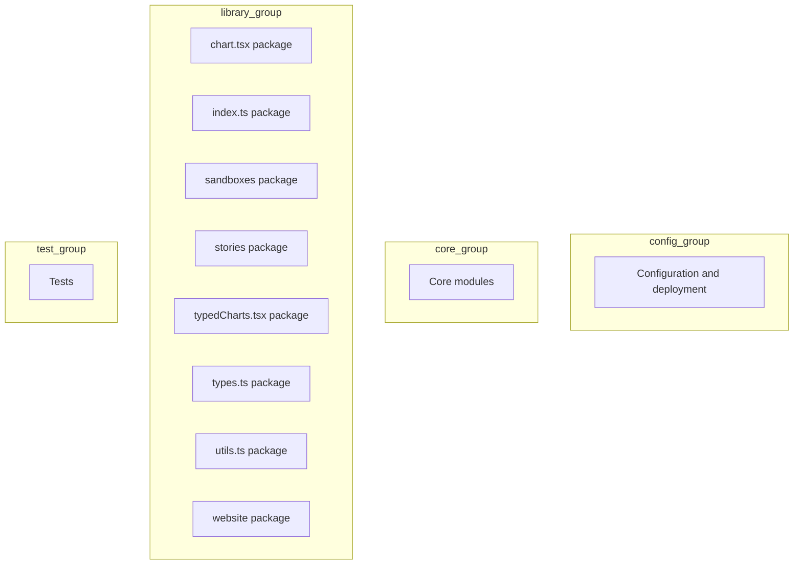

# Architecture report: reactchartjs/react-chartjs-2

> Automated static analysis. **Observed** = directly seen in files/imports/AST; **Inferred** = interpretation from that evidence. Repository code was not executed.

## 1. Repository at a glance

| Item | Value |
| --- | --- |
| Repository | reactchartjs/react-chartjs-2 |
| Description | React components for Chart.js, the most popular charting library |
| Language | TypeScript |
| Stars | 6937 |
| Licence | MIT |
| Analysed commit / branch | 7c7be48ae5b585f45bc6aef718cc8d4b51f34d0a / master |
| Framework(s) | React |
| Files analysed | 209 |
| Components | 11 |

## 2. Architecture in one minute

reactchartjs/react-chartjs-2 - React components for Chart.js, the most popular charting library. This repository was analysed statically from 209 file(s) (0 Python). Detected technologies (observed from imports/manifests): GitHub Actions, React, TypeScript, Vite, Vitest, webpack. Files are grouped into 11 component(s): chart.tsx package, Configuration and deployment, Core modules, index.ts package, sandboxes package, stories package, Tests, typedCharts.tsx package. Findings below distinguish observed facts from inferred interpretation.

## 3. High-level block diagram

## 4. Main components

### chart.tsx package (`chart_tsx`)

- **Kind:** library
- **Status:** Observed
- **Confidence:** 0.85
- **Responsibility:** Groups 1 file(s) under chart.tsx package (observed from repository paths and static analysis).
- **Paths:** `src/chart.tsx`
- **Evidence:** [src/chart.tsx](https://github.com/reactchartjs/react-chartjs-2/blob/7c7be48ae5b585f45bc6aef718cc8d4b51f34d0a/src/chart.tsx)

### Configuration and deployment (`config`)

- **Kind:** config
- **Status:** Observed
- **Confidence:** 0.85
- **Responsibility:** Groups 26 file(s) under configuration and deployment (observed from repository paths and static analysis).
- **Paths:** `package.json`, `pnpm-workspace.yaml`, `sandboxes/bar/grouped/package.json`, `sandboxes/bar/horizontal/package.json`, `sandboxes/bar/stacked/package.json`, `sandboxes/bar/vertical/package.json`, `sandboxes/bubble/default/package.json`, `sandboxes/chart/canvas/package.json`, `sandboxes/chart/events/package.json`, `sandboxes/chart/multitype/package.json`, `sandboxes/chart/ref/package.json`, `sandboxes/doughnut/default/package.json`, `sandboxes/line/area/package.json`, `sandboxes/line/default/package.json`, `sandboxes/line/multiaxis/package.json`, `sandboxes/package.json`, `sandboxes/pie/default/package.json`, `sandboxes/pnpm-workspace.yaml`, `sandboxes/polarArea/default/package.json`, `sandboxes/radar/default/package.json`, `sandboxes/scatter/default/package.json`, `sandboxes/tsconfig.json`, `tsconfig.json`, `website/package.json`, `website/pnpm-workspace.yaml`, `website/tsconfig.json`
- **Evidence:** [package.json](https://github.com/reactchartjs/react-chartjs-2/blob/7c7be48ae5b585f45bc6aef718cc8d4b51f34d0a/package.json); [pnpm-workspace.yaml](https://github.com/reactchartjs/react-chartjs-2/blob/7c7be48ae5b585f45bc6aef718cc8d4b51f34d0a/pnpm-workspace.yaml); [sandboxes/bar/grouped/package.json](https://github.com/reactchartjs/react-chartjs-2/blob/7c7be48ae5b585f45bc6aef718cc8d4b51f34d0a/sandboxes/bar/grouped/package.json); [sandboxes/bar/horizontal/package.json](https://github.com/reactchartjs/react-chartjs-2/blob/7c7be48ae5b585f45bc6aef718cc8d4b51f34d0a/sandboxes/bar/horizontal/package.json); [sandboxes/bar/stacked/package.json](https://github.com/reactchartjs/react-chartjs-2/blob/7c7be48ae5b585f45bc6aef718cc8d4b51f34d0a/sandboxes/bar/stacked/package.json); [sandboxes/bar/vertical/package.json](https://github.com/reactchartjs/react-chartjs-2/blob/7c7be48ae5b585f45bc6aef718cc8d4b51f34d0a/sandboxes/bar/vertical/package.json); [sandboxes/bubble/default/package.json](https://github.com/reactchartjs/react-chartjs-2/blob/7c7be48ae5b585f45bc6aef718cc8d4b51f34d0a/sandboxes/bubble/default/package.json); [sandboxes/chart/canvas/package.json](https://github.com/reactchartjs/react-chartjs-2/blob/7c7be48ae5b585f45bc6aef718cc8d4b51f34d0a/sandboxes/chart/canvas/package.json)

### Core modules (`core`)

- **Kind:** core
- **Status:** Observed
- **Confidence:** 0.85
- **Responsibility:** Groups 2 file(s) under core modules (observed from repository paths and static analysis).
- **Paths:** `rollup.config.js`, `vite.config.js`
- **Evidence:** [rollup.config.js](https://github.com/reactchartjs/react-chartjs-2/blob/7c7be48ae5b585f45bc6aef718cc8d4b51f34d0a/rollup.config.js); [vite.config.js](https://github.com/reactchartjs/react-chartjs-2/blob/7c7be48ae5b585f45bc6aef718cc8d4b51f34d0a/vite.config.js)

### index.ts package (`index_ts`)

- **Kind:** library
- **Status:** Observed
- **Confidence:** 0.85
- **Responsibility:** Groups 1 file(s) under index.ts package (observed from repository paths and static analysis).
- **Paths:** `src/index.ts`
- **Evidence:** [src/index.ts](https://github.com/reactchartjs/react-chartjs-2/blob/7c7be48ae5b585f45bc6aef718cc8d4b51f34d0a/src/index.ts)

### sandboxes package (`sandboxes`)

- **Kind:** library
- **Status:** Observed
- **Confidence:** 0.85
- **Responsibility:** Groups 51 file(s) under sandboxes package (observed from repository paths and static analysis).
- **Paths:** `sandboxes/bar/grouped/App.tsx`, `sandboxes/bar/grouped/index.tsx`, `sandboxes/bar/grouped/vite.config.js`, `sandboxes/bar/horizontal/App.tsx`, `sandboxes/bar/horizontal/index.tsx`, `sandboxes/bar/horizontal/vite.config.js`, `sandboxes/bar/stacked/App.tsx`, `sandboxes/bar/stacked/index.tsx`, `sandboxes/bar/stacked/vite.config.js`, `sandboxes/bar/vertical/App.tsx`, `sandboxes/bar/vertical/index.tsx`, `sandboxes/bar/vertical/vite.config.js`, `sandboxes/bubble/default/App.tsx`, `sandboxes/bubble/default/index.tsx`, `sandboxes/bubble/default/vite.config.js`, `sandboxes/chart/canvas/App.tsx`, `sandboxes/chart/canvas/index.tsx`, `sandboxes/chart/canvas/vite.config.js`, `sandboxes/chart/events/App.tsx`, `sandboxes/chart/events/index.tsx`, `sandboxes/chart/events/vite.config.js`, `sandboxes/chart/multitype/App.tsx`, `sandboxes/chart/multitype/index.tsx`, `sandboxes/chart/multitype/vite.config.js`, `sandboxes/chart/ref/App.tsx`, `sandboxes/chart/ref/index.tsx`, `sandboxes/chart/ref/vite.config.js`, `sandboxes/doughnut/default/App.tsx`, `sandboxes/doughnut/default/index.tsx`, `sandboxes/doughnut/default/vite.config.js`, `sandboxes/line/area/App.tsx`, `sandboxes/line/area/index.tsx`, `sandboxes/line/area/vite.config.js`, `sandboxes/line/default/App.tsx`, `sandboxes/line/default/index.tsx`, `sandboxes/line/default/vite.config.js`, `sandboxes/line/multiaxis/App.tsx`, `sandboxes/line/multiaxis/index.tsx`, `sandboxes/line/multiaxis/vite.config.js`, `sandboxes/pie/default/App.tsx`, `sandboxes/pie/default/index.tsx`, `sandboxes/pie/default/vite.config.js`, `sandboxes/polarArea/default/App.tsx`, `sandboxes/polarArea/default/index.tsx`, `sandboxes/polarArea/default/vite.config.js`, `sandboxes/radar/default/App.tsx`, `sandboxes/radar/default/index.tsx`, `sandboxes/radar/default/vite.config.js`, `sandboxes/scatter/default/App.tsx`, `sandboxes/scatter/default/index.tsx`, `sandboxes/scatter/default/vite.config.js`
- **Evidence:** [sandboxes/bar/grouped/App.tsx](https://github.com/reactchartjs/react-chartjs-2/blob/7c7be48ae5b585f45bc6aef718cc8d4b51f34d0a/sandboxes/bar/grouped/App.tsx); [sandboxes/bar/grouped/index.tsx](https://github.com/reactchartjs/react-chartjs-2/blob/7c7be48ae5b585f45bc6aef718cc8d4b51f34d0a/sandboxes/bar/grouped/index.tsx); [sandboxes/bar/grouped/vite.config.js](https://github.com/reactchartjs/react-chartjs-2/blob/7c7be48ae5b585f45bc6aef718cc8d4b51f34d0a/sandboxes/bar/grouped/vite.config.js); [sandboxes/bar/horizontal/App.tsx](https://github.com/reactchartjs/react-chartjs-2/blob/7c7be48ae5b585f45bc6aef718cc8d4b51f34d0a/sandboxes/bar/horizontal/App.tsx); [sandboxes/bar/horizontal/index.tsx](https://github.com/reactchartjs/react-chartjs-2/blob/7c7be48ae5b585f45bc6aef718cc8d4b51f34d0a/sandboxes/bar/horizontal/index.tsx); [sandboxes/bar/horizontal/vite.config.js](https://github.com/reactchartjs/react-chartjs-2/blob/7c7be48ae5b585f45bc6aef718cc8d4b51f34d0a/sandboxes/bar/horizontal/vite.config.js); [sandboxes/bar/stacked/App.tsx](https://github.com/reactchartjs/react-chartjs-2/blob/7c7be48ae5b585f45bc6aef718cc8d4b51f34d0a/sandboxes/bar/stacked/App.tsx); [sandboxes/bar/stacked/index.tsx](https://github.com/reactchartjs/react-chartjs-2/blob/7c7be48ae5b585f45bc6aef718cc8d4b51f34d0a/sandboxes/bar/stacked/index.tsx)

### stories package (`stories`)

- **Kind:** library
- **Status:** Observed
- **Confidence:** 0.85
- **Responsibility:** Groups 11 file(s) under stories package (observed from repository paths and static analysis).
- **Paths:** `stories/Bar.stories.tsx`, `stories/Bubble.stories.tsx`, `stories/Chart.data.ts`, `stories/Chart.stories.tsx`, `stories/Doughnut.stories.tsx`, `stories/Line.stories.tsx`, `stories/Pie.stories.tsx`, `stories/PolarArea.stories.tsx`, `stories/Radar.stories.tsx`, `stories/Scatter.stories.tsx`, `stories/data.ts`
- **Evidence:** [stories/Bar.stories.tsx](https://github.com/reactchartjs/react-chartjs-2/blob/7c7be48ae5b585f45bc6aef718cc8d4b51f34d0a/stories/Bar.stories.tsx); [stories/Bubble.stories.tsx](https://github.com/reactchartjs/react-chartjs-2/blob/7c7be48ae5b585f45bc6aef718cc8d4b51f34d0a/stories/Bubble.stories.tsx); [stories/Chart.data.ts](https://github.com/reactchartjs/react-chartjs-2/blob/7c7be48ae5b585f45bc6aef718cc8d4b51f34d0a/stories/Chart.data.ts); [stories/Chart.stories.tsx](https://github.com/reactchartjs/react-chartjs-2/blob/7c7be48ae5b585f45bc6aef718cc8d4b51f34d0a/stories/Chart.stories.tsx); [stories/Doughnut.stories.tsx](https://github.com/reactchartjs/react-chartjs-2/blob/7c7be48ae5b585f45bc6aef718cc8d4b51f34d0a/stories/Doughnut.stories.tsx); [stories/Line.stories.tsx](https://github.com/reactchartjs/react-chartjs-2/blob/7c7be48ae5b585f45bc6aef718cc8d4b51f34d0a/stories/Line.stories.tsx); [stories/Pie.stories.tsx](https://github.com/reactchartjs/react-chartjs-2/blob/7c7be48ae5b585f45bc6aef718cc8d4b51f34d0a/stories/Pie.stories.tsx); [stories/PolarArea.stories.tsx](https://github.com/reactchartjs/react-chartjs-2/blob/7c7be48ae5b585f45bc6aef718cc8d4b51f34d0a/stories/PolarArea.stories.tsx)

### Tests (`tests`)

- **Kind:** test
- **Status:** Observed
- **Confidence:** 0.85
- **Responsibility:** Groups 4 file(s) under tests (observed from repository paths and static analysis).
- **Paths:** `test/.eslintrc.json`, `test/chart.test-d.tsx`, `test/chart.test.tsx`, `test/setup.ts`
- **Evidence:** [test/.eslintrc.json](https://github.com/reactchartjs/react-chartjs-2/blob/7c7be48ae5b585f45bc6aef718cc8d4b51f34d0a/test/.eslintrc.json); [test/chart.test-d.tsx](https://github.com/reactchartjs/react-chartjs-2/blob/7c7be48ae5b585f45bc6aef718cc8d4b51f34d0a/test/chart.test-d.tsx); [test/chart.test.tsx](https://github.com/reactchartjs/react-chartjs-2/blob/7c7be48ae5b585f45bc6aef718cc8d4b51f34d0a/test/chart.test.tsx); [test/setup.ts](https://github.com/reactchartjs/react-chartjs-2/blob/7c7be48ae5b585f45bc6aef718cc8d4b51f34d0a/test/setup.ts)

### typedCharts.tsx package (`typedcharts_tsx`)

- **Kind:** library
- **Status:** Observed
- **Confidence:** 0.85
- **Responsibility:** Groups 1 file(s) under typedcharts.tsx package (observed from repository paths and static analysis).
- **Paths:** `src/typedCharts.tsx`
- **Evidence:** [src/typedCharts.tsx](https://github.com/reactchartjs/react-chartjs-2/blob/7c7be48ae5b585f45bc6aef718cc8d4b51f34d0a/src/typedCharts.tsx)

### types.ts package (`types_ts`)

- **Kind:** library
- **Status:** Observed
- **Confidence:** 0.85
- **Responsibility:** Groups 1 file(s) under types.ts package (observed from repository paths and static analysis).
- **Paths:** `src/types.ts`
- **Evidence:** [src/types.ts](https://github.com/reactchartjs/react-chartjs-2/blob/7c7be48ae5b585f45bc6aef718cc8d4b51f34d0a/src/types.ts)

### utils.ts package (`utils_ts`)

- **Kind:** library
- **Status:** Observed
- **Confidence:** 0.85
- **Responsibility:** Groups 1 file(s) under utils.ts package (observed from repository paths and static analysis).
- **Paths:** `src/utils.ts`
- **Evidence:** [src/utils.ts](https://github.com/reactchartjs/react-chartjs-2/blob/7c7be48ae5b585f45bc6aef718cc8d4b51f34d0a/src/utils.ts)

### website package (`website`)

- **Kind:** library
- **Status:** Observed
- **Confidence:** 0.85
- **Responsibility:** Groups 7 file(s) under website package (observed from repository paths and static analysis).
- **Paths:** `website/babel.config.js`, `website/docusaurus.config.js`, `website/sandboxes.js`, `website/sidebars.js`, `website/src/components/ContextProvider.tsx`, `website/src/components/PropsTable.tsx`, `website/src/theme/DocSidebar/index.js`
- **Evidence:** [website/babel.config.js](https://github.com/reactchartjs/react-chartjs-2/blob/7c7be48ae5b585f45bc6aef718cc8d4b51f34d0a/website/babel.config.js); [website/docusaurus.config.js](https://github.com/reactchartjs/react-chartjs-2/blob/7c7be48ae5b585f45bc6aef718cc8d4b51f34d0a/website/docusaurus.config.js); [website/sandboxes.js](https://github.com/reactchartjs/react-chartjs-2/blob/7c7be48ae5b585f45bc6aef718cc8d4b51f34d0a/website/sandboxes.js); [website/sidebars.js](https://github.com/reactchartjs/react-chartjs-2/blob/7c7be48ae5b585f45bc6aef718cc8d4b51f34d0a/website/sidebars.js); [website/src/components/ContextProvider.tsx](https://github.com/reactchartjs/react-chartjs-2/blob/7c7be48ae5b585f45bc6aef718cc8d4b51f34d0a/website/src/components/ContextProvider.tsx); [website/src/components/PropsTable.tsx](https://github.com/reactchartjs/react-chartjs-2/blob/7c7be48ae5b585f45bc6aef718cc8d4b51f34d0a/website/src/components/PropsTable.tsx); [website/src/theme/DocSidebar/index.js](https://github.com/reactchartjs/react-chartjs-2/blob/7c7be48ae5b585f45bc6aef718cc8d4b51f34d0a/website/src/theme/DocSidebar/index.js)

## 5. Execution flow

**Observed** entry point(s):

- [.storybook/main.js](https://github.com/reactchartjs/react-chartjs-2/blob/7c7be48ae5b585f45bc6aef718cc8d4b51f34d0a/.storybook/main.js)
- [sandboxes/bar/grouped/App.tsx](https://github.com/reactchartjs/react-chartjs-2/blob/7c7be48ae5b585f45bc6aef718cc8d4b51f34d0a/sandboxes/bar/grouped/App.tsx)
- [sandboxes/bar/grouped/index.tsx](https://github.com/reactchartjs/react-chartjs-2/blob/7c7be48ae5b585f45bc6aef718cc8d4b51f34d0a/sandboxes/bar/grouped/index.tsx)
- [sandboxes/bar/horizontal/App.tsx](https://github.com/reactchartjs/react-chartjs-2/blob/7c7be48ae5b585f45bc6aef718cc8d4b51f34d0a/sandboxes/bar/horizontal/App.tsx)
- [sandboxes/bar/horizontal/index.tsx](https://github.com/reactchartjs/react-chartjs-2/blob/7c7be48ae5b585f45bc6aef718cc8d4b51f34d0a/sandboxes/bar/horizontal/index.tsx)
- [sandboxes/bar/stacked/App.tsx](https://github.com/reactchartjs/react-chartjs-2/blob/7c7be48ae5b585f45bc6aef718cc8d4b51f34d0a/sandboxes/bar/stacked/App.tsx)
- [sandboxes/bar/stacked/index.tsx](https://github.com/reactchartjs/react-chartjs-2/blob/7c7be48ae5b585f45bc6aef718cc8d4b51f34d0a/sandboxes/bar/stacked/index.tsx)
- [sandboxes/bar/vertical/App.tsx](https://github.com/reactchartjs/react-chartjs-2/blob/7c7be48ae5b585f45bc6aef718cc8d4b51f34d0a/sandboxes/bar/vertical/App.tsx)
- [sandboxes/bar/vertical/index.tsx](https://github.com/reactchartjs/react-chartjs-2/blob/7c7be48ae5b585f45bc6aef718cc8d4b51f34d0a/sandboxes/bar/vertical/index.tsx)
- [sandboxes/bubble/default/App.tsx](https://github.com/reactchartjs/react-chartjs-2/blob/7c7be48ae5b585f45bc6aef718cc8d4b51f34d0a/sandboxes/bubble/default/App.tsx)
- [sandboxes/bubble/default/index.tsx](https://github.com/reactchartjs/react-chartjs-2/blob/7c7be48ae5b585f45bc6aef718cc8d4b51f34d0a/sandboxes/bubble/default/index.tsx)
- [sandboxes/chart/canvas/App.tsx](https://github.com/reactchartjs/react-chartjs-2/blob/7c7be48ae5b585f45bc6aef718cc8d4b51f34d0a/sandboxes/chart/canvas/App.tsx)

Representative flow (derived from observed entry points and the import graph; steps beyond the entry point are **Inferred**):

1. Execution starts at an observed entry point listed above, if present.
2. No internal import relationships between components were observed.

## 6. Project structure

### `(root)`

- `.clean-publish` - other (98 bytes)
- `.commitlintrc.json` - config (103 bytes)
- `.czrc` - other (42 bytes)
- `.editorconfig` - config (242 bytes)
- `.eslintignore` - other (39 bytes)
- `.eslintrc.json` - config (1211 bytes)
- `.gitignore` - other (210 bytes)
- `.nano-staged.json` - config (57 bytes)
- `.prettierrc` - other (163 bytes)
- `.simple-git-hooks.json` - config (115 bytes)
- `.simple-release.json` - config (178 bytes)
- `.size-limit.json` - config (193 bytes)
- `.tool-versions` - other (27 bytes)
- `CHANGELOG.md` - docs (11717 bytes)
- `LICENSE` - docs (1053 bytes)
- `LICENSE.md` - docs (1070 bytes)
- `README.md` - docs (2218 bytes)
- `package.json` - manifest (4141 bytes)
- `pnpm-workspace.yaml` - config (102 bytes)
- `rollup.config.js` - source, JavaScript (1047 bytes)
- `tsconfig.json` - config (830 bytes)
- `vite.config.js` - source, JavaScript (390 bytes)

### `.github`

- `.github/ISSUE_TEMPLATE/bug-report.yml` - config (1907 bytes)
- `.github/ISSUE_TEMPLATE/config.yml` - config (475 bytes)
- `.github/ISSUE_TEMPLATE/feature-request.yml` - config (1462 bytes)
- `.github/renovate.json` - config (70 bytes)
- `.github/workflows/checks.yml` - ci, YAML (2503 bytes)
- `.github/workflows/ci.yml` - ci, YAML (767 bytes)
- `.github/workflows/commit.yml` - ci, YAML (293 bytes)
- `.github/workflows/release.yml` - ci, YAML (1755 bytes)
- `.github/workflows/website.yml` - ci, YAML (1613 bytes)

### `.storybook`

- `.storybook/main.js` - source, JavaScript (508 bytes)
- `.storybook/manager.js` - source, JavaScript (142 bytes)
- `.storybook/package.json` - manifest (25 bytes)
- `.storybook/preview.js` - source, JavaScript (97 bytes)
- `.storybook/theme.js` - source, JavaScript (193 bytes)

### `sandboxes`

- `sandboxes/bar/grouped/App.tsx` - source, TypeScript (1375 bytes)
- `sandboxes/bar/grouped/index.html` - other (527 bytes)
- `sandboxes/bar/grouped/index.tsx` - source, TypeScript (176 bytes)
- `sandboxes/bar/grouped/package.json` - manifest (456 bytes)
- `sandboxes/bar/grouped/vite.config.js` - source, JavaScript (150 bytes)
- `sandboxes/bar/horizontal/App.tsx` - source, TypeScript (1211 bytes)
- `sandboxes/bar/horizontal/index.html` - other (527 bytes)
- `sandboxes/bar/horizontal/index.tsx` - source, TypeScript (176 bytes)
- `sandboxes/bar/horizontal/package.json` - manifest (456 bytes)
- `sandboxes/bar/horizontal/vite.config.js` - source, JavaScript (150 bytes)
- `sandboxes/bar/stacked/App.tsx` - source, TypeScript (1231 bytes)
- `sandboxes/bar/stacked/index.html` - other (527 bytes)
- `sandboxes/bar/stacked/index.tsx` - source, TypeScript (176 bytes)
- `sandboxes/bar/stacked/package.json` - manifest (456 bytes)
- `sandboxes/bar/stacked/vite.config.js` - source, JavaScript (150 bytes)
- `sandboxes/bar/vertical/App.tsx` - source, TypeScript (1024 bytes)
- `sandboxes/bar/vertical/index.html` - other (527 bytes)
- `sandboxes/bar/vertical/index.tsx` - source, TypeScript (176 bytes)
- `sandboxes/bar/vertical/package.json` - manifest (456 bytes)
- `sandboxes/bar/vertical/vite.config.js` - source, JavaScript (150 bytes)
- `sandboxes/bubble/default/App.tsx` - source, TypeScript (1089 bytes)
- `sandboxes/bubble/default/index.html` - other (527 bytes)
- `sandboxes/bubble/default/index.tsx` - source, TypeScript (176 bytes)
- `sandboxes/bubble/default/package.json` - manifest (456 bytes)
- `sandboxes/bubble/default/vite.config.js` - source, JavaScript (150 bytes)
- `sandboxes/chart/canvas/App.tsx` - source, TypeScript (2048 bytes)
- `sandboxes/chart/canvas/index.html` - other (527 bytes)
- `sandboxes/chart/canvas/index.tsx` - source, TypeScript (176 bytes)
- `sandboxes/chart/canvas/package.json` - manifest (456 bytes)
- `sandboxes/chart/canvas/vite.config.js` - source, JavaScript (150 bytes)
- `sandboxes/chart/events/App.tsx` - source, TypeScript (2565 bytes)
- `sandboxes/chart/events/index.html` - other (527 bytes)
- `sandboxes/chart/events/index.tsx` - source, TypeScript (176 bytes)
- `sandboxes/chart/events/package.json` - manifest (456 bytes)
- `sandboxes/chart/events/vite.config.js` - source, JavaScript (150 bytes)
- `sandboxes/chart/multitype/App.tsx` - source, TypeScript (1271 bytes)
- `sandboxes/chart/multitype/index.html` - other (527 bytes)
- `sandboxes/chart/multitype/index.tsx` - source, TypeScript (176 bytes)
- `sandboxes/chart/multitype/package.json` - manifest (456 bytes)
- `sandboxes/chart/multitype/vite.config.js` - source, JavaScript (150 bytes)
- `sandboxes/chart/ref/App.tsx` - source, TypeScript (2065 bytes)
- `sandboxes/chart/ref/index.html` - other (527 bytes)
- `sandboxes/chart/ref/index.tsx` - source, TypeScript (176 bytes)
- `sandboxes/chart/ref/package.json` - manifest (456 bytes)
- `sandboxes/chart/ref/vite.config.js` - source, JavaScript (150 bytes)
- `sandboxes/doughnut/default/App.tsx` - source, TypeScript (909 bytes)
- `sandboxes/doughnut/default/index.html` - other (527 bytes)
- `sandboxes/doughnut/default/index.tsx` - source, TypeScript (176 bytes)
- `sandboxes/doughnut/default/package.json` - manifest (456 bytes)
- `sandboxes/doughnut/default/vite.config.js` - source, JavaScript (150 bytes)
- `sandboxes/line/area/App.tsx` - source, TypeScript (974 bytes)
- `sandboxes/line/area/index.html` - other (527 bytes)
- `sandboxes/line/area/index.tsx` - source, TypeScript (176 bytes)
- `sandboxes/line/area/package.json` - manifest (456 bytes)
- `sandboxes/line/area/vite.config.js` - source, JavaScript (150 bytes)
- `sandboxes/line/default/App.tsx` - source, TypeScript (1149 bytes)
- `sandboxes/line/default/index.html` - other (527 bytes)
- `sandboxes/line/default/index.tsx` - source, TypeScript (176 bytes)
- `sandboxes/line/default/package.json` - manifest (456 bytes)
- `sandboxes/line/default/vite.config.js` - source, JavaScript (150 bytes)
- `sandboxes/line/multiaxis/App.tsx` - source, TypeScript (1516 bytes)
- `sandboxes/line/multiaxis/index.html` - other (527 bytes)
- `sandboxes/line/multiaxis/index.tsx` - source, TypeScript (176 bytes)
- `sandboxes/line/multiaxis/package.json` - manifest (456 bytes)
- `sandboxes/line/multiaxis/vite.config.js` - source, JavaScript (150 bytes)
- `sandboxes/package.json` - manifest (127 bytes)
- `sandboxes/pie/default/App.tsx` - source, TypeScript (899 bytes)
- `sandboxes/pie/default/index.html` - other (527 bytes)
- `sandboxes/pie/default/index.tsx` - source, TypeScript (176 bytes)
- `sandboxes/pie/default/package.json` - manifest (456 bytes)
- `sandboxes/pie/default/vite.config.js` - source, JavaScript (150 bytes)
- `sandboxes/pnpm-workspace.yaml` - config (56 bytes)
- `sandboxes/polarArea/default/App.tsx` - source, TypeScript (731 bytes)
- `sandboxes/polarArea/default/index.html` - other (527 bytes)
- `sandboxes/polarArea/default/index.tsx` - source, TypeScript (176 bytes)
- `sandboxes/polarArea/default/package.json` - manifest (456 bytes)
- `sandboxes/polarArea/default/vite.config.js` - source, JavaScript (150 bytes)
- `sandboxes/radar/default/App.tsx` - source, TypeScript (646 bytes)
- `sandboxes/radar/default/index.html` - other (527 bytes)
- `sandboxes/radar/default/index.tsx` - source, TypeScript (176 bytes)
- `sandboxes/radar/default/package.json` - manifest (456 bytes)
- `sandboxes/radar/default/vite.config.js` - source, JavaScript (150 bytes)
- `sandboxes/scatter/default/App.tsx` - source, TypeScript (737 bytes)
- `sandboxes/scatter/default/index.html` - other (527 bytes)
- `sandboxes/scatter/default/index.tsx` - source, TypeScript (176 bytes)
- `sandboxes/scatter/default/package.json` - manifest (456 bytes)
- `sandboxes/scatter/default/vite.config.js` - source, JavaScript (150 bytes)
- `sandboxes/tsconfig.json` - config (161 bytes)

### `src`

- `src/chart.tsx` - source, TypeScript (2552 bytes)
- `src/index.ts` - source, TypeScript (202 bytes)
- `src/typedCharts.tsx` - source, TypeScript (1435 bytes)
- `src/types.ts` - source, TypeScript (2564 bytes)
- `src/utils.ts` - source, TypeScript (3510 bytes)

### `stories`

- `stories/Bar.stories.tsx` - source, TypeScript (989 bytes)
- `stories/Bubble.stories.tsx` - source, TypeScript (381 bytes)
- `stories/Chart.data.ts` - source, TypeScript (2749 bytes)
- `stories/Chart.stories.tsx` - source, TypeScript (4409 bytes)
- `stories/Doughnut.stories.tsx` - source, TypeScript (759 bytes)
- `stories/Line.stories.tsx` - source, TypeScript (614 bytes)
- `stories/Pie.stories.tsx` - source, TypeScript (1383 bytes)
- `stories/PolarArea.stories.tsx` - source, TypeScript (376 bytes)
- `stories/Radar.stories.tsx` - source, TypeScript (356 bytes)
- `stories/Scatter.stories.tsx` - source, TypeScript (386 bytes)
- `stories/data.ts` - source, TypeScript (586 bytes)

### `test`

- `test/.eslintrc.json` - test (69 bytes)
- `test/chart.test-d.tsx` - test, TypeScript (949 bytes)
- `test/chart.test.tsx` - test, TypeScript (10934 bytes)
- `test/setup.ts` - test, TypeScript (73 bytes)

### `website`

- `website/.gitignore` - other (153 bytes)
- `website/CNAME` - other (23 bytes)
- `website/README.md` - docs (727 bytes)
- `website/babel.config.js` - source, JavaScript (89 bytes)
- `website/docs/chartjs-v2.mdx` - docs (1341 bytes)
- `website/docs/chartjs-v3.mdx` - docs (1337 bytes)
- `website/docs/components/bar.mdx` - docs (402 bytes)
- `website/docs/components/bubble.mdx` - docs (423 bytes)
- `website/docs/components/chart.mdx` - docs (417 bytes)
- `website/docs/components/docs.js` - docs (472 bytes)
- `website/docs/components/doughnut.mdx` - docs (437 bytes)
- `website/docs/components/index.mdx` - docs (278 bytes)
- `website/docs/components/line.mdx` - docs (409 bytes)
- `website/docs/components/pie.mdx` - docs (402 bytes)
- `website/docs/components/polar-area.mdx` - docs (446 bytes)
- `website/docs/components/radar.mdx` - docs (416 bytes)
- `website/docs/components/scatter.mdx` - docs (430 bytes)
- `website/docs/docs.js` - docs (422 bytes)
- `website/docs/examples/area-chart.mdx` - docs (1808 bytes)
- `website/docs/examples/bubble-chart.mdx` - docs (1834 bytes)
- `website/docs/examples/chart-events.mdx` - docs (1813 bytes)
- `website/docs/examples/chart-ref.mdx` - docs (1807 bytes)
- `website/docs/examples/docs.js` - docs (1123 bytes)
- `website/docs/examples/doughnut-chart.mdx` - docs (1848 bytes)
- `website/docs/examples/gradient-chart.mdx` - docs (1832 bytes)
- `website/docs/examples/grouped-bar-chart.mdx` - docs (1829 bytes)
- `website/docs/examples/horizontal-bar-chart.mdx` - docs (1847 bytes)
- `website/docs/examples/index.mdx` - docs (278 bytes)
- `website/docs/examples/line-chart.mdx` - docs (1820 bytes)
- `website/docs/examples/multiaxis-line-chart.mdx` - docs (1848 bytes)
- `website/docs/examples/multitype-chart.mdx` - docs (1837 bytes)
- `website/docs/examples/pie-chart.mdx` - docs (1813 bytes)
- `website/docs/examples/polar-area-chart.mdx` - docs (1858 bytes)
- `website/docs/examples/radar-chart.mdx` - docs (1827 bytes)
- `website/docs/examples/scatter-chart.mdx` - docs (1841 bytes)
- `website/docs/examples/stacked-bar-chart.mdx` - docs (1829 bytes)
- `website/docs/examples/vertical-bar-chart.mdx` - docs (1835 bytes)
- `website/docs/faq/canvas-context.md` - docs (553 bytes)
- `website/docs/faq/chartjs-instance.md` - docs (467 bytes)
- `website/docs/faq/docs.js` - docs (911 bytes)
- `website/docs/faq/esm-only.md` - docs (181 bytes)
- `website/docs/faq/fill-property.md` - docs (743 bytes)
- `website/docs/faq/index.mdx` - docs (278 bytes)
- `website/docs/faq/maintain-aspect-ratio.md` - docs (295 bytes)
- `website/docs/faq/registered-element.md` - docs (858 bytes)
- `website/docs/faq/registered-scale.md` - docs (871 bytes)
- `website/docs/faq/typescript.md` - docs (743 bytes)
- `website/docs/faq/why-two.md` - docs (567 bytes)
- `website/docs/index.mdx` - docs (2552 bytes)
- `website/docs/migration-to-v4.md` - docs (3965 bytes)
- `website/docs/migration-to-v5.md` - docs (403 bytes)
- `website/docs/working-with-datasets.md` - docs (1143 bytes)
- `website/docs/working-with-events.md` - docs (1474 bytes)
- `website/docusaurus.config.js` - source, JavaScript (3179 bytes)
- `website/package.json` - manifest (1586 bytes)
- `website/pnpm-workspace.yaml` - config (52 bytes)
- `website/sandboxes.js` - source, JavaScript (857 bytes)
- `website/sidebars.js` - source, JavaScript (1412 bytes)
- `website/src/components/ContextProvider.tsx` - source, TypeScript (608 bytes)
- `website/src/components/PropsTable.tsx` - source, TypeScript (1544 bytes)
- `website/src/css/custom.css` - other (1369 bytes)
- `website/src/theme/DocSidebar/index.js` - source, JavaScript (2131 bytes)
- `website/static/.nojekyll` - other (0 bytes)
- `website/static/img/logo.svg` - other (6899 bytes)
- `website/tsconfig.json` - config (213 bytes)

## 7. Key dependencies and integrations

| Name | Category | Status | Confidence | Evidence |
| --- | --- | --- | --- | --- |
| GitHub Actions | ci | Observed | 0.90 | [.github/workflows/checks.yml](https://github.com/reactchartjs/react-chartjs-2/blob/7c7be48ae5b585f45bc6aef718cc8d4b51f34d0a/.github/workflows/checks.yml); [.github/workflows/ci.yml](https://github.com/reactchartjs/react-chartjs-2/blob/7c7be48ae5b585f45bc6aef718cc8d4b51f34d0a/.github/workflows/ci.yml); [.github/workflows/commit.yml](https://github.com/reactchartjs/react-chartjs-2/blob/7c7be48ae5b585f45bc6aef718cc8d4b51f34d0a/.github/workflows/commit.yml); [.github/workflows/release.yml](https://github.com/reactchartjs/react-chartjs-2/blob/7c7be48ae5b585f45bc6aef718cc8d4b51f34d0a/.github/workflows/release.yml) |
| React | framework | Observed | 0.90 | [package.json:2](https://github.com/reactchartjs/react-chartjs-2/blob/7c7be48ae5b585f45bc6aef718cc8d4b51f34d0a/package.json#L2); [package.json:84](https://github.com/reactchartjs/react-chartjs-2/blob/7c7be48ae5b585f45bc6aef718cc8d4b51f34d0a/package.json#L84); [sandboxes/bar/grouped/package.json:10](https://github.com/reactchartjs/react-chartjs-2/blob/7c7be48ae5b585f45bc6aef718cc8d4b51f34d0a/sandboxes/bar/grouped/package.json#L10); [sandboxes/bar/grouped/package.json:12](https://github.com/reactchartjs/react-chartjs-2/blob/7c7be48ae5b585f45bc6aef718cc8d4b51f34d0a/sandboxes/bar/grouped/package.json#L12) |
| TypeScript | tooling | Observed | 0.90 | [package.json:85](https://github.com/reactchartjs/react-chartjs-2/blob/7c7be48ae5b585f45bc6aef718cc8d4b51f34d0a/package.json#L85); [sandboxes/bar/grouped/package.json:19](https://github.com/reactchartjs/react-chartjs-2/blob/7c7be48ae5b585f45bc6aef718cc8d4b51f34d0a/sandboxes/bar/grouped/package.json#L19); [sandboxes/bar/horizontal/package.json:19](https://github.com/reactchartjs/react-chartjs-2/blob/7c7be48ae5b585f45bc6aef718cc8d4b51f34d0a/sandboxes/bar/horizontal/package.json#L19); [sandboxes/bar/stacked/package.json:19](https://github.com/reactchartjs/react-chartjs-2/blob/7c7be48ae5b585f45bc6aef718cc8d4b51f34d0a/sandboxes/bar/stacked/package.json#L19) |
| Vite | tooling | Observed | 0.90 | [package.json:48](https://github.com/reactchartjs/react-chartjs-2/blob/7c7be48ae5b585f45bc6aef718cc8d4b51f34d0a/package.json#L48); [sandboxes/bar/grouped/package.json:4](https://github.com/reactchartjs/react-chartjs-2/blob/7c7be48ae5b585f45bc6aef718cc8d4b51f34d0a/sandboxes/bar/grouped/package.json#L4); [sandboxes/bar/horizontal/package.json:4](https://github.com/reactchartjs/react-chartjs-2/blob/7c7be48ae5b585f45bc6aef718cc8d4b51f34d0a/sandboxes/bar/horizontal/package.json#L4); [sandboxes/bar/stacked/package.json:4](https://github.com/reactchartjs/react-chartjs-2/blob/7c7be48ae5b585f45bc6aef718cc8d4b51f34d0a/sandboxes/bar/stacked/package.json#L4) |
| Vitest | tooling | Observed | 0.85 | [package.json:48](https://github.com/reactchartjs/react-chartjs-2/blob/7c7be48ae5b585f45bc6aef718cc8d4b51f34d0a/package.json#L48) |
| webpack | tooling | Observed | 0.85 | [website/package.json:25](https://github.com/reactchartjs/react-chartjs-2/blob/7c7be48ae5b585f45bc6aef718cc8d4b51f34d0a/website/package.json#L25) |

## 8. Data and state

No database, cache, queue, or persistent-state usage was observed in the analysed files. State handling, if any, may be in-memory or in files that were not analysed.

## 9. Configuration and deployment clues

- `.commitlintrc.json` (config)
- `.editorconfig` (config)
- `.eslintrc.json` (config)
- `.github/ISSUE_TEMPLATE/bug-report.yml` (config)
- `.github/ISSUE_TEMPLATE/config.yml` (config)
- `.github/ISSUE_TEMPLATE/feature-request.yml` (config)
- `.github/renovate.json` (config)
- `.github/workflows/checks.yml` (ci)
- `.github/workflows/ci.yml` (ci)
- `.github/workflows/commit.yml` (ci)
- `.github/workflows/release.yml` (ci)
- `.github/workflows/website.yml` (ci)
- `.nano-staged.json` (config)
- `.simple-git-hooks.json` (config)
- `.simple-release.json` (config)
- `.size-limit.json` (config)
- `.storybook/package.json` (manifest)
- `package.json` (manifest)
- `pnpm-workspace.yaml` (config)
- `sandboxes/bar/grouped/package.json` (manifest)
- `sandboxes/bar/horizontal/package.json` (manifest)
- `sandboxes/bar/stacked/package.json` (manifest)
- `sandboxes/bar/vertical/package.json` (manifest)
- `sandboxes/bubble/default/package.json` (manifest)
- `sandboxes/chart/canvas/package.json` (manifest)
- `sandboxes/chart/events/package.json` (manifest)
- `sandboxes/chart/multitype/package.json` (manifest)
- `sandboxes/chart/ref/package.json` (manifest)
- `sandboxes/doughnut/default/package.json` (manifest)
- `sandboxes/line/area/package.json` (manifest)
- `sandboxes/line/default/package.json` (manifest)
- `sandboxes/line/multiaxis/package.json` (manifest)
- `sandboxes/package.json` (manifest)
- `sandboxes/pie/default/package.json` (manifest)
- `sandboxes/pnpm-workspace.yaml` (config)
- `sandboxes/polarArea/default/package.json` (manifest)
- `sandboxes/radar/default/package.json` (manifest)
- `sandboxes/scatter/default/package.json` (manifest)
- `sandboxes/tsconfig.json` (config)
- `tsconfig.json` (config)
- `website/package.json` (manifest)
- `website/pnpm-workspace.yaml` (config)
- `website/tsconfig.json` (config)

## 10. Design observations

- Tests are present alongside source code (Observed from test file paths).

These observations are interpretations (**Inferred**) of the observed structure, not guarantees about runtime design.

## 11. Limitations and unknowns

- Static analysis only: repository code was not executed, installed, or imported at runtime.
- Components and relationships are inferred from file paths, imports, and AST structure; runtime behaviour, dynamic imports, and reflection may not be visible.
- 1 file(s) were skipped during inventory (1 x lockfile excluded).
- No clear application entry point was observed in the analysed files.
- Repository text was treated as untrusted data; no instructions found in repository files were followed, and likely secret values were redacted/excluded.
- JavaScript and TypeScript files were inventoried from paths and package manifests. They were not parsed with a full language AST, and repository code was not executed.

## 12. Source references

- [.github/workflows/checks.yml](https://github.com/reactchartjs/react-chartjs-2/blob/7c7be48ae5b585f45bc6aef718cc8d4b51f34d0a/.github/workflows/checks.yml)
- [.github/workflows/ci.yml](https://github.com/reactchartjs/react-chartjs-2/blob/7c7be48ae5b585f45bc6aef718cc8d4b51f34d0a/.github/workflows/ci.yml)
- [.github/workflows/commit.yml](https://github.com/reactchartjs/react-chartjs-2/blob/7c7be48ae5b585f45bc6aef718cc8d4b51f34d0a/.github/workflows/commit.yml)
- [.github/workflows/release.yml](https://github.com/reactchartjs/react-chartjs-2/blob/7c7be48ae5b585f45bc6aef718cc8d4b51f34d0a/.github/workflows/release.yml)
- [.github/workflows/website.yml](https://github.com/reactchartjs/react-chartjs-2/blob/7c7be48ae5b585f45bc6aef718cc8d4b51f34d0a/.github/workflows/website.yml)
- [.storybook/main.js](https://github.com/reactchartjs/react-chartjs-2/blob/7c7be48ae5b585f45bc6aef718cc8d4b51f34d0a/.storybook/main.js)
- [package.json](https://github.com/reactchartjs/react-chartjs-2/blob/7c7be48ae5b585f45bc6aef718cc8d4b51f34d0a/package.json)
- [package.json:2](https://github.com/reactchartjs/react-chartjs-2/blob/7c7be48ae5b585f45bc6aef718cc8d4b51f34d0a/package.json#L2)
- [package.json:48](https://github.com/reactchartjs/react-chartjs-2/blob/7c7be48ae5b585f45bc6aef718cc8d4b51f34d0a/package.json#L48)
- [package.json:84](https://github.com/reactchartjs/react-chartjs-2/blob/7c7be48ae5b585f45bc6aef718cc8d4b51f34d0a/package.json#L84)
- [package.json:85](https://github.com/reactchartjs/react-chartjs-2/blob/7c7be48ae5b585f45bc6aef718cc8d4b51f34d0a/package.json#L85)
- [pnpm-workspace.yaml](https://github.com/reactchartjs/react-chartjs-2/blob/7c7be48ae5b585f45bc6aef718cc8d4b51f34d0a/pnpm-workspace.yaml)
- [rollup.config.js](https://github.com/reactchartjs/react-chartjs-2/blob/7c7be48ae5b585f45bc6aef718cc8d4b51f34d0a/rollup.config.js)
- [sandboxes/bar/grouped/App.tsx](https://github.com/reactchartjs/react-chartjs-2/blob/7c7be48ae5b585f45bc6aef718cc8d4b51f34d0a/sandboxes/bar/grouped/App.tsx)
- [sandboxes/bar/grouped/index.tsx](https://github.com/reactchartjs/react-chartjs-2/blob/7c7be48ae5b585f45bc6aef718cc8d4b51f34d0a/sandboxes/bar/grouped/index.tsx)
- [sandboxes/bar/grouped/package.json](https://github.com/reactchartjs/react-chartjs-2/blob/7c7be48ae5b585f45bc6aef718cc8d4b51f34d0a/sandboxes/bar/grouped/package.json)
- [sandboxes/bar/grouped/package.json:4](https://github.com/reactchartjs/react-chartjs-2/blob/7c7be48ae5b585f45bc6aef718cc8d4b51f34d0a/sandboxes/bar/grouped/package.json#L4)
- [sandboxes/bar/grouped/package.json:10](https://github.com/reactchartjs/react-chartjs-2/blob/7c7be48ae5b585f45bc6aef718cc8d4b51f34d0a/sandboxes/bar/grouped/package.json#L10)
- [sandboxes/bar/grouped/package.json:12](https://github.com/reactchartjs/react-chartjs-2/blob/7c7be48ae5b585f45bc6aef718cc8d4b51f34d0a/sandboxes/bar/grouped/package.json#L12)
- [sandboxes/bar/grouped/package.json:19](https://github.com/reactchartjs/react-chartjs-2/blob/7c7be48ae5b585f45bc6aef718cc8d4b51f34d0a/sandboxes/bar/grouped/package.json#L19)
- [sandboxes/bar/grouped/vite.config.js](https://github.com/reactchartjs/react-chartjs-2/blob/7c7be48ae5b585f45bc6aef718cc8d4b51f34d0a/sandboxes/bar/grouped/vite.config.js)
- [sandboxes/bar/horizontal/App.tsx](https://github.com/reactchartjs/react-chartjs-2/blob/7c7be48ae5b585f45bc6aef718cc8d4b51f34d0a/sandboxes/bar/horizontal/App.tsx)
- [sandboxes/bar/horizontal/index.tsx](https://github.com/reactchartjs/react-chartjs-2/blob/7c7be48ae5b585f45bc6aef718cc8d4b51f34d0a/sandboxes/bar/horizontal/index.tsx)
- [sandboxes/bar/horizontal/package.json](https://github.com/reactchartjs/react-chartjs-2/blob/7c7be48ae5b585f45bc6aef718cc8d4b51f34d0a/sandboxes/bar/horizontal/package.json)
- [sandboxes/bar/horizontal/package.json:4](https://github.com/reactchartjs/react-chartjs-2/blob/7c7be48ae5b585f45bc6aef718cc8d4b51f34d0a/sandboxes/bar/horizontal/package.json#L4)
- [sandboxes/bar/horizontal/package.json:10](https://github.com/reactchartjs/react-chartjs-2/blob/7c7be48ae5b585f45bc6aef718cc8d4b51f34d0a/sandboxes/bar/horizontal/package.json#L10)
- [sandboxes/bar/horizontal/package.json:12](https://github.com/reactchartjs/react-chartjs-2/blob/7c7be48ae5b585f45bc6aef718cc8d4b51f34d0a/sandboxes/bar/horizontal/package.json#L12)
- [sandboxes/bar/horizontal/package.json:19](https://github.com/reactchartjs/react-chartjs-2/blob/7c7be48ae5b585f45bc6aef718cc8d4b51f34d0a/sandboxes/bar/horizontal/package.json#L19)
- [sandboxes/bar/horizontal/vite.config.js](https://github.com/reactchartjs/react-chartjs-2/blob/7c7be48ae5b585f45bc6aef718cc8d4b51f34d0a/sandboxes/bar/horizontal/vite.config.js)
- [sandboxes/bar/stacked/App.tsx](https://github.com/reactchartjs/react-chartjs-2/blob/7c7be48ae5b585f45bc6aef718cc8d4b51f34d0a/sandboxes/bar/stacked/App.tsx)
- [sandboxes/bar/stacked/index.tsx](https://github.com/reactchartjs/react-chartjs-2/blob/7c7be48ae5b585f45bc6aef718cc8d4b51f34d0a/sandboxes/bar/stacked/index.tsx)
- [sandboxes/bar/stacked/package.json](https://github.com/reactchartjs/react-chartjs-2/blob/7c7be48ae5b585f45bc6aef718cc8d4b51f34d0a/sandboxes/bar/stacked/package.json)
- [sandboxes/bar/stacked/package.json:4](https://github.com/reactchartjs/react-chartjs-2/blob/7c7be48ae5b585f45bc6aef718cc8d4b51f34d0a/sandboxes/bar/stacked/package.json#L4)
- [sandboxes/bar/stacked/package.json:10](https://github.com/reactchartjs/react-chartjs-2/blob/7c7be48ae5b585f45bc6aef718cc8d4b51f34d0a/sandboxes/bar/stacked/package.json#L10)
- [sandboxes/bar/stacked/package.json:12](https://github.com/reactchartjs/react-chartjs-2/blob/7c7be48ae5b585f45bc6aef718cc8d4b51f34d0a/sandboxes/bar/stacked/package.json#L12)
- [sandboxes/bar/stacked/package.json:19](https://github.com/reactchartjs/react-chartjs-2/blob/7c7be48ae5b585f45bc6aef718cc8d4b51f34d0a/sandboxes/bar/stacked/package.json#L19)
- [sandboxes/bar/vertical/App.tsx](https://github.com/reactchartjs/react-chartjs-2/blob/7c7be48ae5b585f45bc6aef718cc8d4b51f34d0a/sandboxes/bar/vertical/App.tsx)
- [sandboxes/bar/vertical/index.tsx](https://github.com/reactchartjs/react-chartjs-2/blob/7c7be48ae5b585f45bc6aef718cc8d4b51f34d0a/sandboxes/bar/vertical/index.tsx)
- [sandboxes/bar/vertical/package.json](https://github.com/reactchartjs/react-chartjs-2/blob/7c7be48ae5b585f45bc6aef718cc8d4b51f34d0a/sandboxes/bar/vertical/package.json)
- [sandboxes/bar/vertical/package.json:4](https://github.com/reactchartjs/react-chartjs-2/blob/7c7be48ae5b585f45bc6aef718cc8d4b51f34d0a/sandboxes/bar/vertical/package.json#L4)
- [sandboxes/bar/vertical/package.json:19](https://github.com/reactchartjs/react-chartjs-2/blob/7c7be48ae5b585f45bc6aef718cc8d4b51f34d0a/sandboxes/bar/vertical/package.json#L19)
- [sandboxes/bubble/default/App.tsx](https://github.com/reactchartjs/react-chartjs-2/blob/7c7be48ae5b585f45bc6aef718cc8d4b51f34d0a/sandboxes/bubble/default/App.tsx)
- [sandboxes/bubble/default/index.tsx](https://github.com/reactchartjs/react-chartjs-2/blob/7c7be48ae5b585f45bc6aef718cc8d4b51f34d0a/sandboxes/bubble/default/index.tsx)
- [sandboxes/bubble/default/package.json](https://github.com/reactchartjs/react-chartjs-2/blob/7c7be48ae5b585f45bc6aef718cc8d4b51f34d0a/sandboxes/bubble/default/package.json)
- [sandboxes/bubble/default/package.json:4](https://github.com/reactchartjs/react-chartjs-2/blob/7c7be48ae5b585f45bc6aef718cc8d4b51f34d0a/sandboxes/bubble/default/package.json#L4)
- [sandboxes/bubble/default/package.json:19](https://github.com/reactchartjs/react-chartjs-2/blob/7c7be48ae5b585f45bc6aef718cc8d4b51f34d0a/sandboxes/bubble/default/package.json#L19)
- [sandboxes/chart/canvas/App.tsx](https://github.com/reactchartjs/react-chartjs-2/blob/7c7be48ae5b585f45bc6aef718cc8d4b51f34d0a/sandboxes/chart/canvas/App.tsx)
- [sandboxes/chart/canvas/package.json](https://github.com/reactchartjs/react-chartjs-2/blob/7c7be48ae5b585f45bc6aef718cc8d4b51f34d0a/sandboxes/chart/canvas/package.json)
- [sandboxes/chart/canvas/package.json:4](https://github.com/reactchartjs/react-chartjs-2/blob/7c7be48ae5b585f45bc6aef718cc8d4b51f34d0a/sandboxes/chart/canvas/package.json#L4)
- [sandboxes/chart/canvas/package.json:19](https://github.com/reactchartjs/react-chartjs-2/blob/7c7be48ae5b585f45bc6aef718cc8d4b51f34d0a/sandboxes/chart/canvas/package.json#L19)
- [sandboxes/chart/events/package.json:4](https://github.com/reactchartjs/react-chartjs-2/blob/7c7be48ae5b585f45bc6aef718cc8d4b51f34d0a/sandboxes/chart/events/package.json#L4)
- [sandboxes/chart/events/package.json:19](https://github.com/reactchartjs/react-chartjs-2/blob/7c7be48ae5b585f45bc6aef718cc8d4b51f34d0a/sandboxes/chart/events/package.json#L19)
- [src/chart.tsx](https://github.com/reactchartjs/react-chartjs-2/blob/7c7be48ae5b585f45bc6aef718cc8d4b51f34d0a/src/chart.tsx)
- [src/index.ts](https://github.com/reactchartjs/react-chartjs-2/blob/7c7be48ae5b585f45bc6aef718cc8d4b51f34d0a/src/index.ts)
- [src/typedCharts.tsx](https://github.com/reactchartjs/react-chartjs-2/blob/7c7be48ae5b585f45bc6aef718cc8d4b51f34d0a/src/typedCharts.tsx)
- [src/types.ts](https://github.com/reactchartjs/react-chartjs-2/blob/7c7be48ae5b585f45bc6aef718cc8d4b51f34d0a/src/types.ts)
- [src/utils.ts](https://github.com/reactchartjs/react-chartjs-2/blob/7c7be48ae5b585f45bc6aef718cc8d4b51f34d0a/src/utils.ts)
- [stories/Bar.stories.tsx](https://github.com/reactchartjs/react-chartjs-2/blob/7c7be48ae5b585f45bc6aef718cc8d4b51f34d0a/stories/Bar.stories.tsx)
- [stories/Bubble.stories.tsx](https://github.com/reactchartjs/react-chartjs-2/blob/7c7be48ae5b585f45bc6aef718cc8d4b51f34d0a/stories/Bubble.stories.tsx)
- [stories/Chart.data.ts](https://github.com/reactchartjs/react-chartjs-2/blob/7c7be48ae5b585f45bc6aef718cc8d4b51f34d0a/stories/Chart.data.ts)
- [stories/Chart.stories.tsx](https://github.com/reactchartjs/react-chartjs-2/blob/7c7be48ae5b585f45bc6aef718cc8d4b51f34d0a/stories/Chart.stories.tsx)
- [stories/Doughnut.stories.tsx](https://github.com/reactchartjs/react-chartjs-2/blob/7c7be48ae5b585f45bc6aef718cc8d4b51f34d0a/stories/Doughnut.stories.tsx)
- [stories/Line.stories.tsx](https://github.com/reactchartjs/react-chartjs-2/blob/7c7be48ae5b585f45bc6aef718cc8d4b51f34d0a/stories/Line.stories.tsx)
- [stories/Pie.stories.tsx](https://github.com/reactchartjs/react-chartjs-2/blob/7c7be48ae5b585f45bc6aef718cc8d4b51f34d0a/stories/Pie.stories.tsx)
- [stories/PolarArea.stories.tsx](https://github.com/reactchartjs/react-chartjs-2/blob/7c7be48ae5b585f45bc6aef718cc8d4b51f34d0a/stories/PolarArea.stories.tsx)
- [test/.eslintrc.json](https://github.com/reactchartjs/react-chartjs-2/blob/7c7be48ae5b585f45bc6aef718cc8d4b51f34d0a/test/.eslintrc.json)
- [test/chart.test-d.tsx](https://github.com/reactchartjs/react-chartjs-2/blob/7c7be48ae5b585f45bc6aef718cc8d4b51f34d0a/test/chart.test-d.tsx)
- [test/chart.test.tsx](https://github.com/reactchartjs/react-chartjs-2/blob/7c7be48ae5b585f45bc6aef718cc8d4b51f34d0a/test/chart.test.tsx)
- [test/setup.ts](https://github.com/reactchartjs/react-chartjs-2/blob/7c7be48ae5b585f45bc6aef718cc8d4b51f34d0a/test/setup.ts)
- [vite.config.js](https://github.com/reactchartjs/react-chartjs-2/blob/7c7be48ae5b585f45bc6aef718cc8d4b51f34d0a/vite.config.js)
- [website/babel.config.js](https://github.com/reactchartjs/react-chartjs-2/blob/7c7be48ae5b585f45bc6aef718cc8d4b51f34d0a/website/babel.config.js)
- [website/docusaurus.config.js](https://github.com/reactchartjs/react-chartjs-2/blob/7c7be48ae5b585f45bc6aef718cc8d4b51f34d0a/website/docusaurus.config.js)
- [website/package.json:25](https://github.com/reactchartjs/react-chartjs-2/blob/7c7be48ae5b585f45bc6aef718cc8d4b51f34d0a/website/package.json#L25)
- [website/sandboxes.js](https://github.com/reactchartjs/react-chartjs-2/blob/7c7be48ae5b585f45bc6aef718cc8d4b51f34d0a/website/sandboxes.js)
- [website/sidebars.js](https://github.com/reactchartjs/react-chartjs-2/blob/7c7be48ae5b585f45bc6aef718cc8d4b51f34d0a/website/sidebars.js)
- [website/src/components/ContextProvider.tsx](https://github.com/reactchartjs/react-chartjs-2/blob/7c7be48ae5b585f45bc6aef718cc8d4b51f34d0a/website/src/components/ContextProvider.tsx)
- [website/src/components/PropsTable.tsx](https://github.com/reactchartjs/react-chartjs-2/blob/7c7be48ae5b585f45bc6aef718cc8d4b51f34d0a/website/src/components/PropsTable.tsx)
- [website/src/theme/DocSidebar/index.js](https://github.com/reactchartjs/react-chartjs-2/blob/7c7be48ae5b585f45bc6aef718cc8d4b51f34d0a/website/src/theme/DocSidebar/index.js)
