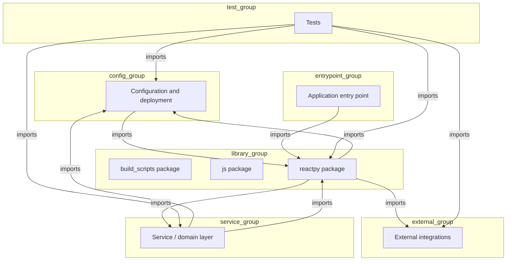

# Architecture report: reactive-python/reactpy

> Automated static analysis. **Observed** = directly seen in files/imports/AST; **Inferred** = interpretation from that evidence. Repository code was not executed.

## 1. Repository at a glance

| Item | Value |
| --- | --- |
| Repository | reactive-python/reactpy |
| Description | It's React, but in Python |
| Language | Python |
| Stars | 8151 |
| Licence | MIT |
| Analysed commit / branch | 4b765d44986a29071d7b09cbeb63b2826da6e411 / main |
| Framework(s) | FastAPI, Flask, Starlette |
| Files analysed | 344 |
| Components | 8 |

## 2. Architecture in one minute

reactive-python/reactpy - It's React, but in Python. This repository was analysed statically from 344 file(s) (196 Python). Detected technologies (observed from imports/manifests): GitHub Actions, FastAPI, Flask, Starlette, Click, requests. Files are grouped into 8 component(s): build_scripts package, Configuration and deployment, Application entry point, External integrations, js package, reactpy package, Service / domain layer, Tests. Observed entry point(s): src/build_scripts/build_py_wheel.py, src/build_scripts/copy_dir.py, src/build_scripts/install_deps.py. Findings below distinguish observed facts from inferred interpretation.

## 3. High-level block diagram

## 4. Main components

### build_scripts package (`build_scripts`)

- **Kind:** library
- **Status:** Observed
- **Confidence:** 0.85
- **Responsibility:** Groups 4 file(s) under build_scripts package (observed from repository paths and static analysis).
- **Paths:** `src/build_scripts/build_js_app.py`, `src/build_scripts/clean_js_dir.py`, `src/build_scripts/delete_old_coverage.py`, `src/build_scripts/install_playwright.py`
- **Evidence:** [src/build_scripts/build_js_app.py](https://github.com/reactive-python/reactpy/blob/4b765d44986a29071d7b09cbeb63b2826da6e411/src/build_scripts/build_js_app.py); [src/build_scripts/clean_js_dir.py](https://github.com/reactive-python/reactpy/blob/4b765d44986a29071d7b09cbeb63b2826da6e411/src/build_scripts/clean_js_dir.py); [src/build_scripts/delete_old_coverage.py](https://github.com/reactive-python/reactpy/blob/4b765d44986a29071d7b09cbeb63b2826da6e411/src/build_scripts/delete_old_coverage.py); [src/build_scripts/install_playwright.py](https://github.com/reactive-python/reactpy/blob/4b765d44986a29071d7b09cbeb63b2826da6e411/src/build_scripts/install_playwright.py)

### Configuration and deployment (`config`)

- **Kind:** config
- **Status:** Observed
- **Confidence:** 0.85
- **Responsibility:** Groups 8 file(s) under configuration and deployment (observed from repository paths and static analysis). Observed top-level functions: boolean.
- **Paths:** `pyproject.toml`, `src/js/package.json`, `src/js/packages/@reactpy/app/package.json`, `src/js/packages/@reactpy/app/tsconfig.json`, `src/js/packages/@reactpy/client/package.json`, `src/js/packages/@reactpy/client/tsconfig.json`, `src/js/tsconfig.json`, `src/reactpy/config.py`
- **Evidence:** [pyproject.toml](https://github.com/reactive-python/reactpy/blob/4b765d44986a29071d7b09cbeb63b2826da6e411/pyproject.toml); [src/js/package.json](https://github.com/reactive-python/reactpy/blob/4b765d44986a29071d7b09cbeb63b2826da6e411/src/js/package.json); [src/js/packages/@reactpy/app/package.json](https://github.com/reactive-python/reactpy/blob/4b765d44986a29071d7b09cbeb63b2826da6e411/src/js/packages/%40reactpy/app/package.json); [src/js/packages/@reactpy/app/tsconfig.json](https://github.com/reactive-python/reactpy/blob/4b765d44986a29071d7b09cbeb63b2826da6e411/src/js/packages/%40reactpy/app/tsconfig.json); [src/js/packages/@reactpy/client/package.json](https://github.com/reactive-python/reactpy/blob/4b765d44986a29071d7b09cbeb63b2826da6e411/src/js/packages/%40reactpy/client/package.json); [src/js/packages/@reactpy/client/tsconfig.json](https://github.com/reactive-python/reactpy/blob/4b765d44986a29071d7b09cbeb63b2826da6e411/src/js/packages/%40reactpy/client/tsconfig.json); [src/js/tsconfig.json](https://github.com/reactive-python/reactpy/blob/4b765d44986a29071d7b09cbeb63b2826da6e411/src/js/tsconfig.json); [src/reactpy/config.py:17](https://github.com/reactive-python/reactpy/blob/4b765d44986a29071d7b09cbeb63b2826da6e411/src/reactpy/config.py#L17)

### Application entry point (`entrypoint`)

- **Kind:** entrypoint
- **Status:** Observed
- **Confidence:** 0.85
- **Responsibility:** Groups 4 file(s) under application entry point (observed from repository paths and static analysis). Observed top-level functions: _build_packaged_static_assets, _hatch_build_command, _hatch_command, _matching_reactpy_wheel, _reactpy_version, _run_hatch_command.
- **Paths:** `src/build_scripts/build_py_wheel.py`, `src/build_scripts/copy_dir.py`, `src/build_scripts/install_deps.py`, `src/reactpy/_console/cli.py`
- **Evidence:** [src/build_scripts/build_py_wheel.py:21](https://github.com/reactive-python/reactpy/blob/4b765d44986a29071d7b09cbeb63b2826da6e411/src/build_scripts/build_py_wheel.py#L21); [src/build_scripts/copy_dir.py:12](https://github.com/reactive-python/reactpy/blob/4b765d44986a29071d7b09cbeb63b2826da6e411/src/build_scripts/copy_dir.py#L12); [src/build_scripts/install_deps.py:13](https://github.com/reactive-python/reactpy/blob/4b765d44986a29071d7b09cbeb63b2826da6e411/src/build_scripts/install_deps.py#L13); [src/reactpy/_console/cli.py:11](https://github.com/reactive-python/reactpy/blob/4b765d44986a29071d7b09cbeb63b2826da6e411/src/reactpy/_console/cli.py#L11)

### External integrations (`external_integrations`)

- **Kind:** external
- **Status:** Observed
- **Confidence:** 0.85
- **Responsibility:** Groups 12 file(s) under external integrations (observed from repository paths and static analysis).
- **Paths:** `src/build_scripts/build_js_client.py`, `src/js/packages/@reactpy/client/src/bind.tsx`, `src/js/packages/@reactpy/client/src/client.ts`, `src/js/packages/@reactpy/client/src/components.tsx`, `src/js/packages/@reactpy/client/src/event-proxy.ts`, `src/js/packages/@reactpy/client/src/handler.ts`, `src/js/packages/@reactpy/client/src/index.ts`, `src/js/packages/@reactpy/client/src/logger.ts`, `src/js/packages/@reactpy/client/src/mount.tsx`, `src/js/packages/@reactpy/client/src/types.ts`, `src/js/packages/@reactpy/client/src/vdom.tsx`, `src/js/packages/@reactpy/client/src/websocket.ts`
- **Evidence:** [src/build_scripts/build_js_client.py](https://github.com/reactive-python/reactpy/blob/4b765d44986a29071d7b09cbeb63b2826da6e411/src/build_scripts/build_js_client.py); [src/js/packages/@reactpy/client/src/bind.tsx](https://github.com/reactive-python/reactpy/blob/4b765d44986a29071d7b09cbeb63b2826da6e411/src/js/packages/%40reactpy/client/src/bind.tsx); [src/js/packages/@reactpy/client/src/client.ts](https://github.com/reactive-python/reactpy/blob/4b765d44986a29071d7b09cbeb63b2826da6e411/src/js/packages/%40reactpy/client/src/client.ts); [src/js/packages/@reactpy/client/src/components.tsx](https://github.com/reactive-python/reactpy/blob/4b765d44986a29071d7b09cbeb63b2826da6e411/src/js/packages/%40reactpy/client/src/components.tsx); [src/js/packages/@reactpy/client/src/event-proxy.ts](https://github.com/reactive-python/reactpy/blob/4b765d44986a29071d7b09cbeb63b2826da6e411/src/js/packages/%40reactpy/client/src/event-proxy.ts); [src/js/packages/@reactpy/client/src/handler.ts](https://github.com/reactive-python/reactpy/blob/4b765d44986a29071d7b09cbeb63b2826da6e411/src/js/packages/%40reactpy/client/src/handler.ts); [src/js/packages/@reactpy/client/src/index.ts](https://github.com/reactive-python/reactpy/blob/4b765d44986a29071d7b09cbeb63b2826da6e411/src/js/packages/%40reactpy/client/src/index.ts); [src/js/packages/@reactpy/client/src/logger.ts](https://github.com/reactive-python/reactpy/blob/4b765d44986a29071d7b09cbeb63b2826da6e411/src/js/packages/%40reactpy/client/src/logger.ts)

### js package (`js`)

- **Kind:** library
- **Status:** Observed
- **Confidence:** 0.85
- **Responsibility:** Groups 5 file(s) under js package (observed from repository paths and static analysis).
- **Paths:** `src/js/eslint.config.mjs`, `src/js/packages/@reactpy/app/src/index.ts`, `src/js/packages/@reactpy/app/src/preact-dom.ts`, `src/js/packages/@reactpy/app/src/preact-jsx-runtime.ts`, `src/js/packages/@reactpy/app/src/preact.ts`
- **Evidence:** [src/js/eslint.config.mjs](https://github.com/reactive-python/reactpy/blob/4b765d44986a29071d7b09cbeb63b2826da6e411/src/js/eslint.config.mjs); [src/js/packages/@reactpy/app/src/index.ts](https://github.com/reactive-python/reactpy/blob/4b765d44986a29071d7b09cbeb63b2826da6e411/src/js/packages/%40reactpy/app/src/index.ts); [src/js/packages/@reactpy/app/src/preact-dom.ts](https://github.com/reactive-python/reactpy/blob/4b765d44986a29071d7b09cbeb63b2826da6e411/src/js/packages/%40reactpy/app/src/preact-dom.ts); [src/js/packages/@reactpy/app/src/preact-jsx-runtime.ts](https://github.com/reactive-python/reactpy/blob/4b765d44986a29071d7b09cbeb63b2826da6e411/src/js/packages/%40reactpy/app/src/preact-jsx-runtime.ts); [src/js/packages/@reactpy/app/src/preact.ts](https://github.com/reactive-python/reactpy/blob/4b765d44986a29071d7b09cbeb63b2826da6e411/src/js/packages/%40reactpy/app/src/preact.ts)

### reactpy package (`reactpy`)

- **Kind:** library
- **Status:** Observed
- **Confidence:** 0.85
- **Responsibility:** Groups 40 file(s) under reactpy package (observed from repository paths and static analysis). Observed top-level classes: AsgiV2Protocol, BackendFixture, BaseEventHandler, BaseLayout, ChangedNode, Component. Observed top-level functions: _add_vdom_to_etree, _build_reactpy_wheel_from_source, _construct_prop_item, _copy_reactpy_wheel_to_static_dir, _ensure_local_reactpy_wheel, _etree_to_vdom.
- **Paths:** `src/reactpy/__init__.py`, `src/reactpy/_console/__init__.py`, `src/reactpy/_console/ast_utils.py`, `src/reactpy/_console/rewrite_keys.py`, `src/reactpy/_console/rewrite_props.py`, `src/reactpy/_event_proxy.py`, `src/reactpy/_html.py`, `src/reactpy/_option.py`, `src/reactpy/_warnings.py`, `src/reactpy/executors/__init__.py`, `src/reactpy/executors/asgi/__init__.py`, `src/reactpy/executors/asgi/middleware.py`, `src/reactpy/executors/asgi/pyscript.py`, `src/reactpy/executors/asgi/standalone.py`, `src/reactpy/executors/asgi/types.py`, `src/reactpy/executors/pyscript/__init__.py`, `src/reactpy/executors/pyscript/component_template.py`, `src/reactpy/executors/pyscript/components.py`, `src/reactpy/executors/pyscript/layout_handler.py`, `src/reactpy/executors/pyscript/utils.py`, `src/reactpy/executors/utils.py`, `src/reactpy/logging.py`, `src/reactpy/reactjs/__init__.py`, `src/reactpy/reactjs/module.py`, `src/reactpy/reactjs/types.py`, `src/reactpy/reactjs/utils.py`, `src/reactpy/templatetags/__init__.py`, `src/reactpy/templatetags/jinja.py`, `src/reactpy/testing/__init__.py`, `src/reactpy/testing/backend.py`, `src/reactpy/testing/common.py`, `src/reactpy/testing/display.py`, `src/reactpy/testing/logs.py`, `src/reactpy/transforms.py`, `src/reactpy/types.py`, `src/reactpy/utils.py`, `src/reactpy/web/__init__.py`, `src/reactpy/web/module.py`, `src/reactpy/web/utils.py`, `src/reactpy/widgets.py`
- **Evidence:** [src/reactpy/__init__.py](https://github.com/reactive-python/reactpy/blob/4b765d44986a29071d7b09cbeb63b2826da6e411/src/reactpy/__init__.py); [src/reactpy/_console/__init__.py](https://github.com/reactive-python/reactpy/blob/4b765d44986a29071d7b09cbeb63b2826da6e411/src/reactpy/_console/__init__.py); [src/reactpy/_console/ast_utils.py:18](https://github.com/reactive-python/reactpy/blob/4b765d44986a29071d7b09cbeb63b2826da6e411/src/reactpy/_console/ast_utils.py#L18); [src/reactpy/_console/rewrite_keys.py:18](https://github.com/reactive-python/reactpy/blob/4b765d44986a29071d7b09cbeb63b2826da6e411/src/reactpy/_console/rewrite_keys.py#L18); [src/reactpy/_console/rewrite_props.py:20](https://github.com/reactive-python/reactpy/blob/4b765d44986a29071d7b09cbeb63b2826da6e411/src/reactpy/_console/rewrite_props.py#L20); [src/reactpy/_event_proxy.py:124](https://github.com/reactive-python/reactpy/blob/4b765d44986a29071d7b09cbeb63b2826da6e411/src/reactpy/_event_proxy.py#L124); [src/reactpy/_html.py:99](https://github.com/reactive-python/reactpy/blob/4b765d44986a29071d7b09cbeb63b2826da6e411/src/reactpy/_html.py#L99); [src/reactpy/_option.py:15](https://github.com/reactive-python/reactpy/blob/4b765d44986a29071d7b09cbeb63b2826da6e411/src/reactpy/_option.py#L15)

### Service / domain layer (`service_layer`)

- **Kind:** service
- **Status:** Observed
- **Confidence:** 0.85
- **Responsibility:** Groups 11 file(s) under service / domain layer (observed from repository paths and static analysis). Observed top-level classes: EffectFunc, EventHandler, Layout, LifeCycleHook, ThreadLocal, Vdom. Observed top-level functions: _closure_lookup, _constant_ints_by_name, _copy_component_model_state, _create_dispatcher, _event_arg_name, _flatten_children.
- **Paths:** `src/reactpy/core/__init__.py`, `src/reactpy/core/_event_inspect.py`, `src/reactpy/core/_f_back.py`, `src/reactpy/core/_life_cycle_hook.py`, `src/reactpy/core/_thread_local.py`, `src/reactpy/core/component.py`, `src/reactpy/core/events.py`, `src/reactpy/core/hooks.py`, `src/reactpy/core/layout.py`, `src/reactpy/core/serve.py`, `src/reactpy/core/vdom.py`
- **Evidence:** [src/reactpy/core/__init__.py](https://github.com/reactive-python/reactpy/blob/4b765d44986a29071d7b09cbeb63b2826da6e411/src/reactpy/core/__init__.py); [src/reactpy/core/_event_inspect.py:24](https://github.com/reactive-python/reactpy/blob/4b765d44986a29071d7b09cbeb63b2826da6e411/src/reactpy/core/_event_inspect.py#L24); [src/reactpy/core/_f_back.py:7](https://github.com/reactive-python/reactpy/blob/4b765d44986a29071d7b09cbeb63b2826da6e411/src/reactpy/core/_f_back.py#L7); [src/reactpy/core/_life_cycle_hook.py:18](https://github.com/reactive-python/reactpy/blob/4b765d44986a29071d7b09cbeb63b2826da6e411/src/reactpy/core/_life_cycle_hook.py#L18); [src/reactpy/core/_thread_local.py:9](https://github.com/reactive-python/reactpy/blob/4b765d44986a29071d7b09cbeb63b2826da6e411/src/reactpy/core/_thread_local.py#L9); [src/reactpy/core/component.py:11](https://github.com/reactive-python/reactpy/blob/4b765d44986a29071d7b09cbeb63b2826da6e411/src/reactpy/core/component.py#L11); [src/reactpy/core/events.py:14](https://github.com/reactive-python/reactpy/blob/4b765d44986a29071d7b09cbeb63b2826da6e411/src/reactpy/core/events.py#L14); [src/reactpy/core/hooks.py:55](https://github.com/reactive-python/reactpy/blob/4b765d44986a29071d7b09cbeb63b2826da6e411/src/reactpy/core/hooks.py#L55)

### Tests (`tests`)

- **Kind:** test
- **Status:** Observed
- **Confidence:** 0.85
- **Responsibility:** Groups 80 file(s) under tests (observed from repository paths and static analysis). Observed top-level classes: CannedClient, ElementInfo, Event, FakeClient, LayoutRunner, Method. Observed top-level functions: Counter, SampleApp, _ControlledInputWhichClearsOnKeyDown, _ControlledInputWithMirror, _HeavyPage, _ack_seq_of.
- **Paths:** `src/js/packages/@reactpy/client/tests/event-proxy.test.ts`, `tests/__init__.py`, `tests/conftest.py`, `tests/sample.py`, `tests/templates/index.html`, `tests/templates/jinja_bad_kwargs.html`, `tests/templates/pyscript.html`, `tests/test_asgi/__init__.py`, `tests/test_asgi/pyscript_components/load_first.py`, `tests/test_asgi/pyscript_components/load_second.py`, `tests/test_asgi/pyscript_components/root.py`, `tests/test_asgi/test_init.py`, `tests/test_asgi/test_middleware.py`, `tests/test_asgi/test_pyscript.py`, `tests/test_asgi/test_standalone.py`, `tests/test_asgi/test_utils.py`, `tests/test_build_py_wheel.py`, `tests/test_client.py`, `tests/test_config.py`, `tests/test_console/__init__.py`, `tests/test_console/test_rewrite_keys.py`, `tests/test_console/test_rewrite_props.py`, `tests/test_core/__init__.py`, `tests/test_core/test_component.py`, `tests/test_core/test_event_inspect.py`, `tests/test_core/test_event_proxy.py`, `tests/test_core/test_events.py`, `tests/test_core/test_hooks.py`, `tests/test_core/test_layout.py`, `tests/test_core/test_serve.py`, `tests/test_core/test_vdom.py`, `tests/test_html.py`, `tests/test_option.py`, `tests/test_pyscript/__init__.py`, `tests/test_pyscript/pyscript_components/custom_root_name.py`, `tests/test_pyscript/pyscript_components/root.py`, `tests/test_pyscript/pyscript_components/root_error.py`, `tests/test_pyscript/test_components.py`, `tests/test_pyscript/test_utils.py`, `tests/test_reactjs/__init__.py`, `tests/test_reactjs/js_fixtures/callable-prop.js`, `tests/test_reactjs/js_fixtures/component-can-have-child.js`, `tests/test_reactjs/js_fixtures/export-resolution/index.js`, `tests/test_reactjs/js_fixtures/export-resolution/one.js`, `tests/test_reactjs/js_fixtures/export-resolution/two.js`, `tests/test_reactjs/js_fixtures/exports-syntax.js`, `tests/test_reactjs/js_fixtures/exports-two-components.js`, `tests/test_reactjs/js_fixtures/generic-module.js`, `tests/test_reactjs/js_fixtures/keys-properly-propagated.js`, `tests/test_reactjs/js_fixtures/nest-custom-under-web.js`, `tests/test_reactjs/js_fixtures/set-flag-when-unmount-is-called.js`, `tests/test_reactjs/js_fixtures/simple-button.js`, `tests/test_reactjs/js_fixtures/subcomponent-notation.js`, `tests/test_reactjs/test_modules.py`, `tests/test_reactjs/test_modules_from_npm.py`, `tests/test_reactjs/test_utils.py`, `tests/test_sample.py`, `tests/test_testing.py`, `tests/test_utils.py`, `tests/test_web/__init__.py`, `tests/test_web/js_fixtures/callable-prop.js`, `tests/test_web/js_fixtures/component-can-have-child.js`, `tests/test_web/js_fixtures/export-resolution/index.js`, `tests/test_web/js_fixtures/export-resolution/one.js`, `tests/test_web/js_fixtures/export-resolution/two.js`, `tests/test_web/js_fixtures/exports-syntax.js`, `tests/test_web/js_fixtures/exports-two-components.js`, `tests/test_web/js_fixtures/generic-module.js`, `tests/test_web/js_fixtures/keys-properly-propagated.js`, `tests/test_web/js_fixtures/set-flag-when-unmount-is-called.js`, `tests/test_web/js_fixtures/simple-button.js`, `tests/test_web/js_fixtures/subcomponent-notation.js`, `tests/test_web/test_module.py`, `tests/test_widgets.py`, `tests/tooling/__init__.py`, `tests/tooling/aio.py`, `tests/tooling/common.py`, `tests/tooling/hooks.py`, `tests/tooling/layout.py`, `tests/tooling/select.py`
- **Evidence:** [src/js/packages/@reactpy/client/tests/event-proxy.test.ts](https://github.com/reactive-python/reactpy/blob/4b765d44986a29071d7b09cbeb63b2826da6e411/src/js/packages/%40reactpy/client/tests/event-proxy.test.ts); [tests/__init__.py](https://github.com/reactive-python/reactpy/blob/4b765d44986a29071d7b09cbeb63b2826da6e411/tests/__init__.py); [tests/conftest.py:22](https://github.com/reactive-python/reactpy/blob/4b765d44986a29071d7b09cbeb63b2826da6e411/tests/conftest.py#L22); [tests/sample.py:8](https://github.com/reactive-python/reactpy/blob/4b765d44986a29071d7b09cbeb63b2826da6e411/tests/sample.py#L8); [tests/templates/index.html](https://github.com/reactive-python/reactpy/blob/4b765d44986a29071d7b09cbeb63b2826da6e411/tests/templates/index.html); [tests/templates/jinja_bad_kwargs.html](https://github.com/reactive-python/reactpy/blob/4b765d44986a29071d7b09cbeb63b2826da6e411/tests/templates/jinja_bad_kwargs.html); [tests/templates/pyscript.html](https://github.com/reactive-python/reactpy/blob/4b765d44986a29071d7b09cbeb63b2826da6e411/tests/templates/pyscript.html); [tests/test_asgi/__init__.py](https://github.com/reactive-python/reactpy/blob/4b765d44986a29071d7b09cbeb63b2826da6e411/tests/test_asgi/__init__.py)

## 5. Execution flow

**Observed** entry point(s):

- [src/build_scripts/build_py_wheel.py:149](https://github.com/reactive-python/reactpy/blob/4b765d44986a29071d7b09cbeb63b2826da6e411/src/build_scripts/build_py_wheel.py#L149)
- [src/build_scripts/copy_dir.py:24](https://github.com/reactive-python/reactpy/blob/4b765d44986a29071d7b09cbeb63b2826da6e411/src/build_scripts/copy_dir.py#L24)
- [src/build_scripts/install_deps.py:43](https://github.com/reactive-python/reactpy/blob/4b765d44986a29071d7b09cbeb63b2826da6e411/src/build_scripts/install_deps.py#L43)
- [src/reactpy/_console/cli.py](https://github.com/reactive-python/reactpy/blob/4b765d44986a29071d7b09cbeb63b2826da6e411/src/reactpy/_console/cli.py)
- [src/reactpy/_console/rewrite_keys.py:18](https://github.com/reactive-python/reactpy/blob/4b765d44986a29071d7b09cbeb63b2826da6e411/src/reactpy/_console/rewrite_keys.py#L18)
- [src/reactpy/_console/rewrite_props.py:20](https://github.com/reactive-python/reactpy/blob/4b765d44986a29071d7b09cbeb63b2826da6e411/src/reactpy/_console/rewrite_props.py#L20)

**Observed** routes (from decorators):

- `ROUTE /` -> `index` in `docs/source/guides/getting-started/_static/embed-reactpy-view/main.py:11`

Representative flow (derived from observed entry points and the import graph; steps beyond the entry point are **Inferred**):

1. Execution starts at an observed entry point listed above, if present.
2. `config` imports `reactpy` (Configuration and deployment -> reactpy package).
3. `entrypoint` imports `reactpy` (Application entry point -> reactpy package).
4. `reactpy` imports `config` (reactpy package -> Configuration and deployment).
5. `reactpy` imports `external_integrations` (reactpy package -> External integrations).
6. `reactpy` imports `service_layer` (reactpy package -> Service / domain layer).
7. `service_layer` imports `config` (Service / domain layer -> Configuration and deployment).
8. `service_layer` imports `reactpy` (Service / domain layer -> reactpy package).
9. `tests` imports `config` (Tests -> Configuration and deployment).

## 6. Project structure

### `(root)`

- `.editorconfig` - config (488 bytes)
- `.gitignore` - other (612 bytes)
- `.pre-commit-config.yaml` - config (821 bytes)
- `.prettierrc` - other (76 bytes)
- `CHANGELOG.md` - docs (36631 bytes)
- `CODE_OF_CONDUCT.md` - docs (3355 bytes)
- `LICENSE` - docs (1093 bytes)
- `README.md` - docs (3073 bytes)
- `pyproject.toml` - manifest (9441 bytes)

### `.github`

- `.github/CODEOWNERS` - other (13 bytes)
- `.github/FUNDING.yml` - config (656 bytes)
- `.github/ISSUE_TEMPLATE/config.yml` - config (211 bytes)
- `.github/ISSUE_TEMPLATE/issue-form.yml` - config (560 bytes)
- `.github/copilot-instructions.md` - docs (15042 bytes)
- `.github/pull_request_template.md` - docs (485 bytes)
- `.github/workflows/.hatch-run.yml` - ci, YAML (2052 bytes)
- `.github/workflows/check.yml` - ci, YAML (1648 bytes)
- `.github/workflows/codeql-analysis.yml` - ci, YAML (2765 bytes)
- `.github/workflows/publish.yml` - ci, YAML (1424 bytes)

### `branding`

- `branding/svg/reactpy-logo-landscape-padded.svg` - other (18591 bytes)
- `branding/svg/reactpy-logo-landscape.svg` - other (18174 bytes)
- `branding/svg/reactpy-logo-square-padded.svg` - other (17472 bytes)
- `branding/svg/reactpy-logo-square.svg` - other (17542 bytes)

### `docs`

- `docs/.gitignore` - docs (73 bytes)
- `docs/Dockerfile` - container (809 bytes)
- `docs/README.md` - docs (31 bytes)
- `docs/docs_app/__init__.py` - docs (0 bytes)
- `docs/docs_app/app.py` - docs (1284 bytes)
- `docs/docs_app/dev.py` - docs (2884 bytes)
- `docs/docs_app/examples.py` - docs (5079 bytes)
- `docs/docs_app/prod.py` - docs (323 bytes)
- `docs/main.py` - docs (147 bytes)
- `docs/pyproject.toml` - manifest (548 bytes)
- `docs/source/_custom_js/README.md` - docs (153 bytes)
- `docs/source/_custom_js/package.json` - manifest (575 bytes)
- `docs/source/_custom_js/rollup.config.js` - docs (639 bytes)
- `docs/source/_custom_js/src/index.js` - docs (2403 bytes)
- `docs/source/_exts/async_doctest.py` - docs (1253 bytes)
- `docs/source/_exts/autogen_api_docs.py` - docs (3881 bytes)
- `docs/source/_exts/build_custom_js.py` - docs (359 bytes)
- `docs/source/_exts/copy_vdom_json_schema.py` - docs (666 bytes)
- `docs/source/_exts/custom_autosectionlabel.py` - docs (2480 bytes)
- `docs/source/_exts/patched_html_translator.py` - docs (770 bytes)
- `docs/source/_exts/reactpy_example.py` - docs (4820 bytes)
- `docs/source/_exts/reactpy_view.py` - docs (1986 bytes)
- `docs/source/_static/css/furo-theme-overrides.css` - docs (79 bytes)
- `docs/source/_static/css/larger-api-margins.css` - docs (122 bytes)
- `docs/source/_static/css/larger-headings.css` - docs (90 bytes)
- `docs/source/_static/css/reactpy-view.css` - docs (960 bytes)
- `docs/source/_static/css/sphinx-design-overrides.css` - docs (208 bytes)
- `docs/source/_static/css/widget-output-css-overrides.css` - docs (159 bytes)
- `docs/source/about/changelog.rst` - docs (74 bytes)
- `docs/source/about/contributor-guide.rst` - docs (5222 bytes)
- `docs/source/about/credits-and-licenses.rst` - docs (602 bytes)
- `docs/source/conf.py` - docs (10201 bytes)
- `docs/source/guides/adding-interactivity/components-with-state/_examples/adding_state_variable/data.json` - config (5639 bytes)
- `docs/source/guides/adding-interactivity/components-with-state/_examples/adding_state_variable/main.py` - docs (890 bytes)
- `docs/source/guides/adding-interactivity/components-with-state/_examples/isolated_state/data.json` - config (5639 bytes)
- `docs/source/guides/adding-interactivity/components-with-state/_examples/isolated_state/main.py` - docs (1440 bytes)
- `docs/source/guides/adding-interactivity/components-with-state/_examples/multiple_state_variables/data.json` - config (5639 bytes)
- `docs/source/guides/adding-interactivity/components-with-state/_examples/multiple_state_variables/main.py` - docs (1235 bytes)
- `docs/source/guides/adding-interactivity/components-with-state/_examples/when_variables_are_not_enough/data.json` - config (5639 bytes)
- `docs/source/guides/adding-interactivity/components-with-state/_examples/when_variables_are_not_enough/main.py` - docs (957 bytes)
- `docs/source/guides/adding-interactivity/components-with-state/index.rst` - docs (13777 bytes)
- `docs/source/guides/adding-interactivity/dangers-of-mutability/_examples/dict_remove.py` - docs (1728 bytes)
- `docs/source/guides/adding-interactivity/dangers-of-mutability/_examples/dict_update.py` - docs (1218 bytes)
- `docs/source/guides/adding-interactivity/dangers-of-mutability/_examples/list_insert.py` - docs (720 bytes)
- `docs/source/guides/adding-interactivity/dangers-of-mutability/_examples/list_re_order.py` - docs (645 bytes)
- `docs/source/guides/adding-interactivity/dangers-of-mutability/_examples/list_remove.py` - docs (1239 bytes)
- `docs/source/guides/adding-interactivity/dangers-of-mutability/_examples/list_replace.py` - docs (661 bytes)
- `docs/source/guides/adding-interactivity/dangers-of-mutability/_examples/moving_dot.py` - docs (1259 bytes)
- `docs/source/guides/adding-interactivity/dangers-of-mutability/_examples/moving_dot_broken.py` - docs (1199 bytes)
- `docs/source/guides/adding-interactivity/dangers-of-mutability/_examples/set_remove.py` - docs (1166 bytes)
- `docs/source/guides/adding-interactivity/dangers-of-mutability/_examples/set_update.py` - docs (1033 bytes)
- `docs/source/guides/adding-interactivity/dangers-of-mutability/index.rst` - docs (14364 bytes)
- `docs/source/guides/adding-interactivity/index.rst` - docs (8208 bytes)
- `docs/source/guides/adding-interactivity/multiple-state-updates/_examples/delay_before_count_updater.py` - docs (385 bytes)
- `docs/source/guides/adding-interactivity/multiple-state-updates/_examples/delay_before_set_count.py` - docs (362 bytes)
- `docs/source/guides/adding-interactivity/multiple-state-updates/_examples/set_color_3_times.py` - docs (591 bytes)
- `docs/source/guides/adding-interactivity/multiple-state-updates/_examples/set_state_function.py` - docs (451 bytes)
- `docs/source/guides/adding-interactivity/multiple-state-updates/index.rst` - docs (5144 bytes)
- `docs/source/guides/adding-interactivity/responding-to-events/_examples/audio_player.py` - docs (511 bytes)
- `docs/source/guides/adding-interactivity/responding-to-events/_examples/button_async_handlers.py` - docs (437 bytes)
- `docs/source/guides/adding-interactivity/responding-to-events/_examples/button_does_nothing.py` - docs (132 bytes)
- `docs/source/guides/adding-interactivity/responding-to-events/_examples/button_handler_as_arg.py` - docs (619 bytes)
- `docs/source/guides/adding-interactivity/responding-to-events/_examples/button_prints_event.py` - docs (197 bytes)
- `docs/source/guides/adding-interactivity/responding-to-events/_examples/button_prints_message.py` - docs (364 bytes)
- `docs/source/guides/adding-interactivity/responding-to-events/_examples/prevent_default_event_actions.py` - docs (425 bytes)
- `docs/source/guides/adding-interactivity/responding-to-events/_examples/stop_event_propagation.py` - docs (1273 bytes)
- `docs/source/guides/adding-interactivity/responding-to-events/index.rst` - docs (5544 bytes)
- `docs/source/guides/adding-interactivity/state-as-a-snapshot/_examples/delayed_print_after_set.py` - docs (419 bytes)
- `docs/source/guides/adding-interactivity/state-as-a-snapshot/_examples/print_chat_message.py` - docs (1212 bytes)
- `docs/source/guides/adding-interactivity/state-as-a-snapshot/_examples/print_count_after_set.py` - docs (331 bytes)
- `docs/source/guides/adding-interactivity/state-as-a-snapshot/_examples/send_message.py` - docs (893 bytes)
- `docs/source/guides/adding-interactivity/state-as-a-snapshot/_examples/set_counter_3_times.py` - docs (371 bytes)
- `docs/source/guides/adding-interactivity/state-as-a-snapshot/index.rst` - docs (6787 bytes)
- `docs/source/guides/creating-interfaces/html-with-reactpy/index.rst` - docs (4238 bytes)
- `docs/source/guides/creating-interfaces/index.rst` - docs (4136 bytes)
- `docs/source/guides/creating-interfaces/rendering-data/_examples/sorted_and_filtered_todo_list.py` - docs (1026 bytes)
- `docs/source/guides/creating-interfaces/rendering-data/_examples/todo_from_list.py` - docs (581 bytes)
- `docs/source/guides/creating-interfaces/rendering-data/_examples/todo_list_with_keys.py` - docs (1116 bytes)
- `docs/source/guides/creating-interfaces/rendering-data/index.rst` - docs (9543 bytes)
- `docs/source/guides/creating-interfaces/your-first-components/_examples/bad_conditional_todo_list.py` - docs (484 bytes)
- `docs/source/guides/creating-interfaces/your-first-components/_examples/good_conditional_todo_list.py` - docs (444 bytes)
- `docs/source/guides/creating-interfaces/your-first-components/_examples/nested_photos.py` - docs (408 bytes)
- `docs/source/guides/creating-interfaces/your-first-components/_examples/parametrized_photos.py` - docs (492 bytes)
- `docs/source/guides/creating-interfaces/your-first-components/_examples/simple_photo.py` - docs (253 bytes)
- `docs/source/guides/creating-interfaces/your-first-components/_examples/todo_list.py` - docs (420 bytes)
- `docs/source/guides/creating-interfaces/your-first-components/_examples/wrap_in_div.py` - docs (279 bytes)
- `docs/source/guides/creating-interfaces/your-first-components/_examples/wrap_in_fragment.py` - docs (277 bytes)
- `docs/source/guides/creating-interfaces/your-first-components/index.rst` - docs (4766 bytes)
- `docs/source/guides/escape-hatches/_examples/material_ui_button_no_action.py` - docs (312 bytes)
- `docs/source/guides/escape-hatches/_examples/material_ui_button_on_click.py` - docs (624 bytes)
- `docs/source/guides/escape-hatches/_examples/super_simple_chart/main.py` - docs (763 bytes)
- `docs/source/guides/escape-hatches/_examples/super_simple_chart/super-simple-chart.js` - docs (2127 bytes)
- `docs/source/guides/escape-hatches/distributing-javascript.rst` - docs (10518 bytes)
- `docs/source/guides/escape-hatches/index.rst` - docs (205 bytes)
- `docs/source/guides/escape-hatches/javascript-components.rst` - docs (5259 bytes)
- `docs/source/guides/escape-hatches/using-a-custom-backend.rst` - docs (153 bytes)
- `docs/source/guides/escape-hatches/using-a-custom-client.rst` - docs (149 bytes)
- `docs/source/guides/getting-started/_examples/debug_error_example.py` - docs (325 bytes)
- `docs/source/guides/getting-started/_examples/hello_world.py` - docs (112 bytes)
- `docs/source/guides/getting-started/_examples/run_fastapi.py` - docs (425 bytes)
- `docs/source/guides/getting-started/_examples/run_flask.py` - docs (419 bytes)
- `docs/source/guides/getting-started/_examples/run_sanic.py` - docs (470 bytes)
- `docs/source/guides/getting-started/_examples/run_starlette.py` - docs (452 bytes)
- `docs/source/guides/getting-started/_examples/run_tornado.py` - docs (608 bytes)
- `docs/source/guides/getting-started/_examples/sample_app.py` - docs (54 bytes)
- `docs/source/guides/getting-started/_static/embed-doc-ex.html` - docs (265 bytes)
- `docs/source/guides/getting-started/_static/embed-reactpy-view/index.html` - docs (788 bytes)
- `docs/source/guides/getting-started/_static/embed-reactpy-view/main.py` - docs (440 bytes)
- `docs/source/guides/getting-started/_static/logo-django.svg` - docs (3268 bytes)
- `docs/source/guides/getting-started/_static/logo-jupyter.svg` - docs (10070 bytes)
- `docs/source/guides/getting-started/_static/logo-plotly.svg` - docs (7595 bytes)
- `docs/source/guides/getting-started/index.rst` - docs (4027 bytes)
- `docs/source/guides/getting-started/installing-reactpy.rst` - docs (4010 bytes)
- `docs/source/guides/getting-started/running-reactpy.rst` - docs (6507 bytes)
- `docs/source/guides/managing-state/combining-contexts-and-reducers/index.rst` - docs (112 bytes)
- `docs/source/guides/managing-state/deeply-sharing-state-with-contexts/index.rst` - docs (118 bytes)
- `docs/source/guides/managing-state/how-to-structure-state/index.rst` - docs (123 bytes)
- `docs/source/guides/managing-state/index.rst` - docs (3675 bytes)
- `docs/source/guides/managing-state/sharing-component-state/_examples/filterable_list/data.json` - config (766 bytes)
- `docs/source/guides/managing-state/sharing-component-state/_examples/filterable_list/main.py` - docs (1113 bytes)
- `docs/source/guides/managing-state/sharing-component-state/_examples/synced_inputs/main.py` - docs (497 bytes)
- `docs/source/guides/managing-state/sharing-component-state/index.rst` - docs (1164 bytes)
- `docs/source/guides/managing-state/simplifying-updates-with-reducers/index.rst` - docs (116 bytes)
- `docs/source/guides/managing-state/when-and-how-to-reset-state/index.rst` - docs (130 bytes)
- `docs/source/guides/understanding-reactpy/_static/idom-flow-diagram.svg` - docs (16737 bytes)
- `docs/source/guides/understanding-reactpy/_static/mvc-flow-diagram.svg` - docs (18573 bytes)
- `docs/source/guides/understanding-reactpy/index.rst` - docs (282 bytes)
- `docs/source/guides/understanding-reactpy/layout-render-servers.rst` - docs (120 bytes)
- `docs/source/guides/understanding-reactpy/representing-html.rst` - docs (2530 bytes)
- `docs/source/guides/understanding-reactpy/the-rendering-pipeline.rst` - docs (162 bytes)
- `docs/source/guides/understanding-reactpy/the-rendering-process.rst` - docs (182 bytes)
- `docs/source/guides/understanding-reactpy/what-are-components.rst` - docs (116 bytes)
- `docs/source/guides/understanding-reactpy/why-reactpy-needs-keys.rst` - docs (123 bytes)
- `docs/source/guides/understanding-reactpy/writing-tests.rst` - docs (96 bytes)
- `docs/source/index.rst` - docs (6816 bytes)
- `docs/source/reference/_examples/character_movement/main.py` - docs (2005 bytes)
- `docs/source/reference/_examples/click_count.py` - docs (253 bytes)
- `docs/source/reference/_examples/material_ui_switch.py` - docs (519 bytes)
- `docs/source/reference/_examples/matplotlib_plot.py` - docs (2103 bytes)
- `docs/source/reference/_examples/network_graph.py` - docs (921 bytes)
- `docs/source/reference/_examples/pigeon_maps.py` - docs (1158 bytes)
- `docs/source/reference/_examples/simple_dashboard.py` - docs (2689 bytes)
- `docs/source/reference/_examples/slideshow.py` - docs (385 bytes)
- `docs/source/reference/_examples/snake_game.py` - docs (5372 bytes)
- `docs/source/reference/_examples/todo.py` - docs (898 bytes)
- `docs/source/reference/_examples/use_reducer_counter.py` - docs (721 bytes)
- `docs/source/reference/_examples/use_state_counter.py` - docs (612 bytes)
- `docs/source/reference/_examples/victory_chart.py` - docs (302 bytes)
- `docs/source/reference/_static/vdom-json-schema.json` - config (2243 bytes)
- `docs/source/reference/browser-events.rst` - docs (893 bytes)
- `docs/source/reference/hooks-api.rst` - docs (13010 bytes)
- `docs/source/reference/html-attributes.rst` - docs (7501 bytes)
- `docs/source/reference/javascript-api.rst` - docs (99 bytes)
- `docs/source/reference/specifications.rst` - docs (5019 bytes)

### `src`

- `src/build_scripts/build_js_app.py` - source, Python (629 bytes)
- `src/build_scripts/build_js_client.py` - source, Python (741 bytes)
- `src/build_scripts/build_py_wheel.py` - source, Python (4274 bytes)
- `src/build_scripts/clean_js_dir.py` - source, Python (1701 bytes)
- `src/build_scripts/copy_dir.py` - source, Python (1030 bytes)
- `src/build_scripts/delete_old_coverage.py` - source, Python (575 bytes)
- `src/build_scripts/install_deps.py` - source, Python (1309 bytes)
- `src/build_scripts/install_playwright.py` - source, Python (706 bytes)
- `src/js/.gitignore` - other (80 bytes)
- `src/js/eslint.config.mjs` - source, JavaScript (662 bytes)
- `src/js/package.json` - manifest (676 bytes)
- `src/js/packages/@reactpy/app/package.json` - manifest (838 bytes)
- `src/js/packages/@reactpy/app/src/index.ts` - source, TypeScript (48 bytes)
- `src/js/packages/@reactpy/app/src/preact-dom.ts` - source, TypeScript (163 bytes)
- `src/js/packages/@reactpy/app/src/preact-jsx-runtime.ts` - source, TypeScript (43 bytes)
- `src/js/packages/@reactpy/app/src/preact.ts` - source, TypeScript (104 bytes)
- `src/js/packages/@reactpy/app/tsconfig.json` - config (269 bytes)
- `src/js/packages/@reactpy/client/README.md` - docs (61 bytes)
- `src/js/packages/@reactpy/client/package.json` - manifest (740 bytes)
- `src/js/packages/@reactpy/client/src/bind.tsx` - source, TypeScript (1521 bytes)
- `src/js/packages/@reactpy/client/src/client.ts` - source, TypeScript (3375 bytes)
- `src/js/packages/@reactpy/client/src/components.tsx` - source, TypeScript (19331 bytes)
- `src/js/packages/@reactpy/client/src/event-proxy.ts` - source, TypeScript (35983 bytes)
- `src/js/packages/@reactpy/client/src/handler.ts` - source, TypeScript (1773 bytes)
- `src/js/packages/@reactpy/client/src/index.ts` - source, TypeScript (412 bytes)
- `src/js/packages/@reactpy/client/src/logger.ts` - source, TypeScript (300 bytes)
- `src/js/packages/@reactpy/client/src/mount.tsx` - source, TypeScript (1325 bytes)
- `src/js/packages/@reactpy/client/src/types.ts` - source, TypeScript (3827 bytes)
- `src/js/packages/@reactpy/client/src/vdom.tsx` - source, TypeScript (12292 bytes)
- `src/js/packages/@reactpy/client/src/websocket.ts` - source, TypeScript (2437 bytes)
- `src/js/packages/@reactpy/client/tests/event-proxy.test.ts` - test, TypeScript (43723 bytes)
- `src/js/packages/@reactpy/client/tsconfig.json` - config (179 bytes)
- `src/js/tsconfig.json` - config (652 bytes)
- `src/reactpy/__init__.py` - source, Python (1226 bytes)
- `src/reactpy/_console/__init__.py` - source, Python (0 bytes)
- `src/reactpy/_console/ast_utils.py` - source, Python (6340 bytes)
- `src/reactpy/_console/cli.py` - source, Python (346 bytes)
- `src/reactpy/_console/rewrite_keys.py` - source, Python (3505 bytes)
- `src/reactpy/_console/rewrite_props.py` - source, Python (4791 bytes)
- `src/reactpy/_event_proxy.py` - source, Python (50807 bytes)
- `src/reactpy/_html.py` - source, Python (11529 bytes)
- `src/reactpy/_option.py` - source, Python (5115 bytes)
- `src/reactpy/_warnings.py` - source, Python (933 bytes)
- `src/reactpy/config.py` - source, Python (5042 bytes)
- `src/reactpy/core/__init__.py` - source, Python (0 bytes)
- `src/reactpy/core/_event_inspect.py` - source, Python (12720 bytes)
- `src/reactpy/core/_f_back.py` - source, Python (605 bytes)
- `src/reactpy/core/_life_cycle_hook.py` - source, Python (11251 bytes)
- `src/reactpy/core/_thread_local.py` - source, Python (828 bytes)
- `src/reactpy/core/component.py` - source, Python (969 bytes)
- `src/reactpy/core/events.py` - source, Python (12001 bytes)
- `src/reactpy/core/hooks.py` - source, Python (20639 bytes)
- `src/reactpy/core/layout.py` - source, Python (44857 bytes)
- `src/reactpy/core/serve.py` - source, Python (2993 bytes)
- `src/reactpy/core/vdom.py` - source, Python (10254 bytes)
- `src/reactpy/executors/__init__.py` - source, Python (0 bytes)
- `src/reactpy/executors/asgi/__init__.py` - source, Python (405 bytes)
- `src/reactpy/executors/asgi/middleware.py` - source, Python (12831 bytes)
- `src/reactpy/executors/asgi/pyscript.py` - source, Python (6065 bytes)
- `src/reactpy/executors/asgi/standalone.py` - source, Python (9475 bytes)
- `src/reactpy/executors/asgi/types.py` - source, Python (3362 bytes)
- `src/reactpy/executors/pyscript/__init__.py` - source, Python (0 bytes)
- `src/reactpy/executors/pyscript/component_template.py` - source, Python (788 bytes)
- `src/reactpy/executors/pyscript/components.py` - source, Python (1925 bytes)
- `src/reactpy/executors/pyscript/layout_handler.py` - source, Python (6447 bytes)
- `src/reactpy/executors/pyscript/utils.py` - source, Python (14763 bytes)
- `src/reactpy/executors/utils.py` - source, Python (3848 bytes)
- `src/reactpy/logging.py` - source, Python (857 bytes)
- `src/reactpy/py.typed` - other (26 bytes)
- `src/reactpy/reactjs/__init__.py` - source, Python (12619 bytes)
- `src/reactpy/reactjs/module.py` - source, Python (9181 bytes)
- `src/reactpy/reactjs/types.py` - source, Python (208 bytes)
- `src/reactpy/reactjs/utils.py` - source, Python (7015 bytes)
- `src/reactpy/static/pyscript-hide-debug.css` - other (33 bytes)
- `src/reactpy/templatetags/__init__.py` - source, Python (80 bytes)
- `src/reactpy/templatetags/jinja.py` - source, Python (1564 bytes)
- `src/reactpy/testing/__init__.py` - source, Python (663 bytes)
- `src/reactpy/testing/backend.py` - source, Python (7576 bytes)
- `src/reactpy/testing/common.py` - source, Python (7136 bytes)
- `src/reactpy/testing/display.py` - source, Python (3594 bytes)
- `src/reactpy/testing/logs.py` - source, Python (5676 bytes)
- `src/reactpy/transforms.py` - source, Python (11944 bytes)
- `src/reactpy/types.py` - source, Python (35623 bytes)
- `src/reactpy/utils.py` - source, Python (10945 bytes)
- `src/reactpy/web/__init__.py` - source, Python (216 bytes)
- `src/reactpy/web/module.py` - source, Python (3332 bytes)
- `src/reactpy/web/utils.py` - source, Python (136 bytes)
- `src/reactpy/widgets.py` - source, Python (2627 bytes)

### `tests`

- `tests/__init__.py` - test, Python (0 bytes)
- `tests/conftest.py` - test, Python (1637 bytes)
- `tests/sample.py` - test, Python (527 bytes)
- `tests/templates/index.html` - test (140 bytes)
- `tests/templates/jinja_bad_kwargs.html` - test (133 bytes)
- `tests/templates/pyscript.html` - test (216 bytes)
- `tests/test_asgi/__init__.py` - test, Python (0 bytes)
- `tests/test_asgi/pyscript_components/load_first.py` - test, Python (162 bytes)
- `tests/test_asgi/pyscript_components/load_second.py` - test, Python (360 bytes)
- `tests/test_asgi/pyscript_components/root.py` - test, Python (359 bytes)
- `tests/test_asgi/test_init.py` - test, Python (782 bytes)
- `tests/test_asgi/test_middleware.py` - test, Python (5944 bytes)
- `tests/test_asgi/test_pyscript.py` - test, Python (6173 bytes)
- `tests/test_asgi/test_standalone.py` - test, Python (11309 bytes)
- `tests/test_asgi/test_utils.py` - test, Python (1330 bytes)
- `tests/test_build_py_wheel.py` - test, Python (4132 bytes)
- `tests/test_client.py` - test, Python (4045 bytes)
- `tests/test_config.py` - test, Python (1448 bytes)
- `tests/test_console/__init__.py` - test, Python (0 bytes)
- `tests/test_console/test_rewrite_keys.py` - test, Python (5453 bytes)
- `tests/test_console/test_rewrite_props.py` - test, Python (2927 bytes)
- `tests/test_core/__init__.py` - test, Python (0 bytes)
- `tests/test_core/test_component.py` - test, Python (1978 bytes)
- `tests/test_core/test_event_inspect.py` - test, Python (17350 bytes)
- `tests/test_core/test_event_proxy.py` - test, Python (66263 bytes)
- `tests/test_core/test_events.py` - test, Python (47697 bytes)
- `tests/test_core/test_hooks.py` - test, Python (45330 bytes)
- `tests/test_core/test_layout.py` - test, Python (64720 bytes)
- `tests/test_core/test_serve.py` - test, Python (6763 bytes)
- `tests/test_core/test_vdom.py` - test, Python (11076 bytes)
- `tests/test_html.py` - test, Python (4800 bytes)
- `tests/test_option.py` - test, Python (4081 bytes)
- `tests/test_pyscript/__init__.py` - test, Python (0 bytes)
- `tests/test_pyscript/pyscript_components/custom_root_name.py` - test, Python (361 bytes)
- `tests/test_pyscript/pyscript_components/root.py` - test, Python (359 bytes)
- `tests/test_pyscript/pyscript_components/root_error.py` - test, Python (520 bytes)
- `tests/test_pyscript/test_components.py` - test, Python (3270 bytes)
- `tests/test_pyscript/test_utils.py` - test, Python (29280 bytes)
- `tests/test_reactjs/__init__.py` - test, Python (0 bytes)
- `tests/test_reactjs/js_fixtures/callable-prop.js` - test, JavaScript (588 bytes)
- `tests/test_reactjs/js_fixtures/component-can-have-child.js` - test, JavaScript (742 bytes)
- `tests/test_reactjs/js_fixtures/export-resolution/index.js` - test, JavaScript (53 bytes)
- `tests/test_reactjs/js_fixtures/export-resolution/one.js` - test, JavaScript (195 bytes)
- `tests/test_reactjs/js_fixtures/export-resolution/two.js` - test, JavaScript (66 bytes)
- `tests/test_reactjs/js_fixtures/exports-syntax.js` - test, JavaScript (914 bytes)
- `tests/test_reactjs/js_fixtures/exports-two-components.js` - test, JavaScript (515 bytes)
- `tests/test_reactjs/js_fixtures/generic-module.js` - test, JavaScript (147 bytes)
- `tests/test_reactjs/js_fixtures/keys-properly-propagated.js` - test, JavaScript (481 bytes)
- `tests/test_reactjs/js_fixtures/nest-custom-under-web.js` - test, JavaScript (452 bytes)
- `tests/test_reactjs/js_fixtures/set-flag-when-unmount-is-called.js` - test, JavaScript (996 bytes)
- `tests/test_reactjs/js_fixtures/simple-button.js` - test, JavaScript (563 bytes)
- `tests/test_reactjs/js_fixtures/subcomponent-notation.js` - test, JavaScript (612 bytes)
- `tests/test_reactjs/test_modules.py` - test, Python (3661 bytes)
- `tests/test_reactjs/test_modules_from_npm.py` - test, Python (15534 bytes)
- `tests/test_reactjs/test_utils.py` - test, Python (7368 bytes)
- `tests/test_sample.py` - test, Python (279 bytes)
- `tests/test_testing.py` - test, Python (10207 bytes)
- `tests/test_utils.py` - test, Python (13014 bytes)
- `tests/test_web/__init__.py` - test, Python (180 bytes)
- `tests/test_web/js_fixtures/callable-prop.js` - test, JavaScript (588 bytes)
- `tests/test_web/js_fixtures/component-can-have-child.js` - test, JavaScript (742 bytes)
- `tests/test_web/js_fixtures/export-resolution/index.js` - test, JavaScript (53 bytes)
- `tests/test_web/js_fixtures/export-resolution/one.js` - test, JavaScript (195 bytes)
- `tests/test_web/js_fixtures/export-resolution/two.js` - test, JavaScript (66 bytes)
- `tests/test_web/js_fixtures/exports-syntax.js` - test, JavaScript (914 bytes)
- `tests/test_web/js_fixtures/exports-two-components.js` - test, JavaScript (515 bytes)
- `tests/test_web/js_fixtures/generic-module.js` - test, JavaScript (147 bytes)
- `tests/test_web/js_fixtures/keys-properly-propagated.js` - test, JavaScript (485 bytes)
- `tests/test_web/js_fixtures/set-flag-when-unmount-is-called.js` - test, JavaScript (996 bytes)
- `tests/test_web/js_fixtures/simple-button.js` - test, JavaScript (563 bytes)
- `tests/test_web/js_fixtures/subcomponent-notation.js` - test, JavaScript (612 bytes)
- `tests/test_web/test_module.py` - test, Python (19372 bytes)
- `tests/test_widgets.py` - test, Python (4671 bytes)
- `tests/tooling/__init__.py` - test, Python (0 bytes)
- `tests/tooling/aio.py` - test, Python (425 bytes)
- `tests/tooling/common.py` - test, Python (1103 bytes)
- `tests/tooling/hooks.py` - test, Python (397 bytes)
- `tests/tooling/layout.py` - test, Python (1468 bytes)
- `tests/tooling/select.py` - test, Python (2766 bytes)

## 7. Key dependencies and integrations

| Name | Category | Status | Confidence | Evidence |
| --- | --- | --- | --- | --- |
| GitHub Actions | ci | Observed | 0.90 | [.github/workflows/.hatch-run.yml](https://github.com/reactive-python/reactpy/blob/4b765d44986a29071d7b09cbeb63b2826da6e411/.github/workflows/.hatch-run.yml); [.github/workflows/check.yml](https://github.com/reactive-python/reactpy/blob/4b765d44986a29071d7b09cbeb63b2826da6e411/.github/workflows/check.yml); [.github/workflows/codeql-analysis.yml](https://github.com/reactive-python/reactpy/blob/4b765d44986a29071d7b09cbeb63b2826da6e411/.github/workflows/codeql-analysis.yml); [.github/workflows/publish.yml](https://github.com/reactive-python/reactpy/blob/4b765d44986a29071d7b09cbeb63b2826da6e411/.github/workflows/publish.yml) |
| FastAPI | framework | Observed | 0.90 | [docs/source/guides/getting-started/_examples/run_fastapi.py:10](https://github.com/reactive-python/reactpy/blob/4b765d44986a29071d7b09cbeb63b2826da6e411/docs/source/guides/getting-started/_examples/run_fastapi.py#L10) |
| Flask | framework | Observed | 0.90 | [docs/source/guides/getting-started/_examples/run_flask.py:10](https://github.com/reactive-python/reactpy/blob/4b765d44986a29071d7b09cbeb63b2826da6e411/docs/source/guides/getting-started/_examples/run_flask.py#L10) |
| Starlette | framework | Observed | 0.95 | [docs/source/guides/getting-started/_examples/run_starlette.py:10](https://github.com/reactive-python/reactpy/blob/4b765d44986a29071d7b09cbeb63b2826da6e411/docs/source/guides/getting-started/_examples/run_starlette.py#L10); [tests/test_asgi/test_middleware.py:9](https://github.com/reactive-python/reactpy/blob/4b765d44986a29071d7b09cbeb63b2826da6e411/tests/test_asgi/test_middleware.py#L9); [tests/test_asgi/test_middleware.py:10](https://github.com/reactive-python/reactpy/blob/4b765d44986a29071d7b09cbeb63b2826da6e411/tests/test_asgi/test_middleware.py#L10); [tests/test_asgi/test_middleware.py:11](https://github.com/reactive-python/reactpy/blob/4b765d44986a29071d7b09cbeb63b2826da6e411/tests/test_asgi/test_middleware.py#L11) |
| Click | library | Observed | 0.95 | [src/reactpy/_console/ast_utils.py:13](https://github.com/reactive-python/reactpy/blob/4b765d44986a29071d7b09cbeb63b2826da6e411/src/reactpy/_console/ast_utils.py#L13); [src/reactpy/_console/cli.py:3](https://github.com/reactive-python/reactpy/blob/4b765d44986a29071d7b09cbeb63b2826da6e411/src/reactpy/_console/cli.py#L3); [src/reactpy/_console/rewrite_keys.py:6](https://github.com/reactive-python/reactpy/blob/4b765d44986a29071d7b09cbeb63b2826da6e411/src/reactpy/_console/rewrite_keys.py#L6); [src/reactpy/_console/rewrite_props.py:9](https://github.com/reactive-python/reactpy/blob/4b765d44986a29071d7b09cbeb63b2826da6e411/src/reactpy/_console/rewrite_props.py#L9) |
| requests | library | Observed | 0.95 | [pyproject.toml:42](https://github.com/reactive-python/reactpy/blob/4b765d44986a29071d7b09cbeb63b2826da6e411/pyproject.toml#L42); [src/reactpy/reactjs/utils.py:11](https://github.com/reactive-python/reactpy/blob/4b765d44986a29071d7b09cbeb63b2826da6e411/src/reactpy/reactjs/utils.py#L11); [tests/test_asgi/test_middleware.py:8](https://github.com/reactive-python/reactpy/blob/4b765d44986a29071d7b09cbeb63b2826da6e411/tests/test_asgi/test_middleware.py#L8); [tests/test_asgi/test_pyscript.py:8](https://github.com/reactive-python/reactpy/blob/4b765d44986a29071d7b09cbeb63b2826da6e411/tests/test_asgi/test_pyscript.py#L8) |
| Uvicorn | library | Observed | 0.90 | [pyproject.toml:52](https://github.com/reactive-python/reactpy/blob/4b765d44986a29071d7b09cbeb63b2826da6e411/pyproject.toml#L52); [src/reactpy/testing/backend.py:12](https://github.com/reactive-python/reactpy/blob/4b765d44986a29071d7b09cbeb63b2826da6e411/src/reactpy/testing/backend.py#L12) |
| Poetry | packaging | Observed | 0.90 | [docs/pyproject.toml:1](https://github.com/reactive-python/reactpy/blob/4b765d44986a29071d7b09cbeb63b2826da6e411/docs/pyproject.toml#L1); [pyproject.toml:137](https://github.com/reactive-python/reactpy/blob/4b765d44986a29071d7b09cbeb63b2826da6e411/pyproject.toml#L137) |
| Docker | tooling | Observed | 0.85 | [docs/Dockerfile](https://github.com/reactive-python/reactpy/blob/4b765d44986a29071d7b09cbeb63b2826da6e411/docs/Dockerfile) |
| pytest | tooling | Observed | 0.95 | [src/reactpy/testing/display.py:14](https://github.com/reactive-python/reactpy/blob/4b765d44986a29071d7b09cbeb63b2826da6e411/src/reactpy/testing/display.py#L14); [tests/conftest.py:3](https://github.com/reactive-python/reactpy/blob/4b765d44986a29071d7b09cbeb63b2826da6e411/tests/conftest.py#L3); [tests/test_asgi/test_init.py:4](https://github.com/reactive-python/reactpy/blob/4b765d44986a29071d7b09cbeb63b2826da6e411/tests/test_asgi/test_init.py#L4); [tests/test_asgi/test_middleware.py:5](https://github.com/reactive-python/reactpy/blob/4b765d44986a29071d7b09cbeb63b2826da6e411/tests/test_asgi/test_middleware.py#L5) |
| TypeScript | tooling | Observed | 0.90 | [src/js/packages/@reactpy/app/package.json:10](https://github.com/reactive-python/reactpy/blob/4b765d44986a29071d7b09cbeb63b2826da6e411/src/js/packages/%40reactpy/app/package.json#L10); [src/js/packages/@reactpy/client/package.json:18](https://github.com/reactive-python/reactpy/blob/4b765d44986a29071d7b09cbeb63b2826da6e411/src/js/packages/%40reactpy/client/package.json#L18) |
| unittest | tooling | Observed | 0.95 | [tests/test_asgi/test_init.py:2](https://github.com/reactive-python/reactpy/blob/4b765d44986a29071d7b09cbeb63b2826da6e411/tests/test_asgi/test_init.py#L2); [tests/test_build_py_wheel.py:6](https://github.com/reactive-python/reactpy/blob/4b765d44986a29071d7b09cbeb63b2826da6e411/tests/test_build_py_wheel.py#L6); [tests/test_core/test_event_inspect.py:333](https://github.com/reactive-python/reactpy/blob/4b765d44986a29071d7b09cbeb63b2826da6e411/tests/test_core/test_event_inspect.py#L333); [tests/test_core/test_layout.py:7](https://github.com/reactive-python/reactpy/blob/4b765d44986a29071d7b09cbeb63b2826da6e411/tests/test_core/test_layout.py#L7) |

## 8. Data and state

No database, cache, queue, or persistent-state usage was observed in the analysed files. State handling, if any, may be in-memory or in files that were not analysed.

## 9. Configuration and deployment clues

- `.editorconfig` (config)
- `.github/FUNDING.yml` (config)
- `.github/ISSUE_TEMPLATE/config.yml` (config)
- `.github/ISSUE_TEMPLATE/issue-form.yml` (config)
- `.github/workflows/.hatch-run.yml` (ci)
- `.github/workflows/check.yml` (ci)
- `.github/workflows/codeql-analysis.yml` (ci)
- `.github/workflows/publish.yml` (ci)
- `.pre-commit-config.yaml` (config)
- `docs/Dockerfile` (container)
- `docs/pyproject.toml` (manifest)
- `docs/source/_custom_js/package.json` (manifest)
- `docs/source/guides/adding-interactivity/components-with-state/_examples/adding_state_variable/data.json` (config)
- `docs/source/guides/adding-interactivity/components-with-state/_examples/isolated_state/data.json` (config)
- `docs/source/guides/adding-interactivity/components-with-state/_examples/multiple_state_variables/data.json` (config)
- `docs/source/guides/adding-interactivity/components-with-state/_examples/when_variables_are_not_enough/data.json` (config)
- `docs/source/guides/managing-state/sharing-component-state/_examples/filterable_list/data.json` (config)
- `docs/source/reference/_static/vdom-json-schema.json` (config)
- `pyproject.toml` (manifest)
- `src/js/package.json` (manifest)
- `src/js/packages/@reactpy/app/package.json` (manifest)
- `src/js/packages/@reactpy/app/tsconfig.json` (config)
- `src/js/packages/@reactpy/client/package.json` (manifest)
- `src/js/packages/@reactpy/client/tsconfig.json` (config)
- `src/js/tsconfig.json` (config)

Console scripts declared in packaging metadata (**Observed**):

- `reactpy` -> `reactpy._console.cli:entry_point`

## 10. Design observations

- An entry/API layer is separated from other code (Inferred from paths and decorators).
- Service/domain code is distinct from entry and data code, suggesting layered separation (Inferred).
- Tests are present alongside source code (Observed from test file paths).
- External integrations appear isolated behind a boundary component (Inferred from imports/paths).

These observations are interpretations (**Inferred**) of the observed structure, not guarantees about runtime design.

## 11. Limitations and unknowns

- Static analysis only: repository code was not executed, installed, or imported at runtime.
- Components and relationships are inferred from file paths, imports, and AST structure; runtime behaviour, dynamic imports, and reflection may not be visible.
- Repository text was treated as untrusted data; no instructions found in repository files were followed, and likely secret values were redacted/excluded.

## 12. Source references

- [.github/workflows/.hatch-run.yml](https://github.com/reactive-python/reactpy/blob/4b765d44986a29071d7b09cbeb63b2826da6e411/.github/workflows/.hatch-run.yml)
- [.github/workflows/check.yml](https://github.com/reactive-python/reactpy/blob/4b765d44986a29071d7b09cbeb63b2826da6e411/.github/workflows/check.yml)
- [.github/workflows/codeql-analysis.yml](https://github.com/reactive-python/reactpy/blob/4b765d44986a29071d7b09cbeb63b2826da6e411/.github/workflows/codeql-analysis.yml)
- [.github/workflows/publish.yml](https://github.com/reactive-python/reactpy/blob/4b765d44986a29071d7b09cbeb63b2826da6e411/.github/workflows/publish.yml)
- [docs/Dockerfile](https://github.com/reactive-python/reactpy/blob/4b765d44986a29071d7b09cbeb63b2826da6e411/docs/Dockerfile)
- [docs/pyproject.toml:1](https://github.com/reactive-python/reactpy/blob/4b765d44986a29071d7b09cbeb63b2826da6e411/docs/pyproject.toml#L1)
- [docs/source/guides/getting-started/_examples/run_fastapi.py:10](https://github.com/reactive-python/reactpy/blob/4b765d44986a29071d7b09cbeb63b2826da6e411/docs/source/guides/getting-started/_examples/run_fastapi.py#L10)
- [docs/source/guides/getting-started/_examples/run_flask.py:10](https://github.com/reactive-python/reactpy/blob/4b765d44986a29071d7b09cbeb63b2826da6e411/docs/source/guides/getting-started/_examples/run_flask.py#L10)
- [docs/source/guides/getting-started/_examples/run_starlette.py:10](https://github.com/reactive-python/reactpy/blob/4b765d44986a29071d7b09cbeb63b2826da6e411/docs/source/guides/getting-started/_examples/run_starlette.py#L10)
- [pyproject.toml](https://github.com/reactive-python/reactpy/blob/4b765d44986a29071d7b09cbeb63b2826da6e411/pyproject.toml)
- [pyproject.toml:42](https://github.com/reactive-python/reactpy/blob/4b765d44986a29071d7b09cbeb63b2826da6e411/pyproject.toml#L42)
- [pyproject.toml:52](https://github.com/reactive-python/reactpy/blob/4b765d44986a29071d7b09cbeb63b2826da6e411/pyproject.toml#L52)
- [pyproject.toml:137](https://github.com/reactive-python/reactpy/blob/4b765d44986a29071d7b09cbeb63b2826da6e411/pyproject.toml#L137)
- [src/build_scripts/build_js_app.py](https://github.com/reactive-python/reactpy/blob/4b765d44986a29071d7b09cbeb63b2826da6e411/src/build_scripts/build_js_app.py)
- [src/build_scripts/build_js_client.py](https://github.com/reactive-python/reactpy/blob/4b765d44986a29071d7b09cbeb63b2826da6e411/src/build_scripts/build_js_client.py)
- [src/build_scripts/build_py_wheel.py:21](https://github.com/reactive-python/reactpy/blob/4b765d44986a29071d7b09cbeb63b2826da6e411/src/build_scripts/build_py_wheel.py#L21)
- [src/build_scripts/build_py_wheel.py:149](https://github.com/reactive-python/reactpy/blob/4b765d44986a29071d7b09cbeb63b2826da6e411/src/build_scripts/build_py_wheel.py#L149)
- [src/build_scripts/clean_js_dir.py](https://github.com/reactive-python/reactpy/blob/4b765d44986a29071d7b09cbeb63b2826da6e411/src/build_scripts/clean_js_dir.py)
- [src/build_scripts/copy_dir.py:12](https://github.com/reactive-python/reactpy/blob/4b765d44986a29071d7b09cbeb63b2826da6e411/src/build_scripts/copy_dir.py#L12)
- [src/build_scripts/copy_dir.py:24](https://github.com/reactive-python/reactpy/blob/4b765d44986a29071d7b09cbeb63b2826da6e411/src/build_scripts/copy_dir.py#L24)
- [src/build_scripts/delete_old_coverage.py](https://github.com/reactive-python/reactpy/blob/4b765d44986a29071d7b09cbeb63b2826da6e411/src/build_scripts/delete_old_coverage.py)
- [src/build_scripts/install_deps.py:13](https://github.com/reactive-python/reactpy/blob/4b765d44986a29071d7b09cbeb63b2826da6e411/src/build_scripts/install_deps.py#L13)
- [src/build_scripts/install_deps.py:43](https://github.com/reactive-python/reactpy/blob/4b765d44986a29071d7b09cbeb63b2826da6e411/src/build_scripts/install_deps.py#L43)
- [src/build_scripts/install_playwright.py](https://github.com/reactive-python/reactpy/blob/4b765d44986a29071d7b09cbeb63b2826da6e411/src/build_scripts/install_playwright.py)
- [src/js/eslint.config.mjs](https://github.com/reactive-python/reactpy/blob/4b765d44986a29071d7b09cbeb63b2826da6e411/src/js/eslint.config.mjs)
- [src/js/package.json](https://github.com/reactive-python/reactpy/blob/4b765d44986a29071d7b09cbeb63b2826da6e411/src/js/package.json)
- [src/js/packages/@reactpy/app/package.json](https://github.com/reactive-python/reactpy/blob/4b765d44986a29071d7b09cbeb63b2826da6e411/src/js/packages/%40reactpy/app/package.json)
- [src/js/packages/@reactpy/app/package.json:10](https://github.com/reactive-python/reactpy/blob/4b765d44986a29071d7b09cbeb63b2826da6e411/src/js/packages/%40reactpy/app/package.json#L10)
- [src/js/packages/@reactpy/app/src/index.ts](https://github.com/reactive-python/reactpy/blob/4b765d44986a29071d7b09cbeb63b2826da6e411/src/js/packages/%40reactpy/app/src/index.ts)
- [src/js/packages/@reactpy/app/src/preact-dom.ts](https://github.com/reactive-python/reactpy/blob/4b765d44986a29071d7b09cbeb63b2826da6e411/src/js/packages/%40reactpy/app/src/preact-dom.ts)
- [src/js/packages/@reactpy/app/src/preact-jsx-runtime.ts](https://github.com/reactive-python/reactpy/blob/4b765d44986a29071d7b09cbeb63b2826da6e411/src/js/packages/%40reactpy/app/src/preact-jsx-runtime.ts)
- [src/js/packages/@reactpy/app/src/preact.ts](https://github.com/reactive-python/reactpy/blob/4b765d44986a29071d7b09cbeb63b2826da6e411/src/js/packages/%40reactpy/app/src/preact.ts)
- [src/js/packages/@reactpy/app/tsconfig.json](https://github.com/reactive-python/reactpy/blob/4b765d44986a29071d7b09cbeb63b2826da6e411/src/js/packages/%40reactpy/app/tsconfig.json)
- [src/js/packages/@reactpy/client/package.json](https://github.com/reactive-python/reactpy/blob/4b765d44986a29071d7b09cbeb63b2826da6e411/src/js/packages/%40reactpy/client/package.json)
- [src/js/packages/@reactpy/client/package.json:18](https://github.com/reactive-python/reactpy/blob/4b765d44986a29071d7b09cbeb63b2826da6e411/src/js/packages/%40reactpy/client/package.json#L18)
- [src/js/packages/@reactpy/client/src/bind.tsx](https://github.com/reactive-python/reactpy/blob/4b765d44986a29071d7b09cbeb63b2826da6e411/src/js/packages/%40reactpy/client/src/bind.tsx)
- [src/js/packages/@reactpy/client/src/client.ts](https://github.com/reactive-python/reactpy/blob/4b765d44986a29071d7b09cbeb63b2826da6e411/src/js/packages/%40reactpy/client/src/client.ts)
- [src/js/packages/@reactpy/client/src/components.tsx](https://github.com/reactive-python/reactpy/blob/4b765d44986a29071d7b09cbeb63b2826da6e411/src/js/packages/%40reactpy/client/src/components.tsx)
- [src/js/packages/@reactpy/client/src/event-proxy.ts](https://github.com/reactive-python/reactpy/blob/4b765d44986a29071d7b09cbeb63b2826da6e411/src/js/packages/%40reactpy/client/src/event-proxy.ts)
- [src/js/packages/@reactpy/client/src/handler.ts](https://github.com/reactive-python/reactpy/blob/4b765d44986a29071d7b09cbeb63b2826da6e411/src/js/packages/%40reactpy/client/src/handler.ts)
- [src/js/packages/@reactpy/client/src/index.ts](https://github.com/reactive-python/reactpy/blob/4b765d44986a29071d7b09cbeb63b2826da6e411/src/js/packages/%40reactpy/client/src/index.ts)
- [src/js/packages/@reactpy/client/src/logger.ts](https://github.com/reactive-python/reactpy/blob/4b765d44986a29071d7b09cbeb63b2826da6e411/src/js/packages/%40reactpy/client/src/logger.ts)
- [src/js/packages/@reactpy/client/tests/event-proxy.test.ts](https://github.com/reactive-python/reactpy/blob/4b765d44986a29071d7b09cbeb63b2826da6e411/src/js/packages/%40reactpy/client/tests/event-proxy.test.ts)
- [src/js/packages/@reactpy/client/tsconfig.json](https://github.com/reactive-python/reactpy/blob/4b765d44986a29071d7b09cbeb63b2826da6e411/src/js/packages/%40reactpy/client/tsconfig.json)
- [src/js/tsconfig.json](https://github.com/reactive-python/reactpy/blob/4b765d44986a29071d7b09cbeb63b2826da6e411/src/js/tsconfig.json)
- [src/reactpy/__init__.py](https://github.com/reactive-python/reactpy/blob/4b765d44986a29071d7b09cbeb63b2826da6e411/src/reactpy/__init__.py)
- [src/reactpy/_console/__init__.py](https://github.com/reactive-python/reactpy/blob/4b765d44986a29071d7b09cbeb63b2826da6e411/src/reactpy/_console/__init__.py)
- [src/reactpy/_console/ast_utils.py:13](https://github.com/reactive-python/reactpy/blob/4b765d44986a29071d7b09cbeb63b2826da6e411/src/reactpy/_console/ast_utils.py#L13)
- [src/reactpy/_console/ast_utils.py:18](https://github.com/reactive-python/reactpy/blob/4b765d44986a29071d7b09cbeb63b2826da6e411/src/reactpy/_console/ast_utils.py#L18)
- [src/reactpy/_console/cli.py](https://github.com/reactive-python/reactpy/blob/4b765d44986a29071d7b09cbeb63b2826da6e411/src/reactpy/_console/cli.py)
- [src/reactpy/_console/cli.py:3](https://github.com/reactive-python/reactpy/blob/4b765d44986a29071d7b09cbeb63b2826da6e411/src/reactpy/_console/cli.py#L3)
- [src/reactpy/_console/cli.py:11](https://github.com/reactive-python/reactpy/blob/4b765d44986a29071d7b09cbeb63b2826da6e411/src/reactpy/_console/cli.py#L11)
- [src/reactpy/_console/rewrite_keys.py:6](https://github.com/reactive-python/reactpy/blob/4b765d44986a29071d7b09cbeb63b2826da6e411/src/reactpy/_console/rewrite_keys.py#L6)
- [src/reactpy/_console/rewrite_keys.py:18](https://github.com/reactive-python/reactpy/blob/4b765d44986a29071d7b09cbeb63b2826da6e411/src/reactpy/_console/rewrite_keys.py#L18)
- [src/reactpy/_console/rewrite_props.py:9](https://github.com/reactive-python/reactpy/blob/4b765d44986a29071d7b09cbeb63b2826da6e411/src/reactpy/_console/rewrite_props.py#L9)
- [src/reactpy/_console/rewrite_props.py:20](https://github.com/reactive-python/reactpy/blob/4b765d44986a29071d7b09cbeb63b2826da6e411/src/reactpy/_console/rewrite_props.py#L20)
- [src/reactpy/_event_proxy.py:124](https://github.com/reactive-python/reactpy/blob/4b765d44986a29071d7b09cbeb63b2826da6e411/src/reactpy/_event_proxy.py#L124)
- [src/reactpy/_html.py:99](https://github.com/reactive-python/reactpy/blob/4b765d44986a29071d7b09cbeb63b2826da6e411/src/reactpy/_html.py#L99)
- [src/reactpy/_option.py:15](https://github.com/reactive-python/reactpy/blob/4b765d44986a29071d7b09cbeb63b2826da6e411/src/reactpy/_option.py#L15)
- [src/reactpy/config.py:17](https://github.com/reactive-python/reactpy/blob/4b765d44986a29071d7b09cbeb63b2826da6e411/src/reactpy/config.py#L17)
- [src/reactpy/core/__init__.py](https://github.com/reactive-python/reactpy/blob/4b765d44986a29071d7b09cbeb63b2826da6e411/src/reactpy/core/__init__.py)
- [src/reactpy/core/_event_inspect.py:24](https://github.com/reactive-python/reactpy/blob/4b765d44986a29071d7b09cbeb63b2826da6e411/src/reactpy/core/_event_inspect.py#L24)
- [src/reactpy/core/_f_back.py:7](https://github.com/reactive-python/reactpy/blob/4b765d44986a29071d7b09cbeb63b2826da6e411/src/reactpy/core/_f_back.py#L7)
- [src/reactpy/core/_life_cycle_hook.py:18](https://github.com/reactive-python/reactpy/blob/4b765d44986a29071d7b09cbeb63b2826da6e411/src/reactpy/core/_life_cycle_hook.py#L18)
- [src/reactpy/core/_thread_local.py:9](https://github.com/reactive-python/reactpy/blob/4b765d44986a29071d7b09cbeb63b2826da6e411/src/reactpy/core/_thread_local.py#L9)
- [src/reactpy/core/component.py:11](https://github.com/reactive-python/reactpy/blob/4b765d44986a29071d7b09cbeb63b2826da6e411/src/reactpy/core/component.py#L11)
- [src/reactpy/core/events.py:14](https://github.com/reactive-python/reactpy/blob/4b765d44986a29071d7b09cbeb63b2826da6e411/src/reactpy/core/events.py#L14)
- [src/reactpy/core/hooks.py:55](https://github.com/reactive-python/reactpy/blob/4b765d44986a29071d7b09cbeb63b2826da6e411/src/reactpy/core/hooks.py#L55)
- [src/reactpy/reactjs/utils.py:11](https://github.com/reactive-python/reactpy/blob/4b765d44986a29071d7b09cbeb63b2826da6e411/src/reactpy/reactjs/utils.py#L11)
- [src/reactpy/testing/backend.py:12](https://github.com/reactive-python/reactpy/blob/4b765d44986a29071d7b09cbeb63b2826da6e411/src/reactpy/testing/backend.py#L12)
- [src/reactpy/testing/display.py:14](https://github.com/reactive-python/reactpy/blob/4b765d44986a29071d7b09cbeb63b2826da6e411/src/reactpy/testing/display.py#L14)
- [tests/__init__.py](https://github.com/reactive-python/reactpy/blob/4b765d44986a29071d7b09cbeb63b2826da6e411/tests/__init__.py)
- [tests/conftest.py:3](https://github.com/reactive-python/reactpy/blob/4b765d44986a29071d7b09cbeb63b2826da6e411/tests/conftest.py#L3)
- [tests/conftest.py:22](https://github.com/reactive-python/reactpy/blob/4b765d44986a29071d7b09cbeb63b2826da6e411/tests/conftest.py#L22)
- [tests/sample.py:8](https://github.com/reactive-python/reactpy/blob/4b765d44986a29071d7b09cbeb63b2826da6e411/tests/sample.py#L8)
- [tests/templates/index.html](https://github.com/reactive-python/reactpy/blob/4b765d44986a29071d7b09cbeb63b2826da6e411/tests/templates/index.html)
- [tests/templates/jinja_bad_kwargs.html](https://github.com/reactive-python/reactpy/blob/4b765d44986a29071d7b09cbeb63b2826da6e411/tests/templates/jinja_bad_kwargs.html)
- [tests/templates/pyscript.html](https://github.com/reactive-python/reactpy/blob/4b765d44986a29071d7b09cbeb63b2826da6e411/tests/templates/pyscript.html)
- [tests/test_asgi/__init__.py](https://github.com/reactive-python/reactpy/blob/4b765d44986a29071d7b09cbeb63b2826da6e411/tests/test_asgi/__init__.py)
- [tests/test_asgi/test_init.py:2](https://github.com/reactive-python/reactpy/blob/4b765d44986a29071d7b09cbeb63b2826da6e411/tests/test_asgi/test_init.py#L2)
- [tests/test_asgi/test_init.py:4](https://github.com/reactive-python/reactpy/blob/4b765d44986a29071d7b09cbeb63b2826da6e411/tests/test_asgi/test_init.py#L4)
- [tests/test_asgi/test_middleware.py:5](https://github.com/reactive-python/reactpy/blob/4b765d44986a29071d7b09cbeb63b2826da6e411/tests/test_asgi/test_middleware.py#L5)
- [tests/test_asgi/test_middleware.py:8](https://github.com/reactive-python/reactpy/blob/4b765d44986a29071d7b09cbeb63b2826da6e411/tests/test_asgi/test_middleware.py#L8)
- [tests/test_asgi/test_middleware.py:9](https://github.com/reactive-python/reactpy/blob/4b765d44986a29071d7b09cbeb63b2826da6e411/tests/test_asgi/test_middleware.py#L9)
- [tests/test_asgi/test_middleware.py:10](https://github.com/reactive-python/reactpy/blob/4b765d44986a29071d7b09cbeb63b2826da6e411/tests/test_asgi/test_middleware.py#L10)
- [tests/test_asgi/test_middleware.py:11](https://github.com/reactive-python/reactpy/blob/4b765d44986a29071d7b09cbeb63b2826da6e411/tests/test_asgi/test_middleware.py#L11)
- [tests/test_asgi/test_pyscript.py:5](https://github.com/reactive-python/reactpy/blob/4b765d44986a29071d7b09cbeb63b2826da6e411/tests/test_asgi/test_pyscript.py#L5)
- [tests/test_asgi/test_pyscript.py:8](https://github.com/reactive-python/reactpy/blob/4b765d44986a29071d7b09cbeb63b2826da6e411/tests/test_asgi/test_pyscript.py#L8)
- [tests/test_asgi/test_pyscript.py:9](https://github.com/reactive-python/reactpy/blob/4b765d44986a29071d7b09cbeb63b2826da6e411/tests/test_asgi/test_pyscript.py#L9)
- [tests/test_asgi/test_pyscript.py:10](https://github.com/reactive-python/reactpy/blob/4b765d44986a29071d7b09cbeb63b2826da6e411/tests/test_asgi/test_pyscript.py#L10)
- [tests/test_asgi/test_pyscript.py:11](https://github.com/reactive-python/reactpy/blob/4b765d44986a29071d7b09cbeb63b2826da6e411/tests/test_asgi/test_pyscript.py#L11)
- [tests/test_asgi/test_standalone.py:4](https://github.com/reactive-python/reactpy/blob/4b765d44986a29071d7b09cbeb63b2826da6e411/tests/test_asgi/test_standalone.py#L4)
- [tests/test_asgi/test_standalone.py:7](https://github.com/reactive-python/reactpy/blob/4b765d44986a29071d7b09cbeb63b2826da6e411/tests/test_asgi/test_standalone.py#L7)
- [tests/test_asgi/test_utils.py:1](https://github.com/reactive-python/reactpy/blob/4b765d44986a29071d7b09cbeb63b2826da6e411/tests/test_asgi/test_utils.py#L1)
- [tests/test_build_py_wheel.py:6](https://github.com/reactive-python/reactpy/blob/4b765d44986a29071d7b09cbeb63b2826da6e411/tests/test_build_py_wheel.py#L6)
- [tests/test_config.py:1](https://github.com/reactive-python/reactpy/blob/4b765d44986a29071d7b09cbeb63b2826da6e411/tests/test_config.py#L1)
- [tests/test_console/test_rewrite_keys.py:5](https://github.com/reactive-python/reactpy/blob/4b765d44986a29071d7b09cbeb63b2826da6e411/tests/test_console/test_rewrite_keys.py#L5)
- [tests/test_console/test_rewrite_props.py:5](https://github.com/reactive-python/reactpy/blob/4b765d44986a29071d7b09cbeb63b2826da6e411/tests/test_console/test_rewrite_props.py#L5)
- [tests/test_core/test_event_inspect.py:333](https://github.com/reactive-python/reactpy/blob/4b765d44986a29071d7b09cbeb63b2826da6e411/tests/test_core/test_event_inspect.py#L333)
- [tests/test_core/test_layout.py:7](https://github.com/reactive-python/reactpy/blob/4b765d44986a29071d7b09cbeb63b2826da6e411/tests/test_core/test_layout.py#L7)
- [tests/test_option.py:2](https://github.com/reactive-python/reactpy/blob/4b765d44986a29071d7b09cbeb63b2826da6e411/tests/test_option.py#L2)
- [tests/test_pyscript/test_utils.py:3](https://github.com/reactive-python/reactpy/blob/4b765d44986a29071d7b09cbeb63b2826da6e411/tests/test_pyscript/test_utils.py#L3)
- [tests/test_reactjs/test_utils.py:2](https://github.com/reactive-python/reactpy/blob/4b765d44986a29071d7b09cbeb63b2826da6e411/tests/test_reactjs/test_utils.py#L2)
- [tests/test_testing.py:3](https://github.com/reactive-python/reactpy/blob/4b765d44986a29071d7b09cbeb63b2826da6e411/tests/test_testing.py#L3)
