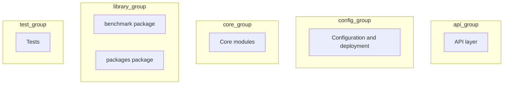

# Architecture report: reactjs/react-docgen

> Automated static analysis. **Observed** = directly seen in files/imports/AST; **Inferred** = interpretation from that evidence. Repository code was not executed.

## 1. Repository at a glance

| Item | Value |
| --- | --- |
| Repository | reactjs/react-docgen |
| Description | A CLI and library to extract information from React component files for documentation generation purposes. |
| Language | TypeScript |
| Stars | 3819 |
| Licence | MIT |
| Analysed commit / branch | 6d4598b70d3776e28debfe1fddc7463fdf2958c6 / 8.x |
| Framework(s) | Next.js, React |
| Files analysed | 401 |
| Components | 6 |

## 2. Architecture in one minute

reactjs/react-docgen - A CLI and library to extract information from React component files for documentation generation purposes.. This repository was analysed statically from 401 file(s) (0 Python). Detected technologies (observed from imports/manifests): GitHub Actions, Next.js, React, Tailwind CSS, TypeScript, Vite. Files are grouped into 6 component(s): API layer, benchmark package, Configuration and deployment, Core modules, packages package, Tests. Findings below distinguish observed facts from inferred interpretation.

## 3. High-level block diagram

## 4. Main components

### API layer (`api_layer`)

- **Kind:** api
- **Status:** Observed
- **Confidence:** 0.85
- **Responsibility:** Groups 20 file(s) under api layer (observed from repository paths and static analysis).
- **Paths:** `packages/react-docgen/src/handlers/__tests__/codeTypeHandler-test.ts`, `packages/react-docgen/src/handlers/__tests__/componentDocblockHandler-test.ts`, `packages/react-docgen/src/handlers/__tests__/componentMethodsHandler-test.ts`, `packages/react-docgen/src/handlers/__tests__/componentMethodsHandler-useCallback-test.ts`, `packages/react-docgen/src/handlers/__tests__/componentMethodsJsDocHandler-test.ts`, `packages/react-docgen/src/handlers/__tests__/defaultPropsHandler-test.ts`, `packages/react-docgen/src/handlers/__tests__/displayNameHandler-test.ts`, `packages/react-docgen/src/handlers/__tests__/propDocblockHandler-test.ts`, `packages/react-docgen/src/handlers/__tests__/propTypeCompositionHandler-test.ts`, `packages/react-docgen/src/handlers/__tests__/propTypeHandler-test.ts`, `packages/react-docgen/src/handlers/codeTypeHandler.ts`, `packages/react-docgen/src/handlers/componentDocblockHandler.ts`, `packages/react-docgen/src/handlers/componentMethodsHandler.ts`, `packages/react-docgen/src/handlers/componentMethodsJsDocHandler.ts`, `packages/react-docgen/src/handlers/defaultPropsHandler.ts`, `packages/react-docgen/src/handlers/displayNameHandler.ts`, `packages/react-docgen/src/handlers/index.ts`, `packages/react-docgen/src/handlers/propDocblockHandler.ts`, `packages/react-docgen/src/handlers/propTypeCompositionHandler.ts`, `packages/react-docgen/src/handlers/propTypeHandler.ts`
- **Evidence:** [packages/react-docgen/src/handlers/__tests__/codeTypeHandler-test.ts](https://github.com/reactjs/react-docgen/blob/6d4598b70d3776e28debfe1fddc7463fdf2958c6/packages/react-docgen/src/handlers/__tests__/codeTypeHandler-test.ts); [packages/react-docgen/src/handlers/__tests__/componentDocblockHandler-test.ts](https://github.com/reactjs/react-docgen/blob/6d4598b70d3776e28debfe1fddc7463fdf2958c6/packages/react-docgen/src/handlers/__tests__/componentDocblockHandler-test.ts); [packages/react-docgen/src/handlers/__tests__/componentMethodsHandler-test.ts](https://github.com/reactjs/react-docgen/blob/6d4598b70d3776e28debfe1fddc7463fdf2958c6/packages/react-docgen/src/handlers/__tests__/componentMethodsHandler-test.ts); [packages/react-docgen/src/handlers/__tests__/componentMethodsHandler-useCallback-test.ts](https://github.com/reactjs/react-docgen/blob/6d4598b70d3776e28debfe1fddc7463fdf2958c6/packages/react-docgen/src/handlers/__tests__/componentMethodsHandler-useCallback-test.ts); [packages/react-docgen/src/handlers/__tests__/componentMethodsJsDocHandler-test.ts](https://github.com/reactjs/react-docgen/blob/6d4598b70d3776e28debfe1fddc7463fdf2958c6/packages/react-docgen/src/handlers/__tests__/componentMethodsJsDocHandler-test.ts); [packages/react-docgen/src/handlers/__tests__/defaultPropsHandler-test.ts](https://github.com/reactjs/react-docgen/blob/6d4598b70d3776e28debfe1fddc7463fdf2958c6/packages/react-docgen/src/handlers/__tests__/defaultPropsHandler-test.ts); [packages/react-docgen/src/handlers/__tests__/displayNameHandler-test.ts](https://github.com/reactjs/react-docgen/blob/6d4598b70d3776e28debfe1fddc7463fdf2958c6/packages/react-docgen/src/handlers/__tests__/displayNameHandler-test.ts); [packages/react-docgen/src/handlers/__tests__/propDocblockHandler-test.ts](https://github.com/reactjs/react-docgen/blob/6d4598b70d3776e28debfe1fddc7463fdf2958c6/packages/react-docgen/src/handlers/__tests__/propDocblockHandler-test.ts)

### benchmark package (`benchmark`)

- **Kind:** library
- **Status:** Observed
- **Confidence:** 0.85
- **Responsibility:** Groups 1 file(s) under benchmark package (observed from repository paths and static analysis).
- **Paths:** `benchmark/index.mjs`
- **Evidence:** [benchmark/index.mjs](https://github.com/reactjs/react-docgen/blob/6d4598b70d3776e28debfe1fddc7463fdf2958c6/benchmark/index.mjs)

### Configuration and deployment (`config`)

- **Kind:** config
- **Status:** Observed
- **Confidence:** 0.85
- **Responsibility:** Groups 14 file(s) under configuration and deployment (observed from repository paths and static analysis).
- **Paths:** `benchmark/package.json`, `nx.json`, `package.json`, `packages/react-docgen-cli/package.json`, `packages/react-docgen-cli/tsconfig.json`, `packages/react-docgen/package.json`, `packages/react-docgen/tsconfig.json`, `packages/website/netlify.toml`, `packages/website/package.json`, `packages/website/src/components/users/users.json`, `packages/website/tsconfig.json`, `pnpm-workspace.yaml`, `renovate.json`, `tsconfig.base.json`
- **Evidence:** [benchmark/package.json](https://github.com/reactjs/react-docgen/blob/6d4598b70d3776e28debfe1fddc7463fdf2958c6/benchmark/package.json); [nx.json](https://github.com/reactjs/react-docgen/blob/6d4598b70d3776e28debfe1fddc7463fdf2958c6/nx.json); [package.json](https://github.com/reactjs/react-docgen/blob/6d4598b70d3776e28debfe1fddc7463fdf2958c6/package.json); [packages/react-docgen-cli/package.json](https://github.com/reactjs/react-docgen/blob/6d4598b70d3776e28debfe1fddc7463fdf2958c6/packages/react-docgen-cli/package.json); [packages/react-docgen-cli/tsconfig.json](https://github.com/reactjs/react-docgen/blob/6d4598b70d3776e28debfe1fddc7463fdf2958c6/packages/react-docgen-cli/tsconfig.json); [packages/react-docgen/package.json](https://github.com/reactjs/react-docgen/blob/6d4598b70d3776e28debfe1fddc7463fdf2958c6/packages/react-docgen/package.json); [packages/react-docgen/tsconfig.json](https://github.com/reactjs/react-docgen/blob/6d4598b70d3776e28debfe1fddc7463fdf2958c6/packages/react-docgen/tsconfig.json); [packages/website/netlify.toml](https://github.com/reactjs/react-docgen/blob/6d4598b70d3776e28debfe1fddc7463fdf2958c6/packages/website/netlify.toml)

### Core modules (`core`)

- **Kind:** core
- **Status:** Observed
- **Confidence:** 0.85
- **Responsibility:** Groups 2 file(s) under core modules (observed from repository paths and static analysis).
- **Paths:** `eslint.config.mjs`, `prettier.config.mjs`
- **Evidence:** [eslint.config.mjs](https://github.com/reactjs/react-docgen/blob/6d4598b70d3776e28debfe1fddc7463fdf2958c6/eslint.config.mjs); [prettier.config.mjs](https://github.com/reactjs/react-docgen/blob/6d4598b70d3776e28debfe1fddc7463fdf2958c6/prettier.config.mjs)

### packages package (`packages`)

- **Kind:** library
- **Status:** Observed
- **Confidence:** 0.85
- **Responsibility:** Groups 164 file(s) under packages package (observed from repository paths and static analysis).
- **Paths:** `packages/react-docgen-cli/src/cli.ts`, `packages/react-docgen-cli/src/commands/parse/command.ts`, `packages/react-docgen-cli/src/commands/parse/options/loadOptions.ts`, `packages/react-docgen-cli/src/commands/parse/options/loadReactDocgenPlugin.ts`, `packages/react-docgen-cli/src/commands/parse/options/loadResolvers.ts`, `packages/react-docgen-cli/src/commands/parse/output/outputError.ts`, `packages/react-docgen-cli/src/commands/parse/output/outputResult.ts`, `packages/react-docgen-cli/src/utils/importFile.ts`, `packages/react-docgen-cli/vitest.config.ts`, `packages/react-docgen/src/Documentation.ts`, `packages/react-docgen/src/FileState.ts`, `packages/react-docgen/src/__mocks__/Documentation.ts`, `packages/react-docgen/src/__mocks__/FileState.ts`, `packages/react-docgen/src/__tests__/imperativeHandleCallbacks-test.ts`, `packages/react-docgen/src/__tests__/main-test.ts`, `packages/react-docgen/src/__tests__/parse-test.ts`, `packages/react-docgen/src/__tests__/parserCompatibility-test.ts`, `packages/react-docgen/src/babelParser.ts`, `packages/react-docgen/src/config.ts`, `packages/react-docgen/src/error.ts`, `packages/react-docgen/src/importer/fsImporter.ts`, `packages/react-docgen/src/importer/ignoreImporter.ts`, `packages/react-docgen/src/importer/index.ts`, `packages/react-docgen/src/importer/makeFsImporter.ts`, `packages/react-docgen/src/importer/makeIgnoreImporter.ts`, `packages/react-docgen/src/main.ts`, `packages/react-docgen/src/parse.ts`, `packages/react-docgen/src/resolver/ChainResolver.ts`, `packages/react-docgen/src/resolver/FindAllDefinitionsResolver.ts`, `packages/react-docgen/src/resolver/FindAnnotatedDefinitionsResolver.ts`, `packages/react-docgen/src/resolver/FindExportedDefinitionsResolver.ts`, `packages/react-docgen/src/resolver/__tests__/ChainResolver-test.ts`, `packages/react-docgen/src/resolver/__tests__/FindAllDefinitionsResolver-test.ts`, `packages/react-docgen/src/resolver/__tests__/FindAnnotatedDefinitionsResolver-test.ts`, `packages/react-docgen/src/resolver/__tests__/FindExportedDefinitionsResolver-test.ts`, `packages/react-docgen/src/resolver/index.ts`, `packages/react-docgen/src/resolver/utils/__tests__/runResolver-test.ts`, `packages/react-docgen/src/resolver/utils/runResolver.ts`, `packages/react-docgen/src/utils/__tests__/docblock-test.ts`, `packages/react-docgen/src/utils/__tests__/expressionTo-test.ts`, `packages/react-docgen/src/utils/__tests__/findFunctionReturn-test.ts`, `packages/react-docgen/src/utils/__tests__/flowUtilityTypes-test.ts`, `packages/react-docgen/src/utils/__tests__/getClassMemberValuePath-test.ts`, `packages/react-docgen/src/utils/__tests__/getFlowType-test.ts`, `packages/react-docgen/src/utils/__tests__/getMemberExpressionRoot-test.ts`, `packages/react-docgen/src/utils/__tests__/getMemberExpressionValuePath-test.ts`, `packages/react-docgen/src/utils/__tests__/getMemberValuePath-test.ts`, `packages/react-docgen/src/utils/__tests__/getMembers-test.ts`, `packages/react-docgen/src/utils/__tests__/getMethodDocumentation-test.ts`, `packages/react-docgen/src/utils/__tests__/getNameOrValue-test.ts`, `packages/react-docgen/src/utils/__tests__/getParameterName-test.ts`, `packages/react-docgen/src/utils/__tests__/getPropType-test.ts`, `packages/react-docgen/src/utils/__tests__/getPropertyName-test.ts`, `packages/react-docgen/src/utils/__tests__/getPropertyValuePath-test.ts`, `packages/react-docgen/src/utils/__tests__/getTSType-test.ts`, `packages/react-docgen/src/utils/__tests__/getTypeAnnotation-test.ts`, `packages/react-docgen/src/utils/__tests__/getTypeFromReactComponent-test.ts`, `packages/react-docgen/src/utils/__tests__/getTypeParameters-test.ts`, `packages/react-docgen/src/utils/__tests__/isDestructuringAssignment-test.ts`, `packages/react-docgen/src/utils/__tests__/isExportsOrModuleAssignment-test.ts`, `packages/react-docgen/src/utils/__tests__/isReactBuiltinReference-test.ts`, `packages/react-docgen/src/utils/__tests__/isReactChildrenElementCall-test.ts`, `packages/react-docgen/src/utils/__tests__/isReactCloneElementCall-test.ts`, `packages/react-docgen/src/utils/__tests__/isReactComponentClass-test.ts`, `packages/react-docgen/src/utils/__tests__/isReactComponentMethod-test.ts`, `packages/react-docgen/src/utils/__tests__/isReactCreateClassCall-test.ts`, `packages/react-docgen/src/utils/__tests__/isReactCreateElementCall-test.ts`, `packages/react-docgen/src/utils/__tests__/isReactForwardRefCall-test.ts`, `packages/react-docgen/src/utils/__tests__/isReactModuleName-test.ts`, `packages/react-docgen/src/utils/__tests__/isRequiredPropType-test.ts`, `packages/react-docgen/src/utils/__tests__/isStatelessComponent-test.ts`, `packages/react-docgen/src/utils/__tests__/isUnreachableFlowType-test.ts`, `packages/react-docgen/src/utils/__tests__/normalizeClassDefinition-test.ts`, `packages/react-docgen/src/utils/__tests__/parseJsDoc-test.ts`, `packages/react-docgen/src/utils/__tests__/printValue-test.ts`, `packages/react-docgen/src/utils/__tests__/resolveExportDeclaration-test.ts`, `packages/react-docgen/src/utils/__tests__/resolveFunctionDefinitionToReturnValue-test.ts`, `packages/react-docgen/src/utils/__tests__/resolveGenericTypeAnnotations-test.ts`, `packages/react-docgen/src/utils/__tests__/resolveHOC-test.ts`, `packages/react-docgen/src/utils/__tests__/resolveObjectKeysToArray-test.ts`, `packages/react-docgen/src/utils/__tests__/resolveObjectPatternPropertyToValue-test.ts`, `packages/react-docgen/src/utils/__tests__/resolveObjectValuesToArray-test.ts`, `packages/react-docgen/src/utils/__tests__/resolveToModule-test.ts`, `packages/react-docgen/src/utils/__tests__/resolveToValue-test.ts`, `packages/react-docgen/src/utils/__tests__/setPropDescription-test.ts`, `packages/react-docgen/src/utils/__tests__/unwrapBuiltinTSPropTypes-test.ts`, `packages/react-docgen/src/utils/docblock.ts`, `packages/react-docgen/src/utils/expressionTo.ts`, `packages/react-docgen/src/utils/findComponentDefinition.ts`, `packages/react-docgen/src/utils/findFunctionReturn.ts`, `packages/react-docgen/src/utils/flowUtilityTypes.ts`, `packages/react-docgen/src/utils/getClassMemberValuePath.ts`, `packages/react-docgen/src/utils/getFlowType.ts`, `packages/react-docgen/src/utils/getMemberExpressionRoot.ts`, `packages/react-docgen/src/utils/getMemberExpressionValuePath.ts`, `packages/react-docgen/src/utils/getMemberValuePath.ts`, `packages/react-docgen/src/utils/getMembers.ts`, `packages/react-docgen/src/utils/getMethodDocumentation.ts`, `packages/react-docgen/src/utils/getNameOrValue.ts`, `packages/react-docgen/src/utils/getParameterName.ts`, `packages/react-docgen/src/utils/getPropType.ts`, `packages/react-docgen/src/utils/getPropertyName.ts`, `packages/react-docgen/src/utils/getPropertyValuePath.ts`, `packages/react-docgen/src/utils/getTSType.ts`, `packages/react-docgen/src/utils/getTypeAnnotation.ts`, `packages/react-docgen/src/utils/getTypeArguments.ts`, `packages/react-docgen/src/utils/getTypeFromReactComponent.ts`, `packages/react-docgen/src/utils/getTypeIdentifier.ts`, `packages/react-docgen/src/utils/getTypeParameters.ts`, `packages/react-docgen/src/utils/index.ts`, `packages/react-docgen/src/utils/isDestructuringAssignment.ts`, `packages/react-docgen/src/utils/isExportsOrModuleAssignment.ts`, `packages/react-docgen/src/utils/isImportSpecifier.ts`, `packages/react-docgen/src/utils/isReactBuiltinCall.ts`, `packages/react-docgen/src/utils/isReactBuiltinReference.ts`, `packages/react-docgen/src/utils/isReactChildrenElementCall.ts`, `packages/react-docgen/src/utils/isReactCloneElementCall.ts`, `packages/react-docgen/src/utils/isReactComponentClass.ts`, `packages/react-docgen/src/utils/isReactComponentMethod.ts`, `packages/react-docgen/src/utils/isReactCreateClassCall.ts`, `packages/react-docgen/src/utils/isReactCreateElementCall.ts`, `packages/react-docgen/src/utils/isReactForwardRefCall.ts`, `packages/react-docgen/src/utils/isReactModuleName.ts`, `packages/react-docgen/src/utils/isRequiredPropType.ts`, `packages/react-docgen/src/utils/isStatelessComponent.ts`, `packages/react-docgen/src/utils/isUnreachableFlowType.ts`, `packages/react-docgen/src/utils/normalizeClassDefinition.ts`, `packages/react-docgen/src/utils/parseJsDoc.ts`, `packages/react-docgen/src/utils/postProcessDocumentation.ts`, `packages/react-docgen/src/utils/printValue.ts`, `packages/react-docgen/src/utils/resolveExportDeclaration.ts`, `packages/react-docgen/src/utils/resolveFunctionDefinitionToReturnValue.ts`, `packages/react-docgen/src/utils/resolveGenericTypeAnnotation.ts`, `packages/react-docgen/src/utils/resolveHOC.ts`, `packages/react-docgen/src/utils/resolveObjectKeysToArray.ts`, `packages/react-docgen/src/utils/resolveObjectPatternPropertyToValue.ts`, `packages/react-docgen/src/utils/resolveObjectValuesToArray.ts`, `packages/react-docgen/src/utils/resolveToModule.ts`, `packages/react-docgen/src/utils/resolveToValue.ts`, `packages/react-docgen/src/utils/setPropDescription.ts`, `packages/react-docgen/src/utils/traverse.ts`, `packages/react-docgen/src/utils/ts-types/index.ts`, `packages/react-docgen/src/utils/unwrapBuiltinTSPropTypes.ts`, `packages/react-docgen/vitest.config.ts`, `packages/website/eslint.config.mjs`, `packages/website/next-sitemap.config.js`, `packages/website/next.config.mjs`, `packages/website/postcss.config.js`, `packages/website/src/app/_meta.js`, `packages/website/src/app/layout.tsx`, `packages/website/src/app/playground/page.tsx`, `packages/website/src/components/ContentMissing.tsx`, `packages/website/src/components/playground/OptionPanel.tsx`, `packages/website/src/components/playground/Panel.tsx`, `packages/website/src/components/playground/Playground.tsx`, `packages/website/src/components/playground/index.ts`, `packages/website/src/components/playground/samples/flow.ts`, `packages/website/src/components/playground/samples/javascript.ts`, `packages/website/src/components/playground/samples/typescript.ts`, `packages/website/src/components/users/User.tsx`, `packages/website/src/components/users/UserList.tsx`, `packages/website/src/empty.ts`, `packages/website/src/mdx-components.tsx`, `packages/website/tailwind.config.ts`
- **Evidence:** [packages/react-docgen-cli/src/cli.ts](https://github.com/reactjs/react-docgen/blob/6d4598b70d3776e28debfe1fddc7463fdf2958c6/packages/react-docgen-cli/src/cli.ts); [packages/react-docgen-cli/src/commands/parse/command.ts](https://github.com/reactjs/react-docgen/blob/6d4598b70d3776e28debfe1fddc7463fdf2958c6/packages/react-docgen-cli/src/commands/parse/command.ts); [packages/react-docgen-cli/src/commands/parse/options/loadOptions.ts](https://github.com/reactjs/react-docgen/blob/6d4598b70d3776e28debfe1fddc7463fdf2958c6/packages/react-docgen-cli/src/commands/parse/options/loadOptions.ts); [packages/react-docgen-cli/src/commands/parse/options/loadReactDocgenPlugin.ts](https://github.com/reactjs/react-docgen/blob/6d4598b70d3776e28debfe1fddc7463fdf2958c6/packages/react-docgen-cli/src/commands/parse/options/loadReactDocgenPlugin.ts); [packages/react-docgen-cli/src/commands/parse/options/loadResolvers.ts](https://github.com/reactjs/react-docgen/blob/6d4598b70d3776e28debfe1fddc7463fdf2958c6/packages/react-docgen-cli/src/commands/parse/options/loadResolvers.ts); [packages/react-docgen-cli/src/commands/parse/output/outputError.ts](https://github.com/reactjs/react-docgen/blob/6d4598b70d3776e28debfe1fddc7463fdf2958c6/packages/react-docgen-cli/src/commands/parse/output/outputError.ts); [packages/react-docgen-cli/src/commands/parse/output/outputResult.ts](https://github.com/reactjs/react-docgen/blob/6d4598b70d3776e28debfe1fddc7463fdf2958c6/packages/react-docgen-cli/src/commands/parse/output/outputResult.ts); [packages/react-docgen-cli/src/utils/importFile.ts](https://github.com/reactjs/react-docgen/blob/6d4598b70d3776e28debfe1fddc7463fdf2958c6/packages/react-docgen-cli/src/utils/importFile.ts)

### Tests (`tests`)

- **Kind:** test
- **Status:** Observed
- **Confidence:** 0.85
- **Responsibility:** Groups 91 file(s) under tests (observed from repository paths and static analysis).
- **Paths:** `packages/react-docgen-cli/tests/integration/__fixtures__/basic/Component.js`, `packages/react-docgen-cli/tests/integration/__fixtures__/basic/NoComponent.js`, `packages/react-docgen-cli/tests/integration/__fixtures__/custom-handler-cjs/Component.js`, `packages/react-docgen-cli/tests/integration/__fixtures__/custom-handler-cjs/handler.cjs`, `packages/react-docgen-cli/tests/integration/__fixtures__/custom-handler-esm/Component.js`, `packages/react-docgen-cli/tests/integration/__fixtures__/custom-handler-esm/handler.mjs`, `packages/react-docgen-cli/tests/integration/__fixtures__/custom-handler-npm/Component.js`, `packages/react-docgen-cli/tests/integration/__fixtures__/custom-importer-cjs/Component.js`, `packages/react-docgen-cli/tests/integration/__fixtures__/custom-importer-cjs/custom-importer-esm/Component.js`, `packages/react-docgen-cli/tests/integration/__fixtures__/custom-importer-cjs/custom-importer-esm/importer.mjs`, `packages/react-docgen-cli/tests/integration/__fixtures__/custom-importer-cjs/custom-importer-npm/Component.js`, `packages/react-docgen-cli/tests/integration/__fixtures__/custom-importer-cjs/importer.cjs`, `packages/react-docgen-cli/tests/integration/__fixtures__/custom-importer-esm/Component.js`, `packages/react-docgen-cli/tests/integration/__fixtures__/custom-importer-esm/importer.mjs`, `packages/react-docgen-cli/tests/integration/__fixtures__/custom-importer-npm/Component.js`, `packages/react-docgen-cli/tests/integration/__fixtures__/custom-resolver-class/Component.js`, `packages/react-docgen-cli/tests/integration/__fixtures__/custom-resolver-class/resolver.cjs`, `packages/react-docgen-cli/tests/integration/__fixtures__/custom-resolver-class/resolver.mjs`, `packages/react-docgen-cli/tests/integration/__fixtures__/custom-resolver-function/Component.js`, `packages/react-docgen-cli/tests/integration/__fixtures__/custom-resolver-function/resolver.cjs`, `packages/react-docgen-cli/tests/integration/__fixtures__/custom-resolver-function/resolver.mjs`, `packages/react-docgen-cli/tests/integration/__fixtures__/ignore/__mocks__/MockComponent.js`, `packages/react-docgen-cli/tests/integration/__fixtures__/ignore/__tests__/TestComponent.js`, `packages/react-docgen-cli/tests/integration/__fixtures__/ignore/foo/FooComponent.js`, `packages/react-docgen-cli/tests/integration/__fixtures__/multiple/MultipleComponents.js`, `packages/react-docgen-cli/tests/integration/__fixtures__/syntax-error/SyntaxError.js`, `packages/react-docgen-cli/tests/integration/cli-test.ts`, `packages/react-docgen-cli/tests/integration/handler-test.ts`, `packages/react-docgen-cli/tests/integration/importer-test.ts`, `packages/react-docgen-cli/tests/integration/resolver-test.ts`, `packages/react-docgen-cli/tests/integration/utils/withFixture.ts`, `packages/react-docgen/tests/NodePathSerializer.ts`, `packages/react-docgen/tests/integration/__fixtures__/class-without-id.tsx`, `packages/react-docgen/tests/integration/__fixtures__/component_1.js`, `packages/react-docgen/tests/integration/__fixtures__/component_10.js`, `packages/react-docgen/tests/integration/__fixtures__/component_11.js`, `packages/react-docgen/tests/integration/__fixtures__/component_12.js`, `packages/react-docgen/tests/integration/__fixtures__/component_13.js`, `packages/react-docgen/tests/integration/__fixtures__/component_14.js`, `packages/react-docgen/tests/integration/__fixtures__/component_15.js`, `packages/react-docgen/tests/integration/__fixtures__/component_16.js`, `packages/react-docgen/tests/integration/__fixtures__/component_17.js`, `packages/react-docgen/tests/integration/__fixtures__/component_18.js`, `packages/react-docgen/tests/integration/__fixtures__/component_19.js`, `packages/react-docgen/tests/integration/__fixtures__/component_2.js`, `packages/react-docgen/tests/integration/__fixtures__/component_20.js`, `packages/react-docgen/tests/integration/__fixtures__/component_21.tsx`, `packages/react-docgen/tests/integration/__fixtures__/component_22.tsx`, `packages/react-docgen/tests/integration/__fixtures__/component_23.tsx`, `packages/react-docgen/tests/integration/__fixtures__/component_24.js`, `packages/react-docgen/tests/integration/__fixtures__/component_25.tsx`, `packages/react-docgen/tests/integration/__fixtures__/component_26.js`, `packages/react-docgen/tests/integration/__fixtures__/component_27.tsx`, `packages/react-docgen/tests/integration/__fixtures__/component_28.tsx`, `packages/react-docgen/tests/integration/__fixtures__/component_29.js`, `packages/react-docgen/tests/integration/__fixtures__/component_3.js`, `packages/react-docgen/tests/integration/__fixtures__/component_30.js`, `packages/react-docgen/tests/integration/__fixtures__/component_31.js`, `packages/react-docgen/tests/integration/__fixtures__/component_32.js`, `packages/react-docgen/tests/integration/__fixtures__/component_33.tsx`, `packages/react-docgen/tests/integration/__fixtures__/component_34.js`, `packages/react-docgen/tests/integration/__fixtures__/component_35.js`, `packages/react-docgen/tests/integration/__fixtures__/component_36.js`, `packages/react-docgen/tests/integration/__fixtures__/component_37.js`, `packages/react-docgen/tests/integration/__fixtures__/component_38.js`, `packages/react-docgen/tests/integration/__fixtures__/component_39.tsx`, `packages/react-docgen/tests/integration/__fixtures__/component_4.js`, `packages/react-docgen/tests/integration/__fixtures__/component_40.js`, `packages/react-docgen/tests/integration/__fixtures__/component_41.tsx`, `packages/react-docgen/tests/integration/__fixtures__/component_42.js`, `packages/react-docgen/tests/integration/__fixtures__/component_43.tsx`, `packages/react-docgen/tests/integration/__fixtures__/component_5.js`, `packages/react-docgen/tests/integration/__fixtures__/component_6.js`, `packages/react-docgen/tests/integration/__fixtures__/component_7.js`, `packages/react-docgen/tests/integration/__fixtures__/component_8.js`, `packages/react-docgen/tests/integration/__fixtures__/component_9.js`, `packages/react-docgen/tests/integration/__fixtures__/flow-export-type.js`, `packages/react-docgen/tests/integration/__fixtures__/flow-import-type.js`, `packages/react-docgen/tests/integration/__fixtures__/flow-spread-import-type.js`, `packages/react-docgen/tests/integration/__fixtures__/namespace-export.tsx`, `packages/react-docgen/tests/integration/__fixtures__/support/other-exports.ts`, `packages/react-docgen/tests/integration/__fixtures__/support/some-exports.ts`, `packages/react-docgen/tests/integration/__fixtures__/test-all-imports.tsx`, `packages/react-docgen/tests/integration/__fixtures__/ts-extends-mixin.tsx`, `packages/react-docgen/tests/integration/__snapshots__/integration-test.ts.snap`, `packages/react-docgen/tests/integration/integration-test.ts`, `packages/react-docgen/tests/integration/parenthesized-function-type-test.ts`, `packages/react-docgen/tests/setupTestFramework.ts`, `packages/react-docgen/tests/types/consumer.ts`, `packages/react-docgen/tests/types/tsconfig.json`, `packages/react-docgen/tests/utils.ts`
- **Evidence:** [packages/react-docgen-cli/tests/integration/__fixtures__/basic/Component.js](https://github.com/reactjs/react-docgen/blob/6d4598b70d3776e28debfe1fddc7463fdf2958c6/packages/react-docgen-cli/tests/integration/__fixtures__/basic/Component.js); [packages/react-docgen-cli/tests/integration/__fixtures__/basic/NoComponent.js](https://github.com/reactjs/react-docgen/blob/6d4598b70d3776e28debfe1fddc7463fdf2958c6/packages/react-docgen-cli/tests/integration/__fixtures__/basic/NoComponent.js); [packages/react-docgen-cli/tests/integration/__fixtures__/custom-handler-cjs/Component.js](https://github.com/reactjs/react-docgen/blob/6d4598b70d3776e28debfe1fddc7463fdf2958c6/packages/react-docgen-cli/tests/integration/__fixtures__/custom-handler-cjs/Component.js); [packages/react-docgen-cli/tests/integration/__fixtures__/custom-handler-cjs/handler.cjs](https://github.com/reactjs/react-docgen/blob/6d4598b70d3776e28debfe1fddc7463fdf2958c6/packages/react-docgen-cli/tests/integration/__fixtures__/custom-handler-cjs/handler.cjs); [packages/react-docgen-cli/tests/integration/__fixtures__/custom-handler-esm/Component.js](https://github.com/reactjs/react-docgen/blob/6d4598b70d3776e28debfe1fddc7463fdf2958c6/packages/react-docgen-cli/tests/integration/__fixtures__/custom-handler-esm/Component.js); [packages/react-docgen-cli/tests/integration/__fixtures__/custom-handler-esm/handler.mjs](https://github.com/reactjs/react-docgen/blob/6d4598b70d3776e28debfe1fddc7463fdf2958c6/packages/react-docgen-cli/tests/integration/__fixtures__/custom-handler-esm/handler.mjs); [packages/react-docgen-cli/tests/integration/__fixtures__/custom-handler-npm/Component.js](https://github.com/reactjs/react-docgen/blob/6d4598b70d3776e28debfe1fddc7463fdf2958c6/packages/react-docgen-cli/tests/integration/__fixtures__/custom-handler-npm/Component.js); [packages/react-docgen-cli/tests/integration/__fixtures__/custom-importer-cjs/Component.js](https://github.com/reactjs/react-docgen/blob/6d4598b70d3776e28debfe1fddc7463fdf2958c6/packages/react-docgen-cli/tests/integration/__fixtures__/custom-importer-cjs/Component.js)

## 5. Execution flow

**Observed** entry point(s):

- [packages/react-docgen/src/main.ts](https://github.com/reactjs/react-docgen/blob/6d4598b70d3776e28debfe1fddc7463fdf2958c6/packages/react-docgen/src/main.ts)

Representative flow (derived from observed entry points and the import graph; steps beyond the entry point are **Inferred**):

1. Execution starts at an observed entry point listed above, if present.
2. No internal import relationships between components were observed.

## 6. Project structure

### `(root)`

- `.editorconfig` - config (220 bytes)
- `.gitattributes` - other (92 bytes)
- `.gitignore` - other (190 bytes)
- `.gitpod.yml` - config (133 bytes)
- `.prettierignore` - other (90 bytes)
- `CODE_OF_CONDUCT.md` - docs (8577 bytes)
- `CONTRIBUTING.md` - docs (1869 bytes)
- `LICENSE` - docs (1086 bytes)
- `README.md` - docs (826 bytes)
- `SECURITY.md` - docs (1864 bytes)
- `eslint.config.mjs` - source, JavaScript (1977 bytes)
- `nx.json` - config (646 bytes)
- `package.json` - manifest (1691 bytes)
- `pnpm-workspace.yaml` - config (151 bytes)
- `prettier.config.mjs` - source, JavaScript (193 bytes)
- `renovate.json` - config (1973 bytes)
- `tsconfig.base.json` - config (510 bytes)

### `.changeset`

- `.changeset/README.md` - docs (510 bytes)
- `.changeset/calm-types-travel.md` - docs (110 bytes)
- `.changeset/config.json` - config (403 bytes)
- `.changeset/mixin-class-props.md` - docs (155 bytes)
- `.changeset/quiet-hooks-listen.md` - docs (118 bytes)
- `.changeset/tidy-beans-smile.md` - docs (219 bytes)

### `.github`

- `.github/FUNDING.yml` - config (16 bytes)
- `.github/workflows/build.yml` - ci, YAML (4241 bytes)
- `.github/workflows/changesets.yml` - ci, YAML (1149 bytes)
- `.github/workflows/lock.yml` - ci, YAML (363 bytes)
- `.github/workflows/ossar-analysis.yml` - ci, YAML (885 bytes)

### `benchmark`

- `benchmark/index.mjs` - source, JavaScript (2919 bytes)
- `benchmark/package.json` - manifest (682 bytes)

### `packages`

- `packages/react-docgen-cli/CHANGELOG.md` - docs (22918 bytes)
- `packages/react-docgen-cli/README.md` - docs (102 bytes)
- `packages/react-docgen-cli/package.json` - manifest (943 bytes)
- `packages/react-docgen-cli/src/cli.ts` - source, TypeScript (301 bytes)
- `packages/react-docgen-cli/src/commands/parse/command.ts` - source, TypeScript (5060 bytes)
- `packages/react-docgen-cli/src/commands/parse/options/loadOptions.ts` - source, TypeScript (1119 bytes)
- `packages/react-docgen-cli/src/commands/parse/options/loadReactDocgenPlugin.ts` - source, TypeScript (693 bytes)
- `packages/react-docgen-cli/src/commands/parse/options/loadResolvers.ts` - source, TypeScript (2039 bytes)
- `packages/react-docgen-cli/src/commands/parse/output/outputError.ts` - source, TypeScript (1119 bytes)
- `packages/react-docgen-cli/src/commands/parse/output/outputResult.ts` - source, TypeScript (506 bytes)
- `packages/react-docgen-cli/src/utils/importFile.ts` - source, TypeScript (831 bytes)
- `packages/react-docgen-cli/tests/integration/__fixtures__/basic/Component.js` - test, JavaScript (171 bytes)
- `packages/react-docgen-cli/tests/integration/__fixtures__/basic/NoComponent.js` - test, JavaScript (0 bytes)
- `packages/react-docgen-cli/tests/integration/__fixtures__/custom-handler-cjs/Component.js` - test, JavaScript (161 bytes)
- `packages/react-docgen-cli/tests/integration/__fixtures__/custom-handler-cjs/handler.cjs` - test, JavaScript (132 bytes)
- `packages/react-docgen-cli/tests/integration/__fixtures__/custom-handler-esm/Component.js` - test, JavaScript (161 bytes)
- `packages/react-docgen-cli/tests/integration/__fixtures__/custom-handler-esm/handler.mjs` - test, JavaScript (130 bytes)
- `packages/react-docgen-cli/tests/integration/__fixtures__/custom-handler-npm/Component.js` - test, JavaScript (161 bytes)
- `packages/react-docgen-cli/tests/integration/__fixtures__/custom-importer-cjs/Component.js` - test, JavaScript (161 bytes)
- `packages/react-docgen-cli/tests/integration/__fixtures__/custom-importer-cjs/custom-importer-esm/Component.js` - test, JavaScript (161 bytes)
- `packages/react-docgen-cli/tests/integration/__fixtures__/custom-importer-cjs/custom-importer-esm/importer.mjs` - test, JavaScript (277 bytes)
- `packages/react-docgen-cli/tests/integration/__fixtures__/custom-importer-cjs/custom-importer-npm/Component.js` - test, JavaScript (161 bytes)
- `packages/react-docgen-cli/tests/integration/__fixtures__/custom-importer-cjs/importer.cjs` - test, JavaScript (280 bytes)
- `packages/react-docgen-cli/tests/integration/__fixtures__/custom-importer-esm/Component.js` - test, JavaScript (161 bytes)
- `packages/react-docgen-cli/tests/integration/__fixtures__/custom-importer-esm/importer.mjs` - test, JavaScript (277 bytes)
- `packages/react-docgen-cli/tests/integration/__fixtures__/custom-importer-npm/Component.js` - test, JavaScript (161 bytes)
- `packages/react-docgen-cli/tests/integration/__fixtures__/custom-resolver-class/Component.js` - test, JavaScript (158 bytes)
- `packages/react-docgen-cli/tests/integration/__fixtures__/custom-resolver-class/resolver.cjs` - test, JavaScript (359 bytes)
- `packages/react-docgen-cli/tests/integration/__fixtures__/custom-resolver-class/resolver.mjs` - test, JavaScript (385 bytes)
- `packages/react-docgen-cli/tests/integration/__fixtures__/custom-resolver-function/Component.js` - test, JavaScript (158 bytes)
- `packages/react-docgen-cli/tests/integration/__fixtures__/custom-resolver-function/resolver.cjs` - test, JavaScript (329 bytes)
- `packages/react-docgen-cli/tests/integration/__fixtures__/custom-resolver-function/resolver.mjs` - test, JavaScript (327 bytes)
- `packages/react-docgen-cli/tests/integration/__fixtures__/ignore/__mocks__/MockComponent.js` - test, JavaScript (162 bytes)
- `packages/react-docgen-cli/tests/integration/__fixtures__/ignore/__tests__/TestComponent.js` - test, JavaScript (162 bytes)
- `packages/react-docgen-cli/tests/integration/__fixtures__/ignore/foo/FooComponent.js` - test, JavaScript (161 bytes)
- `packages/react-docgen-cli/tests/integration/__fixtures__/multiple/MultipleComponents.js` - test, JavaScript (262 bytes)
- `packages/react-docgen-cli/tests/integration/__fixtures__/syntax-error/SyntaxError.js` - test, JavaScript (18 bytes)
- `packages/react-docgen-cli/tests/integration/cli-test.ts` - test, TypeScript (7389 bytes)
- `packages/react-docgen-cli/tests/integration/handler-test.ts` - test, TypeScript (4635 bytes)
- `packages/react-docgen-cli/tests/integration/importer-test.ts` - test, TypeScript (3374 bytes)
- `packages/react-docgen-cli/tests/integration/resolver-test.ts` - test, TypeScript (6386 bytes)
- `packages/react-docgen-cli/tests/integration/utils/withFixture.ts` - test, TypeScript (1176 bytes)
- `packages/react-docgen-cli/tsconfig.json` - config (229 bytes)
- `packages/react-docgen-cli/vitest.config.ts` - source, TypeScript (390 bytes)
- `packages/react-docgen/CHANGELOG.md` - docs (36759 bytes)
- `packages/react-docgen/package.json` - manifest (1501 bytes)
- `packages/react-docgen/src/Documentation.ts` - source, TypeScript (5715 bytes)
- `packages/react-docgen/src/FileState.ts` - source, TypeScript (2736 bytes)
- `packages/react-docgen/src/__mocks__/Documentation.ts` - source, TypeScript (393 bytes)
- `packages/react-docgen/src/__mocks__/FileState.ts` - source, TypeScript (322 bytes)
- `packages/react-docgen/src/__tests__/__snapshots__/main-test.ts.snap` - other (3315 bytes)
- `packages/react-docgen/src/__tests__/imperativeHandleCallbacks-test.ts` - source, TypeScript (2679 bytes)
- `packages/react-docgen/src/__tests__/main-test.ts` - source, TypeScript (4446 bytes)
- `packages/react-docgen/src/__tests__/parse-test.ts` - source, TypeScript (4083 bytes)
- `packages/react-docgen/src/__tests__/parserCompatibility-test.ts` - source, TypeScript (3571 bytes)
- `packages/react-docgen/src/babelParser.ts` - source, TypeScript (3018 bytes)
- `packages/react-docgen/src/config.ts` - source, TypeScript (2203 bytes)
- `packages/react-docgen/src/error.ts` - source, TypeScript (536 bytes)
- `packages/react-docgen/src/handlers/__tests__/__snapshots__/codeTypeHandler-test.ts.snap` - other (31481 bytes)
- `packages/react-docgen/src/handlers/__tests__/__snapshots__/componentMethodsHandler-test.ts.snap` - other (5798 bytes)
- `packages/react-docgen/src/handlers/__tests__/__snapshots__/componentMethodsJsDocHandler-test.ts.snap` - other (1458 bytes)
- `packages/react-docgen/src/handlers/__tests__/__snapshots__/defaultPropsHandler-test.ts.snap` - other (12439 bytes)
- `packages/react-docgen/src/handlers/__tests__/__snapshots__/propTypeHandler-test.ts.snap` - other (5907 bytes)
- `packages/react-docgen/src/handlers/__tests__/codeTypeHandler-test.ts` - source, TypeScript (13583 bytes)
- `packages/react-docgen/src/handlers/__tests__/componentDocblockHandler-test.ts` - source, TypeScript (12692 bytes)
- `packages/react-docgen/src/handlers/__tests__/componentMethodsHandler-test.ts` - source, TypeScript (13145 bytes)
- `packages/react-docgen/src/handlers/__tests__/componentMethodsHandler-useCallback-test.ts` - source, TypeScript (12222 bytes)
- `packages/react-docgen/src/handlers/__tests__/componentMethodsJsDocHandler-test.ts` - source, TypeScript (2714 bytes)
- `packages/react-docgen/src/handlers/__tests__/defaultPropsHandler-test.ts` - source, TypeScript (18258 bytes)
- `packages/react-docgen/src/handlers/__tests__/displayNameHandler-test.ts` - source, TypeScript (20476 bytes)
- `packages/react-docgen/src/handlers/__tests__/propDocblockHandler-test.ts` - source, TypeScript (6820 bytes)
- `packages/react-docgen/src/handlers/__tests__/propTypeCompositionHandler-test.ts` - source, TypeScript (5102 bytes)
- `packages/react-docgen/src/handlers/__tests__/propTypeHandler-test.ts` - source, TypeScript (9907 bytes)
- `packages/react-docgen/src/handlers/codeTypeHandler.ts` - source, TypeScript (3928 bytes)
- `packages/react-docgen/src/handlers/componentDocblockHandler.ts` - source, TypeScript (2376 bytes)
- `packages/react-docgen/src/handlers/componentMethodsHandler.ts` - source, TypeScript (8188 bytes)
- `packages/react-docgen/src/handlers/componentMethodsJsDocHandler.ts` - source, TypeScript (1727 bytes)
- `packages/react-docgen/src/handlers/defaultPropsHandler.ts` - source, TypeScript (5725 bytes)
- `packages/react-docgen/src/handlers/displayNameHandler.ts` - source, TypeScript (2723 bytes)
- `packages/react-docgen/src/handlers/index.ts` - source, TypeScript (1027 bytes)
- `packages/react-docgen/src/handlers/propDocblockHandler.ts` - source, TypeScript (1413 bytes)
- `packages/react-docgen/src/handlers/propTypeCompositionHandler.ts` - source, TypeScript (1671 bytes)
- `packages/react-docgen/src/handlers/propTypeHandler.ts` - source, TypeScript (3120 bytes)
- `packages/react-docgen/src/importer/fsImporter.ts` - source, TypeScript (130 bytes)
- `packages/react-docgen/src/importer/ignoreImporter.ts` - source, TypeScript (136 bytes)
- `packages/react-docgen/src/importer/index.ts` - source, TypeScript (611 bytes)
- `packages/react-docgen/src/importer/makeFsImporter.ts` - source, TypeScript (8317 bytes)
- `packages/react-docgen/src/importer/makeIgnoreImporter.ts` - source, TypeScript (125 bytes)
- `packages/react-docgen/src/main.ts` - source, TypeScript (2657 bytes)
- `packages/react-docgen/src/parse.ts` - source, TypeScript (2307 bytes)
- `packages/react-docgen/src/resolver/ChainResolver.ts` - source, TypeScript (1408 bytes)
- `packages/react-docgen/src/resolver/FindAllDefinitionsResolver.ts` - source, TypeScript (3005 bytes)
- `packages/react-docgen/src/resolver/FindAnnotatedDefinitionsResolver.ts` - source, TypeScript (3192 bytes)
- `packages/react-docgen/src/resolver/FindExportedDefinitionsResolver.ts` - source, TypeScript (3622 bytes)
- `packages/react-docgen/src/resolver/__tests__/ChainResolver-test.ts` - source, TypeScript (3844 bytes)
- `packages/react-docgen/src/resolver/__tests__/FindAllDefinitionsResolver-test.ts` - source, TypeScript (10914 bytes)
- `packages/react-docgen/src/resolver/__tests__/FindAnnotatedDefinitionsResolver-test.ts` - source, TypeScript (5844 bytes)
- `packages/react-docgen/src/resolver/__tests__/FindExportedDefinitionsResolver-test.ts` - source, TypeScript (80793 bytes)
- `packages/react-docgen/src/resolver/__tests__/__snapshots__/FindAnnotatedDefinitionsResolver-test.ts.snap` - other (5743 bytes)
- `packages/react-docgen/src/resolver/__tests__/__snapshots__/FindExportedDefinitionsResolver-test.ts.snap` - other (81202 bytes)
- `packages/react-docgen/src/resolver/index.ts` - source, TypeScript (1244 bytes)
- `packages/react-docgen/src/resolver/utils/__tests__/runResolver-test.ts` - source, TypeScript (1106 bytes)
- `packages/react-docgen/src/resolver/utils/runResolver.ts` - source, TypeScript (436 bytes)
- `packages/react-docgen/src/utils/__tests__/__snapshots__/getClassMemberValuePath-test.ts.snap` - other (1885 bytes)
- `packages/react-docgen/src/utils/__tests__/__snapshots__/getFlowType-test.ts.snap` - other (4044 bytes)
- `packages/react-docgen/src/utils/__tests__/__snapshots__/getMemberExpressionRoot-test.ts.snap` - other (630 bytes)
- `packages/react-docgen/src/utils/__tests__/__snapshots__/getMembers-test.ts.snap` - other (3143 bytes)
- `packages/react-docgen/src/utils/__tests__/__snapshots__/getMethodDocumentation-test.ts.snap` - other (2188 bytes)
- `packages/react-docgen/src/utils/__tests__/__snapshots__/getNameOrValue-test.ts.snap` - other (778 bytes)
- `packages/react-docgen/src/utils/__tests__/__snapshots__/getPropType-test.ts.snap` - other (8296 bytes)
- `packages/react-docgen/src/utils/__tests__/__snapshots__/getTSType-test.ts.snap` - other (25605 bytes)
- `packages/react-docgen/src/utils/__tests__/__snapshots__/getTypeFromReactComponent-test.ts.snap` - other (6777 bytes)
- `packages/react-docgen/src/utils/__tests__/__snapshots__/getTypeParameters-test.ts.snap` - other (745 bytes)
- `packages/react-docgen/src/utils/__tests__/__snapshots__/parseJsDoc-test.ts.snap` - other (3196 bytes)
- `packages/react-docgen/src/utils/__tests__/__snapshots__/printValue-test.ts.snap` - other (1073 bytes)
- `packages/react-docgen/src/utils/__tests__/__snapshots__/resolveFunctionDefinitionToReturnValue-test.ts.snap` - other (490 bytes)
- `packages/react-docgen/src/utils/__tests__/__snapshots__/resolveGenericTypeAnnotations-test.ts.snap` - other (641 bytes)
- `packages/react-docgen/src/utils/__tests__/__snapshots__/resolveHOC-test.ts.snap` - other (1807 bytes)
- `packages/react-docgen/src/utils/__tests__/__snapshots__/resolveObjectKeysToArray-test.ts.snap` - other (1336 bytes)
- `packages/react-docgen/src/utils/__tests__/__snapshots__/resolveObjectPatternPropertyToValue-test.ts.snap` - other (512 bytes)
- `packages/react-docgen/src/utils/__tests__/__snapshots__/resolveObjectValuesToArray-test.ts.snap` - other (1527 bytes)
- `packages/react-docgen/src/utils/__tests__/__snapshots__/resolveToValue-test.ts.snap` - other (3427 bytes)
- `packages/react-docgen/src/utils/__tests__/__snapshots__/unwrapBuiltinTSPropTypes-test.ts.snap` - other (1307 bytes)
- `packages/react-docgen/src/utils/__tests__/docblock-test.ts` - source, TypeScript (1722 bytes)
- `packages/react-docgen/src/utils/__tests__/expressionTo-test.ts` - source, TypeScript (1580 bytes)
- `packages/react-docgen/src/utils/__tests__/findFunctionReturn-test.ts` - source, TypeScript (6972 bytes)
- `packages/react-docgen/src/utils/__tests__/flowUtilityTypes-test.ts` - source, TypeScript (2832 bytes)
- `packages/react-docgen/src/utils/__tests__/getClassMemberValuePath-test.ts` - source, TypeScript (3246 bytes)
- `packages/react-docgen/src/utils/__tests__/getFlowType-test.ts` - source, TypeScript (44981 bytes)
- `packages/react-docgen/src/utils/__tests__/getMemberExpressionRoot-test.ts` - source, TypeScript (852 bytes)
- `packages/react-docgen/src/utils/__tests__/getMemberExpressionValuePath-test.ts` - source, TypeScript (3677 bytes)
- `packages/react-docgen/src/utils/__tests__/getMemberValuePath-test.ts` - source, TypeScript (3053 bytes)
- `packages/react-docgen/src/utils/__tests__/getMembers-test.ts` - source, TypeScript (922 bytes)
- `packages/react-docgen/src/utils/__tests__/getMethodDocumentation-test.ts` - source, TypeScript (11587 bytes)
- `packages/react-docgen/src/utils/__tests__/getNameOrValue-test.ts` - source, TypeScript (1855 bytes)
- `packages/react-docgen/src/utils/__tests__/getParameterName-test.ts` - source, TypeScript (2117 bytes)
- `packages/react-docgen/src/utils/__tests__/getPropType-test.ts` - source, TypeScript (16181 bytes)
- `packages/react-docgen/src/utils/__tests__/getPropertyName-test.ts` - source, TypeScript (3692 bytes)
- `packages/react-docgen/src/utils/__tests__/getPropertyValuePath-test.ts` - source, TypeScript (2356 bytes)
- `packages/react-docgen/src/utils/__tests__/getTSType-test.ts` - source, TypeScript (17184 bytes)
- `packages/react-docgen/src/utils/__tests__/getTypeAnnotation-test.ts` - source, TypeScript (842 bytes)
- `packages/react-docgen/src/utils/__tests__/getTypeFromReactComponent-test.ts` - source, TypeScript (11422 bytes)
- `packages/react-docgen/src/utils/__tests__/getTypeParameters-test.ts` - source, TypeScript (1892 bytes)
- `packages/react-docgen/src/utils/__tests__/isDestructuringAssignment-test.ts` - source, TypeScript (1375 bytes)
- `packages/react-docgen/src/utils/__tests__/isExportsOrModuleAssignment-test.ts` - source, TypeScript (749 bytes)
- `packages/react-docgen/src/utils/__tests__/isReactBuiltinReference-test.ts` - source, TypeScript (4550 bytes)
- `packages/react-docgen/src/utils/__tests__/isReactChildrenElementCall-test.ts` - source, TypeScript (3135 bytes)
- `packages/react-docgen/src/utils/__tests__/isReactCloneElementCall-test.ts` - source, TypeScript (2770 bytes)
- `packages/react-docgen/src/utils/__tests__/isReactComponentClass-test.ts` - source, TypeScript (6509 bytes)
- `packages/react-docgen/src/utils/__tests__/isReactComponentMethod-test.ts` - source, TypeScript (2606 bytes)
- `packages/react-docgen/src/utils/__tests__/isReactCreateClassCall-test.ts` - source, TypeScript (4198 bytes)
- `packages/react-docgen/src/utils/__tests__/isReactCreateElementCall-test.ts` - source, TypeScript (2880 bytes)
- `packages/react-docgen/src/utils/__tests__/isReactForwardRefCall-test.ts` - source, TypeScript (3062 bytes)
- `packages/react-docgen/src/utils/__tests__/isReactModuleName-test.ts` - source, TypeScript (524 bytes)
- `packages/react-docgen/src/utils/__tests__/isRequiredPropType-test.ts` - source, TypeScript (839 bytes)
- `packages/react-docgen/src/utils/__tests__/isStatelessComponent-test.ts` - source, TypeScript (4252 bytes)
- `packages/react-docgen/src/utils/__tests__/isUnreachableFlowType-test.ts` - source, TypeScript (931 bytes)
- `packages/react-docgen/src/utils/__tests__/normalizeClassDefinition-test.ts` - source, TypeScript (3907 bytes)
- `packages/react-docgen/src/utils/__tests__/parseJsDoc-test.ts` - source, TypeScript (1470 bytes)
- `packages/react-docgen/src/utils/__tests__/printValue-test.ts` - source, TypeScript (2414 bytes)
- `packages/react-docgen/src/utils/__tests__/resolveExportDeclaration-test.ts` - source, TypeScript (2593 bytes)
- `packages/react-docgen/src/utils/__tests__/resolveFunctionDefinitionToReturnValue-test.ts` - source, TypeScript (1465 bytes)
- `packages/react-docgen/src/utils/__tests__/resolveGenericTypeAnnotations-test.ts` - source, TypeScript (1016 bytes)
- `packages/react-docgen/src/utils/__tests__/resolveHOC-test.ts` - source, TypeScript (3290 bytes)
- `packages/react-docgen/src/utils/__tests__/resolveObjectKeysToArray-test.ts` - source, TypeScript (4505 bytes)
- `packages/react-docgen/src/utils/__tests__/resolveObjectPatternPropertyToValue-test.ts` - source, TypeScript (3111 bytes)
- `packages/react-docgen/src/utils/__tests__/resolveObjectValuesToArray-test.ts` - source, TypeScript (5490 bytes)
- `packages/react-docgen/src/utils/__tests__/resolveToModule-test.ts` - source, TypeScript (2595 bytes)
- `packages/react-docgen/src/utils/__tests__/resolveToValue-test.ts` - source, TypeScript (8444 bytes)
- `packages/react-docgen/src/utils/__tests__/setPropDescription-test.ts` - source, TypeScript (2434 bytes)
- `packages/react-docgen/src/utils/__tests__/unwrapBuiltinTSPropTypes-test.ts` - source, TypeScript (3115 bytes)
- `packages/react-docgen/src/utils/docblock.ts` - source, TypeScript (1734 bytes)
- `packages/react-docgen/src/utils/expressionTo.ts` - source, TypeScript (2902 bytes)
- `packages/react-docgen/src/utils/findComponentDefinition.ts` - source, TypeScript (1808 bytes)
- `packages/react-docgen/src/utils/findFunctionReturn.ts` - source, TypeScript (4368 bytes)
- `packages/react-docgen/src/utils/flowUtilityTypes.ts` - source, TypeScript (1071 bytes)
- `packages/react-docgen/src/utils/getClassMemberValuePath.ts` - source, TypeScript (1167 bytes)
- `packages/react-docgen/src/utils/getFlowType.ts` - source, TypeScript (14713 bytes)
- `packages/react-docgen/src/utils/getMemberExpressionRoot.ts` - source, TypeScript (554 bytes)
- `packages/react-docgen/src/utils/getMemberExpressionValuePath.ts` - source, TypeScript (3339 bytes)
- `packages/react-docgen/src/utils/getMemberValuePath.ts` - source, TypeScript (4426 bytes)
- `packages/react-docgen/src/utils/getMembers.ts` - source, TypeScript (1622 bytes)
- `packages/react-docgen/src/utils/getMethodDocumentation.ts` - source, TypeScript (7924 bytes)
- `packages/react-docgen/src/utils/getNameOrValue.ts` - source, TypeScript (866 bytes)
- `packages/react-docgen/src/utils/getParameterName.ts` - source, TypeScript (1208 bytes)
- `packages/react-docgen/src/utils/getPropType.ts` - source, TypeScript (8858 bytes)
- `packages/react-docgen/src/utils/getPropertyName.ts` - source, TypeScript (1927 bytes)
- `packages/react-docgen/src/utils/getPropertyValuePath.ts` - source, TypeScript (876 bytes)
- `packages/react-docgen/src/utils/getTSType.ts` - source, TypeScript (16356 bytes)
- `packages/react-docgen/src/utils/getTypeAnnotation.ts` - source, TypeScript (938 bytes)
- `packages/react-docgen/src/utils/getTypeArguments.ts` - source, TypeScript (732 bytes)
- `packages/react-docgen/src/utils/getTypeFromReactComponent.ts` - source, TypeScript (9101 bytes)
- `packages/react-docgen/src/utils/getTypeIdentifier.ts` - source, TypeScript (504 bytes)
- `packages/react-docgen/src/utils/getTypeParameters.ts` - source, TypeScript (2120 bytes)
- `packages/react-docgen/src/utils/index.ts` - source, TypeScript (4197 bytes)
- `packages/react-docgen/src/utils/isDestructuringAssignment.ts` - source, TypeScript (450 bytes)
- `packages/react-docgen/src/utils/isExportsOrModuleAssignment.ts` - source, TypeScript (568 bytes)
- `packages/react-docgen/src/utils/isImportSpecifier.ts` - source, TypeScript (390 bytes)
- `packages/react-docgen/src/utils/isReactBuiltinCall.ts` - source, TypeScript (560 bytes)
- `packages/react-docgen/src/utils/isReactBuiltinReference.ts` - source, TypeScript (1882 bytes)
- `packages/react-docgen/src/utils/isReactChildrenElementCall.ts` - source, TypeScript (854 bytes)
- `packages/react-docgen/src/utils/isReactCloneElementCall.ts` - source, TypeScript (456 bytes)
- `packages/react-docgen/src/utils/isReactComponentClass.ts` - source, TypeScript (2326 bytes)
- `packages/react-docgen/src/utils/isReactComponentMethod.ts` - source, TypeScript (1004 bytes)
- `packages/react-docgen/src/utils/isReactCreateClassCall.ts` - source, TypeScript (1094 bytes)
- `packages/react-docgen/src/utils/isReactCreateElementCall.ts` - source, TypeScript (459 bytes)
- `packages/react-docgen/src/utils/isReactForwardRefCall.ts` - source, TypeScript (532 bytes)
- `packages/react-docgen/src/utils/isReactModuleName.ts` - source, TypeScript (340 bytes)
- `packages/react-docgen/src/utils/isRequiredPropType.ts` - source, TypeScript (461 bytes)
- `packages/react-docgen/src/utils/isStatelessComponent.ts` - source, TypeScript (1346 bytes)
- `packages/react-docgen/src/utils/isUnreachableFlowType.ts` - source, TypeScript (340 bytes)
- `packages/react-docgen/src/utils/normalizeClassDefinition.ts` - source, TypeScript (3486 bytes)
- `packages/react-docgen/src/utils/parseJsDoc.ts` - source, TypeScript (3166 bytes)
- `packages/react-docgen/src/utils/postProcessDocumentation.ts` - source, TypeScript (408 bytes)
- `packages/react-docgen/src/utils/printValue.ts` - source, TypeScript (698 bytes)
- `packages/react-docgen/src/utils/resolveExportDeclaration.ts` - source, TypeScript (1153 bytes)
- `packages/react-docgen/src/utils/resolveFunctionDefinitionToReturnValue.ts` - source, TypeScript (1048 bytes)
- `packages/react-docgen/src/utils/resolveGenericTypeAnnotation.ts` - source, TypeScript (1416 bytes)
- `packages/react-docgen/src/utils/resolveHOC.ts` - source, TypeScript (1317 bytes)
- `packages/react-docgen/src/utils/resolveObjectKeysToArray.ts` - source, TypeScript (4237 bytes)
- `packages/react-docgen/src/utils/resolveObjectPatternPropertyToValue.ts` - source, TypeScript (1288 bytes)
- `packages/react-docgen/src/utils/resolveObjectValuesToArray.ts` - source, TypeScript (3034 bytes)
- `packages/react-docgen/src/utils/resolveToModule.ts` - source, TypeScript (1494 bytes)
- `packages/react-docgen/src/utils/resolveToValue.ts` - source, TypeScript (7225 bytes)
- `packages/react-docgen/src/utils/setPropDescription.ts` - source, TypeScript (766 bytes)
- `packages/react-docgen/src/utils/traverse.ts` - source, TypeScript (641 bytes)
- `packages/react-docgen/src/utils/ts-types/index.ts` - source, TypeScript (4690 bytes)
- `packages/react-docgen/src/utils/unwrapBuiltinTSPropTypes.ts` - source, TypeScript (1044 bytes)
- `packages/react-docgen/tests/NodePathSerializer.ts` - test, TypeScript (938 bytes)
- `packages/react-docgen/tests/integration/__fixtures__/class-without-id.tsx` - test, TypeScript (191 bytes)
- `packages/react-docgen/tests/integration/__fixtures__/component_1.js` - test, JavaScript (207 bytes)
- `packages/react-docgen/tests/integration/__fixtures__/component_10.js` - test, JavaScript (2400 bytes)
- `packages/react-docgen/tests/integration/__fixtures__/component_11.js` - test, JavaScript (639 bytes)
- `packages/react-docgen/tests/integration/__fixtures__/component_12.js` - test, JavaScript (2363 bytes)
- `packages/react-docgen/tests/integration/__fixtures__/component_13.js` - test, JavaScript (1157 bytes)
- `packages/react-docgen/tests/integration/__fixtures__/component_14.js` - test, JavaScript (241 bytes)
- `packages/react-docgen/tests/integration/__fixtures__/component_15.js` - test, JavaScript (501 bytes)
- `packages/react-docgen/tests/integration/__fixtures__/component_16.js` - test, JavaScript (208 bytes)
- `packages/react-docgen/tests/integration/__fixtures__/component_17.js` - test, JavaScript (568 bytes)
- `packages/react-docgen/tests/integration/__fixtures__/component_18.js` - test, JavaScript (534 bytes)
- `packages/react-docgen/tests/integration/__fixtures__/component_19.js` - test, JavaScript (379 bytes)
- `packages/react-docgen/tests/integration/__fixtures__/component_2.js` - test, JavaScript (526 bytes)
- `packages/react-docgen/tests/integration/__fixtures__/component_20.js` - test, JavaScript (273 bytes)
- `packages/react-docgen/tests/integration/__fixtures__/component_21.tsx` - test, TypeScript (466 bytes)
- `packages/react-docgen/tests/integration/__fixtures__/component_22.tsx` - test, TypeScript (469 bytes)
- `packages/react-docgen/tests/integration/__fixtures__/component_23.tsx` - test, TypeScript (489 bytes)
- `packages/react-docgen/tests/integration/__fixtures__/component_24.js` - test, JavaScript (512 bytes)
- `packages/react-docgen/tests/integration/__fixtures__/component_25.tsx` - test, TypeScript (436 bytes)
- `packages/react-docgen/tests/integration/__fixtures__/component_26.js` - test, JavaScript (438 bytes)
- `packages/react-docgen/tests/integration/__fixtures__/component_27.tsx` - test, TypeScript (515 bytes)
- `packages/react-docgen/tests/integration/__fixtures__/component_28.tsx` - test, TypeScript (302 bytes)
- `packages/react-docgen/tests/integration/__fixtures__/component_29.js` - test, JavaScript (185 bytes)
- `packages/react-docgen/tests/integration/__fixtures__/component_3.js` - test, JavaScript (257 bytes)
- `packages/react-docgen/tests/integration/__fixtures__/component_30.js` - test, JavaScript (181 bytes)
- `packages/react-docgen/tests/integration/__fixtures__/component_31.js` - test, JavaScript (195 bytes)
- `packages/react-docgen/tests/integration/__fixtures__/component_32.js` - test, JavaScript (221 bytes)
- `packages/react-docgen/tests/integration/__fixtures__/component_33.tsx` - test, TypeScript (257 bytes)
- `packages/react-docgen/tests/integration/__fixtures__/component_34.js` - test, JavaScript (312 bytes)
- `packages/react-docgen/tests/integration/__fixtures__/component_35.js` - test, JavaScript (320 bytes)
- `packages/react-docgen/tests/integration/__fixtures__/component_36.js` - test, JavaScript (318 bytes)
- `packages/react-docgen/tests/integration/__fixtures__/component_37.js` - test, JavaScript (320 bytes)
- `packages/react-docgen/tests/integration/__fixtures__/component_38.js` - test, JavaScript (286 bytes)
- `packages/react-docgen/tests/integration/__fixtures__/component_39.tsx` - test, TypeScript (342 bytes)
- `packages/react-docgen/tests/integration/__fixtures__/component_4.js` - test, JavaScript (566 bytes)
- `packages/react-docgen/tests/integration/__fixtures__/component_40.js` - test, JavaScript (314 bytes)
- `packages/react-docgen/tests/integration/__fixtures__/component_41.tsx` - test, TypeScript (320 bytes)
- `packages/react-docgen/tests/integration/__fixtures__/component_42.js` - test, JavaScript (134 bytes)
- `packages/react-docgen/tests/integration/__fixtures__/component_43.tsx` - test, TypeScript (1160 bytes)
- `packages/react-docgen/tests/integration/__fixtures__/component_5.js` - test, JavaScript (456 bytes)
- `packages/react-docgen/tests/integration/__fixtures__/component_6.js` - test, JavaScript (461 bytes)
- `packages/react-docgen/tests/integration/__fixtures__/component_7.js` - test, JavaScript (241 bytes)
- `packages/react-docgen/tests/integration/__fixtures__/component_8.js` - test, JavaScript (239 bytes)
- `packages/react-docgen/tests/integration/__fixtures__/component_9.js` - test, JavaScript (219 bytes)
- `packages/react-docgen/tests/integration/__fixtures__/flow-export-type.js` - test, JavaScript (348 bytes)
- `packages/react-docgen/tests/integration/__fixtures__/flow-import-type.js` - test, JavaScript (349 bytes)
- `packages/react-docgen/tests/integration/__fixtures__/flow-spread-import-type.js` - test, JavaScript (279 bytes)
- `packages/react-docgen/tests/integration/__fixtures__/namespace-export.tsx` - test, TypeScript (223 bytes)
- `packages/react-docgen/tests/integration/__fixtures__/support/other-exports.ts` - test, TypeScript (29 bytes)
- `packages/react-docgen/tests/integration/__fixtures__/support/some-exports.ts` - test, TypeScript (123 bytes)
- `packages/react-docgen/tests/integration/__fixtures__/test-all-imports.tsx` - test, TypeScript (267 bytes)
- `packages/react-docgen/tests/integration/__fixtures__/ts-extends-mixin.tsx` - test, TypeScript (342 bytes)
- `packages/react-docgen/tests/integration/__snapshots__/integration-test.ts.snap` - test (47625 bytes)
- `packages/react-docgen/tests/integration/integration-test.ts` - test, TypeScript (1097 bytes)
- `packages/react-docgen/tests/integration/parenthesized-function-type-test.ts` - test, TypeScript (772 bytes)
- `packages/react-docgen/tests/setupTestFramework.ts` - test, TypeScript (142 bytes)
- `packages/react-docgen/tests/types/consumer.ts` - test, TypeScript (728 bytes)
- `packages/react-docgen/tests/types/tsconfig.json` - test (178 bytes)
- `packages/react-docgen/tests/utils.ts` - test, TypeScript (6762 bytes)
- `packages/react-docgen/tsconfig.json` - config (252 bytes)
- `packages/react-docgen/vitest.config.ts` - source, TypeScript (416 bytes)
- `packages/website/.gitignore` - other (59 bytes)
- `packages/website/.nvmrc` - other (8 bytes)
- `packages/website/README.md` - docs (243 bytes)
- `packages/website/eslint.config.mjs` - source, JavaScript (889 bytes)
- `packages/website/netlify.toml` - config (147 bytes)
- `packages/website/next-sitemap.config.js` - source, JavaScript (179 bytes)
- `packages/website/next.config.mjs` - source, JavaScript (528 bytes)
- `packages/website/package.json` - manifest (1624 bytes)
- `packages/website/postcss.config.js` - source, JavaScript (113 bytes)
- `packages/website/public/.keep` - other (0 bytes)
- `packages/website/public/_redirects` - other (151 bytes)
- `packages/website/public/robots.txt` - docs (24 bytes)
- `packages/website/src/app/_meta.js` - source, JavaScript (678 bytes)
- `packages/website/src/app/about/page.mdx` - other (1287 bytes)
- `packages/website/src/app/docs/_meta.js` - docs (170 bytes)
- `packages/website/src/app/docs/extending/_meta.js` - docs (122 bytes)
- `packages/website/src/app/docs/extending/architecture/page.mdx` - docs (1911 bytes)
- `packages/website/src/app/docs/extending/handler/page.mdx` - docs (1650 bytes)
- `packages/website/src/app/docs/extending/importer/page.mdx` - docs (1596 bytes)
- `packages/website/src/app/docs/extending/resolver/page.mdx` - docs (1490 bytes)
- `packages/website/src/app/docs/getting-started/_meta.js` - docs (55 bytes)
- `packages/website/src/app/docs/getting-started/cli/page.mdx` - docs (2536 bytes)
- `packages/website/src/app/docs/getting-started/nodejs/page.mdx` - docs (1215 bytes)
- `packages/website/src/app/docs/migrate/_meta.js` - docs (38 bytes)
- `packages/website/src/app/docs/migrate/v6/page.mdx` - docs (6882 bytes)
- `packages/website/src/app/docs/reference/_meta.js` - docs (206 bytes)
- `packages/website/src/app/docs/reference/api/page.mdx` - docs (2345 bytes)
- `packages/website/src/app/docs/reference/cli/page.mdx` - docs (5458 bytes)
- `packages/website/src/app/docs/reference/config/page.mdx` - docs (1956 bytes)
- `packages/website/src/app/docs/reference/documentation/_meta.js` - docs (111 bytes)
- `packages/website/src/app/docs/reference/documentation/basic/page.mdx` - docs (3405 bytes)
- `packages/website/src/app/docs/reference/documentation/flow/page.mdx` - docs (1542 bytes)
- `packages/website/src/app/docs/reference/documentation/prop-types/page.mdx` - docs (1931 bytes)
- `packages/website/src/app/docs/reference/documentation/typescript/page.mdx` - docs (1572 bytes)
- `packages/website/src/app/docs/reference/file-state/page.mdx` - docs (399 bytes)
- `packages/website/src/app/docs/reference/handlers/_meta.js` - docs (472 bytes)
- `packages/website/src/app/docs/reference/handlers/child-context-type-handler/page.mdx` - docs (1486 bytes)
- `packages/website/src/app/docs/reference/handlers/code-type-handler/page.mdx` - docs (1888 bytes)
- `packages/website/src/app/docs/reference/handlers/component-docblock-handler/page.mdx` - docs (815 bytes)
- `packages/website/src/app/docs/reference/handlers/component-methods-handler/page.mdx` - docs (2222 bytes)
- `packages/website/src/app/docs/reference/handlers/context-type-handler/page.mdx` - docs (1446 bytes)
- `packages/website/src/app/docs/reference/handlers/default-props-handler/page.mdx` - docs (1488 bytes)
- `packages/website/src/app/docs/reference/handlers/display-name-handler/page.mdx` - docs (1614 bytes)
- `packages/website/src/app/docs/reference/handlers/prop-docblock-handler/page.mdx` - docs (1506 bytes)
- `packages/website/src/app/docs/reference/handlers/prop-type-composition-handler/page.mdx` - docs (1291 bytes)
- `packages/website/src/app/docs/reference/handlers/prop-type-handler/page.mdx` - docs (1760 bytes)
- `packages/website/src/app/docs/reference/resolvers/_meta.js` - docs (242 bytes)
- `packages/website/src/app/docs/reference/resolvers/chain-resolver/page.mdx` - docs (1275 bytes)
- `packages/website/src/app/docs/reference/resolvers/find-all-definitions-resolver/page.mdx` - docs (1031 bytes)
- `packages/website/src/app/docs/reference/resolvers/find-annotated-definitions-resolver/page.mdx` - docs (1037 bytes)
- `packages/website/src/app/docs/reference/resolvers/find-exported-definitions-resolver/page.mdx` - docs (1300 bytes)
- `packages/website/src/app/docs/release-notes/_meta.js` - docs (82 bytes)
- `packages/website/src/app/docs/release-notes/cli/page.mdx` - docs (22918 bytes)
- `packages/website/src/app/docs/release-notes/react-docgen/page.mdx` - docs (36759 bytes)
- `packages/website/src/app/globals.css` - other (223 bytes)
- `packages/website/src/app/layout.tsx` - source, TypeScript (1580 bytes)
- `packages/website/src/app/page.mdx` - other (1193 bytes)
- `packages/website/src/app/playground/page.tsx` - source, TypeScript (236 bytes)
- `packages/website/src/app/users/page.mdx` - other (564 bytes)
- `packages/website/src/components/ContentMissing.tsx` - source, TypeScript (212 bytes)
- `packages/website/src/components/playground/OptionPanel.tsx` - source, TypeScript (6726 bytes)
- `packages/website/src/components/playground/Panel.tsx` - source, TypeScript (1380 bytes)
- `packages/website/src/components/playground/Playground.tsx` - source, TypeScript (7644 bytes)
- `packages/website/src/components/playground/index.ts` - source, TypeScript (258 bytes)
- `packages/website/src/components/playground/samples/flow.ts` - source, TypeScript (185 bytes)
- `packages/website/src/components/playground/samples/javascript.ts` - source, TypeScript (620 bytes)
- `packages/website/src/components/playground/samples/typescript.ts` - source, TypeScript (185 bytes)
- `packages/website/src/components/users/User.tsx` - source, TypeScript (846 bytes)
- `packages/website/src/components/users/UserList.tsx` - source, TypeScript (495 bytes)
- `packages/website/src/components/users/logos/docz.svg` - other (6715 bytes)
- `packages/website/src/components/users/logos/facebook.svg` - other (2125 bytes)
- `packages/website/src/components/users/logos/gatsby.svg` - other (1695 bytes)
- `packages/website/src/components/users/logos/instructure.svg` - other (387 bytes)
- `packages/website/src/components/users/logos/react-styleguidist.svg` - other (14077 bytes)
- `packages/website/src/components/users/logos/researchgate.svg` - other (5324 bytes)
- `packages/website/src/components/users/logos/storybook.svg` - other (4323 bytes)
- `packages/website/src/components/users/users.json` - config (911 bytes)
- `packages/website/src/empty.ts` - source, TypeScript (0 bytes)
- `packages/website/src/mdx-components.tsx` - source, TypeScript (339 bytes)
- `packages/website/tailwind.config.ts` - source, TypeScript (519 bytes)
- `packages/website/tsconfig.json` - config (731 bytes)

## 7. Key dependencies and integrations

| Name | Category | Status | Confidence | Evidence |
| --- | --- | --- | --- | --- |
| GitHub Actions | ci | Observed | 0.90 | [.github/workflows/build.yml](https://github.com/reactjs/react-docgen/blob/6d4598b70d3776e28debfe1fddc7463fdf2958c6/.github/workflows/build.yml); [.github/workflows/changesets.yml](https://github.com/reactjs/react-docgen/blob/6d4598b70d3776e28debfe1fddc7463fdf2958c6/.github/workflows/changesets.yml); [.github/workflows/lock.yml](https://github.com/reactjs/react-docgen/blob/6d4598b70d3776e28debfe1fddc7463fdf2958c6/.github/workflows/lock.yml); [.github/workflows/ossar-analysis.yml](https://github.com/reactjs/react-docgen/blob/6d4598b70d3776e28debfe1fddc7463fdf2958c6/.github/workflows/ossar-analysis.yml) |
| Next.js | framework | Observed | 0.85 | [packages/website/package.json:7](https://github.com/reactjs/react-docgen/blob/6d4598b70d3776e28debfe1fddc7463fdf2958c6/packages/website/package.json#L7) |
| React | framework | Observed | 0.90 | [packages/website/package.json:2](https://github.com/reactjs/react-docgen/blob/6d4598b70d3776e28debfe1fddc7463fdf2958c6/packages/website/package.json#L2); [packages/website/package.json:21](https://github.com/reactjs/react-docgen/blob/6d4598b70d3776e28debfe1fddc7463fdf2958c6/packages/website/package.json#L21) |
| Tailwind CSS | library | Observed | 0.85 | [packages/website/package.json:19](https://github.com/reactjs/react-docgen/blob/6d4598b70d3776e28debfe1fddc7463fdf2958c6/packages/website/package.json#L19) |
| TypeScript | tooling | Observed | 0.85 | [package.json:38](https://github.com/reactjs/react-docgen/blob/6d4598b70d3776e28debfe1fddc7463fdf2958c6/package.json#L38) |
| Vite | tooling | Observed | 0.85 | [package.json:25](https://github.com/reactjs/react-docgen/blob/6d4598b70d3776e28debfe1fddc7463fdf2958c6/package.json#L25) |
| Vitest | tooling | Observed | 0.85 | [package.json:25](https://github.com/reactjs/react-docgen/blob/6d4598b70d3776e28debfe1fddc7463fdf2958c6/package.json#L25) |

## 8. Data and state

No database, cache, queue, or persistent-state usage was observed in the analysed files. State handling, if any, may be in-memory or in files that were not analysed.

## 9. Configuration and deployment clues

- `.changeset/config.json` (config)
- `.editorconfig` (config)
- `.github/FUNDING.yml` (config)
- `.github/workflows/build.yml` (ci)
- `.github/workflows/changesets.yml` (ci)
- `.github/workflows/lock.yml` (ci)
- `.github/workflows/ossar-analysis.yml` (ci)
- `.gitpod.yml` (config)
- `benchmark/package.json` (manifest)
- `nx.json` (config)
- `package.json` (manifest)
- `packages/react-docgen-cli/package.json` (manifest)
- `packages/react-docgen-cli/tsconfig.json` (config)
- `packages/react-docgen/package.json` (manifest)
- `packages/react-docgen/tsconfig.json` (config)
- `packages/website/netlify.toml` (config)
- `packages/website/package.json` (manifest)
- `packages/website/src/components/users/users.json` (config)
- `packages/website/tsconfig.json` (config)
- `pnpm-workspace.yaml` (config)
- `renovate.json` (config)
- `tsconfig.base.json` (config)

## 10. Design observations

- An entry/API layer is separated from other code (Inferred from paths and decorators).
- Tests are present alongside source code (Observed from test file paths).

These observations are interpretations (**Inferred**) of the observed structure, not guarantees about runtime design.

## 11. Limitations and unknowns

- Static analysis only: repository code was not executed, installed, or imported at runtime.
- Components and relationships are inferred from file paths, imports, and AST structure; runtime behaviour, dynamic imports, and reflection may not be visible.
- 14 file(s) were skipped during inventory (1 x likely secret file excluded; 13 x vendored/generated directory excluded).
- No clear application entry point was observed in the analysed files.
- Repository text was treated as untrusted data; no instructions found in repository files were followed, and likely secret values were redacted/excluded.
- JavaScript and TypeScript files were inventoried from paths and package manifests. They were not parsed with a full language AST, and repository code was not executed.

## 12. Source references

- [.github/workflows/build.yml](https://github.com/reactjs/react-docgen/blob/6d4598b70d3776e28debfe1fddc7463fdf2958c6/.github/workflows/build.yml)
- [.github/workflows/changesets.yml](https://github.com/reactjs/react-docgen/blob/6d4598b70d3776e28debfe1fddc7463fdf2958c6/.github/workflows/changesets.yml)
- [.github/workflows/lock.yml](https://github.com/reactjs/react-docgen/blob/6d4598b70d3776e28debfe1fddc7463fdf2958c6/.github/workflows/lock.yml)
- [.github/workflows/ossar-analysis.yml](https://github.com/reactjs/react-docgen/blob/6d4598b70d3776e28debfe1fddc7463fdf2958c6/.github/workflows/ossar-analysis.yml)
- [benchmark/index.mjs](https://github.com/reactjs/react-docgen/blob/6d4598b70d3776e28debfe1fddc7463fdf2958c6/benchmark/index.mjs)
- [benchmark/package.json](https://github.com/reactjs/react-docgen/blob/6d4598b70d3776e28debfe1fddc7463fdf2958c6/benchmark/package.json)
- [eslint.config.mjs](https://github.com/reactjs/react-docgen/blob/6d4598b70d3776e28debfe1fddc7463fdf2958c6/eslint.config.mjs)
- [nx.json](https://github.com/reactjs/react-docgen/blob/6d4598b70d3776e28debfe1fddc7463fdf2958c6/nx.json)
- [package.json](https://github.com/reactjs/react-docgen/blob/6d4598b70d3776e28debfe1fddc7463fdf2958c6/package.json)
- [package.json:25](https://github.com/reactjs/react-docgen/blob/6d4598b70d3776e28debfe1fddc7463fdf2958c6/package.json#L25)
- [package.json:38](https://github.com/reactjs/react-docgen/blob/6d4598b70d3776e28debfe1fddc7463fdf2958c6/package.json#L38)
- [packages/react-docgen-cli/package.json](https://github.com/reactjs/react-docgen/blob/6d4598b70d3776e28debfe1fddc7463fdf2958c6/packages/react-docgen-cli/package.json)
- [packages/react-docgen-cli/src/cli.ts](https://github.com/reactjs/react-docgen/blob/6d4598b70d3776e28debfe1fddc7463fdf2958c6/packages/react-docgen-cli/src/cli.ts)
- [packages/react-docgen-cli/src/commands/parse/command.ts](https://github.com/reactjs/react-docgen/blob/6d4598b70d3776e28debfe1fddc7463fdf2958c6/packages/react-docgen-cli/src/commands/parse/command.ts)
- [packages/react-docgen-cli/src/commands/parse/options/loadOptions.ts](https://github.com/reactjs/react-docgen/blob/6d4598b70d3776e28debfe1fddc7463fdf2958c6/packages/react-docgen-cli/src/commands/parse/options/loadOptions.ts)
- [packages/react-docgen-cli/src/commands/parse/options/loadReactDocgenPlugin.ts](https://github.com/reactjs/react-docgen/blob/6d4598b70d3776e28debfe1fddc7463fdf2958c6/packages/react-docgen-cli/src/commands/parse/options/loadReactDocgenPlugin.ts)
- [packages/react-docgen-cli/src/commands/parse/options/loadResolvers.ts](https://github.com/reactjs/react-docgen/blob/6d4598b70d3776e28debfe1fddc7463fdf2958c6/packages/react-docgen-cli/src/commands/parse/options/loadResolvers.ts)
- [packages/react-docgen-cli/src/commands/parse/output/outputError.ts](https://github.com/reactjs/react-docgen/blob/6d4598b70d3776e28debfe1fddc7463fdf2958c6/packages/react-docgen-cli/src/commands/parse/output/outputError.ts)
- [packages/react-docgen-cli/src/commands/parse/output/outputResult.ts](https://github.com/reactjs/react-docgen/blob/6d4598b70d3776e28debfe1fddc7463fdf2958c6/packages/react-docgen-cli/src/commands/parse/output/outputResult.ts)
- [packages/react-docgen-cli/src/utils/importFile.ts](https://github.com/reactjs/react-docgen/blob/6d4598b70d3776e28debfe1fddc7463fdf2958c6/packages/react-docgen-cli/src/utils/importFile.ts)
- [packages/react-docgen-cli/tests/integration/__fixtures__/basic/Component.js](https://github.com/reactjs/react-docgen/blob/6d4598b70d3776e28debfe1fddc7463fdf2958c6/packages/react-docgen-cli/tests/integration/__fixtures__/basic/Component.js)
- [packages/react-docgen-cli/tests/integration/__fixtures__/basic/NoComponent.js](https://github.com/reactjs/react-docgen/blob/6d4598b70d3776e28debfe1fddc7463fdf2958c6/packages/react-docgen-cli/tests/integration/__fixtures__/basic/NoComponent.js)
- [packages/react-docgen-cli/tests/integration/__fixtures__/custom-handler-cjs/Component.js](https://github.com/reactjs/react-docgen/blob/6d4598b70d3776e28debfe1fddc7463fdf2958c6/packages/react-docgen-cli/tests/integration/__fixtures__/custom-handler-cjs/Component.js)
- [packages/react-docgen-cli/tests/integration/__fixtures__/custom-handler-cjs/handler.cjs](https://github.com/reactjs/react-docgen/blob/6d4598b70d3776e28debfe1fddc7463fdf2958c6/packages/react-docgen-cli/tests/integration/__fixtures__/custom-handler-cjs/handler.cjs)
- [packages/react-docgen-cli/tests/integration/__fixtures__/custom-handler-esm/Component.js](https://github.com/reactjs/react-docgen/blob/6d4598b70d3776e28debfe1fddc7463fdf2958c6/packages/react-docgen-cli/tests/integration/__fixtures__/custom-handler-esm/Component.js)
- [packages/react-docgen-cli/tests/integration/__fixtures__/custom-handler-esm/handler.mjs](https://github.com/reactjs/react-docgen/blob/6d4598b70d3776e28debfe1fddc7463fdf2958c6/packages/react-docgen-cli/tests/integration/__fixtures__/custom-handler-esm/handler.mjs)
- [packages/react-docgen-cli/tests/integration/__fixtures__/custom-handler-npm/Component.js](https://github.com/reactjs/react-docgen/blob/6d4598b70d3776e28debfe1fddc7463fdf2958c6/packages/react-docgen-cli/tests/integration/__fixtures__/custom-handler-npm/Component.js)
- [packages/react-docgen-cli/tests/integration/__fixtures__/custom-importer-cjs/Component.js](https://github.com/reactjs/react-docgen/blob/6d4598b70d3776e28debfe1fddc7463fdf2958c6/packages/react-docgen-cli/tests/integration/__fixtures__/custom-importer-cjs/Component.js)
- [packages/react-docgen-cli/tsconfig.json](https://github.com/reactjs/react-docgen/blob/6d4598b70d3776e28debfe1fddc7463fdf2958c6/packages/react-docgen-cli/tsconfig.json)
- [packages/react-docgen/package.json](https://github.com/reactjs/react-docgen/blob/6d4598b70d3776e28debfe1fddc7463fdf2958c6/packages/react-docgen/package.json)
- [packages/react-docgen/src/handlers/__tests__/codeTypeHandler-test.ts](https://github.com/reactjs/react-docgen/blob/6d4598b70d3776e28debfe1fddc7463fdf2958c6/packages/react-docgen/src/handlers/__tests__/codeTypeHandler-test.ts)
- [packages/react-docgen/src/handlers/__tests__/componentDocblockHandler-test.ts](https://github.com/reactjs/react-docgen/blob/6d4598b70d3776e28debfe1fddc7463fdf2958c6/packages/react-docgen/src/handlers/__tests__/componentDocblockHandler-test.ts)
- [packages/react-docgen/src/handlers/__tests__/componentMethodsHandler-test.ts](https://github.com/reactjs/react-docgen/blob/6d4598b70d3776e28debfe1fddc7463fdf2958c6/packages/react-docgen/src/handlers/__tests__/componentMethodsHandler-test.ts)
- [packages/react-docgen/src/handlers/__tests__/componentMethodsHandler-useCallback-test.ts](https://github.com/reactjs/react-docgen/blob/6d4598b70d3776e28debfe1fddc7463fdf2958c6/packages/react-docgen/src/handlers/__tests__/componentMethodsHandler-useCallback-test.ts)
- [packages/react-docgen/src/handlers/__tests__/componentMethodsJsDocHandler-test.ts](https://github.com/reactjs/react-docgen/blob/6d4598b70d3776e28debfe1fddc7463fdf2958c6/packages/react-docgen/src/handlers/__tests__/componentMethodsJsDocHandler-test.ts)
- [packages/react-docgen/src/handlers/__tests__/defaultPropsHandler-test.ts](https://github.com/reactjs/react-docgen/blob/6d4598b70d3776e28debfe1fddc7463fdf2958c6/packages/react-docgen/src/handlers/__tests__/defaultPropsHandler-test.ts)
- [packages/react-docgen/src/handlers/__tests__/displayNameHandler-test.ts](https://github.com/reactjs/react-docgen/blob/6d4598b70d3776e28debfe1fddc7463fdf2958c6/packages/react-docgen/src/handlers/__tests__/displayNameHandler-test.ts)
- [packages/react-docgen/src/handlers/__tests__/propDocblockHandler-test.ts](https://github.com/reactjs/react-docgen/blob/6d4598b70d3776e28debfe1fddc7463fdf2958c6/packages/react-docgen/src/handlers/__tests__/propDocblockHandler-test.ts)
- [packages/react-docgen/src/main.ts](https://github.com/reactjs/react-docgen/blob/6d4598b70d3776e28debfe1fddc7463fdf2958c6/packages/react-docgen/src/main.ts)
- [packages/react-docgen/tsconfig.json](https://github.com/reactjs/react-docgen/blob/6d4598b70d3776e28debfe1fddc7463fdf2958c6/packages/react-docgen/tsconfig.json)
- [packages/website/netlify.toml](https://github.com/reactjs/react-docgen/blob/6d4598b70d3776e28debfe1fddc7463fdf2958c6/packages/website/netlify.toml)
- [packages/website/package.json:2](https://github.com/reactjs/react-docgen/blob/6d4598b70d3776e28debfe1fddc7463fdf2958c6/packages/website/package.json#L2)
- [packages/website/package.json:7](https://github.com/reactjs/react-docgen/blob/6d4598b70d3776e28debfe1fddc7463fdf2958c6/packages/website/package.json#L7)
- [packages/website/package.json:19](https://github.com/reactjs/react-docgen/blob/6d4598b70d3776e28debfe1fddc7463fdf2958c6/packages/website/package.json#L19)
- [packages/website/package.json:21](https://github.com/reactjs/react-docgen/blob/6d4598b70d3776e28debfe1fddc7463fdf2958c6/packages/website/package.json#L21)
- [prettier.config.mjs](https://github.com/reactjs/react-docgen/blob/6d4598b70d3776e28debfe1fddc7463fdf2958c6/prettier.config.mjs)
