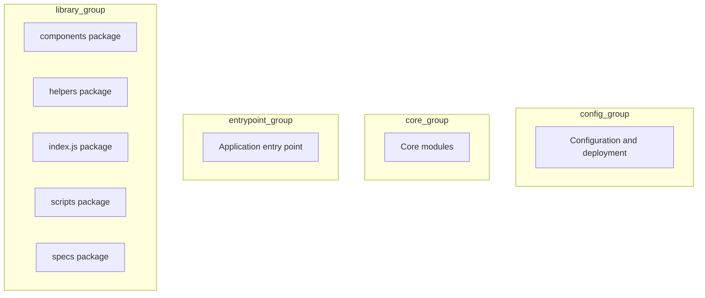

# Architecture report: reactjs/react-modal

> Automated static analysis. **Observed** = directly seen in files/imports/AST; **Inferred** = interpretation from that evidence. Repository code was not executed.

## 1. Repository at a glance

| Item | Value |
| --- | --- |
| Repository | reactjs/react-modal |
| Description | Accessible modal dialog component for React |
| Language | JavaScript |
| Stars | 7403 |
| Licence | MIT |
| Analysed commit / branch | e66ab51b65e6c03d9dfa283f026da1c7f9f6c9b0 / master |
| Framework(s) | React |
| Files analysed | 83 |
| Components | 8 |

## 2. Architecture in one minute

reactjs/react-modal - Accessible modal dialog component for React. This repository was analysed statically from 83 file(s) (1 Python). Detected technologies (observed from imports/manifests): GitHub Actions, React, React Router, webpack. Files are grouped into 8 component(s): components package, Configuration and deployment, Core modules, Application entry point, helpers package, index.js package, scripts package, specs package. Observed entry point(s): scripts/changelog.py. Findings below distinguish observed facts from inferred interpretation.

## 3. High-level block diagram

## 4. Main components

### components package (`components`)

- **Kind:** library
- **Status:** Observed
- **Confidence:** 0.85
- **Responsibility:** Groups 2 file(s) under components package (observed from repository paths and static analysis).
- **Paths:** `src/components/Modal.js`, `src/components/ModalPortal.js`
- **Evidence:** [src/components/Modal.js](https://github.com/reactjs/react-modal/blob/e66ab51b65e6c03d9dfa283f026da1c7f9f6c9b0/src/components/Modal.js); [src/components/ModalPortal.js](https://github.com/reactjs/react-modal/blob/e66ab51b65e6c03d9dfa283f026da1c7f9f6c9b0/src/components/ModalPortal.js)

### Configuration and deployment (`config`)

- **Kind:** config
- **Status:** Observed
- **Confidence:** 0.85
- **Responsibility:** Groups 3 file(s) under configuration and deployment (observed from repository paths and static analysis).
- **Paths:** `bower.json`, `mkdocs.yml`, `package.json`
- **Evidence:** [bower.json](https://github.com/reactjs/react-modal/blob/e66ab51b65e6c03d9dfa283f026da1c7f9f6c9b0/bower.json); [mkdocs.yml](https://github.com/reactjs/react-modal/blob/e66ab51b65e6c03d9dfa283f026da1c7f9f6c9b0/mkdocs.yml); [package.json](https://github.com/reactjs/react-modal/blob/e66ab51b65e6c03d9dfa283f026da1c7f9f6c9b0/package.json)

### Core modules (`core`)

- **Kind:** core
- **Status:** Observed
- **Confidence:** 0.85
- **Responsibility:** Groups 1 file(s) under core modules (observed from repository paths and static analysis).
- **Paths:** `karma.conf.js`
- **Evidence:** [karma.conf.js](https://github.com/reactjs/react-modal/blob/e66ab51b65e6c03d9dfa283f026da1c7f9f6c9b0/karma.conf.js)

### Application entry point (`entrypoint`)

- **Kind:** entrypoint
- **Status:** Observed
- **Confidence:** 0.85
- **Responsibility:** Groups 1 file(s) under application entry point (observed from repository paths and static analysis). Observed top-level functions: adjacents, generate_all, generate_current, get_all_tags, get_tags_date, git_exec.
- **Paths:** `scripts/changelog.py`
- **Evidence:** [scripts/changelog.py:24](https://github.com/reactjs/react-modal/blob/e66ab51b65e6c03d9dfa283f026da1c7f9f6c9b0/scripts/changelog.py#L24)

### helpers package (`helpers`)

- **Kind:** library
- **Status:** Observed
- **Confidence:** 0.85
- **Responsibility:** Groups 8 file(s) under helpers package (observed from repository paths and static analysis).
- **Paths:** `src/helpers/ariaAppHider.js`, `src/helpers/bodyTrap.js`, `src/helpers/classList.js`, `src/helpers/focusManager.js`, `src/helpers/portalOpenInstances.js`, `src/helpers/safeHTMLElement.js`, `src/helpers/scopeTab.js`, `src/helpers/tabbable.js`
- **Evidence:** [src/helpers/ariaAppHider.js](https://github.com/reactjs/react-modal/blob/e66ab51b65e6c03d9dfa283f026da1c7f9f6c9b0/src/helpers/ariaAppHider.js); [src/helpers/bodyTrap.js](https://github.com/reactjs/react-modal/blob/e66ab51b65e6c03d9dfa283f026da1c7f9f6c9b0/src/helpers/bodyTrap.js); [src/helpers/classList.js](https://github.com/reactjs/react-modal/blob/e66ab51b65e6c03d9dfa283f026da1c7f9f6c9b0/src/helpers/classList.js); [src/helpers/focusManager.js](https://github.com/reactjs/react-modal/blob/e66ab51b65e6c03d9dfa283f026da1c7f9f6c9b0/src/helpers/focusManager.js); [src/helpers/portalOpenInstances.js](https://github.com/reactjs/react-modal/blob/e66ab51b65e6c03d9dfa283f026da1c7f9f6c9b0/src/helpers/portalOpenInstances.js); [src/helpers/safeHTMLElement.js](https://github.com/reactjs/react-modal/blob/e66ab51b65e6c03d9dfa283f026da1c7f9f6c9b0/src/helpers/safeHTMLElement.js); [src/helpers/scopeTab.js](https://github.com/reactjs/react-modal/blob/e66ab51b65e6c03d9dfa283f026da1c7f9f6c9b0/src/helpers/scopeTab.js); [src/helpers/tabbable.js](https://github.com/reactjs/react-modal/blob/e66ab51b65e6c03d9dfa283f026da1c7f9f6c9b0/src/helpers/tabbable.js)

### index.js package (`index_js`)

- **Kind:** library
- **Status:** Observed
- **Confidence:** 0.85
- **Responsibility:** Groups 1 file(s) under index.js package (observed from repository paths and static analysis).
- **Paths:** `src/index.js`
- **Evidence:** [src/index.js](https://github.com/reactjs/react-modal/blob/e66ab51b65e6c03d9dfa283f026da1c7f9f6c9b0/src/index.js)

### scripts package (`scripts`)

- **Kind:** library
- **Status:** Observed
- **Confidence:** 0.85
- **Responsibility:** Groups 4 file(s) under scripts package (observed from repository paths and static analysis).
- **Paths:** `scripts/defaultConfig.js`, `scripts/webpack.config.js`, `scripts/webpack.dist.config.js`, `scripts/webpack.test.config.js`
- **Evidence:** [scripts/defaultConfig.js](https://github.com/reactjs/react-modal/blob/e66ab51b65e6c03d9dfa283f026da1c7f9f6c9b0/scripts/defaultConfig.js); [scripts/webpack.config.js](https://github.com/reactjs/react-modal/blob/e66ab51b65e6c03d9dfa283f026da1c7f9f6c9b0/scripts/webpack.config.js); [scripts/webpack.dist.config.js](https://github.com/reactjs/react-modal/blob/e66ab51b65e6c03d9dfa283f026da1c7f9f6c9b0/scripts/webpack.dist.config.js); [scripts/webpack.test.config.js](https://github.com/reactjs/react-modal/blob/e66ab51b65e6c03d9dfa283f026da1c7f9f6c9b0/scripts/webpack.test.config.js)

### specs package (`specs`)

- **Kind:** library
- **Status:** Observed
- **Confidence:** 0.85
- **Responsibility:** Groups 7 file(s) under specs package (observed from repository paths and static analysis).
- **Paths:** `specs/Modal.events.spec.js`, `specs/Modal.helpers.spec.js`, `specs/Modal.spec.js`, `specs/Modal.style.spec.js`, `specs/Modal.testability.spec.js`, `specs/helper.js`, `specs/index.js`
- **Evidence:** [specs/Modal.events.spec.js](https://github.com/reactjs/react-modal/blob/e66ab51b65e6c03d9dfa283f026da1c7f9f6c9b0/specs/Modal.events.spec.js); [specs/Modal.helpers.spec.js](https://github.com/reactjs/react-modal/blob/e66ab51b65e6c03d9dfa283f026da1c7f9f6c9b0/specs/Modal.helpers.spec.js); [specs/Modal.spec.js](https://github.com/reactjs/react-modal/blob/e66ab51b65e6c03d9dfa283f026da1c7f9f6c9b0/specs/Modal.spec.js); [specs/Modal.style.spec.js](https://github.com/reactjs/react-modal/blob/e66ab51b65e6c03d9dfa283f026da1c7f9f6c9b0/specs/Modal.style.spec.js); [specs/Modal.testability.spec.js](https://github.com/reactjs/react-modal/blob/e66ab51b65e6c03d9dfa283f026da1c7f9f6c9b0/specs/Modal.testability.spec.js); [specs/helper.js](https://github.com/reactjs/react-modal/blob/e66ab51b65e6c03d9dfa283f026da1c7f9f6c9b0/specs/helper.js); [specs/index.js](https://github.com/reactjs/react-modal/blob/e66ab51b65e6c03d9dfa283f026da1c7f9f6c9b0/specs/index.js)

## 5. Execution flow

**Observed** entry point(s):

- [scripts/changelog.py:138](https://github.com/reactjs/react-modal/blob/e66ab51b65e6c03d9dfa283f026da1c7f9f6c9b0/scripts/changelog.py#L138)
- [specs/index.js](https://github.com/reactjs/react-modal/blob/e66ab51b65e6c03d9dfa283f026da1c7f9f6c9b0/specs/index.js)
- [src/index.js](https://github.com/reactjs/react-modal/blob/e66ab51b65e6c03d9dfa283f026da1c7f9f6c9b0/src/index.js)

Representative flow (derived from observed entry points and the import graph; steps beyond the entry point are **Inferred**):

1. Execution starts at an observed entry point listed above, if present.
2. No internal import relationships between components were observed.

## 6. Project structure

### `(root)`

- `.babelrc` - other (106 bytes)
- `.eslintrc.js` - source, JavaScript (1204 bytes)
- `.gitignore` - other (208 bytes)
- `.npmignore` - other (248 bytes)
- `.travis.yml` - ci, YAML (134 bytes)
- `CHANGELOG.md` - docs (45944 bytes)
- `CONTRIBUTING.md` - docs (827 bytes)
- `LICENSE` - docs (1057 bytes)
- `Makefile` - other (4102 bytes)
- `README.md` - docs (4136 bytes)
- `UPGRADE_GUIDE.md` - docs (170 bytes)
- `bower.json` - config (547 bytes)
- `flake.lock` - other (1466 bytes)
- `flake.nix` - other (651 bytes)
- `karma.conf.js` - source, JavaScript (1010 bytes)
- `mkdocs.yml` - config (901 bytes)
- `package.json` - manifest (2515 bytes)

### `.github`

- `.github/ISSUE_TEMPLATE.md` - docs (253 bytes)
- `.github/PULL_REQUEST_TEMPLATE.md` - docs (103 bytes)
- `.github/workflows/test.yml` - ci, YAML (476 bytes)

### `.log`

- `.log/ti-16339.log` - other (34619 bytes)
- `.log/ti-28128.log` - other (29598 bytes)
- `.log/ti-39437.log` - other (46739 bytes)
- `.log/ti-88235.log` - other (161552 bytes)

### `docs`

- `docs/accessibility/index.md` - docs (3594 bytes)
- `docs/contributing/development.md` - docs (1118 bytes)
- `docs/contributing/index.md` - docs (1205 bytes)
- `docs/examples/css_classes.md` - docs (260 bytes)
- `docs/examples/global_overrides.md` - docs (230 bytes)
- `docs/examples/index.md` - docs (378 bytes)
- `docs/examples/inline_styles.md` - docs (158 bytes)
- `docs/examples/minimal.md` - docs (141 bytes)
- `docs/examples/on_request_close.md` - docs (410 bytes)
- `docs/examples/set_app_element.md` - docs (369 bytes)
- `docs/examples/should_close_on_overlay_click.md` - docs (620 bytes)
- `docs/index.md` - docs (6296 bytes)
- `docs/pygments.css` - docs (4880 bytes)
- `docs/styles/classes.md` - docs (3604 bytes)
- `docs/styles/index.md` - docs (911 bytes)
- `docs/styles/transitions.md` - docs (2207 bytes)
- `docs/testing/index.md` - docs (417 bytes)

### `examples`

- `examples/base.css` - other (362 bytes)
- `examples/basic/app.css` - other (735 bytes)
- `examples/basic/app.js` - source, JavaScript (918 bytes)
- `examples/basic/forms/index.js` - source, JavaScript (2119 bytes)
- `examples/basic/index.html` - other (1275 bytes)
- `examples/basic/multiple_modals/index.js` - source, JavaScript (4011 bytes)
- `examples/basic/nested_modals/index.js` - source, JavaScript (3498 bytes)
- `examples/basic/react-router/index.js` - source, JavaScript (1302 bytes)
- `examples/basic/simple_usage/index.js` - source, JavaScript (2651 bytes)
- `examples/basic/simple_usage/modal.js` - source, JavaScript (787 bytes)
- `examples/bootstrap/app.css` - other (831 bytes)
- `examples/bootstrap/app.js` - source, JavaScript (4342 bytes)
- `examples/bootstrap/index.html` - other (1281 bytes)
- `examples/index.html` - other (1360 bytes)
- `examples/wc/app.css` - other (831 bytes)
- `examples/wc/app.js` - source, JavaScript (4784 bytes)
- `examples/wc/index.html` - other (1274 bytes)

### `scripts`

- `scripts/changelog.py` - source, Python (3271 bytes)
- `scripts/defaultConfig.js` - source, JavaScript (418 bytes)
- `scripts/repo_status` - other (242 bytes)
- `scripts/version` - other (411 bytes)
- `scripts/webpack.config.js` - source, JavaScript (689 bytes)
- `scripts/webpack.dist.config.js` - source, JavaScript (994 bytes)
- `scripts/webpack.test.config.js` - source, JavaScript (498 bytes)

### `specs`

- `specs/Modal.events.spec.js` - source, JavaScript (9348 bytes)
- `specs/Modal.helpers.spec.js` - source, JavaScript (7472 bytes)
- `specs/Modal.spec.js` - source, JavaScript (26151 bytes)
- `specs/Modal.style.spec.js` - source, JavaScript (2335 bytes)
- `specs/Modal.testability.spec.js` - source, JavaScript (443 bytes)
- `specs/helper.js` - source, JavaScript (6405 bytes)
- `specs/index.js` - source, JavaScript (435 bytes)

### `src`

- `src/components/Modal.js` - source, JavaScript (6876 bytes)
- `src/components/ModalPortal.js` - source, JavaScript (11407 bytes)
- `src/helpers/ariaAppHider.js` - source, JavaScript (2412 bytes)
- `src/helpers/bodyTrap.js` - source, JavaScript (1989 bytes)
- `src/helpers/classList.js` - source, JavaScript (3565 bytes)
- `src/helpers/focusManager.js` - source, JavaScript (2649 bytes)
- `src/helpers/portalOpenInstances.js` - source, JavaScript (1861 bytes)
- `src/helpers/safeHTMLElement.js` - source, JavaScript (358 bytes)
- `src/helpers/scopeTab.js` - source, JavaScript (2144 bytes)
- `src/helpers/tabbable.js` - source, JavaScript (2705 bytes)
- `src/index.js` - source, JavaScript (63 bytes)

## 7. Key dependencies and integrations

| Name | Category | Status | Confidence | Evidence |
| --- | --- | --- | --- | --- |
| GitHub Actions | ci | Observed | 0.85 | [.github/workflows/test.yml](https://github.com/reactjs/react-modal/blob/e66ab51b65e6c03d9dfa283f026da1c7f9f6c9b0/.github/workflows/test.yml) |
| React | framework | Observed | 0.90 | [package.json:2](https://github.com/reactjs/react-modal/blob/e66ab51b65e6c03d9dfa283f026da1c7f9f6c9b0/package.json#L2); [package.json:57](https://github.com/reactjs/react-modal/blob/e66ab51b65e6c03d9dfa283f026da1c7f9f6c9b0/package.json#L57) |
| React Router | library | Observed | 0.90 | [package.json:58](https://github.com/reactjs/react-modal/blob/e66ab51b65e6c03d9dfa283f026da1c7f9f6c9b0/package.json#L58); [package.json:59](https://github.com/reactjs/react-modal/blob/e66ab51b65e6c03d9dfa283f026da1c7f9f6c9b0/package.json#L59) |
| webpack | tooling | Observed | 0.85 | [package.json:17](https://github.com/reactjs/react-modal/blob/e66ab51b65e6c03d9dfa283f026da1c7f9f6c9b0/package.json#L17) |

## 8. Data and state

No database, cache, queue, or persistent-state usage was observed in the analysed files. State handling, if any, may be in-memory or in files that were not analysed.

## 9. Configuration and deployment clues

- `.github/workflows/test.yml` (ci)
- `.travis.yml` (ci)
- `bower.json` (config)
- `mkdocs.yml` (config)
- `package.json` (manifest)

## 10. Design observations

- An entry/API layer is separated from other code (Inferred from paths and decorators).

These observations are interpretations (**Inferred**) of the observed structure, not guarantees about runtime design.

## 11. Limitations and unknowns

- Static analysis only: repository code was not executed, installed, or imported at runtime.
- Components and relationships are inferred from file paths, imports, and AST structure; runtime behaviour, dynamic imports, and reflection may not be visible.
- 1 file(s) were skipped during inventory (1 x vendored/generated directory excluded).
- Repository text was treated as untrusted data; no instructions found in repository files were followed, and likely secret values were redacted/excluded.

## 12. Source references

- [.github/workflows/test.yml](https://github.com/reactjs/react-modal/blob/e66ab51b65e6c03d9dfa283f026da1c7f9f6c9b0/.github/workflows/test.yml)
- [bower.json](https://github.com/reactjs/react-modal/blob/e66ab51b65e6c03d9dfa283f026da1c7f9f6c9b0/bower.json)
- [karma.conf.js](https://github.com/reactjs/react-modal/blob/e66ab51b65e6c03d9dfa283f026da1c7f9f6c9b0/karma.conf.js)
- [mkdocs.yml](https://github.com/reactjs/react-modal/blob/e66ab51b65e6c03d9dfa283f026da1c7f9f6c9b0/mkdocs.yml)
- [package.json](https://github.com/reactjs/react-modal/blob/e66ab51b65e6c03d9dfa283f026da1c7f9f6c9b0/package.json)
- [package.json:2](https://github.com/reactjs/react-modal/blob/e66ab51b65e6c03d9dfa283f026da1c7f9f6c9b0/package.json#L2)
- [package.json:17](https://github.com/reactjs/react-modal/blob/e66ab51b65e6c03d9dfa283f026da1c7f9f6c9b0/package.json#L17)
- [package.json:57](https://github.com/reactjs/react-modal/blob/e66ab51b65e6c03d9dfa283f026da1c7f9f6c9b0/package.json#L57)
- [package.json:58](https://github.com/reactjs/react-modal/blob/e66ab51b65e6c03d9dfa283f026da1c7f9f6c9b0/package.json#L58)
- [package.json:59](https://github.com/reactjs/react-modal/blob/e66ab51b65e6c03d9dfa283f026da1c7f9f6c9b0/package.json#L59)
- [scripts/changelog.py:24](https://github.com/reactjs/react-modal/blob/e66ab51b65e6c03d9dfa283f026da1c7f9f6c9b0/scripts/changelog.py#L24)
- [scripts/changelog.py:138](https://github.com/reactjs/react-modal/blob/e66ab51b65e6c03d9dfa283f026da1c7f9f6c9b0/scripts/changelog.py#L138)
- [scripts/defaultConfig.js](https://github.com/reactjs/react-modal/blob/e66ab51b65e6c03d9dfa283f026da1c7f9f6c9b0/scripts/defaultConfig.js)
- [scripts/webpack.config.js](https://github.com/reactjs/react-modal/blob/e66ab51b65e6c03d9dfa283f026da1c7f9f6c9b0/scripts/webpack.config.js)
- [scripts/webpack.dist.config.js](https://github.com/reactjs/react-modal/blob/e66ab51b65e6c03d9dfa283f026da1c7f9f6c9b0/scripts/webpack.dist.config.js)
- [scripts/webpack.test.config.js](https://github.com/reactjs/react-modal/blob/e66ab51b65e6c03d9dfa283f026da1c7f9f6c9b0/scripts/webpack.test.config.js)
- [specs/Modal.events.spec.js](https://github.com/reactjs/react-modal/blob/e66ab51b65e6c03d9dfa283f026da1c7f9f6c9b0/specs/Modal.events.spec.js)
- [specs/Modal.helpers.spec.js](https://github.com/reactjs/react-modal/blob/e66ab51b65e6c03d9dfa283f026da1c7f9f6c9b0/specs/Modal.helpers.spec.js)
- [specs/Modal.spec.js](https://github.com/reactjs/react-modal/blob/e66ab51b65e6c03d9dfa283f026da1c7f9f6c9b0/specs/Modal.spec.js)
- [specs/Modal.style.spec.js](https://github.com/reactjs/react-modal/blob/e66ab51b65e6c03d9dfa283f026da1c7f9f6c9b0/specs/Modal.style.spec.js)
- [specs/Modal.testability.spec.js](https://github.com/reactjs/react-modal/blob/e66ab51b65e6c03d9dfa283f026da1c7f9f6c9b0/specs/Modal.testability.spec.js)
- [specs/helper.js](https://github.com/reactjs/react-modal/blob/e66ab51b65e6c03d9dfa283f026da1c7f9f6c9b0/specs/helper.js)
- [specs/index.js](https://github.com/reactjs/react-modal/blob/e66ab51b65e6c03d9dfa283f026da1c7f9f6c9b0/specs/index.js)
- [src/components/Modal.js](https://github.com/reactjs/react-modal/blob/e66ab51b65e6c03d9dfa283f026da1c7f9f6c9b0/src/components/Modal.js)
- [src/components/ModalPortal.js](https://github.com/reactjs/react-modal/blob/e66ab51b65e6c03d9dfa283f026da1c7f9f6c9b0/src/components/ModalPortal.js)
- [src/helpers/ariaAppHider.js](https://github.com/reactjs/react-modal/blob/e66ab51b65e6c03d9dfa283f026da1c7f9f6c9b0/src/helpers/ariaAppHider.js)
- [src/helpers/bodyTrap.js](https://github.com/reactjs/react-modal/blob/e66ab51b65e6c03d9dfa283f026da1c7f9f6c9b0/src/helpers/bodyTrap.js)
- [src/helpers/classList.js](https://github.com/reactjs/react-modal/blob/e66ab51b65e6c03d9dfa283f026da1c7f9f6c9b0/src/helpers/classList.js)
- [src/helpers/focusManager.js](https://github.com/reactjs/react-modal/blob/e66ab51b65e6c03d9dfa283f026da1c7f9f6c9b0/src/helpers/focusManager.js)
- [src/helpers/portalOpenInstances.js](https://github.com/reactjs/react-modal/blob/e66ab51b65e6c03d9dfa283f026da1c7f9f6c9b0/src/helpers/portalOpenInstances.js)
- [src/helpers/safeHTMLElement.js](https://github.com/reactjs/react-modal/blob/e66ab51b65e6c03d9dfa283f026da1c7f9f6c9b0/src/helpers/safeHTMLElement.js)
- [src/helpers/scopeTab.js](https://github.com/reactjs/react-modal/blob/e66ab51b65e6c03d9dfa283f026da1c7f9f6c9b0/src/helpers/scopeTab.js)
- [src/helpers/tabbable.js](https://github.com/reactjs/react-modal/blob/e66ab51b65e6c03d9dfa283f026da1c7f9f6c9b0/src/helpers/tabbable.js)
- [src/index.js](https://github.com/reactjs/react-modal/blob/e66ab51b65e6c03d9dfa283f026da1c7f9f6c9b0/src/index.js)
