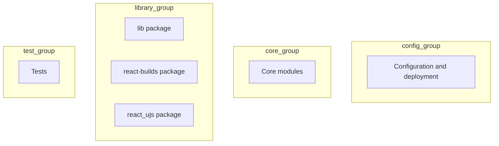

# Architecture report: reactjs/react-rails

> Automated static analysis. **Observed** = directly seen in files/imports/AST; **Inferred** = interpretation from that evidence. Repository code was not executed.

## 1. Repository at a glance

| Item | Value |
| --- | --- |
| Repository | reactjs/react-rails |
| Description | Integrate React.js with Rails views and controllers, the asset pipeline, or webpacker. |
| Language | JavaScript |
| Stars | 6776 |
| Licence | Apache-2.0 |
| Analysed commit / branch | e48a3263d6a79e544d7af92df4ebd86e5f27e213 / main |
| Framework(s) | React |
| Files analysed | 252 |
| Components | 6 |

## 2. Architecture in one minute

reactjs/react-rails - Integrate React.js with Rails views and controllers, the asset pipeline, or webpacker.. This repository was analysed statically from 252 file(s) (0 Python). Detected technologies (observed from imports/manifests): GitHub Actions, React, webpack. Files are grouped into 6 component(s): Configuration and deployment, Core modules, lib package, react-builds package, react_ujs package, Tests. Findings below distinguish observed facts from inferred interpretation.

## 3. High-level block diagram

## 4. Main components

### Configuration and deployment (`config`)

- **Kind:** config
- **Status:** Observed
- **Confidence:** 0.85
- **Responsibility:** Groups 2 file(s) under configuration and deployment (observed from repository paths and static analysis).
- **Paths:** `package.json`, `react-builds/package.json`
- **Evidence:** [package.json](https://github.com/reactjs/react-rails/blob/e48a3263d6a79e544d7af92df4ebd86e5f27e213/package.json); [react-builds/package.json](https://github.com/reactjs/react-rails/blob/e48a3263d6a79e544d7af92df4ebd86e5f27e213/react-builds/package.json)

### Core modules (`core`)

- **Kind:** core
- **Status:** Observed
- **Confidence:** 0.85
- **Responsibility:** Groups 1 file(s) under core modules (observed from repository paths and static analysis).
- **Paths:** `check_for_uncommitted_files.sh`
- **Evidence:** [check_for_uncommitted_files.sh](https://github.com/reactjs/react-rails/blob/e48a3263d6a79e544d7af92df4ebd86e5f27e213/check_for_uncommitted_files.sh)

### lib package (`lib`)

- **Kind:** library
- **Status:** Observed
- **Confidence:** 0.85
- **Responsibility:** Groups 40 file(s) under lib package (observed from repository paths and static analysis).
- **Paths:** `lib/assets/javascripts/react_ujs.js`, `lib/assets/react-source/production/react-server.js`, `lib/assets/react-source/production/react.js`, `lib/generators/react/component_generator.rb`, `lib/generators/react/install_generator.rb`, `lib/generators/templates/component.es6.jsx`, `lib/generators/templates/component.es6.tsx`, `lib/generators/templates/component.js.jsx`, `lib/generators/templates/component.js.jsx.tsx`, `lib/generators/templates/react_server_rendering.rb`, `lib/generators/templates/server_rendering.js`, `lib/generators/templates/server_rendering_pack.js`, `lib/react-rails.rb`, `lib/react.rb`, `lib/react/jsx.rb`, `lib/react/jsx/babel_transformer.rb`, `lib/react/jsx/jsx_transformer.rb`, `lib/react/jsx/processor.rb`, `lib/react/jsx/sprockets_strategy.rb`, `lib/react/jsx/template.rb`, `lib/react/rails.rb`, `lib/react/rails/asset_variant.rb`, `lib/react/rails/component_mount.rb`, `lib/react/rails/controller_lifecycle.rb`, `lib/react/rails/controller_renderer.rb`, `lib/react/rails/railtie.rb`, `lib/react/rails/version.rb`, `lib/react/rails/view_helper.rb`, `lib/react/server_rendering.rb`, `lib/react/server_rendering/bundle_renderer.rb`, `lib/react/server_rendering/bundle_renderer/console_polyfill.js`, `lib/react/server_rendering/bundle_renderer/console_replay.js`, `lib/react/server_rendering/bundle_renderer/console_reset.js`, `lib/react/server_rendering/bundle_renderer/timeout_polyfill.js`, `lib/react/server_rendering/environment_container.rb`, `lib/react/server_rendering/exec_js_renderer.rb`, `lib/react/server_rendering/manifest_container.rb`, `lib/react/server_rendering/propshaft_container.rb`, `lib/react/server_rendering/separate_server_bundle_container.rb`, `lib/react/server_rendering/yaml_manifest_container.rb`
- **Evidence:** [lib/assets/javascripts/react_ujs.js](https://github.com/reactjs/react-rails/blob/e48a3263d6a79e544d7af92df4ebd86e5f27e213/lib/assets/javascripts/react_ujs.js); [lib/assets/react-source/production/react-server.js](https://github.com/reactjs/react-rails/blob/e48a3263d6a79e544d7af92df4ebd86e5f27e213/lib/assets/react-source/production/react-server.js); [lib/assets/react-source/production/react.js](https://github.com/reactjs/react-rails/blob/e48a3263d6a79e544d7af92df4ebd86e5f27e213/lib/assets/react-source/production/react.js); [lib/generators/react/component_generator.rb](https://github.com/reactjs/react-rails/blob/e48a3263d6a79e544d7af92df4ebd86e5f27e213/lib/generators/react/component_generator.rb); [lib/generators/react/install_generator.rb](https://github.com/reactjs/react-rails/blob/e48a3263d6a79e544d7af92df4ebd86e5f27e213/lib/generators/react/install_generator.rb); [lib/generators/templates/component.es6.jsx](https://github.com/reactjs/react-rails/blob/e48a3263d6a79e544d7af92df4ebd86e5f27e213/lib/generators/templates/component.es6.jsx); [lib/generators/templates/component.es6.tsx](https://github.com/reactjs/react-rails/blob/e48a3263d6a79e544d7af92df4ebd86e5f27e213/lib/generators/templates/component.es6.tsx); [lib/generators/templates/component.js.jsx](https://github.com/reactjs/react-rails/blob/e48a3263d6a79e544d7af92df4ebd86e5f27e213/lib/generators/templates/component.js.jsx)

### react-builds package (`react_builds`)

- **Kind:** library
- **Status:** Observed
- **Confidence:** 0.85
- **Responsibility:** Groups 3 file(s) under react-builds package (observed from repository paths and static analysis).
- **Paths:** `react-builds/react-browser.js`, `react-builds/react-server.js`, `react-builds/webpack.config.js`
- **Evidence:** [react-builds/react-browser.js](https://github.com/reactjs/react-rails/blob/e48a3263d6a79e544d7af92df4ebd86e5f27e213/react-builds/react-browser.js); [react-builds/react-server.js](https://github.com/reactjs/react-rails/blob/e48a3263d6a79e544d7af92df4ebd86e5f27e213/react-builds/react-server.js); [react-builds/webpack.config.js](https://github.com/reactjs/react-rails/blob/e48a3263d6a79e544d7af92df4ebd86e5f27e213/react-builds/webpack.config.js)

### react_ujs package (`react_ujs`)

- **Kind:** library
- **Status:** Observed
- **Confidence:** 0.85
- **Responsibility:** Groups 15 file(s) under react_ujs package (observed from repository paths and static analysis).
- **Paths:** `react_ujs/index.js`, `react_ujs/src/events/detect.js`, `react_ujs/src/events/native.js`, `react_ujs/src/events/pjax.js`, `react_ujs/src/events/turbolinks.js`, `react_ujs/src/events/turbolinksClassic.js`, `react_ujs/src/events/turbolinksClassicDeprecated.js`, `react_ujs/src/getConstructor/fromGlobal.js`, `react_ujs/src/getConstructor/fromRequireContext.js`, `react_ujs/src/getConstructor/fromRequireContextWithGlobalFallback.js`, `react_ujs/src/getConstructor/fromRequireContextsWithGlobalFallback.js`, `react_ujs/src/reactDomClient.js`, `react_ujs/src/renderHelpers.js`, `react_ujs/src/supportsRootApi.js`, `react_ujs/webpack.config.js`
- **Evidence:** [react_ujs/index.js](https://github.com/reactjs/react-rails/blob/e48a3263d6a79e544d7af92df4ebd86e5f27e213/react_ujs/index.js); [react_ujs/src/events/detect.js](https://github.com/reactjs/react-rails/blob/e48a3263d6a79e544d7af92df4ebd86e5f27e213/react_ujs/src/events/detect.js); [react_ujs/src/events/native.js](https://github.com/reactjs/react-rails/blob/e48a3263d6a79e544d7af92df4ebd86e5f27e213/react_ujs/src/events/native.js); [react_ujs/src/events/pjax.js](https://github.com/reactjs/react-rails/blob/e48a3263d6a79e544d7af92df4ebd86e5f27e213/react_ujs/src/events/pjax.js); [react_ujs/src/events/turbolinks.js](https://github.com/reactjs/react-rails/blob/e48a3263d6a79e544d7af92df4ebd86e5f27e213/react_ujs/src/events/turbolinks.js); [react_ujs/src/events/turbolinksClassic.js](https://github.com/reactjs/react-rails/blob/e48a3263d6a79e544d7af92df4ebd86e5f27e213/react_ujs/src/events/turbolinksClassic.js); [react_ujs/src/events/turbolinksClassicDeprecated.js](https://github.com/reactjs/react-rails/blob/e48a3263d6a79e544d7af92df4ebd86e5f27e213/react_ujs/src/events/turbolinksClassicDeprecated.js); [react_ujs/src/getConstructor/fromGlobal.js](https://github.com/reactjs/react-rails/blob/e48a3263d6a79e544d7af92df4ebd86e5f27e213/react_ujs/src/getConstructor/fromGlobal.js)

### Tests (`tests`)

- **Kind:** test
- **Status:** Observed
- **Confidence:** 0.85
- **Responsibility:** Groups 139 file(s) under tests (observed from repository paths and static analysis).
- **Paths:** `lib/react/rails/test_helper.rb`, `test/bin/create-fake-js-package-managers`, `test/dummy/.gitignore`, `test/dummy/.postcssrc.yml`, `test/dummy/README.rdoc`, `test/dummy/Rakefile`, `test/dummy/app/assets/config/manifest.js`, `test/dummy/app/assets/images/.keep`, `test/dummy/app/assets/javascripts/app_no_turbolinks.js`, `test/dummy/app/assets/javascripts/application.js`, `test/dummy/app/assets/javascripts/components.js`, `test/dummy/app/assets/javascripts/components/PlainJSTodo.js`, `test/dummy/app/assets/javascripts/components/Todo.js.jsx.coffee`, `test/dummy/app/assets/javascripts/components/TodoList.js.jsx`, `test/dummy/app/assets/javascripts/components/TodoListWithConsoleLog.js.jsx`, `test/dummy/app/assets/javascripts/components/WithSetTimeout.js.jsx`, `test/dummy/app/assets/javascripts/example.js.jsx`, `test/dummy/app/assets/javascripts/example2.js.jsx.coffee`, `test/dummy/app/assets/javascripts/example3.js.jsx`, `test/dummy/app/assets/javascripts/flow_types_example.js.jsx`, `test/dummy/app/assets/javascripts/harmony_example.js.jsx`, `test/dummy/app/assets/javascripts/pages.js`, `test/dummy/app/assets/javascripts/require_test/jsx_preprocessor_test.jsx`, `test/dummy/app/assets/javascripts/require_test/jsx_require_child_coffee.coffee`, `test/dummy/app/assets/javascripts/require_test/jsx_require_child_js.js`, `test/dummy/app/assets/javascripts/require_test/jsx_require_child_jsx.jsx`, `test/dummy/app/assets/javascripts/server_rendering.js`, `test/dummy/app/assets/javascripts/turbolinks_only.js`, `test/dummy/app/assets/stylesheets/application.css`, `test/dummy/app/controllers/application_controller.rb`, `test/dummy/app/controllers/concerns/.keep`, `test/dummy/app/controllers/counters_controller.rb`, `test/dummy/app/controllers/pack_components_controller.rb`, `test/dummy/app/controllers/pages_controller.rb`, `test/dummy/app/controllers/server_controller.rb`, `test/dummy/app/helpers/application_helper.rb`, `test/dummy/app/javascript/components/Counter.js`, `test/dummy/app/javascript/components/GreetingMessage.js`, `test/dummy/app/javascript/components/Todo.js`, `test/dummy/app/javascript/components/TodoList.js`, `test/dummy/app/javascript/components/TodoListWithConsoleLog.js`, `test/dummy/app/javascript/components/WithSetTimeout.js`, `test/dummy/app/javascript/components/export_default_component.js`, `test/dummy/app/javascript/components/named_export_component.js`, `test/dummy/app/javascript/components/subfolder/exports_component.js`, `test/dummy/app/javascript/controllers/mount_counters.js`, `test/dummy/app/javascript/packs/application.js`, `test/dummy/app/javascript/packs/server_rendering.js`, `test/dummy/app/mailers/.keep`, `test/dummy/app/models/.keep`, `test/dummy/app/models/concerns/.keep`, `test/dummy/app/pants/yfronts.js`, `test/dummy/app/views/counters/create.turbo_stream.erb`, `test/dummy/app/views/counters/index.html.erb`, `test/dummy/app/views/layouts/app_no_turbolinks.html.erb`, `test/dummy/app/views/layouts/application.html.erb`, `test/dummy/app/views/pack_components/show.html.erb`, `test/dummy/app/views/pages/_component_with_inner_html.html.erb`, `test/dummy/app/views/pages/show.html.erb`, `test/dummy/app/views/server/console_example.html.erb`, `test/dummy/app/views/server/console_example_suppressed.html.erb`, `test/dummy/app/views/server/show.html.erb`, `test/dummy/babel.config.js`, `test/dummy/bin/bundle`, `test/dummy/bin/rails`, `test/dummy/bin/rake`, `test/dummy/bin/shakapacker`, `test/dummy/bin/shakapacker-dev-server`, `test/dummy/bin/yarn`, `test/dummy/config.ru`, `test/dummy/config/application.rb`, `test/dummy/config/boot.rb`, `test/dummy/config/environment.rb`, `test/dummy/config/environments/development.rb`, `test/dummy/config/environments/production.rb`, `test/dummy/config/environments/test.rb`, `test/dummy/config/initializers/backtrace_silencers.rb`, `test/dummy/config/initializers/filter_parameter_logging.rb`, `test/dummy/config/initializers/inflections.rb`, `test/dummy/config/initializers/mime_types.rb`, `test/dummy/config/initializers/react.rb`, `test/dummy/config/initializers/secret_token.rb`, `test/dummy/config/initializers/session_store.rb`, `test/dummy/config/initializers/wrap_parameters.rb`, `test/dummy/config/locales/en.yml`, `test/dummy/config/routes.rb`, `test/dummy/config/shakapacker.yml`, `test/dummy/config/webpack/clientWebpackConfig.js`, `test/dummy/config/webpack/commonWebpackConfig.js`, `test/dummy/config/webpack/development.js`, `test/dummy/config/webpack/production.js`, `test/dummy/config/webpack/serverClientOrBoth.js`, `test/dummy/config/webpack/serverWebpackConfig.js`, `test/dummy/config/webpack/test.js`, `test/dummy/config/webpack/webpack.config.js`, `test/dummy/lib/assets/.keep`, `test/dummy/log/.keep`, `test/dummy/package.json`, `test/dummy/public/404.html`, `test/dummy/public/422.html`, `test/dummy/public/500.html`, `test/generators/coffee_component_generator_test.rb`, `test/generators/component_generator_test.rb`, `test/generators/es6_component_generator_test.rb`, `test/generators/install_generator_sprockets_test.rb`, `test/generators/install_generator_webpacker_test.rb`, `test/generators/ts_es6_component_generator_test.rb`, `test/helper_files/TodoListWithUpdates.js`, `test/helper_files/TodoListWithUpdates.js.jsx`, `test/helper_files/WithoutSprockets.js`, `test/react/jsx/jsx_prepocessor_test.rb`, `test/react/jsx/jsx_transformer_test.rb`, `test/react/jsx_test.rb`, `test/react/rails/asset_variant_test.rb`, `test/react/rails/component_mount_test.rb`, `test/react/rails/component_renderer_test.rb`, `test/react/rails/controller_lifecycle_test.rb`, `test/react/rails/pages_controller_test.rb`, `test/react/rails/railtie_test.rb`, `test/react/rails/react_rails_ujs_test.rb`, `test/react/rails/realtime_update_test.rb`, `test/react/rails/test_helper_test.rb`, `test/react/rails/view_helper_test.rb`, `test/react/rails/webpacker_test.rb`, `test/react/server_rendering/bundle_renderer_test.rb`, `test/react/server_rendering/console_replay_test.rb`, `test/react/server_rendering/exec_js_renderer_test.rb`, `test/react/server_rendering/manifest_container_test.rb`, `test/react/server_rendering/propshaft_container_test.rb`, `test/react/server_rendering/webpacker_containers_test.rb`, `test/react/server_rendering/yaml_manifest_container_test.rb`, `test/react/server_rendering_test.rb`, `test/react_asset_test.rb`, `test/react_test.rb`, `test/server_rendered_html_test.rb`, `test/support/propshaft_helpers.rb`, `test/support/sprockets_helpers.rb`, `test/support/webpacker_helpers.rb`, `test/test_helper.rb`
- **Evidence:** [lib/react/rails/test_helper.rb](https://github.com/reactjs/react-rails/blob/e48a3263d6a79e544d7af92df4ebd86e5f27e213/lib/react/rails/test_helper.rb); [test/bin/create-fake-js-package-managers](https://github.com/reactjs/react-rails/blob/e48a3263d6a79e544d7af92df4ebd86e5f27e213/test/bin/create-fake-js-package-managers); [test/dummy/.gitignore](https://github.com/reactjs/react-rails/blob/e48a3263d6a79e544d7af92df4ebd86e5f27e213/test/dummy/.gitignore); [test/dummy/.postcssrc.yml](https://github.com/reactjs/react-rails/blob/e48a3263d6a79e544d7af92df4ebd86e5f27e213/test/dummy/.postcssrc.yml); [test/dummy/README.rdoc](https://github.com/reactjs/react-rails/blob/e48a3263d6a79e544d7af92df4ebd86e5f27e213/test/dummy/README.rdoc); [test/dummy/Rakefile](https://github.com/reactjs/react-rails/blob/e48a3263d6a79e544d7af92df4ebd86e5f27e213/test/dummy/Rakefile); [test/dummy/app/assets/config/manifest.js](https://github.com/reactjs/react-rails/blob/e48a3263d6a79e544d7af92df4ebd86e5f27e213/test/dummy/app/assets/config/manifest.js); [test/dummy/app/assets/images/.keep](https://github.com/reactjs/react-rails/blob/e48a3263d6a79e544d7af92df4ebd86e5f27e213/test/dummy/app/assets/images/.keep)

## 5. Execution flow

**Observed** entry point(s):

- [react_ujs/index.js](https://github.com/reactjs/react-rails/blob/e48a3263d6a79e544d7af92df4ebd86e5f27e213/react_ujs/index.js)

Representative flow (derived from observed entry points and the import graph; steps beyond the entry point are **Inferred**):

1. Execution starts at an observed entry point listed above, if present.
2. No internal import relationships between components were observed.

## 6. Project structure

### `(root)`

- `.bowerrc` - other (30 bytes)
- `.codeclimate.yml` - config (87 bytes)
- `.gitignore` - other (178 bytes)
- `.pryrc` - other (197 bytes)
- `.rubocop.yml` - config (1489 bytes)
- `.rubocop_todo.yml` - config (662 bytes)
- `Appraisals` - other (487 bytes)
- `CHANGELOG.md` - docs (18759 bytes)
- `CODE_OF_CONDUCT.md` - docs (3217 bytes)
- `CONTRIBUTING.md` - docs (9311 bytes)
- `Gemfile` - other (259 bytes)
- `Gemfile.lock` - other (6848 bytes)
- `Guardfile` - other (219 bytes)
- `LICENSE` - docs (11357 bytes)
- `LintingGemfile` - other (224 bytes)
- `LintingGemfile.lock` - other (1070 bytes)
- `README.md` - docs (10478 bytes)
- `Rakefile` - other (2437 bytes)
- `SECURITY.md` - docs (606 bytes)
- `VERSIONS.md` - docs (1739 bytes)
- `check_for_uncommitted_files.sh` - source, Shell (255 bytes)
- `package.json` - manifest (460 bytes)
- `react-rails.gemspec` - other (1881 bytes)

### `.github`

- `.github/ISSUE_TEMPLATE.md` - docs (555 bytes)
- `.github/PULL_REQUEST_TEMPLATE.md` - docs (673 bytes)
- `.github/workflows/claude-code-review.yml` - ci, YAML (1952 bytes)
- `.github/workflows/claude.yml` - ci, YAML (1886 bytes)
- `.github/workflows/rubocop.yml` - ci, YAML (671 bytes)
- `.github/workflows/ruby.yml` - ci, YAML (7057 bytes)

### `docs`

- `docs/common-errors.md` - docs (3014 bytes)
- `docs/component-generator.md` - docs (3806 bytes)
- `docs/controller-actions.md` - docs (951 bytes)
- `docs/get-started.md` - docs (11144 bytes)
- `docs/migrating-from-react-rails-to-react_on_rails.md` - docs (6306 bytes)
- `docs/server-side-rendering.md` - docs (4969 bytes)
- `docs/ujs.md` - docs (3635 bytes)
- `docs/upgrading.md` - docs (1613 bytes)
- `docs/view-helper.md` - docs (2459 bytes)

### `gemfiles`

- `gemfiles/base.gemfile` - other (115 bytes)
- `gemfiles/base.gemfile.lock` - other (6525 bytes)
- `gemfiles/connection_pool_3.gemfile` - other (121 bytes)
- `gemfiles/connection_pool_3.gemfile.lock` - other (6603 bytes)
- `gemfiles/propshaft.gemfile` - other (119 bytes)
- `gemfiles/propshaft.gemfile.lock` - other (6858 bytes)
- `gemfiles/shakapacker.gemfile` - other (118 bytes)
- `gemfiles/shakapacker.gemfile.lock` - other (6897 bytes)
- `gemfiles/sprockets_3.gemfile` - other (198 bytes)
- `gemfiles/sprockets_3.gemfile.lock` - other (7058 bytes)
- `gemfiles/sprockets_4.gemfile` - other (200 bytes)
- `gemfiles/sprockets_4.gemfile.lock` - other (7060 bytes)

### `lib`

- `lib/assets/javascripts/react_ujs.js` - source, JavaScript (7589 bytes)
- `lib/assets/react-source/production/react-server.js` - source, JavaScript (126666 bytes)
- `lib/assets/react-source/production/react.js` - source, JavaScript (146537 bytes)
- `lib/generators/react/component_generator.rb` - source, Ruby (8058 bytes)
- `lib/generators/react/install_generator.rb` - source, Ruby (4042 bytes)
- `lib/generators/templates/.gitkeep` - other (0 bytes)
- `lib/generators/templates/component.es6.jsx` - source, JavaScript (544 bytes)
- `lib/generators/templates/component.es6.tsx` - source, TypeScript (666 bytes)
- `lib/generators/templates/component.js.jsx` - source, JavaScript (542 bytes)
- `lib/generators/templates/component.js.jsx.coffee` - other (466 bytes)
- `lib/generators/templates/component.js.jsx.tsx` - source, TypeScript (932 bytes)
- `lib/generators/templates/react_server_rendering.rb` - source, Ruby (187 bytes)
- `lib/generators/templates/server_rendering.js` - source, JavaScript (196 bytes)
- `lib/generators/templates/server_rendering_pack.js` - source, JavaScript (300 bytes)
- `lib/react-rails.rb` - source, Ruby (213 bytes)
- `lib/react.rb` - source, Ruby (693 bytes)
- `lib/react/jsx.rb` - source, Ruby (893 bytes)
- `lib/react/jsx/babel_transformer.rb` - source, Ruby (1032 bytes)
- `lib/react/jsx/jsx_transformer.rb` - source, Ruby (1112 bytes)
- `lib/react/jsx/processor.rb` - source, Ruby (209 bytes)
- `lib/react/jsx/sprockets_strategy.rb` - source, Ruby (2606 bytes)
- `lib/react/jsx/template.rb` - source, Ruby (334 bytes)
- `lib/react/rails.rb` - source, Ruby (284 bytes)
- `lib/react/rails/asset_variant.rb` - source, Ruby (1098 bytes)
- `lib/react/rails/component_mount.rb` - source, Ruby (3154 bytes)
- `lib/react/rails/controller_lifecycle.rb` - source, Ruby (2093 bytes)
- `lib/react/rails/controller_renderer.rb` - source, Ruby (1414 bytes)
- `lib/react/rails/railtie.rb` - source, Ruby (6786 bytes)
- `lib/react/rails/test_helper.rb` - test, Ruby (594 bytes)
- `lib/react/rails/version.rb` - source, Ruby (237 bytes)
- `lib/react/rails/view_helper.rb` - source, Ruby (905 bytes)
- `lib/react/server_rendering.rb` - source, Ruby (1668 bytes)
- `lib/react/server_rendering/bundle_renderer.rb` - source, Ruby (4415 bytes)
- `lib/react/server_rendering/bundle_renderer/console_polyfill.js` - source, JavaScript (216 bytes)
- `lib/react/server_rendering/bundle_renderer/console_replay.js` - source, JavaScript (331 bytes)
- `lib/react/server_rendering/bundle_renderer/console_reset.js` - source, JavaScript (83 bytes)
- `lib/react/server_rendering/bundle_renderer/timeout_polyfill.js` - source, JavaScript (612 bytes)
- `lib/react/server_rendering/environment_container.rb` - source, Ruby (589 bytes)
- `lib/react/server_rendering/exec_js_renderer.rb` - source, Ruby (2248 bytes)
- `lib/react/server_rendering/manifest_container.rb` - source, Ruby (937 bytes)
- `lib/react/server_rendering/propshaft_container.rb` - source, Ruby (524 bytes)
- `lib/react/server_rendering/separate_server_bundle_container.rb` - source, Ruby (424 bytes)
- `lib/react/server_rendering/yaml_manifest_container.rb` - source, Ruby (968 bytes)

### `rakelib`

- `rakelib/create_release.rake` - other (6194 bytes)

### `react-builds`

- `react-builds/package.json` - manifest (551 bytes)
- `react-builds/react-browser.js` - source, JavaScript (285 bytes)
- `react-builds/react-server.js` - source, JavaScript (566 bytes)
- `react-builds/webpack.config.js` - source, JavaScript (607 bytes)

### `react_ujs`

- `react_ujs/index.js` - source, JavaScript (7864 bytes)
- `react_ujs/readme.md` - docs (150 bytes)
- `react_ujs/src/events/detect.js` - source, JavaScript (1898 bytes)
- `react_ujs/src/events/native.js` - source, JavaScript (529 bytes)
- `react_ujs/src/events/pjax.js` - source, JavaScript (421 bytes)
- `react_ujs/src/events/turbolinks.js` - source, JavaScript (245 bytes)
- `react_ujs/src/events/turbolinksClassic.js` - source, JavaScript (451 bytes)
- `react_ujs/src/events/turbolinksClassicDeprecated.js` - source, JavaScript (552 bytes)
- `react_ujs/src/getConstructor/fromGlobal.js` - source, JavaScript (673 bytes)
- `react_ujs/src/getConstructor/fromRequireContext.js` - source, JavaScript (752 bytes)
- `react_ujs/src/getConstructor/fromRequireContextWithGlobalFallback.js` - source, JavaScript (688 bytes)
- `react_ujs/src/getConstructor/fromRequireContextsWithGlobalFallback.js` - source, JavaScript (1039 bytes)
- `react_ujs/src/reactDomClient.js` - source, JavaScript (698 bytes)
- `react_ujs/src/renderHelpers.js` - source, JavaScript (733 bytes)
- `react_ujs/src/supportsRootApi.js` - source, JavaScript (383 bytes)
- `react_ujs/webpack.config.js` - source, JavaScript (630 bytes)

### `test`

- `test/bin/create-fake-js-package-managers` - test (926 bytes)
- `test/dummy/.gitignore` - test (75 bytes)
- `test/dummy/.postcssrc.yml` - test (58 bytes)
- `test/dummy/README.rdoc` - test (478 bytes)
- `test/dummy/Rakefile` - test (277 bytes)
- `test/dummy/app/assets/config/manifest.js` - test, JavaScript (142 bytes)
- `test/dummy/app/assets/images/.keep` - test (0 bytes)
- `test/dummy/app/assets/javascripts/app_no_turbolinks.js` - test, JavaScript (70 bytes)
- `test/dummy/app/assets/javascripts/application.js` - test, JavaScript (832 bytes)
- `test/dummy/app/assets/javascripts/components.js` - test, JavaScript (67 bytes)
- `test/dummy/app/assets/javascripts/components/PlainJSTodo.js` - test, JavaScript (120 bytes)
- `test/dummy/app/assets/javascripts/components/Todo.js.jsx.coffee` - test (180 bytes)
- `test/dummy/app/assets/javascripts/components/TodoList.js.jsx` - test, JavaScript (445 bytes)
- `test/dummy/app/assets/javascripts/components/TodoListWithConsoleLog.js.jsx` - test, JavaScript (584 bytes)
- `test/dummy/app/assets/javascripts/components/WithSetTimeout.js.jsx` - test, JavaScript (204 bytes)
- `test/dummy/app/assets/javascripts/example.js.jsx` - test, JavaScript (21 bytes)
- `test/dummy/app/assets/javascripts/example2.js.jsx.coffee` - test (124 bytes)
- `test/dummy/app/assets/javascripts/example3.js.jsx` - test, JavaScript (8 bytes)
- `test/dummy/app/assets/javascripts/flow_types_example.js.jsx` - test, JavaScript (76 bytes)
- `test/dummy/app/assets/javascripts/harmony_example.js.jsx` - test, JavaScript (586 bytes)
- `test/dummy/app/assets/javascripts/pages.js` - test, JavaScript (598 bytes)
- `test/dummy/app/assets/javascripts/require_test/jsx_preprocessor_test.jsx` - test, JavaScript (144 bytes)
- `test/dummy/app/assets/javascripts/require_test/jsx_require_child_coffee.coffee` - test (21 bytes)
- `test/dummy/app/assets/javascripts/require_test/jsx_require_child_js.js` - test, JavaScript (35 bytes)
- `test/dummy/app/assets/javascripts/require_test/jsx_require_child_jsx.jsx` - test, JavaScript (32 bytes)
- `test/dummy/app/assets/javascripts/server_rendering.js` - test, JavaScript (72 bytes)
- `test/dummy/app/assets/javascripts/turbolinks_only.js` - test, JavaScript (23 bytes)
- `test/dummy/app/assets/stylesheets/application.css` - test (546 bytes)
- `test/dummy/app/controllers/application_controller.rb` - test, Ruby (237 bytes)
- `test/dummy/app/controllers/concerns/.keep` - test (0 bytes)
- `test/dummy/app/controllers/counters_controller.rb` - test, Ruby (199 bytes)
- `test/dummy/app/controllers/pack_components_controller.rb` - test, Ruby (174 bytes)
- `test/dummy/app/controllers/pages_controller.rb` - test, Ruby (805 bytes)
- `test/dummy/app/controllers/server_controller.rb` - test, Ruby (1046 bytes)
- `test/dummy/app/helpers/application_helper.rb` - test, Ruby (60 bytes)
- `test/dummy/app/javascript/components/Counter.js` - test, JavaScript (536 bytes)
- `test/dummy/app/javascript/components/GreetingMessage.js` - test, JavaScript (693 bytes)
- `test/dummy/app/javascript/components/Todo.js` - test, JavaScript (209 bytes)
- `test/dummy/app/javascript/components/TodoList.js` - test, JavaScript (563 bytes)
- `test/dummy/app/javascript/components/TodoListWithConsoleLog.js` - test, JavaScript (765 bytes)
- `test/dummy/app/javascript/components/WithSetTimeout.js` - test, JavaScript (287 bytes)
- `test/dummy/app/javascript/components/export_default_component.js` - test, JavaScript (154 bytes)
- `test/dummy/app/javascript/components/named_export_component.js` - test, JavaScript (113 bytes)
- `test/dummy/app/javascript/components/subfolder/exports_component.js` - test, JavaScript (93 bytes)
- `test/dummy/app/javascript/controllers/mount_counters.js` - test, JavaScript (641 bytes)
- `test/dummy/app/javascript/packs/application.js` - test, JavaScript (522 bytes)
- `test/dummy/app/javascript/packs/server_rendering.js` - test, JavaScript (300 bytes)
- `test/dummy/app/mailers/.keep` - test (0 bytes)
- `test/dummy/app/models/.keep` - test (0 bytes)
- `test/dummy/app/models/concerns/.keep` - test (0 bytes)
- `test/dummy/app/pants/yfronts.js` - test, JavaScript (47 bytes)
- `test/dummy/app/views/counters/create.turbo_stream.erb` - test (96 bytes)
- `test/dummy/app/views/counters/index.html.erb` - test (367 bytes)
- `test/dummy/app/views/layouts/app_no_turbolinks.html.erb` - test (175 bytes)
- `test/dummy/app/views/layouts/application.html.erb` - test (344 bytes)
- `test/dummy/app/views/pack_components/show.html.erb` - test (329 bytes)
- `test/dummy/app/views/pages/_component_with_inner_html.html.erb` - test (148 bytes)
- `test/dummy/app/views/pages/show.html.erb` - test (1129 bytes)
- `test/dummy/app/views/server/console_example.html.erb` - test (84 bytes)
- `test/dummy/app/views/server/console_example_suppressed.html.erb` - test (84 bytes)
- `test/dummy/app/views/server/show.html.erb` - test (75 bytes)
- `test/dummy/babel.config.js` - test, JavaScript (891 bytes)
- `test/dummy/bin/bundle` - test (156 bytes)
- `test/dummy/bin/rails` - test (172 bytes)
- `test/dummy/bin/rake` - test (121 bytes)
- `test/dummy/bin/shakapacker` - test (441 bytes)
- `test/dummy/bin/shakapacker-dev-server` - test (491 bytes)
- `test/dummy/bin/yarn` - test (302 bytes)
- `test/dummy/config.ru` - test (178 bytes)
- `test/dummy/config/application.rb` - test, Ruby (1903 bytes)
- `test/dummy/config/boot.rb` - test, Ruby (264 bytes)
- `test/dummy/config/environment.rb` - test, Ruby (178 bytes)
- `test/dummy/config/environments/development.rb` - test, Ruby (729 bytes)
- `test/dummy/config/environments/production.rb` - test, Ruby (3278 bytes)
- `test/dummy/config/environments/test.rb` - test, Ruby (1687 bytes)
- `test/dummy/config/initializers/backtrace_silencers.rb` - test, Ruby (435 bytes)
- `test/dummy/config/initializers/filter_parameter_logging.rb` - test, Ruby (225 bytes)
- `test/dummy/config/initializers/inflections.rb` - test, Ruby (678 bytes)
- `test/dummy/config/initializers/mime_types.rb` - test, Ruby (236 bytes)
- `test/dummy/config/initializers/react.rb` - test, Ruby (547 bytes)
- `test/dummy/config/initializers/secret_token.rb` - test, Ruby (827 bytes)
- `test/dummy/config/initializers/session_store.rb` - test, Ruby (169 bytes)
- `test/dummy/config/initializers/wrap_parameters.rb` - test, Ruby (548 bytes)
- `test/dummy/config/locales/en.yml` - test (634 bytes)
- `test/dummy/config/routes.rb` - test, Ruby (550 bytes)
- `test/dummy/config/shakapacker.yml` - test (932 bytes)
- `test/dummy/config/webpack/clientWebpackConfig.js` - test, JavaScript (523 bytes)
- `test/dummy/config/webpack/commonWebpackConfig.js` - test, JavaScript (845 bytes)
- `test/dummy/config/webpack/development.js` - test, JavaScript (661 bytes)
- `test/dummy/config/webpack/production.js` - test, JavaScript (237 bytes)
- `test/dummy/config/webpack/serverClientOrBoth.js` - test, JavaScript (1164 bytes)
- `test/dummy/config/webpack/serverWebpackConfig.js` - test, JavaScript (4348 bytes)
- `test/dummy/config/webpack/test.js` - test, JavaScript (213 bytes)
- `test/dummy/config/webpack/webpack.config.js` - test, JavaScript (450 bytes)
- `test/dummy/lib/assets/.keep` - test (0 bytes)
- `test/dummy/log/.keep` - test (0 bytes)
- `test/dummy/package.json` - test (1265 bytes)
- `test/dummy/public/404.html` - test (1351 bytes)
- `test/dummy/public/422.html` - test (1334 bytes)
- `test/dummy/public/500.html` - test (1266 bytes)
- `test/generators/coffee_component_generator_test.rb` - test, Ruby (1539 bytes)
- `test/generators/component_generator_test.rb` - test, Ruby (3013 bytes)
- `test/generators/es6_component_generator_test.rb` - test, Ruby (1209 bytes)
- `test/generators/install_generator_sprockets_test.rb` - test, Ruby (3398 bytes)
- `test/generators/install_generator_webpacker_test.rb` - test, Ruby (1747 bytes)
- `test/generators/ts_es6_component_generator_test.rb` - test, Ruby (947 bytes)
- `test/helper_files/TodoListWithUpdates.js` - test, JavaScript (216 bytes)
- `test/helper_files/TodoListWithUpdates.js.jsx` - test, JavaScript (432 bytes)
- `test/helper_files/WithoutSprockets.js` - test, JavaScript (246 bytes)
- `test/react/jsx/jsx_prepocessor_test.rb` - test, Ruby (940 bytes)
- `test/react/jsx/jsx_transformer_test.rb` - test, Ruby (2543 bytes)
- `test/react/jsx_test.rb` - test, Ruby (1967 bytes)
- `test/react/rails/asset_variant_test.rb` - test, Ruby (706 bytes)
- `test/react/rails/component_mount_test.rb` - test, Ruby (5121 bytes)
- `test/react/rails/component_renderer_test.rb` - test, Ruby (2552 bytes)
- `test/react/rails/controller_lifecycle_test.rb` - test, Ruby (1731 bytes)
- `test/react/rails/pages_controller_test.rb` - test, Ruby (941 bytes)
- `test/react/rails/railtie_test.rb` - test, Ruby (2329 bytes)
- `test/react/rails/react_rails_ujs_test.rb` - test, Ruby (5492 bytes)
- `test/react/rails/realtime_update_test.rb` - test, Ruby (1004 bytes)
- `test/react/rails/test_helper_test.rb` - test, Ruby (816 bytes)
- `test/react/rails/view_helper_test.rb` - test, Ruby (1865 bytes)
- `test/react/rails/webpacker_test.rb` - test, Ruby (759 bytes)
- `test/react/server_rendering/bundle_renderer_test.rb` - test, Ruby (5525 bytes)
- `test/react/server_rendering/console_replay_test.rb` - test, Ruby (788 bytes)
- `test/react/server_rendering/exec_js_renderer_test.rb` - test, Ruby (2653 bytes)
- `test/react/server_rendering/manifest_container_test.rb` - test, Ruby (878 bytes)
- `test/react/server_rendering/propshaft_container_test.rb` - test, Ruby (380 bytes)
- `test/react/server_rendering/webpacker_containers_test.rb` - test, Ruby (511 bytes)
- `test/react/server_rendering/yaml_manifest_container_test.rb` - test, Ruby (595 bytes)
- `test/react/server_rendering_test.rb` - test, Ruby (1770 bytes)
- `test/react_asset_test.rb` - test, Ruby (1555 bytes)
- `test/react_test.rb` - test, Ruby (2017 bytes)
- `test/server_rendered_html_test.rb` - test, Ruby (6198 bytes)
- `test/support/propshaft_helpers.rb` - test, Ruby (205 bytes)
- `test/support/sprockets_helpers.rb` - test, Ruby (2649 bytes)
- `test/support/webpacker_helpers.rb` - test, Ruby (2770 bytes)
- `test/test_helper.rb` - test, Ruby (2940 bytes)

## 7. Key dependencies and integrations

| Name | Category | Status | Confidence | Evidence |
| --- | --- | --- | --- | --- |
| GitHub Actions | ci | Observed | 0.90 | [.github/workflows/claude-code-review.yml](https://github.com/reactjs/react-rails/blob/e48a3263d6a79e544d7af92df4ebd86e5f27e213/.github/workflows/claude-code-review.yml); [.github/workflows/claude.yml](https://github.com/reactjs/react-rails/blob/e48a3263d6a79e544d7af92df4ebd86e5f27e213/.github/workflows/claude.yml); [.github/workflows/rubocop.yml](https://github.com/reactjs/react-rails/blob/e48a3263d6a79e544d7af92df4ebd86e5f27e213/.github/workflows/rubocop.yml); [.github/workflows/ruby.yml](https://github.com/reactjs/react-rails/blob/e48a3263d6a79e544d7af92df4ebd86e5f27e213/.github/workflows/ruby.yml) |
| React | framework | Observed | 0.90 | [package.json:2](https://github.com/reactjs/react-rails/blob/e48a3263d6a79e544d7af92df4ebd86e5f27e213/package.json#L2); [package.json:15](https://github.com/reactjs/react-rails/blob/e48a3263d6a79e544d7af92df4ebd86e5f27e213/package.json#L15); [react-builds/package.json:2](https://github.com/reactjs/react-rails/blob/e48a3263d6a79e544d7af92df4ebd86e5f27e213/react-builds/package.json#L2); [react-builds/package.json:16](https://github.com/reactjs/react-rails/blob/e48a3263d6a79e544d7af92df4ebd86e5f27e213/react-builds/package.json#L16) |
| webpack | tooling | Observed | 0.90 | [package.json:11](https://github.com/reactjs/react-rails/blob/e48a3263d6a79e544d7af92df4ebd86e5f27e213/package.json#L11); [react-builds/package.json:7](https://github.com/reactjs/react-rails/blob/e48a3263d6a79e544d7af92df4ebd86e5f27e213/react-builds/package.json#L7); [test/dummy/package.json:16](https://github.com/reactjs/react-rails/blob/e48a3263d6a79e544d7af92df4ebd86e5f27e213/test/dummy/package.json#L16) |

## 8. Data and state

No database, cache, queue, or persistent-state usage was observed in the analysed files. State handling, if any, may be in-memory or in files that were not analysed.

## 9. Configuration and deployment clues

- `.codeclimate.yml` (config)
- `.github/workflows/claude-code-review.yml` (ci)
- `.github/workflows/claude.yml` (ci)
- `.github/workflows/rubocop.yml` (ci)
- `.github/workflows/ruby.yml` (ci)
- `.rubocop.yml` (config)
- `.rubocop_todo.yml` (config)
- `package.json` (manifest)
- `react-builds/package.json` (manifest)

## 10. Design observations

- Tests are present alongside source code (Observed from test file paths).

These observations are interpretations (**Inferred**) of the observed structure, not guarantees about runtime design.

## 11. Limitations and unknowns

- Static analysis only: repository code was not executed, installed, or imported at runtime.
- Components and relationships are inferred from file paths, imports, and AST structure; runtime behaviour, dynamic imports, and reflection may not be visible.
- 6 file(s) were skipped during inventory (2 x lockfile excluded; 4 x vendored/generated directory excluded).
- No clear application entry point was observed in the analysed files.
- Repository text was treated as untrusted data; no instructions found in repository files were followed, and likely secret values were redacted/excluded.
- JavaScript and TypeScript files were inventoried from paths and package manifests. They were not parsed with a full language AST, and repository code was not executed.

## 12. Source references

- [.github/workflows/claude-code-review.yml](https://github.com/reactjs/react-rails/blob/e48a3263d6a79e544d7af92df4ebd86e5f27e213/.github/workflows/claude-code-review.yml)
- [.github/workflows/claude.yml](https://github.com/reactjs/react-rails/blob/e48a3263d6a79e544d7af92df4ebd86e5f27e213/.github/workflows/claude.yml)
- [.github/workflows/rubocop.yml](https://github.com/reactjs/react-rails/blob/e48a3263d6a79e544d7af92df4ebd86e5f27e213/.github/workflows/rubocop.yml)
- [.github/workflows/ruby.yml](https://github.com/reactjs/react-rails/blob/e48a3263d6a79e544d7af92df4ebd86e5f27e213/.github/workflows/ruby.yml)
- [check_for_uncommitted_files.sh](https://github.com/reactjs/react-rails/blob/e48a3263d6a79e544d7af92df4ebd86e5f27e213/check_for_uncommitted_files.sh)
- [lib/assets/javascripts/react_ujs.js](https://github.com/reactjs/react-rails/blob/e48a3263d6a79e544d7af92df4ebd86e5f27e213/lib/assets/javascripts/react_ujs.js)
- [lib/assets/react-source/production/react-server.js](https://github.com/reactjs/react-rails/blob/e48a3263d6a79e544d7af92df4ebd86e5f27e213/lib/assets/react-source/production/react-server.js)
- [lib/assets/react-source/production/react.js](https://github.com/reactjs/react-rails/blob/e48a3263d6a79e544d7af92df4ebd86e5f27e213/lib/assets/react-source/production/react.js)
- [lib/generators/react/component_generator.rb](https://github.com/reactjs/react-rails/blob/e48a3263d6a79e544d7af92df4ebd86e5f27e213/lib/generators/react/component_generator.rb)
- [lib/generators/react/install_generator.rb](https://github.com/reactjs/react-rails/blob/e48a3263d6a79e544d7af92df4ebd86e5f27e213/lib/generators/react/install_generator.rb)
- [lib/generators/templates/component.es6.jsx](https://github.com/reactjs/react-rails/blob/e48a3263d6a79e544d7af92df4ebd86e5f27e213/lib/generators/templates/component.es6.jsx)
- [lib/generators/templates/component.es6.tsx](https://github.com/reactjs/react-rails/blob/e48a3263d6a79e544d7af92df4ebd86e5f27e213/lib/generators/templates/component.es6.tsx)
- [lib/generators/templates/component.js.jsx](https://github.com/reactjs/react-rails/blob/e48a3263d6a79e544d7af92df4ebd86e5f27e213/lib/generators/templates/component.js.jsx)
- [lib/react/rails/test_helper.rb](https://github.com/reactjs/react-rails/blob/e48a3263d6a79e544d7af92df4ebd86e5f27e213/lib/react/rails/test_helper.rb)
- [package.json](https://github.com/reactjs/react-rails/blob/e48a3263d6a79e544d7af92df4ebd86e5f27e213/package.json)
- [package.json:2](https://github.com/reactjs/react-rails/blob/e48a3263d6a79e544d7af92df4ebd86e5f27e213/package.json#L2)
- [package.json:11](https://github.com/reactjs/react-rails/blob/e48a3263d6a79e544d7af92df4ebd86e5f27e213/package.json#L11)
- [package.json:15](https://github.com/reactjs/react-rails/blob/e48a3263d6a79e544d7af92df4ebd86e5f27e213/package.json#L15)
- [react-builds/package.json](https://github.com/reactjs/react-rails/blob/e48a3263d6a79e544d7af92df4ebd86e5f27e213/react-builds/package.json)
- [react-builds/package.json:2](https://github.com/reactjs/react-rails/blob/e48a3263d6a79e544d7af92df4ebd86e5f27e213/react-builds/package.json#L2)
- [react-builds/package.json:7](https://github.com/reactjs/react-rails/blob/e48a3263d6a79e544d7af92df4ebd86e5f27e213/react-builds/package.json#L7)
- [react-builds/package.json:16](https://github.com/reactjs/react-rails/blob/e48a3263d6a79e544d7af92df4ebd86e5f27e213/react-builds/package.json#L16)
- [react-builds/react-browser.js](https://github.com/reactjs/react-rails/blob/e48a3263d6a79e544d7af92df4ebd86e5f27e213/react-builds/react-browser.js)
- [react-builds/react-server.js](https://github.com/reactjs/react-rails/blob/e48a3263d6a79e544d7af92df4ebd86e5f27e213/react-builds/react-server.js)
- [react-builds/webpack.config.js](https://github.com/reactjs/react-rails/blob/e48a3263d6a79e544d7af92df4ebd86e5f27e213/react-builds/webpack.config.js)
- [react_ujs/index.js](https://github.com/reactjs/react-rails/blob/e48a3263d6a79e544d7af92df4ebd86e5f27e213/react_ujs/index.js)
- [react_ujs/src/events/detect.js](https://github.com/reactjs/react-rails/blob/e48a3263d6a79e544d7af92df4ebd86e5f27e213/react_ujs/src/events/detect.js)
- [react_ujs/src/events/native.js](https://github.com/reactjs/react-rails/blob/e48a3263d6a79e544d7af92df4ebd86e5f27e213/react_ujs/src/events/native.js)
- [react_ujs/src/events/pjax.js](https://github.com/reactjs/react-rails/blob/e48a3263d6a79e544d7af92df4ebd86e5f27e213/react_ujs/src/events/pjax.js)
- [react_ujs/src/events/turbolinks.js](https://github.com/reactjs/react-rails/blob/e48a3263d6a79e544d7af92df4ebd86e5f27e213/react_ujs/src/events/turbolinks.js)
- [react_ujs/src/events/turbolinksClassic.js](https://github.com/reactjs/react-rails/blob/e48a3263d6a79e544d7af92df4ebd86e5f27e213/react_ujs/src/events/turbolinksClassic.js)
- [react_ujs/src/events/turbolinksClassicDeprecated.js](https://github.com/reactjs/react-rails/blob/e48a3263d6a79e544d7af92df4ebd86e5f27e213/react_ujs/src/events/turbolinksClassicDeprecated.js)
- [react_ujs/src/getConstructor/fromGlobal.js](https://github.com/reactjs/react-rails/blob/e48a3263d6a79e544d7af92df4ebd86e5f27e213/react_ujs/src/getConstructor/fromGlobal.js)
- [test/bin/create-fake-js-package-managers](https://github.com/reactjs/react-rails/blob/e48a3263d6a79e544d7af92df4ebd86e5f27e213/test/bin/create-fake-js-package-managers)
- [test/dummy/.gitignore](https://github.com/reactjs/react-rails/blob/e48a3263d6a79e544d7af92df4ebd86e5f27e213/test/dummy/.gitignore)
- [test/dummy/.postcssrc.yml](https://github.com/reactjs/react-rails/blob/e48a3263d6a79e544d7af92df4ebd86e5f27e213/test/dummy/.postcssrc.yml)
- [test/dummy/README.rdoc](https://github.com/reactjs/react-rails/blob/e48a3263d6a79e544d7af92df4ebd86e5f27e213/test/dummy/README.rdoc)
- [test/dummy/Rakefile](https://github.com/reactjs/react-rails/blob/e48a3263d6a79e544d7af92df4ebd86e5f27e213/test/dummy/Rakefile)
- [test/dummy/app/assets/config/manifest.js](https://github.com/reactjs/react-rails/blob/e48a3263d6a79e544d7af92df4ebd86e5f27e213/test/dummy/app/assets/config/manifest.js)
- [test/dummy/app/assets/images/.keep](https://github.com/reactjs/react-rails/blob/e48a3263d6a79e544d7af92df4ebd86e5f27e213/test/dummy/app/assets/images/.keep)
- [test/dummy/package.json:3](https://github.com/reactjs/react-rails/blob/e48a3263d6a79e544d7af92df4ebd86e5f27e213/test/dummy/package.json#L3)
- [test/dummy/package.json:16](https://github.com/reactjs/react-rails/blob/e48a3263d6a79e544d7af92df4ebd86e5f27e213/test/dummy/package.json#L16)
- [test/dummy/package.json:23](https://github.com/reactjs/react-rails/blob/e48a3263d6a79e544d7af92df4ebd86e5f27e213/test/dummy/package.json#L23)
