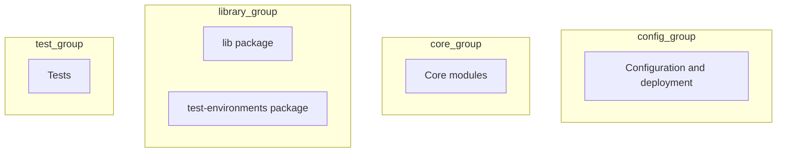

# Architecture report: reagent-project/reagent

> Automated static analysis. **Observed** = directly seen in files/imports/AST; **Inferred** = interpretation from that evidence. Repository code was not executed.

## 1. Repository at a glance

| Item | Value |
| --- | --- |
| Repository | reagent-project/reagent |
| Description | A minimalistic ClojureScript interface to React.js |
| Language | Clojure |
| Stars | 4897 |
| Licence | MIT |
| Analysed commit / branch | 7ad8cdf2c05737256bd4583b845164d93a3becf4 / master |
| Framework(s) | React |
| Files analysed | 209 |
| Components | 5 |

## 2. Architecture in one minute

reagent-project/reagent - A minimalistic ClojureScript interface to React.js. This repository was analysed statically from 209 file(s) (0 Python). Detected technologies (observed from imports/manifests): GitHub Actions, React, webpack. Files are grouped into 5 component(s): Configuration and deployment, Core modules, lib package, test-environments package, Tests. Findings below distinguish observed facts from inferred interpretation.

## 3. High-level block diagram

## 4. Main components

### Configuration and deployment (`config`)

- **Kind:** config
- **Status:** Observed
- **Confidence:** 0.85
- **Responsibility:** Groups 4 file(s) under configuration and deployment (observed from repository paths and static analysis).
- **Paths:** `codecov.yml`, `package.json`, `react-18-package-lock.json`, `react-18-package.json`
- **Evidence:** [codecov.yml](https://github.com/reagent-project/reagent/blob/7ad8cdf2c05737256bd4583b845164d93a3becf4/codecov.yml); [package.json](https://github.com/reagent-project/reagent/blob/7ad8cdf2c05737256bd4583b845164d93a3becf4/package.json); [react-18-package-lock.json](https://github.com/reagent-project/reagent/blob/7ad8cdf2c05737256bd4583b845164d93a3becf4/react-18-package-lock.json); [react-18-package.json](https://github.com/reagent-project/reagent/blob/7ad8cdf2c05737256bd4583b845164d93a3becf4/react-18-package.json)

### Core modules (`core`)

- **Kind:** core
- **Status:** Observed
- **Confidence:** 0.85
- **Responsibility:** Groups 6 file(s) under core modules (observed from repository paths and static analysis).
- **Paths:** `build-docs-index.sh`, `build-docs.sh`, `build-example-site.sh`, `cljfmt.sh`, `prepare-tests.sh`, `run-tests.sh`
- **Evidence:** [build-docs-index.sh](https://github.com/reagent-project/reagent/blob/7ad8cdf2c05737256bd4583b845164d93a3becf4/build-docs-index.sh); [build-docs.sh](https://github.com/reagent-project/reagent/blob/7ad8cdf2c05737256bd4583b845164d93a3becf4/build-docs.sh); [build-example-site.sh](https://github.com/reagent-project/reagent/blob/7ad8cdf2c05737256bd4583b845164d93a3becf4/build-example-site.sh); [cljfmt.sh](https://github.com/reagent-project/reagent/blob/7ad8cdf2c05737256bd4583b845164d93a3becf4/cljfmt.sh); [prepare-tests.sh](https://github.com/reagent-project/reagent/blob/7ad8cdf2c05737256bd4583b845164d93a3becf4/prepare-tests.sh); [run-tests.sh](https://github.com/reagent-project/reagent/blob/7ad8cdf2c05737256bd4583b845164d93a3becf4/run-tests.sh)

### lib package (`lib`)

- **Kind:** library
- **Status:** Observed
- **Confidence:** 0.85
- **Responsibility:** Groups 1 file(s) under lib package (observed from repository paths and static analysis).
- **Paths:** `lib/modules.js`
- **Evidence:** [lib/modules.js](https://github.com/reagent-project/reagent/blob/7ad8cdf2c05737256bd4583b845164d93a3becf4/lib/modules.js)

### test-environments package (`test_environments`)

- **Kind:** library
- **Status:** Observed
- **Confidence:** 0.85
- **Responsibility:** Groups 15 file(s) under test-environments package (observed from repository paths and static analysis).
- **Paths:** `test-environments/browser-cljsjs-prod/test.sh`, `test-environments/browser-cljsjs/test.sh`, `test-environments/browser-npm-prod/test.sh`, `test-environments/browser-npm/test.sh`, `test-environments/bundle-adv/build.sh`, `test-environments/bundle-adv/karma.conf.js`, `test-environments/bundle-adv/test.sh`, `test-environments/bundle-adv/webpack.config.js`, `test-environments/bundle/karma.conf.js`, `test-environments/bundle/test.sh`, `test-environments/bundle/webpack.config.js`, `test-environments/bundle/workaround.js`, `test-environments/node-npm/test.sh`, `test-environments/shadow-cljs-prod/karma.conf.js`, `test-environments/shadow-cljs-prod/test.sh`
- **Evidence:** [test-environments/browser-cljsjs-prod/test.sh](https://github.com/reagent-project/reagent/blob/7ad8cdf2c05737256bd4583b845164d93a3becf4/test-environments/browser-cljsjs-prod/test.sh); [test-environments/browser-cljsjs/test.sh](https://github.com/reagent-project/reagent/blob/7ad8cdf2c05737256bd4583b845164d93a3becf4/test-environments/browser-cljsjs/test.sh); [test-environments/browser-npm-prod/test.sh](https://github.com/reagent-project/reagent/blob/7ad8cdf2c05737256bd4583b845164d93a3becf4/test-environments/browser-npm-prod/test.sh); [test-environments/browser-npm/test.sh](https://github.com/reagent-project/reagent/blob/7ad8cdf2c05737256bd4583b845164d93a3becf4/test-environments/browser-npm/test.sh); [test-environments/bundle-adv/build.sh](https://github.com/reagent-project/reagent/blob/7ad8cdf2c05737256bd4583b845164d93a3becf4/test-environments/bundle-adv/build.sh); [test-environments/bundle-adv/karma.conf.js](https://github.com/reagent-project/reagent/blob/7ad8cdf2c05737256bd4583b845164d93a3becf4/test-environments/bundle-adv/karma.conf.js); [test-environments/bundle-adv/test.sh](https://github.com/reagent-project/reagent/blob/7ad8cdf2c05737256bd4583b845164d93a3becf4/test-environments/bundle-adv/test.sh); [test-environments/bundle-adv/webpack.config.js](https://github.com/reagent-project/reagent/blob/7ad8cdf2c05737256bd4583b845164d93a3becf4/test-environments/bundle-adv/webpack.config.js)

### Tests (`tests`)

- **Kind:** test
- **Status:** Observed
- **Confidence:** 0.85
- **Responsibility:** Groups 16 file(s) under tests (observed from repository paths and static analysis).
- **Paths:** `test-environments/node-cljsjs/test_disabled.sh`, `test/reagent/impl/template_test.cljs`, `test/reagent/impl/util_test.cljs`, `test/reagenttest/performancetest.cljs`, `test/reagenttest/runtests.cljs`, `test/reagenttest/testcursor.cljs`, `test/reagenttest/testhooks.cljs`, `test/reagenttest/testratom.cljs`, `test/reagenttest/testratomasync.cljs`, `test/reagenttest/testreagent.cljs`, `test/reagenttest/testtrack.cljs`, `test/reagenttest/testwithlet.cljs`, `test/reagenttest/testwrap.cljs`, `test/reagenttest/utils.clj`, `test/reagenttest/utils.cljs`, `test/runners/karma.conf.js`
- **Evidence:** [test-environments/node-cljsjs/test_disabled.sh](https://github.com/reagent-project/reagent/blob/7ad8cdf2c05737256bd4583b845164d93a3becf4/test-environments/node-cljsjs/test_disabled.sh); [test/reagent/impl/template_test.cljs](https://github.com/reagent-project/reagent/blob/7ad8cdf2c05737256bd4583b845164d93a3becf4/test/reagent/impl/template_test.cljs); [test/reagent/impl/util_test.cljs](https://github.com/reagent-project/reagent/blob/7ad8cdf2c05737256bd4583b845164d93a3becf4/test/reagent/impl/util_test.cljs); [test/reagenttest/performancetest.cljs](https://github.com/reagent-project/reagent/blob/7ad8cdf2c05737256bd4583b845164d93a3becf4/test/reagenttest/performancetest.cljs); [test/reagenttest/runtests.cljs](https://github.com/reagent-project/reagent/blob/7ad8cdf2c05737256bd4583b845164d93a3becf4/test/reagenttest/runtests.cljs); [test/reagenttest/testcursor.cljs](https://github.com/reagent-project/reagent/blob/7ad8cdf2c05737256bd4583b845164d93a3becf4/test/reagenttest/testcursor.cljs); [test/reagenttest/testhooks.cljs](https://github.com/reagent-project/reagent/blob/7ad8cdf2c05737256bd4583b845164d93a3becf4/test/reagenttest/testhooks.cljs); [test/reagenttest/testratom.cljs](https://github.com/reagent-project/reagent/blob/7ad8cdf2c05737256bd4583b845164d93a3becf4/test/reagenttest/testratom.cljs)

## 5. Execution flow

No entry point was observed; the startup flow below is therefore limited.

Representative flow (derived from observed entry points and the import graph; steps beyond the entry point are **Inferred**):

1. Execution starts at an observed entry point listed above, if present.
2. No internal import relationships between components were observed.

## 6. Project structure

### `(root)`

- `.cljfmt.edn` - other (638 bytes)
- `.git-blame-ignore-revs` - other (64 bytes)
- `.gitignore` - other (244 bytes)
- `.nvmrc` - other (13 bytes)
- `CHANGELOG.md` - docs (41014 bytes)
- `CLAUDE.md` - docs (3127 bytes)
- `CONTRIBUTING.md` - docs (1750 bytes)
- `LICENSE` - docs (1114 bytes)
- `README.md` - docs (5748 bytes)
- `ROADMAP.md` - docs (611 bytes)
- `SECURITY.md` - docs (242 bytes)
- `bb.edn` - other (219 bytes)
- `build-docs-index.sh` - source, Shell (314 bytes)
- `build-docs.sh` - source, Shell (653 bytes)
- `build-example-site.sh` - source, Shell (1328 bytes)
- `cljfmt.sh` - source, Shell (383 bytes)
- `codecov.yml` - config (85 bytes)
- `deps.edn` - other (325 bytes)
- `package.json` - manifest (764 bytes)
- `prepare-tests.sh` - source, Shell (25 bytes)
- `project.clj` - other (8050 bytes)
- `react-18-package-lock.json` - config (154651 bytes)
- `react-18-package.json` - config (768 bytes)
- `run-tests.sh` - source, Shell (967 bytes)
- `shadow-cljs.edn` - other (1187 bytes)

### `.claude`

- `.claude/launch.json` - config (205 bytes)
- `.claude/settings.json` - config (467 bytes)

### `.clj-kondo`

- `.clj-kondo/config.edn` - other (475 bytes)
- `.clj-kondo/funcool/promesa/config.edn` - other (492 bytes)

### `.github`

- `.github/ISSUE_TEMPLATE/bug_report.md` - docs (738 bytes)
- `.github/ISSUE_TEMPLATE/feature_request.md` - docs (854 bytes)
- `.github/issue_template.md` - docs (304 bytes)
- `.github/workflows/clojure.yml` - ci, YAML (4356 bytes)

### `.lsp`

- `.lsp/config.edn` - other (178 bytes)

### `demo`

- `demo/reagentdemo/common.cljs` - other (849 bytes)
- `demo/reagentdemo/core.cljs` - other (2059 bytes)
- `demo/reagentdemo/dev.cljs` - other (277 bytes)
- `demo/reagentdemo/intro.cljs` - other (12417 bytes)
- `demo/reagentdemo/main.cljs` - other (107 bytes)
- `demo/reagentdemo/news.cljs` - other (2505 bytes)
- `demo/reagentdemo/news/anyargs.cljs` - other (5250 bytes)
- `demo/reagentdemo/news/async.cljs` - other (7642 bytes)
- `demo/reagentdemo/news/binaryclock.cljs` - other (1307 bytes)
- `demo/reagentdemo/news/clockpost.cljs` - other (4913 bytes)
- `demo/reagentdemo/news/news050.cljs` - other (12862 bytes)
- `demo/reagentdemo/news/news051.cljs` - other (3205 bytes)
- `demo/reagentdemo/news/news060.cljs` - other (16614 bytes)
- `demo/reagentdemo/news/news060rc.cljs` - other (2328 bytes)
- `demo/reagentdemo/news/news060release.cljs` - other (1247 bytes)
- `demo/reagentdemo/news/news061.cljs` - other (813 bytes)
- `demo/reagentdemo/news/undodemo.cljs` - other (3061 bytes)
- `demo/reagentdemo/syntax.clj` - other (1461 bytes)
- `demo/reagentdemo/syntax.cljs` - other (3849 bytes)
- `demo/sitetools/core.cljs` - other (4382 bytes)

### `doc`

- `doc/0.8-upgrade.md` - docs (4454 bytes)
- `doc/2.0-upgrade.md` - docs (677 bytes)
- `doc/BatchingAndTiming.md` - docs (6131 bytes)
- `doc/ControlledInputs.md` - docs (2235 bytes)
- `doc/CreatingReagentComponents.md` - docs (16881 bytes)
- `doc/FAQ/CljsjsReactProblems.md` - docs (1338 bytes)
- `doc/FAQ/ComponentNotRerendering.md` - docs (2986 bytes)
- `doc/FAQ/ForcingComponentRecreation.md` - docs (362 bytes)
- `doc/FAQ/HtmlEntities.md` - docs (673 bytes)
- `doc/FAQ/MyAttributesAreMissing.md` - docs (553 bytes)
- `doc/FAQ/UsingAnEntity.md` - docs (769 bytes)
- `doc/FAQ/UsingRefs.md` - docs (2095 bytes)
- `doc/FAQ/dangerouslySetInnerHTML.md` - docs (527 bytes)
- `doc/InteropWithReact.md` - docs (7895 bytes)
- `doc/ManagingState.md` - docs (12564 bytes)
- `doc/README.md` - docs (2972 bytes)
- `doc/React19.md` - docs (2505 bytes)
- `doc/ReactFeatures.md` - docs (12754 bytes)
- `doc/ReactRenderers.md` - docs (2130 bytes)
- `doc/ReagentCompiler.md` - docs (3598 bytes)
- `doc/Security.md` - docs (3992 bytes)
- `doc/ServerSideRendering.md` - docs (1045 bytes)
- `doc/UsingHiccupToDescribeHTML.md` - docs (6586 bytes)
- `doc/UsingSquareBracketsInsteadOfParens.md` - docs (9040 bytes)
- `doc/WhenDoComponentsUpdate.md` - docs (13746 bytes)
- `doc/cljdoc.edn` - other (2462 bytes)
- `doc/development.md` - docs (1131 bytes)
- `doc/examples/material-ui.md` - docs (2798 bytes)
- `doc/examples/smooth-ui.md` - docs (951 bytes)
- `doc/reagent1.md` - docs (389 bytes)

### `examples`

- `examples/functional-components-and-hooks/README.md` - docs (79 bytes)
- `examples/functional-components-and-hooks/deps.edn` - other (156 bytes)
- `examples/functional-components-and-hooks/package.json` - manifest (167 bytes)
- `examples/functional-components-and-hooks/resources/public/example.css` - other (366 bytes)
- `examples/functional-components-and-hooks/resources/public/index.html` - other (292 bytes)
- `examples/functional-components-and-hooks/shadow-cljs.edn` - other (271 bytes)
- `examples/functional-components-and-hooks/src/example/core.cljs` - other (1561 bytes)
- `examples/geometry/README.md` - docs (51 bytes)
- `examples/geometry/deps.edn` - other (156 bytes)
- `examples/geometry/package.json` - manifest (167 bytes)
- `examples/geometry/resources/public/example.css` - other (80 bytes)
- `examples/geometry/resources/public/index.html` - other (292 bytes)
- `examples/geometry/shadow-cljs.edn` - other (323 bytes)
- `examples/geometry/src/geometry/components.cljs` - other (1877 bytes)
- `examples/geometry/src/geometry/core.cljs` - other (2837 bytes)
- `examples/geometry/src/geometry/geometry.cljs` - other (311 bytes)
- `examples/material-ui/README.md` - docs (54 bytes)
- `examples/material-ui/deps.edn` - other (156 bytes)
- `examples/material-ui/package.json` - manifest (293 bytes)
- `examples/material-ui/resources/public/index.html` - other (245 bytes)
- `examples/material-ui/shadow-cljs.edn` - other (292 bytes)
- `examples/material-ui/src/example/core.cljs` - other (7545 bytes)
- `examples/react-context/README.md` - docs (45 bytes)
- `examples/react-context/deps.edn` - other (156 bytes)
- `examples/react-context/package.json` - manifest (167 bytes)
- `examples/react-context/resources/public/index.html` - other (245 bytes)
- `examples/react-context/shadow-cljs.edn` - other (271 bytes)
- `examples/react-context/src/example/core.cljs` - other (1346 bytes)
- `examples/react-mde/README.md` - docs (461 bytes)
- `examples/react-mde/deps.edn` - other (156 bytes)
- `examples/react-mde/package.json` - manifest (290 bytes)
- `examples/react-mde/resources/public/index.html` - other (301 bytes)
- `examples/react-mde/shadow-cljs.edn` - other (292 bytes)
- `examples/react-mde/src/example/core.cljs` - other (4131 bytes)
- `examples/react-transition-group/README.md` - docs (222 bytes)
- `examples/react-transition-group/deps.edn` - other (156 bytes)
- `examples/react-transition-group/package.json` - manifest (207 bytes)
- `examples/react-transition-group/resources/public/fade.css` - other (264 bytes)
- `examples/react-transition-group/resources/public/index.html` - other (305 bytes)
- `examples/react-transition-group/shadow-cljs.edn` - other (271 bytes)
- `examples/react-transition-group/src/example/core.cljs` - other (2839 bytes)
- `examples/shadow-dom-input/README.md` - docs (364 bytes)
- `examples/shadow-dom-input/deps.edn` - other (156 bytes)
- `examples/shadow-dom-input/package.json` - manifest (167 bytes)
- `examples/shadow-dom-input/resources/public/example.css` - other (366 bytes)
- `examples/shadow-dom-input/resources/public/index.html` - other (324 bytes)
- `examples/shadow-dom-input/shadow-cljs.edn` - other (362 bytes)
- `examples/shadow-dom-input/src/shadow_dom_input_demo/core.cljs` - other (3339 bytes)
- `examples/simple/README.md` - docs (51 bytes)
- `examples/simple/deps.edn` - other (156 bytes)
- `examples/simple/package.json` - manifest (167 bytes)
- `examples/simple/resources/public/example.css` - other (366 bytes)
- `examples/simple/resources/public/index.html` - other (292 bytes)
- `examples/simple/shadow-cljs.edn` - other (338 bytes)
- `examples/simple/src/simpleexample/core.cljs` - other (1112 bytes)
- `examples/todomvc/README.md` - docs (51 bytes)
- `examples/todomvc/deps.edn` - other (156 bytes)
- `examples/todomvc/package.json` - manifest (167 bytes)
- `examples/todomvc/resources/public/index.html` - other (290 bytes)
- `examples/todomvc/resources/public/todos.css` - other (10435 bytes)
- `examples/todomvc/shadow-cljs.edn` - other (320 bytes)
- `examples/todomvc/src/todomvc/core.cljs` - other (4894 bytes)

### `lib`

- `lib/modules.js` - source, JavaScript (369 bytes)

### `logo`

- `logo/logo-text.svg` - other (4354 bytes)
- `logo/logo.svg` - other (1146 bytes)

### `outsite`

- `outsite/public/README.md` - docs (146 bytes)

### `prerender`

- `prerender/sitetools/prerender.cljs` - other (2915 bytes)

### `site`

- `site/public/css/examples.css` - other (10833 bytes)
- `site/public/css/main.css` - other (4185 bytes)
- `site/public/index.html` - other (490 bytes)

### `src`

- `src/clj-kondo/clj-kondo.exports/reagent/reagent/config.edn` - other (99 bytes)
- `src/reagent/core.clj` - other (3244 bytes)
- `src/reagent/core.cljs` - other (12480 bytes)
- `src/reagent/debug.clj` - other (2645 bytes)
- `src/reagent/debug.cljs` - other (615 bytes)
- `src/reagent/dom.cljs` - other (3304 bytes)
- `src/reagent/dom/client.cljs` - other (3168 bytes)
- `src/reagent/dom/server.cljs` - other (895 bytes)
- `src/reagent/hooks.cljs` - other (6951 bytes)
- `src/reagent/impl/batching.cljs` - other (3551 bytes)
- `src/reagent/impl/component.cljs` - other (19906 bytes)
- `src/reagent/impl/input.cljs` - other (7053 bytes)
- `src/reagent/impl/protocols.cljs` - other (229 bytes)
- `src/reagent/impl/template.cljs` - other (12661 bytes)
- `src/reagent/impl/util.clj` - other (1050 bytes)
- `src/reagent/impl/util.cljs` - other (7289 bytes)
- `src/reagent/interop.clj` - other (670 bytes)
- `src/reagent/interop.cljs` - other (59 bytes)
- `src/reagent/ratom.clj` - other (3318 bytes)
- `src/reagent/ratom.cljs` - other (17806 bytes)

### `test`

- `test/reagent/impl/template_test.cljs` - test (1783 bytes)
- `test/reagent/impl/util_test.cljs` - test (6316 bytes)
- `test/reagenttest/performancetest.cljs` - test (1596 bytes)
- `test/reagenttest/runtests.cljs` - test (3713 bytes)
- `test/reagenttest/testcursor.cljs` - test (14255 bytes)
- `test/reagenttest/testhooks.cljs` - test (8158 bytes)
- `test/reagenttest/testratom.cljs` - test (14431 bytes)
- `test/reagenttest/testratomasync.cljs` - test (7550 bytes)
- `test/reagenttest/testreagent.cljs` - test (63154 bytes)
- `test/reagenttest/testtrack.cljs` - test (7770 bytes)
- `test/reagenttest/testwithlet.cljs` - test (8540 bytes)
- `test/reagenttest/testwrap.cljs` - test (6315 bytes)
- `test/reagenttest/utils.clj` - test (2429 bytes)
- `test/reagenttest/utils.cljs` - test (7958 bytes)
- `test/runners/karma.conf.js` - test, JavaScript (1128 bytes)

### `test-environments`

- `test-environments/browser-cljsjs-prod/test.sh` - source, Shell (218 bytes)
- `test-environments/browser-cljsjs/test.sh` - source, Shell (168 bytes)
- `test-environments/browser-npm-prod/test.sh` - source, Shell (240 bytes)
- `test-environments/browser-npm/test.sh` - source, Shell (159 bytes)
- `test-environments/bundle-adv/README.md` - docs (414 bytes)
- `test-environments/bundle-adv/build.edn` - other (281 bytes)
- `test-environments/bundle-adv/build.sh` - source, Shell (253 bytes)
- `test-environments/bundle-adv/karma.conf.js` - source, JavaScript (554 bytes)
- `test-environments/bundle-adv/karma.edn` - other (285 bytes)
- `test-environments/bundle-adv/test.sh` - source, Shell (274 bytes)
- `test-environments/bundle-adv/webpack.config.js` - source, JavaScript (220 bytes)
- `test-environments/bundle/build.edn` - other (289 bytes)
- `test-environments/bundle/karma.conf.js` - source, JavaScript (1034 bytes)
- `test-environments/bundle/test.sh` - source, Shell (152 bytes)
- `test-environments/bundle/webpack.config.js` - source, JavaScript (207 bytes)
- `test-environments/bundle/workaround.js` - source, JavaScript (99 bytes)
- `test-environments/node-cljsjs/test_disabled.sh` - test, Shell (161 bytes)
- `test-environments/node-npm/test.sh` - source, Shell (293 bytes)
- `test-environments/shadow-cljs-prod/karma.conf.js` - source, JavaScript (456 bytes)
- `test-environments/shadow-cljs-prod/test.sh` - source, Shell (210 bytes)

## 7. Key dependencies and integrations

| Name | Category | Status | Confidence | Evidence |
| --- | --- | --- | --- | --- |
| GitHub Actions | ci | Observed | 0.85 | [.github/workflows/clojure.yml](https://github.com/reagent-project/reagent/blob/7ad8cdf2c05737256bd4583b845164d93a3becf4/.github/workflows/clojure.yml) |
| React | framework | Observed | 0.90 | [examples/functional-components-and-hooks/package.json:2](https://github.com/reagent-project/reagent/blob/7ad8cdf2c05737256bd4583b845164d93a3becf4/examples/functional-components-and-hooks/package.json#L2); [examples/functional-components-and-hooks/package.json:5](https://github.com/reagent-project/reagent/blob/7ad8cdf2c05737256bd4583b845164d93a3becf4/examples/functional-components-and-hooks/package.json#L5); [examples/geometry/package.json:2](https://github.com/reagent-project/reagent/blob/7ad8cdf2c05737256bd4583b845164d93a3becf4/examples/geometry/package.json#L2); [examples/geometry/package.json:5](https://github.com/reagent-project/reagent/blob/7ad8cdf2c05737256bd4583b845164d93a3becf4/examples/geometry/package.json#L5) |
| webpack | tooling | Observed | 0.85 | [package.json:21](https://github.com/reagent-project/reagent/blob/7ad8cdf2c05737256bd4583b845164d93a3becf4/package.json#L21) |

## 8. Data and state

No database, cache, queue, or persistent-state usage was observed in the analysed files. State handling, if any, may be in-memory or in files that were not analysed.

## 9. Configuration and deployment clues

- `.claude/launch.json` (config)
- `.claude/settings.json` (config)
- `.github/workflows/clojure.yml` (ci)
- `codecov.yml` (config)
- `examples/functional-components-and-hooks/package.json` (manifest)
- `examples/geometry/package.json` (manifest)
- `examples/material-ui/package.json` (manifest)
- `examples/react-context/package.json` (manifest)
- `examples/react-mde/package.json` (manifest)
- `examples/react-transition-group/package.json` (manifest)
- `examples/shadow-dom-input/package.json` (manifest)
- `examples/simple/package.json` (manifest)
- `examples/todomvc/package.json` (manifest)
- `package.json` (manifest)
- `react-18-package-lock.json` (config)
- `react-18-package.json` (config)

## 10. Design observations

- Tests are present alongside source code (Observed from test file paths).

These observations are interpretations (**Inferred**) of the observed structure, not guarantees about runtime design.

## 11. Limitations and unknowns

- Static analysis only: repository code was not executed, installed, or imported at runtime.
- Components and relationships are inferred from file paths, imports, and AST structure; runtime behaviour, dynamic imports, and reflection may not be visible.
- 10 file(s) were skipped during inventory (10 x lockfile excluded).
- No clear application entry point was observed in the analysed files.
- Repository text was treated as untrusted data; no instructions found in repository files were followed, and likely secret values were redacted/excluded.
- JavaScript and TypeScript files were inventoried from paths and package manifests. They were not parsed with a full language AST, and repository code was not executed.

## 12. Source references

- [.github/workflows/clojure.yml](https://github.com/reagent-project/reagent/blob/7ad8cdf2c05737256bd4583b845164d93a3becf4/.github/workflows/clojure.yml)
- [build-docs-index.sh](https://github.com/reagent-project/reagent/blob/7ad8cdf2c05737256bd4583b845164d93a3becf4/build-docs-index.sh)
- [build-docs.sh](https://github.com/reagent-project/reagent/blob/7ad8cdf2c05737256bd4583b845164d93a3becf4/build-docs.sh)
- [build-example-site.sh](https://github.com/reagent-project/reagent/blob/7ad8cdf2c05737256bd4583b845164d93a3becf4/build-example-site.sh)
- [cljfmt.sh](https://github.com/reagent-project/reagent/blob/7ad8cdf2c05737256bd4583b845164d93a3becf4/cljfmt.sh)
- [codecov.yml](https://github.com/reagent-project/reagent/blob/7ad8cdf2c05737256bd4583b845164d93a3becf4/codecov.yml)
- [examples/functional-components-and-hooks/package.json:2](https://github.com/reagent-project/reagent/blob/7ad8cdf2c05737256bd4583b845164d93a3becf4/examples/functional-components-and-hooks/package.json#L2)
- [examples/functional-components-and-hooks/package.json:5](https://github.com/reagent-project/reagent/blob/7ad8cdf2c05737256bd4583b845164d93a3becf4/examples/functional-components-and-hooks/package.json#L5)
- [examples/geometry/package.json:2](https://github.com/reagent-project/reagent/blob/7ad8cdf2c05737256bd4583b845164d93a3becf4/examples/geometry/package.json#L2)
- [examples/geometry/package.json:5](https://github.com/reagent-project/reagent/blob/7ad8cdf2c05737256bd4583b845164d93a3becf4/examples/geometry/package.json#L5)
- [examples/material-ui/package.json:4](https://github.com/reagent-project/reagent/blob/7ad8cdf2c05737256bd4583b845164d93a3becf4/examples/material-ui/package.json#L4)
- [examples/material-ui/package.json:9](https://github.com/reagent-project/reagent/blob/7ad8cdf2c05737256bd4583b845164d93a3becf4/examples/material-ui/package.json#L9)
- [examples/react-context/package.json:2](https://github.com/reagent-project/reagent/blob/7ad8cdf2c05737256bd4583b845164d93a3becf4/examples/react-context/package.json#L2)
- [examples/react-context/package.json:5](https://github.com/reagent-project/reagent/blob/7ad8cdf2c05737256bd4583b845164d93a3becf4/examples/react-context/package.json#L5)
- [lib/modules.js](https://github.com/reagent-project/reagent/blob/7ad8cdf2c05737256bd4583b845164d93a3becf4/lib/modules.js)
- [package.json](https://github.com/reagent-project/reagent/blob/7ad8cdf2c05737256bd4583b845164d93a3becf4/package.json)
- [package.json:21](https://github.com/reagent-project/reagent/blob/7ad8cdf2c05737256bd4583b845164d93a3becf4/package.json#L21)
- [prepare-tests.sh](https://github.com/reagent-project/reagent/blob/7ad8cdf2c05737256bd4583b845164d93a3becf4/prepare-tests.sh)
- [react-18-package-lock.json](https://github.com/reagent-project/reagent/blob/7ad8cdf2c05737256bd4583b845164d93a3becf4/react-18-package-lock.json)
- [react-18-package.json](https://github.com/reagent-project/reagent/blob/7ad8cdf2c05737256bd4583b845164d93a3becf4/react-18-package.json)
- [run-tests.sh](https://github.com/reagent-project/reagent/blob/7ad8cdf2c05737256bd4583b845164d93a3becf4/run-tests.sh)
- [test-environments/browser-cljsjs-prod/test.sh](https://github.com/reagent-project/reagent/blob/7ad8cdf2c05737256bd4583b845164d93a3becf4/test-environments/browser-cljsjs-prod/test.sh)
- [test-environments/browser-cljsjs/test.sh](https://github.com/reagent-project/reagent/blob/7ad8cdf2c05737256bd4583b845164d93a3becf4/test-environments/browser-cljsjs/test.sh)
- [test-environments/browser-npm-prod/test.sh](https://github.com/reagent-project/reagent/blob/7ad8cdf2c05737256bd4583b845164d93a3becf4/test-environments/browser-npm-prod/test.sh)
- [test-environments/browser-npm/test.sh](https://github.com/reagent-project/reagent/blob/7ad8cdf2c05737256bd4583b845164d93a3becf4/test-environments/browser-npm/test.sh)
- [test-environments/bundle-adv/build.sh](https://github.com/reagent-project/reagent/blob/7ad8cdf2c05737256bd4583b845164d93a3becf4/test-environments/bundle-adv/build.sh)
- [test-environments/bundle-adv/karma.conf.js](https://github.com/reagent-project/reagent/blob/7ad8cdf2c05737256bd4583b845164d93a3becf4/test-environments/bundle-adv/karma.conf.js)
- [test-environments/bundle-adv/test.sh](https://github.com/reagent-project/reagent/blob/7ad8cdf2c05737256bd4583b845164d93a3becf4/test-environments/bundle-adv/test.sh)
- [test-environments/bundle-adv/webpack.config.js](https://github.com/reagent-project/reagent/blob/7ad8cdf2c05737256bd4583b845164d93a3becf4/test-environments/bundle-adv/webpack.config.js)
- [test-environments/node-cljsjs/test_disabled.sh](https://github.com/reagent-project/reagent/blob/7ad8cdf2c05737256bd4583b845164d93a3becf4/test-environments/node-cljsjs/test_disabled.sh)
- [test/reagent/impl/template_test.cljs](https://github.com/reagent-project/reagent/blob/7ad8cdf2c05737256bd4583b845164d93a3becf4/test/reagent/impl/template_test.cljs)
- [test/reagent/impl/util_test.cljs](https://github.com/reagent-project/reagent/blob/7ad8cdf2c05737256bd4583b845164d93a3becf4/test/reagent/impl/util_test.cljs)
- [test/reagenttest/performancetest.cljs](https://github.com/reagent-project/reagent/blob/7ad8cdf2c05737256bd4583b845164d93a3becf4/test/reagenttest/performancetest.cljs)
- [test/reagenttest/runtests.cljs](https://github.com/reagent-project/reagent/blob/7ad8cdf2c05737256bd4583b845164d93a3becf4/test/reagenttest/runtests.cljs)
- [test/reagenttest/testcursor.cljs](https://github.com/reagent-project/reagent/blob/7ad8cdf2c05737256bd4583b845164d93a3becf4/test/reagenttest/testcursor.cljs)
- [test/reagenttest/testhooks.cljs](https://github.com/reagent-project/reagent/blob/7ad8cdf2c05737256bd4583b845164d93a3becf4/test/reagenttest/testhooks.cljs)
- [test/reagenttest/testratom.cljs](https://github.com/reagent-project/reagent/blob/7ad8cdf2c05737256bd4583b845164d93a3becf4/test/reagenttest/testratom.cljs)
