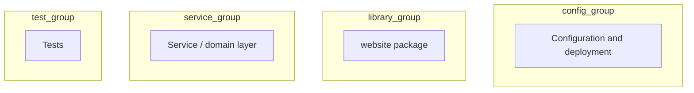

# Architecture report: reasonml/reason-react

> Automated static analysis. **Observed** = directly seen in files/imports/AST; **Inferred** = interpretation from that evidence. Repository code was not executed.

## 1. Repository at a glance

| Item | Value |
| --- | --- |
| Repository | reasonml/reason-react |
| Description | Reason bindings for ReactJS |
| Language | Reason |
| Stars | 3262 |
| Licence | MIT |
| Analysed commit / branch | 0206fb41ac67c4ba584409f4eb7d3e501273d431 / main |
| Framework(s) | React |
| Files analysed | 216 |
| Components | 4 |

## 2. Architecture in one minute

reasonml/reason-react - Reason bindings for ReactJS. This repository was analysed statically from 216 file(s) (0 Python). Detected technologies (observed from imports/manifests): GitHub Actions, React, Jest. Files are grouped into 4 component(s): Configuration and deployment, Service / domain layer, Tests, website package. Findings below distinguish observed facts from inferred interpretation.

## 3. High-level block diagram

## 4. Main components

### Configuration and deployment (`config`)

- **Kind:** config
- **Status:** Observed
- **Confidence:** 0.85
- **Responsibility:** Groups 5 file(s) under configuration and deployment (observed from repository paths and static analysis).
- **Paths:** `crowdin.yaml`, `package.json`, `website/i18n/en.json`, `website/package.json`, `website/sidebars.json`
- **Evidence:** [crowdin.yaml](https://github.com/reasonml/reason-react/blob/0206fb41ac67c4ba584409f4eb7d3e501273d431/crowdin.yaml); [package.json](https://github.com/reasonml/reason-react/blob/0206fb41ac67c4ba584409f4eb7d3e501273d431/package.json); [website/i18n/en.json](https://github.com/reasonml/reason-react/blob/0206fb41ac67c4ba584409f4eb7d3e501273d431/website/i18n/en.json); [website/package.json](https://github.com/reasonml/reason-react/blob/0206fb41ac67c4ba584409f4eb7d3e501273d431/website/package.json); [website/sidebars.json](https://github.com/reasonml/reason-react/blob/0206fb41ac67c4ba584409f4eb7d3e501273d431/website/sidebars.json)

### Service / domain layer (`service_layer`)

- **Kind:** service
- **Status:** Observed
- **Confidence:** 0.85
- **Responsibility:** Groups 1 file(s) under service / domain layer (observed from repository paths and static analysis).
- **Paths:** `website/core/Footer.js`
- **Evidence:** [website/core/Footer.js](https://github.com/reasonml/reason-react/blob/0206fb41ac67c4ba584409f4eb7d3e501273d431/website/core/Footer.js)

### Tests (`tests`)

- **Kind:** test
- **Status:** Observed
- **Confidence:** 0.85
- **Responsibility:** Groups 77 file(s) under tests (observed from repository paths and static analysis).
- **Paths:** `ppx/test/component-without-make.t/input.re`, `ppx/test/component-without-make.t/run.t`, `ppx/test/component.t/input.re`, `ppx/test/component.t/run.t`, `ppx/test/data-attribute-collisions.t/input.re`, `ppx/test/data-attribute-collisions.t/run.t`, `ppx/test/data-attributes.t/input.re`, `ppx/test/data-attributes.t/run.t`, `ppx/test/dune`, `ppx/test/external.t/input.re`, `ppx/test/external.t/run.t`, `ppx/test/fragment.t/input.re`, `ppx/test/fragment.t/run.t`, `ppx/test/functor.t/input.re`, `ppx/test/functor.t/run.t`, `ppx/test/input.re`, `ppx/test/locations-check.t`, `ppx/test/lower.t/input.re`, `ppx/test/lower.t/run.t`, `ppx/test/ppx.sh`, `ppx/test/record-props-error.t/input.re`, `ppx/test/record-props-error.t/run.t`, `ppx/test/record-props.t/input.re`, `ppx/test/record-props.t/run.t`, `ppx/test/run-ppx.sh`, `ppx/test/signature-optional.t/input.re`, `ppx/test/signature-optional.t/run.t`, `ppx/test/signature.t/input.re`, `ppx/test/signature.t/run.t`, `ppx/test/upper.t/input.re`, `ppx/test/upper.t/run.t`, `test/Form__test.re`, `test/Hooks__test.re`, `test/ReactDOMDataAttributes__test.re`, `test/ReactDOM__test.re`, `test/ReactRouter__test.re`, `test/React__test.re`, `test/Ref__test.re`, `test/blackbox-tests/components-destructured-error.t/component.re`, `test/blackbox-tests/components-destructured-error.t/run.t`, `test/blackbox-tests/data-attributes.t/run.t`, `test/blackbox-tests/dom-props-completion.t`, `test/blackbox-tests/dom-props-locations.t`, `test/blackbox-tests/dom-props.t/input.re.in`, `test/blackbox-tests/dom-props.t/run.t`, `test/blackbox-tests/dune`, `test/blackbox-tests/hover.t`, `test/blackbox-tests/issue-429.t/component.re`, `test/blackbox-tests/issue-429.t/run.t`, `test/blackbox-tests/key-as-prop-error.t/component.re`, `test/blackbox-tests/key-as-prop-error.t/run.t`, `test/blackbox-tests/keys.t/component.re`, `test/blackbox-tests/keys.t/run.t`, `test/blackbox-tests/optional-arg-check.t`, `test/blackbox-tests/react.t`, `test/blackbox-tests/simple.t/component.re`, `test/blackbox-tests/simple.t/run.t`, `test/blackbox-tests/uppercase.t/component.re`, `test/blackbox-tests/uppercase.t/run.t`, `test/blackbox-tests/useCallback.t`, `test/dune`, `test/jest/Expect.re`, `test/jest/Jest.re`, `test/jest/Mock.re`, `test/jest/README.md`, `test/jest/dune`, `test/melange-testing-library/README.md`, `test/melange-testing-library/dom/DomTestingLibrary.re`, `test/melange-testing-library/dom/DomTestingLibrary.rei`, `test/melange-testing-library/dom/FireEvent.re`, `test/melange-testing-library/dom/FireEvent.rei`, `test/melange-testing-library/dom/Queries.re`, `test/melange-testing-library/dom/Utils.re`, `test/melange-testing-library/dom/dune`, `test/melange-testing-library/react/ReactTestingLibrary.re`, `test/melange-testing-library/react/ReactTestingLibrary.rei`, `test/melange-testing-library/react/dune`
- **Evidence:** [ppx/test/component-without-make.t/input.re](https://github.com/reasonml/reason-react/blob/0206fb41ac67c4ba584409f4eb7d3e501273d431/ppx/test/component-without-make.t/input.re); [ppx/test/component-without-make.t/run.t](https://github.com/reasonml/reason-react/blob/0206fb41ac67c4ba584409f4eb7d3e501273d431/ppx/test/component-without-make.t/run.t); [ppx/test/component.t/input.re](https://github.com/reasonml/reason-react/blob/0206fb41ac67c4ba584409f4eb7d3e501273d431/ppx/test/component.t/input.re); [ppx/test/component.t/run.t](https://github.com/reasonml/reason-react/blob/0206fb41ac67c4ba584409f4eb7d3e501273d431/ppx/test/component.t/run.t); [ppx/test/data-attribute-collisions.t/input.re](https://github.com/reasonml/reason-react/blob/0206fb41ac67c4ba584409f4eb7d3e501273d431/ppx/test/data-attribute-collisions.t/input.re); [ppx/test/data-attribute-collisions.t/run.t](https://github.com/reasonml/reason-react/blob/0206fb41ac67c4ba584409f4eb7d3e501273d431/ppx/test/data-attribute-collisions.t/run.t); [ppx/test/data-attributes.t/input.re](https://github.com/reasonml/reason-react/blob/0206fb41ac67c4ba584409f4eb7d3e501273d431/ppx/test/data-attributes.t/input.re); [ppx/test/data-attributes.t/run.t](https://github.com/reasonml/reason-react/blob/0206fb41ac67c4ba584409f4eb7d3e501273d431/ppx/test/data-attributes.t/run.t)

### website package (`website`)

- **Kind:** library
- **Status:** Observed
- **Confidence:** 0.85
- **Responsibility:** Groups 11 file(s) under website package (observed from repository paths and static analysis).
- **Paths:** `website/languages.js`, `website/pages/en/built-with-reason-react.js`, `website/pages/en/examples.js`, `website/pages/en/faq.js`, `website/pages/en/gettingStarted.js`, `website/pages/en/help-with-translations.js`, `website/pages/en/index.js`, `website/siteConfig.js`, `website/static/js/redirect.js`, `website/static/js/redirectBlog.js`, `website/static/js/redirectIndex.js`
- **Evidence:** [website/languages.js](https://github.com/reasonml/reason-react/blob/0206fb41ac67c4ba584409f4eb7d3e501273d431/website/languages.js); [website/pages/en/built-with-reason-react.js](https://github.com/reasonml/reason-react/blob/0206fb41ac67c4ba584409f4eb7d3e501273d431/website/pages/en/built-with-reason-react.js); [website/pages/en/examples.js](https://github.com/reasonml/reason-react/blob/0206fb41ac67c4ba584409f4eb7d3e501273d431/website/pages/en/examples.js); [website/pages/en/faq.js](https://github.com/reasonml/reason-react/blob/0206fb41ac67c4ba584409f4eb7d3e501273d431/website/pages/en/faq.js); [website/pages/en/gettingStarted.js](https://github.com/reasonml/reason-react/blob/0206fb41ac67c4ba584409f4eb7d3e501273d431/website/pages/en/gettingStarted.js); [website/pages/en/help-with-translations.js](https://github.com/reasonml/reason-react/blob/0206fb41ac67c4ba584409f4eb7d3e501273d431/website/pages/en/help-with-translations.js); [website/pages/en/index.js](https://github.com/reasonml/reason-react/blob/0206fb41ac67c4ba584409f4eb7d3e501273d431/website/pages/en/index.js); [website/siteConfig.js](https://github.com/reasonml/reason-react/blob/0206fb41ac67c4ba584409f4eb7d3e501273d431/website/siteConfig.js)

## 5. Execution flow

**Observed** entry point(s):

- [website/pages/en/index.js](https://github.com/reasonml/reason-react/blob/0206fb41ac67c4ba584409f4eb7d3e501273d431/website/pages/en/index.js)

Representative flow (derived from observed entry points and the import graph; steps beyond the entry point are **Inferred**):

1. Execution starts at an observed entry point listed above, if present.
2. No internal import relationships between components were observed.

## 6. Project structure

### `(root)`

- `.gitattributes` - other (98 bytes)
- `.gitignore` - other (169 bytes)
- `.npmignore` - other (79 bytes)
- `.ocamlformat` - other (17 bytes)
- `CHANGES.md` - docs (33847 bytes)
- `CONTRIBUTING.md` - docs (1580 bytes)
- `LICENSE` - docs (1063 bytes)
- `Makefile` - other (2097 bytes)
- `README.md` - docs (2845 bytes)
- `crowdin.yaml` - config (1137 bytes)
- `dune` - other (25 bytes)
- `dune-project` - other (1320 bytes)
- `flake.lock` - other (1075 bytes)
- `flake.nix` - other (3510 bytes)
- `package.json` - manifest (730 bytes)
- `reason-react-ppx.opam` - other (934 bytes)
- `reason-react.opam` - other (1285 bytes)
- `reason-react.opam.template` - other (93 bytes)

### `.github`

- `.github/workflows/nix.yml` - ci, YAML (593 bytes)
- `.github/workflows/opam.yml` - ci, YAML (1053 bytes)
- `.github/workflows/website.yml` - ci, YAML (794 bytes)

### `.vscode`

- `.vscode/settings.json` - config (97 bytes)

### `demo`

- `demo/dune` - other (245 bytes)
- `demo/index.html` - other (1256 bytes)
- `demo/main.re` - other (6513 bytes)

### `docs`

- `docs/adding-data-props.md` - docs (505 bytes)
- `docs/clone-element.md` - docs (726 bytes)
- `docs/community.md` - docs (361 bytes)
- `docs/component-as-prop.md` - docs (791 bytes)
- `docs/components.md` - docs (6927 bytes)
- `docs/context.md` - docs (2055 bytes)
- `docs/custom-hooks.md` - docs (381 bytes)
- `docs/dom.md` - docs (1973 bytes)
- `docs/element-type-is-invalid.md` - docs (1157 bytes)
- `docs/error-boundaries.md` - docs (1718 bytes)
- `docs/event.md` - docs (1193 bytes)
- `docs/example-projects.md` - docs (464 bytes)
- `docs/graphql-apollo.md` - docs (2346 bytes)
- `docs/i-really-need-feature-x-from-reactjs.md` - docs (676 bytes)
- `docs/i-want-to-create-a-dom-element-without-jsx.md` - docs (784 bytes)
- `docs/im-having-a-type-error.md` - docs (306 bytes)
- `docs/importing-js-into-reason.md` - docs (1895 bytes)
- `docs/importing-reason-into-js.md` - docs (718 bytes)
- `docs/installation.md` - docs (4457 bytes)
- `docs/intro-example.md` - docs (1676 bytes)
- `docs/invalid-prop-name.md` - docs (919 bytes)
- `docs/js-using-reason.md` - docs (465 bytes)
- `docs/jsx.md` - docs (3456 bytes)
- `docs/playground.md` - docs (891 bytes)
- `docs/props-spread.md` - docs (283 bytes)
- `docs/reason-using-js.md` - docs (552 bytes)
- `docs/refs.md` - docs (1595 bytes)
- `docs/render-props.md` - docs (574 bytes)
- `docs/router.md` - docs (4670 bytes)
- `docs/simple.md` - docs (2430 bytes)
- `docs/style.md` - docs (1095 bytes)
- `docs/tailwind-css.md` - docs (1505 bytes)
- `docs/ternary-shortcut.md` - docs (250 bytes)
- `docs/testing.md` - docs (3138 bytes)
- `docs/useeffect-hook.md` - docs (797 bytes)
- `docs/usereducer-hook.md` - docs (1170 bytes)
- `docs/usestate-hook.md` - docs (3066 bytes)
- `docs/what-and-why.md` - docs (1157 bytes)
- `docs/working-with-optional-data.md` - docs (2405 bytes)

### `ppx`

- `ppx/dune` - other (294 bytes)
- `ppx/reason_react_ppx.ml` - other (54807 bytes)
- `ppx/standalone.ml` - other (101 bytes)
- `ppx/test/component-without-make.t/input.re` - test (708 bytes)
- `ppx/test/component-without-make.t/run.t` - test (2129 bytes)
- `ppx/test/component.t/input.re` - test (2063 bytes)
- `ppx/test/component.t/run.t` - test (9083 bytes)
- `ppx/test/data-attribute-collisions.t/input.re` - test (817 bytes)
- `ppx/test/data-attribute-collisions.t/run.t` - test (1583 bytes)
- `ppx/test/data-attributes.t/input.re` - test (529 bytes)
- `ppx/test/data-attributes.t/run.t` - test (1438 bytes)
- `ppx/test/dune` - test (167 bytes)
- `ppx/test/external.t/input.re` - test (185 bytes)
- `ppx/test/external.t/run.t` - test (469 bytes)
- `ppx/test/fragment.t/input.re` - test (275 bytes)
- `ppx/test/fragment.t/run.t` - test (1335 bytes)
- `ppx/test/functor.t/input.re` - test (223 bytes)
- `ppx/test/functor.t/run.t` - test (805 bytes)
- `ppx/test/input.re` - test (5322 bytes)
- `ppx/test/locations-check.t` - test (2043 bytes)
- `ppx/test/lower.t/input.re` - test (1764 bytes)
- `ppx/test/lower.t/run.t` - test (6250 bytes)
- `ppx/test/ppx.sh` - test, Shell (55 bytes)
- `ppx/test/record-props-error.t/input.re` - test (137 bytes)
- `ppx/test/record-props-error.t/run.t` - test (480 bytes)
- `ppx/test/record-props.t/input.re` - test (134 bytes)
- `ppx/test/record-props.t/run.t` - test (704 bytes)
- `ppx/test/run-ppx.sh` - test, Shell (424 bytes)
- `ppx/test/signature-optional.t/input.re` - test (1126 bytes)
- `ppx/test/signature-optional.t/run.t` - test (3597 bytes)
- `ppx/test/signature.t/input.re` - test (495 bytes)
- `ppx/test/signature.t/run.t` - test (1434 bytes)
- `ppx/test/upper.t/input.re` - test (742 bytes)
- `ppx/test/upper.t/run.t` - test (1691 bytes)

### `src`

- `src/README.md` - docs (1104 bytes)
- `src/React.re` - other (29252 bytes)
- `src/React.rei` - other (44151 bytes)
- `src/ReactDOM.re` - other (53205 bytes)
- `src/ReactDOM.rei` - other (56784 bytes)
- `src/ReactDOMServer.re` - other (219 bytes)
- `src/ReactDOMServer.rei` - other (219 bytes)
- `src/ReactDOMServerNode.re` - other (1702 bytes)
- `src/ReactDOMServerNode.rei` - other (1353 bytes)
- `src/ReactDOMTestUtils.re` - other (7614 bytes)
- `src/ReactDOMTestUtils.rei` - other (5691 bytes)
- `src/ReasonReactErrorBoundary.re` - other (1735 bytes)
- `src/ReasonReactErrorBoundary.rei` - other (406 bytes)
- `src/ReasonReactRouter.re` - other (6153 bytes)
- `src/ReasonReactRouter.rei` - other (1942 bytes)
- `src/dune` - other (592 bytes)

### `test`

- `test/Form__test.re` - test (4113 bytes)
- `test/Hooks__test.re` - test (11258 bytes)
- `test/ReactDOMDataAttributes__test.re` - test (5587 bytes)
- `test/ReactDOM__test.re` - test (1697 bytes)
- `test/ReactRouter__test.re` - test (663 bytes)
- `test/React__test.re` - test (14521 bytes)
- `test/Ref__test.re` - test (975 bytes)
- `test/blackbox-tests/components-destructured-error.t/component.re` - test (128 bytes)
- `test/blackbox-tests/components-destructured-error.t/run.t` - test (585 bytes)
- `test/blackbox-tests/data-attributes.t/run.t` - test (1216 bytes)
- `test/blackbox-tests/dom-props-completion.t` - test (2798 bytes)
- `test/blackbox-tests/dom-props-locations.t` - test (2572 bytes)
- `test/blackbox-tests/dom-props.t/input.re.in` - test (1160 bytes)
- `test/blackbox-tests/dom-props.t/run.t` - test (5684 bytes)
- `test/blackbox-tests/dune` - test (93 bytes)
- `test/blackbox-tests/hover.t` - test (1246 bytes)
- `test/blackbox-tests/issue-429.t/component.re` - test (765 bytes)
- `test/blackbox-tests/issue-429.t/run.t` - test (5765 bytes)
- `test/blackbox-tests/key-as-prop-error.t/component.re` - test (72 bytes)
- `test/blackbox-tests/key-as-prop-error.t/run.t` - test (601 bytes)
- `test/blackbox-tests/keys.t/component.re` - test (210 bytes)
- `test/blackbox-tests/keys.t/run.t` - test (3611 bytes)
- `test/blackbox-tests/optional-arg-check.t` - test (766 bytes)
- `test/blackbox-tests/react.t` - test (1385 bytes)
- `test/blackbox-tests/simple.t/component.re` - test (263 bytes)
- `test/blackbox-tests/simple.t/run.t` - test (3405 bytes)
- `test/blackbox-tests/uppercase.t/component.re` - test (233 bytes)
- `test/blackbox-tests/uppercase.t/run.t` - test (692 bytes)
- `test/blackbox-tests/useCallback.t` - test (1055 bytes)
- `test/dune` - test (305 bytes)
- `test/jest/Expect.re` - test (1430 bytes)
- `test/jest/Jest.re` - test (3836 bytes)
- `test/jest/Mock.re` - test (1021 bytes)
- `test/jest/README.md` - test (889 bytes)
- `test/jest/dune` - test (74 bytes)
- `test/melange-testing-library/README.md` - test (202 bytes)
- `test/melange-testing-library/dom/DomTestingLibrary.re` - test (63 bytes)
- `test/melange-testing-library/dom/DomTestingLibrary.rei` - test (17589 bytes)
- `test/melange-testing-library/dom/FireEvent.re` - test (16859 bytes)
- `test/melange-testing-library/dom/FireEvent.rei` - test (4492 bytes)
- `test/melange-testing-library/dom/Queries.re` - test (26558 bytes)
- `test/melange-testing-library/dom/Utils.re` - test (4919 bytes)
- `test/melange-testing-library/dom/dune` - test (139 bytes)
- `test/melange-testing-library/react/ReactTestingLibrary.re` - test (25142 bytes)
- `test/melange-testing-library/react/ReactTestingLibrary.rei` - test (17874 bytes)
- `test/melange-testing-library/react/dune` - test (170 bytes)

### `website`

- `website/.gitignore` - other (64 bytes)
- `website/README.md` - docs (1499 bytes)
- `website/blog/2017-06-09-major-release.md` - docs (758 bytes)
- `website/blog/2017-06-21-015.md` - docs (490 bytes)
- `website/blog/2017-07-05-021.md` - docs (232 bytes)
- `website/blog/2017-09-01-reducers.md` - docs (4866 bytes)
- `website/blog/2017-10-02-new-docs-site.md` - docs (1602 bytes)
- `website/blog/2017-11-17-power-children.md` - docs (2527 bytes)
- `website/blog/2018-01-09-subscriptions-send-router.md` - docs (1960 bytes)
- `website/blog/2018-08-06-050.md` - docs (990 bytes)
- `website/blog/2019-03-12-small-release.md` - docs (606 bytes)
- `website/blog/2019-04-10-react-hooks.md` - docs (3016 bytes)
- `website/blog/2019-10-18-new-bsb-template.md` - docs (3482 bytes)
- `website/blog/2020-05-05-080-release.md` - docs (1810 bytes)
- `website/blog/2020-06-08-090-release.md` - docs (1278 bytes)
- `website/blog/2021-05-07-rescript-migration.md` - docs (3240 bytes)
- `website/blog/2023-06-11-reborn.md` - docs (3419 bytes)
- `website/blog/2023-09-13-reason-react-ppx.md` - docs (3407 bytes)
- `website/core/Footer.js` - source, JavaScript (923 bytes)
- `website/i18n/en.json` - config (5701 bytes)
- `website/languages.js` - source, JavaScript (2546 bytes)
- `website/package.json` - manifest (419 bytes)
- `website/pages/en/built-with-reason-react.js` - source, JavaScript (1166 bytes)
- `website/pages/en/examples.js` - source, JavaScript (524 bytes)
- `website/pages/en/faq.js` - source, JavaScript (534 bytes)
- `website/pages/en/gettingStarted.js` - source, JavaScript (514 bytes)
- `website/pages/en/help-with-translations.js` - source, JavaScript (1705 bytes)
- `website/pages/en/index.js` - source, JavaScript (5263 bytes)
- `website/sidebars.json` - config (1361 bytes)
- `website/siteConfig.js` - source, JavaScript (3954 bytes)
- `website/static/.nojekyll` - other (0 bytes)
- `website/static/css/custom.css` - other (1539 bytes)
- `website/static/css/logo.css` - other (246 bytes)
- `website/static/css/reason.css` - other (3969 bytes)
- `website/static/img/logos/ahrefs.svg` - other (1160 bytes)
- `website/static/img/logos/appier.svg` - other (3543 bytes)
- `website/static/img/logos/astrocoders.svg` - other (2284 bytes)
- `website/static/img/logos/astrolabe.svg` - other (948 bytes)
- `website/static/img/logos/atvero.svg` - other (3916 bytes)
- `website/static/img/logos/auditless.svg` - other (5377 bytes)
- `website/static/img/logos/beop.svg` - other (3764 bytes)
- `website/static/img/logos/codeheroes.svg` - other (4032 bytes)
- `website/static/img/logos/facebook.svg` - other (1011 bytes)
- `website/static/img/logos/greenlabs.svg` - other (9029 bytes)
- `website/static/img/logos/imandra.svg` - other (3810 bytes)
- `website/static/img/logos/literal.svg` - other (293 bytes)
- `website/static/img/logos/lukin.svg` - other (27515 bytes)
- `website/static/img/logos/messenger.svg` - other (696 bytes)
- `website/static/img/logos/porter.svg` - other (12578 bytes)
- `website/static/img/logos/pupilfirst.svg` - other (2785 bytes)
- `website/static/img/logos/socialtables.svg` - other (6335 bytes)
- `website/static/img/logos/wowair.svg` - other (5869 bytes)
- `website/static/img/reason-react-white.svg` - other (565 bytes)
- `website/static/js/redirect.js` - source, JavaScript (1665 bytes)
- `website/static/js/redirectBlog.js` - source, JavaScript (1643 bytes)
- `website/static/js/redirectIndex.js` - source, JavaScript (1665 bytes)

## 7. Key dependencies and integrations

| Name | Category | Status | Confidence | Evidence |
| --- | --- | --- | --- | --- |
| GitHub Actions | ci | Observed | 0.90 | [.github/workflows/nix.yml](https://github.com/reasonml/reason-react/blob/0206fb41ac67c4ba584409f4eb7d3e501273d431/.github/workflows/nix.yml); [.github/workflows/opam.yml](https://github.com/reasonml/reason-react/blob/0206fb41ac67c4ba584409f4eb7d3e501273d431/.github/workflows/opam.yml); [.github/workflows/website.yml](https://github.com/reasonml/reason-react/blob/0206fb41ac67c4ba584409f4eb7d3e501273d431/.github/workflows/website.yml) |
| React | framework | Observed | 0.90 | [package.json:2](https://github.com/reasonml/reason-react/blob/0206fb41ac67c4ba584409f4eb7d3e501273d431/package.json#L2); [package.json:18](https://github.com/reasonml/reason-react/blob/0206fb41ac67c4ba584409f4eb7d3e501273d431/package.json#L18) |
| Jest | tooling | Observed | 0.85 | [package.json:16](https://github.com/reasonml/reason-react/blob/0206fb41ac67c4ba584409f4eb7d3e501273d431/package.json#L16) |

## 8. Data and state

No database, cache, queue, or persistent-state usage was observed in the analysed files. State handling, if any, may be in-memory or in files that were not analysed.

## 9. Configuration and deployment clues

- `.github/workflows/nix.yml` (ci)
- `.github/workflows/opam.yml` (ci)
- `.github/workflows/website.yml` (ci)
- `.vscode/settings.json` (config)
- `crowdin.yaml` (config)
- `package.json` (manifest)
- `website/i18n/en.json` (config)
- `website/package.json` (manifest)
- `website/sidebars.json` (config)

## 10. Design observations

- Service/domain code is distinct from entry and data code, suggesting layered separation (Inferred).
- Tests are present alongside source code (Observed from test file paths).

These observations are interpretations (**Inferred**) of the observed structure, not guarantees about runtime design.

## 11. Limitations and unknowns

- Static analysis only: repository code was not executed, installed, or imported at runtime.
- Components and relationships are inferred from file paths, imports, and AST structure; runtime behaviour, dynamic imports, and reflection may not be visible.
- No clear application entry point was observed in the analysed files.
- Repository text was treated as untrusted data; no instructions found in repository files were followed, and likely secret values were redacted/excluded.
- JavaScript and TypeScript files were inventoried from paths and package manifests. They were not parsed with a full language AST, and repository code was not executed.

## 12. Source references

- [.github/workflows/nix.yml](https://github.com/reasonml/reason-react/blob/0206fb41ac67c4ba584409f4eb7d3e501273d431/.github/workflows/nix.yml)
- [.github/workflows/opam.yml](https://github.com/reasonml/reason-react/blob/0206fb41ac67c4ba584409f4eb7d3e501273d431/.github/workflows/opam.yml)
- [.github/workflows/website.yml](https://github.com/reasonml/reason-react/blob/0206fb41ac67c4ba584409f4eb7d3e501273d431/.github/workflows/website.yml)
- [crowdin.yaml](https://github.com/reasonml/reason-react/blob/0206fb41ac67c4ba584409f4eb7d3e501273d431/crowdin.yaml)
- [package.json](https://github.com/reasonml/reason-react/blob/0206fb41ac67c4ba584409f4eb7d3e501273d431/package.json)
- [package.json:2](https://github.com/reasonml/reason-react/blob/0206fb41ac67c4ba584409f4eb7d3e501273d431/package.json#L2)
- [package.json:16](https://github.com/reasonml/reason-react/blob/0206fb41ac67c4ba584409f4eb7d3e501273d431/package.json#L16)
- [package.json:18](https://github.com/reasonml/reason-react/blob/0206fb41ac67c4ba584409f4eb7d3e501273d431/package.json#L18)
- [ppx/test/component-without-make.t/input.re](https://github.com/reasonml/reason-react/blob/0206fb41ac67c4ba584409f4eb7d3e501273d431/ppx/test/component-without-make.t/input.re)
- [ppx/test/component-without-make.t/run.t](https://github.com/reasonml/reason-react/blob/0206fb41ac67c4ba584409f4eb7d3e501273d431/ppx/test/component-without-make.t/run.t)
- [ppx/test/component.t/input.re](https://github.com/reasonml/reason-react/blob/0206fb41ac67c4ba584409f4eb7d3e501273d431/ppx/test/component.t/input.re)
- [ppx/test/component.t/run.t](https://github.com/reasonml/reason-react/blob/0206fb41ac67c4ba584409f4eb7d3e501273d431/ppx/test/component.t/run.t)
- [ppx/test/data-attribute-collisions.t/input.re](https://github.com/reasonml/reason-react/blob/0206fb41ac67c4ba584409f4eb7d3e501273d431/ppx/test/data-attribute-collisions.t/input.re)
- [ppx/test/data-attribute-collisions.t/run.t](https://github.com/reasonml/reason-react/blob/0206fb41ac67c4ba584409f4eb7d3e501273d431/ppx/test/data-attribute-collisions.t/run.t)
- [ppx/test/data-attributes.t/input.re](https://github.com/reasonml/reason-react/blob/0206fb41ac67c4ba584409f4eb7d3e501273d431/ppx/test/data-attributes.t/input.re)
- [ppx/test/data-attributes.t/run.t](https://github.com/reasonml/reason-react/blob/0206fb41ac67c4ba584409f4eb7d3e501273d431/ppx/test/data-attributes.t/run.t)
- [website/core/Footer.js](https://github.com/reasonml/reason-react/blob/0206fb41ac67c4ba584409f4eb7d3e501273d431/website/core/Footer.js)
- [website/i18n/en.json](https://github.com/reasonml/reason-react/blob/0206fb41ac67c4ba584409f4eb7d3e501273d431/website/i18n/en.json)
- [website/languages.js](https://github.com/reasonml/reason-react/blob/0206fb41ac67c4ba584409f4eb7d3e501273d431/website/languages.js)
- [website/package.json](https://github.com/reasonml/reason-react/blob/0206fb41ac67c4ba584409f4eb7d3e501273d431/website/package.json)
- [website/pages/en/built-with-reason-react.js](https://github.com/reasonml/reason-react/blob/0206fb41ac67c4ba584409f4eb7d3e501273d431/website/pages/en/built-with-reason-react.js)
- [website/pages/en/examples.js](https://github.com/reasonml/reason-react/blob/0206fb41ac67c4ba584409f4eb7d3e501273d431/website/pages/en/examples.js)
- [website/pages/en/faq.js](https://github.com/reasonml/reason-react/blob/0206fb41ac67c4ba584409f4eb7d3e501273d431/website/pages/en/faq.js)
- [website/pages/en/gettingStarted.js](https://github.com/reasonml/reason-react/blob/0206fb41ac67c4ba584409f4eb7d3e501273d431/website/pages/en/gettingStarted.js)
- [website/pages/en/help-with-translations.js](https://github.com/reasonml/reason-react/blob/0206fb41ac67c4ba584409f4eb7d3e501273d431/website/pages/en/help-with-translations.js)
- [website/pages/en/index.js](https://github.com/reasonml/reason-react/blob/0206fb41ac67c4ba584409f4eb7d3e501273d431/website/pages/en/index.js)
- [website/sidebars.json](https://github.com/reasonml/reason-react/blob/0206fb41ac67c4ba584409f4eb7d3e501273d431/website/sidebars.json)
- [website/siteConfig.js](https://github.com/reasonml/reason-react/blob/0206fb41ac67c4ba584409f4eb7d3e501273d431/website/siteConfig.js)
