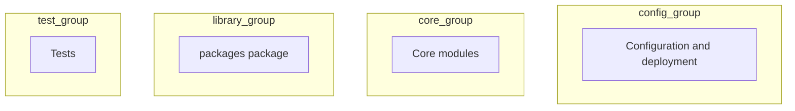

# Architecture report: rebassjs/rebass

> Automated static analysis. **Observed** = directly seen in files/imports/AST; **Inferred** = interpretation from that evidence. Repository code was not executed.

## 1. Repository at a glance

| Item | Value |
| --- | --- |
| Repository | rebassjs/rebass |
| Description | :atom_symbol: React primitive UI components built with styled-system. |
| Language | JavaScript |
| Stars | 7898 |
| Licence | MIT |
| Analysed commit / branch | 31726a00fc81371b5cde9eb35fd01cabc5a21a58 / master |
| Framework(s) | React |
| Files analysed | 137 |
| Components | 4 |

## 2. Architecture in one minute

rebassjs/rebass - :atom_symbol: React primitive UI components built with styled-system.. This repository was analysed statically from 137 file(s) (0 Python). Detected technologies (observed from imports/manifests): React, Jest. Files are grouped into 4 component(s): Configuration and deployment, Core modules, packages package, Tests. Findings below distinguish observed facts from inferred interpretation.

## 3. High-level block diagram

## 4. Main components

### Configuration and deployment (`config`)

- **Kind:** config
- **Status:** Observed
- **Confidence:** 0.85
- **Responsibility:** Groups 11 file(s) under configuration and deployment (observed from repository paths and static analysis).
- **Paths:** `lerna.json`, `package.json`, `packages/bundler/package.json`, `packages/docs/package.json`, `packages/forms/package.json`, `packages/layout/package.json`, `packages/preset-material/package.json`, `packages/preset/package.json`, `packages/rebass/package.json`, `packages/reflexbox/package.json`, `packages/space/package.json`
- **Evidence:** [lerna.json](https://github.com/rebassjs/rebass/blob/31726a00fc81371b5cde9eb35fd01cabc5a21a58/lerna.json); [package.json](https://github.com/rebassjs/rebass/blob/31726a00fc81371b5cde9eb35fd01cabc5a21a58/package.json); [packages/bundler/package.json](https://github.com/rebassjs/rebass/blob/31726a00fc81371b5cde9eb35fd01cabc5a21a58/packages/bundler/package.json); [packages/docs/package.json](https://github.com/rebassjs/rebass/blob/31726a00fc81371b5cde9eb35fd01cabc5a21a58/packages/docs/package.json); [packages/forms/package.json](https://github.com/rebassjs/rebass/blob/31726a00fc81371b5cde9eb35fd01cabc5a21a58/packages/forms/package.json); [packages/layout/package.json](https://github.com/rebassjs/rebass/blob/31726a00fc81371b5cde9eb35fd01cabc5a21a58/packages/layout/package.json); [packages/preset-material/package.json](https://github.com/rebassjs/rebass/blob/31726a00fc81371b5cde9eb35fd01cabc5a21a58/packages/preset-material/package.json); [packages/preset/package.json](https://github.com/rebassjs/rebass/blob/31726a00fc81371b5cde9eb35fd01cabc5a21a58/packages/preset/package.json)

### Core modules (`core`)

- **Kind:** core
- **Status:** Observed
- **Confidence:** 0.85
- **Responsibility:** Groups 1 file(s) under core modules (observed from repository paths and static analysis).
- **Paths:** `babel.config.js`
- **Evidence:** [babel.config.js](https://github.com/rebassjs/rebass/blob/31726a00fc81371b5cde9eb35fd01cabc5a21a58/babel.config.js)

### packages package (`packages`)

- **Kind:** library
- **Status:** Observed
- **Confidence:** 0.85
- **Responsibility:** Groups 9 file(s) under packages package (observed from repository paths and static analysis).
- **Paths:** `packages/bundler/index.js`, `packages/forms/src/index.js`, `packages/layout/src/index.js`, `packages/preset-material/src/index.js`, `packages/preset/src/index.js`, `packages/rebass/src/index.js`, `packages/reflexbox/babel.config.js`, `packages/reflexbox/src/index.js`, `packages/space/src/index.js`
- **Evidence:** [packages/bundler/index.js](https://github.com/rebassjs/rebass/blob/31726a00fc81371b5cde9eb35fd01cabc5a21a58/packages/bundler/index.js); [packages/forms/src/index.js](https://github.com/rebassjs/rebass/blob/31726a00fc81371b5cde9eb35fd01cabc5a21a58/packages/forms/src/index.js); [packages/layout/src/index.js](https://github.com/rebassjs/rebass/blob/31726a00fc81371b5cde9eb35fd01cabc5a21a58/packages/layout/src/index.js); [packages/preset-material/src/index.js](https://github.com/rebassjs/rebass/blob/31726a00fc81371b5cde9eb35fd01cabc5a21a58/packages/preset-material/src/index.js); [packages/preset/src/index.js](https://github.com/rebassjs/rebass/blob/31726a00fc81371b5cde9eb35fd01cabc5a21a58/packages/preset/src/index.js); [packages/rebass/src/index.js](https://github.com/rebassjs/rebass/blob/31726a00fc81371b5cde9eb35fd01cabc5a21a58/packages/rebass/src/index.js); [packages/reflexbox/babel.config.js](https://github.com/rebassjs/rebass/blob/31726a00fc81371b5cde9eb35fd01cabc5a21a58/packages/reflexbox/babel.config.js); [packages/reflexbox/src/index.js](https://github.com/rebassjs/rebass/blob/31726a00fc81371b5cde9eb35fd01cabc5a21a58/packages/reflexbox/src/index.js)

### Tests (`tests`)

- **Kind:** test
- **Status:** Observed
- **Confidence:** 0.85
- **Responsibility:** Groups 10 file(s) under tests (observed from repository paths and static analysis).
- **Paths:** `packages/forms/test/__snapshots__/index.js.snap`, `packages/forms/test/index.js`, `packages/preset-material/test/__snapshots__/index.js.snap`, `packages/preset-material/test/index.js`, `packages/preset/test/__snapshots__/index.js.snap`, `packages/preset/test/index.js`, `packages/rebass/test/index.js`, `packages/reflexbox/test/index.js`, `packages/space/test/__snapshots__/index.js.snap`, `packages/space/test/index.js`
- **Evidence:** [packages/forms/test/__snapshots__/index.js.snap](https://github.com/rebassjs/rebass/blob/31726a00fc81371b5cde9eb35fd01cabc5a21a58/packages/forms/test/__snapshots__/index.js.snap); [packages/forms/test/index.js](https://github.com/rebassjs/rebass/blob/31726a00fc81371b5cde9eb35fd01cabc5a21a58/packages/forms/test/index.js); [packages/preset-material/test/__snapshots__/index.js.snap](https://github.com/rebassjs/rebass/blob/31726a00fc81371b5cde9eb35fd01cabc5a21a58/packages/preset-material/test/__snapshots__/index.js.snap); [packages/preset-material/test/index.js](https://github.com/rebassjs/rebass/blob/31726a00fc81371b5cde9eb35fd01cabc5a21a58/packages/preset-material/test/index.js); [packages/preset/test/__snapshots__/index.js.snap](https://github.com/rebassjs/rebass/blob/31726a00fc81371b5cde9eb35fd01cabc5a21a58/packages/preset/test/__snapshots__/index.js.snap); [packages/preset/test/index.js](https://github.com/rebassjs/rebass/blob/31726a00fc81371b5cde9eb35fd01cabc5a21a58/packages/preset/test/index.js); [packages/rebass/test/index.js](https://github.com/rebassjs/rebass/blob/31726a00fc81371b5cde9eb35fd01cabc5a21a58/packages/rebass/test/index.js); [packages/reflexbox/test/index.js](https://github.com/rebassjs/rebass/blob/31726a00fc81371b5cde9eb35fd01cabc5a21a58/packages/reflexbox/test/index.js)

## 5. Execution flow

**Observed** entry point(s):

- [packages/bundler/index.js](https://github.com/rebassjs/rebass/blob/31726a00fc81371b5cde9eb35fd01cabc5a21a58/packages/bundler/index.js)
- [packages/forms/src/index.js](https://github.com/rebassjs/rebass/blob/31726a00fc81371b5cde9eb35fd01cabc5a21a58/packages/forms/src/index.js)
- [packages/layout/src/index.js](https://github.com/rebassjs/rebass/blob/31726a00fc81371b5cde9eb35fd01cabc5a21a58/packages/layout/src/index.js)
- [packages/preset-material/src/index.js](https://github.com/rebassjs/rebass/blob/31726a00fc81371b5cde9eb35fd01cabc5a21a58/packages/preset-material/src/index.js)
- [packages/preset/src/index.js](https://github.com/rebassjs/rebass/blob/31726a00fc81371b5cde9eb35fd01cabc5a21a58/packages/preset/src/index.js)
- [packages/rebass/src/index.js](https://github.com/rebassjs/rebass/blob/31726a00fc81371b5cde9eb35fd01cabc5a21a58/packages/rebass/src/index.js)
- [packages/reflexbox/src/index.js](https://github.com/rebassjs/rebass/blob/31726a00fc81371b5cde9eb35fd01cabc5a21a58/packages/reflexbox/src/index.js)
- [packages/space/src/index.js](https://github.com/rebassjs/rebass/blob/31726a00fc81371b5cde9eb35fd01cabc5a21a58/packages/space/src/index.js)

Representative flow (derived from observed entry points and the import graph; steps beyond the entry point are **Inferred**):

1. Execution starts at an observed entry point listed above, if present.
2. No internal import relationships between components were observed.

## 6. Project structure

### `(root)`

- `.eslintignore` - other (54 bytes)
- `.gitignore` - other (41 bytes)
- `.npmignore` - other (25 bytes)
- `.travis.yml` - ci, YAML (97 bytes)
- `CHANGELOG.md` - docs (6079 bytes)
- `CODE_OF_CONDUCT.md` - docs (3213 bytes)
- `CONTRIBUTING.md` - docs (460 bytes)
- `LICENSE.md` - docs (1092 bytes)
- `babel.config.js` - source, JavaScript (459 bytes)
- `lerna.json` - config (111 bytes)
- `package.json` - manifest (1278 bytes)

### `.circleci`

- `.circleci/config.yml` - ci, YAML (967 bytes)

### `examples`

- `examples/sandbox/README.md` - docs (102 bytes)
- `examples/sandbox/package.json` - manifest (600 bytes)
- `examples/sandbox/src/index.js` - source, JavaScript (813 bytes)
- `examples/styled-components/README.md` - docs (112 bytes)
- `examples/styled-components/package.json` - manifest (615 bytes)
- `examples/styled-components/src/index.js` - source, JavaScript (740 bytes)

### `packages`

- `packages/bundler/index.js` - source, JavaScript (389 bytes)
- `packages/bundler/package.json` - manifest (406 bytes)
- `packages/docs/.eslintrc.js` - docs (90 bytes)
- `packages/docs/gatsby-browser.js` - docs (40 bytes)
- `packages/docs/gatsby-config.js` - docs (323 bytes)
- `packages/docs/gatsby-ssr.js` - docs (40 bytes)
- `packages/docs/package.json` - manifest (1188 bytes)
- `packages/docs/src/components/blocks.js` - docs (2304 bytes)
- `packages/docs/src/components/code.js` - docs (2839 bytes)
- `packages/docs/src/components/demo-provider.js` - docs (1247 bytes)
- `packages/docs/src/components/edit-link.js` - docs (691 bytes)
- `packages/docs/src/components/footer.js` - docs (540 bytes)
- `packages/docs/src/components/head.js` - docs (732 bytes)
- `packages/docs/src/components/header.js` - docs (2170 bytes)
- `packages/docs/src/components/icon.js` - docs (454 bytes)
- `packages/docs/src/components/layout.js` - docs (2532 bytes)
- `packages/docs/src/components/logo.js` - docs (3374 bytes)
- `packages/docs/src/components/nav.mdx` - docs (1209 bytes)
- `packages/docs/src/components/note.js` - docs (307 bytes)
- `packages/docs/src/components/recipe-card.js` - docs (964 bytes)
- `packages/docs/src/components/skip-link.js` - docs (617 bytes)
- `packages/docs/src/components/twitter-card.js` - docs (457 bytes)
- `packages/docs/src/components/wrapper.js` - docs (1320 bytes)
- `packages/docs/src/gatsby-plugin-theme-ui/components.js` - docs (484 bytes)
- `packages/docs/src/gatsby-plugin-theme-ui/index.js` - docs (4538 bytes)
- `packages/docs/src/index.js` - docs (502 bytes)
- `packages/docs/src/pages/404.mdx` - docs (161 bytes)
- `packages/docs/src/pages/box.mdx` - docs (291 bytes)
- `packages/docs/src/pages/button.mdx` - docs (248 bytes)
- `packages/docs/src/pages/card.mdx` - docs (190 bytes)
- `packages/docs/src/pages/demo.mdx` - docs (556 bytes)
- `packages/docs/src/pages/extending.mdx` - docs (3746 bytes)
- `packages/docs/src/pages/flex.mdx` - docs (384 bytes)
- `packages/docs/src/pages/forms/checkbox.mdx` - docs (394 bytes)
- `packages/docs/src/pages/forms/index.mdx` - docs (2153 bytes)
- `packages/docs/src/pages/forms/input.mdx` - docs (310 bytes)
- `packages/docs/src/pages/forms/label.mdx` - docs (190 bytes)
- `packages/docs/src/pages/forms/radio.mdx` - docs (589 bytes)
- `packages/docs/src/pages/forms/select.mdx` - docs (457 bytes)
- `packages/docs/src/pages/forms/slider.mdx` - docs (298 bytes)
- `packages/docs/src/pages/forms/switch.mdx` - docs (150 bytes)
- `packages/docs/src/pages/forms/textarea.mdx` - docs (281 bytes)
- `packages/docs/src/pages/getting-started.mdx` - docs (3866 bytes)
- `packages/docs/src/pages/guides/css-grid.mdx` - docs (2718 bytes)
- `packages/docs/src/pages/guides/index.mdx` - docs (775 bytes)
- `packages/docs/src/pages/guides/mdx.mdx` - docs (1910 bytes)
- `packages/docs/src/pages/guides/server-side-rendering.mdx` - docs (329 bytes)
- `packages/docs/src/pages/guides/styled-components.mdx` - docs (515 bytes)
- `packages/docs/src/pages/guides/theme-ui.mdx` - docs (252 bytes)
- `packages/docs/src/pages/guides/using-rebass-without-context.mdx` - docs (604 bytes)
- `packages/docs/src/pages/heading.mdx` - docs (182 bytes)
- `packages/docs/src/pages/image.mdx` - docs (267 bytes)
- `packages/docs/src/pages/index.mdx` - docs (2962 bytes)
- `packages/docs/src/pages/layout/index.mdx` - docs (532 bytes)
- `packages/docs/src/pages/link.mdx` - docs (208 bytes)
- `packages/docs/src/pages/migrating.mdx` - docs (1854 bytes)
- `packages/docs/src/pages/props.mdx` - docs (6944 bytes)
- `packages/docs/src/pages/recipes/avatar.mdx` - docs (160 bytes)
- `packages/docs/src/pages/recipes/background-image-card.mdx` - docs (351 bytes)
- `packages/docs/src/pages/recipes/badge.mdx` - docs (208 bytes)
- `packages/docs/src/pages/recipes/container.mdx` - docs (152 bytes)
- `packages/docs/src/pages/recipes/flexbox-align.mdx` - docs (288 bytes)
- `packages/docs/src/pages/recipes/flexbox-grid.mdx` - docs (313 bytes)
- `packages/docs/src/pages/recipes/flexbox-wrap.mdx` - docs (1031 bytes)
- `packages/docs/src/pages/recipes/image-card.mdx` - docs (211 bytes)
- `packages/docs/src/pages/recipes/index.mdx` - docs (1211 bytes)
- `packages/docs/src/pages/recipes/nav-bar.mdx` - docs (229 bytes)
- `packages/docs/src/pages/recipes/nav-link.mdx` - docs (202 bytes)
- `packages/docs/src/pages/recipes/video-embed.mdx` - docs (483 bytes)
- `packages/docs/src/pages/reflexbox.mdx` - docs (87 bytes)
- `packages/docs/src/pages/space.mdx` - docs (86 bytes)
- `packages/docs/src/pages/text.mdx` - docs (177 bytes)
- `packages/docs/src/pages/theming.mdx` - docs (3104 bytes)
- `packages/docs/src/pages/variants.mdx` - docs (1583 bytes)
- `packages/docs/static/_redirects` - docs (192 bytes)
- `packages/docs/static/logo.svg` - docs (3429 bytes)
- `packages/forms/.gitignore` - other (23 bytes)
- `packages/forms/.npmignore` - other (5 bytes)
- `packages/forms/README.md` - docs (1674 bytes)
- `packages/forms/package.json` - manifest (448 bytes)
- `packages/forms/src/index.js` - source, JavaScript (7496 bytes)
- `packages/forms/test/__snapshots__/index.js.snap` - test (5765 bytes)
- `packages/forms/test/index.js` - test, JavaScript (2541 bytes)
- `packages/layout/.gitignore` - other (23 bytes)
- `packages/layout/.npmignore` - other (21 bytes)
- `packages/layout/README.md` - docs (45 bytes)
- `packages/layout/package.json` - manifest (320 bytes)
- `packages/layout/src/index.js` - source, JavaScript (770 bytes)
- `packages/preset-material/LICENSE.md` - docs (1091 bytes)
- `packages/preset-material/README.md` - docs (972 bytes)
- `packages/preset-material/package.json` - manifest (660 bytes)
- `packages/preset-material/src/index.js` - source, JavaScript (2739 bytes)
- `packages/preset-material/test/__snapshots__/index.js.snap` - test (2977 bytes)
- `packages/preset-material/test/index.js` - test, JavaScript (92 bytes)
- `packages/preset/LICENSE.md` - docs (1091 bytes)
- `packages/preset/README.md` - docs (1235 bytes)
- `packages/preset/package.json` - manifest (642 bytes)
- `packages/preset/src/index.js` - source, JavaScript (2108 bytes)
- `packages/preset/test/__snapshots__/index.js.snap` - test (2544 bytes)
- `packages/preset/test/index.js` - test, JavaScript (92 bytes)
- `packages/rebass/.gitignore` - other (23 bytes)
- `packages/rebass/.npmignore` - other (5 bytes)
- `packages/rebass/README.md` - docs (3791 bytes)
- `packages/rebass/package.json` - manifest (734 bytes)
- `packages/rebass/src/index.js` - source, JavaScript (1324 bytes)
- `packages/rebass/test/index.js` - test, JavaScript (3665 bytes)
- `packages/reflexbox/.gitignore` - other (23 bytes)
- `packages/reflexbox/.npmignore` - other (21 bytes)
- `packages/reflexbox/LICENSE.md` - docs (1091 bytes)
- `packages/reflexbox/README.md` - docs (6693 bytes)
- `packages/reflexbox/babel.config.js` - source, JavaScript (273 bytes)
- `packages/reflexbox/package.json` - manifest (993 bytes)
- `packages/reflexbox/src/index.js` - source, JavaScript (824 bytes)
- `packages/reflexbox/test/index.js` - test, JavaScript (4611 bytes)
- `packages/space/README.md` - docs (1385 bytes)
- `packages/space/package.json` - manifest (696 bytes)
- `packages/space/src/index.js` - source, JavaScript (587 bytes)
- `packages/space/test/__snapshots__/index.js.snap` - test (226 bytes)
- `packages/space/test/index.js` - test, JavaScript (952 bytes)

## 7. Key dependencies and integrations

| Name | Category | Status | Confidence | Evidence |
| --- | --- | --- | --- | --- |
| React | framework | Observed | 0.90 | [examples/sandbox/package.json:8](https://github.com/rebassjs/rebass/blob/31726a00fc81371b5cde9eb35fd01cabc5a21a58/examples/sandbox/package.json#L8); [examples/sandbox/package.json:14](https://github.com/rebassjs/rebass/blob/31726a00fc81371b5cde9eb35fd01cabc5a21a58/examples/sandbox/package.json#L14); [examples/styled-components/package.json:8](https://github.com/rebassjs/rebass/blob/31726a00fc81371b5cde9eb35fd01cabc5a21a58/examples/styled-components/package.json#L8); [examples/styled-components/package.json:13](https://github.com/rebassjs/rebass/blob/31726a00fc81371b5cde9eb35fd01cabc5a21a58/examples/styled-components/package.json#L13) |
| Jest | tooling | Observed | 0.85 | [package.json:11](https://github.com/rebassjs/rebass/blob/31726a00fc81371b5cde9eb35fd01cabc5a21a58/package.json#L11) |

## 8. Data and state

No database, cache, queue, or persistent-state usage was observed in the analysed files. State handling, if any, may be in-memory or in files that were not analysed.

## 9. Configuration and deployment clues

- `.circleci/config.yml` (ci)
- `.travis.yml` (ci)
- `examples/sandbox/package.json` (manifest)
- `examples/styled-components/package.json` (manifest)
- `lerna.json` (config)
- `package.json` (manifest)
- `packages/bundler/package.json` (manifest)
- `packages/docs/package.json` (manifest)
- `packages/forms/package.json` (manifest)
- `packages/layout/package.json` (manifest)
- `packages/preset-material/package.json` (manifest)
- `packages/preset/package.json` (manifest)
- `packages/rebass/package.json` (manifest)
- `packages/reflexbox/package.json` (manifest)
- `packages/space/package.json` (manifest)

## 10. Design observations

- Tests are present alongside source code (Observed from test file paths).

These observations are interpretations (**Inferred**) of the observed structure, not guarantees about runtime design.

## 11. Limitations and unknowns

- Static analysis only: repository code was not executed, installed, or imported at runtime.
- Components and relationships are inferred from file paths, imports, and AST structure; runtime behaviour, dynamic imports, and reflection may not be visible.
- 1 file(s) were skipped during inventory (1 x likely secret file excluded).
- No clear application entry point was observed in the analysed files.
- Repository text was treated as untrusted data; no instructions found in repository files were followed, and likely secret values were redacted/excluded.
- JavaScript and TypeScript files were inventoried from paths and package manifests. They were not parsed with a full language AST, and repository code was not executed.

## 12. Source references

- [babel.config.js](https://github.com/rebassjs/rebass/blob/31726a00fc81371b5cde9eb35fd01cabc5a21a58/babel.config.js)
- [examples/sandbox/package.json:8](https://github.com/rebassjs/rebass/blob/31726a00fc81371b5cde9eb35fd01cabc5a21a58/examples/sandbox/package.json#L8)
- [examples/sandbox/package.json:14](https://github.com/rebassjs/rebass/blob/31726a00fc81371b5cde9eb35fd01cabc5a21a58/examples/sandbox/package.json#L14)
- [examples/styled-components/package.json:8](https://github.com/rebassjs/rebass/blob/31726a00fc81371b5cde9eb35fd01cabc5a21a58/examples/styled-components/package.json#L8)
- [examples/styled-components/package.json:13](https://github.com/rebassjs/rebass/blob/31726a00fc81371b5cde9eb35fd01cabc5a21a58/examples/styled-components/package.json#L13)
- [lerna.json](https://github.com/rebassjs/rebass/blob/31726a00fc81371b5cde9eb35fd01cabc5a21a58/lerna.json)
- [package.json](https://github.com/rebassjs/rebass/blob/31726a00fc81371b5cde9eb35fd01cabc5a21a58/package.json)
- [package.json:11](https://github.com/rebassjs/rebass/blob/31726a00fc81371b5cde9eb35fd01cabc5a21a58/package.json#L11)
- [package.json:18](https://github.com/rebassjs/rebass/blob/31726a00fc81371b5cde9eb35fd01cabc5a21a58/package.json#L18)
- [package.json:25](https://github.com/rebassjs/rebass/blob/31726a00fc81371b5cde9eb35fd01cabc5a21a58/package.json#L25)
- [packages/bundler/index.js](https://github.com/rebassjs/rebass/blob/31726a00fc81371b5cde9eb35fd01cabc5a21a58/packages/bundler/index.js)
- [packages/bundler/package.json](https://github.com/rebassjs/rebass/blob/31726a00fc81371b5cde9eb35fd01cabc5a21a58/packages/bundler/package.json)
- [packages/docs/package.json](https://github.com/rebassjs/rebass/blob/31726a00fc81371b5cde9eb35fd01cabc5a21a58/packages/docs/package.json)
- [packages/docs/package.json:16](https://github.com/rebassjs/rebass/blob/31726a00fc81371b5cde9eb35fd01cabc5a21a58/packages/docs/package.json#L16)
- [packages/docs/package.json:34](https://github.com/rebassjs/rebass/blob/31726a00fc81371b5cde9eb35fd01cabc5a21a58/packages/docs/package.json#L34)
- [packages/forms/package.json](https://github.com/rebassjs/rebass/blob/31726a00fc81371b5cde9eb35fd01cabc5a21a58/packages/forms/package.json)
- [packages/forms/src/index.js](https://github.com/rebassjs/rebass/blob/31726a00fc81371b5cde9eb35fd01cabc5a21a58/packages/forms/src/index.js)
- [packages/forms/test/__snapshots__/index.js.snap](https://github.com/rebassjs/rebass/blob/31726a00fc81371b5cde9eb35fd01cabc5a21a58/packages/forms/test/__snapshots__/index.js.snap)
- [packages/forms/test/index.js](https://github.com/rebassjs/rebass/blob/31726a00fc81371b5cde9eb35fd01cabc5a21a58/packages/forms/test/index.js)
- [packages/layout/package.json](https://github.com/rebassjs/rebass/blob/31726a00fc81371b5cde9eb35fd01cabc5a21a58/packages/layout/package.json)
- [packages/layout/src/index.js](https://github.com/rebassjs/rebass/blob/31726a00fc81371b5cde9eb35fd01cabc5a21a58/packages/layout/src/index.js)
- [packages/preset-material/package.json](https://github.com/rebassjs/rebass/blob/31726a00fc81371b5cde9eb35fd01cabc5a21a58/packages/preset-material/package.json)
- [packages/preset-material/src/index.js](https://github.com/rebassjs/rebass/blob/31726a00fc81371b5cde9eb35fd01cabc5a21a58/packages/preset-material/src/index.js)
- [packages/preset-material/test/__snapshots__/index.js.snap](https://github.com/rebassjs/rebass/blob/31726a00fc81371b5cde9eb35fd01cabc5a21a58/packages/preset-material/test/__snapshots__/index.js.snap)
- [packages/preset-material/test/index.js](https://github.com/rebassjs/rebass/blob/31726a00fc81371b5cde9eb35fd01cabc5a21a58/packages/preset-material/test/index.js)
- [packages/preset/package.json](https://github.com/rebassjs/rebass/blob/31726a00fc81371b5cde9eb35fd01cabc5a21a58/packages/preset/package.json)
- [packages/preset/src/index.js](https://github.com/rebassjs/rebass/blob/31726a00fc81371b5cde9eb35fd01cabc5a21a58/packages/preset/src/index.js)
- [packages/preset/test/__snapshots__/index.js.snap](https://github.com/rebassjs/rebass/blob/31726a00fc81371b5cde9eb35fd01cabc5a21a58/packages/preset/test/__snapshots__/index.js.snap)
- [packages/preset/test/index.js](https://github.com/rebassjs/rebass/blob/31726a00fc81371b5cde9eb35fd01cabc5a21a58/packages/preset/test/index.js)
- [packages/rebass/src/index.js](https://github.com/rebassjs/rebass/blob/31726a00fc81371b5cde9eb35fd01cabc5a21a58/packages/rebass/src/index.js)
- [packages/rebass/test/index.js](https://github.com/rebassjs/rebass/blob/31726a00fc81371b5cde9eb35fd01cabc5a21a58/packages/rebass/test/index.js)
- [packages/reflexbox/babel.config.js](https://github.com/rebassjs/rebass/blob/31726a00fc81371b5cde9eb35fd01cabc5a21a58/packages/reflexbox/babel.config.js)
- [packages/reflexbox/src/index.js](https://github.com/rebassjs/rebass/blob/31726a00fc81371b5cde9eb35fd01cabc5a21a58/packages/reflexbox/src/index.js)
- [packages/reflexbox/test/index.js](https://github.com/rebassjs/rebass/blob/31726a00fc81371b5cde9eb35fd01cabc5a21a58/packages/reflexbox/test/index.js)
- [packages/space/src/index.js](https://github.com/rebassjs/rebass/blob/31726a00fc81371b5cde9eb35fd01cabc5a21a58/packages/space/src/index.js)
