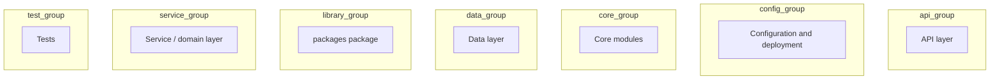

# Architecture report: redfin/react-server

> Automated static analysis. **Observed** = directly seen in files/imports/AST; **Inferred** = interpretation from that evidence. Repository code was not executed.

## 1. Repository at a glance

| Item | Value |
| --- | --- |
| Repository | redfin/react-server |
| Description | :rocket: Blazing fast page load and seamless navigation. |
| Language | JavaScript |
| Stars | 3861 |
| Licence | Apache-2.0 |
| Analysed commit / branch | 572ff229d51d25515ab4b8f13cd15a87cd787f61 / master |
| Framework(s) | Express, React |
| Files analysed | 538 |
| Components | 7 |

## 2. Architecture in one minute

redfin/react-server - :rocket: Blazing fast page load and seamless navigation.. This repository was analysed statically from 538 file(s) (3 Python). Detected technologies (observed from imports/manifests): Express, React, Redux, Docker, Docker Compose, webpack. Files are grouped into 7 component(s): API layer, Configuration and deployment, Core modules, Data layer, packages package, Service / domain layer, Tests. Findings below distinguish observed facts from inferred interpretation.

## 3. High-level block diagram

## 4. Main components

### API layer (`api_layer`)

- **Kind:** api
- **Status:** Observed
- **Confidence:** 0.85
- **Responsibility:** Groups 2 file(s) under api layer (observed from repository paths and static analysis).
- **Paths:** `packages/react-server-examples/bike-share/api/index.js`, `packages/react-server-examples/bike-share/api/networks.js`
- **Evidence:** [packages/react-server-examples/bike-share/api/index.js](https://github.com/redfin/react-server/blob/572ff229d51d25515ab4b8f13cd15a87cd787f61/packages/react-server-examples/bike-share/api/index.js); [packages/react-server-examples/bike-share/api/networks.js](https://github.com/redfin/react-server/blob/572ff229d51d25515ab4b8f13cd15a87cd787f61/packages/react-server-examples/bike-share/api/networks.js)

### Configuration and deployment (`config`)

- **Kind:** config
- **Status:** Observed
- **Confidence:** 0.85
- **Responsibility:** Groups 42 file(s) under configuration and deployment (observed from repository paths and static analysis).
- **Paths:** `Dockerfile`, `lerna.json`, `package.json`, `packages/babel-plugin-react-server/package.json`, `packages/babel-preset-react-server/package.json`, `packages/flab/package.json`, `packages/generator-react-server/generators/app/templates/Dockerfile`, `packages/generator-react-server/generators/app/templates/docker-compose.yml`, `packages/generator-react-server/generators/app/templates/package.json`, `packages/generator-react-server/generators/app/templates/routes.json`, `packages/generator-react-server/package.json`, `packages/react-server-cli/package.json`, `packages/react-server-core-middleware/package.json`, `packages/react-server-data-bundle-cache/package.json`, `packages/react-server-examples/bike-share/Dockerfile`, `packages/react-server-examples/bike-share/docker-compose.yml`, `packages/react-server-examples/bike-share/package.json`, `packages/react-server-examples/code-splitting/package.json`, `packages/react-server-examples/hello-world/package.json`, `packages/react-server-examples/meteor-site/package.json`, `packages/react-server-examples/meteor-site/routes.json`, `packages/react-server-examples/package.json`, `packages/react-server-examples/redux-basic/package.json`, `packages/react-server-examples/styled-components/package.json`, `packages/react-server-examples/styled-components/routes.json`, `packages/react-server-gulp-module-tagger/package.json`, `packages/react-server-integration-tests/config.json`, `packages/react-server-integration-tests/package.json`, `packages/react-server-middleware-json-response/package.json`, `packages/react-server-module-tagger/package.json`, `packages/react-server-redux/package.json`, `packages/react-server-test-pages/package.json`, `packages/react-server-website/.dockerignore`, `packages/react-server-website/Dockerfile`, `packages/react-server-website/deployment/deploy.yml`, `packages/react-server-website/deployment/docker-compose.yml`, `packages/react-server-website/deployment/ec2.ini`, `packages/react-server-website/deployment/requirements.txt`, `packages/react-server-website/deployment/setup.yml`, `packages/react-server-website/docker-compose.yml`, `packages/react-server-website/package.json`, `packages/react-server/package.json`
- **Evidence:** [Dockerfile](https://github.com/redfin/react-server/blob/572ff229d51d25515ab4b8f13cd15a87cd787f61/Dockerfile); [lerna.json](https://github.com/redfin/react-server/blob/572ff229d51d25515ab4b8f13cd15a87cd787f61/lerna.json); [package.json](https://github.com/redfin/react-server/blob/572ff229d51d25515ab4b8f13cd15a87cd787f61/package.json); [packages/babel-plugin-react-server/package.json](https://github.com/redfin/react-server/blob/572ff229d51d25515ab4b8f13cd15a87cd787f61/packages/babel-plugin-react-server/package.json); [packages/babel-preset-react-server/package.json](https://github.com/redfin/react-server/blob/572ff229d51d25515ab4b8f13cd15a87cd787f61/packages/babel-preset-react-server/package.json); [packages/flab/package.json](https://github.com/redfin/react-server/blob/572ff229d51d25515ab4b8f13cd15a87cd787f61/packages/flab/package.json); [packages/generator-react-server/generators/app/templates/Dockerfile](https://github.com/redfin/react-server/blob/572ff229d51d25515ab4b8f13cd15a87cd787f61/packages/generator-react-server/generators/app/templates/Dockerfile); [packages/generator-react-server/generators/app/templates/docker-compose.yml](https://github.com/redfin/react-server/blob/572ff229d51d25515ab4b8f13cd15a87cd787f61/packages/generator-react-server/generators/app/templates/docker-compose.yml)

### Core modules (`core`)

- **Kind:** core
- **Status:** Observed
- **Confidence:** 0.85
- **Responsibility:** Groups 1 file(s) under core modules (observed from repository paths and static analysis).
- **Paths:** `babel.config.js`
- **Evidence:** [babel.config.js](https://github.com/redfin/react-server/blob/572ff229d51d25515ab4b8f13cd15a87cd787f61/babel.config.js)

### Data layer (`data_layer`)

- **Kind:** data
- **Status:** Observed
- **Confidence:** 0.85
- **Responsibility:** Groups 4 file(s) under data layer (observed from repository paths and static analysis).
- **Paths:** `packages/react-server-integration-tests/src/__tests__/containers/data/FooEmitter.js`, `packages/react-server-test-pages/pages/data/EchoCssPage.js`, `packages/react-server-test-pages/pages/data/delay.js`, `packages/react-server-test-pages/pages/data/error.js`
- **Evidence:** [packages/react-server-integration-tests/src/__tests__/containers/data/FooEmitter.js](https://github.com/redfin/react-server/blob/572ff229d51d25515ab4b8f13cd15a87cd787f61/packages/react-server-integration-tests/src/__tests__/containers/data/FooEmitter.js); [packages/react-server-test-pages/pages/data/EchoCssPage.js](https://github.com/redfin/react-server/blob/572ff229d51d25515ab4b8f13cd15a87cd787f61/packages/react-server-test-pages/pages/data/EchoCssPage.js); [packages/react-server-test-pages/pages/data/delay.js](https://github.com/redfin/react-server/blob/572ff229d51d25515ab4b8f13cd15a87cd787f61/packages/react-server-test-pages/pages/data/delay.js); [packages/react-server-test-pages/pages/data/error.js](https://github.com/redfin/react-server/blob/572ff229d51d25515ab4b8f13cd15a87cd787f61/packages/react-server-test-pages/pages/data/error.js)

### packages package (`packages`)

- **Kind:** library
- **Status:** Observed
- **Confidence:** 0.85
- **Responsibility:** Groups 241 file(s) under packages package (observed from repository paths and static analysis). Observed top-level classes: Ec2Inventory.
- **Paths:** `packages/babel-plugin-react-server/babel.config.js`, `packages/babel-plugin-react-server/src/index.js`, `packages/babel-preset-react-server/index.js`, `packages/babel-preset-react-server/test.js`, `packages/babel-preset-react-server/tst/expected.js`, `packages/babel-preset-react-server/tst/source.js`, `packages/flab/LAB.src.js`, `packages/flab/index.js`, `packages/flab/minify.js`, `packages/flab/stringify.js`, `packages/generator-react-server/generators/app/index.js`, `packages/generator-react-server/generators/app/templates/babel.config.js`, `packages/generator-react-server/generators/app/templates/components/hello-world.js`, `packages/generator-react-server/generators/app/templates/pages/hello-world.js`, `packages/generator-react-server/generators/app/templates/test.js`, `packages/react-server-cli/gulpfile.babel.js`, `packages/react-server-cli/src/ConfigurationError.js`, `packages/react-server-cli/src/NonCachingExtractTextLoader.js`, `packages/react-server-cli/src/__tests__/compileClient/compileClientSpec.js`, `packages/react-server-cli/src/callerDependency-Mock.js`, `packages/react-server-cli/src/callerDependency.js`, `packages/react-server-cli/src/cli.js`, `packages/react-server-cli/src/commands/add-page.js`, `packages/react-server-cli/src/commands/compile.js`, `packages/react-server-cli/src/commands/init.js`, `packages/react-server-cli/src/commands/start.js`, `packages/react-server-cli/src/compileClient.js`, `packages/react-server-cli/src/defaultOptions.js`, `packages/react-server-cli/src/fileExists.js`, `packages/react-server-cli/src/findOptionsInFiles.js`, `packages/react-server-cli/src/handleCompilationErrors.js`, `packages/react-server-cli/src/index.js`, `packages/react-server-cli/src/logProductionWarnings.js`, `packages/react-server-cli/src/mergeOptions.js`, `packages/react-server-cli/src/parseCliArgs.js`, `packages/react-server-cli/src/react-server.js`, `packages/react-server-cli/src/run.js`, `packages/react-server-cli/src/serverSideHotModuleReload.js`, `packages/react-server-cli/src/setupLogging.js`, `packages/react-server-cli/src/webpack/webpack.config.fn.js`, `packages/react-server-cli/src/webpack/webpack4.config.fn.js`, `packages/react-server-core-middleware/index.js`, `packages/react-server-core-middleware/src/coreCssMiddleware.js`, `packages/react-server-core-middleware/src/coreJsMiddleware.js`, `packages/react-server-data-bundle-cache/gulpfile.js`, `packages/react-server-data-bundle-cache/main.js`, `packages/react-server-data-bundle-cache/src/before.js`, `packages/react-server-data-bundle-cache/src/constants.js`, `packages/react-server-data-bundle-cache/src/fetch.js`, `packages/react-server-data-bundle-cache/src/index.js`, `packages/react-server-data-bundle-cache/src/install.js`, `packages/react-server-data-bundle-cache/src/last-url.js`, `packages/react-server-data-bundle-cache/src/listen.js`, `packages/react-server-data-bundle-cache/src/log-events.js`, `packages/react-server-data-bundle-cache/src/logging.js`, `packages/react-server-data-bundle-cache/src/opt-in.js`, `packages/react-server-data-bundle-cache/src/preload.js`, `packages/react-server-data-bundle-cache/src/wrap.js`, `packages/react-server-examples/bike-share/components/error.js`, `packages/react-server-examples/bike-share/components/footer.js`, `packages/react-server-examples/bike-share/components/header.js`, `packages/react-server-examples/bike-share/components/network-card.js`, `packages/react-server-examples/bike-share/components/network-list.js`, `packages/react-server-examples/bike-share/components/station-card.js`, `packages/react-server-examples/bike-share/components/station-list.js`, `packages/react-server-examples/bike-share/middleware/request-to-port.js`, `packages/react-server-examples/bike-share/pages/index.js`, `packages/react-server-examples/bike-share/pages/network.js`, `packages/react-server-examples/bike-share/pages/not-found.js`, `packages/react-server-examples/bike-share/routes.js`, `packages/react-server-examples/code-splitting/componentLoaders/FooterLoader.js`, `packages/react-server-examples/code-splitting/componentLoaders/HeaderLoader.js`, `packages/react-server-examples/code-splitting/components/Body.js`, `packages/react-server-examples/code-splitting/components/Footer.js`, `packages/react-server-examples/code-splitting/components/Header.js`, `packages/react-server-examples/code-splitting/pages/index.js`, `packages/react-server-examples/code-splitting/routes.js`, `packages/react-server-examples/code-splitting/webpackConfig.js`, `packages/react-server-examples/hello-world/HelloWorld.js`, `packages/react-server-examples/hello-world/HelloWorldPage.js`, `packages/react-server-examples/hello-world/routes.js`, `packages/react-server-examples/meteor-site/components/Footer.js`, `packages/react-server-examples/meteor-site/components/Header.js`, `packages/react-server-examples/meteor-site/components/Map.js`, `packages/react-server-examples/meteor-site/components/MeteorMap.js`, `packages/react-server-examples/meteor-site/components/MeteorTable.js`, `packages/react-server-examples/meteor-site/components/Table.js`, `packages/react-server-examples/meteor-site/components/index.js`, `packages/react-server-examples/meteor-site/middleware/Bootstrap.js`, `packages/react-server-examples/meteor-site/pages/Homepage.js`, `packages/react-server-examples/meteor-site/stores/actions.js`, `packages/react-server-examples/meteor-site/stores/index.js`, `packages/react-server-examples/meteor-site/stores/reducers.js`, `packages/react-server-examples/redux-basic/components/Counter.js`, `packages/react-server-examples/redux-basic/pages/counter-app/index.js`, `packages/react-server-examples/redux-basic/pages/counter-app/reducer.js`, `packages/react-server-examples/redux-basic/pages/store.js`, `packages/react-server-examples/redux-basic/routes.js`, `packages/react-server-examples/styled-components/components/banner.js`, `packages/react-server-examples/styled-components/components/centered-div.js`, `packages/react-server-examples/styled-components/components/hello-world.js`, `packages/react-server-examples/styled-components/components/primary-button.js`, `packages/react-server-examples/styled-components/components/secondary-button.js`, `packages/react-server-examples/styled-components/components/themes.js`, `packages/react-server-examples/styled-components/pages/hello-world.js`, `packages/react-server-examples/styled-components/styles/button.js`, `packages/react-server-examples/styled-components/styles/global.js`, `packages/react-server-examples/styled-components/test.js`, `packages/react-server-gulp-module-tagger/index.js`, `packages/react-server-integration-tests/gulpfile.babel.js`, `packages/react-server-integration-tests/src/__tests__/asyncRender/AsyncElementPage.js`, `packages/react-server-integration-tests/src/__tests__/asyncRender/AsyncRenderSpec.js`, `packages/react-server-integration-tests/src/__tests__/asyncRender/ServerTimeoutElementPage.js`, `packages/react-server-integration-tests/src/__tests__/containers/ContainersSpec.js`, `packages/react-server-integration-tests/src/__tests__/containers/components/ValEcho.js`, `packages/react-server-integration-tests/src/__tests__/containers/pages/AttributesOnRootContainer.js`, `packages/react-server-integration-tests/src/__tests__/containers/pages/AttributesOnRootElement.js`, `packages/react-server-integration-tests/src/__tests__/containers/pages/PropsFromEmitterRootContainer.js`, `packages/react-server-integration-tests/src/__tests__/containers/pages/PropsFromEmitterRootElement.js`, `packages/react-server-integration-tests/src/__tests__/containers/pages/SingleDivInArray.js`, `packages/react-server-integration-tests/src/__tests__/containers/pages/SingleDivNoArray.js`, `packages/react-server-integration-tests/src/__tests__/containers/pages/SinglePromiseInArray.js`, `packages/react-server-integration-tests/src/__tests__/containers/pages/SinglePromiseNoArray.js`, `packages/react-server-integration-tests/src/__tests__/containers/pages/SingleRootContainerInArray.js`, `packages/react-server-integration-tests/src/__tests__/containers/pages/SingleRootContainerNoArray.js`, `packages/react-server-integration-tests/src/__tests__/containers/pages/SingleRootElementInArray.js`, `packages/react-server-integration-tests/src/__tests__/containers/pages/SingleRootElementInRootContainer.js`, `packages/react-server-integration-tests/src/__tests__/containers/pages/SingleRootElementNoArray.js`, `packages/react-server-integration-tests/src/__tests__/css/CssPage.js`, `packages/react-server-integration-tests/src/__tests__/css/CssSpec.js`, `packages/react-server-integration-tests/src/__tests__/css/CssWithAssetsPage.js`, `packages/react-server-integration-tests/src/__tests__/httpAndHttpsServers/HelloWorldPage.js`, `packages/react-server-integration-tests/src/__tests__/httpAndHttpsServers/HttpServerSpec.js`, `packages/react-server-integration-tests/src/__tests__/httpHeaders/AsyncHttpHeadersPage.js`, `packages/react-server-integration-tests/src/__tests__/httpHeaders/HttpHeadersPage.js`, `packages/react-server-integration-tests/src/__tests__/httpHeaders/HttpHeadersSpec.js`, `packages/react-server-integration-tests/src/__tests__/internalServerError/InternalServerErrorSpec.js`, `packages/react-server-integration-tests/src/__tests__/internalServerError/pages/InternalServerErrorException.js`, `packages/react-server-integration-tests/src/__tests__/internalServerError/pages/InternalServerErrorNoDocument.js`, `packages/react-server-integration-tests/src/__tests__/internalServerError/pages/InternalServerErrorRejection.js`, `packages/react-server-integration-tests/src/__tests__/internalServerError/pages/InternalServerErrorWithDocument.js`, `packages/react-server-integration-tests/src/__tests__/notFound/NotFoundSpec.js`, `packages/react-server-integration-tests/src/__tests__/notFound/pages/NotFoundNoDocument.js`, `packages/react-server-integration-tests/src/__tests__/notFound/pages/NotFoundWithDocument.js`, `packages/react-server-integration-tests/src/__tests__/rawResponse/RawResponsePage.js`, `packages/react-server-integration-tests/src/__tests__/rawResponse/RawResponseSpec.js`, `packages/react-server-integration-tests/src/__tests__/redirectForward/FinalPage.js`, `packages/react-server-integration-tests/src/__tests__/redirectForward/ForwardPage.js`, `packages/react-server-integration-tests/src/__tests__/redirectForward/PermanentRedirectPage.js`, `packages/react-server-integration-tests/src/__tests__/redirectForward/PermanentRedirectWithDocumentPage.js`, `packages/react-server-integration-tests/src/__tests__/redirectForward/RedirectForwardSpec.js`, `packages/react-server-integration-tests/src/__tests__/redirectForward/TemporaryRedirectPage.js`, `packages/react-server-integration-tests/src/__tests__/redirectForward/TemporaryRedirectWithDocumentPage.js`, `packages/react-server-integration-tests/src/__tests__/simpleRender/GoodbyeWorldPage.js`, `packages/react-server-integration-tests/src/__tests__/simpleRender/HelloWorldPage.js`, `packages/react-server-integration-tests/src/__tests__/simpleRender/HelloWorldSpec.js`, `packages/react-server-integration-tests/src/__tests__/simpleRender/MultiElementPage.js`, `packages/react-server-integration-tests/src/__tests__/title/AsyncServerTimeoutTitlePage.js`, `packages/react-server-integration-tests/src/__tests__/title/AsyncTitlePage.js`, `packages/react-server-integration-tests/src/__tests__/title/NullTitlePage.js`, `packages/react-server-integration-tests/src/__tests__/title/SimpleTitlePage.js`, `packages/react-server-integration-tests/src/__tests__/title/TitleSpec.js`, `packages/react-server-integration-tests/src/__tests__/title/UnicodeTitlePage.js`, `packages/react-server-integration-tests/src/specRuntime/TransitionPage.js`, `packages/react-server-integration-tests/src/specRuntime/testHelper.js`, `packages/react-server-middleware-json-response/index.src.js`, `packages/react-server-module-tagger/index.js`, `packages/react-server-module-tagger/test.js`, `packages/react-server-redux/gulpfile.babel.js`, `packages/react-server-redux/src/ReduxAdapter.js`, `packages/react-server-redux/src/RootProvider.js`, `packages/react-server-redux/src/index.js`, `packages/react-server-test-pages/babel.config.js`, `packages/react-server-test-pages/entrypoints.js`, `packages/react-server-test-pages/middleware/RequestToPort.js`, `packages/react-server-test-pages/pages/bottleneck/dataRequests.js`, `packages/react-server-test-pages/pages/bottleneck/elements.js`, `packages/react-server-test-pages/pages/bottleneck/largeDataRequests.js`, `packages/react-server-test-pages/pages/bottleneck/middleware.js`, `packages/react-server-test-pages/pages/bottleneck/test-middleware/TestMiddleware.js`, `packages/react-server-test-pages/pages/error/logs.js`, `packages/react-server-test-pages/pages/index.js`, `packages/react-server-test-pages/pages/navigation/common.js`, `packages/react-server-test-pages/pages/navigation/data-bundle-cache.js`, `packages/react-server-test-pages/pages/navigation/forward.js`, `packages/react-server-test-pages/pages/navigation/forwardEven.js`, `packages/react-server-test-pages/pages/navigation/forwardOdd.js`, `packages/react-server-test-pages/pages/navigation/navigateTo.js`, `packages/react-server-test-pages/pages/navigation/playground.js`, `packages/react-server-test-pages/pages/root/aboveTheFold.js`, `packages/react-server-test-pages/pages/root/attributes.js`, `packages/react-server-test-pages/pages/root/error.js`, `packages/react-server-test-pages/pages/root/order.js`, `packages/react-server-test-pages/pages/root/reduxAdapter.js`, `packages/react-server-test-pages/pages/root/reuse-trim.js`, `packages/react-server-test-pages/pages/root/rootProvider.js`, `packages/react-server-test-pages/pages/root/when.js`, `packages/react-server-test-pages/pages/styles/promises.js`, `packages/react-server-test-pages/pages/styles/sass.js`, `packages/react-server-test-pages/routes.js`, `packages/react-server-website/build-dir-contents.js`, `packages/react-server-website/components/Footer.js`, `packages/react-server-website/components/Header.js`, `packages/react-server-website/components/Markdown.js`, `packages/react-server-website/components/assets/SvgClose.js`, `packages/react-server-website/components/assets/SvgDropdown.js`, `packages/react-server-website/components/assets/SvgHambut.js`, `packages/react-server-website/components/assets/SvgLogo.js`, `packages/react-server-website/components/doc-body.js`, `packages/react-server-website/components/doc-contents.js`, `packages/react-server-website/components/homepage-body.js`, `packages/react-server-website/components/page-title.js`, `packages/react-server-website/components/source-body.js`, `packages/react-server-website/components/source-contents.js`, `packages/react-server-website/deployment/decrypt_credentials.py`, `packages/react-server-website/deployment/ec2.py`, `packages/react-server-website/deployment/encrypt_credentials.py`, `packages/react-server-website/deployment/instance-setup.sh`, `packages/react-server-website/lib/github-button.js`, `packages/react-server-website/lib/highlight.js`, `packages/react-server-website/lib/page-name-mixin.js`, `packages/react-server-website/lib/repo.js`, `packages/react-server-website/lib/slackin-button.js`, `packages/react-server-website/middleware/Analytics.js`, `packages/react-server-website/middleware/CacheControl.js`, `packages/react-server-website/middleware/DataBundleCache.js`, `packages/react-server-website/middleware/Favicon.js`, `packages/react-server-website/middleware/PageFooter.js`, `packages/react-server-website/middleware/PageHeader.js`, `packages/react-server-website/middleware/RequestToPort.js`, `packages/react-server-website/middleware/Theme.js`, `packages/react-server-website/pages/contents-api.js`, `packages/react-server-website/pages/docs-api.js`, `packages/react-server-website/pages/docs.js`, `packages/react-server-website/pages/homepage.js`, `packages/react-server-website/pages/source-api.js`, `packages/react-server-website/pages/source-contents-api.js`, `packages/react-server-website/pages/source.js`, `packages/react-server-website/routes.js`, `packages/react-server-website/test.js`, `packages/react-server/gulpfile.js`
- **Evidence:** [packages/babel-plugin-react-server/babel.config.js](https://github.com/redfin/react-server/blob/572ff229d51d25515ab4b8f13cd15a87cd787f61/packages/babel-plugin-react-server/babel.config.js); [packages/babel-plugin-react-server/src/index.js](https://github.com/redfin/react-server/blob/572ff229d51d25515ab4b8f13cd15a87cd787f61/packages/babel-plugin-react-server/src/index.js); [packages/babel-preset-react-server/index.js](https://github.com/redfin/react-server/blob/572ff229d51d25515ab4b8f13cd15a87cd787f61/packages/babel-preset-react-server/index.js); [packages/babel-preset-react-server/test.js](https://github.com/redfin/react-server/blob/572ff229d51d25515ab4b8f13cd15a87cd787f61/packages/babel-preset-react-server/test.js); [packages/babel-preset-react-server/tst/expected.js](https://github.com/redfin/react-server/blob/572ff229d51d25515ab4b8f13cd15a87cd787f61/packages/babel-preset-react-server/tst/expected.js); [packages/babel-preset-react-server/tst/source.js](https://github.com/redfin/react-server/blob/572ff229d51d25515ab4b8f13cd15a87cd787f61/packages/babel-preset-react-server/tst/source.js); [packages/flab/LAB.src.js](https://github.com/redfin/react-server/blob/572ff229d51d25515ab4b8f13cd15a87cd787f61/packages/flab/LAB.src.js); [packages/flab/index.js](https://github.com/redfin/react-server/blob/572ff229d51d25515ab4b8f13cd15a87cd787f61/packages/flab/index.js)

### Service / domain layer (`service_layer`)

- **Kind:** service
- **Status:** Observed
- **Confidence:** 0.85
- **Responsibility:** Groups 46 file(s) under service / domain layer (observed from repository paths and static analysis).
- **Paths:** `packages/react-server/core/ClientController.js`, `packages/react-server/core/ClientRequest.js`, `packages/react-server/core/ExpressServerRequest.js`, `packages/react-server/core/ReactServerAgent.js`, `packages/react-server/core/ReactServerAgent/Cache.js`, `packages/react-server/core/ReactServerAgent/Plugins.js`, `packages/react-server/core/ReactServerAgent/Request.js`, `packages/react-server/core/ReactServerAgent/__tests__/ReactServerAgentSpec.js`, `packages/react-server/core/__bench__/handlePage.js`, `packages/react-server/core/__bench__/loggingClient.js`, `packages/react-server/core/__tests__/ClientRequestSpec.js`, `packages/react-server/core/__tests__/NormalValuesPage.js`, `packages/react-server/core/__tests__/NullValuePromisesPage.js`, `packages/react-server/core/__tests__/NullValuesPage.js`, `packages/react-server/core/__tests__/context/navigator/DumbPage.js`, `packages/react-server/core/__tests__/context/navigator/NavigatorRoutes.js`, `packages/react-server/core/__tests__/context/navigator/NavigatorSpec.js`, `packages/react-server/core/__tests__/reactMiddlewareSpec.js`, `packages/react-server/core/client.js`, `packages/react-server/core/common.js`, `packages/react-server/core/components/FragmentDataCache.jsx`, `packages/react-server/core/components/History.js`, `packages/react-server/core/components/Link.jsx`, `packages/react-server/core/components/RootContainer.js`, `packages/react-server/core/components/RootElement.js`, `packages/react-server/core/components/TheFold.js`, `packages/react-server/core/components/__tests__/FragmentDataCacheSpec.js`, `packages/react-server/core/config.js`, `packages/react-server/core/constants.js`, `packages/react-server/core/context/Navigator.js`, `packages/react-server/core/context/RequestContext.js`, `packages/react-server/core/logging.js`, `packages/react-server/core/logging/client.js`, `packages/react-server/core/logging/common.js`, `packages/react-server/core/logging/response.js`, `packages/react-server/core/logging/server.js`, `packages/react-server/core/logging/stats.js`, `packages/react-server/core/renderMiddleware.js`, `packages/react-server/core/server.js`, `packages/react-server/core/util/ClientCssHelper.js`, `packages/react-server/core/util/DebugUtil.js`, `packages/react-server/core/util/PageUtil.js`, `packages/react-server/core/util/RequestLocalStorage.js`, `packages/react-server/core/util/StringEscapeUtil.js`, `packages/react-server/core/util/bundleNameUtil.js`, `packages/react-server/core/util/navigateTo.js`
- **Evidence:** [packages/react-server/core/ClientController.js](https://github.com/redfin/react-server/blob/572ff229d51d25515ab4b8f13cd15a87cd787f61/packages/react-server/core/ClientController.js); [packages/react-server/core/ClientRequest.js](https://github.com/redfin/react-server/blob/572ff229d51d25515ab4b8f13cd15a87cd787f61/packages/react-server/core/ClientRequest.js); [packages/react-server/core/ExpressServerRequest.js](https://github.com/redfin/react-server/blob/572ff229d51d25515ab4b8f13cd15a87cd787f61/packages/react-server/core/ExpressServerRequest.js); [packages/react-server/core/ReactServerAgent.js](https://github.com/redfin/react-server/blob/572ff229d51d25515ab4b8f13cd15a87cd787f61/packages/react-server/core/ReactServerAgent.js); [packages/react-server/core/ReactServerAgent/Cache.js](https://github.com/redfin/react-server/blob/572ff229d51d25515ab4b8f13cd15a87cd787f61/packages/react-server/core/ReactServerAgent/Cache.js); [packages/react-server/core/ReactServerAgent/Plugins.js](https://github.com/redfin/react-server/blob/572ff229d51d25515ab4b8f13cd15a87cd787f61/packages/react-server/core/ReactServerAgent/Plugins.js); [packages/react-server/core/ReactServerAgent/Request.js](https://github.com/redfin/react-server/blob/572ff229d51d25515ab4b8f13cd15a87cd787f61/packages/react-server/core/ReactServerAgent/Request.js); [packages/react-server/core/ReactServerAgent/__tests__/ReactServerAgentSpec.js](https://github.com/redfin/react-server/blob/572ff229d51d25515ab4b8f13cd15a87cd787f61/packages/react-server/core/ReactServerAgent/__tests__/ReactServerAgentSpec.js)

### Tests (`tests`)

- **Kind:** test
- **Status:** Observed
- **Confidence:** 0.85
- **Responsibility:** Groups 55 file(s) under tests (observed from repository paths and static analysis).
- **Paths:** `packages/babel-plugin-react-server/test/fixtures/configurable-token/.babelrc`, `packages/babel-plugin-react-server/test/fixtures/configurable-token/actual.js`, `packages/babel-plugin-react-server/test/fixtures/configurable-token/expected.js`, `packages/babel-plugin-react-server/test/fixtures/example/.babelrc`, `packages/babel-plugin-react-server/test/fixtures/example/actual.js`, `packages/babel-plugin-react-server/test/fixtures/example/expected.js`, `packages/babel-plugin-react-server/test/fixtures/label-as-second-key/.babelrc`, `packages/babel-plugin-react-server/test/fixtures/label-as-second-key/actual.js`, `packages/babel-plugin-react-server/test/fixtures/label-as-second-key/expected.js`, `packages/babel-plugin-react-server/test/fixtures/label/.babelrc`, `packages/babel-plugin-react-server/test/fixtures/label/actual.js`, `packages/babel-plugin-react-server/test/fixtures/label/expected.js`, `packages/babel-plugin-react-server/test/fixtures/prefix/.babelrc`, `packages/babel-plugin-react-server/test/fixtures/prefix/actual.js`, `packages/babel-plugin-react-server/test/fixtures/prefix/expected.js`, `packages/babel-plugin-react-server/test/fixtures/reserved-future-tokens/.babelrc`, `packages/babel-plugin-react-server/test/fixtures/reserved-future-tokens/actual.js`, `packages/babel-plugin-react-server/test/fixtures/reserved-future-tokens/expected.js`, `packages/babel-plugin-react-server/test/fixtures/trim/.babelrc`, `packages/babel-plugin-react-server/test/fixtures/trim/actual.js`, `packages/babel-plugin-react-server/test/fixtures/trim/expected.js`, `packages/babel-plugin-react-server/test/index.js`, `packages/generator-react-server/test/app.js`, `packages/react-server-cli/test/commands.js`, `packages/react-server-cli/test/fixtures/BasicPage.js`, `packages/react-server-cli/test/fixtures/commands/start-basic/in-files/routes.json`, `packages/react-server-cli/test/fixtures/commands/start-basic/options.json`, `packages/react-server-cli/test/fixtures/commands/start-missing-routes/options.json`, `packages/react-server-cli/test/fixtures/commands/start-reactserverrc/in-files/.reactserverrc`, `packages/react-server-cli/test/fixtures/commands/start-reactserverrc/in-files/customRoutes.js`, `packages/react-server-cli/test/fixtures/commands/start-reactserverrc/options.json`, `packages/react-server-cli/test/fixtures/commands/start-routes-with-error/in-files/routes.js`, `packages/react-server-cli/test/fixtures/commands/start-routes-with-error/options.json`, `packages/react-server-cli/test/parseCliArgs.js`, `packages/react-server-gulp-module-tagger/test/fixtures/custom-token/actual.js`, `packages/react-server-gulp-module-tagger/test/fixtures/custom-token/expected.js`, `packages/react-server-gulp-module-tagger/test/fixtures/custom-token/gulpfile.js`, `packages/react-server-gulp-module-tagger/test/fixtures/example/actual.js`, `packages/react-server-gulp-module-tagger/test/fixtures/example/expected.js`, `packages/react-server-gulp-module-tagger/test/fixtures/example/gulpfile.js`, `packages/react-server-gulp-module-tagger/test/fixtures/prefix/actual.js`, `packages/react-server-gulp-module-tagger/test/fixtures/prefix/expected.js`, `packages/react-server-gulp-module-tagger/test/fixtures/prefix/gulpfile.js`, `packages/react-server-gulp-module-tagger/test/fixtures/reserved-future-tokens/actual.js`, `packages/react-server-gulp-module-tagger/test/fixtures/reserved-future-tokens/expected.js`, `packages/react-server-gulp-module-tagger/test/fixtures/reserved-future-tokens/gulpfile.js`, `packages/react-server-gulp-module-tagger/test/fixtures/single-quote-custom-token/actual.js`, `packages/react-server-gulp-module-tagger/test/fixtures/single-quote-custom-token/expected.js`, `packages/react-server-gulp-module-tagger/test/fixtures/single-quote-custom-token/gulpfile.js`, `packages/react-server-gulp-module-tagger/test/fixtures/trim/actual.js`, `packages/react-server-gulp-module-tagger/test/fixtures/trim/expected.js`, `packages/react-server-gulp-module-tagger/test/fixtures/trim/gulpfile.js`, `packages/react-server-gulp-module-tagger/test/test.js`, `packages/react-server-redux/test/ReduxAdapter.spec.js`, `packages/react-server/core/test/util/reactServerAgentSupport.js`
- **Evidence:** [packages/babel-plugin-react-server/test/fixtures/configurable-token/.babelrc](https://github.com/redfin/react-server/blob/572ff229d51d25515ab4b8f13cd15a87cd787f61/packages/babel-plugin-react-server/test/fixtures/configurable-token/.babelrc); [packages/babel-plugin-react-server/test/fixtures/configurable-token/actual.js](https://github.com/redfin/react-server/blob/572ff229d51d25515ab4b8f13cd15a87cd787f61/packages/babel-plugin-react-server/test/fixtures/configurable-token/actual.js); [packages/babel-plugin-react-server/test/fixtures/configurable-token/expected.js](https://github.com/redfin/react-server/blob/572ff229d51d25515ab4b8f13cd15a87cd787f61/packages/babel-plugin-react-server/test/fixtures/configurable-token/expected.js); [packages/babel-plugin-react-server/test/fixtures/example/.babelrc](https://github.com/redfin/react-server/blob/572ff229d51d25515ab4b8f13cd15a87cd787f61/packages/babel-plugin-react-server/test/fixtures/example/.babelrc); [packages/babel-plugin-react-server/test/fixtures/example/actual.js](https://github.com/redfin/react-server/blob/572ff229d51d25515ab4b8f13cd15a87cd787f61/packages/babel-plugin-react-server/test/fixtures/example/actual.js); [packages/babel-plugin-react-server/test/fixtures/example/expected.js](https://github.com/redfin/react-server/blob/572ff229d51d25515ab4b8f13cd15a87cd787f61/packages/babel-plugin-react-server/test/fixtures/example/expected.js); [packages/babel-plugin-react-server/test/fixtures/label-as-second-key/.babelrc](https://github.com/redfin/react-server/blob/572ff229d51d25515ab4b8f13cd15a87cd787f61/packages/babel-plugin-react-server/test/fixtures/label-as-second-key/.babelrc); [packages/babel-plugin-react-server/test/fixtures/label-as-second-key/actual.js](https://github.com/redfin/react-server/blob/572ff229d51d25515ab4b8f13cd15a87cd787f61/packages/babel-plugin-react-server/test/fixtures/label-as-second-key/actual.js)

## 5. Execution flow

**Observed** entry point(s):

- [packages/babel-plugin-react-server/src/index.js](https://github.com/redfin/react-server/blob/572ff229d51d25515ab4b8f13cd15a87cd787f61/packages/babel-plugin-react-server/src/index.js)
- [packages/babel-preset-react-server/index.js](https://github.com/redfin/react-server/blob/572ff229d51d25515ab4b8f13cd15a87cd787f61/packages/babel-preset-react-server/index.js)
- [packages/flab/index.js](https://github.com/redfin/react-server/blob/572ff229d51d25515ab4b8f13cd15a87cd787f61/packages/flab/index.js)
- [packages/generator-react-server/generators/app/index.js](https://github.com/redfin/react-server/blob/572ff229d51d25515ab4b8f13cd15a87cd787f61/packages/generator-react-server/generators/app/index.js)
- [packages/react-server-cli/bin/react-server-cli](https://github.com/redfin/react-server/blob/572ff229d51d25515ab4b8f13cd15a87cd787f61/packages/react-server-cli/bin/react-server-cli)
- [packages/react-server-cli/src/index.js](https://github.com/redfin/react-server/blob/572ff229d51d25515ab4b8f13cd15a87cd787f61/packages/react-server-cli/src/index.js)
- [packages/react-server-core-middleware/index.js](https://github.com/redfin/react-server/blob/572ff229d51d25515ab4b8f13cd15a87cd787f61/packages/react-server-core-middleware/index.js)
- [packages/react-server-data-bundle-cache/main.js](https://github.com/redfin/react-server/blob/572ff229d51d25515ab4b8f13cd15a87cd787f61/packages/react-server-data-bundle-cache/main.js)
- [packages/react-server-data-bundle-cache/src/index.js](https://github.com/redfin/react-server/blob/572ff229d51d25515ab4b8f13cd15a87cd787f61/packages/react-server-data-bundle-cache/src/index.js)
- [packages/react-server-examples/hello-world/HelloWorld.js](https://github.com/redfin/react-server/blob/572ff229d51d25515ab4b8f13cd15a87cd787f61/packages/react-server-examples/hello-world/HelloWorld.js)
- [packages/react-server-gulp-module-tagger/index.js](https://github.com/redfin/react-server/blob/572ff229d51d25515ab4b8f13cd15a87cd787f61/packages/react-server-gulp-module-tagger/index.js)
- [packages/react-server-module-tagger/index.js](https://github.com/redfin/react-server/blob/572ff229d51d25515ab4b8f13cd15a87cd787f61/packages/react-server-module-tagger/index.js)

Representative flow (derived from observed entry points and the import graph; steps beyond the entry point are **Inferred**):

1. Execution starts at an observed entry point listed above, if present.
2. No internal import relationships between components were observed.

## 6. Project structure

### `(root)`

- `.dockerignore` - container (49 bytes)
- `.editorconfig` - config (169 bytes)
- `.eslintrc` - other (2404 bytes)
- `.gitattributes` - other (63 bytes)
- `.gitignore` - other (86 bytes)
- `.travis.yml` - ci, YAML (1814 bytes)
- `CHANGELOG.md` - docs (41952 bytes)
- `CODE_OF_CONDUCT.md` - docs (3229 bytes)
- `CONTRIBUTING.md` - docs (6316 bytes)
- `Dockerfile` - container (214 bytes)
- `LICENSE` - docs (11357 bytes)
- `MAINTAINING.md` - docs (1653 bytes)
- `README.md` - docs (4421 bytes)
- `babel.config.js` - source, JavaScript (121 bytes)
- `lerna.json` - config (475 bytes)
- `package.json` - manifest (3899 bytes)

### `docs`

- `docs/README.md` - docs (1768 bytes)
- `docs/_contents.json` - config (924 bytes)
- `docs/guides/client-transitions.md` - docs (3446 bytes)
- `docs/guides/logging.md` - docs (1527 bytes)
- `docs/guides/production.md` - docs (15036 bytes)
- `docs/guides/react-server-cli.md` - docs (12590 bytes)
- `docs/guides/understanding-rendering.md` - docs (3595 bytes)
- `docs/guides/using-react-server-agent.md` - docs (1592 bytes)
- `docs/guides/writing-middleware.md` - docs (1982 bytes)
- `docs/guides/writing-pages.md` - docs (4431 bytes)
- `docs/intro/design.md` - docs (4021 bytes)
- `docs/intro/why-react-server.md` - docs (21879 bytes)
- `docs/page-api.md` - docs (12148 bytes)
- `docs/testing-ports.md` - docs (381 bytes)
- `docs/using-react-server-agent.md` - docs (1592 bytes)

### `packages`

- `packages/babel-plugin-react-server/.gitignore` - other (23 bytes)
- `packages/babel-plugin-react-server/.npmignore` - other (23 bytes)
- `packages/babel-plugin-react-server/README.md` - docs (1192 bytes)
- `packages/babel-plugin-react-server/babel.config.js` - source, JavaScript (222 bytes)
- `packages/babel-plugin-react-server/package.json` - manifest (764 bytes)
- `packages/babel-plugin-react-server/src/index.js` - source, JavaScript (2150 bytes)
- `packages/babel-plugin-react-server/test/fixtures/configurable-token/.babelrc` - test (67 bytes)
- `packages/babel-plugin-react-server/test/fixtures/configurable-token/actual.js` - test, JavaScript (61 bytes)
- `packages/babel-plugin-react-server/test/fixtures/configurable-token/expected.js` - test, JavaScript (215 bytes)
- `packages/babel-plugin-react-server/test/fixtures/example/.babelrc` - test (44 bytes)
- `packages/babel-plugin-react-server/test/fixtures/example/actual.js` - test, JavaScript (68 bytes)
- `packages/babel-plugin-react-server/test/fixtures/example/expected.js` - test, JavaScript (203 bytes)
- `packages/babel-plugin-react-server/test/fixtures/label-as-second-key/.babelrc` - test (44 bytes)
- `packages/babel-plugin-react-server/test/fixtures/label-as-second-key/actual.js` - test, JavaScript (120 bytes)
- `packages/babel-plugin-react-server/test/fixtures/label-as-second-key/expected.js` - test, JavaScript (256 bytes)
- `packages/babel-plugin-react-server/test/fixtures/label/.babelrc` - test (44 bytes)
- `packages/babel-plugin-react-server/test/fixtures/label/actual.js` - test, JavaScript (86 bytes)
- `packages/babel-plugin-react-server/test/fixtures/label/expected.js` - test, JavaScript (221 bytes)
- `packages/babel-plugin-react-server/test/fixtures/prefix/.babelrc` - test (78 bytes)
- `packages/babel-plugin-react-server/test/fixtures/prefix/actual.js` - test, JavaScript (68 bytes)
- `packages/babel-plugin-react-server/test/fixtures/prefix/expected.js` - test, JavaScript (219 bytes)
- `packages/babel-plugin-react-server/test/fixtures/reserved-future-tokens/.babelrc` - test (44 bytes)
- `packages/babel-plugin-react-server/test/fixtures/reserved-future-tokens/actual.js` - test, JavaScript (22 bytes)
- `packages/babel-plugin-react-server/test/fixtures/reserved-future-tokens/expected.js` - test, JavaScript (317 bytes)
- `packages/babel-plugin-react-server/test/fixtures/trim/.babelrc` - test (100 bytes)
- `packages/babel-plugin-react-server/test/fixtures/trim/actual.js` - test, JavaScript (68 bytes)
- `packages/babel-plugin-react-server/test/fixtures/trim/expected.js` - test, JavaScript (161 bytes)
- `packages/babel-plugin-react-server/test/index.js` - test, JavaScript (721 bytes)
- `packages/babel-preset-react-server/.eslintignore` - other (4 bytes)
- `packages/babel-preset-react-server/.gitignore` - other (19 bytes)
- `packages/babel-preset-react-server/.npmignore` - other (34 bytes)
- `packages/babel-preset-react-server/README.md` - docs (221 bytes)
- `packages/babel-preset-react-server/index.js` - source, JavaScript (292 bytes)
- `packages/babel-preset-react-server/package.json` - manifest (822 bytes)
- `packages/babel-preset-react-server/test.js` - source, JavaScript (829 bytes)
- `packages/babel-preset-react-server/tst/expected.js` - source, JavaScript (330 bytes)
- `packages/babel-preset-react-server/tst/source.js` - source, JavaScript (166 bytes)
- `packages/flab/.eslintignore` - other (18 bytes)
- `packages/flab/.gitignore` - other (8 bytes)
- `packages/flab/LAB.src.js` - source, JavaScript (20254 bytes)
- `packages/flab/README.md` - docs (148 bytes)
- `packages/flab/index.js` - source, JavaScript (83 bytes)
- `packages/flab/minify.js` - source, JavaScript (504 bytes)
- `packages/flab/package.json` - manifest (928 bytes)
- `packages/flab/stringify.js` - source, JavaScript (221 bytes)
- `packages/generator-react-server/.gitignore` - other (32 bytes)
- `packages/generator-react-server/.npmignore` - other (9 bytes)
- `packages/generator-react-server/README.md` - docs (1464 bytes)
- `packages/generator-react-server/generators/app/index.js` - source, JavaScript (1819 bytes)
- `packages/generator-react-server/generators/app/templates/Dockerfile` - container (63 bytes)
- `packages/generator-react-server/generators/app/templates/README.md` - docs (3081 bytes)
- `packages/generator-react-server/generators/app/templates/_gitignore` - other (26 bytes)
- `packages/generator-react-server/generators/app/templates/_reactserverrc` - other (313 bytes)
- `packages/generator-react-server/generators/app/templates/babel.config.js` - source, JavaScript (157 bytes)
- `packages/generator-react-server/generators/app/templates/components/hello-world.js` - source, JavaScript (637 bytes)
- `packages/generator-react-server/generators/app/templates/docker-compose.yml` - container (1168 bytes)
- `packages/generator-react-server/generators/app/templates/package.json` - manifest (717 bytes)
- `packages/generator-react-server/generators/app/templates/pages/hello-world.js` - source, JavaScript (474 bytes)
- `packages/generator-react-server/generators/app/templates/routes.json` - config (122 bytes)
- `packages/generator-react-server/generators/app/templates/test.js` - source, JavaScript (862 bytes)
- `packages/generator-react-server/package.json` - manifest (1226 bytes)
- `packages/generator-react-server/test/app.js` - test, JavaScript (5036 bytes)
- `packages/react-server-cli/.babelrc` - other (83 bytes)
- `packages/react-server-cli/.gitignore` - other (32 bytes)
- `packages/react-server-cli/.npmignore` - other (28 bytes)
- `packages/react-server-cli/README.md` - docs (728 bytes)
- `packages/react-server-cli/bin/react-server-cli` - other (50 bytes)
- `packages/react-server-cli/gulpfile.babel.js` - source, JavaScript (576 bytes)
- `packages/react-server-cli/package.json` - manifest (2056 bytes)
- `packages/react-server-cli/src/ConfigurationError.js` - source, JavaScript (438 bytes)
- `packages/react-server-cli/src/NonCachingExtractTextLoader.js` - source, JavaScript (573 bytes)
- `packages/react-server-cli/src/__tests__/compileClient/compileClientSpec.js` - source, JavaScript (2525 bytes)
- `packages/react-server-cli/src/callerDependency-Mock.js` - source, JavaScript (331 bytes)
- `packages/react-server-cli/src/callerDependency.js` - source, JavaScript (397 bytes)
- `packages/react-server-cli/src/cli.js` - source, JavaScript (265 bytes)
- `packages/react-server-cli/src/commands/add-page.js` - source, JavaScript (1241 bytes)
- `packages/react-server-cli/src/commands/compile.js` - source, JavaScript (724 bytes)
- `packages/react-server-cli/src/commands/init.js` - source, JavaScript (1401 bytes)
- `packages/react-server-cli/src/commands/start.js` - source, JavaScript (7229 bytes)
- `packages/react-server-cli/src/compileClient.js` - source, JavaScript (10479 bytes)
- `packages/react-server-cli/src/defaultOptions.js` - source, JavaScript (1284 bytes)
- `packages/react-server-cli/src/fileExists.js` - source, JavaScript (140 bytes)
- `packages/react-server-cli/src/findOptionsInFiles.js` - source, JavaScript (1410 bytes)
- `packages/react-server-cli/src/handleCompilationErrors.js` - source, JavaScript (1168 bytes)
- `packages/react-server-cli/src/index.js` - source, JavaScript (670 bytes)
- `packages/react-server-cli/src/logProductionWarnings.js` - source, JavaScript (1327 bytes)
- `packages/react-server-cli/src/mergeOptions.js` - source, JavaScript (1240 bytes)
- `packages/react-server-cli/src/parseCliArgs.js` - source, JavaScript (7182 bytes)
- `packages/react-server-cli/src/react-server.js` - source, JavaScript (186 bytes)
- `packages/react-server-cli/src/run.js` - source, JavaScript (1369 bytes)
- `packages/react-server-cli/src/serverSideHotModuleReload.js` - source, JavaScript (1563 bytes)
- `packages/react-server-cli/src/setupLogging.js` - source, JavaScript (287 bytes)
- `packages/react-server-cli/src/webpack/webpack.config.fn.js` - source, JavaScript (3200 bytes)
- `packages/react-server-cli/src/webpack/webpack4.config.fn.js` - source, JavaScript (3077 bytes)
- `packages/react-server-cli/test/commands.js` - test, JavaScript (3434 bytes)
- `packages/react-server-cli/test/fixtures/BasicPage.js` - test, JavaScript (157 bytes)
- `packages/react-server-cli/test/fixtures/commands/start-basic/in-files/routes.json` - test (112 bytes)
- `packages/react-server-cli/test/fixtures/commands/start-basic/options.json` - test (98 bytes)
- `packages/react-server-cli/test/fixtures/commands/start-missing-routes/options.json` - test (93 bytes)
- `packages/react-server-cli/test/fixtures/commands/start-reactserverrc/in-files/.reactserverrc` - test (52 bytes)
- `packages/react-server-cli/test/fixtures/commands/start-reactserverrc/in-files/customRoutes.js` - test, JavaScript (105 bytes)
- `packages/react-server-cli/test/fixtures/commands/start-reactserverrc/options.json` - test (98 bytes)
- `packages/react-server-cli/test/fixtures/commands/start-routes-with-error/in-files/routes.js` - test, JavaScript (54 bytes)
- `packages/react-server-cli/test/fixtures/commands/start-routes-with-error/options.json` - test (143 bytes)
- `packages/react-server-cli/test/parseCliArgs.js` - test, JavaScript (11753 bytes)
- `packages/react-server-core-middleware/.gitignore` - other (4 bytes)
- `packages/react-server-core-middleware/.npmignore` - other (4 bytes)
- `packages/react-server-core-middleware/README.md` - docs (48 bytes)
- `packages/react-server-core-middleware/index.js` - source, JavaScript (147 bytes)
- `packages/react-server-core-middleware/package.json` - manifest (903 bytes)
- `packages/react-server-core-middleware/src/coreCssMiddleware.js` - source, JavaScript (812 bytes)
- `packages/react-server-core-middleware/src/coreJsMiddleware.js` - source, JavaScript (1014 bytes)
- `packages/react-server-data-bundle-cache/.gitignore` - other (14 bytes)
- `packages/react-server-data-bundle-cache/.npmignore` - other (55 bytes)
- `packages/react-server-data-bundle-cache/README.md` - docs (1071 bytes)
- `packages/react-server-data-bundle-cache/gulpfile.js` - source, JavaScript (484 bytes)
- `packages/react-server-data-bundle-cache/main.js` - source, JavaScript (199 bytes)
- `packages/react-server-data-bundle-cache/package.json` - manifest (717 bytes)
- `packages/react-server-data-bundle-cache/src/before.js` - source, JavaScript (149 bytes)
- `packages/react-server-data-bundle-cache/src/constants.js` - source, JavaScript (346 bytes)
- `packages/react-server-data-bundle-cache/src/fetch.js` - source, JavaScript (98 bytes)
- `packages/react-server-data-bundle-cache/src/index.js` - source, JavaScript (131 bytes)
- `packages/react-server-data-bundle-cache/src/install.js` - source, JavaScript (209 bytes)
- `packages/react-server-data-bundle-cache/src/last-url.js` - source, JavaScript (88 bytes)
- `packages/react-server-data-bundle-cache/src/listen.js` - source, JavaScript (379 bytes)
- `packages/react-server-data-bundle-cache/src/log-events.js` - source, JavaScript (353 bytes)
- `packages/react-server-data-bundle-cache/src/logging.js` - source, JavaScript (119 bytes)
- `packages/react-server-data-bundle-cache/src/opt-in.js` - source, JavaScript (210 bytes)
- `packages/react-server-data-bundle-cache/src/preload.js` - source, JavaScript (93 bytes)
- `packages/react-server-data-bundle-cache/src/wrap.js` - source, JavaScript (685 bytes)
- `packages/react-server-examples/.babelrc` - other (34 bytes)
- `packages/react-server-examples/.eslintignore` - other (19 bytes)
- `packages/react-server-examples/README.md` - docs (852 bytes)
- `packages/react-server-examples/bike-share/.babelrc` - other (33 bytes)
- `packages/react-server-examples/bike-share/.gitignore` - other (32 bytes)
- `packages/react-server-examples/bike-share/.reactserverrc` - other (69 bytes)
- `packages/react-server-examples/bike-share/Dockerfile` - container (63 bytes)
- `packages/react-server-examples/bike-share/README.md` - docs (2787 bytes)
- `packages/react-server-examples/bike-share/api/index.js` - source, JavaScript (385 bytes)
- `packages/react-server-examples/bike-share/api/networks.js` - source, JavaScript (794 bytes)
- `packages/react-server-examples/bike-share/components/error.js` - source, JavaScript (167 bytes)
- `packages/react-server-examples/bike-share/components/footer.js` - source, JavaScript (420 bytes)
- `packages/react-server-examples/bike-share/components/header.js` - source, JavaScript (269 bytes)
- `packages/react-server-examples/bike-share/components/network-card.js` - source, JavaScript (780 bytes)
- `packages/react-server-examples/bike-share/components/network-list.js` - source, JavaScript (567 bytes)
- `packages/react-server-examples/bike-share/components/station-card.js` - source, JavaScript (1073 bytes)
- `packages/react-server-examples/bike-share/components/station-list.js` - source, JavaScript (557 bytes)
- `packages/react-server-examples/bike-share/docker-compose.yml` - container (1168 bytes)
- `packages/react-server-examples/bike-share/middleware/request-to-port.js` - source, JavaScript (287 bytes)
- `packages/react-server-examples/bike-share/package.json` - manifest (615 bytes)
- `packages/react-server-examples/bike-share/pages/index.js` - source, JavaScript (1090 bytes)
- `packages/react-server-examples/bike-share/pages/network.js` - source, JavaScript (1451 bytes)
- `packages/react-server-examples/bike-share/pages/not-found.js` - source, JavaScript (589 bytes)
- `packages/react-server-examples/bike-share/routes.js` - source, JavaScript (327 bytes)
- `packages/react-server-examples/bike-share/styles/base.scss` - other (356 bytes)
- `packages/react-server-examples/bike-share/styles/index.scss` - other (16 bytes)
- `packages/react-server-examples/bike-share/styles/network.scss` - other (16 bytes)
- `packages/react-server-examples/bike-share/styles/reset.scss` - other (919 bytes)
- `packages/react-server-examples/code-splitting/.babelrc` - other (34 bytes)
- `packages/react-server-examples/code-splitting/.gitignore` - other (26 bytes)
- `packages/react-server-examples/code-splitting/.reactserverrc` - other (75 bytes)
- `packages/react-server-examples/code-splitting/README.md` - docs (2088 bytes)
- `packages/react-server-examples/code-splitting/componentLoaders/FooterLoader.js` - source, JavaScript (733 bytes)
- `packages/react-server-examples/code-splitting/componentLoaders/HeaderLoader.js` - source, JavaScript (746 bytes)
- `packages/react-server-examples/code-splitting/components/Body.js` - source, JavaScript (624 bytes)
- `packages/react-server-examples/code-splitting/components/Footer.js` - source, JavaScript (573 bytes)
- `packages/react-server-examples/code-splitting/components/Header.js` - source, JavaScript (387 bytes)
- `packages/react-server-examples/code-splitting/package.json` - manifest (594 bytes)
- `packages/react-server-examples/code-splitting/pages/index.js` - source, JavaScript (680 bytes)
- `packages/react-server-examples/code-splitting/routes.js` - source, JavaScript (113 bytes)
- `packages/react-server-examples/code-splitting/webpackConfig.js` - source, JavaScript (553 bytes)
- `packages/react-server-examples/hello-world/.babelrc` - other (71 bytes)
- `packages/react-server-examples/hello-world/.gitignore` - other (26 bytes)
- `packages/react-server-examples/hello-world/.reactserverrc` - other (34 bytes)
- `packages/react-server-examples/hello-world/HelloWorld.js` - source, JavaScript (450 bytes)
- `packages/react-server-examples/hello-world/HelloWorldPage.js` - source, JavaScript (146 bytes)
- `packages/react-server-examples/hello-world/README.md` - docs (876 bytes)
- `packages/react-server-examples/hello-world/package.json` - manifest (629 bytes)
- `packages/react-server-examples/hello-world/routes.js` - source, JavaScript (121 bytes)
- `packages/react-server-examples/meteor-site/.babelrc` - other (34 bytes)
- `packages/react-server-examples/meteor-site/.gitignore` - other (13 bytes)
- `packages/react-server-examples/meteor-site/.reactserverrc` - other (109 bytes)
- `packages/react-server-examples/meteor-site/README.md` - docs (12825 bytes)
- `packages/react-server-examples/meteor-site/components/Footer.js` - source, JavaScript (1218 bytes)
- `packages/react-server-examples/meteor-site/components/Header.js` - source, JavaScript (167 bytes)
- `packages/react-server-examples/meteor-site/components/Map.js` - source, JavaScript (1038 bytes)
- `packages/react-server-examples/meteor-site/components/MeteorMap.js` - source, JavaScript (922 bytes)
- `packages/react-server-examples/meteor-site/components/MeteorTable.js` - source, JavaScript (564 bytes)
- `packages/react-server-examples/meteor-site/components/Table.js` - source, JavaScript (1808 bytes)
- `packages/react-server-examples/meteor-site/components/index.js` - source, JavaScript (140 bytes)
- `packages/react-server-examples/meteor-site/middleware/Bootstrap.js` - source, JavaScript (144 bytes)
- `packages/react-server-examples/meteor-site/package.json` - manifest (834 bytes)
- `packages/react-server-examples/meteor-site/pages/Homepage.js` - source, JavaScript (2127 bytes)
- `packages/react-server-examples/meteor-site/routes.json` - config (169 bytes)
- `packages/react-server-examples/meteor-site/stores/actions.js` - source, JavaScript (1636 bytes)
- `packages/react-server-examples/meteor-site/stores/index.js` - source, JavaScript (749 bytes)
- `packages/react-server-examples/meteor-site/stores/reducers.js` - source, JavaScript (1812 bytes)
- `packages/react-server-examples/meteor-site/styles/general.css` - other (286 bytes)
- `packages/react-server-examples/meteor-site/styles/meteor.svg` - other (5473 bytes)
- `packages/react-server-examples/package.json` - manifest (168 bytes)
- `packages/react-server-examples/redux-basic/.babelrc` - other (34 bytes)
- `packages/react-server-examples/redux-basic/.gitignore` - other (74 bytes)
- `packages/react-server-examples/redux-basic/.reactserverrc` - other (286 bytes)
- `packages/react-server-examples/redux-basic/README.md` - docs (1619 bytes)
- `packages/react-server-examples/redux-basic/components/Counter.js` - source, JavaScript (1152 bytes)
- `packages/react-server-examples/redux-basic/package.json` - manifest (710 bytes)
- `packages/react-server-examples/redux-basic/pages/counter-app/index.js` - source, JavaScript (1067 bytes)
- `packages/react-server-examples/redux-basic/pages/counter-app/reducer.js` - source, JavaScript (189 bytes)
- `packages/react-server-examples/redux-basic/pages/store.js` - source, JavaScript (232 bytes)
- `packages/react-server-examples/redux-basic/routes.js` - source, JavaScript (130 bytes)
- `packages/react-server-examples/styled-components/.babelrc` - other (33 bytes)
- `packages/react-server-examples/styled-components/.eslintrc` - other (2149 bytes)
- `packages/react-server-examples/styled-components/.gitignore` - other (26 bytes)
- `packages/react-server-examples/styled-components/.reactserverrc` - other (286 bytes)
- `packages/react-server-examples/styled-components/README.md` - docs (1441 bytes)
- `packages/react-server-examples/styled-components/components/banner.js` - source, JavaScript (279 bytes)
- `packages/react-server-examples/styled-components/components/centered-div.js` - source, JavaScript (126 bytes)
- `packages/react-server-examples/styled-components/components/hello-world.js` - source, JavaScript (1469 bytes)
- `packages/react-server-examples/styled-components/components/primary-button.js` - source, JavaScript (524 bytes)
- `packages/react-server-examples/styled-components/components/secondary-button.js` - source, JavaScript (476 bytes)
- `packages/react-server-examples/styled-components/components/themes.js` - source, JavaScript (1179 bytes)
- `packages/react-server-examples/styled-components/package.json` - manifest (782 bytes)
- `packages/react-server-examples/styled-components/pages/hello-world.js` - source, JavaScript (474 bytes)
- `packages/react-server-examples/styled-components/routes.json` - config (122 bytes)
- `packages/react-server-examples/styled-components/styles/button.js` - source, JavaScript (360 bytes)
- `packages/react-server-examples/styled-components/styles/global.js` - source, JavaScript (207 bytes)
- `packages/react-server-examples/styled-components/test.js` - source, JavaScript (842 bytes)
- `packages/react-server-gulp-module-tagger/.npmignore` - other (27 bytes)
- `packages/react-server-gulp-module-tagger/README.md` - docs (2186 bytes)
- `packages/react-server-gulp-module-tagger/index.js` - source, JavaScript (1303 bytes)
- `packages/react-server-gulp-module-tagger/package.json` - manifest (595 bytes)
- `packages/react-server-gulp-module-tagger/test/fixtures/custom-token/actual.js` - test, JavaScript (216 bytes)
- `packages/react-server-gulp-module-tagger/test/fixtures/custom-token/expected.js` - test, JavaScript (543 bytes)
- `packages/react-server-gulp-module-tagger/test/fixtures/custom-token/gulpfile.js` - test, JavaScript (205 bytes)
- `packages/react-server-gulp-module-tagger/test/fixtures/example/actual.js` - test, JavaScript (198 bytes)
- `packages/react-server-gulp-module-tagger/test/fixtures/example/expected.js` - test, JavaScript (531 bytes)
- `packages/react-server-gulp-module-tagger/test/fixtures/example/gulpfile.js` - test, JavaScript (170 bytes)
- `packages/react-server-gulp-module-tagger/test/fixtures/prefix/actual.js` - test, JavaScript (198 bytes)
- `packages/react-server-gulp-module-tagger/test/fixtures/prefix/expected.js` - test, JavaScript (577 bytes)
- `packages/react-server-gulp-module-tagger/test/fixtures/prefix/gulpfile.js` - test, JavaScript (201 bytes)
- `packages/react-server-gulp-module-tagger/test/fixtures/reserved-future-tokens/actual.js` - test, JavaScript (22 bytes)
- `packages/react-server-gulp-module-tagger/test/fixtures/reserved-future-tokens/expected.js` - test, JavaScript (274 bytes)
- `packages/react-server-gulp-module-tagger/test/fixtures/reserved-future-tokens/gulpfile.js` - test, JavaScript (170 bytes)
- `packages/react-server-gulp-module-tagger/test/fixtures/single-quote-custom-token/actual.js` - test, JavaScript (222 bytes)
- `packages/react-server-gulp-module-tagger/test/fixtures/single-quote-custom-token/expected.js` - test, JavaScript (588 bytes)
- `packages/react-server-gulp-module-tagger/test/fixtures/single-quote-custom-token/gulpfile.js` - test, JavaScript (205 bytes)
- `packages/react-server-gulp-module-tagger/test/fixtures/trim/actual.js` - test, JavaScript (198 bytes)
- `packages/react-server-gulp-module-tagger/test/fixtures/trim/expected.js` - test, JavaScript (409 bytes)
- `packages/react-server-gulp-module-tagger/test/fixtures/trim/gulpfile.js` - test, JavaScript (219 bytes)
- `packages/react-server-gulp-module-tagger/test/test.js` - test, JavaScript (1374 bytes)
- `packages/react-server-integration-tests/.babelrc` - other (33 bytes)
- `packages/react-server-integration-tests/.gitignore` - other (43 bytes)
- `packages/react-server-integration-tests/README.md` - docs (13022 bytes)
- `packages/react-server-integration-tests/config.json` - config (52 bytes)
- `packages/react-server-integration-tests/gulpfile.babel.js` - source, JavaScript (1304 bytes)
- `packages/react-server-integration-tests/package.json` - manifest (370 bytes)
- `packages/react-server-integration-tests/src/__tests__/asyncRender/AsyncElementPage.js` - source, JavaScript (360 bytes)
- `packages/react-server-integration-tests/src/__tests__/asyncRender/AsyncRenderSpec.js` - source, JavaScript (853 bytes)
- `packages/react-server-integration-tests/src/__tests__/asyncRender/ServerTimeoutElementPage.js` - source, JavaScript (380 bytes)
- `packages/react-server-integration-tests/src/__tests__/containers/ContainersSpec.js` - source, JavaScript (2463 bytes)
- `packages/react-server-integration-tests/src/__tests__/containers/components/ValEcho.js` - source, JavaScript (77 bytes)
- `packages/react-server-integration-tests/src/__tests__/containers/data/FooEmitter.js` - source, JavaScript (89 bytes)
- `packages/react-server-integration-tests/src/__tests__/containers/pages/AttributesOnRootContainer.js` - source, JavaScript (242 bytes)
- `packages/react-server-integration-tests/src/__tests__/containers/pages/AttributesOnRootElement.js` - source, JavaScript (234 bytes)
- `packages/react-server-integration-tests/src/__tests__/containers/pages/PropsFromEmitterRootContainer.js` - source, JavaScript (322 bytes)
- `packages/react-server-integration-tests/src/__tests__/containers/pages/PropsFromEmitterRootElement.js` - source, JavaScript (316 bytes)
- `packages/react-server-integration-tests/src/__tests__/containers/pages/SingleDivInArray.js` - source, JavaScript (120 bytes)
- `packages/react-server-integration-tests/src/__tests__/containers/pages/SingleDivNoArray.js` - source, JavaScript (118 bytes)
- `packages/react-server-integration-tests/src/__tests__/containers/pages/SinglePromiseInArray.js` - source, JavaScript (167 bytes)
- `packages/react-server-integration-tests/src/__tests__/containers/pages/SinglePromiseNoArray.js` - source, JavaScript (165 bytes)
- `packages/react-server-integration-tests/src/__tests__/containers/pages/SingleRootContainerInArray.js` - source, JavaScript (220 bytes)
- `packages/react-server-integration-tests/src/__tests__/containers/pages/SingleRootContainerNoArray.js` - source, JavaScript (209 bytes)
- `packages/react-server-integration-tests/src/__tests__/containers/pages/SingleRootElementInArray.js` - source, JavaScript (212 bytes)
- `packages/react-server-integration-tests/src/__tests__/containers/pages/SingleRootElementInRootContainer.js` - source, JavaScript (264 bytes)
- `packages/react-server-integration-tests/src/__tests__/containers/pages/SingleRootElementNoArray.js` - source, JavaScript (201 bytes)
- `packages/react-server-integration-tests/src/__tests__/css/BasicCss.css` - other (29 bytes)
- `packages/react-server-integration-tests/src/__tests__/css/CssPage.js` - source, JavaScript (197 bytes)
- `packages/react-server-integration-tests/src/__tests__/css/CssSpec.js` - source, JavaScript (1175 bytes)
- `packages/react-server-integration-tests/src/__tests__/css/CssWithAssets.css` - other (651 bytes)
- `packages/react-server-integration-tests/src/__tests__/css/CssWithAssetsPage.js` - source, JavaScript (201 bytes)
- `packages/react-server-integration-tests/src/__tests__/css/fonts/Open Font License.markdown` - other (4443 bytes)
- `packages/react-server-integration-tests/src/__tests__/css/fonts/Prociono-Regular-webfont.svg` - other (44521 bytes)
- `packages/react-server-integration-tests/src/__tests__/httpAndHttpsServers/HelloWorldPage.js` - source, JavaScript (152 bytes)
- `packages/react-server-integration-tests/src/__tests__/httpAndHttpsServers/HttpServerSpec.js` - source, JavaScript (882 bytes)
- `packages/react-server-integration-tests/src/__tests__/httpHeaders/AsyncHttpHeadersPage.js` - source, JavaScript (180 bytes)
- `packages/react-server-integration-tests/src/__tests__/httpHeaders/HttpHeadersPage.js` - source, JavaScript (144 bytes)
- `packages/react-server-integration-tests/src/__tests__/httpHeaders/HttpHeadersSpec.js` - source, JavaScript (1035 bytes)
- `packages/react-server-integration-tests/src/__tests__/internalServerError/InternalServerErrorSpec.js` - source, JavaScript (1598 bytes)
- `packages/react-server-integration-tests/src/__tests__/internalServerError/pages/InternalServerErrorException.js` - source, JavaScript (415 bytes)
- `packages/react-server-integration-tests/src/__tests__/internalServerError/pages/InternalServerErrorNoDocument.js` - source, JavaScript (261 bytes)
- `packages/react-server-integration-tests/src/__tests__/internalServerError/pages/InternalServerErrorRejection.js` - source, JavaScript (330 bytes)
- `packages/react-server-integration-tests/src/__tests__/internalServerError/pages/InternalServerErrorWithDocument.js` - source, JavaScript (249 bytes)
- `packages/react-server-integration-tests/src/__tests__/notFound/NotFoundSpec.js` - source, JavaScript (1218 bytes)
- `packages/react-server-integration-tests/src/__tests__/notFound/pages/NotFoundNoDocument.js` - source, JavaScript (255 bytes)
- `packages/react-server-integration-tests/src/__tests__/notFound/pages/NotFoundWithDocument.js` - source, JavaScript (238 bytes)
- `packages/react-server-integration-tests/src/__tests__/rawResponse/RawResponsePage.js` - source, JavaScript (171 bytes)
- `packages/react-server-integration-tests/src/__tests__/rawResponse/RawResponseSpec.js` - source, JavaScript (815 bytes)
- `packages/react-server-integration-tests/src/__tests__/redirectForward/FinalPage.js` - source, JavaScript (140 bytes)
- `packages/react-server-integration-tests/src/__tests__/redirectForward/ForwardPage.js` - source, JavaScript (209 bytes)
- `packages/react-server-integration-tests/src/__tests__/redirectForward/PermanentRedirectPage.js` - source, JavaScript (239 bytes)
- `packages/react-server-integration-tests/src/__tests__/redirectForward/PermanentRedirectWithDocumentPage.js` - source, JavaScript (252 bytes)
- `packages/react-server-integration-tests/src/__tests__/redirectForward/RedirectForwardSpec.js` - source, JavaScript (5209 bytes)
- `packages/react-server-integration-tests/src/__tests__/redirectForward/TemporaryRedirectPage.js` - source, JavaScript (239 bytes)
- `packages/react-server-integration-tests/src/__tests__/redirectForward/TemporaryRedirectWithDocumentPage.js` - source, JavaScript (252 bytes)
- `packages/react-server-integration-tests/src/__tests__/simpleRender/GoodbyeWorldPage.js` - source, JavaScript (160 bytes)
- `packages/react-server-integration-tests/src/__tests__/simpleRender/HelloWorldPage.js` - source, JavaScript (152 bytes)
- `packages/react-server-integration-tests/src/__tests__/simpleRender/HelloWorldSpec.js` - source, JavaScript (1063 bytes)
- `packages/react-server-integration-tests/src/__tests__/simpleRender/MultiElementPage.js` - source, JavaScript (189 bytes)
- `packages/react-server-integration-tests/src/__tests__/title/AsyncServerTimeoutTitlePage.js` - source, JavaScript (277 bytes)
- `packages/react-server-integration-tests/src/__tests__/title/AsyncTitlePage.js` - source, JavaScript (239 bytes)
- `packages/react-server-integration-tests/src/__tests__/title/NullTitlePage.js` - source, JavaScript (88 bytes)
- `packages/react-server-integration-tests/src/__tests__/title/SimpleTitlePage.js` - source, JavaScript (254 bytes)
- `packages/react-server-integration-tests/src/__tests__/title/TitleSpec.js` - source, JavaScript (1412 bytes)
- `packages/react-server-integration-tests/src/__tests__/title/UnicodeTitlePage.js` - source, JavaScript (391 bytes)
- `packages/react-server-integration-tests/src/specRuntime/TransitionPage.js` - source, JavaScript (325 bytes)
- `packages/react-server-integration-tests/src/specRuntime/testHelper.js` - source, JavaScript (12901 bytes)
- `packages/react-server-middleware-json-response/.gitignore` - other (9 bytes)
- `packages/react-server-middleware-json-response/README.md` - docs (397 bytes)
- `packages/react-server-middleware-json-response/index.src.js` - source, JavaScript (241 bytes)
- `packages/react-server-middleware-json-response/package.json` - manifest (865 bytes)
- `packages/react-server-module-tagger/README.md` - docs (828 bytes)
- `packages/react-server-module-tagger/index.js` - source, JavaScript (3590 bytes)
- `packages/react-server-module-tagger/package.json` - manifest (612 bytes)
- `packages/react-server-module-tagger/test.js` - source, JavaScript (1092 bytes)
- `packages/react-server-redux/.gitignore` - other (43 bytes)
- `packages/react-server-redux/.npmignore` - other (47 bytes)
- `packages/react-server-redux/gulpfile.babel.js` - source, JavaScript (491 bytes)
- `packages/react-server-redux/package.json` - manifest (825 bytes)
- `packages/react-server-redux/src/ReduxAdapter.js` - source, JavaScript (1562 bytes)
- `packages/react-server-redux/src/RootProvider.js` - source, JavaScript (1082 bytes)
- `packages/react-server-redux/src/index.js` - source, JavaScript (105 bytes)
- `packages/react-server-redux/test/ReduxAdapter.spec.js` - test, JavaScript (917 bytes)
- `packages/react-server-test-pages/.eslintignore` - other (13 bytes)
- `packages/react-server-test-pages/.gitignore` - other (13 bytes)
- `packages/react-server-test-pages/.npmignore` - other (48 bytes)
- `packages/react-server-test-pages/.reactserverrc` - other (49 bytes)
- `packages/react-server-test-pages/README.md` - docs (807 bytes)
- `packages/react-server-test-pages/babel.config.js` - source, JavaScript (176 bytes)
- `packages/react-server-test-pages/entrypoints.js` - source, JavaScript (2356 bytes)
- `packages/react-server-test-pages/middleware/RequestToPort.js` - source, JavaScript (263 bytes)
- `packages/react-server-test-pages/package.json` - manifest (969 bytes)
- `packages/react-server-test-pages/pages/bottleneck/colors/blue.scss` - other (62 bytes)
- `packages/react-server-test-pages/pages/bottleneck/colors/green.scss` - other (66 bytes)
- `packages/react-server-test-pages/pages/bottleneck/colors/indigo.scss` - other (70 bytes)
- `packages/react-server-test-pages/pages/bottleneck/colors/orange.scss` - other (70 bytes)
- `packages/react-server-test-pages/pages/bottleneck/colors/purple.scss` - other (70 bytes)
- `packages/react-server-test-pages/pages/bottleneck/colors/red.scss` - other (60 bytes)
- `packages/react-server-test-pages/pages/bottleneck/colors/yellow.scss` - other (70 bytes)
- `packages/react-server-test-pages/pages/bottleneck/dataRequests.js` - source, JavaScript (1240 bytes)
- `packages/react-server-test-pages/pages/bottleneck/elements.js` - source, JavaScript (1649 bytes)
- `packages/react-server-test-pages/pages/bottleneck/largeDataRequests.js` - source, JavaScript (1286 bytes)
- `packages/react-server-test-pages/pages/bottleneck/middleware.js` - source, JavaScript (660 bytes)
- `packages/react-server-test-pages/pages/bottleneck/test-middleware/TestMiddleware.js` - source, JavaScript (293 bytes)
- `packages/react-server-test-pages/pages/data/EchoCssPage.js` - source, JavaScript (224 bytes)
- `packages/react-server-test-pages/pages/data/delay.js` - source, JavaScript (467 bytes)
- `packages/react-server-test-pages/pages/data/error.js` - source, JavaScript (77 bytes)
- `packages/react-server-test-pages/pages/error/logs.js` - source, JavaScript (3232 bytes)
- `packages/react-server-test-pages/pages/index.js` - source, JavaScript (509 bytes)
- `packages/react-server-test-pages/pages/navigation/common.css` - other (270 bytes)
- `packages/react-server-test-pages/pages/navigation/common.js` - source, JavaScript (1922 bytes)
- `packages/react-server-test-pages/pages/navigation/data-bundle-cache.css` - other (132 bytes)
- `packages/react-server-test-pages/pages/navigation/data-bundle-cache.js` - source, JavaScript (2035 bytes)
- `packages/react-server-test-pages/pages/navigation/forward.js` - source, JavaScript (1391 bytes)
- `packages/react-server-test-pages/pages/navigation/forwardEven.js` - source, JavaScript (715 bytes)
- `packages/react-server-test-pages/pages/navigation/forwardOdd.js` - source, JavaScript (709 bytes)
- `packages/react-server-test-pages/pages/navigation/navigateTo.js` - source, JavaScript (509 bytes)
- `packages/react-server-test-pages/pages/navigation/playground.css` - other (49 bytes)
- `packages/react-server-test-pages/pages/navigation/playground.js` - source, JavaScript (3540 bytes)
- `packages/react-server-test-pages/pages/root/aboveTheFold.js` - source, JavaScript (986 bytes)
- `packages/react-server-test-pages/pages/root/attributes.js` - source, JavaScript (936 bytes)
- `packages/react-server-test-pages/pages/root/error.js` - source, JavaScript (1369 bytes)
- `packages/react-server-test-pages/pages/root/order.js` - source, JavaScript (931 bytes)
- `packages/react-server-test-pages/pages/root/reduxAdapter.js` - source, JavaScript (1818 bytes)
- `packages/react-server-test-pages/pages/root/reuse-trim.js` - source, JavaScript (458 bytes)
- `packages/react-server-test-pages/pages/root/rootProvider.js` - source, JavaScript (1037 bytes)
- `packages/react-server-test-pages/pages/root/when.js` - source, JavaScript (454 bytes)
- `packages/react-server-test-pages/pages/styles/promises.js` - source, JavaScript (740 bytes)
- `packages/react-server-test-pages/pages/styles/sass.js` - source, JavaScript (358 bytes)
- `packages/react-server-test-pages/pages/styles/sass.sass` - other (56 bytes)
- `packages/react-server-test-pages/pages/styles/sass.scss` - other (60 bytes)
- `packages/react-server-test-pages/routes.js` - source, JavaScript (750 bytes)
- `packages/react-server-website/.babelrc` - other (33 bytes)
- `packages/react-server-website/.dockerignore` - container (46 bytes)
- `packages/react-server-website/.eslintignore` - other (18 bytes)
- `packages/react-server-website/.gitignore` - other (49 bytes)
- `packages/react-server-website/.reactserverrc` - other (296 bytes)
- `packages/react-server-website/Dockerfile` - container (279 bytes)
- `packages/react-server-website/README.md` - docs (502 bytes)
- `packages/react-server-website/build-dir-contents.js` - source, JavaScript (1385 bytes)
- `packages/react-server-website/components/Footer.js` - source, JavaScript (1067 bytes)
- `packages/react-server-website/components/Footer.less` - other (69 bytes)
- `packages/react-server-website/components/Header.js` - source, JavaScript (3153 bytes)
- `packages/react-server-website/components/Header.less` - other (2515 bytes)
- `packages/react-server-website/components/Markdown.js` - source, JavaScript (2329 bytes)
- `packages/react-server-website/components/Markdown.less` - other (1814 bytes)
- `packages/react-server-website/components/assets/SvgClose.js` - source, JavaScript (686 bytes)
- `packages/react-server-website/components/assets/SvgDropdown.js` - source, JavaScript (338 bytes)
- `packages/react-server-website/components/assets/SvgHambut.js` - source, JavaScript (673 bytes)
- `packages/react-server-website/components/assets/SvgLogo.js` - source, JavaScript (5997 bytes)
- `packages/react-server-website/components/content/HomeContributingSection.md` - docs (161 bytes)
- `packages/react-server-website/components/content/HomeGetStartedSection.md` - docs (569 bytes)
- `packages/react-server-website/components/content/HomeWhySection.md` - docs (1692 bytes)
- `packages/react-server-website/components/doc-body.js` - source, JavaScript (376 bytes)
- `packages/react-server-website/components/doc-contents.js` - source, JavaScript (1904 bytes)
- `packages/react-server-website/components/doc-contents.less` - other (1525 bytes)
- `packages/react-server-website/components/homepage-body.js` - source, JavaScript (1379 bytes)
- `packages/react-server-website/components/homepage-body.less` - other (843 bytes)
- `packages/react-server-website/components/page-title.js` - source, JavaScript (1118 bytes)
- `packages/react-server-website/components/page-title.less` - other (367 bytes)
- `packages/react-server-website/components/source-body.js` - source, JavaScript (391 bytes)
- `packages/react-server-website/components/source-body.less` - other (2077 bytes)
- `packages/react-server-website/components/source-contents.js` - source, JavaScript (1934 bytes)
- `packages/react-server-website/components/source-intro.md` - docs (334 bytes)
- `packages/react-server-website/deployment/decrypt_credentials.py` - source, Python (1144 bytes)
- `packages/react-server-website/deployment/deploy.yml` - config (836 bytes)
- `packages/react-server-website/deployment/docker-compose.yml` - container (1088 bytes)
- `packages/react-server-website/deployment/ec2.ini` - config (8070 bytes)
- `packages/react-server-website/deployment/ec2.py` - source, Python (60320 bytes)
- `packages/react-server-website/deployment/encrypt_credentials.py` - source, Python (1127 bytes)
- `packages/react-server-website/deployment/instance-setup.sh` - source, Shell (827 bytes)
- `packages/react-server-website/deployment/requirements.txt` - manifest (49 bytes)
- `packages/react-server-website/deployment/setup.yml` - config (2799 bytes)
- `packages/react-server-website/docker-compose.yml` - container (1303 bytes)
- `packages/react-server-website/lib/github-button.js` - source, JavaScript (8587 bytes)
- `packages/react-server-website/lib/highlight.js` - source, JavaScript (11268 bytes)
- `packages/react-server-website/lib/page-name-mixin.js` - source, JavaScript (805 bytes)
- `packages/react-server-website/lib/repo.js` - source, JavaScript (777 bytes)
- `packages/react-server-website/lib/slackin-button.js` - source, JavaScript (7267 bytes)
- `packages/react-server-website/middleware/Analytics.js` - source, JavaScript (878 bytes)
- `packages/react-server-website/middleware/CacheControl.js` - source, JavaScript (318 bytes)
- `packages/react-server-website/middleware/DataBundleCache.js` - source, JavaScript (1533 bytes)
- `packages/react-server-website/middleware/Favicon.js` - source, JavaScript (157 bytes)
- `packages/react-server-website/middleware/PageFooter.js` - source, JavaScript (167 bytes)
- `packages/react-server-website/middleware/PageHeader.js` - source, JavaScript (223 bytes)
- `packages/react-server-website/middleware/RequestToPort.js` - source, JavaScript (263 bytes)
- `packages/react-server-website/middleware/Theme.js` - source, JavaScript (460 bytes)
- `packages/react-server-website/middleware/Theme/base.less` - other (909 bytes)
- `packages/react-server-website/middleware/Theme/button.less` - other (959 bytes)
- `packages/react-server-website/middleware/Theme/constants.less` - other (973 bytes)
- `packages/react-server-website/middleware/Theme/layout.less` - other (868 bytes)
- `packages/react-server-website/nginx.conf` - other (2591 bytes)
- `packages/react-server-website/package.json` - manifest (961 bytes)
- `packages/react-server-website/pages/contents-api.js` - source, JavaScript (250 bytes)
- `packages/react-server-website/pages/docs-api.js` - source, JavaScript (745 bytes)
- `packages/react-server-website/pages/docs.js` - source, JavaScript (1269 bytes)
- `packages/react-server-website/pages/docs.less` - other (96 bytes)
- `packages/react-server-website/pages/homepage.js` - source, JavaScript (325 bytes)
- `packages/react-server-website/pages/homepage.less` - other (436 bytes)
- `packages/react-server-website/pages/source-api.js` - source, JavaScript (675 bytes)
- `packages/react-server-website/pages/source-contents-api.js` - source, JavaScript (235 bytes)
- `packages/react-server-website/pages/source.js` - source, JavaScript (1241 bytes)
- `packages/react-server-website/pages/source.less` - other (656 bytes)
- `packages/react-server-website/routes.js` - source, JavaScript (957 bytes)
- `packages/react-server-website/running-with-docker-compose.md` - docs (2557 bytes)
- `packages/react-server-website/test.js` - source, JavaScript (1274 bytes)
- `packages/react-server/.gitignore` - other (44 bytes)
- `packages/react-server/.npmignore` - other (244 bytes)
- `packages/react-server/README.md` - docs (3545 bytes)
- `packages/react-server/core/ClientController.js` - source, JavaScript (26325 bytes)
- `packages/react-server/core/ClientRequest.js` - source, JavaScript (2099 bytes)
- `packages/react-server/core/ExpressServerRequest.js` - source, JavaScript (1126 bytes)
- `packages/react-server/core/ReactServerAgent.js` - source, JavaScript (2540 bytes)
- `packages/react-server/core/ReactServerAgent/Cache.js` - source, JavaScript (13494 bytes)
- `packages/react-server/core/ReactServerAgent/Plugins.js` - source, JavaScript (1189 bytes)
- `packages/react-server/core/ReactServerAgent/Request.js` - source, JavaScript (10565 bytes)
- `packages/react-server/core/ReactServerAgent/__tests__/ReactServerAgentSpec.js` - source, JavaScript (19547 bytes)
- `packages/react-server/core/__bench__/handlePage.js` - source, JavaScript (1470 bytes)
- `packages/react-server/core/__bench__/loggingClient.js` - source, JavaScript (1266 bytes)
- `packages/react-server/core/__tests__/ClientRequestSpec.js` - source, JavaScript (2554 bytes)
- `packages/react-server/core/__tests__/NormalValuesPage.js` - source, JavaScript (257 bytes)
- `packages/react-server/core/__tests__/NullValuePromisesPage.js` - source, JavaScript (297 bytes)
- `packages/react-server/core/__tests__/NullValuesPage.js` - source, JavaScript (141 bytes)
- `packages/react-server/core/__tests__/context/navigator/DumbPage.js` - source, JavaScript (156 bytes)
- `packages/react-server/core/__tests__/context/navigator/NavigatorRoutes.js` - source, JavaScript (1301 bytes)
- `packages/react-server/core/__tests__/context/navigator/NavigatorSpec.js` - source, JavaScript (6385 bytes)
- `packages/react-server/core/__tests__/reactMiddlewareSpec.js` - source, JavaScript (3188 bytes)
- `packages/react-server/core/client.js` - source, JavaScript (191 bytes)
- `packages/react-server/core/common.js` - source, JavaScript (859 bytes)
- `packages/react-server/core/components/FragmentDataCache.jsx` - source, JavaScript (2281 bytes)
- `packages/react-server/core/components/History.js` - source, JavaScript (3275 bytes)
- `packages/react-server/core/components/Link.jsx` - source, JavaScript (1214 bytes)
- `packages/react-server/core/components/RootContainer.js` - source, JavaScript (1178 bytes)
- `packages/react-server/core/components/RootElement.js` - source, JavaScript (6166 bytes)
- `packages/react-server/core/components/TheFold.js` - source, JavaScript (435 bytes)
- `packages/react-server/core/components/__tests__/FragmentDataCacheSpec.js` - source, JavaScript (9727 bytes)
- `packages/react-server/core/config.js` - source, JavaScript (1490 bytes)
- `packages/react-server/core/constants.js` - source, JavaScript (244 bytes)
- `packages/react-server/core/context/Navigator.js` - source, JavaScript (8760 bytes)
- `packages/react-server/core/context/RequestContext.js` - source, JavaScript (1596 bytes)
- `packages/react-server/core/logging.js` - source, JavaScript (150 bytes)
- `packages/react-server/core/logging/client.js` - source, JavaScript (3837 bytes)
- `packages/react-server/core/logging/common.js` - source, JavaScript (3160 bytes)
- `packages/react-server/core/logging/response.js` - source, JavaScript (2097 bytes)
- `packages/react-server/core/logging/server.js` - source, JavaScript (4172 bytes)
- `packages/react-server/core/logging/stats.js` - source, JavaScript (4585 bytes)
- `packages/react-server/core/renderMiddleware.js` - source, JavaScript (34589 bytes)
- `packages/react-server/core/server.js` - source, JavaScript (113 bytes)
- `packages/react-server/core/test/util/reactServerAgentSupport.js` - test, JavaScript (2217 bytes)
- `packages/react-server/core/util/ClientCssHelper.js` - source, JavaScript (3519 bytes)
- `packages/react-server/core/util/DebugUtil.js` - source, JavaScript (1345 bytes)
- `packages/react-server/core/util/PageUtil.js` - source, JavaScript (14570 bytes)
- `packages/react-server/core/util/RequestLocalStorage.js` - source, JavaScript (167 bytes)
- `packages/react-server/core/util/StringEscapeUtil.js` - source, JavaScript (738 bytes)
- `packages/react-server/core/util/bundleNameUtil.js` - source, JavaScript (586 bytes)
- `packages/react-server/core/util/navigateTo.js` - source, JavaScript (414 bytes)
- `packages/react-server/gulpfile.js` - source, JavaScript (3071 bytes)
- `packages/react-server/package.json` - manifest (1241 bytes)

## 7. Key dependencies and integrations

| Name | Category | Status | Confidence | Evidence |
| --- | --- | --- | --- | --- |
| Express | framework | Observed | 0.90 | [package.json:47](https://github.com/redfin/react-server/blob/572ff229d51d25515ab4b8f13cd15a87cd787f61/package.json#L47); [packages/react-server-cli/package.json:29](https://github.com/redfin/react-server/blob/572ff229d51d25515ab4b8f13cd15a87cd787f61/packages/react-server-cli/package.json#L29) |
| React | framework | Observed | 0.90 | [package.json:18](https://github.com/redfin/react-server/blob/572ff229d51d25515ab4b8f13cd15a87cd787f61/package.json#L18); [package.json:76](https://github.com/redfin/react-server/blob/572ff229d51d25515ab4b8f13cd15a87cd787f61/package.json#L76); [packages/generator-react-server/generators/app/templates/package.json:4](https://github.com/redfin/react-server/blob/572ff229d51d25515ab4b8f13cd15a87cd787f61/packages/generator-react-server/generators/app/templates/package.json#L4); [packages/generator-react-server/generators/app/templates/package.json:17](https://github.com/redfin/react-server/blob/572ff229d51d25515ab4b8f13cd15a87cd787f61/packages/generator-react-server/generators/app/templates/package.json#L17) |
| Redux | library | Observed | 0.90 | [packages/react-server-examples/meteor-site/package.json:6](https://github.com/redfin/react-server/blob/572ff229d51d25515ab4b8f13cd15a87cd787f61/packages/react-server-examples/meteor-site/package.json#L6); [packages/react-server-examples/redux-basic/package.json:2](https://github.com/redfin/react-server/blob/572ff229d51d25515ab4b8f13cd15a87cd787f61/packages/react-server-examples/redux-basic/package.json#L2); [packages/react-server-redux/package.json:2](https://github.com/redfin/react-server/blob/572ff229d51d25515ab4b8f13cd15a87cd787f61/packages/react-server-redux/package.json#L2); [packages/react-server-test-pages/package.json:20](https://github.com/redfin/react-server/blob/572ff229d51d25515ab4b8f13cd15a87cd787f61/packages/react-server-test-pages/package.json#L20) |
| Docker | tooling | Observed | 0.90 | [Dockerfile](https://github.com/redfin/react-server/blob/572ff229d51d25515ab4b8f13cd15a87cd787f61/Dockerfile); [packages/generator-react-server/generators/app/templates/Dockerfile](https://github.com/redfin/react-server/blob/572ff229d51d25515ab4b8f13cd15a87cd787f61/packages/generator-react-server/generators/app/templates/Dockerfile); [packages/react-server-examples/bike-share/Dockerfile](https://github.com/redfin/react-server/blob/572ff229d51d25515ab4b8f13cd15a87cd787f61/packages/react-server-examples/bike-share/Dockerfile); [packages/react-server-website/Dockerfile](https://github.com/redfin/react-server/blob/572ff229d51d25515ab4b8f13cd15a87cd787f61/packages/react-server-website/Dockerfile) |
| Docker Compose | tooling | Observed | 0.90 | [packages/generator-react-server/generators/app/templates/docker-compose.yml](https://github.com/redfin/react-server/blob/572ff229d51d25515ab4b8f13cd15a87cd787f61/packages/generator-react-server/generators/app/templates/docker-compose.yml); [packages/react-server-examples/bike-share/docker-compose.yml](https://github.com/redfin/react-server/blob/572ff229d51d25515ab4b8f13cd15a87cd787f61/packages/react-server-examples/bike-share/docker-compose.yml); [packages/react-server-website/deployment/docker-compose.yml](https://github.com/redfin/react-server/blob/572ff229d51d25515ab4b8f13cd15a87cd787f61/packages/react-server-website/deployment/docker-compose.yml); [packages/react-server-website/docker-compose.yml](https://github.com/redfin/react-server/blob/572ff229d51d25515ab4b8f13cd15a87cd787f61/packages/react-server-website/docker-compose.yml) |
| webpack | tooling | Observed | 0.85 | [packages/react-server-cli/package.json:31](https://github.com/redfin/react-server/blob/572ff229d51d25515ab4b8f13cd15a87cd787f61/packages/react-server-cli/package.json#L31) |

## 8. Data and state

- Data component `data_layer` (Observed): Groups 4 file(s) under data layer (observed from repository paths and static analysis).

## 9. Configuration and deployment clues

- `.dockerignore` (container)
- `.editorconfig` (config)
- `.travis.yml` (ci)
- `Dockerfile` (container)
- `docs/_contents.json` (config)
- `lerna.json` (config)
- `package.json` (manifest)
- `packages/babel-plugin-react-server/package.json` (manifest)
- `packages/babel-preset-react-server/package.json` (manifest)
- `packages/flab/package.json` (manifest)
- `packages/generator-react-server/generators/app/templates/Dockerfile` (container)
- `packages/generator-react-server/generators/app/templates/docker-compose.yml` (container)
- `packages/generator-react-server/generators/app/templates/package.json` (manifest)
- `packages/generator-react-server/generators/app/templates/routes.json` (config)
- `packages/generator-react-server/package.json` (manifest)
- `packages/react-server-cli/package.json` (manifest)
- `packages/react-server-core-middleware/package.json` (manifest)
- `packages/react-server-data-bundle-cache/package.json` (manifest)
- `packages/react-server-examples/bike-share/Dockerfile` (container)
- `packages/react-server-examples/bike-share/docker-compose.yml` (container)
- `packages/react-server-examples/bike-share/package.json` (manifest)
- `packages/react-server-examples/code-splitting/package.json` (manifest)
- `packages/react-server-examples/hello-world/package.json` (manifest)
- `packages/react-server-examples/meteor-site/package.json` (manifest)
- `packages/react-server-examples/meteor-site/routes.json` (config)
- `packages/react-server-examples/package.json` (manifest)
- `packages/react-server-examples/redux-basic/package.json` (manifest)
- `packages/react-server-examples/styled-components/package.json` (manifest)
- `packages/react-server-examples/styled-components/routes.json` (config)
- `packages/react-server-gulp-module-tagger/package.json` (manifest)
- `packages/react-server-integration-tests/config.json` (config)
- `packages/react-server-integration-tests/package.json` (manifest)
- `packages/react-server-middleware-json-response/package.json` (manifest)
- `packages/react-server-module-tagger/package.json` (manifest)
- `packages/react-server-redux/package.json` (manifest)
- `packages/react-server-test-pages/package.json` (manifest)
- `packages/react-server-website/.dockerignore` (container)
- `packages/react-server-website/Dockerfile` (container)
- `packages/react-server-website/deployment/deploy.yml` (config)
- `packages/react-server-website/deployment/docker-compose.yml` (container)
- `packages/react-server-website/deployment/ec2.ini` (config)
- `packages/react-server-website/deployment/requirements.txt` (manifest)
- `packages/react-server-website/deployment/setup.yml` (config)
- `packages/react-server-website/docker-compose.yml` (container)
- `packages/react-server-website/package.json` (manifest)
- `packages/react-server/package.json` (manifest)

## 10. Design observations

- An entry/API layer is separated from other code (Inferred from paths and decorators).
- Data-related code is grouped separately, suggesting a data-layer boundary (Inferred).
- Service/domain code is distinct from entry and data code, suggesting layered separation (Inferred).
- Tests are present alongside source code (Observed from test file paths).

These observations are interpretations (**Inferred**) of the observed structure, not guarantees about runtime design.

## 11. Limitations and unknowns

- Static analysis only: repository code was not executed, installed, or imported at runtime.
- Components and relationships are inferred from file paths, imports, and AST structure; runtime behaviour, dynamic imports, and reflection may not be visible.
- 4 file(s) were skipped during inventory (2 x likely secret file excluded; 2 x lockfile excluded).
- File packages/react-server-website/deployment/decrypt_credentials.py could not be parsed as Python (possible SyntaxError) and was skipped for AST analysis.
- File packages/react-server-website/deployment/encrypt_credentials.py could not be parsed as Python (possible SyntaxError) and was skipped for AST analysis.
- No clear application entry point was observed in the analysed files.
- Repository text was treated as untrusted data; no instructions found in repository files were followed, and likely secret values were redacted/excluded.

## 12. Source references

- [Dockerfile](https://github.com/redfin/react-server/blob/572ff229d51d25515ab4b8f13cd15a87cd787f61/Dockerfile)
- [babel.config.js](https://github.com/redfin/react-server/blob/572ff229d51d25515ab4b8f13cd15a87cd787f61/babel.config.js)
- [lerna.json](https://github.com/redfin/react-server/blob/572ff229d51d25515ab4b8f13cd15a87cd787f61/lerna.json)
- [package.json](https://github.com/redfin/react-server/blob/572ff229d51d25515ab4b8f13cd15a87cd787f61/package.json)
- [package.json:18](https://github.com/redfin/react-server/blob/572ff229d51d25515ab4b8f13cd15a87cd787f61/package.json#L18)
- [package.json:47](https://github.com/redfin/react-server/blob/572ff229d51d25515ab4b8f13cd15a87cd787f61/package.json#L47)
- [package.json:76](https://github.com/redfin/react-server/blob/572ff229d51d25515ab4b8f13cd15a87cd787f61/package.json#L76)
- [packages/babel-plugin-react-server/babel.config.js](https://github.com/redfin/react-server/blob/572ff229d51d25515ab4b8f13cd15a87cd787f61/packages/babel-plugin-react-server/babel.config.js)
- [packages/babel-plugin-react-server/package.json](https://github.com/redfin/react-server/blob/572ff229d51d25515ab4b8f13cd15a87cd787f61/packages/babel-plugin-react-server/package.json)
- [packages/babel-plugin-react-server/src/index.js](https://github.com/redfin/react-server/blob/572ff229d51d25515ab4b8f13cd15a87cd787f61/packages/babel-plugin-react-server/src/index.js)
- [packages/babel-plugin-react-server/test/fixtures/configurable-token/.babelrc](https://github.com/redfin/react-server/blob/572ff229d51d25515ab4b8f13cd15a87cd787f61/packages/babel-plugin-react-server/test/fixtures/configurable-token/.babelrc)
- [packages/babel-plugin-react-server/test/fixtures/configurable-token/actual.js](https://github.com/redfin/react-server/blob/572ff229d51d25515ab4b8f13cd15a87cd787f61/packages/babel-plugin-react-server/test/fixtures/configurable-token/actual.js)
- [packages/babel-plugin-react-server/test/fixtures/configurable-token/expected.js](https://github.com/redfin/react-server/blob/572ff229d51d25515ab4b8f13cd15a87cd787f61/packages/babel-plugin-react-server/test/fixtures/configurable-token/expected.js)
- [packages/babel-plugin-react-server/test/fixtures/example/.babelrc](https://github.com/redfin/react-server/blob/572ff229d51d25515ab4b8f13cd15a87cd787f61/packages/babel-plugin-react-server/test/fixtures/example/.babelrc)
- [packages/babel-plugin-react-server/test/fixtures/example/actual.js](https://github.com/redfin/react-server/blob/572ff229d51d25515ab4b8f13cd15a87cd787f61/packages/babel-plugin-react-server/test/fixtures/example/actual.js)
- [packages/babel-plugin-react-server/test/fixtures/example/expected.js](https://github.com/redfin/react-server/blob/572ff229d51d25515ab4b8f13cd15a87cd787f61/packages/babel-plugin-react-server/test/fixtures/example/expected.js)
- [packages/babel-plugin-react-server/test/fixtures/label-as-second-key/.babelrc](https://github.com/redfin/react-server/blob/572ff229d51d25515ab4b8f13cd15a87cd787f61/packages/babel-plugin-react-server/test/fixtures/label-as-second-key/.babelrc)
- [packages/babel-plugin-react-server/test/fixtures/label-as-second-key/actual.js](https://github.com/redfin/react-server/blob/572ff229d51d25515ab4b8f13cd15a87cd787f61/packages/babel-plugin-react-server/test/fixtures/label-as-second-key/actual.js)
- [packages/babel-preset-react-server/index.js](https://github.com/redfin/react-server/blob/572ff229d51d25515ab4b8f13cd15a87cd787f61/packages/babel-preset-react-server/index.js)
- [packages/babel-preset-react-server/package.json](https://github.com/redfin/react-server/blob/572ff229d51d25515ab4b8f13cd15a87cd787f61/packages/babel-preset-react-server/package.json)
- [packages/babel-preset-react-server/test.js](https://github.com/redfin/react-server/blob/572ff229d51d25515ab4b8f13cd15a87cd787f61/packages/babel-preset-react-server/test.js)
- [packages/babel-preset-react-server/tst/expected.js](https://github.com/redfin/react-server/blob/572ff229d51d25515ab4b8f13cd15a87cd787f61/packages/babel-preset-react-server/tst/expected.js)
- [packages/babel-preset-react-server/tst/source.js](https://github.com/redfin/react-server/blob/572ff229d51d25515ab4b8f13cd15a87cd787f61/packages/babel-preset-react-server/tst/source.js)
- [packages/flab/LAB.src.js](https://github.com/redfin/react-server/blob/572ff229d51d25515ab4b8f13cd15a87cd787f61/packages/flab/LAB.src.js)
- [packages/flab/index.js](https://github.com/redfin/react-server/blob/572ff229d51d25515ab4b8f13cd15a87cd787f61/packages/flab/index.js)
- [packages/flab/package.json](https://github.com/redfin/react-server/blob/572ff229d51d25515ab4b8f13cd15a87cd787f61/packages/flab/package.json)
- [packages/generator-react-server/generators/app/index.js](https://github.com/redfin/react-server/blob/572ff229d51d25515ab4b8f13cd15a87cd787f61/packages/generator-react-server/generators/app/index.js)
- [packages/generator-react-server/generators/app/templates/Dockerfile](https://github.com/redfin/react-server/blob/572ff229d51d25515ab4b8f13cd15a87cd787f61/packages/generator-react-server/generators/app/templates/Dockerfile)
- [packages/generator-react-server/generators/app/templates/docker-compose.yml](https://github.com/redfin/react-server/blob/572ff229d51d25515ab4b8f13cd15a87cd787f61/packages/generator-react-server/generators/app/templates/docker-compose.yml)
- [packages/generator-react-server/generators/app/templates/package.json:4](https://github.com/redfin/react-server/blob/572ff229d51d25515ab4b8f13cd15a87cd787f61/packages/generator-react-server/generators/app/templates/package.json#L4)
- [packages/generator-react-server/generators/app/templates/package.json:17](https://github.com/redfin/react-server/blob/572ff229d51d25515ab4b8f13cd15a87cd787f61/packages/generator-react-server/generators/app/templates/package.json#L17)
- [packages/react-server-cli/bin/react-server-cli](https://github.com/redfin/react-server/blob/572ff229d51d25515ab4b8f13cd15a87cd787f61/packages/react-server-cli/bin/react-server-cli)
- [packages/react-server-cli/package.json:29](https://github.com/redfin/react-server/blob/572ff229d51d25515ab4b8f13cd15a87cd787f61/packages/react-server-cli/package.json#L29)
- [packages/react-server-cli/package.json:31](https://github.com/redfin/react-server/blob/572ff229d51d25515ab4b8f13cd15a87cd787f61/packages/react-server-cli/package.json#L31)
- [packages/react-server-cli/src/index.js](https://github.com/redfin/react-server/blob/572ff229d51d25515ab4b8f13cd15a87cd787f61/packages/react-server-cli/src/index.js)
- [packages/react-server-core-middleware/index.js](https://github.com/redfin/react-server/blob/572ff229d51d25515ab4b8f13cd15a87cd787f61/packages/react-server-core-middleware/index.js)
- [packages/react-server-data-bundle-cache/main.js](https://github.com/redfin/react-server/blob/572ff229d51d25515ab4b8f13cd15a87cd787f61/packages/react-server-data-bundle-cache/main.js)
- [packages/react-server-data-bundle-cache/src/index.js](https://github.com/redfin/react-server/blob/572ff229d51d25515ab4b8f13cd15a87cd787f61/packages/react-server-data-bundle-cache/src/index.js)
- [packages/react-server-examples/bike-share/Dockerfile](https://github.com/redfin/react-server/blob/572ff229d51d25515ab4b8f13cd15a87cd787f61/packages/react-server-examples/bike-share/Dockerfile)
- [packages/react-server-examples/bike-share/api/index.js](https://github.com/redfin/react-server/blob/572ff229d51d25515ab4b8f13cd15a87cd787f61/packages/react-server-examples/bike-share/api/index.js)
- [packages/react-server-examples/bike-share/api/networks.js](https://github.com/redfin/react-server/blob/572ff229d51d25515ab4b8f13cd15a87cd787f61/packages/react-server-examples/bike-share/api/networks.js)
- [packages/react-server-examples/bike-share/docker-compose.yml](https://github.com/redfin/react-server/blob/572ff229d51d25515ab4b8f13cd15a87cd787f61/packages/react-server-examples/bike-share/docker-compose.yml)
- [packages/react-server-examples/bike-share/package.json:2](https://github.com/redfin/react-server/blob/572ff229d51d25515ab4b8f13cd15a87cd787f61/packages/react-server-examples/bike-share/package.json#L2)
- [packages/react-server-examples/bike-share/package.json:15](https://github.com/redfin/react-server/blob/572ff229d51d25515ab4b8f13cd15a87cd787f61/packages/react-server-examples/bike-share/package.json#L15)
- [packages/react-server-examples/code-splitting/package.json:2](https://github.com/redfin/react-server/blob/572ff229d51d25515ab4b8f13cd15a87cd787f61/packages/react-server-examples/code-splitting/package.json#L2)
- [packages/react-server-examples/code-splitting/package.json:17](https://github.com/redfin/react-server/blob/572ff229d51d25515ab4b8f13cd15a87cd787f61/packages/react-server-examples/code-splitting/package.json#L17)
- [packages/react-server-examples/hello-world/HelloWorld.js](https://github.com/redfin/react-server/blob/572ff229d51d25515ab4b8f13cd15a87cd787f61/packages/react-server-examples/hello-world/HelloWorld.js)
- [packages/react-server-examples/meteor-site/package.json:6](https://github.com/redfin/react-server/blob/572ff229d51d25515ab4b8f13cd15a87cd787f61/packages/react-server-examples/meteor-site/package.json#L6)
- [packages/react-server-examples/redux-basic/package.json:2](https://github.com/redfin/react-server/blob/572ff229d51d25515ab4b8f13cd15a87cd787f61/packages/react-server-examples/redux-basic/package.json#L2)
- [packages/react-server-gulp-module-tagger/index.js](https://github.com/redfin/react-server/blob/572ff229d51d25515ab4b8f13cd15a87cd787f61/packages/react-server-gulp-module-tagger/index.js)
- [packages/react-server-integration-tests/src/__tests__/containers/data/FooEmitter.js](https://github.com/redfin/react-server/blob/572ff229d51d25515ab4b8f13cd15a87cd787f61/packages/react-server-integration-tests/src/__tests__/containers/data/FooEmitter.js)
- [packages/react-server-module-tagger/index.js](https://github.com/redfin/react-server/blob/572ff229d51d25515ab4b8f13cd15a87cd787f61/packages/react-server-module-tagger/index.js)
- [packages/react-server-redux/package.json:2](https://github.com/redfin/react-server/blob/572ff229d51d25515ab4b8f13cd15a87cd787f61/packages/react-server-redux/package.json#L2)
- [packages/react-server-test-pages/package.json:20](https://github.com/redfin/react-server/blob/572ff229d51d25515ab4b8f13cd15a87cd787f61/packages/react-server-test-pages/package.json#L20)
- [packages/react-server-test-pages/pages/data/EchoCssPage.js](https://github.com/redfin/react-server/blob/572ff229d51d25515ab4b8f13cd15a87cd787f61/packages/react-server-test-pages/pages/data/EchoCssPage.js)
- [packages/react-server-test-pages/pages/data/delay.js](https://github.com/redfin/react-server/blob/572ff229d51d25515ab4b8f13cd15a87cd787f61/packages/react-server-test-pages/pages/data/delay.js)
- [packages/react-server-test-pages/pages/data/error.js](https://github.com/redfin/react-server/blob/572ff229d51d25515ab4b8f13cd15a87cd787f61/packages/react-server-test-pages/pages/data/error.js)
- [packages/react-server-website/Dockerfile](https://github.com/redfin/react-server/blob/572ff229d51d25515ab4b8f13cd15a87cd787f61/packages/react-server-website/Dockerfile)
- [packages/react-server-website/deployment/docker-compose.yml](https://github.com/redfin/react-server/blob/572ff229d51d25515ab4b8f13cd15a87cd787f61/packages/react-server-website/deployment/docker-compose.yml)
- [packages/react-server-website/docker-compose.yml](https://github.com/redfin/react-server/blob/572ff229d51d25515ab4b8f13cd15a87cd787f61/packages/react-server-website/docker-compose.yml)
- [packages/react-server/core/ClientController.js](https://github.com/redfin/react-server/blob/572ff229d51d25515ab4b8f13cd15a87cd787f61/packages/react-server/core/ClientController.js)
- [packages/react-server/core/ClientRequest.js](https://github.com/redfin/react-server/blob/572ff229d51d25515ab4b8f13cd15a87cd787f61/packages/react-server/core/ClientRequest.js)
- [packages/react-server/core/ExpressServerRequest.js](https://github.com/redfin/react-server/blob/572ff229d51d25515ab4b8f13cd15a87cd787f61/packages/react-server/core/ExpressServerRequest.js)
- [packages/react-server/core/ReactServerAgent.js](https://github.com/redfin/react-server/blob/572ff229d51d25515ab4b8f13cd15a87cd787f61/packages/react-server/core/ReactServerAgent.js)
- [packages/react-server/core/ReactServerAgent/Cache.js](https://github.com/redfin/react-server/blob/572ff229d51d25515ab4b8f13cd15a87cd787f61/packages/react-server/core/ReactServerAgent/Cache.js)
- [packages/react-server/core/ReactServerAgent/Plugins.js](https://github.com/redfin/react-server/blob/572ff229d51d25515ab4b8f13cd15a87cd787f61/packages/react-server/core/ReactServerAgent/Plugins.js)
- [packages/react-server/core/ReactServerAgent/Request.js](https://github.com/redfin/react-server/blob/572ff229d51d25515ab4b8f13cd15a87cd787f61/packages/react-server/core/ReactServerAgent/Request.js)
- [packages/react-server/core/ReactServerAgent/__tests__/ReactServerAgentSpec.js](https://github.com/redfin/react-server/blob/572ff229d51d25515ab4b8f13cd15a87cd787f61/packages/react-server/core/ReactServerAgent/__tests__/ReactServerAgentSpec.js)
